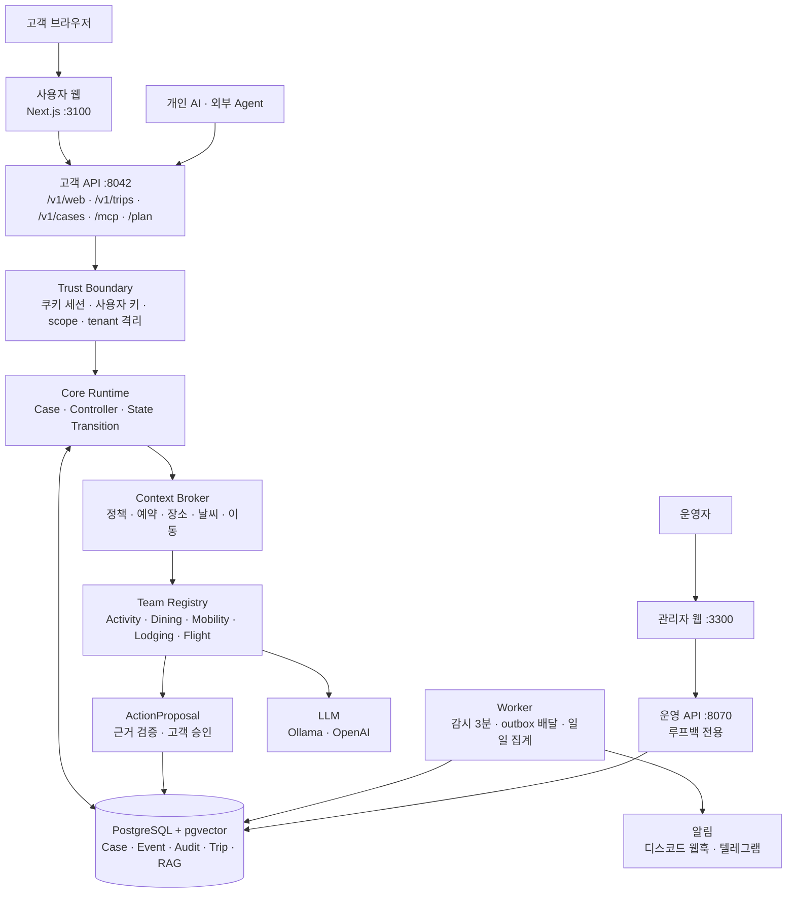

# 구구루트 (GuguRoute)

> 팀 A-COPilot이 개발하는 여행 고객운영(Travel CS) 플랫폼 — 고객이 가져온 여행 계획을 읽고 확인한 뒤, 여행이 끝날 때까지 지켜보며 바뀐 일을 알려 줍니다.

최신 확인: 2026-10-23 — `role-manager` `60ee6108`(PR #79 병합)의 코드·설정·배포 파일과 대조해 다시 썼습니다. 구현·배포 상태는 이 날짜의 저장소 내용이며, 각 환경의 실제 가동 여부는 [운영 현황](final_project_cs/wiki/operations/current-state.md)의 관측 기록을 따릅니다.

구구루트는 고객의 여행 계획과 자연어 요청을 업무 **Case**로 접수하고, 정책·예약·장소·날씨·이동 정보로 Context를 구성한 뒤, 도메인별 Agent Team이 근거 기반의 확인 결과와 후속 조치 제안을 반환하는 고객운영 플랫폼입니다. 개발 팀은 **A-COPilot**입니다.

여행 계획을 대신 만들어 주는 서비스가 아니라, 외부 에이전트나 고객이 가져온 일정을 검증하고 운영시간·이동 가능성·날씨·장소 정보를 확인해 여행 중 변경을 관리합니다. 제품 이름은 2026-10-18에 구구루트로 바꿨으며, 코드 식별자(`ACOP_*` 환경변수 · `acop_cs` DB · `tripilot-*` 컨테이너 · `tripilot_*` MCP 도구 등)는 옛 이름을 그대로 씁니다([유지 위치·이유](wiki/records/reports/2026-10-18_guguroute-rename-exceptions.md)).

## 팀 소개

`guguroute`은 `A-COPilot` 6인 팀이 개발합니다. 아래 표는 기존 발표 자료의 6인 소개이며, 현재 개발 책임과 코드 위치는 [개발 역할 정본](wiki/delivery/roles.md)을 따릅니다. 표의 과거 분담을 현재 담당 확정으로 재사용하지 않으며, 6인 전원이 데이터 전처리에 공통 참여합니다.

| 팀원 | 담당 영역 | 주요 역할 |
|---|---|---|
| 최연우 | Core 1 Runtime (역할 이름 **매니저**, 브랜치 `role-manager`) | Case 12단계 상태전이 머신, CAS 동시성 제어, 2축 Registry 라우팅 |
| 서유현 | Mobility Team | 실시간 운행 중단·도로 통제 감지, 우회로 탐색, 출발 시각 역산 알고리즘 |
| 정세환 | Dining Team | 영업시간·브레이크타임 대조, 해외카드 결제 검증, CatchTable·Tripadvisor 연동 |
| 최상욱 | UI & 검증 (요식 지원) | 동적 여행계획서 웹(`/t/{token}`), 18개 MVP DoD 검증 하네스, 요식업 데이터 정제 |
| 김지혜 | Activity Team | 관람·체험·쇼핑 성립 검증, 기상청 초단기예보 감시, 다국어 프롬프트 템플릿 |
| 송채영 | Activity Team | 관람·체험·쇼핑 성립 검증, 기상청 초단기예보 감시, 다국어 프롬프트 템플릿 |

> 공통 역할: 6인 전원 데이터 전처리 참여, 파이프라인 총괄 및 DB 무결성 관리

## 프로젝트 범위

| 항목 | 현재 기준 |
|---|---|
| 도메인 | 여행 고객운영(Travel CS) |
| 기준 상품 | 서울 1개 도시 · 최대 7일 · 최대 4인 |
| MVP Team | Activity · Dining · Mobility |
| 함께 등록된 Team | Lodging(숙소) · Flight(규칙 기반 예약 모듈, LLM 없음) — 예약은 외부 링크로 넘깁니다 |
| MVP 다음 단계 | Booking Handoff — 등록돼 있지만 기본은 사람에게 인계하며, 실제 예약 변경은 시연용 Mock에서만 합니다 |
| 핵심 원칙 | 근거 없는 확답 금지, Team의 직접 실행 금지, 승인 없는 side effect 금지 |
| 현재 사양 정본 | [wiki](wiki/index.md)의 확정 결정·계약. v11은 2026-09-10 당시 계획 기록 |

> MVP 범위 밖 기능을 현재 제공 기능처럼 설명하지 않습니다. 특히 Booking Handoff와 업체 예약 변경은 승인·연동 범위를 별도로 검증해야 합니다.

## 해결하려는 문제

여행 중에는 일정 항목, 예약, 운영시간, 이동시간, 날씨와 같은 정보가 서로 영향을 줍니다. 단순 챗봇은 오래된 정보나 근거 없는 추정을 섞기 쉽고, 자동화 시스템은 예약 변경처럼 되돌리기 어려운 작업을 잘못 실행할 위험이 있습니다.

구구루트는 다음 순서로 이 문제를 분리합니다.

1. 고객 메시지를 Case로 만들고 감성·요청 종류·대상 객체를 분류합니다.
2. `case_type`과 `intent`를 분리해 담당 Team을 선택합니다.
3. 정책·예약·장소·날씨·이동 정보를 읽기 경로로 수집합니다.
4. Team은 `TeamResult`와 `ActionProposal`만 반환합니다.
5. 업체 예약·결제·환급처럼 고객 승인이 필요한 제안은 근거와 권한을 확인한 뒤 고객 승인을 받습니다. 항로 지킴이의 일정 변경은 해당 자동 적용 조건을 따릅니다.
6. 승인·배달·실행 결과는 이벤트와 감사 기록으로 남깁니다.

## 고객 사용 흐름

사용자 웹(`final_project_cs/frontend/apps/web`)은 실제 서버에만 붙습니다(데모 데이터 없음). 화면별 상세와 연결 상태는 [웹 README](final_project_cs/frontend/apps/web/README.md)와 [화면별 연동 문서](final_project_cs/wiki/external/web-screen-api.md)가 정본입니다.

1. **시작** — 소개(`/`)에서 시작 화면(`/start`)으로 들어가 약관에 동의하고 여행 취향 설문에 답합니다. 로그인 없이 게스트로 쓸 수 있고, 소셜 로그인(google · kakao · naver · discord 중 서버가 켠 것)은 설정의 계정 화면(`/mypage/account`)에서 합니다.
2. **계획 담기**(`/trips/new`) — 직접 입력 · 파일(최대 5개) · 「계획 짜 주기 (테스트)」 중 하나로 계획을 보냅니다. 빈 글이나 여행과 무관한 글은 모델을 부르기 전에 규칙으로 돌려보냅니다.
3. **계획 확인**(`/intakes/[intakeId]`) — 서버가 읽은 일정 줄, 장소·시간 문제, 판정을 보고 고객이 장소·날짜·시각을 고치거나 지운 뒤 「여행 등록」합니다.
4. **여행 화면**(`/trips/[tripId]`) — 지도 위 시트에 하루씩 일정과 이동 줄을 보여 줍니다. 상세 보기 · 일정 수정 · 채팅 · 알림 센터 · 여행계획서 열기/공유가 있고, 여행이 끝나면 엔딩 크레딧을 볼 수 있습니다.
5. **여행 중** — 서버가 3분마다 곧 시작할 일정을 점검합니다. 항로 지킴이를 켠 여행은 대안을 적용한 뒤 알리고, 끈 여행은 대안과 이유를 보여 주고 먼저 묻습니다. 재난 상황에서는 일정을 멈추고 대피 안내를 보여 줍니다.
6. **알림** — 변경(생성 포함) · 하루 시작 · 출발 시각(시작 − 이동 − 여유로 역산)에 디스코드 웹훅이나 텔레그램으로 보냅니다. 알림 받는 곳은 로그인한 회원만 설정할 수 있습니다(게스트에게는 화면에서 알림 설정을 열지 않음).

메뉴(오른쪽 위)에서 여행 목록 · 여행 취향 설문 · 이용 방법(`/help`) · 문의함 · 공지사항 · 설정(계정 · 알림 받는 곳 · 약관 동의 · 에이전트 키 · 언어 · 테마)을 엽니다. 언어는 한국어/영어, 테마는 기기 설정 따르기 · 그린 · 다크입니다.

## 주요 기능

- **Case lifecycle**: 생성, 분류, 라우팅, Team 실행, 승인 대기, 재개, 완료/에스컬레이션을 이벤트 기반으로 관리
- **계획 읽기**: 우리 자료로 가르친 E4B 모델(Ollama `tripilot-pointer:e4b-ft`)이 계획서와 채팅 수정 요청을 통째로 읽고, 코드는 원문 인용 확인·시각 재계산·장소 조회·범위 검사·저장만 맡음([D-025](wiki/decisions/D-025-plan-reading-model-understands.md))
- **여행 Team**: 활동(Activity), 식음(Dining), 이동(Mobility), 숙소(Lodging), 항공(Flight)의 가능 여부·예외·대안 판정
- **감시와 항로 지킴이**: 3분 주기 일정 감시, 외부 정보 위험 점검, 재난 시 일정 정지. 항로 지킴이를 켠 여행만 자동 재계획 → 재검증 → 저장 → 통지, 꺼짐이면 먼저 묻기([D-020](wiki/decisions/D-020-trip-survey-and-ask-first.md)). 운영 스위치 `travel.guardian.enabled`로 서비스 전체에서 끌 수 있음
- **근거 기반 응답**: 정책·예약·장소·기상 등 Evidence를 답변과 제안에 연결
- **RAG 검색**: 정책 문서를 청크로 나누고 PostgreSQL/pgvector로 검색. 임베딩은 `openai`(text-embedding-3-small, 1536차원) 또는 `ollama`(bge-m3, 1024차원) 중 설정으로 고름
- **외부 데이터 어댑터**: 기상·관광정보·장소·공휴일·교통·대기질·공항·지도·길찾기 소스를 `ports/data_sources/`에서 설정에 따라 연결
- **승인 경계**: Team은 환불·예약 변경·알림 같은 side effect를 실행하지 않고 제안만 생성
- **멱등성과 outbox**: 중복 요청·중복 메시지 발행을 DB 제약과 영속 outbox로 방어
- **시험 여행 보관함**: 남길 시험 여행은 삭제 직전에 `trip_archives`에 담고 감시·알림 대상에서 뺌([D-CS-018](final_project_cs/wiki/decisions/D-CS-018-test-trip-archive.md))
- **개인 AI 입구(MCP)**: 고객 API의 `/mcp`에서 사용자 키·OAuth로 **본인 여행만** 다룸. 읽기 도구 8개, 쓰기 도구 7개는 `travel.mcp.write_enabled` 기본 꺼짐([여행 MCP 계약](final_project_cs/wiki/external/mcp-tools.md))
- **운영 앱과 관리자 웹**: 고객 포트와 분리된 루프백 전용 운영 API(8070)와 운영자 웹(3300) — 문의함·사용자·사용량·감시 현황·한도·공지/점검·운영 기록·운영 설정·재난 시뮬레이션·접수 근거·승인/위임/발송 등
- **Composer 관리 채널**: 프로젝트 설정 검증·변경은 관리용 빌드(`app.entrypoint:app`)에서만 별도 인증 경로로 제공

## 아키텍처



### 계층별 책임

| 계층 | 책임 | 대표 위치 |
|---|---|---|
| Presentation | 고객 API, MCP, A2A 시뮬레이터, 운영 API·진단 화면, 인증 경계 | `final_project_cs/app/presentation/`, `app/ops_entrypoint.py`, `app/entrypoint.py` |
| Application | Case 접수·분류·라우팅·Controller·배치 | `final_project_cs/app/application/` |
| Core | 계약, 상태 전이, Registry, 멱등성, 설정, 안전 규칙 | `final_project_cs/app/core/` |
| 여행 도메인 | 다섯 칸으로 나눔([D-CS-013](final_project_cs/wiki/decisions/D-CS-013-domain-folder-layout.md)) — `components`(필수 부품: 접수·일정·장소·계획·감시·대화 등) · `instances`(에이전트 팀) · `modules`(끌 수 있는 기능: MCP·실시간 진행·웹 계정) · `ports`(외부 데이터 어댑터) · `entry`(HTTP 입구) | `final_project_cs/app/domains/travel_ops/` |
| Infrastructure | PostgreSQL, pgvector, 외부 API, LLM, outbox | `final_project_cs/app/infrastructure/` |
| Knowledge | 정책 원문, manifest, ingest | `final_project_cs/knowledge/` |

### 라우팅과 분류

분류 결과에는 두 축이 있습니다.

- `intent`: 일정 제출, 사건 신고, 확인 요청, 조정 거부, 그 외
- `issue_code`: 대상 객체와 상황을 나타내며 접두사가 `case_type`이 됩니다. 예를 들어 `activity_...`, `dining_...`, `mobility_...`와 같이 Team 대상이 결정됩니다.

요청 종류만으로 Team을 고르지 않습니다. 분류 실패나 대상이 불명확한 경우 임의의 Team으로 보내지 않고 에스컬레이션합니다.

## Team 책임

등록과 능력 목록의 정본은 [`final_project_cs/config/project.yaml`](final_project_cs/config/project.yaml)입니다.

| Team | 책임 | 등록된 capability |
|---|---|---|
| Activity | 관람·체험·쇼핑 등 활동의 성립·취소 가능 여부, 시간·정원·날씨 조건, 변경 제안 | `activity.check_cancelable`, `check_feasible`, `propose_change`, `itinerary`, `itinerary_question`, `submit_itinerary` |
| Dining | 식당 영업시간·휴무·동행 조건 확인, 대안 제안 | `dining.check_open`, `check_conditions`, `itinerary`, `itinerary_question` |
| Mobility | 구간 이동시간·대중교통·막차·예외 확인 | `mobility.check_route`, `status`, `exception`, `itinerary`, `itinerary_question` |
| Lodging | 숙소 찾기·내 숙소 위치·일정의 숙소 항목. 예약은 링크로 | `lodging.assist`, `status`, `itinerary`, `itinerary_question` |
| Flight | 항공편 찾기·일정의 항공편 항목. 규칙 기반 예약 모듈(LLM 없음, 구현은 `instances/booking/`), 예약은 링크로 | `flight.assist`, `status`, `itinerary`, `itinerary_question` |
| Booking Handoff | 공급자 예약 원장 대조와 승인 대기 전환 — MVP 다음 단계 | `booking.verify`, `prepare_change`, `prepare_cancel`, `prepare_revert` |

Team은 허용된 read tool만 사용하고, 외부 시스템에 직접 쓰지 않습니다. 예약 변경·취소·업체 통지 등 실행이 필요한 경우 `ActionProposal → 검증 → Human Approval → 실행/배달` 경로를 거칩니다.

## 저장소 구성

| 경로 | 역할 |
|---|---|
| [`final_project_cs/`](final_project_cs/) | 릴리스 대상 제품 — 서버·여행 Team·웹 앱·DB·배포·평가·시험 |
| [`final_project_sample/`](final_project_sample/) | Core/Team 계약과 Composer 인프라를 먼저 검증하는 참고 구현체 |
| [`final_project_ui/`](final_project_ui/) | 대상 프로젝트를 읽어 보여주는 Python 개발 콘솔(기본 포트 8060, 읽기 중심) |
| [`acop_dojo/`](acop_dojo/) | `final_project_cs`의 구조·동작을 실행 증거로 배우는 학습 도장(`python dojo.py`) |
| [`program/`](program/) | 기획서·조사·발표·제출 산출물 |
| [`wiki/`](wiki/) | 중앙 허브 — 제품·결정·전달·평가·운영 규칙 지도 |
| [`datasets/`](datasets/) | 데이터셋과 전처리 결과. **git에 올리지 않습니다**(`.gitignore`의 `/datasets/`). 각 폴더의 `README.md`·`REPORT.md`가 기준 |
| [`docs/`](docs/) · [`legacy/`](legacy/) | Activity 팀 작업 문서 · 옛 개인 작업 사본 보존(2026-10-12) |
| [`scripts/`](scripts/) · [`tools/`](tools/) | 저장소 단위 보조 스크립트 · 로컬 자료 보호 도구(`safe_git.py`, `local_data_guard.py`) |
| [`.github/workflows/`](.github/workflows/) | GitHub 검사(develop·main 전용) |
| `triPilot-실행.bat` · `triPilot-종료.bat` | Windows 로컬 묶음 실행·종료(API 8042 · 운영 API 8070 · 웹 3100 · 관리자 웹 3300) |

`final_project_cs/` 안은 다음과 같습니다. 상세 설계는 [`final_project_cs/wiki/index.md`](final_project_cs/wiki/index.md)에서 영역별로 연결됩니다.

| 경로 | 역할 |
|---|---|
| `app/` | Python 서버(FastAPI) — core · application · domains/travel_ops · infrastructure · presentation |
| `config/` | 모듈·Team 등록(`project.yaml`), 운영 스위치·한도(`guardrails.yaml`) |
| `prompts/` · `knowledge/` | 모델 지시문 · 정책 지식 원문과 적재 도구 |
| `frontend/apps/web` | 사용자 웹(Next.js, 포트 3100) |
| `frontend/apps/admin` | 운영자 웹(Next.js, 포트 3300) |
| `frontend/apps/dev-console` | 개발팀 시험·비교 콘솔(Next.js, 포트 3200) — 샘플 모드, 실제 Core 호출 없음 |
| `frontend/apps/mobile` | 폴더만 있음 — 실행 가능한 앱 없음(보류) |
| `deploy/` · `docker/` | 공개 배포(Docker Compose·Caddy·자동 반영) · 로컬 DB Compose |
| `tests/` · `eval/` · `ml/` | 시험 · 평가 도구와 자료 · 모델 학습·라벨링 스크립트 |
| `scripts/` | 운영 명령(점검·바깥함 일꾼·되잡기·일일 집계·시드 등) |
| `wiki/` | cs 상세 설계·계약·운영 문서와 작업 기록 |

## 기술 스택

| 영역 | 기술 |
|---|---|
| 서버 실행 환경 | Python 3.12, FastAPI 0.116.1, Uvicorn 0.35.0, Pydantic 2.13.4, pydantic-settings 2.10.1 |
| 데이터베이스 | PostgreSQL 16(로컬·CI) / 17(공개 배포), pgvector, pgcrypto, `psycopg` 3.3.4 직접 SQL, 반복 실행 가능한 SQL migration runner |
| LLM | Ollama(가르친 Gemma 4 E4B `tripilot-pointer:e4b-ft`, 임베딩 bge-m3) · OpenAI SDK 2.44.0 · `local_ft` · `mock`(시험·CI) adapter. httpx로 Ollama 자체 API를 직접 호출 |
| RAG/토큰 | pgvector vector search, `tiktoken` |
| 연동 프로토콜 | REST, SSE(오래 걸리는 웹 요청의 실시간 진행), [여행 MCP](final_project_cs/wiki/external/mcp-tools.md)(`mcp` 1.28.1), 개인 AI OAuth, A2A 시뮬레이터 |
| 외부 연동 | `httpx` 0.28.1 기반 여행 데이터 어댑터, 소스별 rate limit |
| Graph | PostgreSQL Recursive CTE 기반 `SqlGraphAdapter`(별도 Graph DB 없음) |
| 사용자·운영자 웹 | Next.js 16.4.2, React 19.3.0, TypeScript 5.9.3(strict), Node.js 22. 사용자 웹은 TanStack Query 5, zod 4, Leaflet 1.9.4(지도 `osm` 기본 · `naver` · `google`), CSS Modules + 디자인 토큰 |
| 진단 화면 | 운영 API의 server-rendered HTML(`/ui/*`), 별도 `final_project_ui` 개발 콘솔 |
| 평가·학습 | NumPy 1.26.4, SciPy 1.13.1, scikit-learn 1.5.2(평가 도구), `ml/`의 학습·라벨링 스크립트 |
| 품질 | pytest 8.4.2, pytest-asyncio, pytest-xdist, ruff 0.16.8(CI), Vitest 5, Playwright 1.63 |
| 배포 | Docker Compose(DB·API·worker·웹), Caddy 사이트 블록, systemd 타이머 자동 반영 |

> `requirements.txt`에 선언된 SQLAlchemy·Alembic·LangChain Core는 현재 `app/`에서 import되지 않습니다(LangGraph 줄은 2026-10-03에 뺐습니다). 구현 완료 스택으로 표기하지 않으며, 실제 도입 시 사용 범위와 문서를 함께 갱신합니다.

## 로컬 실행

아래 명령은 Windows PowerShell 기준입니다. 자세한 절차와 문제 해결은 [로컬 실행 안내](final_project_cs/wiki/operations/local-setup.md)를 봅니다.

### 1. DB (PostgreSQL 16 + pgvector)

Docker가 있으면 `final_project_cs` 폴더에서 로컬 전용 DB를 띄웁니다(`127.0.0.1:5433`, DB `acop_cs`, 비밀번호 없는 trust — 이 PC 밖에서는 붙지 못합니다).

```powershell
cd final_project_cs
docker compose -f docker/compose.db.yml up -d
```

이미 쓰는 PostgreSQL 16+가 있으면 `pgvector` 확장을 만들 수 있는 빈 DB 하나를 준비해도 됩니다. 확장(`vector`·`pgcrypto`)은 마이그레이션이 만듭니다.

### 2. Python 환경과 의존성

```powershell
py -3.12 -m venv .venv
.\.venv\Scripts\Activate.ps1
python -m pip install -r requirements.txt
```

### 3. 환경변수

```powershell
Copy-Item .env.example .env
Copy-Item .env.apikeys.example .env.apikeys
```

`.env`에는 DB·LLM·앱 설정을, `.env.apikeys`에는 여행 외부 데이터 소스 키를 넣습니다(뒤 파일 값이 이깁니다). 두 파일 모두 커밋하지 않습니다.

최소한 다음 값은 실제 환경에 맞게 채웁니다.

```dotenv
ACOP_DATABASE_URL=postgresql+psycopg://postgres@127.0.0.1:5433/acop_cs
ACOP_LLM_PROVIDER=openai
ACOP_OPENAI_API_KEY=발급받은_키
ACOP_LLM_MODEL=gpt-4o-mini
ACOP_EMBEDDING_MODEL=text-embedding-3-small
ACOP_TENANT_ID=demo
ACOP_SECRET_KEY=충분히_긴_랜덤_시크릿
ACOP_COMPOSER_JWT_SECRET=관리용_시크릿
ACOP_COMPOSER_ISSUER_SECRET=관리용_별도_시크릿
```

- 로컬 모델을 쓰려면 `ACOP_OLLAMA_BASE_URL`을 채웁니다(비우면 OpenAI). 기본 모델 `tripilot-pointer:e4b-ft`는 우리가 학습시킨 모델이라 올려 둔 Ollama에만 있습니다 — 없는 PC에서는 `ACOP_OLLAMA_MODEL`로 가진 모델을 지정합니다. 정책 검색 임베딩은 `ACOP_EMBEDDING_PROVIDER`(`openai` | `ollama`)로 고릅니다.
- 설정은 선언되지 않은 환경변수를 허용하지 않으며(`extra="forbid"`), 필수값이 없으면 조용한 데모 모드로 바꾸지 않고 실패합니다. 운영 환경에서는 예시 시크릿을 반드시 교체합니다.

### 4. DB 스키마와 지식 데이터

```powershell
python -m app.infrastructure.db.migrate
python -m scripts.register_prompts
python -m scripts.check_env
```

정책 코퍼스 구조만 확인하려면 `python -m knowledge.ingest --dry-run`, 임베딩까지 적재하려면 `python -m knowledge.ingest`를 실행합니다. 임베딩 모델을 바꾸면 `config/guardrails.yaml`의 차원, DB의 벡터 칸(1536 · 1024), 기존 적재 데이터를 함께 검토합니다.

### 5. 고객 API 서버 (포트 8042)

사용자 웹이 기본으로 붙는 주소가 `http://127.0.0.1:8042`이므로 개발 서버도 8042번으로 띄웁니다.

```powershell
python -m uvicorn app.presentation.api.app:app --host 127.0.0.1 --port 8042 --reload
Invoke-RestMethod http://127.0.0.1:8042/health
```

- 이 빌드는 고객·외부 Agent용이며 Composer 쓰기 라우터와 `/admin/reload`가 없습니다. 관리용 Composer 빌드가 필요할 때만 `app.entrypoint:app`을 쓰며, `acop_composer` 패키지(`final_project_sample`을 `PYTHONPATH`에)와 별도 인증 시크릿이 필요합니다.
- 화면이 서버를 부르려면 `ACOP_WEB_ALLOWED_ORIGINS`에 화면 주소가 있어야 합니다. 기본값이 `http://127.0.0.1:3100,http://localhost:3100`이라 아래대로 띄우면 따로 설정할 것이 없습니다.
- DB 마이그레이션을 새로 적용했으면 떠 있는 서버를 한 번 껐다 켭니다.

### 6. 사용자 웹 (포트 3100)

Node.js 22와 npm이 필요합니다. 서버를 먼저 띄운 뒤 **다른 터미널**에서 `final_project_cs` 폴더 기준으로 실행합니다.

```powershell
cd frontend/apps/web
npm ci
Copy-Item .env.example .env.local
npm run dev
```

브라우저에서 **`http://127.0.0.1:3100`** 을 엽니다. `localhost:3100`으로 열면 브라우저가 저장 공간을 따로 잡아 다른 사용자로 보입니다.

| 값 | 뜻 |
|---|---|
| `NEXT_PUBLIC_DATA_MODE=live` | 실제 서버에 붙습니다. 이 값이 없거나 `live`가 아니면 「서버 연결이 설정되지 않았어요」 한 장만 보입니다 |
| `NEXT_PUBLIC_API_BASE` | 붙을 서버 주소. 기본 `http://127.0.0.1:8042` |
| `NEXT_PUBLIC_MAP_PROVIDER` | `osm`(기본) · `naver` · `google`. 예전 `demo` 값은 설정 오류 |
| `NEXT_PUBLIC_TURNSTILE_SITE_KEY` | 사람 확인. 비우면 꺼짐 |

값을 바꾸면 `npm run dev`를 다시 띄웁니다.

### 7. 운영 API와 관리자 웹 (포트 8070 · 3300, 선택)

```powershell
python -m app.ops_entrypoint            # final_project_cs 폴더, 127.0.0.1:8070 전용
cd frontend/apps/admin; npm ci; npm run build; npm run start   # 127.0.0.1:3300
```

운영자 계정은 `ACOP_UI_OPERATORS`에 등록하고, 관리자 웹의 `.env.local`에 `NEXT_PUBLIC_ADMIN_DATA_MODE=live`와 `ADMIN_OPS_API_URL`(루프백 주소만)을 둡니다. 자세한 조건은 [관리자 웹 README](final_project_cs/frontend/apps/admin/README.md)를 봅니다.

> 루트의 `triPilot-실행.bat`은 위 네 프로세스(8042 · 8070 · 3100 · 3300)를 한꺼번에 띄우고(`check` 인자는 점검만), `triPilot-종료.bat`은 그 배치가 켠 것만 끕니다. 8042는 저장소 밖의 개인 시작 스크립트(`%USERPROFILE%\.acop-ops\start-acop.ps1`)를 부르므로, 그 파일이 없는 PC에서는 위 5번으로 띄웁니다.

## API 표면

정본은 [REST 명세 목차](final_project_cs/wiki/external/rest-endpoints/index.md)이며, 화면별 사용 API와 연결 상태는 [화면별 연동 문서](final_project_cs/wiki/external/web-screen-api.md), 관리자 웹은 [관리자 화면 연동 문서](final_project_cs/wiki/external/admin-screen-api.md)에 있습니다.

**고객 API 앱**(`app.presentation.api.app:app`, 8042)

| 경로 묶음 | 인증 | 설명 |
|---|---|---|
| `/v1/web/*` | HttpOnly 쿠키 세션(쓰기는 `X-CSRF-Token`), 옛 사용자 키(`X-User-Key`)·에이전트 키도 받음 | 사용자 웹 — 세션·로그인·약관·프로필·계획 접수(`trip-intakes`)·여행(`trips`)·채팅·위험 점검·항로 지킴이·문의·에이전트 키·기능 스위치(`features`) 등 |
| `/v1/trips/*` | Bearer API 키 + scope(`trip:write` 등) | 외부 에이전트용 여행 등록·조회·신고·일정 짜기 |
| `/v1/cases` · `/v1/outbox` · `/v1/delegations` | Bearer API 키 + scope(`case:write`, `case:read`, `action:approve`, `delegation:read` 등) | Case 생성·조회·메시지·제안 승인, unknown 배달 확인, 위임 |
| `/mcp` | 사용자 키 · 개인 AI OAuth(`/oauth/*`, `/.well-known/*`) | 여행 MCP 도구 |
| `/plan/{trip_id}` · `/booking-change/{id}` | 여행별 토큰 | 여행계획서 · 예약 변경 안내 |
| `/introspection` · `/health` | `ops:introspect` · 없음 | 조립 상태 · 프로세스 상태 |

다른 고객 또는 tenant의 리소스는 존재 여부를 노출하지 않도록 404로 처리합니다. 웹 게스트 세션은 로그인 없이 만들어지며 사람 확인(Turnstile)을 거칩니다.

**운영 앱**(`python -m app.ops_entrypoint`, 127.0.0.1:8070 전용) — 관리자 웹이 부르는 `/admin/api/*`, 한도·보관 설정 `/admin/limits` · `/admin/retention`, 진단 화면 `/ui/*`(Case · Trace · 승인 · VOC · outbox 등)가 있습니다. 고객 포트에는 운영 화면이 없습니다.

**관리용 빌드**(`app.entrypoint:app`)에만 `/composer/*`와 재기동 없는 설정 반영 `/admin/reload`가 붙습니다.

## 데이터·외부 소스

### 내부 데이터

핵심 업무 상태는 PostgreSQL이 권위 있는 원천입니다. 마이그레이션은 [`final_project_cs/app/infrastructure/db/migrations/`](final_project_cs/app/infrastructure/db/migrations/)에 있고 설치 순서는 같은 폴더의 `migration-plan.json`이 정합니다.

- `customer_cases`: Case 현재 상태 projection
- `case_events`: append-only 상태 변경 이벤트
- `agent_runs`, `team_tasks`: Agent 실행 추적
- `action_requests`, `action_approvals`: 제안·승인·멱등성
- `outbox`: 영속 메시지와 배달 상태
- `knowledge_documents`, `knowledge_chunks`: 정책 문서와 임베딩
- `feedback_analytics_reports`: VOC 일일 집계
- 여행 도메인: `places`, `bookings`, `supplier_bookings`, `place_catalog`, `watch_observations`, `trip_archives` 등

### 외부 소스

기상·관광정보·공휴일·교통·대기질·공항·지도·길찾기 소스는 `.env.apikeys` 설정에 따라 활성화되며, 기상 공급자 기본값은 키가 필요 없는 Open-Meteo입니다. 소스별 일일 호출량과 최소 호출 간격을 적용하고, 실패한 소스를 성공한 것처럼 대체하지 않습니다. 실패한 자료에 기대는 작업만 보류하고 기존 일정과 독립 기능은 유지합니다([D-018](wiki/decisions/D-018-decision15-stop-paths.md)).

## 배포

공개 배포 파일과 절차는 [`final_project_cs/deploy/README.md`](final_project_cs/deploy/README.md)가 정본입니다. 각 환경이 지금 실제로 도는지는 [운영 현황](final_project_cs/wiki/operations/current-state.md)의 관측 기록으로 확인합니다.

| 환경 | 구성 | 따라가는 브랜치 |
|---|---|---|
| x600 서버(공개 배포) | Docker Compose 서비스 넷 — `tripilot-db`(pgvector pg17) · `tripilot-api`(8043) · `tripilot-worker`(감시·바깥함·일일 집계) · `tripilot-web`(3000). 호스트 포트를 열지 않고 기존 Caddy가 도메인으로 갈라 보냄(`/v1 /plan /booking-change /mcp /health` → API, 나머지 → 웹) | 서버 설정(`autodeploy.conf`)이 정함. [2026-10-22 기록](wiki/records/reports/2026-10-22_activity-alias-deploy-check.md) 기준 팀 저장소 `role-manager` |
| Oracle ARM(develop 시험 서버) | 팀 `develop`을 ARM64 이미지로 빌드·기동. 관리자 웹(3300)·운영 API(8070)는 루프백에서만 받음([절차](final_project_cs/wiki/operations/arm-develop-cd.md)) | `develop` |

두 서버 모두 systemd 타이머로 **5분마다** 따라가는 브랜치의 새 커밋을 확인해 이미지를 다시 만들고 반영합니다. x600 서버의 `auto_deploy.sh`는 배포에 쓰이는 폴더가 바뀐 때만 커밋 해시 이름의 이미지를 만들고, 새 이미지가 건강하지 않으면 이전 이미지로 되돌립니다. 자동 반영은 GitHub 검사 결과를 기다리지 않으므로, `role-manager`·`develop`에 올린 변경은 곧바로 해당 서버에 반영될 수 있습니다. 관리자 웹은 `docker-compose.admin.yml`의 `operations` 프로필(`tripilot-admin`, 127.0.0.1:3300)로 따로 띄웁니다.

## 안전·운영 불변식

실무 운영에서 가장 중요한 규칙은 기능 목록보다 아래 경계입니다.

- Core는 특정 Team 내부 구현을 import하지 않고 Registry 계약만 사용합니다.
- Team은 외부 쓰기나 side effect를 수행하지 않고 `ActionProposal`만 반환합니다.
- Case 상태는 `transition_case()` 단일 진입점으로 변경합니다.
- 이벤트와 감사 기록은 append-only입니다.
- 동일 요청은 idempotency key로 한 번만 처리합니다.
- 모든 조회는 tenant/customer 범위로 제한합니다.
- PII는 저장·응답·감사·LLM 전달 경로에서 마스킹 규칙을 적용합니다.
- Evidence가 없으면 확정 문장을 만들지 않고 `unknown` 또는 `escalated`로 남깁니다.
- 외부 provider timeout을 성공으로 추정하지 않습니다.
- Outbox의 `unknown` 메시지는 자동 재실행하지 않고 사람이 확인한 근거를 기록합니다.
- 운영 화면·운영 API는 고객 포트에 두지 않고 루프백 전용 운영 앱에만 둡니다.

상세 규칙은 [`final_project_cs/CLAUDE.md`](final_project_cs/CLAUDE.md), [`final_project_cs/RULE.md`](final_project_cs/RULE.md), [`final_project_cs/wiki/quality/invariants.md`](final_project_cs/wiki/quality/invariants.md)를 확인합니다.

## 운영 명령

`final_project_cs` 폴더에서 실행합니다.

```powershell
# 전체 환경 점검
python -m scripts.check_env

# 한 번의 outbox 배달 작업
python -m scripts.run_outbox_worker --once

# 되잡기 작업(멈춘 Case 회수 · 여행 감시 등) 한 회차
python -m scripts.run_sweepers --once

# VOC 일일 리포트 생성
python -m scripts.run_daily_feedback --date 2026-09-11

# 모듈 토글과 실제 기동 경로 확인
python -m scripts.verify_module_toggles
```

`--apply`가 필요한 정리·스케줄러 설치 명령은 실행 전에 대상과 백업 위치를 확인합니다. 운영 데이터에 영향을 줄 수 있는 명령은 개발 DB에서 먼저 검증합니다.

## 테스트와 품질 게이트

### 서버 (pytest)

`final_project_cs/pytest.ini`는 `tests`와 `eval/tests`를 모으고 `-m "not live"`로 실제 모델을 부르는 시험을 기본에서 뺍니다. `db`(실제 PostgreSQL 필요)·`slow` 표시는 `tests/conftest.py`가 붙입니다.

| 폴더 | 시험 파일 수 (2026-10-23 `test_*.py` 셈) |
|---|---|
| `tests/unit` | 579 |
| `tests/e2e` | 119 |
| `tests/integration` | 96 |
| `tests/scenario` | 32 |
| `tests/contract` | 18 |
| `tests/architecture` | 12 |
| `tests/live` | 10 |
| `tests/security` | 8 |
| `eval/tests` | 4 |

```powershell
# 빠른 관문(develop 과 같음)
python -m pytest tests/architecture tests/contract tests/unit tests/security -m "not live and not db and not slow" -q

# 전체(main 과 같음) — 빈 시험 DB에 migrate · register_prompts · seed_travel 을 먼저
python -m scripts.seed_travel
python -m pytest -q --ignore=tests/integration/rag -n auto --dist loadfile
```

환경값은 CI와 같게 맞춥니다(`.github/workflows/ci-main.yml`의 `env` 칸 — `ACOP_LLM_PROVIDER=mock` 등). 로컬 `.env`가 실제 공급자를 가리키면 시나리오 시험이 엉뚱하게 실패할 수 있습니다. `tests/integration/rag`는 코퍼스가 필요해 CI에서 뺍니다.

### 웹 앱

| 앱 | 명령 |
|---|---|
| 사용자 웹 | `npm run check`(lint · typecheck · Vitest · build), `npm run test:live`(Playwright — **모방 서버**로 도는 화면 시험, 실서버 확인이 아님), `REAL_SERVER_E2E=1 npm run test:real`(실서버 대상 — 실제 여행 등록·알림이 생김) |
| 관리자 웹 | `npm run check`, `npm run test:e2e`, `npm run test:unconfigured`, `npm run export:html`(CI는 demo 모드로 빌드) |
| 개발 콘솔 | `npm run check`, `npm run test:e2e` |

### GitHub 검사

`role-manager`에는 검사가 없습니다(2026-10-13 결정). develop은 빠른 검사, main은 전체 검사입니다(2026-10-19 결정, [기록](wiki/records/reports/2026-10-19_ci-develop-fast-main-full.md)).

| 워크플로 | 언제 | 무엇을 |
|---|---|---|
| `ci-develop.yml` | develop push(wiki·program·루트 문서만 바뀐 때 제외) · develop으로 오는 PR · 수동 | ruff, `tests/architecture` · `contract` · `unit` · `security`(`not live and not db and not slow`) |
| `ci-main.yml` | main push · main으로 오는 PR · 수동 | ruff, pg16 서비스에 migrate · 프롬프트 등록 · 시드 → 전체 pytest(live · rag 제외, 병렬), `Dockerfile.api` 빌드 |
| `ci-web.yml` | develop · main에서 웹 경로가 바뀔 때 · 수동 | `npm run check`. main · 수동일 때만 `test:live` 4묶음 |
| `ci-admin.yml` | develop · main에서 관리자 경로가 바뀔 때 | `npm run check`, 독립 HTML 차이 확인. 전체 실행일 때만 `test:e2e` · `test:unconfigured` |

변경을 완료로 표시하기 전에 다음을 함께 확인합니다.

1. 코드와 계약 문서가 일치하는가
2. API surface와 scope 테스트가 갱신됐는가
3. tenant 격리·PII·멱등성·승인 경계가 회귀하지 않았는가
4. 외부 소스 실패와 근거 부족 상태가 정직하게 표시되는가
5. 실제 브라우저가 필요한 UI 흐름을 화면에서 확인했는가 — 모방 서버 시험 통과를 실서버 확인으로 적지 않는가
6. 테스트·실측 수치에 실행 조건과 분모가 적혀 있는가

## 개발 규칙과 문서 지도

| 목적 | 문서 |
|---|---|
| 작업 규칙 | 루트 [`CLAUDE.md`](CLAUDE.md)·[`AGENTS.md`](AGENTS.md)(같은 내용), [`final_project_cs/CLAUDE.md`](final_project_cs/CLAUDE.md)·[`RULE.md`](final_project_cs/RULE.md) |
| 처음 구조 파악 | [`final_project_cs/wiki/quickstart.md`](final_project_cs/wiki/quickstart.md) |
| 결정 | [제품 결정](wiki/decisions/index.md) · [cs 결정](final_project_cs/wiki/decisions/index.md) |
| 실행·환경·배포 | [`final_project_cs/wiki/operations/`](final_project_cs/wiki/operations/) · [`final_project_cs/deploy/README.md`](final_project_cs/deploy/README.md) |
| Team 계약·경계 | [`final_project_cs/wiki/teams/`](final_project_cs/wiki/teams/) |
| Case·상태·메시징 | [`final_project_cs/wiki/runtime/`](final_project_cs/wiki/runtime/) |
| DB·마이그레이션 | [`final_project_cs/wiki/data/`](final_project_cs/wiki/data/) |
| REST·MCP·A2A | [`final_project_cs/wiki/external/`](final_project_cs/wiki/external/) |
| 웹 앱 | [프론트 작업 안내](final_project_cs/frontend/README.md) · [사용자 웹 README](final_project_cs/frontend/apps/web/README.md)·[개발 기준](final_project_cs/frontend/apps/web/DEVELOPMENT.md) · [관리자 웹 README](final_project_cs/frontend/apps/admin/README.md) |
| 테스트·평가 | [`final_project_cs/wiki/quality/`](final_project_cs/wiki/quality/) |
| 작업 기록·인계 | [`final_project_cs/wiki/records/reports/`](final_project_cs/wiki/records/reports/) · [변경 이력](final_project_cs/wiki/log.md) · [인계 목차](wiki/handoff/index.md) |
| 제출 산출물 | [`final_project_cs/wiki/records/submission/00_제출산출물_인덱스.md`](final_project_cs/wiki/records/submission/00_제출산출물_인덱스.md) |

작업 전 위 작업 규칙을 읽습니다. 변경·검증 결과는 `final_project_cs/wiki/records/reports/`에 남기고, 현재 지식이 바뀌면 해당 wiki 페이지를 함께 갱신합니다. 이 저장소는 GitHub 공개 저장소이므로 토큰·키·개인정보·`.env` 계열 파일을 커밋하지 않습니다.

## Git 브랜치와 릴리스 흐름

```text
기능 가지  →  role-* 작업 가지  →  role-manager  →  develop  →  main
```

- `role-manager`는 코어 담당(옛 `role-core1`·`role-core2`)이자 통합 브랜치입니다. 팀원 브랜치는 `role-activity`·`role-dining`·`role-mobility`·`role-eval-ui`이며, 브랜치 이름만으로 담당자나 배포 상태를 추정하지 않습니다([이름 대응](wiki/delivery/roles.md)).
- `role-manager`·`develop`은 각각 서버 자동 반영 대상이므로(위 「배포」), 올리기 전에 로컬에서 바뀐 영역의 시험을 돌립니다. develop에 올리기 전 순서는 루트 `CLAUDE.md`의 「커밋·푸시 대상」을 따릅니다.
- 원격 이력이 갈라져 있으면 기존 작업을 보존하는 통합과 검증을 먼저 하고, 강제 푸시·덮어쓰기를 하지 않습니다.

푸시 전에는 다음을 확인합니다.

```powershell
git status --short --branch
git diff --check
python -m pytest tests/architecture tests/contract tests/unit tests/security -q
git log --oneline -5
```

시크릿 파일(`.env`, `.env.apikeys`, `.env.teamflow`)과 로컬 DB·모델 캐시·`datasets/`는 저장소에 포함하지 않습니다.

## 알려진 한계와 다음 단계

- MVP는 서울 단일 도시·최대 7일·최대 4인 기준입니다.
- Booking Handoff와 업체 예약 변경은 MVP 이후 범위이며 자동 실행을 전제로 하지 않습니다. 숙소·항공은 예약을 외부 링크로 넘깁니다.
- 「계획 짜 주기」는 시험(테스트) 입력 칸입니다.
- 운영 외부 소스는 공급자별 키·쿼터·가용성에 의존합니다.
- A2A는 원격 Team 계약과 왕복 검증을 위한 시뮬레이터이며, `a2a_executor` 모듈은 꺼져 있습니다.
- 모바일 앱은 없습니다(보류). 개발 콘솔(`frontend/apps/dev-console`)은 샘플 모드로, 실제 Core·모델을 부르지 않습니다.
- 학습시킨 기본 모델(`tripilot-pointer:e4b-ft`)은 그 모델을 올려 둔 Ollama에서만 쓸 수 있습니다.
- 운영 배포 시 TLS, 비밀 저장소, 프로세스 감독, 데이터 백업·복구, 알림 채널을 별도로 확정해야 합니다.
- 실제 고객 데이터와 운영 트래픽을 투입하기 전에는 평가셋·PII·부하·장애 복구 결과를 별도 승인해야 합니다.

## 라이선스 및 데이터 주의

본 저장소의 코드·문서·데이터셋은 각각의 원출처와 사용 조건을 따릅니다. 외부 공공데이터와 모델을 사용할 때는 제공기관의 이용약관·쿼터·재배포 조건을 확인합니다. 한국관광공사 자료는 출처(ⓒ한국관광공사)를 표시하며, 사진·이미지는 학업용 한정으로 git 밖에만 보관합니다([D-022](wiki/decisions/D-022-study-only-kto-images.md)). 본 시스템의 응답은 여행 운영 지원을 위한 사전 확인이며, 항공·숙박·교통·업체의 최종 변경이나 계약을 자동 확정하지 않습니다.

개정 전 소개·도구 목록은 [보존 기록](wiki/records/commerce_2026-10-11/README.md)에 남겼습니다.
