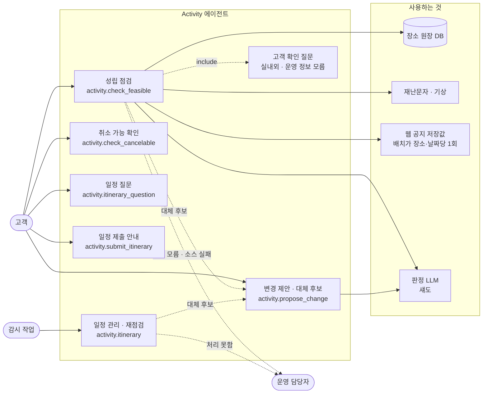
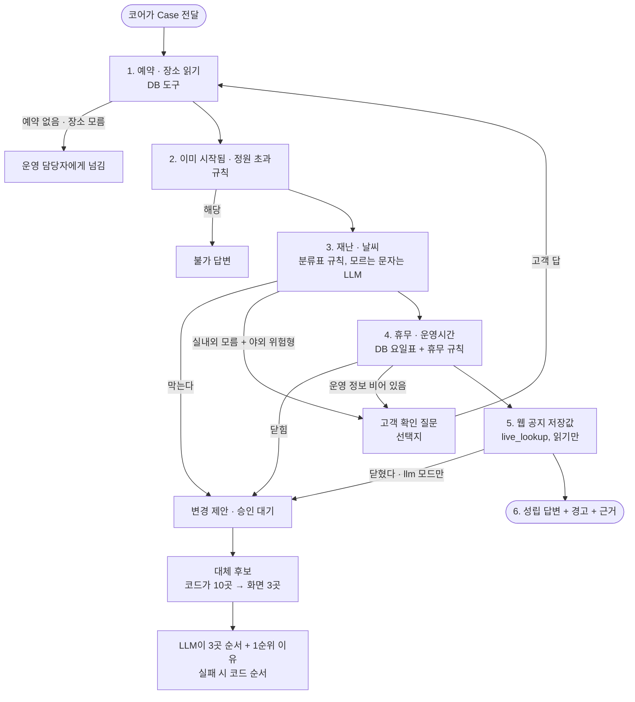

# Activity 에이전트 — 유스케이스 · 판정 플로우 (2026-10-13, `role-activity-b` 기준)

> 코드 기준: `instances/activity/team.py`(`ActivityTeam.execute` · `_check_feasible`) · `replacement.py`(대체 후보) · `alternative_order.py`(LLM 순서) · `live_store.py`(웹 공지 저장값).
> GitHub 에서 mermaid 로 그려진다.

## 1. 유스케이스 다이어그램

| 유스케이스 | 언제 | 하는 일 | 쓰는 것 |
|---|---|---|---|
| 성립 점검 | 고객이 「이 일정 가능해?」 · 예약 점검 | 시작됨 · 정원 → 재난 · 날씨 → 휴무 · 운영시간 → 웹 공지 저장값 → 모르면 질문 → 성립 | DB 원장 · 재난/기상 · 웹 공지 저장값 |
| 취소 가능 확인 | 「취소하면 위약금?」 | 예약의 취소 조건과 남은 시간으로 계산(금액은 근거 있을 때만) | 예약 조건 · 규정 |
| 변경 제안 · 대체 후보 | 「바꿔 주세요」 · 위 점검에서 문제 발견 | 변경 제안(승인 대기) + 대체 후보 3곳 | 관광공사 목록(DB) · LLM 순서 |
| 일정 질문 | 규정 · 일정 질문 | 규정을 읽어 답(면제 아님) | 규정 검색 |
| 일정 제출 안내 | 일정 제출 요청 | 일정을 만들지 않고 여행 접수로 안내 | — |
| 일정 관리 · 재점검 | 감시 작업이 연 Case · 지연/휴무/품절 신고 | 그 항목을 다시 점검하고 깨졌으면 대안을 계산해 제안 | 위와 같음 |
| 고객 확인 질문 | 실내외를 모르는데 야외 위험형 재난 · 운영 정보가 비어 있음 | 선택지로 묻고, 답으로 다시 판정 | `choices` |

## 2. 성립 점검 판정 플로우

## 3. 어디까지 켜져 있나

| 구성 | 상태 | 이유 |
|---|---|---|
| 규칙 · DB 판정(2 · 3 · 4) | **켜짐** | 기본 동작 |
| 판정 LLM(휴무 · 재난 · 실내외 · 순서) | `shadow` — 고객 답은 코드 판정 | 정확도 라벨 미측정. `.env` 의 `ACOP_ACTIVITY_JUDGE_MODE=shadow` 로 켜서 기록만 쌓는다 |
| 웹 공지 저장값(5) | 꺼짐 | 코어가 `live_lookup` 을 꽂고 배치를 돌려야 켜진다 |
| 대체 후보 LLM 순서 | `shadow` → 검증 뒤 `llm` | 후보는 코드가 고정, LLM 은 3곳의 순서만 |

코어와 맞출 것: [코어_전달사항_2026-10-13.md](코어_전달사항_2026-10-13.md)
