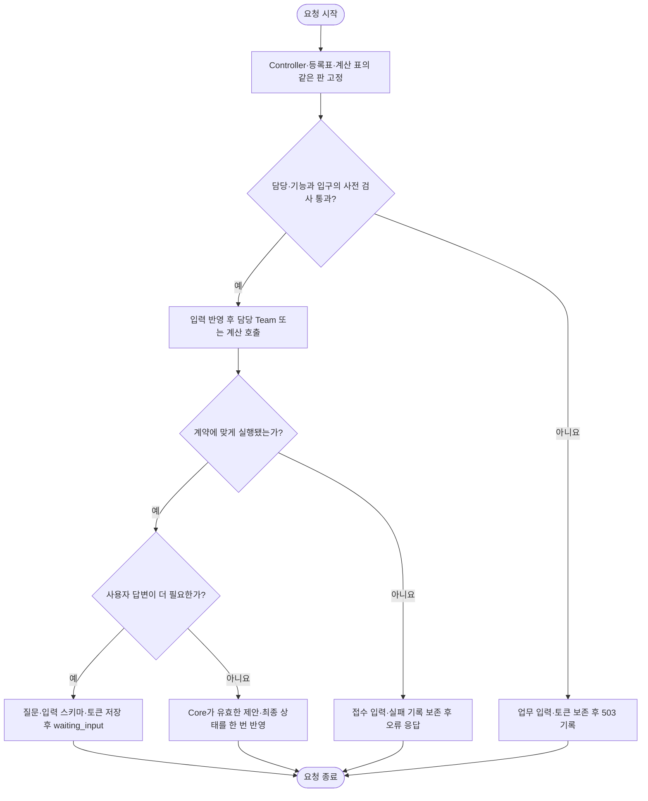

# Team 인스턴스의 로딩·실행·교체

개정: 2026-10-11 22:50 KST. **로컬 구현·필수 관문·전체 업무 시나리오와 운영 기준 후보의 검증 근거를 확보했습니다. 동일 운영 이미지의 격리 Linux 기능 175개와 화면 통신 단위 53개도 통과했습니다. 전체 E2E는 실행 중이며 운영에는 미반영입니다.**

팀이 꺼져 있거나 설치되지 않았으면 그 팀의 업무와 필수 계산을 실행하지 않습니다. 저장된 계획서 조회 같은 독립 기능은 유지합니다. 새 요청은 새 조립을 사용하고 이미 시작한 요청은 기존 조립으로 끝납니다.

| 할 일 | 상태 | 진행 |
|---|---|---|
| 구현 단위 | 로컬 구현 | 6/6 = 100% |
| 인수 조건별 실행 근거 | 확보 | 24/24 = 100% |
| 제품 전체 회귀 | 재실행 중 | 완료 판정 전 |
| 운영 반영 | 미실시 | 0/1 = 0% |

분모 6은 아래 코드 단위이며 24는 아래 조건입니다. 시험 개수를 제품 완료율로 바꾸지 않습니다. [최종 실제 시험명·로그·SHA256 매핑](../records/evidence/2026-10-11_1936_team_plugin_implementation/acceptance-mapping-v2.json)은 최종 코드에서 조건에 직접 연결된 65개 시험을 다시 실행한 근거입니다. 이전 판의 178개 묶음은 별도 기록으로 보존합니다.

## 실행 흐름

아래는 Team 업무나 필수 계산을 수행하는 요청의 로컬 구현입니다. 운영 반영을 뜻하지 않습니다.

Team은 계산하고 제안하며 Core가 변경·발행을 적용합니다. 계산을 재사용하는 team_hooks를 모두 Team.execute로 바꾸지는 않습니다. 계산의 소유 팀과 필수 여부를 같은 조립 판에서 확인합니다. 사전 관문은 담당·기능과 해당 입구가 명시적으로 검사한 계산에 적용합니다. 실행 도중 필요해진 다른 Team의 필수 계산은 실제 호출에서 거절합니다. 원격 장애뿐 아니라 이 경우에도 접수한 답변·실행·실패 기록이 남으므로 사전 거절과 같은 무변경 보장이 아닙니다.

계약에 맞지 않는 결과·실행 오류는 실패를 기록하고 현재 요청을 종료합니다. `waiting_input`은 업무 완료가 아닙니다. 답변이 오면 같은 Case의 대기 토큰과 답변 본문을 전달하는 새 요청이 시작되며, 담당 확인 뒤 재개합니다. 담당 부재의 사전 거절이면 답변·토큰을 소비하지 않습니다. 범용 Case 재개 API는 도메인 준비 callback을 받지 않으므로 모든 교차 Team 계산의 사전 가용성을 보장하지 않습니다. Core에 특정 도메인의 의존 관계를 넣거나 모든 식당 업무에 이동 팀을 일괄 요구하지 않습니다.

## 구현 단위와 코드

| 단위 | 현재 동작 | 코드 |
|---|---|---|
| 선언·오류 계약 | required 기본 true, 선택 capability/hooks, 정적 검증과 적재 분리 | [project_config](../../app/core/project_config.py), [가용성 오류](../../app/core/team_availability.py) |
| 실행 관문 | 담당 지정·재개 입력 소비·Task 생성 전 검사, Local/A2A 방어 | [Registry](../../app/core/registry.py), [Controller](../../app/application/controller.py) |
| 선택 로딩 | inactive import·생성 0회, 선택 적재 실패만 load_failed | [조립](../../app/composition.py), [지연 재수출](../../app/domains/travel_ops/__init__.py) |
| 판별 계산 표 | 후보별 수집·불변 표·원자 게시·요청 종료까지 고정 | [service_bindings](../../app/core/service_bindings.py), [runtime](../../app/application/runtime.py) |
| 제품 경계 | JSON/SSE/MCP 실패 정합, 필수 계산 엄격 실패, 독립 감시 유지 | [실행 계약](team-contract/plugin-availability.md) |
| 인수 근거 | 실제 DB 대기·재개·한 번 변경, 병행 판 교체, 원격 취소 검증 | [최종 인수 매핑](../records/evidence/2026-10-11_1936_team_plugin_implementation/acceptance-mapping-v2.json) |

## 로딩과 교체

required는 active인 Team을 적재할 때 적용합니다. inactive는 required여도 구현을 import하지 않습니다. 선택 Team의 import·생성·계산 제공자 적재 실패는 그 팀을 load_failed로 기록합니다. 필수 Team·필수 코어·잘못된 선언·중복 capability·계약 불일치는 후보를 거절합니다.

후보 조립은 게시된 계산 표를 clear/register로 바꾸지 않습니다. 새 Controller·Registry·Executor·BindingTable·revision을 준비한 뒤 포인터를 교체합니다. 불완전한 후보는 게시하지 않습니다. HTTP 전체 응답과 SSE 종료, 동기 작업 threadpool, 백그라운드 한 회차까지 같은 판을 유지합니다.

기존 관리용 reload를 사용합니다. 별도 mutable disable API·참조 카운트·강제 drain을 추가하지 않았습니다. 원격 기계 상태와 DB의 시간에 따른 값까지 불변으로 만드는 보장은 아닙니다. 이동 엔진 자료·경유 설정 변경은 재기동이 필요하며 hot reload 중 전역 엔진을 다시 초기화하지 않습니다.

## 필수 계산과 독립 기능

| 경계 | 담당 | 부재 시 |
|---|---|---|
| 이동 시간·경로·출발 안내·사고·도보 상한 | Mobility | 의존 요청 불가. 직선 어림·빈 사고 목록으로 성공하지 않음 |
| 식당 상태·등록 전 영업시간 | Dining | 의존 판정 불가. place_id 유무에 관계없이 실행 관문 적용 |
| 기존 목록의 근처 보강·이름 찾기 | Dining | 독립 조회에서는 생략 사유 기록. 담당 업무 대행은 금지 |
| 독립 목록의 선호·유사도 정렬 | Activity | 선택 신호 생략과 이유 표시. Activity 업무 대행은 금지 |
| 종류별 감시 | 해당 Team | 해당 종류 미실행 기록, 독립 종류 계속 |
| 기존 계획서·공통 읽기·정리 | Team 비의존 | 사용 가능한 독립 경로 유지 |

엔진 off와 Team disabled는 구분합니다. 활성 Team의 필수 엔진 실패는 engine_unavailable이며 추정 성공을 발행하지 않습니다. 전역 callback은 명시적 standalone_services 시험·독립 조립 경계에서만 사용합니다. 정상 제품 요청이 조립 표 없이 전역 계산으로 되돌아가지는 않습니다.

## 업무 상태·원격 실행·기록

사전 확인한 담당·기능의 disabled/not_installed/load_failed는 ROUTED·재개 답변·토큰 소비 전에 거절합니다. 재활성화 후 같은 답변은 한 번만 적용합니다. 알 수 없는 case_type은 알려진 담당 부재와 구별해 기존 재배분·routing_failed 절차를 유지합니다. 도메인의 순수 담당 메타데이터를 조립이 주입하며 Core에 여행 Team 이름 목록을 넣지 않습니다.

A2A 결과의 team_id/task_id/run_id를 강제 대조하고 모르는 완료 상태는 성공으로 받지 않습니다. 동기 resolver는 순수 조회만 thread에서 수행합니다. transport의 제출·poll·cancel은 async 계약입니다. 실행 deadline과 유한 취소 정리 예산을 분리해 Controller가 취소 정리보다 먼저 종료하는 경합을 막습니다. 실제 원격 기계의 취소 성능은 이번 대역 시험으로 확정하지 않습니다.

공개 오류는 team_unavailable, HTTP 503입니다. SSE·MCP도 같은 이유의 실패이며 422/completed로 바꾸지 않습니다. remote_unavailable만 retryable입니다. 고객 입력·접속 정보 없이 composition_revision과 실패 종류를 기록합니다. controller_call_finished는 호출 종료 로그이며 업무 completed와 다른 뜻입니다.

백그라운드 조립 실패는 fatal로 기록하고 그 회차의 Team 의존 작업만 중단합니다. 기능 배선이 성공한 경우 독립 정리·분류·기존 주기 재난 점검은 계속합니다. 기능 배선 자체가 실패하면 게스트 감시 범위도 보장되지 않으므로 출발 안내·재난 점검까지 중단하고 독립 정리·분류만 계속합니다. 두 실패를 구분하며 작업별 일반 예외를 격리하고 명시적 종료 신호는 가로채지 않습니다.

작업 프로세스의 선택 기능 배선은 성공한 뒤 회차마다 다시 등록하지 않습니다. 모델 제공자의 준비 상태가 초기화되는 일을 막습니다. 실패하면 다음 회차에서 재시도합니다. Team 후보 조립과 계산 표의 판 교체를 막는 전역 잠금으로 사용하지 않습니다.

## 인수 조건 24개

[최종 매핑 파일](../records/evidence/2026-10-11_1936_team_plugin_implementation/acceptance-mapping-v2.json)에 각 행의 실제 PASSED 시험명·로그 행·해시가 있습니다.

| 번호 | 조건 | 확인할 결과 |
|---|---|---|
| 1 | 비활성 Team 구현 패키지 없음 | import 0회, 독립 앱 기동 |
| 2 | Team 선언 제거 | 해당 업무 불가, 독립 Team 요청 정상 |
| 3 | 모든 선택 Team 비활성화 | 필수 코어·기존 계획서 조회 유지 |
| 4 | 선택 Team import·생성 실패 | 실패 이유 기록, 독립 기능 유지 |
| 5 | 자동·직접 지정 disabled 실행 | execute 0회 |
| 6 | 기존 owner가 disabled | 실행·업무 변경 0회, 운영 실패 기록 |
| 7 | 필수 계산 제공 Team disabled | 이전 callback·어림값 성공 0회 |
| 8 | 후보 조립 도중 실패 | 게시된 Controller·계산 표·revision 불변 |
| 9 | 같은 요청의 두 hook 읽기 사이 reload | 두 읽기 모두 같은 판 |
| 10 | 기존 요청 실행 중 disable 판 게시 | 기존 요청은 옛 판, 신규 거절, 중복 적용 없음 |
| 11 | 연속 reload 중 계산 읽기 | 두 판 모두 enabled일 때 일시 부재·부분 등록 없음 |
| 12 | waiting_input 중 disable 뒤 답변 | Case 버전·답변·토큰 소모 없음 |
| 13 | 재활성화 뒤 같은 답변 재전송 | 호환성 확인·일정 한 번 변경 |
| 14 | Local/A2A disabled | 같은 이용 불가 의미, 원격 transport 0회 |
| 15 | JSON/SSE/MCP 기능 불가 | 422·completed 위장 없음, 표면 정합 |
| 16 | 중복 capability·계약 불일치 | 후보 거절·이전 판 보존 |
| 17 | ROUTED 저장 직전 Team unavailable | owner만 바뀐 Case 잔류 없음 |
| 18 | enabled Team의 엔진 off | disabled와 구별, 검증 소스 없으면 추정 성공 없음 |
| 19 | 독립 정렬의 선택 유사도 부재 | 신호 생략·이유 표시, Activity 업무 대행 없음 |
| 20 | 감시 종류 하나 disabled | 해당 종류 미실행 기록·독립 감시 계속 |
| 21 | sync 입구·백그라운드 판 전파 | 한 요청/회차 전체의 같은 판 |
| 22 | A2A endpoint 또는 결과 식별자 불일치 | 잘못된 결과 거절, completed 수용 없음 |
| 23 | 원격 unavailable·resolver 실패 | unavailable은 운영 불가, 일반 전송 결함과 원인 구분 |
| 24 | 필수 Team·코어 실패와 옛 판 종료 | 필수 실패를 격리로 숨기지 않음, 옛 결과에 옛 revision |

24/24는 명시한 로컬 조건의 근거 확보 수입니다. 제품 전체 무결함·운영 반영·외부 데이터 정확성을 뜻하지 않습니다.

## 독립 검토와 근거

Sonnet 5.5와 Opus 5.5를 실제 CLI로 호출했습니다. 모델 메타데이터와 직접 실행한 시험 원문은 [첫 Sonnet 감사](../records/evidence/2026-10-11_1936_team_plugin_implementation/sonnet-final-review.json), [Opus 감사](../records/evidence/2026-10-11_1936_team_plugin_implementation/opus-final-review.jsonl)에 보존합니다. Opus가 기존 시험 통과 뒤 추가로 찾은 여섯 결함은 [후속 결함 기록](../records/reports/debugs/2026-10-11_2136_plugin_independent_audit.md)에 구분했습니다. 수정 뒤 [최종 Sonnet 감사](../records/reports/2026-10-11_2233_team_plugin_final_delta.md)는 193/193 합성 시험과 누락 구간 6파일의 별도 읽기 검토를 완료했습니다. 감사 소스 12개 해시는 동일했고 새 확정 결함은 없었습니다. 전체 저장소·실제 원격 시스템·외부 값 정확성의 무결함 판정은 아닙니다.

- [실행 가용성 계약](team-contract/plugin-availability.md), [등록표](team-registry.md), [구성 선언](composition.md)
- [실제 DB 재개·취소 반복 검증](../records/reports/2026-10-11_2135_controller_acceptance_a2a_deadline.md)
- [미분류와 담당 부재](../records/reports/2026-10-11_2134_unknown_routing_availability.md)
- [로컬 개발 DB 스키마 준비](../records/reports/2026-10-11_2130_local_improvement_schema.md)
- [추가 배선 격리·E2E 계산 조립](../records/reports/2026-10-11_2200_worker_failure_isolation_and_e2e_bindings.md)
- [운영 기준 소스 대조](../records/reports/2026-10-11_2155_plugin_operating_baseline.md)
- [HTTP 우회 재현·차단](../records/reports/2026-10-11_2213_http_plugin_boundary.md)
- [실제 Sonnet 후속 감사와 별도 보완 검증](../records/reports/2026-10-11_2227_sonnet_plugin_review.md)
- [필수 관문·전체 시나리오·재생 한계](../records/reports/2026-10-11_2229_plugin_regression_followup.md)
- [최소 운영 후보·구조 대조·Linux 문법 확인](../records/reports/2026-10-11_2231_plugin_minimal_candidate_v5.md)
- [현재 메시지 API·대기·재개 응답 계약](../records/reports/2026-10-11_2239_message_api_contract.md)
- [worker 상태 보존·E2E fixture 감사](../records/reports/2026-10-11_2242_worker_state_and_e2e_fixture_audit.md)
- [동일 운영 이미지 Linux 격리 기능 175개](../records/reports/2026-10-11_2245_plugin_linux_functional_verification.md)
- [화면 통신·재개 단위 53개](../records/reports/2026-10-11_2250_frontend_resume_contract.md)
- [개정 전 문서 백업](../_backup/2026-10-11_2140_plugin_current/)
