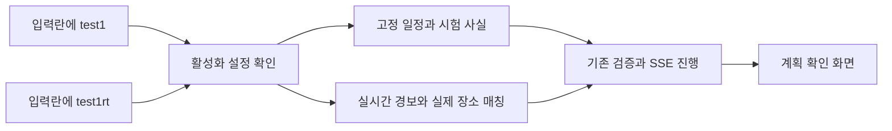

# 계획서 시험 일정 입력

계획 등록의 「나의 여행 계획」에 `test1`~`test15`를 적고 제출하면 미리 준비한 서울 여행 원문으로 기존 검증을 진행한다. 고정되는 것은 입력이며 검사 결과는 실제 조회에 따른다. `rt` 실제 영향 일정 생성은 아직 구현하지 않았다. 아래 그림과 최초 계약은 이전 초안의 범위를 보존한 기록이다.

## 기본안·문제 분류 추가 — 2026-10-11

카탈로그 `seoul-text-v2`는 기존 번호를 유지하고 `test13`~`test15`에 문제 상황을 의도적으로 넣지 않은 기본안 3개를 추가한다. 종료 시각·구체적 장소를 적고 방문 사이 여유를 둔다. 실제 조회 결과가 항상 문제 없다고 강제하지 않는다.

목록과 접수 시험 메타데이터에 `category`를 추가한다. 값은 `normal`(문제 없는 기본안), `time`(시간 겹침), `hours`(운영시간·휴무), `place`(장소 미정), `mobility`(이동 여유), `input`(입력 확인), `general`(일반 흐름)이다. 기존 필드·인증·저장 구조는 유지하며 이 값은 시험 목적이다. 검증 결과의 문제 분류를 대체하지 않는다. 구버전 응답에 값이 없으면 화면은 일반 흐름으로 표시한다.

웹 선택 목록은 기본안을 먼저 묶고 각 분류를 서로 다른 옅은 색과 분류 이름으로 함께 표시한다. 선택한 항목에도 같은 분류 표시를 남긴다. 색만으로 구별하지 않는다. 키보드 선택·취소와 직접 코드 입력을 유지한다. 이번 변경 담당·검토는 같은 작업자가 수행하며 독립 검토·운영 반영 완료로 표시하지 않는다.

[기본안·분류 색 구현과 시험 결과](../records/reports/2026-10-11_2217_테스트계획_기본안_분류색.md).

## 현재 구현 범위 — 2026-10-11

사용자가 다시 요청한 단축 입력을 바로 사용할 수 있도록 고정 계획 원문 15개를 연결한다. 현재 시험 배포 기본값은 켜짐이고 관리자 설정 `testing.intake_presets_enabled`로 끌 수 있다. 아래 최초 초안의 기본 꺼짐은 현재 시험 배포에 적용하지 않는다. 입력 원문만 준비하며 운영시간·휴무·이동·경보의 검사 결과를 고정 성공/실패로 바꾸지 않는다. 예상 결과는 확인할 대상이며 실제 조회에 따라 달라진다. `test1rt` 등의 실시간 영향 일정 생성은 미구현으로 명시적으로 거절한다.

`GET /v1/web/test-scenarios`는 고객 정보 없는 공개 계획 목록이다. 접수별 메타데이터는 `intake_test_scenarios`에 본인 고객·테넌트와 함께 저장하고 조회의 `test_scenario` 및 `review.test_scenario`로 제공한다. 새 마이그레이션230이 필요하다. 코드는 전체 문자열만 인식하고 일반 글·파일·계획 생성 흐름을 바꾸지 않는다.

## 최초 계약 초안 v1 — 2026-10-09

- 입력은 전체 문자열이 `test1`~`test12` 또는 해당 번호 뒤 `rt`일 때만 인식한다. 대소문자와 앞뒤 공백은 허용한다. 다른 글에 포함된 test는 일반 계획이다. 파일과 시험 코드를 동시에 제출하면 422로 거절한다.
- `GET /v1/web/test-scenarios`는 활성화 여부와 번호·이름·설명·예상 결과·고정 계획 원문을 돌려준다. 운영 설정이 꺼져 있으면 목록은 비어 있다.
- 기존 `POST /v1/web/trip-intakes`의 `text`에 시험 코드를 보낸다. 고객 인증·사람 확인·한도는 기존과 같다. 응답은 기존 접수 응답이고, 뒤에서 실제 일정 원문과 값·검사를 만들어 기존 SSE/확인 화면으로 연결한다.
- 접수의 시험 정보는 `intake_test_scenarios`에 테넌트·접수·고객별로 보관한다. `view.review.test_scenario`에 코드·모드·카탈로그 버전·설명·실시간 검사 근거를 싣는다. 원문은 확대된 일정이며 코드만 받은 것으로 끝내지 않는다.
- 고정 시험의 장소·운영시간은 명시된 시험 사실이다. 기존 운영시간·겹침 판정기를 그대로 사용하고, 해당 시험 접수에만 시험 사실을 공급한다. 일반 접수와 실시간 시험의 조회값을 고정 시험으로 대체하지 않는다.
- `rt`는 당일 실제 소스와 서울 장소 목록을 조회해 실제 영향 판정이 나온 활동·식사 일정을 구성한다. 실제 영향이 없으면 `no_live_alert`, 소스를 읽지 못하면 `live_alert_unavailable`로 구별한다. 위치·시각·출처가 없는 사건과 샘플 재난 CSV는 실제 경보의 근거로 사용하지 않는다. 당일 경보 전체 수집·일별 화면 보관은 별도 스냅샷 세션의 책임이다.
- 관리자웹앱 「한도 · 감시 조절」의 시험 일정 설정으로 `testing.intake_presets_enabled`와 `testing.intake_realtime_enabled`를 각각 끈다. 저장은 기존 관리자 인증·CSRF·`limits:write`·판 충돌·변경 사유·감사 기록을 적용한다. 기본은 꺼짐이며 시험 배포에서는 운영자가 켠다. 꺼져 있는 시험 코드는 모델에 보내지 않고 `test_scenarios_disabled`로 거절한다.
- 테스트 내용은 서울·최대 7일·4인 여행이다. 고정 시험은 검증 기능의 사례이며 현재 실제 장소 영업 상황이나 모든 미래 장애를 보장하지 않는다. 스냅샷 점검은 별도 점검용 계정만 사용한다.

## 최초 초안의 사용 순서 — 현재 rt는 미구현

| 화면 | 할 일 | 보이는 결과 |
|---|---|---|
| 관리자웹앱 → 한도 · 감시 조절 → 시험 일정 | 고정 시험 켜기, 필요하면 실시간 시험도 켜기, 변경 사유를 적고 저장 | 저장된 활성화 값 |
| 새 여행 → 나의 여행 계획 | 목록에서 번호를 고르거나 `test1` 입력 | 선택한 시험의 설명·예상 결과 |
| 같은 화면 | 계획 확인하기 | 로딩·검증 진행 후 시험 표시가 붙은 확인 화면 |
| 같은 화면 | `test1rt` 입력 후 계획 확인하기 | 영향이 확인된 당일 일정 또는 경보 없음·조회 실패 안내 |

스냅샷 자동 점검은 별도 「triPilot : 실시간 경보 스냅샷」 세션에서 설정한다.

## 현재 사용 순서와 확인 근거

`[2026-10-16]` 목록은 test1~test50 이다 — test1~16 은 검사 항목별(시각+장소 목록), test17~50 은 계획 이해 시험지의 입력 형식 11가지(정형 목록+자유 문장 · 말투·오타 한 줄 · 문단 자유문 · CSV·TSV · JSON · 메모식 엑셀 · 붙여 넣은 표 · 나눠 보낸 메시지 · 계획+질문+짜기 · 중간 정정 · 실제 접수)를 짧음·보통·김으로 나눈 예시다. 예시마다 그날 지금 구조가 무엇을 못 읽는지 적었다. [입력 형식별 예시 보고서](../records/reports/2026-10-16_테스트계획_입력형식별_예시.md). x600 서버 실서버 확인(10/16 10:40): 목록 50개 · 18분류, test26 · test20 이 확인 화면까지 가고 안내 문장과 맞음 — [실서버 확인 보고서](../records/reports/2026-10-16_1040_테스트계획_입력형식별_예시_x600_실서버_확인.md).

새 여행 → 나의 여행 계획에서 test 번호를 직접 입력하거나 분류별 목록에서 고르고 「계획 확인하기」를 누른다. 원문 미리보기에서 준비된 내용을 확인할 수 있다. 목록이 꺼지거나 실패해도 일반 입력은 가능하다. rt는 미구현 안내로 거절한다. [최초 구현·시험 결과](../records/reports/2026-10-11_0710_준비된_시험계획_연결.md).
