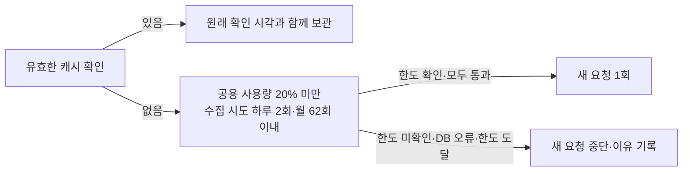

# 실시간 경보와 대체안 스냅샷 점검

2026-10-12 서울 28건 추가 대조: 원문 선형13·다각형1·지점14를 분석하고 12건에 로컬 지도 방향 조각 후보를 붙였다. 보류3건의 도로 위치 근거를 보강했으나 실제 여행 경로 확정·자동 변경 정답으로 승격하지 않았다. 원본 수집 예약은 인계된 일시정지를 유지한다. [도로 구간·방향 추가 대조](../records/reports/2026-10-12_서울28건_도로구간과방향_추가대조.md). 수정 전 문서는 [백업](_backup/2026-10-12_서울28건_도로대조연결전/alert-snapshots.md)에 보존했다.

2026-10-12 인계: 서울 후보 28건의 일정 영향 확인과 수집 관련 작업을 별도 세션에 이전했다. 매일 수집 예약도 새 세션에 연결했으며 기존 일시중지 상태와 예산 제한을 유지한다. [작업 인계서](../records/reports/2026-10-12_실경보_서울28건_세션인계.md).

2026-10-12 누적 확인: 실제 원본 8회차·44파일, 수집 전용 월 시도 15/372 = 4.0%이며 중복·과거 공지를 구분했다. [누적 수집·예산 현황](../records/reports/2026-10-12_0257_실경보_누적수집_예산현황.md).

경보 원본을 회차별로 보관하고, 실제 영향이 확인된 서울 장소·시각의 시험 접수에서 대체안을 검증한다. 실제 여행은 등록하지 않는다. 경보를 찾지 못한 회차와 읽지 못한 회차를 구분한다.

2026-10-09 당시 기록: 원본 수집 heartbeat 활성화·원본 수집·mock 서버 전후 화면 보관을 실행했다. 당시 실제 cs 프로젝트 서버의 시험 API 응답은 404였으며, 이를 오늘 API 상태로 재사용하지 않는다. 30분 감시와 원격 시험 접수 자동화는 당시 자동 승인 검토가 거절했다. 현재 예약 상태는 위 인계의 일시정지를 따르며, 현재 시험 입력 구현은 [시험 일정 입력 계약](../external/test-scenarios.md)을 확인한다. [당시 실측 리포트](../records/reports/2026-10-09_0235_경보_스냅샷_자동점검.md).

[점검 흐름 그림](../records/evidence/2026-10-09_경보_스냅샷/flow.html)

## 실행과 비용

Codex 앱의 인계된 heartbeat(`tripilot`)는 **매일 오전 9시(한국 시간)에 원본만 수집하도록 설정돼 있으나 현재 일시정지 상태**다. 실행 명령은 `python -m scripts.capture_alert_scenarios --archive-only`다. 이 모드는 시험 API·계정·접수·브라우저를 실행하지 않는다. 같은 수집 상태면 조용히 기록한다. 활성화돼 있고 앱과 로컬 실행 환경에 접근 가능한 동안 돈다. 앱이 꺼져 있는 동안 모든 경보를 수집했다는 보장은 없다.

30분 감시와 매일·새 경보의 대체안 화면 검증까지 포함하는 heartbeat 생성은 자동 승인 검토가 「반복 주기와 원격 시험 접수의 명시적 승인 부족」을 이유로 거절했다. 사용자 승인을 기다리고 있으며 등록하지 않았다. 원본 수집 자동화에서 차단된 시험 접수를 간접 실행하지 않는다.

별도 유료 서비스를 새로 만들지 않는다. 기존 공공 API 호출 예산을 쓰고, 시험 접수의 모델 호출은 기존 cs 프로젝트 서버 정책을 따른다. API 자동 전환 시 모델 호출 비용이 발생할 수 있다. 수집·대체 장소 재검사는 기존 공유 예산의 낮은 우선순위 몫을 사용한다. 한도를 우회하거나 늘리지 않는다.

### 실사용 테스트를 남기는 수집 상한 — 2026-10-09

안전 시험 10/10과 실제 로컬 개발 DB 시험 4/4를 통과했고 x600 서버 수집에도 제한을 적용했다. [제한 적용 결과](../records/reports/2026-10-09_1118_경보_수집_예산제한.md).

원본 수집은 **소스별 공용 하루 사용량이 설정 상한의 20%에 도달하면 새 호출을 멈춘다**. 알려진 월 상한에도 같은 기준을 적용한다. 기존 제한이 20%보다 작으면 더 작은 값을 따른다. 이 중단선은 모든 호출이 같이 센 사용량 기준이라 감시·채팅이 먼저 20%를 썼어도 수집은 멈춘다. 수집이 남은 80%를 소비하지 않도록 한 제한이며, 다른 기능 전체의 소비를 제한한 것은 아니다.

추가로 **소스당 하루 2회·월 62회까지** 수집용 호출 시도를 허용한다. 한 번의 예약 수집에 새 요청이 보통 1회였던 원본을 기준으로, 추가 확인 1회를 남긴 보수적인 운영값이다. 최적값을 측정했다고 주장하지 않는다. 하루 1,000건 소스라면 수집 시도는 최대 2/1,000 = 0.2%이고 공용 사용량 200/1,000 = 20%부터는 새 수집을 하지 않는다.



수집용 시도는 x600 서버의 기존 예산 DB에 `alert_snapshot:<소스>`로 따로 센다. 프로세스 재실행·동시 실행에도 초기화되지 않고 한국 시각 자정에 하루 줄이 바뀐다. 기존 공용 예산 거절이나 통신 실패도 수집용 시도 한 번으로 센다. 호출을 할 수 있는지 확인하지 못하면 새 요청을 하지 않는다. 유효한 캐시는 새 호출 없이 계속 보관할 수 있다. 한도를 모르는 소스는 새 요청을 하지 않는다.

개인 설정 `budget_policy`가 유일한 수집 설정이다. `shared_stop_ratio=0.2`, `source_daily_attempts=2`, `source_monthly_attempts=62`이며 설정이 없거나 잘못되면 수집을 시작하지 않는다. 외부 제공처의 월 한도가 설정되지 않은 소스는 실제 제공처 잔여율을 알 수 없다. 그 경우 수집용 월 62회 상한을 별도로 적용하고, 제공처가 초과를 알려 이미 차단한 소스는 기존 차단을 유지한다. 호출 예산·관리자 설정·감시 정책의 전체 상한을 올리거나 카운터를 초기화하지 않는다.

11:10 읽기 전용 조회에서 ITS는 오늘 **1/1,000 = 0.1%**였지만 제공처의 월 초과 표시가 있었다. 앞선 「예산 소진」 보고는 이 두 가지를 구분하지 못했다. 수집이 오늘 1,000건을 다 썼다는 뜻이 아니며, 제공처의 실제 월 한도와 이 키의 전체 외부 사용량은 이 카운터만으로 확인할 수 없다.

```powershell
# final_project_cs 폴더에서 실행
python -m scripts.capture_alert_scenarios
python -m scripts.capture_alert_scenarios --collect-only
python -m scripts.capture_alert_scenarios --archive-only
```

첫 명령은 경보 수집 → 시험 API 확인 → 조건을 만족할 때 화면 검증까지 실행한다. 두 번째는 이 PC의 설정으로 수집만 한다. 세 번째는 개인 설정에 등록한 명령으로 실제 원본만 보관하고 시험 API·브라우저를 호출하지 않는다. x600 서버 연결은 개인 설정의 수집 명령을 쓴다. 기본 결과 폴더는 git 밖 [var/alert-snapshots/](../../var/alert-snapshots/)다.

## 입력 설정

개인 설정 파일은 [var/alert-snapshots/config.json](../../var/alert-snapshots/config.json)이다. 주소·접속 명령은 공용 문서에 복사하지 않는다. `api_base`는 점검 대상 cs 프로젝트 서버의 고객 API 설정에서, `web_url`은 같은 API를 사용하는 웹의 실제 실행 주소에서 가져온다. 빈 웹 주소를 임의로 추정해 채우지 않는다.

| 설정 | 뜻 |
|---|---|
| `api_base` | 점검할 실제 고객 API 주소 |
| `web_url` | 그 API를 사용하는 실제 웹 화면 주소 |
| `browser_channel` | 설치된 브라우저. 이 PC는 `chrome`으로 확인 |
| `collection_command` | JSON으로 경보 수집 결과를 내는 개인 명령. 없으면 로컬 설정 사용 |
| `verification_command` | 대체 장소 목록을 표준 입력으로 받아 실제 경보를 다시 검사하는 개인 명령 |
| `scenario_codes` | 시험 코드 목록. 기본 `test1rt` |
| `budget_policy` | 원본 수집의 공용 중단선과 소스별 하루·월 시도 상한 |

계정·키는 새로 입력하지 않는다. 브라우저는 빈 세션으로 시작하고 점검용 게스트만 만든다. 기존 브라우저의 로그인·저장된 세션은 사용하지 않는다. 사람 확인이 켜져 자동 진행이 막히면 실패로 기록하며 우회하지 않는다.

## 성공 판정

계약은 [시험 일정 입력](../external/test-scenarios.md), 구현은 [실행기](../../scripts/capture_alert_scenarios.py)와 [화면 시험](../../frontend/apps/web/tests/live/alert-snapshots.spec.ts)이다.

1. 실제 API가 `test1rt`를 처리하고 `review.test_scenario`에 당일 장소 좌표·시작 시각·실제 영향 판정을 반환해야 한다. 고정 시험·샘플 CSV를 실경보로 쓰지 않는다.
2. 영향받은 장소의 대체안이 실제 `autofix` 응답에 있어야 하고 화면에도 보여야 한다. `dry_run: true`라 접수의 변경안을 저장하지 않는다.
3. 대체 장소·시각을 실제 `DisruptionCheck`로 재검사한다. 영향이 남아 있거나 필요한 소스가 실패·미연결·일부 응답이면 성공으로 인정하지 않는다. 먼 미래 시각을 현재 사건으로 확인했다고 쓰지 않는다.
4. 전후 화면·원문·API 응답·검사 결과·실행 조건을 같은 회차 폴더에 보관한다.

화면에서 여행 등록·채팅·알림·다른 쓰기를 요청하면 차단하고 실패 기록에 남긴다. 점검용 접수도 `/confirm`을 호출하지 않아 여행과 고객 알림을 만들지 않는다.

## 보관과 확인 범위

| 파일 | 담는 것 |
|---|---|
| `collection.json`, `*-raw.json` | 소스별 성공·실패, 공급자 본문·해시·첫 확인 시각·캐시 여부 |
| `runtime.json`, `report.json` | 실제 실행 설정·로컬 코드 해시·수집 범위·API 상태·판정 |
| `intake-responses.json`, `*-matching.json` | 점검 접수 응답과 장소·시간 매칭 근거 |
| `*-before.png`, `*-after.png` | 원래 일정과 대체안 화면 |
| `alternative-verification.json` | 대체 장소의 실제 경보 재검사 |

`real/`은 실제 cs 프로젝트 서버 점검, `mock/`은 mock 서버의 화면 반응 시험이다. mock 화면을 실제 사건 스냅샷으로 부르지 않는다. 새 회차는 새 폴더다. 상태 파일을 갱신할 때도 `_backup/`에 직전 판을 복사한다. 인증 헤더·쿠키·쿼리 문자열은 수집 결과에 싣지 않는다. 연결 설정과 원본은 git 밖에만 둔다.

기상특보·교통 돌발은 조회 시점 현황이고, 재난문자·지진은 당일 범위다. 지하철 공지는 기존 어댑터의 최신 100개 한 쪽을 읽는다. 원문을 함께 남겨 날짜와 해제 여부를 대조한다. **이를 당일 모든 사건을 빠짐없이 모은 것으로 보고하지 않는다.** 회차 사이에 생겼다가 해제된 사건·공급자가 제공하지 않는 과거 이력·페이지 범위 밖 공지는 놓칠 수 있다. 예보·대기질은 실시간 시험 API와 대체 장소 검사에 나온 장소별 근거를 보관한다.

## 판정과 복구

| 판정 | 의미·다음 동작 |
|---|---|
| `awaiting_api` | 목록 API가 404. 원본은 보관. 전체 점검 예약 승인·연결 후 재확인 |
| `test_scenarios_disabled` | 관리자 설정에서 시험이 꺼짐. 자동으로 켜지 않음 |
| `web_configuration_required` | 실제 웹 주소가 확인되지 않음. API와 같은 환경의 화면을 확인 후 개인 설정 연결 |
| `no_live_alert` | API가 적용할 실제 영향을 찾지 못함. 사건을 꾸며 만들지 않음 |
| `no_live_alert_incomplete` | API는 매칭 없으나 일부 경보 소스가 실패. 전체 경보 없음으로 해석하지 않음 |
| `alternative_recheck_failed` | 대체안이 실제 경보 재검사를 통과하지 못함. 스냅샷·실패 근거 보관 |
| `passed` | 화면·영향 장소의 대체안·실제 재검사 통과 |
| `already_running` | 앞 회차가 점검 중. 새 회차는 시작하지 않음 |
| `archived`, `archived_partial` | 원본만 보관. 뒤쪽 값은 일부 소스를 못 읽었다는 뜻 |

`run.lock`이 남으면 해당 파일에 적힌 프로세스가 살아 있는지 먼저 확인한다. 살아 있는 점검의 잠금을 지우지 않는다. 비정상 종료가 확인된 잠금만 백업 후 정리한다. 반복 점검을 멈출 때는 이 채팅의 heartbeat를 일시중지한다.
