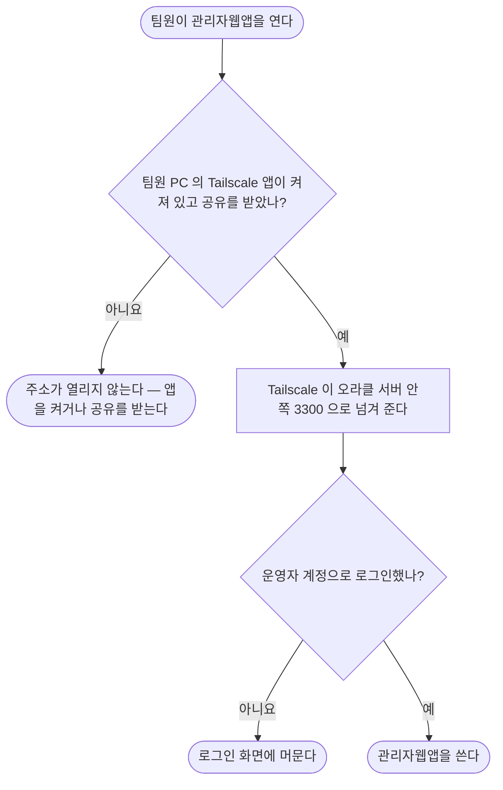

# 오라클 서버 관리자웹앱 — 팀원 접속(Tailscale) 따라 하기

팀원은 **Tailscale 앱 하나만 깔면** 오라클 서버의 관리자웹앱에 들어옵니다. 인터넷 주소는 따로 생기지 않고, 팀원은 x600 서버에 닿지 않습니다.

| 물음 | 답 |
|---|---|
| 돈이 드나 | 무료입니다. Tailscale 개인 요금제, 팀원도 각자 무료 계정 |
| 무엇을 몇 개 만드나 | Tailscale 계정은 **관리하는 사람 1개 + 팀원마다 1개(팀원이 직접)**, 운영자 계정은 **팀원마다 1개** |
| 걸리는 시간 | 처음 한 번 5분, 팀원 한 명 더할 때마다 5분 |

`[2026-10-15]` 관리자웹앱은 고객 웹 · 고객 API 와 **같은 자동 배포 회차**에서 빌드 · 기동 · 건강 검사 · 실패 복구된다 — develop 이 바뀌면 사람 손 없이 새 판으로 바뀐다([자동 배포](arm-develop-cd.md)). 이 문서는 그 위에서 **사람이 하는 일**만 다룬다.

## 어떻게 이어지나



관리자웹앱은 오라클 서버 **안쪽 주소(127.0.0.1)에서만** 받는다. 공개 주소(Caddy)에도, 서버 바깥 포트에도 연결하지 않는다. Tailscale 의 `serve` 가 Tailscale 망으로 들어온 요청만 안쪽 3300 으로 넘긴다.

## 처음 한 번 — 관리하는 사람

| 순서 | 어디서 | 무엇을 | 끝나면 보이는 것 |
|---|---|---|---|
| 1 | 오라클 서버에서 `sudo tailscale up --hostname=guguroute-admin --accept-dns=false` 가 보여 준 `https://login.tailscale.com/a/…` 주소 | 브라우저로 열고 Google · Microsoft · GitHub 중 하나로 로그인 → **Connect** | [기기 목록](https://login.tailscale.com/admin/machines)에 `guguroute-admin` 이 **Connected** |
| 2 | 오라클 서버 | `sudo tailscale serve --bg --tcp=3300 tcp://127.0.0.1:3300` | `tailscale serve status` 에 `tcp://guguroute-admin.<내 망 이름>.ts.net:3300` → `tcp://127.0.0.1:3300` |

2 는 서버 설정이라 Claude 가 대신해도 된다. 한 번 하면 재부팅 뒤에도 남는다.

## 팀원 한 명 더하기

### ① 운영자 계정 만들기 — 관리하는 사람

오라클 서버에 SSH 로 들어가 다음을 친다. `<아이디>` 는 승인 · 처리 기록에 남는 이름이다(예: `op-kim`).

```bash
sudo ~/tripilot-serving/control/admin_env.sh operator --id <아이디>
```

| 화면에 나오는 말 | 하는 일 |
|---|---|
| `<아이디> 의 비밀번호(12자 이상, 화면에 안 보임):` | 비밀번호를 친다(글자가 안 보이는 게 정상) |
| `한 번 더:` | 같은 비밀번호를 한 번 더 |
| `<아이디> 계정을 넣었다. 계정 n개 — …` | 계정이 저장됐다 |
| `끝 — 관리자웹앱이 새 설정으로 다시 떴다` | 바로 로그인할 수 있다 |

자동 배포나 질의 검사가 도는 중이면 「기다린다」가 나오고 최대 15분 뒤에 끝난다. 아이디 · 비밀번호는 팀원에게 **개인 메시지로** 보낸다(단체방 금지). 비밀번호 원문은 서버 어디에도 남지 않고 해시만 저장된다.

### ② 기계 공유하기 — 관리하는 사람

1. [기기 목록](https://login.tailscale.com/admin/machines)에서 `guguroute-admin` 줄 오른쪽 **⋯** → **Share…**
2. 팀원 이메일을 넣거나 **Copy share link** 로 링크를 복사해 팀원에게 보낸다.

공유는 **그 기계 하나만** 보이게 한다 — 팀원은 내 Tailscale 망의 다른 기기를 보지 못한다. 망 전체에 들이는 「초대(Invite users)」는 쓰지 않는다.

### ③ 접속하기 — 팀원

| 순서 | 무엇을 | 끝나면 보이는 것 |
|---|---|---|
| 1 | [tailscale.com/download](https://tailscale.com/download) 에서 앱을 깔고 아무 계정으로 로그인 | 앱이 **Connected** |
| 2 | 받은 공유 링크를 열고 **Accept** | 앱 기기 목록에 `guguroute-admin` |
| 3 | 브라우저에서 `http://guguroute-admin.<공유한 사람의 망 이름>.ts.net:3300` (관리하는 사람이 정확한 주소를 알려 준다) | 「운영자 로그인」 화면 |
| 4 | ①에서 받은 아이디 · 비밀번호로 로그인 | 관리자웹앱 첫 화면 |

주소창에 「주의 요함(http)」이 떠도 괜찮다 — 오가는 내용은 Tailscale 이 암호화한다.

## 팀원 빼기 · 비밀번호 바꾸기

| 할 일 | 방법 |
|---|---|
| 접속 길 끊기 | 기기 목록 → `guguroute-admin` → **⋯** → **Share…** → 그 사람 옆 **Revoke** |
| 운영자 계정 빼기 | `sudo ~/tripilot-serving/control/admin_env.sh remove --id <아이디>` |
| 비밀번호 바꾸기 | ①을 같은 아이디로 다시 한다(다른 계정은 그대로) |
| 지금 계정 보기 | `sudo ~/tripilot-serving/control/admin_env.sh list` — 아이디와 열쇠 유무만 보인다(고객 API 열쇠는 5개가 맞다 — `[2026-10-16]` limits:read · limits:write 를 더했다) |
| 권한만 바꾸기 | `sudo ~/tripilot-serving/control/admin_env.sh scopes --id <아이디>` — 기본은 관리자웹앱 화면 전체 7개. 바꾼 뒤 그 사람은 로그아웃했다가 다시 로그인해야 새 권한이 붙는다 |

## 막힐 때

| 화면 · 오류 | 원인 | 고치는 법 |
|---|---|---|
| 주소가 아예 안 열린다 | 팀원 앱이 꺼졌거나 공유를 안 받았다 | 앱을 켜고 ②의 링크를 다시 연다 |
| `DNS_PROBE_FINISHED_NXDOMAIN` · 「주소를 찾을 수 없음」 | 그 기기에 Tailscale 앱이 없거나 꺼져 있다(`ts.net` 이름은 앱이 켜진 기기에서만 찾아진다) | 앱을 깔고 켠다. 이름이 안 찾아지면 앱 기기 목록의 `guguroute-admin` 숫자 주소(100.…)에 `:3300` 을 붙여 연다 |
| 「운영자 계정이 설정되지 않아 접근이 닫혀 있습니다」 | 운영자 계정이 0개다 | ①을 한다 |
| 로그인이 안 되고 15분 동안 막힌다 | 5번 틀려 잠겼다 | 15분 기다리거나 ①로 비밀번호를 다시 정한다 |
| 「운영 API에 연결하지 못했습니다」 | 관리자웹앱 안의 운영 API 가 내려갔다 | 오라클 서버에서 `sudo docker ps` 로 `tripilot-arm-admin-1` 이 healthy 인지 본다. 자동 배포 로그는 `journalctl -u tripilot-arm-cd.service` |
| `관리자웹앱 이미지가 아직 없다` | 이 develop 판의 관리자웹앱을 아직 안 만들었거나 건너뛰었다 | 자동 배포 로그에서 「관리자웹앱 건너뜀」 · 빌드 실패를 찾는다 |
| 승인 버튼이 「키가 설정되지 않았다」로 실패 | 고객 API 열쇠가 없다 | `sudo ~/tripilot-serving/control/admin_env.sh keys` (처음 한 번 — 2026-10-15 넣어 두었다) |
| 「웹 제한값」 · 「보관 기간」 화면이 「운영용 제한 설정 키가 설정되지 않았습니다」(503) | 고객 API 열쇠에 limits:read · limits:write 가 없다(2026-10-16 전 도구로 넣은 열쇠는 3개뿐) | `control/admin_env.py` 의 `OPS_SCOPES` 가 5개인지 보고 `sudo ~/tripilot-serving/control/admin_env.sh keys` — 2026-10-16 다시 넣어 두었다([기록](../records/reports/2026-10-15_1830_관리자웹앱_점검_수정.md)) |
| 「불러오기 실패 · ops:introspect 권한이 없습니다」 | 계정 권한이 화면 전체보다 좁다(2026-10-15 전 도구로 만든 계정은 3개뿐) | 위 「권한만 바꾸기」 뒤 로그아웃 → 다시 로그인 |

## 관계

- [자동 배포와 질의 검사](arm-develop-cd.md) — 관리자웹앱이 빌드 · 기동되는 회차
- [D-CS-008](../decisions/D-CS-008-ops-console-separate-app.md) — 운영 화면을 고객 앱과 떼고 바깥에 열지 않는 결정
- [D-CS-007](../decisions/D-CS-007-ui-operator-login.md) — 운영자 계정 · 로그인 규칙
- [설치 기록](../records/reports/2026-10-15_arm-admin-web-tailscale.md)
