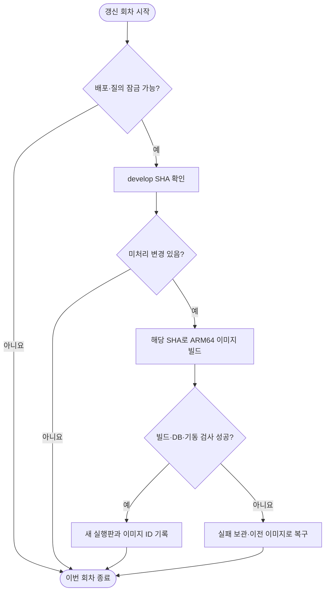

# Oracle ARM develop 자동 배포와 질의 검사

팀 저장소 `develop` 변경을 5분마다 확인해 Oracle ARM 안에서 ARM64 이미지를 빌드한다. 앱·웹·상시 작업·시험용 DB·모델 연결기만 관리하며, 기존 추론 시험 서비스와 x600 서버의 배포는 유지한다. 접속 설정은 개인 SSH 설정에만 둔다.

## 범위

사용자가 지정한 공개 HTTPS 주소로 접근하는 develop 서빙 시험이다. API와 웹 프로세스는 루프백 주소에서만 받고 기존 Caddy가 고객용 경로를 연결한다. API 문서·내부 점검 경로는 공개하지 않는다. 운영 DB·실제 사용자·외부 통지 자격 증명은 가져오지 않는다. 최초 시험용 여행과 사용자만 별도 DB에 만든다. 장소 검색·실시간 외부 데이터·이동 경로의 전체 기능 완료를 뜻하지 않는다.

웹 이미지는 API 기본 주소를 빈 값으로 빌드해 같은 출처의 고객 API를 사용한다. 방문자 PC의 루프백 주소를 사용하지 않는다. 기계 내부 환경 파일에 공개 기본 주소·웹 출처·허용 출처를 설정하고 HTTPS 쿠키와 CSRF 검사를 유지한다. 출처 변경에 필요한 앱 교체는 기존 질의 회차의 배포 잠금을 획득한 뒤 수행한다. 실제 도메인과 접속 정보는 공용 문서에 쓰지 않는다. [공개 연결·실측·백업](../records/reports/2026-10-10_0237_arm-develop-public-domain.md).

상태·관측·실패·원본 위치는 [승인 자료 전송·배포와 최신 관측](../records/reports/2026-10-10_0130_arm-approved-mobility-transfer-and-deployment.md) · [대기열 최초 설치](../records/reports/2026-10-10_0115_arm-server-local-six-hour-queue.md) · [최초 Docker 준비 기록](../records/reports/2026-10-09_arm-docker-develop-cd.md)이 정본이다. 코드와 단위 시험은 [배포 도구](../../deploy/arm/)에 있다. 모델 품질·장시간 부하 시험은 [기존 ARM 실행기](arm-serving-queue.md)와 구분한다.

## 한 회차 동작

`[실측 2026-10-10]` 사용자 승인 뒤 Oracle ARM의 빈 장소·식당 기준 DB와 제한된 검색 키를 복구하고 기존 접수의 좌표·확인 결과를 새 판에 저장했다. 별도 활동 후보 수정은 로컬 검증 완료·ARM 코드 반영 대기이며, 진단 중 API 재시작과 영향받은 질의 실패도 보존했다. [복구·한도·검증·남은 일](../records/reports/2026-10-10_0535_arm-place-source-recovery.md).

이번 회차가 끝난 뒤 5분이 지나면 다음 갱신 회차를 시작한다. 실패한 SHA는 원인을 수정해 기록을 보관하고 명시적으로 재개하거나 새 SHA가 들어오기 전까지 반복하지 않는다. 첫 설치에는 이전 이미지가 없어 복구할 실행판이 없으며 실패 상태로 남는다. DB 마이그레이션은 전진 적용이므로 이미지 복구가 DB 구조 복구까지 보장하지는 않는다.

## 자원과 데이터

- 빌드는 한 번에 하나이며 BuildKit은 CPU 0.6코어·메모리 2GiB로 제한한다. 기존 추론과 자원을 나누므로 함께 실행한 구간의 지연은 단독 실행 속도로 해석하지 않는다.
- 모델 연결기는 앱 전용 llama.cpp 텍스트 추론 결과를 앱의 Ollama 계약으로 옮긴다. 평가 작업의 모델 교체와 앱 모델 식별 충돌을 피하도록 경로를 분리하고, 모델 식별까지 맞아야 건강 상태가 준비 완료가 된다. vLLM이나 새 모델을 켜는 구성이 아니다. 이미지 입력·스트리밍 모델 요청은 지원 여부를 명시적으로 거절한다. 고객 API의 SSE와는 다른 층이다.
- 임베딩은 이미 보관된 모델의 별도 프로세스가 실제 벡터를 만든다. 임베딩 연결 성공과 여행 RAG 자료 적재·검색 품질 검증은 별도다.
- 비밀값은 기계 내부 환경 파일에서만 읽으며 이미지에는 넣지 않는다. `[2026-10-13 사용자 지시]` 환경 파일은 x600 서버와 같은 두 파일이다 — `control/.env`(설정·비밀값·compose 변수) + `control/.env.apikeys`(외부 API 키·호출 한도, 이름은 저장소 `.env.apikeys.example` 을 따른다). 옛 `app.env`·`control.env` 두 파일 구조는 Codex 가 처음 설치할 때 정한 것이며 사용자 결정이 아니었다. 오라클 서버 적용 상태는 [기록](../records/reports/2026-10-13_arm-env-layout-like-x600.md)을 본다. 모델·DB·이전 이미지를 자동 삭제하지 않는다. 새 빌드는 여유 공간 10GiB 미만이면 보류한다.

## 실제 질의 검사

Oracle ARM 기계의 `tripilot-arm-refill.timer`가 한국 시간 00·06·12·18시에 남은 일감을 확인하고 다음 6시간분을 보충한다. 재부팅 후에도 보충하며 PC와 Codex가 꺼져 있어도 동작한다. `tripilot-arm-work-queue.service`는 상시 실행하며 한 회차씩 실제 HTTP 검사를 수행한다. 옛 30분 검사 타이머는 비활성화했다. Codex 예약은 이 실행의 필수 구성요소가 아니다.

초기 회차 시간은 **480초 추정**이며 완료 회차의 실제 시간으로 계속 보정한다. 대기 시간 추정 합계가 21,600초 미만이면 실행 중인 작업자가 중간에도 보충한다. 같은 시간대의 재호출은 남은 분량만 채우며 동일 작업 ID를 두 번 실행하지 않는다. 등록한 6시간분과 실제 6시간 운전 완료는 구분한다. [기계 내부 동작 그림](arm-serving-queue-flow.html).

한 회차는 건강 상태·비인증 거부·기존 시험 사용자 둘의 인증 확인(최초 한 번만 생성)·전용 합성 여행 준비·본인 접근·다른 사용자 차단·여행 질문 넷의 **11개 검사**다. 질문은 같은 문맥 재사용·잡담 속 여행 요청·말투/언어 변경의 세 프로필을 교대로 사용한다. 중간 실패 뒤 미실행 검사도 11개 분모에 남긴다. `travel-answer-v4-session-soak`는 시험 계정과 기존 합성 여행1개를 재사용한다. 비로그인 고객의 여행1개 제한은 유지한다. 기존 계정 인증이나 전용 여행의 제목·버전·날짜·정답 시각 검사가 실패하면 새 계정·여행 발급으로 숨기지 않는다. 대화 이력이 이어지는 반복 서빙 시험이며, 신규 계정·새 여행을 쓰던 v2와 계정만 재사용하던 v3의 신규 문맥 검사와 합산하지 않는다. 로직·실제 답변·자동 작업자 적용 상태는 [답변 복구 리포트](../records/reports/2026-10-11_oracle_answer_repair.md)를 따른다. HTTP 응답 성공을 정답 정확도로 쓰지 않는다. 반복은 지연·오류·누수·격리 안정성 시험이며 독립 정확도 표본으로 합산하지 않는다.

`[실측 2026-10-11]` 기존 검사는 HTTP 200인 해석 오류 안내도 성공으로 세었다. `travel-answer-v2`는 정상 답변 상태·결정 종류·오류 부재·합성 일정의 정답 시각까지 확인한다. 수정판의 검증과 실제 적용 상태, 과거 결과 소급 판정은 [모델 연결·대화 실패 점검](../records/reports/2026-10-11_0323_arm-llm-response-failure.md)에 있다. 이전 HTTP 통과 수치를 실제 대화 성공으로 쓰지 않는다.

배포와 질의 검사는 같은 잠금을 회차 단위로 사용한다. 검사 회차가 끝나면 자동 배포 서비스가 변경을 확인할 기회를 준다. 작업자 자체 잠금은 별도여서 추가 작업자를 띄워도 중복 실행하지 않는다. 실패한 프로필은 같은 배포 SHA에서 반복하지 않으며 다른 준비된 프로필을 먼저 선택한다. 갑자기 종료된 회차는 보관한 요약으로 회수하거나 중단 실패로 기록한다.

검증된 앱 배포·건강 상태·남은 공간 3GiB 조건이 충족돼야 HTTP 일을 시작한다. 조건 대기는 미실행이며 성공으로 세지 않는다. 현재 앱 배포를 막는 조건과 실행 여부는 최신 리포트에서 확인한다. 기존 추론 시험의 상시 대기열은 별도이며 새 작업자가 이를 중단하거나 같은 평가를 다시 시작하지 않는다.

## 상태 확인과 문제 대응

Oracle ARM 기계에서 다음 명령을 사용한다. 무료 기존 자원만 사용하는 구성이다.

| 확인 | 기대 상태 |
|---|---|
| `systemctl is-active tripilot-arm-cd.timer` | `active`, 변경 검사 예약 |
| `systemctl status tripilot-arm-cd.service` | 실행 중 또는 직전 회차 정상 종료 |
| `journalctl -u tripilot-arm-cd.service` | SHA·이미지 빌드·기동 실패 근거 |
| `systemctl is-active tripilot-arm-refill.timer` | `active`, 기계 자체의 6시간 공급 |
| `systemctl is-active tripilot-arm-work-queue.service` | `active`, 상시 소비·조건 대기 |
| `systemctl is-enabled tripilot-arm-probe.timer` | `disabled`, 옛 중복 경로 중지 |
| `systemctl is-active tripilot-arm-serving.service` | 기존 추론 시험 유지 |

실패 시 로그와 상태 파일을 먼저 보존한다. 필수 환경값·호환성·남은 공간 등 원인을 고친 후 같은 SHA를 재개한다. 앱 기동 실패를 시험 문항 성공으로 세지 않는다. 취약점 검사에서 나온 배포 원본의 의존성 문제도 공개 전 검토 항목으로 기록하며, 검증 없이 의존성 전체를 강제 갱신하지 않는다.

2026-10-10: 자료 승인·검증 뒤 내부 앱 배포를 완료했습니다. 건강 확인 대상과 HTTP 입구가 없는 상시 작업자를 나눠 실행하고 전체 컨테이너 상태를 확인합니다. 실제 질의 완료 여부와 수치는 위 최신 관측 리포트에서 확인합니다.

`[실측 2026-10-10 02시]` 완료 회수와 누락 역할 보충을 확인했으며 Oracle ARM의 앱 기동 성공과 실제 질의 시간 초과를 분리합니다. 수정 후보의 운영 반영은 검증 대기입니다. [최근 관측·재개 조건](../records/reports/2026-10-10_0200_six-hour-gpu-arm-report.md).

`[실측 2026-10-10 14시]` 실패로 차단된 작업을 준비 시간에서 제외하도록 앱 대기열을 수정하고 성공 프로필의 실제 HTTP 시험을 재개했다. 모델 벤치마크와 차단·실패 기록은 보존한다. [관측·회수·검증·백업](../records/reports/2026-10-10_1400_six-hour-gpu-arm-report.md).

`[로컬 계약 2026-10-11]` 연결기는 비어 있거나 정상 종료되지 않은 모델 답을 HTTP502로 구분한다. JSON 요청은 완성된 엄격 JSON인지 검사하며 전체 스키마·업무 의미 검증은 앱이 맡는다. 정상 답 원문은 바꾸지 않고 종료 이유·토큰 사용량을 보존한다. 고객 입력 오류400과 모델 응답 오류502를 분리하며 자동 재호출하지 않는다. 운영 반영과 실제 앱 회귀는 검증 대기다. [사전 시험 조건](../../../program/research/daily_rag_slm/2026-10-11_response_guard_prereg_v1.json).

`[로컬 검증 2026-10-11]` 불완전 답과 잘못된 upstream 응답을 모델 실패로 구분하는 회귀 검사를 통과했습니다. 기존 ARM 앱의 실패는 미해결이고 이 수정은 운영 미반영입니다. [검증·재개 조건·백업](../records/reports/2026-10-11_1030_daily-response-completion-research.md).

`[운영 반영 2026-10-11 저녁]` 로컬 응답 검사 연결기와 앱 전용 모델 경로를 반영했고, 연결기 준비 완료를 기다리는 건강 검사를 추가했다. 실제 답변·공개 연결 검증 상태와 이전 실패는 [복구 리포트](../records/reports/2026-10-11_oracle_answer_repair.md)가 소유한다. 앞의 운영 미반영 문장은 당일 오전 상태다.

[실측 2026-10-12] 지식 자료를 이미지에 포함하고 승인한 최소 검색 수정을 보존하는 소스 충돌 검사를 추가했습니다. 변경된 develop 파일은 조용히 덮어쓰지 않고 재검토합니다. [적용·실제 해시·실패·재개](../records/reports/2026-10-12_0454_arm-search-model-repair.md).

`[2026-10-13]` 구글 드라이브 공유 폴더(dataset)를 서버 `datasets/` 로 경로 그대로 10분마다 맞추는 예약(`tripilot-arm-dataset-sync.timer`)을 설치했습니다. 앱 자료 자리는 바꾸지 않았고 구글 로그인 한 번이 남았습니다. [설치·안전장치·로그인 안내](../records/reports/2026-10-13_arm-gdrive-dataset-sync.md).

`[2026-10-13]` develop `ea4eba89` 부터 서버 전용 덧씌움 충돌로 자동 배포가 멈췄다. 덧씌움을 develop 에 없는 2가지(정확한 이름 정렬 · 지식 문서 적재)로 줄여 재개했고, 충돌 시 같은 SHA 를 반복 시도하지 않게 했다. [원인 · 합의 · 남은 일](../records/reports/2026-10-13_arm-cd-overlay-conflict.md).
