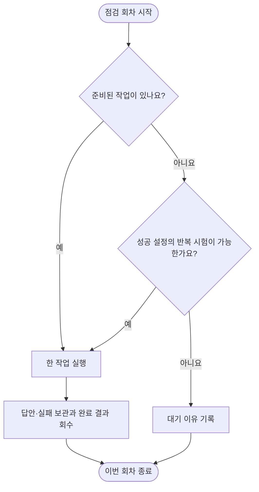

# Oracle ARM 여행 질의 지속 서빙 시험

기존 Oracle ARM 기계에서 여행 질의 인식의 정확도·지연·메모리·장시간 안정성을 함께 잰다. 기존 자원만 사용하며 새 결제는 없다. 담당 실행기는 이미 등록된 시스템 서비스 한 개다.

## 먼저 확인할 것

[날짜별 상태](../../../program/research/daily_rag_slm/arm_serving_2026-10-09.json)와 실제 프로세스를 대조한다. 개인 SSH 설정의 접속 정보는 공용 문서에 복사하지 않는다. ARM 작업 폴더는 `~/bench/continuous-travel-20261008`이며 모델은 기존 보관본을 사용한다.

| 확인 | 기대 상태 |
|---|---|
| `systemctl is-active tripilot-arm-serving.service` | `active` |
| `systemctl is-enabled tripilot-arm-serving.service` | `enabled`, 재부팅 후 실행 |
| `active.json`과 `state.json` | 현재 작업·저장 수·완료/실패가 답안과 일치 |
| `resources.jsonl` | 5초 간격의 실제 자원 관측 |

명령은 Oracle ARM 기계에 접속한 터미널에서 실행한다. 실행 중인 다른 작업이나 이 서비스의 현재 추론을 중단하지 않는다.

## 작업을 이어가는 방법

다음 예약 시각에 새 회차를 시작한다. 실행기는 준비 작업 또는 성공 설정의 유효한 안정성 반복을 계속 처리하며, 실패한 작업은 원인 수정 전 반복하지 않는다.

서비스가 파일 잠금을 잡아 중복 실행을 막는다. 재시작하면 저장된 문항을 건너뛰고 미완료 작업을 잇는다. 답안은 문항마다 즉시 저장하며 실행 시도별 입력·모델·코드 해시와 실행기 버전을 보존한다. 실패하거나 해석 실패가 있는 작업은 원인 수정 없이 자동 반복하지 않는다.

최초 작업이 끝난 뒤에는 성공한 설정을 별도 반복 번호로 돌려 지연 변화·메모리 증가·오류·동시 처리 안정성을 잰다. 같은 문항을 반복한 결과를 독립 정확도 표본으로 합치지 않는다. 새 평가·양자화·동시 접수·검색 임베딩 시험이 준비되면 manifest를 직전 백업하고 임시 파일을 원자적으로 교체해 추가한다. 실행기 파일 변경은 현재 작업 종료 뒤 새 버전으로 전환하며 생존 중인 실행기를 하나 더 띄우지 않는다.

## 자원과 합격 여부 확인

`[설정]` 추론 스레드는 2개다. 작업 전체의 CPU 상한은 1.8코어, 메모리 상한은 10GiB이며 실제 기계의 나머지 메모리는 운영체제에 남긴다. 새 모델 다운로드나 저장공간 결제 없이 기존 모델로 실행한다.

CPU 목표는 **두 코어 전체 용량 대비 20% 이상**이다. `workload_cpu_pct_of_two_cores`의 최근 5분 시간 가중 평균으로 판단하고 기계 전체의 사용률·가상화 대기(`host_steal_pct`)를 함께 기록한다. 모델 해시 계산·적재 구간과 정상 추론 구간을 구분한다. 짧은 구간을 통과했다고 하루 동안 유지했다고 쓰지 않는다.

메모리 목표도 **호스트 전체 대비 20% 이상**으로 관측한다. 사용량은 `/proc/meminfo`의 `MemTotal−MemAvailable`로 계산하고 추론 프로세스의 익명 메모리와 파일 매핑을 따로 남긴다. 파일 캐시가 포함된 서비스 전체 메모리를 회수 불가능한 모델 메모리로 쓰지 않는다. 루트 디스크 총량·실사용량·남은 공간과 사용자 확인선 20GB도 함께 기록한다. 이미 충족하면 의미 없는 파일이나 메모리를 추가하지 않는다.

`[외부]` [Oracle 공식 문서](https://docs.oracle.com/en-us/iaas/Content/FreeTier/freetier_topic-Always_Free_Resources.htm)의 유휴 컴퓨트 판정은 7일 동안 CPU 95백분위·네트워크·A1 메모리의 조건이 모두 낮은 경우다. 디스크 사용량은 열거된 판정 항목이 아니다. OS의 현재 메모리와 최근5분 CPU를 OCI의7일 판정과 구분한다.

모델 초기화·준비, 메모리에 올라간 모델의 입력 처리, 같은 입력 문맥 재사용은 별도 시간이다. 계속 켜진 모델도 새 문맥을 처음 읽는 비용이 있으며 같은 문맥의 직렬 캐시 적중 지연을 모든 질문이나 동시 처리 지연으로 일반화하지 않는다.

연속 미달이면 현재 작업의 계산/대기 상태를 확인하고 다음 유효한 일감을 보충한다. 의미 없는 CPU 소모나 메모리 채우기는 만들지 않는다. 남은 공간 3GiB 미만이면 대기 상태를 남긴다. 기존 모델 영구 삭제와 새 자원 결제는 하지 않는다.

정확도는 정상 요청 정답/전체 정상 요청과 요청 없음 오지목/전체 요청 없음을 분리한다. HTTP 오류와 해석 실패도 분모에 남긴다. 응답 시간은 첫 요청·이후 요청과 캐시 토큰을 구분하며 59개 미만에서는 p95를 확정하지 않는다. 기존 `e4bt` 합친 학습판의 레시피를 대조하기 전 정확한 oos 판으로 이름 붙이지 않는다.

## 완료 결과 회수와 장애 처리

작업별 `attempt_*.json`, `answers.jsonl`, `summary.json`, `engine.log`를 새 로컬 보관 폴더에 회수한다. 입력 문항 ID 전체와 해시를 확인한 뒤 집계한다. 기존 집계 변경 직전에 백업한다.

| 증상 | 확인·조치 |
|---|---|
| `failed` | 실행기 로그와 journal 확인, 원본 보존 후 새 작업 버전으로 수정 |
| 서비스가 반복 종료 | 최근 journal과 메모리 상한·입력 해시 확인, 무조건 재시작 금지 |
| CPU 목표 지속 미달 | 최근 5분 관측과 대기 이유 확인, 준비 작업·다음 접수 설정 보충 |
| 공간 대기 | 완료 로그 회수·원인 보고, 모델 삭제나 새 결제는 별도 지시 |

## 관계

- [모델 평가 기준](../quality/slm-model-evaluation.md) — 원본·우리 학습판·보류 자료와 채택 기준
- [GPU 작업 관리](gpu-work-queue.md) — GPU 학습·평가와 결과 공유
- [ARM 실행기](../../../program/scripts/plan_qa_bench/server/arm_serving_queue.py) — 지속 서빙 시험 구현
- [날짜별 연구 색인](../../../program/research/daily_rag_slm/index.md) — 실제 상태와 회수 근거

ARM 모델 추론 가동은 cs 프로젝트의 API·DB·검색·웹 전체를 이 기계에 배포했다는 뜻이 아니다. 전체 서비스 배포 여부는 별도 실측으로 확인한다.

`[실측 2026-10-08]` 지속 서비스 등록과 실제 여행 응답·잠금 보유를 확인했고, 정상 추론 중 최근5분 CPU 목표를 충족했다. [가동 검증](../records/reports/2026-10-08_1440_arm_serving_activation.md) · [5분 연속 실측](../records/reports/2026-10-08_1443_arm_steady_cpu.md).

`[실측 2026-10-09]` 첫 완료 답안 회수에서 CPU 목표 충족과 긴 응답 지연을 구분했다. 동일 원문·같은 모델의 캐시 교대 진단을 기존 실행기에 추가했고 개선 실측은 대기다. [회수·관측·등록 근거](../records/reports/2026-10-09_0800_six-hour-gpu-arm-report.md).

`[실측 2026-10-09 오후]` 동일 모델·고정 입력의 캐시 교대 진단에서 첫 두 실행을 회수했다. 남은 반복과 새 일정 첫 요청 지연을 포함해 판단하며, CPU 목표 충족을 응답 속도나 전체 서비스 배포 완료와 구분한다. [6시간 현황·검증 원문](../records/reports/2026-10-09_1400_six-hour-gpu-arm-report.md).

`[실측 2026-10-09 저녁]` 같은 모델·같은 일정의 후속 질문 캐시 교대 진단을 모두 완료했고 사전 개발 지연 기준을 통과했다. 새 일정 첫 요청과 사용자 간 캐시 격리·독립 검증은 별도로 남으며 제품 채택이나 전체 서비스 배포 완료를 뜻하지 않는다. [전체 반복·자원·한계·회수 근거](../records/reports/2026-10-09_2000_six-hour-gpu-arm-report.md).

`[실측 2026-10-09 밤]` 실제 실행 도구와 메모리·디스크를 확인하고 모델 초기화와 입력 처리 지연을 분리했다. 자동 점검에도 같은 구분을 반영했다. [관측·정정·백업](../records/reports/2026-10-09_2244_arm-runtime-memory-disk.md).

`[실측 2026-10-10 02시]` 완료 회수와 누락 역할 보충을 확인했으며 Oracle ARM의 앱 기동 성공과 실제 질의 시간 초과를 분리합니다. 수정 후보의 운영 반영은 검증 대기입니다. [최근 관측·재개 조건](../records/reports/2026-10-10_0200_six-hour-gpu-arm-report.md).

`[실측 2026-10-10 08시]` 최근5분 자원 목표는 충족했지만 동시 접수 지연이 길고 답변 의미·독립 정확도 검증이 남아 있습니다. 실제 앱 자체 대기열과 모델 벤치마크를 구분합니다. [관측·회수·다음6시간](../records/reports/2026-10-10_0800_six-hour-gpu-arm-report.md).

`[실측 2026-10-10 14시]` 실패로 차단된 작업을 준비 시간에서 제외하도록 앱 대기열을 수정하고 성공 프로필의 실제 HTTP 시험을 재개했다. 모델 벤치마크와 차단·실패 기록은 보존한다. [관측·회수·검증·백업](../records/reports/2026-10-10_1400_six-hour-gpu-arm-report.md).

`[실측 2026-10-10 20시]` 기계 내부 보충과 실제 HTTP 완료를 확인했고 차단 작업을 보존했다. 자원 목표·응답 계약 통과와 의미 정확도·독립 검증을 분리한다. [관측 창·회수·한계](../records/reports/2026-10-10_2000_six-hour-gpu-arm-report.md).

`[실측 2026-10-11 02시]` 자체 공급과 모델 상주를 확인했으며, 실제 웹 응답 반복 시험과 독립 정확도를 분리합니다. [자원 창·실패 보존·문맥 처리](../records/reports/2026-10-11_0200_six-hour-gpu-arm-report.md).

`[실측 2026-10-11 03시]` 모델 연결 성공과 실제 요청 해석 실패를 확인했고, 오류 안내를 성공으로 세던 앱 검사 수정판을 검증했다. [소급 재판정·실제 호출·수정 및 적용 상태](../records/reports/2026-10-11_0323_arm-llm-response-failure.md). 이전 HTTP 통과 수치를 실제 답변 성공으로 해석하지 않는다.

`[실측 2026-10-11 08시]` 실제 답변 검사는 빈 답변과 잘린 JSON을 실패로 판정한다. 일부 직접 호출 성공만으로 차단된 앱 프로필을 재개하지 않고 정확한 모델·앱 회귀 검증을 별도로 요구한다. [관측·회수·재개 조건](../records/reports/2026-10-11_0800_six-hour-gpu-arm-report.md).

`[실측 2026-10-11 저녁]` 공유 추론 경로에서 평가 모델 교체가 앱의 고정 모델 검사와 충돌했다. 로컬 연결기·앱 전용 모델 경로·준비 검사를 반영해 기본 실제 답변을 복구했다. 반복 시험의 계정·비로그인 여행 제한을 유지한 채 동일 합성 여행 재사용으로 전환했다. 실제 답변·자동 작업자 재개와 혼합·복합 요청의 남은 결함은 연결된 리포트에서 확인한다. [원인·적용·실패·후속 검증](../records/reports/2026-10-11_oracle_answer_repair.md).

`[실측 2026-10-11 22시]` 앱 전용 모델 연결 복구 후 자동 반복 회귀와 남은 복합 질문 오답, 모델 시험과 호스트 자원 관측을 분리합니다. [정기 결과·실패 보존·다음 작업](../records/reports/2026-10-11_2240_six-hour-gpu-arm-report.md).

`[실측 2026-10-12]` 앱 추론 CPU 우선 배정·상한을 조정하고 모델 상주와 입력 처리·요청 경쟁을 구분했습니다. 범위 조회의 검증·최소 운영 반영·검사 중 메모리 장애·남은 지연은 [원인과 실제 적용 기록](../records/reports/2026-10-12_0038_arm-latency-root-cause.md)을 따릅니다.

[실측 2026-10-12] 명시적 하루 요약 버튼은 날짜와 본인 여행을 검증해 저장 일정의 읽기 경로로 처리합니다. 모델 상주 여부와 일반 질의 지연을 구분하며 실제 반영과 측정 범위는 [하루 요약 수정 기록](../records/reports/2026-10-12_day-summary-timeout-repair.md)을 따릅니다.
