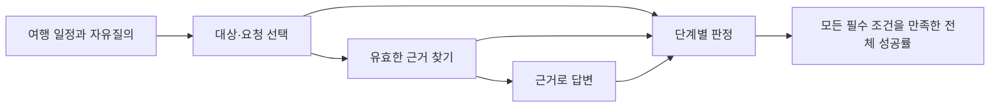

# 대상 선택·근거·답변 통합 평가

일정 항목을 잘 고르는 것과 고객에게 정확히 답하는 것을 함께 검사한다. 기존 D/E를 합친 점수 하나로 대신하지 않고, 잘못 고른 문제·근거를 못 찾은 문제·근거를 보고도 잘못 답한 문제를 나눠 기록한다.

**이 문서는 새 평가의 제안 계약이며 제품 채택 관문으로 확정하지 않았다.** 원본 자료·실행 결과·후보별 수치는 날짜별 기록에만 둔다. [2026-10-09 설계·논문 검토 계획](../../../program/research/daily_rag_slm/selection_answer_plan_2026-10-09_v2.md).

## 기존 시험과의 관계

D는 직접 선택·잡담·복합 참조 등 기존 인식 진단, E는 평문 자유질의 속 여행 요청과 대조 문장 진단으로 유지한다. A/B/C는 같은 문항의 채점 방식도 포함하므로 다섯 독립 데이터셋으로 더하지 않는다. 새 통합 시험의 임시 이름은 **F-v1**이며 E의 이름·과거 정답을 바꾸지 않는다.

## 항목이 없다고 요청도 없는 것은 아니다

다음 세 값을 따로 정답으로 둔다.

| 값 | 의미 | 예 |
|---|---|---|
| target_ids | 기존 일정에서 가리킨 항목 집합 | 식당 하나·식당과 이동 둘 |
| request_scope | 요청 범위 | 기존 항목·전체 여행·새 장소·잡담·지원 범위 밖·대상 확인 필요 |
| evidence_status | 근거 상태 | 충분·대체 근거 사용·필수 근거 조회 실패·근거 불필요 |

“서울에서 비 오면 갈 곳을 새로 추천해 주세요”는 기존 항목 선택이 비어 있어도 여행 요청이다. “오늘 날씨 좋네요”라는 감상과 다르게 답해야 한다. 둘을 NONE 하나로 합치면 실제 요청을 버리는 모델이 높은 점수를 받을 수 있다.

판정은 요청 의도까지 본다. 변경 제안 요청에 실제 도구 실행 결과 없이 “예약 변경이 완료됐다”고 답하면 실패다. 업체 예약 승인 등 현재 제품 규칙을 바꾸지 않는다. 필수 정보는 대체 소스를 조회하는 기존 규칙을 적용하고, 대체까지 실패한 경우는 파이프라인 실패로 보존한다. 평가 도구가 운영 앱을 끄거나 사실을 지어내지는 않는다.

## 한 에피소드의 계약

입력은 고객별 격리된 가상 여행 일정·앞 대화·질문·관측 시각·검색 가능한 출처 묶음이다. 정답은 대상 집합, 요청 범위, 필요한 사실 목록, 사실별 근거 ID, 허용되는 답변 행동, 금지 주장으로 둔다. 정답 문장 하나와 문자 일치시키지 않는다.

출처마다 ID·고객 범위·유효 시각·버전·SHA-256과 구조화된 사실을 둔다. 오래된 값과 새 값을 동시에 넣으면 어느 출처가 우선인지 정한다. 우선순위 자체가 정해지지 않은 충돌을 모델 오답으로 강제하지 않는다. 시간·금액·고유명사·예약번호는 출처의 원값을 사용한다.

정답 파일과 모델에 보여 줄 입력 파일은 분리한다. 정답·필수 사실 목록을 검색 문맥으로 유출하지 않는다. 외부 공공 정보는 사실과 출처만 사용하며 소개글·사진·다른 고객 데이터는 넣지 않는다.

## 실패를 분리하는 세 실행 조건

| 조건 | 고정하는 부분 | 알아내는 실패 |
|---|---|---|
| 정답 대상 + 정답 근거 | 선택과 검색 | 답변 작성 자체 |
| 모델 선택 + 정답 근거 | 검색 | 대상·요청 인식으로 생긴 답변 손실 |
| 모델 선택 + 실제 검색 | 없음 | 실제 전체 파이프라인 |

정답 근거 조건은 모델에게 정답 자체를 주는 것이 아니라 해당 조건의 출처 문서만 준다. 세 조건은 같은 질문의 진단용 반복이며 독립 질문 세 개로 세지 않는다.

선택 전용 모델끼리는 같은 고정 답변기를 붙여 선택의 영향을 비교한다. 일반 생성 모델의 자체 답변 성능은 별도 표에 둔다. 선택지 로짓과 JSON 생성 경로, 말로 한 확신도와 토큰 확률을 구분한다.

## 지표와 제안 합격 기준

파일 형식 검사 통과는 모델 정확도 통과가 아니다. 실패·시간 초과·형식 오류·미완료는 예정된 전체 문항 분모에 남긴다.

| 단계 | 반드시 보고할 지표 | 새 시험 제안 기준 |
|---|---|---|
| 선택 | 단일/복합 대상 집합 완전 일치·범위별 회수율 | 기존 대상 요청 ≥228/240 =95%; 기존 대상 없는 문항의 오지목 ≤4/480 =0.83% |
| 검색 | 정답 근거 Recall@k·필수 사실 근거 충족률·고객 격리 위반 | 답할 수 있는 질문의 필수 근거 충족 ≥95%; 다른 고객 출처 사용0건 |
| 답변 | 필수 사실 충족·근거 없는 주장·인용 정확/완전·요청 행동 | 근거 충족 ≥95%; 인용 정확 ≥99%; 중요한 수치·날짜·이름 오기0건 |
| 전체 | 선택·근거·답변 필수 조건 동시 통과 | 전체 및 각 요청 범위 ≥90%; 근거 없는 중요 주장 포함 에피소드 ≤1% |
| 회귀 | 기존 D/E 정상 요청·혼합 짝 손실·부류별 오지목 | 정상 회귀/혼합 선택 손실 ≤2%p; 부류별 악화도 따로 보고 |
| 실행 | 오류·지연p50/p95·전체 메모리·CPU·동시 처리 | Oracle ARM 2코어·12GB 실제 측정; 허용 지연은 파일럿에서 정하고 최종시험 전에 고정 |

분자·분모는 에피소드/검색 문서/답변 주장 중 무엇인지 명시한다. 답할 수 없는 문항의 근거 지표는 적격 분모와 전체 계획 분모를 함께 공개한다. 빈 답변은 필요한 답을 누락하면 실패다. 잡담은 실제로 근거가 필요하지 않으므로 인용 점수를 억지로 만들지 않는다.

위 문턱은 기존 E의 사전 기준을 소급해서 바꾸지 않는다. 480문항에서 오류4건의 관측 비율이 낮아도 모집단 오지목이1% 이하임을 증명하는 것은 아니다. Wilson 구간과 일정군 단위 짝지은 부트스트랩을 함께 낸다. 같은 일정의 말투 바꾼 문장은 독립 표본으로 가정하지 않는다.

## 자료 생성·검수·잠금

개발480개와 독립 보류720개는 **계획 수량**이다. 개발/보류 분리는 문장 무작위 추출보다 먼저 일정군·장소/별칭군·질문 템플릿군·출처군으로 한다. 보류 자료는 학습·프롬프트 조정·문턱 탐색에 쓰지 않는다.

| 독립 보류의 계획 구성 | 수 |
|---|---:|
| 기존 항목 정보100·변경80·두 언급 중 하나20·두 실제 요청40 | 240 |
| 잡담240·전체 여행80·새 장소60·범위 밖60·대상 확인40 | 480 |
| 합계 | 720 |

기존 대상 없는480개 중 전체 여행/새 장소140개는 명백한 여행 요청이다. 확인 질문40개도 응답이 필요하다. “요청없음480개”라고 보고하지 않는다.

최소120개의 일정군을 목표로 한다. 입력에 맥락을 더한 대조120짝 및 출처 이상120개 하위 진단은 추가 호출이지만 독립 질문 수를 늘리지 않는다. 한국어를 중심으로 말투·앞 대화·인용·부정·다국어·복합 요청의 표지를 교차 부여한다.

정답 검수는 두 사람이 서로의 판정을 보지 않고 수행하고 불일치는 합의로 해결한다. AI 자체 검토를 사람 검수로 세지 않는다. 실제 사용자가 새로 작성한50~100개 질문의 별도 현실성 점검도 마련한다. 아직 수집하지 않았다면 대기 상태로 둔다.

정규화 문자 일치·전체 입력 해시·근접 문장·일정군 중복을 기존 학습/D/E와 검사한다. 보류 전체는 검수 후 해시를 고정하고 평가 답안을 보기 전 계약을 잠근다. 이미 본 보류 답안으로 학습하면 해당 판을 개발 자료로 전환하고 새 보류판을 만든다.

## 재개와 관련 문서

- [일일 연구 기록](../../../program/research/daily_rag_slm/index.md) — 단계별 실제 완료와 재개 위치
- [모델 선별·추가 학습](slm-model-evaluation.md) — 후보와 제품 채택 구분
- [E 완성도 감사](../records/reports/2026-10-09_0214_e-testset-maturity-audit.md) — 기존 진단의 한계
- [개발 예시 자료](../../../datasets/core/answer_selection/selection_answer_bench/2026-10-09_pilot_v3/REPORT.md) — 사람 검수 전 예시, 독립 최종 검증 자료가 아님

평가의 request_scope는 진단용 정답 라벨이며 제품의 기존 intent·case_type을 교체하지 않습니다. 개발 예시의 초기 ID·일정군 표시를 모델 실행 전에 수정했습니다. [독립 검토·현재 판](../records/reports/2026-10-09_1158_pilot-independent-review-corrections.md).
