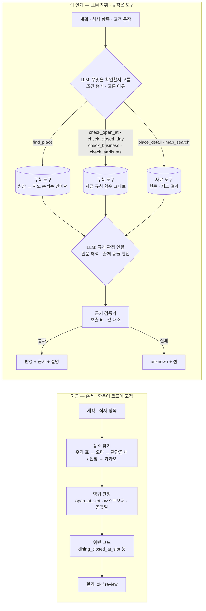
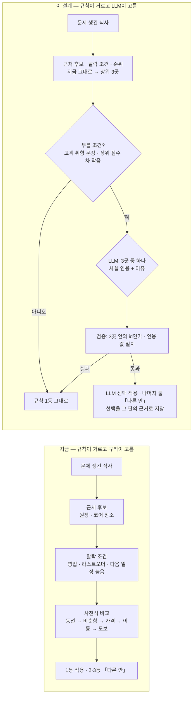

# 요식 판정을 LLM 에이전트로 — MCP 도구 · 체크리스트 평가 설계 (초안)

- 작성 2026-10-13 · 요식(dining) 담당 · 상태: **초안 — 팀 결정 전**(§11 「정할 것」)
- 출발점: 멘토링(2026-10-13) — 「룰베이스가 아닌, LLM이 MCP 도구를 쓰며 스스로 판정하는 에이전트 시스템을 만들고, 체크리스트를 그 평가 기준으로 삼는다.
  DB 조회 · 지도 API · SNS 검색을 MCP 도구로 제공하고 무엇을 판정할지 LLM이 직접 고르게 한다. API나 DB 방식이 더 저렴하더라도 학습 목적상 기본 규칙 체크까지
  LLM이 잘하도록. DB에 없으면 API로 한 번 더 검색하는 구조를 유지하고, 이 조회 기능을 MCP 형태로.」
- 에이전트 설계 방향(사용자 정리): 전체 계획을 보고 무엇을 판정할지 LLM이 직접 고른다 · DB 조회도 MCP로 제공해 도구로 체크한다 · 큰 역할과 세부 작업을 명확히 입력하고
  원하는 케이스의 정답을 잘 맞히는지 테스트한다.

---

## 1. 목표 · 범위

| | |
|---|---|
| 목표 | 여행 계획의 **식사 항목**마다 「무엇을 확인해야 하는가」를 LLM이 고르고, MCP 도구로 근거를 모아 **판정과 근거**를 낸다 |
| 범위(1차) | 요식 판정만 — 식당을 찾았나 · 그 시각 영업 · 휴무 · 브레이크 · 라스트오더 · 폐업 · 식이 조건 · 아이 동반 · 결제. 대체 식당 고르기는 2차 |
| 범위 밖 | 일정 쓰기(바꾸기)는 하지 않는다 — 판정만. 바꾸는 것은 지금처럼 계산(`replan` · `autofix`)과 고객 확인이 한다(§9 원칙 2) |
| 적용 위치 `[2026-10-13 사용자 결정]` | **① 접수 확인 화면의 식사 판정**(문지기를 통과한 식사만 — 고객 메모 조건 · 규칙 「모름」 · 비정형 원문 · 출처 충돌) · **② 대체 식당 셋 중 고르기**(§7-2). **등록된 여행의 새벽 확인에는 쓰지 않는다** — 판정이 구글 영업 확인(열림 · 닫힘 · 모름)과 정해진 대체 규칙뿐이고, 고객 문장은 접수 때 이미 읽었고, 출처 충돌도 「그날 실시간을 믿는다」로 규칙이 정해져 있다. 일괄 작업이라 LLM은 시간 · 비용만 늘린다. 예외: 3차 SNS · 공지(임시 휴무 · 「재료 소진」)를 넣으면 **그 공지 문장 해석 한 단계만** LLM |
| 성공 기준 | 체크리스트 평가(§7)에서 규칙 판정과 같거나 나은 정답률 · 근거 검증 통과 100% · 정해 둔 호출 수 · 시간 상한 안 |

## 2. 지금 구조 (2026-10-13 실측)

```
일정 접수(intake) ──────────────────────────────────────────────── 대부분 규칙
  rules.py   규칙으로 줄 읽기(시각 · 이름 · 끼니 말)
  llm_spans  규칙이 못 읽은 줄만 gemma 가 「원문 조각 + 역할」을 인용 → 서버가 원문에서 잘라 검증   ← LLM 1곳(읽기)
  places.py  장소 찾기: 우리 표 → 오타 → 관광공사 자리 / 요식 원장 → 카카오(고정 순서, 규칙)
  review / autofix  운영시간 · 이동 · 휴무 검사와 자동 추천(계산)
  candidates  대체 후보 — 이유 문장만 선택적으로 모델이 다듬는다(reasons.polish, 자동 추천은 끈다)

등록된 여행 확인 ────────────────────────────────────────────────── 전부 계산
  Dining Team(instances/dining/team.py)   self.llm 을 부르지 않는다
    코어 읽기 도구(app/tools/read_tools.py — 이름 붙은 도구 · manifest allowed_tools · max_steps 예산 · 같은 호출 반복 차단 · 근거 기록)
      read.dining_state / read.dining_states → 원장 SQL 함수 open_at_slot · needs_last_order_check · holiday_context · core_attributes
  itinerary_checks  dining_closed_at_slot 등 위반 코드(규칙)
  replan.dining_candidates  대체 식당 — 탈락 규칙 + 사전식 비교(동선 · 결 · 브랜드)
  새벽 확인(dawn_check)  구글 open_verdict 로 그날 식사 영업 확인(place_id 만 저장)

요식 원장(dining 스키마) — 관광공사 · 미쉐린 · 노포 · 비건 · 할랄 · 인허가 + 사람 검수 시트, 정답셋 101건(dn_truth)
MCP 서버(modules/mcp/mcp_server.py, /mcp/) — 고객 개인 AI(ChatGPT · Claude)가 **사용자 키로 본인 여행**을 읽고 쓰는 입구(FastMCP)
```

- 판정의 **순서와 항목이 코드에 고정**돼 있다(어떤 체크를 할지 규칙이 정한다).
- LLM은 「규칙이 못 한 일」에만 — 못 읽은 줄 인용, 이유 문장 다듬기. 판정에는 쓰이지 않는다(v11 §4-D 「판정이 계산으로 되는 동안 LLM을 부르지 않는다」).

## 3. 바꿀 구조 — LLM은 지휘, 규칙은 도구

★`[2026-10-13 검토]` 「LLM을 굳이 안 써도 되는 곳에 쓰는가」를 따져 고쳤다. 초안은 영업 · 휴무 · 라스트오더 같은 **정해진 계산**까지 LLM이 옮겨 적게 해
느리고 비싸기만 하고 정확도는 같았다. 그래서 역할을 나눈다 — **LLM은 판정 전체를 지휘하고(무엇을 볼지 고르기 · 도구 부르기 · 결과를 모아 판정 · 설명),
규칙은 도구가 되어 계산한 판정을 돌려준다.** LLM은 규칙 판정을 다시 계산하지 않고 근거로 인용한다.

| 일 | 맡는 쪽 | 왜 |
|---|---|---|
| 그날 일정을 보고 **무엇을 확인할지 고르기** | **LLM** | 멘토링의 핵심 — 「무엇을 판정할지 LLM이 직접 고른다」 |
| 자유 문장에서 조건 뽑기(「아이랑」 「할랄만」 「웨이팅 싫어요」 「매운 거 못 먹어요」) | **LLM** | 언어 이해 — 규칙으로는 끝이 없다 |
| 애매한 가게 특정 · 원장에 없을 때 **어떤 말로 다시 찾을지**(질의 바꾸기) | **LLM** | 「광장시장 먹자골목 빈대떡」 「종각역 그 칼국수」 · 지점 여럿 · 오타 |
| 정형화 안 된 원문 해석(「매월 둘째 · 넷째 월 휴무」 「재료 소진 시 마감」) · 공지 · SNS(3차) | **LLM** | 지금 규칙 파서(`parse_hours`)가 못 읽는 부분 |
| 출처끼리 어긋날 때 판단(원장 영업 · 구글 폐업 · 공지 임시 휴무) · 고객에게 하는 설명 | **LLM** | 근거를 견주고 이유를 말하는 일 |
| 그 시각 영업 · 그날 휴무 · 브레이크 · 라스트오더(20분 탈락 · 60분 경고) | **규칙 도구** | 요일 · 시간 · 달력 계산 — LLM이 하면 계산 실수만 늘어난다 |
| 폐업 상태 · 할랄 · 아이 동반 · 카드 속성 | **규칙 도구** | 칸 하나 읽기 |
| 「원장 먼저, 없으면 지도 API」 순서 | **도구 안의 코드**(`find_place`) | 고정 순서 — LLM에 맡기면 어길 때 손해뿐 |
| 근거 검증 · 예산 · 상한 | **서버 코드** | 신뢰의 바닥 |

```
여행 계획(그날 일정 전체 — 식사와 앞뒤 일정)
        ▼
요식 판정 에이전트(LLM, 지휘) ── 역할 지시문(§4) · 체크리스트(§7)
        │  ① 이 식사에 필요한 체크를 고른다(자유 문장 조건 포함)
        │  ② 도구를 부른다(읽기 전용, §5) — 규칙 도구는 판정을 돌려주고, 자료 도구는 원문 · 사실을 돌려준다
        │  ③ 규칙 판정은 인용하고, 원문 · 출처 충돌은 스스로 해석해 판정 + 근거(도구 호출 id · 값 경로)
        ▼
근거 검증기(서버, §6) ── 근거가 그 호출의 실제 결과에 있는가 · 형식 · 지어낸 값 0
        ▼
판정 결과(항목 × 체크) ──► 그림자 기록(1단계) / 규칙 판정 대신 사용(스위치를 켠 뒤)
        ▲
규칙 판정(지금 코드) ── **정답지 · 비교 기준**으로 남긴다(같은 입력으로 나란히)
```

## 3-2. 흐름 비교 — 지금 → 이 설계대로

**(가) 식사 판정**



**(나) 대체 식당 고르기**



| | 지금 | 이 설계 |
|---|---|---|
| 확인 항목 | 코드가 고정 | LLM이 고른다(고른 이유 기록) |
| 기본 계산 | 규칙 함수 | **같은 규칙 함수**(도구로 감쌌다) — LLM은 인용 |
| 자유 문장 · 원문 · 충돌 | 못 본다(규칙이 못 읽으면 「모름」) | LLM이 해석 · 근거로 원문을 단다 |
| DB → API 순서 | 코드 | 코드(`find_place` 안) |
| 대체 식당 하나 고르기 | 사전식 비교 | 거르기 · 순위는 그대로, **상위 3곳 중 하나는 LLM**(부를 조건이 맞을 때만) |
| 지어낸 값 | 생길 수 없다(규칙) | 근거 검증기가 막는다 |
| 같은 입력 같은 결과 | 보장 | 판정: 검증 · 그림자 비교 / 고르기: 선택을 저장해 다시 계산할 때 존중 |
| 고객 영향 | 바로 | 그림자 운행 → 스위치 |

## 4. 에이전트 — 역할 · 세부 작업 · 출력

**큰 역할(시스템 지시문 요지)**
> 너는 여행 일정의 식사 항목을 점검하는 요식 담당이다. 그날 일정 전체를 보고, 식사 항목마다 고객이 그 시각 그 식당에서 문제없이 먹을 수 있는지
> 확인할 항목을 직접 골라 도구로 확인한다. 값은 반드시 도구 결과에서만 가져온다. 모르면 「unknown」이라 하고 이유를 쓴다.

**세부 작업(순서 지시)**
1. 식사 항목을 찾고, 일정 · 고객 문장에서 **조건**을 뽑는다(식이 · 아이 · 결제 · 대기 · 맛 …).
2. 식당을 `find_place` 로 특정한다(도구가 원장 → 지도 순서를 안에서 처리한다). 애매하거나 없다고 나오면 **다른 말로 한 번 더**(질의 바꾸기 — LLM 몫, 최대 2번).
3. 이 항목에 필요한 체크를 체크리스트(§7)에서 고른다 — 고른 이유를 한 줄로.
4. 기본 체크는 **규칙 도구**(`check_*`)를 불러 그 판정을 그대로 인용한다 — 다시 계산하지 않는다.
5. 규칙 도구가 「unknown」이거나 원문이 정형화돼 있지 않으면(`place_detail` 의 원문) **직접 해석**하고, 출처끼리 어긋나면 견주어 판정한다 — 해석한 원문을 근거로 단다.
6. 출력 형식(JSON)으로만 답한다.

**출력(JSON — 서버가 스키마로 검사)**
```json
{"items": [{"item_id": "...", "place": {"source": "ledger", "place_uid": "...", "call_id": "c2"},
  "checks": [{"check": "open_at_slot", "why_chosen": "12:00 점심 일정",
              "verdict": "bad", "reason": "그날(월)은 정기 휴무라 12:00 에 열지 않는다",
              "evidence": [{"call_id": "c3", "path": "open_at_slot", "value": false}]}]}],
 "skipped": [{"item_id": "...", "check": "halal", "why": "식이 조건 요청 없음"}]}
```

**상한** — 식사 항목당 도구 호출 8회 · 에이전트 한 번에 60초 · 같은 호출 반복은 거절(코어 `ToolLoopExceeded` 와 같은 규칙). 넘으면 그 항목은 「unknown(상한)」.

## 5. MCP 도구 (내부 에이전트용, 읽기 전용)

★고객용 `/mcp/` 와 **따로** 둔다 — 그쪽은 사용자 키 · 본인 여행 범위의 입구다. 내부 에이전트용은 같은 프로세스의 FastMCP 서버(또는 같은 도구 함수를
함수 호출로)로, 테넌트 범위는 서버가 넣는다(LLM이 정하지 않는다 — 코어 읽기 도구와 같은 원칙).

도구는 두 갈래다 — **규칙 도구**(판정까지 계산해 돌려준다)와 **자료 도구**(사실 · 원문을 돌려준다, LLM이 해석할 때 쓴다).

**규칙 도구 — 지금 규칙 코드를 도구로 감싼다**

| 도구 | 입력 | 돌려주는 것(판정 + 이유 + 근거 값) | 감싸는 지금 코드 |
|---|---|---|---|
| `find_place` | name, near?(lat, lng) | 원장에서 찾고, **없으면 안에서 지도(카카오)로 한 번 더** — 하나로 정해졌나 · place_uid/지도 id · 일치 방식 · 확인 필요 · 어디서 찾았나 | `ledger.find_place_by_name` · `find_license_shop_by_name` · `KakaoLocal.search` |
| `check_open_at` | place, start, end | 영업 ok/bad/unknown · 라스트오더(20분 탈락 · 60분 경고) · 브레이크 · 공휴일 맥락 | `dining.open_at_slot` · `needs_last_order_check` · `holiday_context` · `replan.last_order_shortfall` |
| `check_closed_day` | place, date | 그날 휴무 ok/bad/unknown · 걸린 휴무 규칙 | 원장 휴무 규칙 · `holiday_context` |
| `check_business` | place | 폐업 · 이전 · 상호 변경 상태 | `dn_place.record_status` · 폐업대조 반영분 |
| `check_attributes` | place, wanted[](halal · vegan · kids · card · parking) | 속성마다 yes/limited/no/unknown + 출처 · 확인일 | `v_attribute_active` · `core_attributes` |
| `live_open_check` | place, start, end | 구글 영업 판정(open/closed/unknown) — place_id 만 남긴다 | `GooglePlaces.find_place_id` · `open_verdict`(예산 장치 그대로) |

**자료 도구 — LLM이 해석할 원문 · 사실**

| 도구 | 입력 | 돌려주는 것 | 감싸는 지금 코드 |
|---|---|---|---|
| `place_detail` | place | 분류 · 결 · **영업시간 원문**(관광공사 · 검수 시트 원문 그대로) · 규칙화된 영업 구간 · 출처 · 확인일 | 원장 표 · `dn_source_record.raw_json` |
| `nearby_places` | lat, lng, radius_m, style? | 근처 식당(거리 · 분류 · 결) | `ledger.nearby_shops` · `find_meal_near` |
| `map_search` | query, near? | 카카오 결과(이름 · 분류 · 좌표 · 주소) — **질의 바꾸기용**, 저장하지 않는다 | `KakaoLocal.search`(예산 장치 그대로) |
| (3차) `sns_search` | 가게 이름, 기간 | 휴무 · 임시 영업 공지 원문 | 없음 — 출처 · 약관 확인 뒤. 새벽 확인에 붙이면 공지 문장 해석 한 단계만 LLM(§1) |

- 「DB에 없으면 API로 한 번 더」는 **`find_place` 안의 코드**로 지킨다(멘토링 「구조를 유지한다」) — LLM에게 순서를 맡기지 않는다. LLM은 그 결과가 애매할 때 **다른 말로 다시 묻는 것**만 한다.
- 규칙 도구의 판정은 지금 규칙 판정과 **같은 함수**다 — 그래서 에이전트 결과와 규칙 결과의 차이는 「무엇을 골랐나 · 원문 해석 · 출처 충돌 판단」에서만 생긴다(평가에서 원인을 가르기 쉽다).

## 6. 근거 검증 (서버)

1. 출력이 JSON 스키마에 맞는가(extra 금지 — 프로젝트 계약 원칙).
2. `evidence.call_id` 가 이번 실행의 실제 호출인가 · `path` 의 값이 그 호출 결과에 **그대로** 있는가.
3. `place.place_uid` 는 그 호출 결과 안의 값인가(원장 · 지도 결과에 없는 가게를 고르지 못한다 — 접수 `llm_spans` 의 「원문에 없는 인용은 버린다」와 같은 원칙).
4. 판정이 근거와 모순되지 않는가(예: `open_at=false` 인데 ok).
5. 하나라도 어기면 그 체크는 버리고 「unknown(검증 실패)」 — 조용히 고치지 않는다(실패 수를 센다).

## 7. 체크리스트 = 평가 기준

| 체크 | 언제 고르나(정답) | 판정 기준 | 정답지 |
|---|---|---|---|
| `found` 가게를 찾았나 | 늘 | 원장 · 지도에서 하나로 정해졌나 | 장소 찾기 평가 `place_lookup_v1` · holdout |
| `open_at_slot` 그 시각 영업 | 시각이 있는 식사 | 원장 영업 판정 · 라스트오더 20분 | 원장 함수 · 정답셋 `dn_truth`(영업시간 실제 대조 101건) |
| `closed_day` 그날 휴무 | 날짜가 있는 식사 | 휴무 규칙 · 공휴일 | 원장 휴무 규칙 |
| `break_time` 브레이크 | 오후 시각 식사 | 브레이크 구간과 겹침 | 원장 규칙 |
| `last_order` 라스트오더 | 끝 시각이 영업 종료 가까움 | 20분 탈락 · 60분 경고(`replan` 상수) | 규칙 판정 |
| `closed_business` 폐업 | 늘(원장 상태 · 실시간 확인) | 원장 closed · 구글 closed | `dn_truth` 의 폐업 표시 · 폐업대조 시트 |
| `dietary` 할랄 · 비건 | 식이 조건 요청이 있을 때만 | 원장 속성 yes/limited/no | 할랄 · 비건 시트 |
| `kids` 아이 동반 | 아이 동반 일정일 때만 | 원장 속성 | 원장 속성 |
| `payment` 결제 | 결제 조건이 있을 때만 | 카드 속성 | 원장 속성 |

**평가 자료** — `eval/datasets/dining_agent_v1.jsonl`(dev) · `dining_agent_holdout_v1.jsonl`(holdout, 프롬프트 고칠 때 보지 않는다)
- 한 줄 = 그날 계획 하나 + 기대(항목별 골라야 할 체크 · 기대 판정). 정답셋 101건 · 대체 식당 평가 · 오늘 만든 시나리오(광장시장 점심 · 동선 무리 · 휴무)에서 만든다.
- 「고르지 말아야 할 체크」도 기대에 넣는다(할랄 요청이 없는데 할랄을 보면 감점).

**비교 실험(학습 목적 — 멘토링 「기본 규칙 체크까지 LLM이 잘하도록」)** — 같은 평가 자료로 세 구성을 잰다.

| 구성 | 기본 체크(영업 · 휴무 · 라스트오더 · 속성) | 무엇을 볼지 · 원문 · 충돌 |
|---|---|---|
| **A. LLM 직접** | 자료 도구(원문 · 규칙화된 구간)만 주고 **LLM이 계산** | LLM |
| **B. 규칙 도구(추천 기본안)** | 규칙 도구의 판정을 **인용** | LLM |
| **C. 규칙만** | 지금 코드 | 지금 코드(고정 순서) |

- 결과로 「LLM이 기본 계산을 하면 정답률 · 시간 · 비용이 어떻게 달라지는가」를 수치로 남긴다 — 발표 근거이자 운영 구성을 고르는 근거. 운영에는 실험에서 가장 나은 구성을 쓴다.

**지표** — ① 체크별 정답률(기대 판정과 같음) ② **체크 고르기**: 빠뜨림률 · 쓸데없는 체크 비율 ③ 근거 검증 통과율(목표 100%) ④ 규칙 판정과 다른 건수와 이유 분류
⑤ 항목당 도구 호출 수 · 시간 · 토큰. 반복 3회 · paired bootstrap 95% CI · McNemar(규칙 대비) — 프로젝트 평가 원칙과 같다. 표본이 작으면 작다고 적는다.

## 7-2. 대체 식당 — 상위 3곳 중 하나를 LLM이 고른다 `[2026-10-13 사용자 제안]`

**규칙이 거르고, LLM이 고른다.** 대체 후보를 찾고 탈락 조건으로 거르고 순위를 매기는 것은 지금 그대로(`replan.dining_candidates` · 접수 `candidates` 의 A · B · C).
그 **상위 3곳 중 하나**를 LLM이 고른다 — 셋 다 규칙을 통과했으니 무엇을 골라도 「닫힌 곳 · 늦는 곳」은 안 된다(위험이 작다).

| | |
|---|---|
| LLM이 받는 것 | 3곳의 사실(거리 · 늘어난 이동 · 분류 · 결 · 비슷한 정도 · 영업 경고 · 가격대) · 그날 일정(앞뒤 식사 · 다음 일정 종류) · 고객 문장(취향) |
| LLM이 내는 것 | `{"pick": "<후보 id>", "reason": "...", "cited": [{"candidate": "<id>", "field": "style", "value": "국물요리"}]}` |
| 검증 | `pick` 이 3곳 안의 id 인가 · 인용 값이 후보 사실과 같은가 — 아니면 **규칙 1등**(실패 수를 센다) |
| 부를 조건 | 고객 취향 문장이 있거나 · 상위 후보끼리 차이가 작을 때(같은 동선 허용 범위 · 같은 비슷함 등급). 아니면 규칙 1등 그대로 — 부를 이유가 없다 |
| 같은 입력 같은 결과 | 온도 0 · 고른 결과를 그 판의 근거로 저장하고, 같은 판을 다시 계산할 때는 저장한 선택을 쓴다 |
| 쓰는 곳 | 등록된 여행의 대체(`replan`) · 접수 전체 자동 추천의 식사 후보(`autofix`) · 화면 후보의 「추천」 표시 |
| 평가 | 정답지가 이미 있다 — `dining_alternatives_v1` · holdout · `…style_v1` · holdout 의 `expect.accept`. 규칙 선택 vs LLM 선택을 같은 자료로. 취향 문장 사례(「가볍게」 「조용한 곳」 「아이랑」)는 새로 만든다 |
| 장점 | 고객 취향 · 그날 흐름(점심에 고기 → 저녁 가볍게) · 비슷한 후보 사이의 이유 있는 선택과 설명 |

- 판정 에이전트(§4~§7)보다 **작고 안전하며 정답지가 있다** — 먼저 할 수 있다(§11 정할 것 6).

## 8. 모델

| 후보 | 장점 | 확인할 것 |
|---|---|---|
| 서버 gemma4:12b(Ollama) | 무료 · 이미 서버에 있다 | **도구 호출 형식을 안정적으로 지키나**(1단계에서 작게 잰다) · 시간 |
| OpenAI(gpt-4o-mini 등, 개발 중) | 도구 호출이 안정적 · 비교 기준 | 비용(평가 1회 수천 원 규모 `[추정]`) |

학습 목적이면 **둘 다 같은 평가로 재서 비교**한다. 프롬프트 · 모델은 `prompts`(prompt_key, version) · `llm_calls` 에 남긴다(산출물에 버전을 박는다 원칙).

## 8-2. 속도 — 모델 바꾸기보다 구조가 먼저

느린 원인은 대부분 **모델을 몇 번 부르나 · 도구를 몇 번 오가나**다. 모델 시험만으로 찾을 일이 아니고, 아래를 구조로 넣은 뒤 평가 러너가 구성마다 시간을 잰다.

| 방법 | 내용 | 기대 |
|---|---|---|
| ① 덜 부르기(문지기) | 규칙이 먼저 돈다 — 규칙이 확실히 ok 이고 자유 문장 · 비정형 원문 · 출처 충돌이 없는 식사는 LLM을 부르지 않는다. 대체 고르기도 부를 조건(§7-2)이 맞을 때만 | 부르는 식사 수 자체가 준다(가장 큰 효과) |
| ② 묶어 부르기 | 식사마다가 아니라 **그날 일정 하나에 한 번** — 모든 식사의 체크를 한 번에 고르게 한다 | 모델 왕복 수 = 식사 수 → 1 |
| ③ 계획 후 실행 | 「생각 → 도구 → 생각 → 도구」 반복(ReAct) 대신, LLM이 **부를 도구 목록을 한 번에** 내고 서버가 **동시에** 실행한 뒤 결과를 한 번에 돌려준다 | 왕복 2번(계획 · 판정)으로 고정 |
| ④ 큰 도구 | 기본 체크를 하나로 묶은 `check_meal`(영업 · 휴무 · 브레이크 · 라스트오더 · 속성을 한 번에) — 도구 5번 → 1번 | 도구 왕복 감소 |
| ⑤ 짧게 | 지시문 고정 부분을 앞에 두어 캐시가 먹게(서버 모델은 `keep_alive` 로 모델을 올려 둔다 · 외부 모델은 프롬프트 캐시) · 출력 JSON 을 짧게 · 도구 결과에서 필요한 칸만 | 토큰 · 첫 응답 시간 감소 |
| ⑥ 화면을 안 기다리게 | 규칙 결과를 먼저 보여 주고, 에이전트 판정은 뒤에서 돌아 다 되면 바꾼다(접수의 실시간 진행 SSE 가 이미 있다) · 등록된 여행의 새벽 확인은 에이전트를 쓰지 않는다(§1 적용 위치) | 고객 체감 시간 ≈ 지금 |
| ⑦ 상한과 대체 | 시간 상한을 넘으면 그 항목은 규칙 결과로 — 느려도 멈추지 않는다 | 최악 시간 고정 |
| ⑧ 모델 · 서빙 | 고르기(체크 · 후보)는 작은 모델, 원문 해석만 큰 모델 · 양자화 · GPU | 측정으로 정한다 |

- **모델 시험은 ⑧ 하나**다 — 나머지는 설계로 정한다. 평가 러너가 구성(①~⑧ 조합)마다 「항목당 시간 · p95 · 모델 호출 수 · 도구 호출 수」를 함께 기록해, 정답률과 시간을 같은 표에서 고른다.
- 목표 시간은 화면 경로에서 정한다 — 예) 접수 확인에서 에이전트 판정 p95 `[정할 값]`초 · 넘으면 ⑦.

## 9. 지키는 원칙

1. **근거 없는 판정은 없다** — 값은 도구 결과에서만(§6). 모르면 unknown + 이유. (cs CLAUDE.md §0.1)
2. **side effect 없음** — 에이전트는 판정만 낸다. 일정 바꾸기 · 알림은 지금처럼 계산 · 승인 경로(§0.2).
3. **외부 데이터 저장 규칙 그대로** — 구글은 place_id 만, 카카오는 그 여행 항목에만. 도구 응답을 캐시하지 않는다.
4. **예산** — 카카오 · 구글 예산 장치(`CallBudget`)를 도구 안에서 그대로 쓴다. 에이전트 상한(§4)과 별개.
5. **그림자 먼저** — 고객 결과를 바꾸기 전에 규칙과 나란히 돌려 어긋남을 기록한다.

## 10. 단계

| 단계 | 할 일 | 산출물 | 끝났다고 보는 기준 |
|---|---|---|---|
| 0 | 이 설계 · 결정 기록(v11 §4-D 와의 관계) | 이 문서 · `wiki/decisions` 한 건 | 팀 확인 |
| 1 | 모델 도구 호출 측정(작게) — 도구 2개(찾기 · 영업)로 20건 | 측정 리포트 | gemma 형식 준수율 · 시간 |
| 1-B | 대체 식당 셋 중 고르기(§7-2) — 선택기 · 검증 · 부를 조건 · 평가(규칙 vs LLM) | `components/planning/meal_pick.py` · 리포트 | 대체 식당 평가 자료에서 규칙과 같거나 나음 · 검증 실패 0 |
| 2 | 요식 MCP 도구 — 규칙 도구 6개(지금 규칙 함수를 감싼다) · 자료 도구 3개(읽기 전용) + 단위 시험 | `instances/dining/agent_tools.py` | 시험 · 규칙 도구 판정 = 지금 규칙 판정 · 테넌트 범위 · 예산 |
| 3 | 에이전트 루프 + 근거 검증기 | `instances/dining/agent.py` | 검증 시험(지어낸 값 · 없는 호출 · 모순 거절) |
| 4 | 평가 자료 dev / holdout + 러너 · 비교 실험 A / B / C(§7) | `eval/runners/dining_agent.py` · 리포트 | 세 구성의 정답률 · 체크 고르기 · 시간 · 비용 |
| 5 | 그림자 운행(접수 확인에서 규칙과 나란히 — 새벽 확인은 대상 아님) | 어긋남 로그 | 1주 · 어긋남 분류 |
| 6 | 스위치(기본 꺼짐) — 평가 기준을 넘으면 켠다 | 설정 · 가드레일 | 팀 결정 |

**진행 `[2026-10-13 실측 — 커밋 전]`** — 1-B · 2 · 3 · 4 를 만들고 쟀고, 5 · 6 을 배선했다(스위치 꺼짐). 서버 gemma 12b 는 측정하지 않는다(사용자 결정) — 로컬 e4b 로만 쟀다.
- **5 · 6** 그림자 운행: 접수 읽기가 끝나 확인 화면으로 넘긴 **뒤** 뒤 일꾼에서 에이전트가 같은 식사를 판정하고 `dining.dn_agent_shadow`(마이그레이션 232)에만 남긴다
  (`instances/dining/shadow.py` · `pipeline._dining_shadow` · 요식 끼움 자리 `dining_ledger.agent_shadow`). 스위치 = 가드레일 `travel.dining.agent_shadow.enabled`(기본 false · 모델 `openai:` 또는 `ollama:`).
  규칙 검사 줄 place · hours · closed ↔ 체크 found · open_at · closed_day 를 나란히 쓴다. 셈은 `python -m scripts.dining.shadow_report`. 새벽 확인에는 붙이지 않았다.
  실제 모델 1회(로컬 원장): 식사 둘 · 18초 · 아이 조건까지 골라 봄 · 어긋남 1(규칙 unknown ↔ 에이전트 bad 「일요일 휴무」).
- **1-B** 셋 중 고르기: 취향 dev 규칙 3/12 → gpt-4o-mini 10/12 · gemma e4b 9/12, holdout 2/6 → 6/6 · 6/6, 동선 위반 0. 취향 문장이 있을 때만 부른다(측정에서 바꿈) — `eval/reports/2026-10-13_dining_meal_pick.md`
- **2** 도구 9개 + FastMCP 서버(같은 정의) — 통합 시험 7(규칙 도구 판정 = 원장 함수 · 모름은 모름 · 상한 · 반복 거절)
- **3** 루프 · 근거 검증 — 단위 시험 6(지어낸 값 · 없는 호출 · 규칙과 모순 · 도구 밖 가게 · 상한 · JSON 재질문)
- **4** 비교 실험(gpt-4o-mini): C 지금 코드 34/41 = 83% · **B 에이전트 + 규칙 도구 123/123 = 100%**(holdout 66/66) · A LLM 직접 98/123 = 80%(영업 판정 51%). gemma e4b(로컬 CPU) B 36/41 = 88% · 틀린 판정 0 · 빠뜨림 5 · 하루 152초 — `eval/reports/2026-10-13_dining_agent.md`

## 11. 정할 것

1. 모델 — gemma / OpenAI / 둘 다 비교(추천: 둘 다).
2. 범위 — 요식만 먼저(추천) / 활동 · 이동까지 같은 틀.
3. v11 §4-D 와의 관계 — 「학습 목적상 판정도 LLM이 한다」를 결정 기록으로 남기고 팀과 공유. 그림자 단계까지는 운영 결과가 바뀌지 않는다.
4. SNS 검색 출처와 약관(인스타그램 · 네이버 블로그 …) — 3차로 미룬다(추천).
5. MCP 형태 — 같은 프로세스 FastMCP 서버(멘토링 「MCP 형태」 그대로) / 함수 호출만(가볍다). 추천: **FastMCP 로 도구를 정의**하고 에이전트는 같은 정의를 함수 호출로도 쓸 수 있게.
6. 순서 — 대체 식당 셋 중 고르기(§7-2, 단계 1-B)를 판정 에이전트보다 **먼저** 할지. 추천: 먼저(작고 안전하고 정답지가 있다 — 첫 결과를 빨리 낸다).

## 12. 위험

| 위험 | 대응 |
|---|---|
| LLM을 안 써도 되는 계산까지 LLM이 해서 느리고 틀린다 | 기본 체크는 규칙 도구가 판정까지(§3 · §5) — LLM은 인용만. 「LLM 직접」은 비교 실험 A 로만 잰다 |
| 작은 모델이 도구 형식을 못 지킨다 | 1단계에서 먼저 잰다 · 형식 실패는 unknown + 셈 · 필요하면 「규칙이 후보, 모델이 고르기」로 낮춘다 |
| 느리다(식사마다 여러 호출) | 항목당 상한 · 그림자 단계에서 시간 측정 · 체크 고르기로 불필요한 호출을 줄이는 것 자체가 평가 지표 |
| 그럴듯한 틀린 판정 | 근거 검증(§6) · 규칙 판정과 나란히(§3) · holdout 분리 |
| 비용(외부 모델) | 평가 실행마다 비용을 리포트에 적는다 · 서버 gemma 와 비교 |
| 지금 규칙 코드와 둘이 된다 | 규칙은 정답지 · 대체 경로로 남긴다(지우지 않는다). 스위치로 하나만 결과에 쓴다 |
