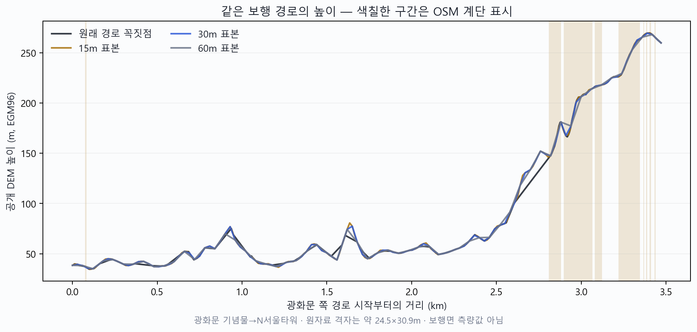
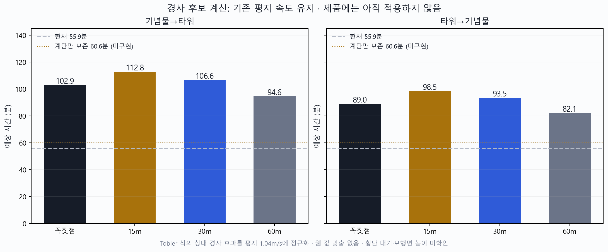

# 고도는 확보했지만, 그대로 붙인 보행 시간은 아직 채택할 수 없다

공개 고도 자료로 실제 보행 그래프의 같은 경로를 양방향 계산했습니다. 오르막·내리막 시간 차이는 재현됐지만, 표본 간격만 바꿔도 예상 시간이 크게 달라졌습니다. 먼저 확인된 계단 시간 전달 손실을 고치고, 고도 입력은 실제 보행면과 경로 선택을 검증한 뒤 연결해야 합니다. 지도 웹 시간에 맞추는 계수나 특정 장소 예외는 만들지 않았습니다.

| 할 일 | 상태 | 진행 |
|---|---|---|
| 고도 원자료 확인 | 끝 | 2/2 타일 = 100% |
| 같은 경로 양방향 계산 | 끝 | 2/2 방향 = 100% |
| 보간·방향·경계 수치 검증 | 통과 | 8/8 = 100% |
| 고도 시간 제품 적용 | 후속 검증 필요 | 0/1 = 0% |

분모는 **한 출발·도착 쌍의 두 방향**입니다. 독립 평가 표본 두 개로 세지 않습니다. 계산값은 모두 공개 DEM에서 나온 **모델 예상**이며 실제로 걸어서 잰 시간이 아닙니다. 기존 40쌍 및 개발 도보 30쌍을 교체하지 않았습니다.

## 확보한 입력과 계산 조건

주 세션이 공개 저장소에서 고도 원자료 두 타일을 실제 내려받았습니다. [확보 기록](../../../../datasets/mobility/raw/elevation_20261008_v1/acquisition.json)의 확보 시각은 2026-10-08 17:48:54 KST, HTTP 상태는 각각 200입니다. 이번 진단은 파일을 다시 읽어 확보 기록의 SHA256과 일치함을 확인했습니다. 원자료 전체의 결측 표시 −32768은 각각 0/12,967,201 셀입니다. **결측이 없다는 사실은 높이가 정확하다는 증거가 아닙니다.**

- [서쪽 타일 N37E126](../../../../datasets/mobility/raw/elevation_20261008_v1/N37E126.hgt.gz): 압축 5,990,516바이트, SHA256 `50823f56c5b9574cd61d52ea1122a1377b922eb4ea568aff6da93b4e57dc59c8`.
- [동쪽 타일 N37E127](../../../../datasets/mobility/raw/elevation_20261008_v1/N37E127.hgt.gz): 압축 13,027,283바이트, SHA256 `ef253d549196ce2239cb8c8c85f912b7f660855dc2cdf969dd174d2689b44a11`.

공식 [Tilezen 형식 설명](https://github.com/tilezen/joerd/blob/master/docs/formats.md)에 따라 gzip을 풀어 big-endian signed int16, 3,601×3,601 배열로 읽었습니다. 수평 좌표는 WGS84(EPSG:4326), 높이 단위는 m, 수직 기준은 **EGM96 geoid**입니다. 북쪽부터 남쪽으로 행을 읽고, 경로 좌표에서 주변 네 셀의 높이를 bilinear 보간했습니다. 경도 127도에서 두 타일의 경계 열은 3,601/3,601 행이 완전히 같고 최대 차이는 0m입니다.

W01 위치의 격자 간격은 남북 30.8875m, 동서 24.4797m입니다. 이는 **표본 격자 크기**로, 수직 정확도나 실제 원천 해상도 보증이 아닙니다. [Tilezen 원자료 설명](https://github.com/tilezen/joerd/blob/master/docs/data-sources.md)은 여러 자료를 합성하며, 특정 지역의 정확한 원천은 footprints 또는 원천 헤더로 확인하도록 안내합니다. 같은 문서는 자료 제작판이 2016~2017년이고 정기 갱신을 계획하지 않는다고 설명하며, 큰 건물 주변 높이 변동 등의 문제를 알립니다. **이번 타일의 원천 촬영·측량일은 확인하지 못했습니다.** 오늘 내려받았다는 사실을 오늘 측량한 값으로 기록하지 않습니다.

실제 입력 좌표는 Google 화면 URL에 공개된 Plus Code 중심인 광화문 기념물(경도126.976859375, 위도37.5760125)과 N서울타워(경도126.988234375, 위도37.5511625)입니다. 네이버·카카오의 검색 출입구 좌표와 정확히 같다는 검증은 아직 하지 않았습니다. 기존 N063의 광화문역 근처 좌표와도 합산하지 않았습니다.

## 같은 로컬 경로에서 관측한 높이

진단 시점의 `road_graph_v2` 보행 경로를 계산한 결과, 양방향 모두 190개의 좌표이며 **정확한 역순 형상**임을 확인했습니다. 그래프 형상 길이는 3,471.100m, 응답 거리는 3,488.1m입니다. 차이 약 17.000m는 라우터가 더한 길 밖 접근 거리로, 응답 선에는 그 접근 형상이 들어 있지 않습니다. 고도 모델에서는 그 17m를 평지 시간으로만 남겼으며 접근 경로·높이를 새로 지어 넣지 않았습니다.



| 항목 | 기념물→타워 | 타워→기념물 |
|---|---:|---:|
| 시작 높이 → 끝 높이 | 38.405 → 259.862m | 259.862 → 38.405m |
| 순높이 차이 | +221.457m | −221.457m |
| 원래 꼭짓점의 누적 상승 / 하강 | 359.477 / 138.019m | 138.019 / 359.477m |
| 계단 표시 구간 길이 | 442.296m | 442.296m |
| 계단 표시 조각 수 | 21개 | 21개 |
| 계단 구간의 DEM 상승 / 하강 | 124.621 / 9.789m | 9.789 / 124.621m |

계단 길이는 실제 선택된 간선의 `F_STEPS` 표시와 좌표 구간으로 계산했습니다. 계단 높이는 DEM 변화를 구간에 겹쳐 배분한 수치이며 **계단 단수·실제 단높이를 측량한 값이 아닙니다**. 균일 표본의 계단 상승·하강은 경계가 표본 사이에 놓이면 거리 겹침 비율로 배분했습니다.

원래 꼭짓점의 최대 절대 경사 `|dh/dx|`는 0.90593입니다. 해당 구간은 경로 시작 약 2,937.86m 지점에서 수평 거리8.94m에 높이8.10m가 변합니다. 이것이 실제 급경사 계단인지, 지형 격자가 보행면과 어긋난 효과인지 이번 자료만으로 구분하지 못합니다. 도시 구간의 높이 굴곡도 같은 한계가 있습니다. **큰 경사를 무조건 노이즈로 잘라 버리거나, 모든 굴곡을 실제 걷는 높이로 확정하지 않습니다.**

## 문헌 계산 후보와 민감도

[Tobler 1993 원문](https://escholarship.org/content/qt05r820mz/qt05r820mz_noSplash_8f1f13a718ba4a0db0079773ffa4a7af.pdf)은 경사에 따라 보행 속도를 계산하는 경험 함수를 제안합니다. 공식 [튀빙겐대 연구 기술노트](https://uni-tuebingen.de/en/research/core-research/collaborative-research-centers/sfb-1070/archive/second-funding-phase/organisation/service-project-s/technical-notes/technical-note-3/)의 명시식과 단위를 확인했습니다.

```text
공표 원형: v(km/h) = 6 × exp(−3.5 × |s + 0.05|)
s = 높이 변화 dh / 수평 경로 거리 dx (둘 다 m)
구간 시간 = 구간 거리 / 구간 속도
```

원형의 평지 속도는 약5.037km/h(1.399m/s)로, 우리 설정1.04m/s보다 빠릅니다. 이를 그대로 연결하면 경사뿐 아니라 평지 기준도 바뀝니다. 별도 후보로 **기존 평지 속도를 유지하는 대수적 정규화**를 계산했습니다.

```text
평지 유지 후보: v(m/s) = 1.04 × exp(−3.5 × (|s + 0.05| − 0.05))
```

이 후보는 출판식 자체와 구분한 **미구현 변형**입니다. 1.04는 기존 설정값이고, 새 OD 보정 계수는 없습니다. 문헌의0.6은 길 밖 보행에 제시된 계수로 계단 전용 근거가 아니므로 이 고도 계산에 쓰지 않았습니다. 표의 모든 고도 모델에는 계단 지연을 별도로 더하지 않았습니다. 급경사와 계단을 무조건 함께 더하면 같은 경사의 부담을 중복 가산할 수 있습니다.

| 표본화 | 정방향 상승 / 하강(m) | 공표 원형 예상(정/역, 분) | 평지 유지 후보 예상(정/역, 분) |
|---|---:|---:|---:|
| 원래 꼭짓점 190개 | 359.477 / 138.019 | 76.521 / 66.150 | 102.943 / 88.991 |
| 15m 간격 233개 | 391.532 / 170.074 | 83.834 / 73.190 | 112.781 / 98.461 |
| 30m 간격 117개 | 382.732 / 161.274 | 79.234 / 69.532 | 106.593 / 93.540 |
| 60m 간격 59개 | 349.000 / 127.543 | 70.344 / 61.058 | 94.632 / 82.140 |

정방향의 표본 좌표를 그대로 역순으로 사용해 지형 조건을 고정했습니다. 15/30/60m는 **민감도 확인용 간격**이며 제품에 채택한 상수가 아닙니다. 원래 꼭짓점은 길고 짧은 선분이 섞여 높이 굴곡을 놓칠 수 있고, 촘촘한 표본은 보간된 셀 변동을 더 많이 담습니다. 거친 표본은 실제 급경사도 평균화합니다. 따라서 “웹에 가까운 간격”을 골라 배포하면 맞춤 보정이 됩니다.



현재 최종 도보 시간은 양방향55.899분입니다. 기존 계단 비율만 보존한 가상 계산은 양방향60.624분입니다. 고도 후보는 방향 차이를 만들지만, 이 한 쌍만으로 실제 시간의 성능 개선이나 상용 사용 가능성을 판정할 수 없습니다. 지도 제공자의 경로 종류·출입구·형상도 로컬 경로와 같다고 입증하지 않았습니다.

별도 웹 관측은 [앞 진단 보고](2026-10-08_1749_도보_계단시간_전달과_지형방향_진단.md)의 원문 링크와 연결됩니다. 네이버 큰길4.1km·82→76분, 카카오 큰길3.8km·82→71분, 최단3.7km·83→71분입니다. 이 웹 값에 가장 가까운 공표식·간격을 골라 정확도나 MAE를 합산하지 않았습니다. 웹의 양방향 형상이 정확히 같다는 증거도 아직 없습니다.

## 후속 구현에 필요한 최소 계약과 판정

계단 시간 전달 손실은 고도 검증과 독립적으로 고칠 수 있습니다. 이번 진단에서는 엔진을 수정하지 않았으며, 주 세션이 다음의 최소 전달 수정을 검토 중입니다.

1. **거리와 시간을 분리해서 끝까지 전달합니다.** 로컬 foot 응답에 내부 `foot_timing{flat_mps, stairs_m, seconds}`를 넣고, `seconds`에 간선 시간뿐 아니라 `route()`가 덧붙이는 접근 시간을 정밀 보존합니다. `BikeRouter`는 내부 메타를 전달하고, `Planner`는 평지 기준을1.04m/s로 정규화한 시간을 사용합니다. `_walk_net`의 기존 `(거리, 길 없음 여부)` 호출 호환은 유지하고 직접 도보·가장 이른 도착에 새 helper를 함께 적용합니다. 접근 `_eff`의 거리 칸에 계단 시간을 거리처럼 끼워 넣지 않습니다.
2. **기존 거리 하한을 잃지 않습니다.** `optimistic` 때문에 거리 하한으로 `wm`이 늘어난 경우에도 최종 초는 `max(정규화 초, wm/설정 속도)` 이상이어야 합니다. 외부 foot 응답은 공급자 `time_s`를 보존하면서 동일 거리 기준의 하한을 검사하고, 시간이 없는 경우 기존 대체식을 씁니다. 음수·NaN·무한 시간은 정상 값으로 쓰지 않습니다. 현재 경로 선택의 계단1.5배와 응답 시간1.667배 차이는 이 전달 수정으로 해결되지 않습니다.
3. **고도는 검증 가능한 보행면 계약 뒤에 붙입니다.** 새 그래프 판에는 가능한 `bridge`, `tunnel`, `layer`, `indoor`, `surface`, `ele`, `incline`, `step_count` 등의 원문 태그와 출처를 보존합니다. 태그가 없다는 사실을 지상 평지로 간주하지 않습니다. DEM은 지상 지형 후보로 쓰고 교량 상판·지하 통로·실내 층간 이동은 별도 높이 근거가 필요합니다. 경사와 계단 시간을 합치는 규칙은 중복 계산 여부를 시험하고 고정해야 합니다.

고도 시간으로 최단 시간 경로까지 고치려면 방향별 간선 비용도 같은 시간 모델로 바꾸고, 부분 간선은 실제 진행한 구간의 높이를 다시 적분해야 합니다. 원간선 시간을 단순 거리 비율로 잘라서는 경사 변화가 사라집니다. A*의 거리 휴리스틱을 그대로 쓰지 않고 시간 단위와 모델 최대속도에 맞춘 하한으로 바꿔야 합니다. Dijkstra 결과와 대조해 최적성부터 확인합니다. **기존 경로에 사후 시간만 붙이는 수정은 최단 시간 경로의 해결이 아닙니다.**

필수 시험은 평지100m=96.153846초, 동일 높이 경로의 방향 반전, 같은 지점0거리, 접근 시간 포함, stairs 비율 유지, 낙관 거리 하한 유지, 메타 없는 외부 응답, 결측 타일·−32768을0으로 채우지 않는 처리입니다. 고도 연결 전에는 교량·지하·계단·일반 길의 알려진 구간과 부분 간선을 추가하고, A*와 Dijkstra 일치 및 모델판·고도해시에 따른 캐시 갱신을 시험해야 합니다. 모델·자료를 선택하는 개발 표본과 최종 판정 표본은 분리합니다.

공개 고도 원천 날짜·보행면이 아직 검증되지 않아 **고도 후보는 제품 채택 보류**입니다. 보류는 자료 폐기나 획득 불가 판정이 아닙니다. 더 높은 해상도의 보행면 높이, 교량·지하 태그, 동일 출입구·같은 경로의 독립 웹 표본을 확보해 후속 검증합니다.

## 재현과 보존

[집계 수치](assets/2026-10-08_walk_elevation_diagnosis_v1/aggregate-evidence.json)와 [검증 기록](../evidence/2026-10-08_1807_도보_고도_양방향_진단_검증.md)에 실행 범위를 남겼습니다. PNG·SVG 모두 실제 계산값으로 생성했고 두 그림을 직접 열어 글자·값·범례를 확인했습니다. 양방향 시간 그림의 눈금을 통일하기 전 출력은 [백업](assets/2026-10-08_walk_elevation_diagnosis_v1/_backup/2026-10-08_눈금통일/)으로 보존했습니다.

이번 작업은 새 진단 스크립트·기록·그림만 만들었고, 엔진 변경·외부 지도 API 호출·cs 프로젝트 서버 배포·커밋·푸시는 하지 않았습니다. 진단 시점의 거리·시간 기준과 주 세션의 이후 수정 결과는 별도로 표시해야 합니다.
