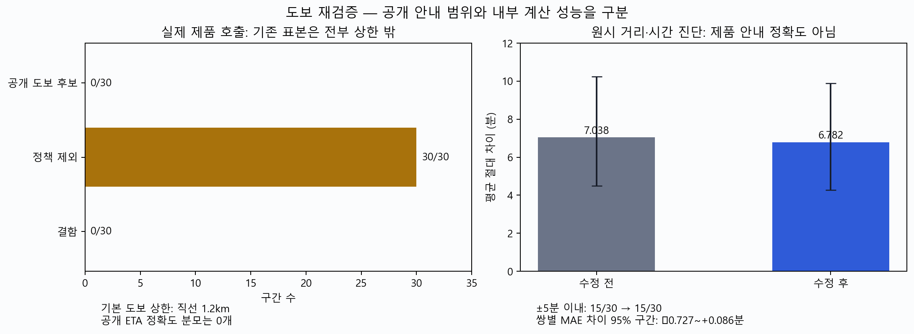

# 기존 30쌍은 제품 도보 범위 밖이었다 — 내부 계산 성능과 공개 안내를 구분한다

수정본의 실제 제품 안내를 전량 호출했지만, 기존 30쌍은 모두 직선 도보 상한1.2km를 넘어 도보 후보가 제외됐습니다. 앞의15/30을 제품 제공률이나 상용 가능한 도보 정확도로 읽으면 안 됩니다. 상한 안 서울역↔남대문시장에서는 왕복 모두 실제 도보 안내가 나왔습니다. 다만 웹과 출입구·경로가 같다고 검증하지 않아 상용 정확도 관문으로 합산하지 않았습니다.

| 할 일 | 상태 | 진행 |
|---|---|---|
| 기존 표본 실제 공개 호출 | 끝 | 30/30 = 100% |
| 내부 시간 전후 진단 | 끝 | 30/30 = 100% |
| 상한 안 왕복 실제 안내 | 확인 | 2/2 방향 = 100% |
| 독립 제품 정확도 판정 | 추가 자료 필요 | 분모 미확정 |

## 앞 수치의 적용 범위 정정

[앞 진단 보고](2026-10-08_1749_도보_계단시간_전달과_지형방향_진단.md)의15/30은 개발용 짧은 구간30쌍의 **원시 거리÷속도 계산이 카카오 최단거리 웹 시간과 ±5분 이내인 수**입니다. 그 코드는 공개 `Planner.leg`의 도보 정책 관문을 통과한 결과를 잰 것이 아닙니다. 기존 기록을 덮어쓰지 않고 이번 기록으로 범위를 정정합니다.

정본 설정의 기본 도보 상한은 직선1,200m, 유아·짐 조건은800m입니다. 이번 조건은 `party_of(None, {})`, `modes=['walk']`, `stage='planning'`, 초행=True, 목표2026-10-08 10:30 KST입니다. 30쌍의 설계 직선은1,617~3,897m이며 실제 좌표 거리로 다시 판정했습니다. 상한·규칙·좌표를 바꾸지 않았습니다.

| 실제 공개 결과 | 구간 수 | 뜻 |
|---|---:|---|
| 도보 후보 제공 | 0/30 = 0% | 이 표본에서 공개 도보 ETA가 없음 |
| 정책으로 제외 | 30/30 = 100% | 직선 상한 초과·공개 사유 no_data |
| 실행 결함 | 0/30 = 0% | 이번 실행에서 예상 밖 오류 미관측 |

공개 ETA·거리 정확도에는 분모가0이므로 ±5분 비율·거리±10% 비율·MAE·CI를 산출하지 않습니다. 정책 제외를 오류나 숨긴 성공으로 세지 않았습니다. `modes=['walk']`로 제한한 확인이며, 다른 이동 수단을 포함한 전체 여행 경로 제공률을 뜻하지 않습니다.

## 실제 계단 전달 수정의 원시 전후 결과

주 세션이 수정한 `GraphRouter`→`BikeRouter`→`Planner._walk_path`를 직접 실행했습니다. 로컬 보행망의 평지1.39m/s·계단 표시로 계산된 정밀 초를 규칙1.04m/s로 정규화하고, 길 밖 접근과 낙관 거리의 추가 하한을 함께 보존합니다. 이번 실제 변경 범위는 로컬 `foot_timing` 전달이며 외부 공급자 `time_s` 사용은 포함하지 않습니다.

원시 진단에는 정책 밖30쌍도 별도 `_walk_path`로 계산했습니다. **실행된 제품 내부 함수의 값**이지만 제품 공개 안내의 정확도가 아닙니다. 수정 전은 저장된 `fresh_ours_transit_100_v1.json`의 소수분·거리 값, 수정 후는 현재 내부 함수의 소수분·거리 값입니다. 공개 분올림 ETA와 소수분을 섞지 않았고, 분올림 원시 진단도 별도 집계했습니다.

| 원시 개발 진단30쌍 | 수정 전 | 수정 후 |
|---|---:|---:|
| 웹 시간과 ±5분 | 15/30 = 50% | 15/30 = 50% |
| 평균 절대 차이(MAE) | 7.037553분 | 6.782234분 |
| MAE bootstrap95% | 4.495057~10.221888분 | 4.284128~9.885309분 |
| 중앙 차이(우리−웹) | +0.287660분 | +0.783028분 |
| 중앙 차이 bootstrap95% | -1.288462~5.616186분 | -0.360674~5.783353분 |
| 웹 거리와 ±10% | 17/30 = 56.7% | 17/30 = 56.7% |
| 평균 절대 거리비 차이 | 12.506319% | 12.507490% |

동일 쌍의 절대 시간 오차 차이는 평균-0.255319분, paired bootstrap95% [-0.726547, 0.085616]입니다. 구간이0을 포함하므로 웹 시간에 대한 일반 개선을 확정하지 않습니다. 계단 표시가 있는 경로는12/30입니다. 이전 단순 가상 계산과 현재 실제 함수는 소수점 거리 처리·실제 직선 거리의 차이 때문에 완전히 같지는 않습니다. 원시 거리의 이전 진단 대비 최대 변화는0.633521m이며, 새 지리 경로 개선이라고 해석하지 않습니다.

반복은 쌍당 실제 공개 호출2회(총60회), 내부 진단1회입니다. 같은 프로세스의 결정론 반복 결과가 일치했으며 현장 보행 편차를 측정한 것이 아닙니다. CI는 OD30쌍을10,000회 재표집, seed20261008로 계산한 개발 표본의 bootstrap입니다. 실제 여행자의 시간 예측구간이 아닙니다. 같은30쌍을 개발에 재사용했으므로 독립 최종 평가가 아닙니다. 기존 앞 보고의2,000회 bootstrap과 재표집 횟수도 구분합니다.

### 쌍별 원시 시간·거리 차이

아래 시간은 모두 소수분 원시 진단입니다. 공개 ETA는 전부 정책 제외입니다. 시간 차이는 우리−카카오 웹, 거리비 차이는 `(우리/웹−1)×100`, 변화는 수정후−수정전입니다.

| 쌍 | 구간 | 웹 분 | 전 원시 분 | 후 원시 분 | 변화 분 | 후−웹 분 | 후 거리비 차이 | 공개 |
|---|---|---:|---:|---:|---:|---:|---:|---|
| N002 | 서울시립미술관→동대문디자인플라자 | 62 | 71.099 | 71.099 | -0.000 | +9.099 | +10.91% | 정책 제외 |
| N012 | 광장시장→시청역 | 39 | 38.630 | 38.630 | +0.000 | -0.370 | +0.44% | 정책 제외 |
| N017 | N서울타워→종묘 | 68 | 63.534 | 68.181 | +4.647 | +0.181 | +10.13% | 정책 제외 |
| N030 | 동묘앞역→종각역 | 51 | 48.886 | 48.886 | +0.000 | -2.114 | -4.67% | 정책 제외 |
| N037 | 용산역→공덕역 | 35 | 45.574 | 45.933 | +0.359 | +10.933 | +35.42% | 정책 제외 |
| N041 | 길상사→인사동 | 62 | 59.527 | 59.527 | +0.000 | -2.473 | -2.25% | 정책 제외 |
| N042 | 노량진역→용산역 | 52 | 60.599 | 60.968 | +0.369 | +8.968 | +14.61% | 정책 제외 |
| N050 | 잠실종합운동장→어린이대공원 | 103 | 105.537 | 105.537 | +0.000 | +2.537 | +1.32% | 정책 제외 |
| N053 | 이화여대→국립현대미술관 서울 | 83 | 74.918 | 74.918 | +0.000 | -8.082 | +3.89% | 정책 제외 |
| N058 | 익선동→성신여대입구역 | 64 | 71.840 | 71.841 | +0.002 | +7.841 | +12.07% | 정책 제외 |
| N063 | 광화문→N서울타워 | 75 | 49.952 | 54.598 | +4.646 | -20.402 | -2.59% | 정책 제외 |
| N064 | 길상사→동묘앞역 | 74 | 72.527 | 73.649 | +1.122 | -0.351 | +2.86% | 정책 제외 |
| N066 | 종묘→서대문역 | 53 | 58.244 | 58.247 | +0.004 | +5.247 | +10.14% | 정책 제외 |
| N071 | 서울역→북촌한옥마을 | 67 | 73.814 | 74.220 | +0.406 | +7.220 | +18.10% | 정책 제외 |
| N073 | 여의도한강공원→마포역 | 35 | 71.635 | 71.635 | +0.000 | +36.635 | +103.18% | 정책 제외 |
| N079 | 남산골한옥마을→동대문역 | 40 | 39.853 | 39.898 | +0.045 | -0.102 | -0.53% | 정책 제외 |
| N080 | 익선동→아현역 | 65 | 76.978 | 76.979 | +0.001 | +11.979 | +20.09% | 정책 제외 |
| N081 | 이화여대→용산역 | 71 | 87.433 | 87.789 | +0.356 | +16.789 | +21.24% | 정책 제외 |
| N083 | 선릉역→잠실새내역 | 58 | 55.122 | 55.122 | +0.000 | -2.878 | -4.46% | 정책 제외 |
| N088 | 낙산공원→삼청동 | 57 | 56.498 | 57.591 | +1.092 | +0.591 | +0.73% | 정책 제외 |
| N089 | 명동성당→국립현대미술관 서울 | 35 | 35.723 | 35.975 | +0.253 | +0.975 | +1.32% | 정책 제외 |
| N090 | 공덕역→청계천 광통교 | 65 | 66.474 | 66.474 | +0.000 | +1.474 | +1.17% | 정책 제외 |
| N091 | 회현역→광장시장 | 44 | 42.896 | 42.896 | +0.000 | -1.104 | -4.40% | 정책 제외 |
| N092 | 종묘→덕수궁 | 47 | 43.481 | 43.486 | +0.005 | -3.514 | -6.43% | 정책 제외 |
| N093 | 시청역→혜화역 | 61 | 60.776 | 60.776 | +0.000 | -0.224 | -2.76% | 정책 제외 |
| N096 | 용리단길→서울역 | 40 | 51.715 | 51.988 | +0.273 | +11.988 | +34.47% | 정책 제외 |
| N097 | 청량리역→왕십리역 | 45 | 50.952 | 51.286 | +0.334 | +6.286 | +13.56% | 정책 제외 |
| N098 | 양재시민의숲→양재역 | 27 | 32.280 | 32.281 | +0.000 | +5.281 | +18.49% | 정책 제외 |
| N099 | 덕수궁→이태원역 | 88 | 72.716 | 72.716 | +0.000 | -15.284 | -7.40% | 정책 제외 |
| N100 | 압구정로데오→삼성역 | 57 | 54.454 | 54.454 | +0.001 | -2.546 | -5.61% | 정책 제외 |

전체 정밀 숫자는 [쌍별 CSV](assets/2026-10-08_walk_product_verification_v1/pair-differences.csv)에 있습니다. 웹 값은 안내 비교이며 직접 걸어 잰 정답이 아닙니다.

## 상한 안 W02의 실제 공개 안내

Google 교정 원문의 공개 Plus Code를 기존에 확인한 [공식 OLC 알고리즘](https://github.com/google/open-location-code/blob/main/python/openlocationcode/openlocationcode.py)의 pair/grid 방식으로 풀었습니다. 별도 라이브러리를 설치하지 않았습니다. 서울역 중심은(경도126.970828125, 위도37.5540375), 남대문시장 중심은(126.977703125,37.5592875)입니다. 셀 높이0.000025도(약2.783m), 너비0.00003125도(약2.758m)이며 실제 출입구 정밀도를 보증하지 않습니다.

| 제품 좌표의 실제 호출 | 직선 | 내부 거리 | 공개 거리 | 원시 시간 | 공개 ETA |
|---|---:|---:|---:|---:|---:|
| 서울역 중심→시장 중심 | 842.412m | 1,179.377m | 1,179m | 19.169205분 | 20분 |
| 시장 중심→서울역 중심 | 842.412m | 1,179.377m | 1,179m | 19.169205분 | 20분 |

방향별2회(총4회) 실제 공개 호출 결과가 같았습니다. 방향2건은 독립 OD1개입니다. 기본1,200m **직선 상한** 안이라 후보가 제공됐으며, 이 두 건을 앞30쌍 분모에 섞지 않습니다. 로컬 경로는 낙관 표시=True, 최대 길 밖 접근87.9m, 큰길 비율51.1%, 계단25.2234m입니다. 내부 거리1,179.3768m는 실제 직선842.4120m×기존우회계수1.4와 같아, 낙관 거리 하한이 지배한 값입니다. 중심 좌표를 실제 출입구처럼 취급하면 안 되는 사례입니다.

정방향 웹 원문의 네이버738m·13분과 비교하면 공개 시간+7분·거리+59.7561%, 카카오972m·19분과 비교하면+1분·거리+21.2963%입니다. **출입구 좌표와 경로 형상이 같다는 확인이 없어 진단 대조에만 씁니다.** 공급자 양방향 경로가 동일하다고 가정하지 않았고, 역방향 제품 값을 정방향 웹 정답으로 합산하지 않았습니다. 표본1개로 상용 준비 완료나95% CI를 만들지 않습니다.

## 코드 근거·검증 범위·남은 일

코드 검토에서 [직접 도보](../../../app/domains/travel_ops/instances/mobility/engine/plan.py:1482)와 [가장 이른 도착 목표](../../../app/domains/travel_ops/instances/mobility/engine/plan.py:1181)는 모두 `_walk_path`에서 받은 분을 `max(1, ceil(minutes))`로 계산합니다. 가장 이른 목표에는 같은 정책 여유가 추가됩니다. 두 경로가 같은 시간식을 사용한다는 코드 근거이며, 별도 유닛 시험을 중복 실행하지 않았습니다. 접근 `_eff`, 경사·고도, 경로 선택 비용과 안내 시간의 목적 일치까지 해결된 것은 아닙니다.

[검증 기록](../evidence/2026-10-09_0002_도보_실제제품_재검증_근거.md)과 [실행 해시](assets/2026-10-08_walk_product_verification_v1/execution-hashes.json)에 실제 시작·끝 입력/소스 해시를 기록했습니다. 30쌍 실행은2026-10-08T23:53:13.444304+09:00~2026-10-08T23:55:18.939966+09:00, W02 실행은2026-10-08T23:56:35.525192+09:00~2026-10-08T23:57:09.922784+09:00입니다. 30쌍 소스31개·입력25개는 실행 중 변경0개, W02 엔진 해시는30쌍과 같고 그 실행 중에도 변경0개입니다. 두 실행 모두 네트워크 연결을 차단했고 시도0회입니다. 이번 진단에서 엔진·규칙·기존 산출물 수정, 커밋·푸시·cs 프로젝트 서버 배포는 하지 않았습니다.

후속 정확도 평가에는 **기본 상한 안의 실제 출입구 좌표**로 평지·계단·교량·지하 연결 구간을 확보하고, 같은 경로 종류·목표 시각을 고정한 독립 표본이 필요합니다. 지형은 [고도 민감도 진단](2026-10-08_1807_도보_고도_양방향_민감도와_구현계약.md)에서 아직 채택 조건을 만족하지 못했습니다. 계단 시간 전달을 고친 사실과 제품 전체의 실제 사용 가능성 판정은 별개로 유지합니다.
