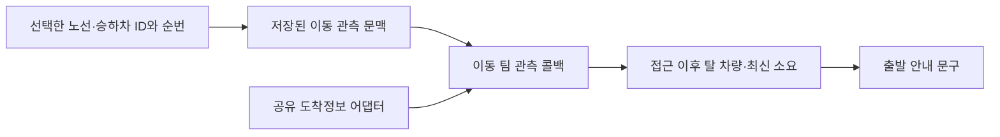

# 버스 실시간 도착정보와 출발 안내 연결의 최소 계약

출발 안내는 아직 저장된 예상 시간을 쓰며, 실시간 버스 도착정보를 소비하지 않는다. 정확한 승차 위치를 유지하는 계약을 먼저 추가하고, 출발 안내에는 이동 팀이 조립한 관측 결과를 전달해야 한다. **이번 작업은 읽기 전용 조사이며 실제 연결 구현은 하지 않았다.**

| 할 일 | 상태 | 진행 |
|---|---|---|
| 호출·저장 경로 확인 | 완료 | 1/1 = 100% |
| 정적 근거 검사 | 확인 | 9/9 = 100% |
| 출발 안내 실제 연결 | 미구현 | 0/1 = 0% |

관측 시각: 2026-10-09T00:08:41.684218+09:00. 검사 분모 9개는 AST·원문 사실 확인 항목이다. 운영 동작 시험이나 실제 버스 운행 정확도 9건이라는 뜻이 아니다. 소스 파일 12개를 읽었고 외부 호출·지도 API 호출은 각각 0회였다. engine·공유 wiki·기존 문서는 수정하지 않았다.

## 현재 끊어진 위치

[일꾼 조립](<C:/Users/playdata2/Documents/final_workspace/final_project_cs/scripts/run_sweepers.py:240>)은 `TravelSources`를 만들지만 `TripReminders`에 `route_events`만 넘긴다. [출발 문구 생성](<C:/Users/playdata2/Documents/final_workspace/final_project_cs/app/domains/travel_ops/components/watch/trip_reminders.py:314>)은 사건을 확인한 뒤 `planned.eta_min`을 그대로 사용한다. `sources.bus_arrival`은 [소스 조립](<C:/Users/playdata2/Documents/final_workspace/final_project_cs/app/domains/travel_ops/ports/data_sources/base.py:607>)에서 이미 만들어진다. 어댑터 부재가 아니라 소비 연결이 빠진 상태다.

[안내 사전 중복 검사](<C:/Users/playdata2/Documents/final_workspace/final_project_cs/app/domains/travel_ops/components/watch/trip_reminders.py:249>)는 이미 `message_exists`를 확인하고 외부 조회를 생략한다. 최종 outbox UNIQUE도 남아 있다. 앞선 진단의 “조회 전에 중복 검사가 필요하다”는 문제는 현재 코드에서 반영된 상태로 구별한다.

더 앞에서 정확한 승차 위치가 빠진다. [버스 후보 생성](<C:/Users/playdata2/Documents/final_workspace/final_project_cs/app/domains/travel_ops/instances/mobility/engine/plan.py:513>)은 x/y 정류장 행을 고르지만 leg에는 노선 이름·승하차 정류장 이름만 넣는다. [버스 구간 검증](<C:/Users/playdata2/Documents/final_workspace/final_project_cs/app/domains/travel_ops/instances/mobility/engine/verify_time.py:766>)과 `_bus_stop_row`는 이름으로 `bus.segment`를 다시 고른다. 같은 이름이 노선에 두 번 나오면 원래 선택한 순번과 달라질 수 있다. [코어 경로 투영](<C:/Users/playdata2/Documents/final_workspace/final_project_cs/app/domains/travel_ops/instances/mobility/engine/plan.py:1704>)은 `_legs`, `_check`, `_lr`를 전달하지 않는다. aggregate wait만 trace에 남으므로 첫 버스의 대기·접근도보·정확 승차 위치를 저장된 경로에서 복원할 수 없다.

## 최소 삽입 지점

1. 이동 팀의 생성·검증 leg에 `route_id`, 승하차 `station_id`와 `seq`를 함께 유지한다. 입력이 정확 ID를 제공하면 같은 노선의 같은 순번인지 검사하고 이름으로 재선택하지 않는다. 노선 표시 이름은 고객 안내용으로 유지한다.
2. 이동 계산 결과에 버전이 있는 관측 문맥을 추가하고 저장까지 보존한다. 현재 `[team_hooks/legs](<C:/Users/playdata2/Documents/final_workspace/final_project_cs/app/domains/travel_ops/components/team_hooks/legs.py>)`와 `[composition 조립](<C:/Users/playdata2/Documents/final_workspace/final_project_cs/app/composition.py:452>)` 경계를 통해 `departure_observer` 같은 콜백을 등록한다. 부품이 `instances.mobility`를 직접 import하지 않는다(D-CS-013). `sources.bus_arrival`은 조립에서 이동 팀 관측 구현에 주입한다.
3. `TripReminders`는 콜백의 상태·근거·소요를 소비하고 문구만 만든다. `run_sweepers`의 안내 경로에서 등록과 주입을 빠뜨리지 않는다. 저장 경로가 다른 일정 생성·코어 CreateTrip·장소 변경·수단 변경도 문맥을 갱신해야 한다. 옵션을 바꾸면 관측 문맥도 새 planned option에 대응해야 한다.



공용 경로 옵션의 허용 칸을 조용히 넓히지 않는다. 관측 문맥을 route option의 optional 계약으로 보낼지, 생성기가 쓰는 `Item.detail`의 내부 문맥으로 저장할지는 계약 페이지에서 먼저 정한다. 추천은 **선택한 옵션별 문맥을 유지하고 Item.detail에서 planned option id와 연결하는 것**이다. 옵션 id만으로 버스 ID를 추정하지 않는다. 옛 저장 경로에 문맥이 없으면 이웃 일정의 확정 장소 좌표로 다시 계산하되 **노선 번호만 보고 적당한 정류소를 고르는 방식은 쓰지 않는다.** 재계산 결과가 저장된 계획 수단과 달라지면 변경 경로로 넘겨야 한다.

## 필요한 문맥과 관측 반환값

| 문맥 칸 | 필요한 이유 |
|---|---|
| schema version·option id·데이터 판 | 저장 이후 다른 선택·판과 섞이지 않게 함 |
| route id·승차 stop id/seq·하차 stop id/seq | 순환·왕복 방향을 정확히 고정 |
| 구간 순서·각 mode·접근도보 초·환승도보 초 | 실제 승차 가능 시각과 후속 환승 재계산 |
| 구간별 model wait·ride·당시 기준시각 | 원래 대기를 교체할 때 중복 계산 방지 |
| 장소 좌표와 이전/다음 항목 연결 | 기존 저장 경로의 재해석과 재경로 확인 |

관측 반환값의 최소 항목은 `status`, `eta_min`, `source`, `confirmed_at`, `provider_received_at`, `route_id`, `stop_id`, `stop_sequence`, `selected_bus_order`, `observed_wait_seconds`, `model_wait_seconds`, `reason`이다. 상태는 실시간 반영·모델 재검증·다른 경로 필요·실패를 구별해야 한다. 일반 `checked_at=now`만으로 도착정보를 새로 읽었다고 표시하지 않는다. 각 구간별 근거를 보존해야 혼합 경로가 일부만 실시간인 경우를 알 수 있다.

`SeoulBusArrival.arrivals`는 route 전체를 한 번 받아 stop id·seq로 필터한다. 캐시 키가 노선 단위라 같은 노선의 정류소 여러 곳은 공유할 수 있다. 정류소 이름과 응답 `dir` 문자열은 정확 ID를 대신하지 않는다. 어댑터는 현재 버스 order 1/2만 유지하므로 이를 차량 고유 ID를 추적한 결과라고 표현하지 않는다.

## 차량 선택과 시간 계산

예를 들어 정류장까지 6분 걸어야 하는데 첫 버스가 3분 뒤 도착한다면 그 버스를 탈 수 없다. 둘째 버스가 9분 뒤라면 접근 6분 뒤의 대기는 3분이다. 도착정보 9분을 “정류장에서 9분 대기”로 더하면 접근 시간이 중복된다.

계약의 계산 순서는 다음과 같다. 초 단위로 계산하고 마지막에 분으로 올림한다.

```text
elapsed = now - confirmed_at
bus_remaining = message_eta_seconds - elapsed
ready_offset = access_walk_seconds + known_boarding_margin_seconds
eligible = bus_remaining >= ready_offset
chosen = eligible한 1/2번 중 가장 빠른 차량
wait_at_stop = chosen.bus_remaining - ready_offset
```

`confirmed_at`은 실제 수신·공유 캐시 최초 수신 시각이며, 재사용할 때 현재 시각으로 바꾸지 않는다. 공급 `mkTm`은 공급 자료의 오래됨·미래시각을 검사하는 근거다. **메시지가 어느 시각부터의 카운트다운인지 검증 없이 mkTm 차이를 추가로 빼지 않는다.** cache 경과와 공급 경과를 둘 다 빼면 이중 차감이 될 수 있다. 현재 설정은 버스 cache 30초, 공유 DB cache 허용, 호출 예산 하루 500회다. 이는 cache 수명이며 공급 자료의 최대 허용 나이·미래 시계 허용 폭과 같다고 간주하지 않는다. 별도 신선도 기준이 계약·설정에 필요하다.

`곧 도착`, `출발대기`, `회차대기`, `운행종료`와 숫자가 없는 메시지를 0초로 바꾸지 않는다. full·is_last는 그대로 기록하고 만차를 확실히 탈 수 있는 버스로 취급하지 않는다. 버스 1/2가 모두 접근 이전에 지나가거나 수치가 없을 때 추정 배차를 실시간 관측으로 표시하지 않는다. 대체는 현재 시각으로 운행·막차·구간 모델을 다시 검증하고 모델 근거를 표시해야 한다. 두 소스 모두 필요한 값을 못 주면 실패 상태를 전달한다.

단일 버스에서 시각대 프로파일이 그대로일 때만 `saved_total - saved_first_wait + observed_wait` 형태로 치환할 수 있다. 실제 승차 시각이 바뀌면 해당 시각대의 ride 모델을 다시 계산해야 한다. 혼합·버스 환승은 후속 승차와 대기·막차까지 순서대로 재검증한다. 먼저 지하철을 타고 나중에 버스를 타는 경로의 먼 미래 승차를 **지금 1/2번 도착정보로 고정하지 않는다.**

출발 안내의 늦게 돈 틱은 `move.starts_at`이 아닌 조회 시점 `now` 이후의 도착을 계산해야 한다. 최신 ETA로 다음 일정에 늦게 도착한다면 낡은 도착 시각으로 출발 안내를 발행하지 않고 기존 감시·재조정 흐름에 전달한다. 알림 문구만 바꾸고 일정 정본을 그대로 두는 것으로 작업 완료를 판정하지 않는다.

## 다음 검증 관문

실제 구현 뒤에는 같은 정류소의 다른 순번, 후보 생성/검증의 선택 일치, 접근 이전 첫 버스 제외, 둘째 선택, cache 경과 차감, 공급 미래시각, 숫자 없는 상태, 만차, 양쪽 실패, 자정·운행일, 혼합 후속 환승, 늦은 틱, 옵션 교체, 중복 틱의 추가 조회 0회, 실시간 도착 증가 시 재조정 전달을 각각 확인한다. 확인기의 9/9는 이런 구현 시험을 대신하지 않는다.

정적 근거는 [AST 검사 결과](<C:/Users/playdata2/Documents/final_workspace/.tmp/mobility_bus_consumer_audit_20261009/source-audit.json>)에 있다. 이 JSON의 source sha256은 파이썬 텍스트 읽기로 줄바꿈을 정규화한 UTF-8 내용의 해시다. 정확한 파일 바이트 해시는 [별도 파일 해시](<C:/Users/playdata2/Documents/final_workspace/.tmp/mobility_bus_consumer_audit_20261009/raw-file-identities.json>)에 기록했다. 재현 스크립트는 [검사기](<C:/Users/playdata2/Documents/final_workspace/.tmp/mobility_bus_consumer_audit_20261009/audit_bus_consumer_contract_v1.py>)다. 새 실행은 출력 폴더 이름을 바꿔 기존 결과를 보존한다.

mock 서버 시험: 수행하지 않음. 실제 소스 원문·AST만 확인했다.
실서버 확인(cs 프로젝트 서버 응답): 안 했음. 실제 버스 API도 이 하위 작업에서 부르지 않았다.
