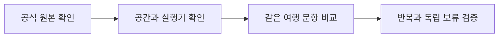

# Saluki 원본 검토와 조건부 여행 질의 시험 준비

Underdog Saluki 27B 1.0은 원본 비교 후보로 검토할 가치가 있지만, 우리 한국어 여행 질의 성능과 설치된 실행기 호환은 아직 측정하지 않았다. 약 7.9GB 파일로 압축됐어도 약 27B 모델이므로 현재 소형 학습 후보 범위에 자동으로 넣지 않는다.

| 할 일 | 상태 | 진행 |
|---|---|---|
| 공식 모델·라이선스 확인 | 완료 | 1/1 = 100% |
| 여행 질의 본 비교 | 조건부 대기 | 0/9425 = 0% |

분모 9425는 계획된 D3·H·E(MX)·D·D2 문항의 합계다. 다운로드나 스모크를 완료했다는 뜻이 아니며, B/C의 복합 선택 평가는 별도 계약을 맞춰야 한다.

## 공식 자료와 해석

2026-10-09 한국 시각에 [공식 모델 카드](https://huggingface.co/ConwayResearch/Underdog-Saluki-27B-1.0), 고정 revision의 API 메타데이터, LICENSE, NOTICE 전체를 읽고 보관했다. 저장소 생성·갱신 시각은 2026-10-08 UTC였으며, 이것을 공개 출시 발표일이라고 확정하지 않았다. 정확한 revision·가중치 SHA·파일 크기·언어·후속 상태는 [후보 목록](../../../../program/research/daily_rag_slm/model_release_watchlist.json)이 정본이다.

카드는 Qwen3.8-27B 계열의 혼합 2비트 GGUF와 선택적 비전 모듈을 설명한다. 이번 후보는 텍스트 파일만 대상으로 한다. 우리 자료 추가 학습은 하지 않았다. 개발사 기반 모델의 지시 학습과 파생 압축은 기록했으나, 추가 학습의 정확한 자료·레시피는 읽은 카드에서 확인하지 못했다. 메타데이터의 선언 언어는 영어이고 한국어 여행 질의 실측은 대기한다. Apache 2.0 본문과 NOTICE를 함께 보존했다.

개발사 도구 호출 시험은 Saluki 88/120, 원본 기반 모델 84/120이고 병렬 호출은 42/100 대 35/100이다. 개발사는 작은 시험의 몇 문항 차이가 반복 편차일 수 있다고 적었다. 이 값은 우리 질의 인식 점수나 상위권 판정이 아니다. 공개된 일부 다른 벤치마크는 실행 도구도 달라 직접 비교의 범위를 제한한다.

## 실행 조건과 재개

[실행 계획](../../../../program/scripts/plan_qa_bench/results/saluki_preflight_20261009/evaluation_plan.json)에 고정 revision 다운로드·SHA 대조·공간 확인·중복 방지·12문항 연결 검사·같은 문항 본 비교의 순서를 남겼다. 현재 조건부 준비이며 실제 실행 대기열의 준비 완료 개수에 합치지 않는다.

GPU 서버 A의 01:10 한국 시각 남은 공간은 약 8.15GiB였다. 텍스트 가중치를 추가하면 3GiB 안전 여유를 지키지 못해 다운로드를 보류한다. GPU 서버 B는 약 20.98GiB였지만 본 학습과 후속 학습 산출물 증가를 고려해 파일시스템 여유·쓰기 한도·실제 보관 위치를 다시 확인해야 한다. 현재 학습을 중단하거나 GPU 시험을 겹쳐 띄우지 않는다. 공간 숫자는 당시 파일시스템 관측이며 저장 할당량 보장은 아니다.

설치된 llama.cpp의 GGUF 구조 로드와 대화 틀을 먼저 확인한다. 공식 카드의 빠른 호출 설정은 생각 끔·온도 0·Jinja 사용이며, 기존 단일 일정 선택 실행기와 같은 입력 정보·JSON 계약으로 시작한다. 실행기·프롬프트 해시·엔진 버전·캐시·문맥 길이·양자화 조건은 시작 전에 고정한다. 연결 검사는 정확도 개선으로 보고하지 않는다.

가중치 파일 크기가 12GB보다 작다는 사실만으로 Oracle ARM 기계의 전체 실행 메모리나 응답 지연이 적합하다고 판정하지 않는다. 현재 ARM 대기열에는 넣지 않았다. 27B 후보는 약 8B 이하 소형 모델의 자동 추가 학습 대상도 아니다. 원본 비교는 계속 준비하되 채택·추가 학습 적합성은 별도 실측으로 판단한다.

## 보존과 검증 범위

- [공식 원본 보관 폴더](../../../../program/scripts/plan_qa_bench/results/saluki_preflight_20261009/)에는 카드·메타데이터·LICENSE·NOTICE와 각각의 SHA를 남겼다. 가중치는 아직 받지 않았다.
- [수정 직전 후보 목록 백업](../../../../program/research/daily_rag_slm/_backup/2026-10-09_011710_saluki_review/)을 보관한 뒤 기존 두 후보를 유지하고 Saluki를 추가했다.
- 조사 완료는 이 한 후보의 공식 자료 검토 범위다. 오늘의 전체 논문 조사·전체 신모델 조사·GPU 본 비교 완료로 표시하지 않는다.
