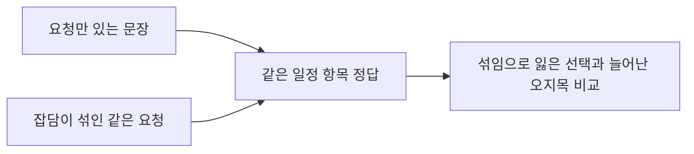

# E 혼합 평문 평가셋의 고도화 범위와 검수 상태

E(MX)는 A~E 중 **잡담이 섞인 자유 문장에서 일정 항목을 찾는 능력**을 더 깊게 진단하는 설계다. 그러나 사람 검수와 독립 최종 검증까지 끝난 평가셋은 아니므로, 통과만으로 상용화 준비가 됐다고 판정하지 않는다.

| 할 일 | 상태 | 진행 |
|---|---|---|
| 혼합·대조 짝과 같은 정답 확인 | 완료 | 2,007/2,007 = 100% |
| 사람 점검 표본의 판정 기입 | 미완료 | 0/158 = 0% |
| 전체 평가셋의 완성도 | 단일 비율로 정의 안 됨 | 분모 없음 |

## 무엇이 더 발전했나

요청만 있는 문장과 그 요청에 잡담을 섞은 문장을 짝지었다. 예를 들어 일정 항목 하나의 시간을 바꿔 달라는 요청에 날씨 잡담이 붙었을 때, 원래 맞히던 선택을 잃는지 별도로 확인한다. A~D의 역할을 모두 대체하는 상위 세트라는 뜻은 아니다.

`[실측]` 본 평가 입력은 혼합 2,007개와 대조 2,007개, 총 4,014개다. 혼합 문장 중 기존 항목을 찾아야 하는 것은 1,033개, 기존 항목을 선택하면 안 되는 것은 974개다. 후자는 여행과 무관하다는 뜻이 아니다. 새 일정 추가나 여행 전체 변경처럼 여행 관련 요청이어도 기존 항목 하나의 번호는 정답이 아닐 수 있다.

## 완성도를 제한하는 근거

| 확인 항목 | 현재 근거 | 판단에 미치는 영향 |
|---|---|---|
| 문장 자연스러움 | 코드 이어 붙임 1,768/2,007 = 88.09%, 모델 작성 자연 혼합 239/2,007 = 11.91% | 실제 고객 발화 대표성을 충분히 입증하지 못함 |
| 정답 검수 | 저장된 사람 판정 0/158 | 두 모델의 라벨 합의를 사람 정답으로 간주하면 안 됨 |
| 어려운 사례 | 구성 전 이견 558개 제외, 그중 요청 없는 일정 언급 410개 | 합의 사례만 남긴 선택 편향을 별도 보완해야 함 |
| 복합 요청 | 실제 두 항목 요청 59개는 본 점수 밖 도전 문항 | E 단일 선택 점수가 복합 처리 성능을 입증하지 않음 |
| 입력 독립성 | 일정 머리말 식별자 59개, 근접 문장 격리 31쌍 | 59개의 독립 고객 여행 또는 4,014개의 독립 표본으로 해석하지 않음 |

`[실측]` 생성기의 근접 중복 검사는 지정된 H 학습·시험 파일과 요청 부분을 대조한다. 모든 과거 학습 자료를 망라한 검사는 이 구현 범위에서 확인되지 않았다. 일일이 다시 본 E 점수는 개발·회귀 진단에 유용하지만 새 독립 보류 자료의 최종 검증을 대신하지 않는다.

`[미확보]` 실제 고객의 다양한 자유 입력, 사람 확정 정답, 다항목 반환 계약의 평가, 새로운 고정 보류 자료 검증이 더 필요하다. E는 일정 참조 인식을 잰다. 검색 근거의 정확성·최신성, 최종 답변, 사용자 격리, 실제 도구 실행과 운영 안정성은 각 별도 평가로 검증해야 한다.

## 검증과 재개

원본 데이터는 변경하거나 재생성하지 않았다. [읽기 전용 감사 도구](../../../../program/scripts/plan_qa_bench/audit_e_maturity.py)를 실행해 파일 SHA, 짝 구조, 제외 문항과 저장된 사람 판정 칸을 [구조화 근거](../../../../program/scripts/plan_qa_bench/results/e_maturity_audit_20261009.json)에 새 이름으로 보존했다. 감사 실행은 사람 정답 검수나 모델 정확도 시험이 아니다.

재현할 때는 `python program/scripts/plan_qa_bench/audit_e_maturity.py --output <새 결과 파일>`로 실행한다. 기존 결과 이름은 덮어쓰지 않는다. 한국어 CSV 헤더의 원본 유니코드와 판정 열 위치를 확인했으며, 터미널 표시 인코딩을 데이터 손상으로 오인하지 않았다.

정답 보완은 기존 점수·원본을 보존한 별도 버전에서 진행한다. 이견 사례를 사람 검수해 포함할 때는 과거 점수와 같은 분모로 섞지 않는다. 최종 검증은 [독립 보류 계약](../../../../program/research/daily_rag_slm/independent_holdout_contract_2026-10-08_v1.md)에 연결한다.

## 관계

- [기존 설계와 생성 조건](../../../../program/research/시험세트_MX_설계_2026-10-07.md) — 이견 제외·유형·사전 기준의 원본 기록.
- [현재 모델 평가 기준](../../quality/slm-model-evaluation.md) — 개발 점수와 모델 채택을 구분하는 정본.
- [원본 데이터 폴더](../../../../datasets/travel/mx_testset/) — 공개 저장소 밖 여행 입력과 판정 자료.
