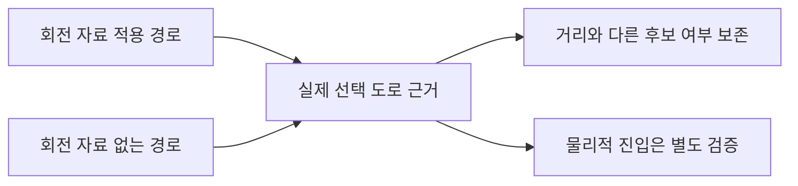

# 차량 대체 경로의 실제 선택 거리와 좌표 이동 통제 실험

회전 자료가 없는 차량 경로도 실제 선택한 출발·도착 도로의 거리를 보존하도록 고쳤습니다. 실제 지도에서는 출발점을 도로 위로 옮겨도 다른 도로를 다시 선택하는 조건을 확인했습니다. 이 조건의 합법 진입 여부는 아직 판정하지 않았습니다.

| 할 일 | 상태 | 진행 |
|---|---|---|
| 수정 전 거리 유실 재현 | 재현 | 4/4 = 100% |
| 수정 후 확대 시험 | 통과 | 695/695 = 100% |
| 포함 관련 시험 | 통과 | 57/57 = 100% |
| 실제 지도 교대 계산 | 완료 | 6/6 = 100% |
| 새 웹 경로 관측 | 미확보 | 0건 |

## 원인과 변경

회전 자료를 읽는 경로의 거리 표시는 직전 단계에서 수정했지만, 자료가 없는 일반 차량 경로는 복원한 실제 간선 대신 가장 가까운 후보를 사용했습니다. 8.8m 간격의 나란한 합성 도로에서 직행/연결·A*/Dijkstra 네 조건 모두 실제 시작/끝은 두번째 후보인데 snap_m은0m/0m였습니다. 후보를 주입한 개발 단위 시험이며 독립 검증 표본이 아닙니다.

일반 경로 복원도 실제 선택 후보를 거리·품질에 사용하고, 회전 적용 경로와 미가용 경로가 같은 선택 근거를 만들게 했습니다. 미가용 상태·회전 적용 범위·차량 후보폭/경로 비용은 유지했습니다. 도보·자전거는 기본 후보 하나라 이 대체 후보 유실을 운영 재현으로 주장하지 않습니다. 해당 정책과 기존 거리/계단 시간은 확대 시험으로 확인했습니다. 자동차·택시 요금 상수나 특정 좌표별 보정은 넣지 않았습니다.

## 실제 지도 통제 계산

| 입력 조건 | 선택 도로까지 거리 | 정적 모델 거리·시간 | 선택 순위 |
|---|---|---|---|
| 기존 좌표 | 8.8m | 98.29m·9.175초 | 두번째 후보 |
| 이전 선택 도로 위로 출발점 이동 | 10.9m | 87.32m·7.859초 | 세번째 후보 |

두 조건을3회 교대해6회 계산했습니다. 출발 요청좌표가 다르므로 정확도 개선율이나 독립6표본으로 세지 않습니다. 후보 중 경로 비용이 작은 도로를 고르는 현행 정책은 좌표 이동만으로 도로를 고정하지 않습니다. 실제 접근/도로 측면/진입 방향 대조가 필요합니다. [좌표·선택 근거·반복 원문](../evidence/2026-10-09_0336_회전자료없는_선택도로_거리/legacy-snap-real-probe-v1.json).

새 네이버 조회는 기존 탭의 화면 전환, 좌표 검색 이동, 새 탭의 같은 좌표 검색을 시도했으나 화면 이동 완료를 확인하지 못했습니다. 구글·카카오는 새 조회를 실행하지 않았고 이번 새 웹 관측은0건입니다. 지도 개발자 API 직접 호출0회. 이전100m/약800m 관측을 이번 조회 결과로 바꾸지 않았습니다. [시도 기록](../evidence/2026-10-09_0336_회전자료없는_선택도로_거리/web-attempt-v1.json).

[OSRM 공식 문서](https://project-osrm.org/docs/v26.5.0/http#general-options)의 방향·반경·도로 측면 제약을 오늘 확인했습니다. 이는 단순 좌표와 도로 측면 통제를 구분하는 참고이며 이번에 OSRM API를 호출하거나 그 기능을 제품에 구현한 것은 아닙니다. 실제 진입 방향이 없는 입력에 방향을 추정해 넣는 근거로 쓰지 않습니다.

## 검증과 보존

수정 전4/4실패 로그와 XML을 보존했습니다. 최초 목표 실행은50통과·7준비오류였으며 기본 임시 폴더 생성 실패가 원인으로 표시됐습니다. 전체 최종 실행은 워크스페이스 안의 새 임시 폴더에서 네 프로세스로 순차 실행했습니다. 관련57개는 그 확대 실행의 같은 시험 ID를 찾아 센 수이며 중복 합산하지 않습니다. 단일 프로세스 전체 회귀나 상주 메모리 검증으로 부르지 않습니다. 이전 코드/자료11개는 현재 유지 파일과 수정 직전 graph_router 백업으로 원판 일치를 확인했고 기존 웹 원문7/7해시도 일치했습니다. [코드·자료 해시/분모](../evidence/2026-10-09_0336_회전자료없는_선택도로_거리/verification-proof-v1.json)·[실행 명령과 종료코드](../evidence/2026-10-09_0336_회전자료없는_선택도로_거리/car-legacy-regression-v1-commands.json).

mock 서버 시험(화면 반응): 안 했음. 합성 도로의 후보 주입 시험 포함.
실서버 확인(로컬 개발 DB 연동): 확대 출발 안내 시나리오에서 했음. 배포된 cs 프로젝트 서버 응답 및 실제 탑승·결제: 안 했음.

[21개 기능 시각화v15](assets/2026-10-09_mobility_readiness_v15/mobility-readiness.html)는 기존 조건부4·개선9·추가검증8 판단을 승격하지 않았습니다. 실제 진입 도로 고정·복잡한 회전·1.2km내 정렬된 도보 표본·혼합 운임·늦음 재조정이 계속 필요합니다.

원본 코드·위키는 [수정 전 백업](../evidence/2026-10-09_0336_회전자료없는_선택도로_거리/before-backup.json), 위키/결함 상태 갱신 전은 [추가 백업](../evidence/2026-10-09_0336_회전자료없는_선택도로_거리/publication-backups-v1.json)에 보존했습니다. 이전 보고서와 시각화는 덮지 않았습니다. 커밋·푸시·배포·외부 메시지 전송은 하지 않았습니다.
