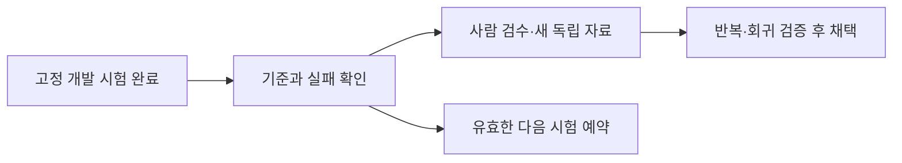

# 6시간 GPU·Oracle ARM 완료 회수와 후속 진단

[실측] Saluki의 전체 개발 시험은 끝났지만 요청이 없는 문장에도 항목을 자주 고르므로 채택하지 않는다. GPU 서버 A에는 FINCH 추가 평가를 보충해 계산을 다시 시작했고 Oracle ARM에는 긴 응답 지연을 확인할 캐시 대조를 예약했다.

| 할 일 | 상태 | 진행 |
|---|---|---|
| Saluki 다섯 개발 평가 | 완료·오류/미완료0 | 9425/9425 = 100% |
| 새 GPU 완료 답안 회수 | 13세트·SHA 확인 | 27555/27555 = 100% |
| ARM 첫 완료 실행 회수 | 문항·SHA 확인 | 360/360 = 100% |
| E 표본 사람 판정 | 미작성 | 0/158 = 0% |

관측 시각은 2026-10-09 한국 시각 ARM07:55:39, E07:56:23, GPU 최신 실행08:06:44이다. 이전 보고의 Saluki184개는 당시 부분 결과이며 이번에는 완료 원문을 회수했다. ARM 첫 실행은01:56:12에 이미 끝났고 이번 회차의 변화는 회수·검증이다. 아래 표와 상태는 해당 시각의 관측이며 미래의 무중단 가동을 입증하지 않는다.

## 지금까지 완료한 일의 의미

기존 oos3/oos2r·MAI 지정 비교는 완료·보관 상태를 유지했다. 학습 자료 변경이 어려운 잡담을 개선해도 정상 요청을 놓칠 수 있어 다른 후보의 자료를 두 번째 판으로 일괄 바꾸지 않는다. 이번에는 새로운 배포 원본 Saluki의 같은 문항 비교를 끝내고 cosine 학습판의 남은 결과를 회수했다. FINCH라는 학습률 조절 방법과 같은 조건으로 비교할 후속 평가를 준비했다. 모델 변경의 정확도와 같은 모델의 실행 속도는 각각 다른 시험이다.

Saluki는 개발사 배포 원본 IQ2-mix이며 **우리 자료 추가 학습 없음**이다. 개발사 계열 학습·양자화는 별도로 기록했다. 약27B라 현재 언어 부분 약8B 이하의 자동 파인튜닝 대상에 넣지 않는다. 본 비교는 다섯 고정 개발/회귀 세트를 각1회 실행한 범위다.

| Saluki 세트 | 정상 요청 정답 | 요청 없음 오지목 | 완료 문항 |
|---|---|---|---|
| D | 771/883 = 87.32% | 76/1786 = 4.26% | 2735/2735 = 100% |
| D2 | 정상 문항0·비율 없음 | 68/1000 = 6.80% | 1000/1000 = 100% |
| D3 | 107/120 = 89.17% | 17/240 = 7.08% | 360/360 = 100% |
| H | 434/461 = 94.14% | 305/855 = 35.67% | 1316/1316 = 100% |
| E/MX 혼합 | 997/1033 = 96.52% | 157/974 = 16.12% | 4014/4014 = 100% |

D의 완료2735는 단일 선택2669와 복합 진단66을 포함한다. 정상/요청없음 열은 단일 선택만이며 복합66은 별도로 집계했다. E 완료4014는 혼합2007와 같은 정답 대조2007이다. 모든 예정 문항을 확인했고 오류·해석실패·미완료0이다. 실패가 생기면 전체 예정 분모에 남긴다.

E 합산 기준은3/4=75%다. 선택률95% 이상·선택 손실2%p 이하·오지목 증가1%p 이하는 충족했지만 **오지목1% 이하**는 실패했다. 대조 정답1008/1033에서 혼합997/1033으로 선택 손실1.06%p, 대조 오지목155/974에서157/974로 증가0.21%p다. 지정 부류MX3·MX4도 실패했다. 합산 기준 일부 통과를 제품 채택으로 쓰지 않는다. 구간·짝지은 검정·세부 부류와 cosine 결과는 [GPU 집계 리포트](2026-10-09_0810_gpu-saluki-cosine-completion-finch-refill.md)를 본다. 현재1회 결과로 일반 우열·원본 비교군의 최종 순위를 확정하지 않는다.

## 현재 실행·대기·실패와 보관

[실측08:06:44] GPU 서버 A는 기존 실행기PID342497 그대로 FINCH D를153/2735=5.59%까지 저장했고 GPU83%를 관측했다. 준비 평가7개·조건 대기0개다. 기반 모델 전체 해시·어댑터 구조·입력 해시 대조 뒤 추가10평가18850문항을 등록했고, 먼저 끝난 두 양자화판의D3 720개도 후속 회수했다. 끝난 Saluki는 반복하지 않는다.

[실측08:06:44] GPU 서버 B는 별도 시드20261013 FINCH100/654=15.29%, GPU100%이며 다음 준비 학습3개를 확인했다. 처음 구성한17평가/5학습을 현재 숫자로 쓰지 않는다. 처음 확인할 때 GPU 서버 A는 대기열이 소진돼 계산이 멈춰 있었고 이번 보충으로 다시 계산했다. 이전6시간 내내 계산했다고 표현하지 않는다.

Saluki의 GPU 서버 B 디스크 보관 전송은03:10에 연결이 끊겨 부분 파일을 남겼다. 원본 시험 성공과 보관 전송 실패를 구분한다. 기존 부분파일과 원본의 동일 구간 해시를 대조하고 남은701432960바이트만 별도 전송해 **7898369152/7898369152바이트=100%·전체SHA 일치**로 복구했다. 실패 기록과 부분 파일은 수정 전 백업했다. 이 사본은 기존 GPU 서버 B 디스크에 있으며 기계 밖 가중치 보관까지 완료한 것은 아니다. [복구 원문](../../../../program/scripts/plan_qa_bench/results/gpu_backlog_20261008/saluki_preservation_resume_hb0754_20261009/resume_verification.json).

학습 어댑터·로그·기본 평가17파일은 로컬 회수·해시 검증했다. 이번 GPU 본 회수는13세트27555답안·72파일SHA이며 부모 에이전트도 독립 재계수했다. 현재 준비 목록은 [GPU 최신 상태](../../../../program/research/daily_rag_slm/gpu_backlog_2026-10-09.json)와 실제 프로세스를 함께 확인한다. 새 결제·임대·모델 삭제·실서비스 배포는 하지 않았다.

## Oracle ARM: 충분한 계산과 긴 응답 시간

[실측07:55:39] 실제2코어·약12GB 기계의 지속 서비스가 실행 중이고 기존 잠금을 보유했다. 최근300.06초의 시간 가중 작업 CPU 사용률은 **두 코어 전체 대비89.73%**로20% 목표를 충족했다. 기계 전체 사용률90.27%, 가상화 대기0.17%, 작업 메모리약8.90GiB, 남은 공간약50.66GiB다. CPU상한1.8코어·메모리10GiB를 유지했다. 이 관측은 정상 추론 구간이며24시간 유지나 cs 프로젝트의 API·DB·검색·웹 전체 배포 완료를 뜻하지 않는다.

기존 합친 여행 학습판 E4B Q4_K_M의 D3는 정상107/120=89.17%, 요청 없음 오지목29/240=12.08%, 오류/해석실패0/360이다. 정확한oos레시피는 아직 대조하지 못했다. llama.cpp bed0a8566·추론2스레드·시드20261008·온도0·최대16토큰·직렬1회 실행이다. GPU의 다른 모델/버전 경로와 속도 배수를 직접 비교하지 않는다.

첫 요청174.50초, 첫 요청을 뺀359개의 중앙값156.13초, 전체360개의p95 174.69초다. 실행기 시간 합계의98.76%가 긴 입력을 읽는 처리에 쓰였다. CPU를 충분히 사용한다고 사용자 응답이 빨라지는 것은 아니다. 캐시 토큰 중앙값1이며 문맥 재사용 개선 가능성을 가설로 남겼다. [문항·버전·분자/분모·지연](../../../../program/scripts/plan_qa_bench/results/heartbeat_20261009_0754/arm_counts_verified.json).

[등록07:59:39] 원문·정답이 같은D3 60문항(정상20·요청없음40)을5개 일정 문맥으로 묶고 캐시 켬/끔/끔/켬 순서로4개 진단을 등록했다. 진행 중인Q8 작업 뒤에 이어지며 기존10작업과 실행기PID를 유지했다. 최초10설정7254호출에서14설정7494호출로 보충했고 등록 직후 준비12개다. 새 진단 완료는0/240=0%, 개선 실측은 대기다.

진단 통과 조건은 같은55개 문맥 내 후속 질문의 중앙값이 캐시 끔보다30% 이상 짧고 새 오류·정답 손실이 없는 것이다. 전체60개·문맥별 첫5개·첫 적재도 따로 보관한다. 240회 반복을 독립 정답 표본240개로 합치지 않는다. 새 자료의 [원문·해시·재현 방법](../../../../datasets/travel/arm_cache_diagnostic_20261009/REPORT.md)과 [등록 증거](../../../../program/scripts/plan_qa_bench/results/heartbeat_20261009_0754/arm_cache_registered.json)를 확인한다.

## 검증 대기와 다음6시간

E는 평문 안의 요청과 일정 항목을 연결하는 가장 고도화된 기존 혼합 진단이지만 사람 검수 완료 평가셋은 아니다. 이번 감사에서도 사람 판정0/158=0%, 같은 정답 혼합/대조2007/2007=100%를 확인했다. 일반 여행 요청·새 요청이 정답null인 경우도 있어 모든 여행 의도·검색·답변 품질 관문으로 확대하지 않는다. [E 감사 리포트](2026-10-09_0214_e-testset-maturity-audit.md)와 [이번 원본 재검사](../../../../program/scripts/plan_qa_bench/results/heartbeat_20261009_0754/e_maturity_audit.json)에 구성과 한계를 남겼다.

독립 보류 목표는 정상240·요청없음480의720개 기본 질의다. 실제 새 자료 작성·사람 검수·고정은 미완료이며 통과로 쓰지 않는다. 기존 개발 자료로 반복 조정한 뒤 같은 자료를 최종 검증으로 부르지 않는다. [별도 자료 계약 초안](../../../../program/research/daily_rag_slm/independent_holdout_contract_2026-10-08_v1.md).

다음6시간에는 다음을 이어간다.

1. FINCH 추가평가를 회수하고 같은 기반·양자화·문항의cosine과 대조한다. 별도 시드 학습이 끝나면 어댑터·레시피·기본 평가를 회수하고 필요한 추가 평가를 보충한다.
2. ARM Q8 완료와 캐시 교대의 지연·캐시·오류·자원을 회수한다. 아직 진행 중이면 중단하지 않고 관측 시각과 검증 대기를 남긴다.
3. E 검수 자료와 별도 보류 자료 준비를 이어간다. 사람 검수는 실제 사람이 판정하기 전 완료로 표시하지 않는다.
4. 일일 오전10시 논문·모델 출시 조사를 유지한다. 이번 회수를 최신 논문 조사 완료로 표시하지 않는다. 준비 작업이 기계별3개 미만이면 필요한 누락 시험을 보충한다.

## 원본 근거와 수정 직전 백업

- [GPU 답안·SHA 부모 재검증](../../../../program/scripts/plan_qa_bench/results/heartbeat_20261009_0754/parent_results_verification.json):13세트27555개와 Saluki5세트의 분자/분모 재계수.
- [ARM 완료 답안](../../../../program/scripts/plan_qa_bench/results/heartbeat_20261009_0754/arm_completed/e4bt_q4_d3/) · [회수SHA4/4](../../../../program/scripts/plan_qa_bench/results/heartbeat_20261009_0754/arm_archive_verification.json).
- [ARM 최신 날짜 상태](../../../../program/research/daily_rag_slm/arm_serving_2026-10-09.json): 실제 관측과 등록 시각·진단 재개 지점.
- [기존 예약 변경 검증](../../../../program/research/daily_rag_slm/six_hour_reporting_2026-10-09.json):6시간 보고와 매일 연구를 유지, 중복 예약 없음.
- [수정 직전 문서 백업 목록](../../../../program/scripts/plan_qa_bench/results/heartbeat_20261009_0754/document_backups.json) · [데이터 색인 백업](../../../../datasets/_backup/2026-10-09_080545_arm_cache_diagnostic_registration/): 과거 근거와 다른 작업 변경을 보존했다. ARM manifest는 등록 전 같은 폴더의 `_backup/2026-10-08_225939_arm_cache_ABBA`에 복사하고 새 내용은 원자적으로 교체했다.
