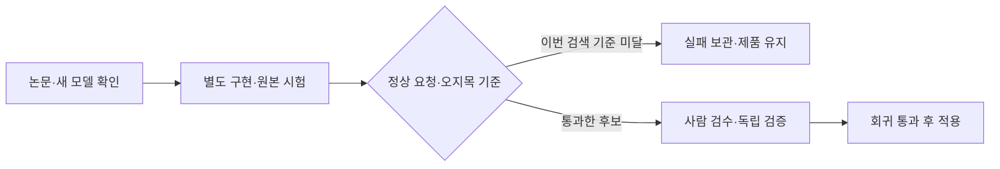

# 일일 논문 검토와 실제 시험

검색 개선 구현은 실제로 시험했으나 전체 기준을 통과하지 못해 제품에 적용하지 않았다. 새 소형 결정 모델은 원본 조건을 검토해 기존 GPU 대기열로 시험 준비를 진행하고, 완료된 학습판과 ARM 답안을 회수했다.

| 할 일 | 상태 | 진행 |
|---|---|---|
| 선정 논문 방법·조건 검토 | 완료 | 3/3 = 100% |
| 검색 구현 로직 검사 | 통과 | 7/7 = 100% |
| 고정 개발 자료 검색 실측 | 완료·기준 실패 | 1700/1700 = 100% |
| 공식 신모델 revision 확인 | 완료 | 6/6 = 100% |
| ARM 신규 완료 답안 회수 | SHA·문항 일치 | 360/360 = 100% |

관측·기록 시각: 2026-10-09T10:15:13.532449+09:00. 선정 조사는 전 세계 출시 전체를 망라하지 않는다. 발표일과 확인일은 아래 원문·구조화 기록에서 구분한다. 검색의 개발 A/B는 일정 선택의 A~E 시험과 다르다.

## 논문에서 선택한 방법과 적용 조건

- [검색 관련성과 다양성 연구](https://arxiv.org/html/2610.09412v1), v1 10월7일: 비슷한 근거가 상위를 차지할 때만 다양성을 높이는 방법이다. 기존 벡터로 계산할 수 있으나 실제 필요한 근거 수를 모르면 정상 근거를 밀어낼 수 있다. 공개 식을 별도 구현했다. 저자 코드를 복사하거나 전체 벤치마크를 재현한 것은 아니다. [저자 저장소](https://github.com/GuillaumeBrouillette/finding-the-right-balance)는 확인했으나 커밋은 고정하지 않았다.
- [페이지 단위 RAG 연구](https://arxiv.org/html/2609.34776v1), v1 9월28일: 프랑스어 PDF595문항에서 페이지·문자/의미 검색 합산·재정렬·질문 분해를 비교했다. 220단어/40겹침, RRF60·목록60 조건 중 합산만 시험했다. 분해 세부 프롬프트 등은 열린 원문에서 충분히 확보하지 못해 전체 파이프라인 재현으로 표시하지 않는다.
- [도메인 추가 학습과 일반 능력 연구](https://arxiv.org/html/2509.20758v3), v1 2025년9월25일·v3 2026년1월28일: 작은 학습률과 토큰 손실에 따른 가중치를 검토했다. 낮은 확률의 일정 ID·null 토큰을 덜 학습할 위험이 있어 현재 두 시드 비교와 토큰별 진단을 먼저 회수한다. 이 방법은 구현·학습 중이 아니다.

각 방법의 해결 문제·추론/학습 비용·회귀 위험·개발/보류 자료·합격 기준·재개 지점은 [선정과 검토 원본](../../../../program/research/daily_rag_slm/2026-10-09_sources_and_review_v1.json)에 있다. 논문 수치를 우리 실측으로 옮기지 않았다. 최근 하루 검색을 우선한 뒤 기간을 넓혔으며 새로 확인한 이전 연구를 새 발표라고 부르지 않는다.

## 검색 실측 결과

여행 문서130개와 기존 BGE-M3 임베딩 캐시를 고정했다. 총340개 고유 개발 질문(A180·B160)을 방식5개로 재생해1700개 결정을 보관했다. 생성 모델 호출은 없으며 실패0개다. 정상 분모는 A100/B48, 요청 없음은 A60/B50, 부분 근거 질문 A20/B62는 별도 상태로 남겼다. 정답 근거@3는 허용 정답 문서 중 하나라도 상위3개에 있으면 맞음이다. 원문 수치·고유명사·출처·사용자 격리 계약은 바꾸지 않았다.

| 검색 방식 | RAG 개발 A 정답 근거@3 | A 요청 없음 오노출 | RAG 개발 B 정답 근거@3 | B 요청 없음 오노출 |
|---|---|---|---|---|
| dense_E | 93/100 = 93.00% | 4/60 = 6.67% | 35/48 = 72.92% | 0/50 = 0.00% |
| RRF_dense_BM25 | 93/100 = 93.00% | 2/60 = 3.33% | 33/48 = 68.75% | 0/50 = 0.00% |
| RNG_gamma0 | 94/100 = 94.00% | 4/60 = 6.67% | 35/48 = 72.92% | 0/50 = 0.00% |
| adaptive_MMR_h1 | 93/100 = 93.00% | 4/60 = 6.67% | 35/48 = 72.92% | 0/50 = 0.00% |
| adaptive_MMR_h2_assumed_diagnostic | 92/100 = 92.00% | 4/60 = 6.67% | 32/48 = 66.67% | 0/50 = 0.00% |

RRF는 A의 오노출을 줄였지만 B 정답 근거는35/48에서33/48로 떨어졌다. RNG는 A 한 질문만 늘고 B는 그대로다(같은 문항 정확검정 p=1.0). h1은 원래 상위 결과와340/340 동일하다. h2는 정답에서 추정한 값이 아니라 필요한 근거를2개로 가정한 진단이며 실제 복합 근거 판별기의 성능이 아니다. B가32/48로 떨어져 적용하지 않는다. 모든 방식은 세트별90% 적중·요청 없음2% 이하·기존 정상 근거 보존 기준을 통과하지 못했다. 같은 개발 자료로 매개변수를 더 고르지 않는다.

별도 보류 검증은 아직 하지 않았다. 전에 사용한 H 파일은 이번 실행에서 읽지 않았다. 선택 계산의 짧은 CPU 시간은 임베딩·BM25 준비·답변 생성·네트워크를 제외한 관측이며 실서빙 지연 비교가 아니다.

[사전 고정 조건](../../../../program/research/daily_rag_slm/2026-10-09_retrieval_prereg_v1.json) · [실행 도구](../../../../program/scripts/rag_gate/rag_improve/selective_retrieval_20261009.py) · [전체 집계](../../../../program/scripts/rag_gate/results/daily_20261009_selective_v1/summary.json) · [1700개 원본 결정](../../../../program/scripts/rag_gate/results/daily_20261009_selective_v1/decisions.jsonl).

## 새 모델 원본 비교 준비

| 공식 배포판 | 전체 매개변수 | 가중치 바이트 | 현재 준비 상태 |
|---|---|---|---|
| Valen-0.8B | 854,305,641 | 3,417,285,852 | 원본17파일 SHA 확인, CPU12/12 통과, GPU 연결→본5개 조건부 등록 |
| Valen-2B | 2,214,825,577 | 8,859,381,820 | 기존 공간과3GiB 보존 조건 초과 |
| Valen-4B | 4,540,981,545 | 9,085,489,252 | 기존 공간과3GiB 보존 조건 초과 |
| North Micro Vision Instruct | 2,484,847,856 | 4,969,765,248 | 언어 약2B·한국어 카드, 라이선스 출처·문맥 실행기 준비 대기 |
| Kolibri-1 | 78,103,074,560 | 78,841,467,208 | 활성3,457,573,120과 전체를 구분; 기존 용량 초과 |
| pplx-embed-v2-late-0.6b | 594,321,600 | 2,377,845,560 | 토큰별128차원 검색기; MIT 본문 출처·ST6·별도 색인 준비 |

Valen은10월7일 출시 공지를 확인했고0.8B/2B의 카드 수정일은10월8일이다. [공식 저장소](https://github.com/Liuziyu77/Valen)와 [0.8B 카드](https://huggingface.co/Valen-Team/Valen-0.8B)는 개발사 결정 학습을 밝힌다. 우리 여행 자료는 추가 학습하지 않았다.0.8B는 FP32 원본 저장·backbone BF16 계산·head FP32·shared_state를 유지하며 선택지별 head 확률을 쓴다. 말로 한 확신도나 다음 토큰 확률과 같다고 하지 않는다. 정답을 입력에 넣지 않고 문맥·질문·모든 일정 항목·NONE 선택지를 보존하는 계약을 작성한다.

[North 공식 카드](https://huggingface.co/CohereLabs/North-Micro-Vision-Instruct)는8월 모델이며 새10월 출시로 쓰지 않는다. [Kolibri 공식 발표](https://aleph-alpha.com/en/blog/kolibri-has-landed-a-sovereign-open-weight-model/)의 발표일10월5일과 배포일10월3일을 구분한다. [Perplexity 공식 카드](https://huggingface.co/perplexity-ai/pplx-embed-v2-late-0.6b)는10월7일 모델로, 현재1024차원 단일 벡터 검색과 색인 계약이 달라 별도 시험이 필요하다. 원본 시험 완료 전 상위권·추가 학습·제품 채택을 확정하지 않았다.

revision·파일별 SHA·정확한 역할·개발사/우리 학습 여부와 준비 상태의 정본은 [후보 목록](../../../../program/research/daily_rag_slm/model_release_watchlist.json)이다. [공식 원본 메타데이터](../../../../program/scripts/plan_qa_bench/results/release_watch_20261009_v1/summary.json) · [신규 검색 모델 원본](../../../../program/scripts/plan_qa_bench/results/release_watch_20261009_extra_v1/summary.json).

## 완료된 계산과 다음 유효 작업

GPU 담당 에이전트가 FINCH 첫 시드 남은8평가18,130/18,130·SHA32/32를 회수했다. 기존 D3 두 판720을 합치면18,850/18,850 완료다. 두 양자화 모두 E 사전 기준2/4이고 정상 요청 회귀가 있어 승격하지 않는다. 복합 요청을 여러 항목으로 답하는 누락 역할6개·5,010문항을 기존 GPU 서버 A worker에 등록했다. 과거 D/E나 새 보류 자료와 합치지 않는다. [등록 원본](../../../../program/scripts/plan_qa_bench/results/gpu_backlog_20261008/multi_items_registration_daily0957_20261009.json) · [FINCH 회수 SHA](../../../../program/scripts/plan_qa_bench/results/gpu_backlog_20261008/A_finch_completed_daily0957_20261009/archive_verification.json). 최신 실행 수는 [GPU 상태](../../../../program/research/daily_rag_slm/gpu_backlog_2026-10-09.json)에서 실제 관측 시각과 함께 본다.

Oracle ARM의 기존 합친 학습판 Q8 D3가10:06 KST에 완료됐다. 정상106/120=88.33%, 요청 없음 오지목31/240=12.92%, 실패·미완료0/360이다. 답안·로그·실행 조건 SHA4/4와 문항 메타데이터360/360을 대조했다. 정확한 학습 판은 레시피 미대조 상태다.1회 순차 측정의 지연 중앙값110.71초·p95 124.32초는 다른 양자화와 같은 엔진의 속도 우열을 증명하지 않는다.

10:09:54 KST에 서비스·잠금·worker를 유지한 채 캐시 대조 첫 작업0/60을 관측했다. 최근300.05초 실제 시험 CPU는 두 코어 전체 대비58.91%, 기계 전체59.29%, steal0.13%, 작업 메모리약9.00GiB, 남은 공간약50.66GiB다. 작업 전환 준비 구간이 포함됐으며24시간 유지 증거가 아니다. 남은 초기 작업11개와 성공판 soak가 이어진다. [ARM 회수 검증](../../../../program/scripts/plan_qa_bench/results/daily_20261009_arm_v1/archive_verification.json) · [실제 자원 원문](../../../../program/scripts/plan_qa_bench/results/daily_20261009_arm_v1/observation.json) · [문항 재계수](../../../../program/scripts/plan_qa_bench/results/daily_20261009_arm_v1/parent_counts_verified.json).

다음은 새 원본 결정 모델 연결검사→고정 전체 비교 회수, 기존 두 시드 FINCH/cosine 비교, ARM 캐시ABBA 네 작업, E 사람 검수와 독립 보류 자료 준비다. E 사람 검수0/158·별도720자료 미작성은 이전 감사의 미완료 사실이며 코드 검사를 사람 검수로 바꾸지 않는다. 연구 구현, 개발 기준 통과, 독립 검증, 제품 채택, 실제 배포를 각각 구분한다.

수정 직전 백업은 [이번 작업 백업 목록](../../../../program/scripts/rag_gate/results/daily_20261009_selective_v1/document_backups.json)에 연결한다. 과거 날짜 근거는 보존한다.

## 새 원본 시험 등록 확인 — 10:22 KST

Valen-0.8B 배포 원본17파일의 SHA를 확인해 GPU 서버 A의 기존 공간에 보관했다. 가중치3,417,285,852바이트이며 회수 기록의 남은 공간4,408,303,616바이트는3GiB 보존 조건을 지켰다. 기존 실행환경에서 processor·Qwen3.5 코드 import·12문항 CPU 입력 변환이12/12 통과했다(최대3,816토큰). 가중치 GPU 로드와 실제 정확도 시험은 이 검사에 포함되지 않는다.

10:21:45 KST에 실행 중 작업과 worker를 유지한 채 연결12문항과 D3→E(MX)→H→D→D2 본5개9,425문항을 기존 대기열에 백업·원자적 등록했다. 본 작업은 연결검사 성공 표시가 생기기 전 조건 대기다. 등록 당시 GPU 추론은0/12·본평가0/9,425이며 원본 상위권·추가 학습 대상·제품 채택을 확정하지 않는다. 전체 입력9,425개는 선택지 최대47개·정보 보존·정답 분리를 검사했고, 전체 실제 토큰 길이의 CPU 검사는 별도 실행 기록으로 회수한다. 단일 선택 API로 D 복합66개를 복수 항목 완전 정답이라고 집계하지 않는다.

[등록 원본](../../../../program/scripts/plan_qa_bench/results/gpu_backlog_20261008/Valen_registration_20261009.json) · [다운로드 SHA](../../../../program/scripts/plan_qa_bench/results/gpu_backlog_20261008/Valen_download_verified_20261009.json) · [CPU 입력 변환](../../../../program/scripts/plan_qa_bench/results/gpu_backlog_20261008/Valen_cpu_preflight_20261009.txt) · [native 답안 집계기](../../../../program/scripts/plan_qa_bench/backlog_valen_report.py) · [이번 정본 갱신 백업과 부모 검증](../../../../program/scripts/rag_gate/results/daily_20261009_selective_v1/valen_registration_parent_verification.json).

## 첫 연결 실패 보존과 수정 시도 — 10:26 KST

첫 Valen 연결 시도는 가중치를 불러오기 전에 실행 환경 선택 오류로 종료했다. 시스템 Python과 가상환경 Python의 실행 파일 링크가 같은 곳을 가리켜 기존 판별이 가상환경을 구별하지 못했다. 첫 시도 답안0/12·종료코드1과 로그를 보존했다. 모델 정확도 저하나 GPU 메모리 실패로 해석하지 않는다.

가상환경 prefix 판별과 연결 attempt 구분을 수정한 새 실행기 v2를 만들었다. 10:26:11 KST에 별도 a2 시도를 기존 worker에 등록하고, 아직 시작하지 않은 본5개에만 새 실행기 SHA를 연결했다. 설치·새 worker·진행 중 작업 중단은 없으며 성공 여부는 실제 GPU 연결 결과 회수 후 확인한다. 자동 반복 재시작이 아니다.

복수 항목 역할 시험은 별도4설정의 답안3,340/3,340·파일 SHA20/20을 로컬로 보관했다. 전체 계획은6설정5,010호출이며 반복 호출을 고유 질문 수로 합치지 않는다.

[수정 시도 등록·첫 실패](../../../../program/scripts/plan_qa_bench/results/gpu_backlog_20261008/Valen_registration_attempt2_20261009.json) · [수정 실행기](../../../../program/scripts/plan_qa_bench/server/queues/valen_native_eval_20261009_v2.py) · [복수 항목 답안 회수 SHA](../../../../program/scripts/plan_qa_bench/results/gpu_backlog_20261008/A_multi_items_completed_20261009_1024/verification.json) · [부모 검사·백업 목록](../../../../program/scripts/rag_gate/results/daily_20261009_selective_v1/valen_environment_repair_parent_verification.json).

## 수정 연결 성공과 전체 시험 시작 — 10:29 KST 이후 회수

별도a2 시도는 원본 FP32 가중치 GPU 로드와 API·확률 해석12/12를 완료했다. 오류·미완료0, 진단 정답4/12(정상4/4, 요청없음·함정 오지목8/8)이다. 이 연결 표본으로 원본 순위를 정하지 않는다. 최대 GPU allocation4,726,889,984바이트를 관측했고 최적 causal_conv1d 커널이 없는 기존 환경의 PyTorch 경로를 썼다. 설치 없이 성공했다. 첫a1 환경 실패는 그대로 보존했다.

전체 본 입력의 CPU token 검사도9,425/9,425·실패0, 최대3,934토큰·47선택지로 확인했다. 연결 성공 표시가 생겨 본5평가가 자동으로 열렸다. 10:29:27 KST 관측에서 D3는 실행 중이고 본 전체가 완료된 상태는 아니다.

복수 항목 역할6설정5,010/5,010 답안을 모두 회수했다. 앞4설정20파일과 뒤2설정10파일, 총SHA30/30을 확인했고 해석 실패11개를 고정 분모에 포함해 집계했다. 개발·회귀용835문항을6설정으로 호출한 것이며5,010개 독립 표본이 아니다.

[실제 연결 집계](../../../../program/scripts/plan_qa_bench/results/gpu_backlog_20261008/valen_08b_original_smoke12_a2/native_counts.json) · [성공·첫 실패·부분 본평가 회수 SHA](../../../../program/scripts/plan_qa_bench/results/gpu_backlog_20261008/Valen_actual_smoke_runtime_20261009_1031/verification.json) · [전체 입력 길이 원문](../../../../program/scripts/plan_qa_bench/results/gpu_backlog_20261008/Valen_preflight_runtime_20261009_1028/all_input_context_preflight.json) · [뒤2설정 회수 SHA](../../../../program/scripts/plan_qa_bench/results/gpu_backlog_20261008/A_multi_items_finch_completed_20261009_1029/verification.json) · [부모 재계수·백업 목록](../../../../program/scripts/rag_gate/results/daily_20261009_selective_v1/valen_success_parent_verification.json).

[GPU 담당 최종 상세 리포트](2026-10-09_1032_valen-native-start-and-multi-item-completion.md)는 복수 항목 B/C 집계와 Valen 원본 시험을 설명한다. GPU 서버 A 실제 관측은10:29:41 KST이며 D3 답안132/360=36.67%, 준비4개·GPU87%였다. 파일 회수 시각10:31과 실제 관측 시각을 구분한다. GPU 서버 B는10:23:24 KST에 FINCH 두 번째 시드400/654·GPU100%·후속3개를 확인했다. 이는 해당 시점의 계산·대기열 증거이며 장기간 사용률을 증명하지 않는다.
