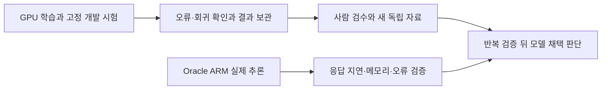

# 14시 GPU 작업 소진 보충과 ARM 캐시 중간 비교

[실측] GPU 서버 A의 준비 작업이 소진된 것을 발견해 기존 실행기에 새 학습판 평가를 보충했다. Oracle ARM은 실제 여행 추론으로 CPU 목표를 충족했고 캐시 비교 두 실행을 회수했다. 개발 시험 결과를 독립 검증이나 제품 채택으로 승격하지 않는다.

| 할 일 | 상태 | 진행 |
|---|---|---|
| 새 GPU 완료 답안 회수 | 로컬 보관·해시 확인 | 4340/4340 = 100% |
| FINCH 두 번째 시드 학습 | 본 학습 완료 | 654/654 = 100% |
| FINCH 어댑터·로그·기본 평가 보관 | 파일 SHA 확인 | 18/18 = 100% |
| GPU 서버 A 추가 평가 등록 | 두 기반 양자화판 | 10/10 = 100% |
| GPU 서버 A 현재 D3 | 실제 추론·GPU98% | 209/360 = 58.06% |
| GPU 서버 B 현재 cosine | 실제 학습·GPU100% | 180/654 = 27.52% |
| ARM 캐시 비교 완료 실행 | 같은60문항 반복 | 120/240호출 = 50% |
| E 표본 사람 판정 | 미작성 | 0/158 = 0% |
| 새 선택·근거·답변 예시 사람 검수 | 미실시 | 0/24 = 0% |
| Saluki 추가 학습 | 실행 조건 대기 | 0/1 = 0% |

이번 보고의 초기 GPU 관측은 한국 시각13:56경, 후속 등록은14:00:47, 최종 GPU 실행 관측은14:02:29경, ARM 관측은13:56:42이다. 각 원본의 관측 시각을 적용하며 지난6시간 내내 모든 기계가 계산했다고 주장하지 않는다. 08시 정기 보고 이후의 일일 연구·중간 회수도 연결하되, 당시 완료 수치를 이번 회차 신규 완료와 합산하지 않는다.

## 완료 결과와 다음 작업을 함께 관리한다

[실측] FINCH는 학습률을 조절하는 방법이다. 동일 자료·시드별 cosine 비교와 개발 평가를 이어, 정상 요청을 놓치지 않으면서 불필요한 선택을 줄이는지 확인한다. 두 번째 시드20261013의 FINCH 학습654단계·변환·기본835문항 평가가 완료돼 HF/GGUF 어댑터와 로그를 회수했다. 기본 단일 선택은748/769=97.27%, 오류·미완료0/835다. 복합66문항에서 하나만 고르는 기본 실행의 점수를 복수 항목 역할의 합격으로 읽지 않는다.

학습률 상한 적용은639/654=97.71%, 연속 구간16~654단계이며 상한5e-5, 관측 최저3.986732956153178e-5다. 이번 반복은 시드 변동을 확인하는 개발 시험이며 독립 보류 검증이 아니다. [학습·기본 평가 수치](../../../../program/scripts/plan_qa_bench/results/gpu_management_20261009_1355/FINCH_seed13_basic_counts.json) · [18파일 보관 검증](../../../../program/scripts/plan_qa_bench/results/gpu_management_20261009_1355/B_verification.json).

[실측] GPU 서버 A의 기존 실행기는 살아 있었지만 초기 확인에서 GPU0%·준비 작업0개였다. 동일 기반 모델 전체 해시·어댑터 구조·입력 해시를 확인한 뒤 새 FINCH 어댑터의 두 양자화판 D/D2/D3/H/E 총10평가18850문항을 기존 실행기에 등록했다. 실행기 재시작·중복 실행·새 모델 다운로드는 하지 않았다. [등록·호환 검증](../../../../program/scripts/plan_qa_bench/results/gpu_management_20261009_1355/A_seed13_registration.json).

GPU 서버 B는 초기 관측에서 cosine 두 번째 시드를160/654=24.46% 학습 중이었고 GPU100%였다. 뒤에 세 번째 시드 cosine/FINCH 두 학습이 준비돼 있었다. 준비2개는 목표3개보다 적으므로 실행 가능한 유효한 후보를 확인한다. 숫자를 채우기 위한 불필요한 추가 시드는 만들지 않는다. 최신 실행·준비·조건 대기는 [GPU 상태 정본](../../../../program/research/daily_rag_slm/gpu_backlog_2026-10-09.json)과 관측 원문을 함께 본다.

[실측14:02:29경] 보충 뒤 GPU 서버 A GPU98%·D3 저장209/360·준비9개를 확인했다. 등록103작업은 완료91·과거실패2·실행1·준비9이며 실패2개도 남긴다. GPU 서버 B는 GPU100%·cosine180/654·준비2개다. 기존 파일 목록과 실행 조건을 대조한 범위에서 새 유효한 세 번째 준비 작업은 확인하지 못했다. Saluki 동일 모델 학습·StandardOne 원본의 공간·Spark 기반 모델 호환 등 조건 대기를 즉시 실행 가능한 일로 세지 않는다. [최종 실행·대기·조건 근거](2026-10-09_140358_gpu-finch-seed2-completion-valen-final-refill.md) · [관측 구조화 원문](../../../../program/scripts/plan_qa_bench/results/gpu_management_20261009_1355/final_proof.json).

[어댑터 영구 보관 정본](../../../../datasets/travel/train_oos/oos2r_finch_5e5_seed20261013_20261009/)에 HF와 GGUF를 보관했다. GGUF SHA256은 `efbfc01207517ace92b4bde9b880b006ee5b4fc84c488e3844d809367ec60429`다.

이번 GPU 답안 회수4340개는 복수 항목 선택 역할4판×835개와 Valen D2 수정 실행1000개다. 답안28파일SHA를 확인했고 FINCH 보관18파일은 부모 에이전트도 SHA를 다시 계산했다. [답안 보관 검증](../../../../program/scripts/plan_qa_bench/results/gpu_management_20261009_1355/A_verification.json) · [부모 독립 재계수](../../../../program/scripts/plan_qa_bench/results/gpu_management_20261009_1355/parent_recount.json).

## 호출 완료와 모델 성능 합격을 구분한다

[실측] Valen-0.8B 배포 원본은 우리 자료로 추가 학습하지 않았고 개발사 결정 학습이 있는 모델이다. 수정한 D2 실행은1000/1000 완료·해석실패0이지만, 요청 없는 문장의 오지목999/1000=99.90%로 해당 여행 선택 경로의 기준을 실패했다. 전체 본5세트는9425/9425 완료 상태다. 최초 가중치 로드 전 실패는 삭제하지 않고 별도 시도로 보존했다.

고정 입력 변환1000/1000, 선택지와 답안 매핑1000/1000을 대조했다. 저장 문항에서 요청 없음 선택지도 존재한다. 이 확인만으로 실패의 모든 원인을 분리한 것은 아니므로 모델의 일반 능력 전체가 나쁘다고 단정하지 않는다. 확률은 결정 전용 출력이며 다른 모델의 말로 한 확신도나 토큰 확률과 같은 척도로 합치지 않는다. [입력·매핑 점검](../../../../program/scripts/plan_qa_bench/results/gpu_management_20261009_1355/Valen_D2_mapping_audit.json).

[실측·미확보] Saluki 원본9425문항 완료와 추가 학습0/1을 구분한다. 첫 학습에는 기존 AI 검토 자료2613행을 비율 변경 없이 사용하도록 준비했다. 추가900행의 AI 합의를 사람 검수로 부르지 않는다. 고정 Saluki 배포판의 학습 가능한 동일 가중치 표현·CUDA 역전파와 기존16GB GPU의 실제 학습 메모리·저장공간 조건이 해결되지 않아 학습을 시작하지 않았다. 다른 기반 모델을 Saluki로 바꿔 부르지 않는다. [현재 학습 계획·막힌 조건](../../../../program/research/daily_rag_slm/saluki_finetune_plan_2026-10-09.md) · [직전 사용자 지시 반영](2026-10-09_1208_saluki-reviewed-set-baseline.md).

## Oracle ARM은 계산 중이며 속도 개선은 반복 확인 중이다

[실측13:56:42] 실제2코어·약12GB Oracle ARM의 기존 서비스는 active, 잠금 보유, 관측 재시작0이다. 최근300.07초·5초 간격60표본의 시간 가중 작업 CPU 사용률은 두 코어 전체 대비89.79%로20% 목표를 충족했다. 기계 전체90.24%, 가상화 대기0.16%, 작업 메모리약8.85GiB, 남은 공간약50.66GiB다. CPU상한1.8코어·메모리10GiB를 유지했다. 이 관측으로24시간 연속 목표 달성이나 cs 프로젝트 전체 배포를 주장하지 않는다.

현재 캐시 교대 비교3회차는16/60=26.67% 저장, 전체 등록14작업 중 완료4·실행1·대기9다. 새 실행기를 띄우거나 현재 추론을 중단하지 않았다. [실제 관측·자원·잠금 원문](../../../../program/scripts/plan_qa_bench/results/heartbeat_20261009_1355_arm_a2/observation.json) · [ARM 상태 정본](../../../../program/research/daily_rag_slm/arm_serving_2026-10-09.json).

| 같은60문항의 캐시 비교 | 정상 요청 정답 | 요청 없음 오지목 | 해석·호출 오류 | 응답 중앙값 | 전체 p95 |
|---|---|---|---|---|---|
| 첫 실행·캐시 켬 | 18/20 = 90% | 0/40 = 0% | 0/60 = 0% | 10.17초 | 159.50초 |
| 둘째 실행·캐시 끔 | 18/20 = 90% | 0/40 = 0% | 0/60 = 0% | 159.18초 | 175.07초 |

두 실행의 문항 ID·정답·선택 결과는60/60 일치했다. 같은 모델·같은 실행기·같은 고정 입력 해시를 확인했고 회수8파일SHA도 일치했다. 기존 여행 학습 Gemma E4B 합친 판 Q4_K_M이며 정확한oos레시피는 미확인이다. llama.cpp bed0a8566, CPU2스레드, 직렬, 시드20261008·온도0·최대16토큰 조건이다.

첫 실행의 문맥 첫5개는 캐시가 없었고 이후55개는 재사용했다. 같은 일정의 후속 질문이 빨라질 가능성을 보여주지만, 새 일정 첫 요청은 약159초가 남는다. 캐시 켬/끔/끔/켬4회 중2회만 완료했으므로 최종 속도 개선·정확도 우열을 확정하지 않는다. 같은60문항을 반복한120호출을 독립 정확도120문항으로 합치지 않으며 실패·미완료는 계획240호출 분모에서 빼지 않는다. [답안·지연·반복·해시](../../../../program/scripts/plan_qa_bench/results/heartbeat_20261009_1355_arm_a2/verification.json) · [원본 입력 대조](../../../../program/scripts/plan_qa_bench/results/heartbeat_20261009_1355_arm_a2/source_identity_checks.json).

## 검증 대기와 다음6시간

[실측] E 사람 판정 CSV는 이번에도158행 중 작성0행이며 이전 해시와 같다. 새 선택·근거·답변 예시는 구조24/24 통과, 사람 검수0/24·모델 답변 실측0/24, 고유 일정 내용1개다. 목표720개 독립 보류 자료는 아직 작성·검수·해시 고정 완료가 아니다. AI 합의·구조 검사·개발 점수만으로 제품 모델을 채택하지 않는다. [E 재확인](../../../../program/scripts/plan_qa_bench/results/heartbeat_20261009_1355_arm_a2/verification.json) · [새 예시 현재 검토 상태](../../../../program/research/daily_rag_slm/selection_answer_review_2026-10-09_v2.json).

다음6시간은 다음 순서로 이어간다.

1. GPU 서버 A의 새 FINCH 추가 평가와 GPU 서버 B의 기존 cosine/FINCH 순서를 유지하며 완료 답안·어댑터를 회수한다. 준비 작업 소진 여부와 공간을 실제로 확인해 유효한 일을 보충한다.
2. Oracle ARM의 남은 캐시 반복을 회수하고 같은55개 후속 질문·문맥 첫5개·오류·메모리를 함께 비교한다. 기존9개 대기와 안정성 반복을 유지한다.
3. Saluki 동일 가중치 학습 경로를 조건 대기로 관리한다. 사람 검수와 독립 자료 준비, 새 평가의 근거·수치·답변 검사 구현을 이어가되 미검증을 완료로 쓰지 않는다.

오늘 논문 조사와 검색 실측을 다시 실행하지 않았다. 앞선 일일 연구의 구현·실측·채택 기준 실패는 [10시 일일 기록](2026-10-09_1015_daily-research-and-serving.md)을 참고한다. 기존6시간 예약을 조회했으며 중복 예약을 만들지 않았고 일일 연구 예약도 유지했다. oos3/oos2r·MAI 완료본은 재실행하지 않았고 Strata의 저장 한도 실패도 반복 재시작하지 않았다. 새 결제·임대·모델 삭제·외부 게시·push·실서비스 배포는 하지 않았다.

## 수정 전 보존

- [ARM 상태 직전 원본](../../../../program/research/daily_rag_slm/_backup/2026-10-09_135927_arm_cache_first_pair/).
- [연구 색인 직전 원본](../../../../program/research/daily_rag_slm/_backup/2026-10-09_140114_six_hour_arm_cache/).
- [ARM 운영 문서 직전 원본](../../operations/_backup/2026-10-09_140114_six_hour_arm_cache/).
- [최종 GPU 관측을 연결하기 직전 보고](./_backup/2026-10-09_140427_final_runtime_snapshot/).
- [GPU 상태 수정 직전 원본](../../../../program/research/daily_rag_slm/_backup/2026-10-09_140358_gpu_hb1355_completion_refill/).

새 관측·답안·이 보고는 새 이름으로 보관하며 지난 정기 보고와 실패 시도는 보존한다.

- [일일 기록·상태 직전 원본](../../../../program/research/daily_rag_slm/_backup/2026-10-09_140510_six_hour_final/).
- [모델 평가 기준 직전 원본](../../quality/_backup/2026-10-09_140510_six_hour_final/) · [GPU 운영 기준 직전 원본](../../operations/_backup/2026-10-09_140510_six_hour_final/) · [wiki 변경 이력 직전 원본](../../_backup/2026-10-09_140510_six_hour_final/).
