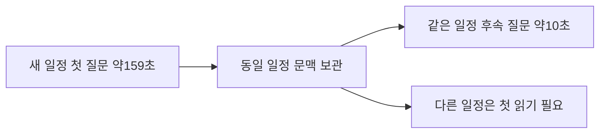

# 20시 완료 평가 회수와 ARM 캐시 교대 비교 결과

[실측] 지난14시 보고 이후 FINCH 추가 평가18,850개와 cosine D3 두 판720개, 합계19,570개 및 다음 비교 학습판을 보관했다. Oracle ARM은 같은 일정의 후속 질문에서 캐시 재사용의 개발 진단 기준을 통과했다. GPU 서버 A는 준비 작업 소진으로 쉬고 있었으며 누락 평가10개를 기존 실행기에 보충했다. 연속 풀가동이나 제품 채택 완료로 쓰지 않는다.

| 할 일 | 상태 | 진행 |
|---|---|---|
| 새 GPU 추가 평가 회수 | FINCH10·cosine D3 두 세트 | 19,570/19,570 = 100% |
| 새 GPU 답안·학습판 파일 확인 | 부모도 SHA 재계산 | 72/72 = 100% |
| cosine 두 번째 시드 학습 | 완료·별도 어댑터 보관 | 654/654 = 100% |
| cosine 두 번째 시드 추가 평가 등록 | 기존 GPU 서버 A 실행기 | 10/10 = 100% |
| GPU 서버 B 세 번째 시드 cosine | 20:05:37 학습 관측 | 270/654 = 41.28% |
| ARM 캐시 교대 비교 | 같은60문항을4회 | 240/240호출 = 100% |
| ARM 동시 접수2개 시험 | 19:54:40 저장 수 | 132/360 = 36.67% |
| E 표본 사람 판정 | CSV 재확인·미작성 | 0/158 = 0% |
| 새 선택·근거·답변 예시 사람 검수 | 상태 기록 재확인 | 0/24 = 0% |
| Saluki 추가 학습 | 실행 조건 대기 | 0/1 = 0% |

## GPU 학습·평가: 정상 질문과 오지목을 같이 본다

[실측] FINCH식 학습률 제어의 시드20261013 어댑터를 적용한 Gemma-4-E4B-it의 Q4_K_M·QAT Q4_0 추가 평가10개가 모두 완료됐다. 우리 여행 자료로 학습한 어댑터이며 배포 원본 점수와 섞지 않는다. D2735·D2 1000·D3 360·H1316·E4014문항을 각 양자화판에서 실행했다. 문항 i의 고유 수와 저장 수를 부모도 재계수했고 해석실패0·미완료0이다. 답안·로그42파일과 다음 cosine 학습판18파일의 SHA도 독립 재확인했다. [회수 검증](../../../../program/scripts/plan_qa_bench/results/gpu_management_20261009_1953/A_verification.json) · [부모 재계수](../../../../program/scripts/plan_qa_bench/results/gpu_management_20261009_1953/parent_recount.json).

| 개발·회귀 세트 | 우리 FINCH 학습 Gemma E4B Q4_K_M | 같은 어댑터·Gemma E4B QAT Q4_0 |
|---|---|---|
| D 정상 요청 정답 | 765/883 = 86.64% | 766/883 = 86.75% |
| D 요청 없음 오지목 | 22/1786 = 1.23% | 29/1786 = 1.62% |
| D2 요청 없음 오지목 | 6/1000 = 0.60% | 6/1000 = 0.60% |
| D3 정상 요청 정답 | 104/120 = 86.67% | 105/120 = 87.50% |
| D3 요청 없음 오지목 | 1/240 = 0.42% | 0/240 = 0% |
| H 대조 정상 정답 | 445/461 = 96.53% | 446/461 = 96.75% |
| H 함정 오지목 | 2/855 = 0.23% | 5/855 = 0.58% |
| E 혼합문장 실제 요청 정답 | 915/1033 = 88.58% | 942/1033 = 91.19% |
| E 혼합문장 요청 없음 오지목 | 3/974 = 0.31% | 7/974 = 0.72% |
| E 사전 합산 기준 | 2/4 = 50% | 2/4 = 50% |

D의 정상883·요청 없음1786은 해당 유형 분모이며 복합66은 별도 역할로 남긴다. H 정상461·함정855는 전체1316을 나눈 것이다. E 전체4014 중 혼합2007문항의 정상1033·요청 없음974를 표시했고 같은 질문 대조2007개도 원본 집계에 보존했다. 실패·미완료를 분모에서 빼지 않는다. 이미 본 개발·회귀 자료이므로 한 시드나 양자화 점수로 일반 우열·채택을 확정하지 않는다.

[실측] cosine 시드20261013은 같은2613행·2에폭·r16·누적8·최대5e-5·654갱신으로 완료됐다. HF/GGUF와 로그·기본 평가를 보관했고 GGUF SHA는 `9832e316c7df17aa41649ab0847f98c36f4281cc403bce180e1665413641517f`다. [학습 완료·18파일 검증](../../../../program/scripts/plan_qa_bench/results/gpu_management_20261009_1953/B_verification.json). 같은 시드·같은 입력의 cosine 추가 평가를 보충해 학습률 방법 비교를 완성한다. GPU 서버 A의 기존 worker·잠금을 확인하고 manifest 직전 백업·원자 교체로10개18,850문항을 등록했다. [등록·입력·어댑터 검증](../../../../program/scripts/plan_qa_bench/results/gpu_management_20261009_1953/A_seed13_registration.json).

최초19:54경 GPU 서버 A는 기존103작업 소진·GPU0%, GPU 서버 B는 세 번째 시드 cosine 학습·GPU100%였다. 이 관측으로 지난6시간 모두 풀가동했다고 말할 수 없다. GPU 서버 B의 다음 FINCH1개와 준비 조건이 필요한 후보를 구분하며 준비되지 않은 후보를 즉시 실행 가능한 일로 세지 않는다. 최종 보충 후 관측과 자동 공급 구현 근거는 같은 회차 GPU 상세 리포트를 연결한다.

## Oracle ARM: 같은 일정의 후속 질문은 빨라졌다

[실측19:54:40KST] 실제2코어·약12GB Oracle ARM의 기존 서비스는 active·enabled, 기존 worker가 잠금을 보유하고 관측 재시작0이다. 최근300.06초·5초 간격60표본의 시간 가중 작업 CPU는 두 코어 전체 대비89.78%로20% 목표를 충족했다. 기계 전체90.21%, 가상화 대기0.16%, 작업 메모리8.93GiB, 여유 공간50.66GiB다. 1.8코어·메모리10GiB 상한을 유지했다. 정상 추론 구간이며24시간 연속 목표 달성이나 cs 프로젝트 전체 배포 완료를 뜻하지 않는다.

캐시 교대 비교4회를 모두 회수했고 새8파일SHA가 일치했다. 등록14작업 중 완료6·실행1·대기7이며 동시 접수2개 설정을 기존 실행기로 진행한다. [관측·자원·잠금 원문](../../../../program/scripts/plan_qa_bench/results/heartbeat_20261009_1953_arm/observation.json) · [회수 파일 검증](../../../../program/scripts/plan_qa_bench/results/heartbeat_20261009_1953_arm/capture.json) · [ARM 상태 정본](../../../../program/research/daily_rag_slm/arm_serving_2026-10-09.json).

| 캐시 교대 실행 | 후속55문항 중앙값 | 전체60문항 p95 | 정상 요청 정답 | 요청 없음 오지목 |
|---|---|---|---|---|
| 켬·첫 실행 | 10.07초 | 159.50초 | 18/20 = 90% | 0/40 = 0% |
| 끔·둘째 실행 | 159.18초 | 175.07초 | 18/20 = 90% | 0/40 = 0% |
| 끔·셋째 실행 | 159.24초 | 175.10초 | 18/20 = 90% | 0/40 = 0% |
| 켬·넷째 실행 | 10.04초 | 158.81초 | 18/20 = 90% | 0/40 = 0% |

사전 기준의 같은55개 후속 질문에 대해 각 조건2회 중앙값의 중앙값을 비교하면159.21초에서10.06초로 감소했다. 감소149.15초/기준159.21초 =93.68%이며, 사전30% 속도 개선·새 오류/정답 손실 없음 기준을 통과했다. 선택한5개 일정 묶음 기준2000회 짝 재표집의 조건부95%구간은93.42~94.18%다. 다른 고객·새 일정 전체를 대표하는 구간은 아니다. [전체 실행·같은 입력·예측 대조](../../../../program/scripts/plan_qa_bench/results/heartbeat_20261009_1953_arm/abba_final_verification.json) · [구간·반복·분모](../../../../program/scripts/plan_qa_bench/results/heartbeat_20261009_1953_arm/abba_intervals.json).

60고유 문항의 결과는4회 모두60/60 일치하고 호출 오류0/240이다. 반복240호출을 정확도240독립 문항으로 합치지 않는다. 정상18/20의 Wilson95%구간69.90~97.21%, 오지목0/40의 구간0~8.76%로 표본 한계도 남는다. 새 일정 첫 질문은 약159초이고 전체p95도 길어 무료 서빙의 응답 목표 충족이나 제품 채택으로 확대하지 않는다.

같은 Gemma E4B 기존 여행 학습 합친 판 Q4_K_M·같은 모델/실행기 SHA·고정 입력을 사용했다. 정확한oos레시피는 미확인이다. llama.cpp bed0a8566,2CPU스레드·직렬·시드20261008·온도0·최대16토큰이다. 모델 정확도 향상과 같은 모델의 캐시 속도 개선을 구분한다.

## 검증 대기와 다음6시간

E 사람 판정 CSV는158행 중0행 작성이다. 새 선택·근거·답변 예시는 구조24/24 통과지만 사람0/24·모델 실측0/24이고 고유 일정 내용1개다. 목표720개 독립 보류 자료는 작성·사람 검수·해시 고정 완료가 아니다. [예시 검토 상태](../../../../program/research/daily_rag_slm/selection_answer_review_2026-10-09_v2.json). AI 합의나 개발 점수로 독립 검증을 대신하지 않는다.

Saluki 배포 원본의9425/9425 완료는 이전 보고와 같다. 사용자 승인한 추가 학습은 기존 검토 자료2613행을 비율 변경 없이 쓰도록 준비했지만 동일 Saluki 가중치의 학습 표현·CUDA 역전파·기존16GB GPU 실제 메모리/공간 조건이 해결되지 않아0/1이다. 기존 상태의12:08관측을 이번 회차 새 실측으로 쓰지 않는다. [계획·막힌 조건·재개](../../../../program/research/daily_rag_slm/saluki_finetune_plan_2026-10-09.md).

다음6시간은 완료 cosine 추가 평가와 세 번째 시드 학습을 회수하고 같은 조건의 FINCH/cosine 비교를 이어간다. 완료 학습판이 평가 대기열로 넘어가는 공백을 줄이며, Oracle ARM 동시 접수 시험·메모리·지연·오류를 회수한다. 캐시의 새 일정·사용자 격리·독립 자료 검증과 E 사람 검수는 별도 대기로 추적한다. 조건 대기 후보를 준비 완료로 부풀리거나 의미 없는 반복으로 사용률을 채우지 않는다.

오늘 일일 논문 조사·검색 실측은 중복 실행하지 않았다. 기존6시간 예약을 조회했고 중복 예약을 만들지 않았으며 일일 연구 예약은 유지했다. 완료oos3/oos2r·MAI와 저장 한도 실패Strata는 재실행하지 않았다. 새 결제·임대·기존 모델 삭제·외부 게시·push·실서비스 배포는 하지 않았다.

## 수정 전 보존

[ARM 상태 직전 원본](../../../../program/research/daily_rag_slm/_backup/2026-10-09_200026_arm_ABBA_final/)을 보관했다. 새 결과와 이번 보고는 새 이름으로 생성했고 과거 날짜 보고와 실패 시도를 보존했다. 일일 기록·wiki 연결 변경의 백업은 갱신 검증 기록에 함께 남긴다.

## 보충 뒤 최종 관측과 자동 공급

[실측20:07:05KST] GPU 서버 A는 새 cosine D3 두 판720/720을 추가 완료해 이번 GPU 서버 A 회수는12세트19,570/19,570=100%다. 새 답안과 학습판 파일 SHA72/72 및 원본 문항ID집합·정답·유형19,570/19,570을 확인했다. GPU82%·D실행·준비7개이며 등록113개 중 완료103·과거실패2·실행1·준비7이다. 현재D 저장 수는 최종 관측에서 조회하지 않았다. [실측20:05:37KST] GPU 서버 B는 세 번째 시드 cosine270/654=41.28%·GPU94%·다음 FINCH1개다. 준비3개 목표에는 미달하며 공간·가중치·학습 호환 조건 대기4개군을 준비 완료로 세지 않는다. 최신 상세 관측·조건 대기와 숨김 로컬 공급 실행기·잠금·읽기 전용 스모크는 [GPU 최종 보고](2026-10-09_200918_gpu-seed2-results-cosine-refill-local-feeder.md)를 따른다. 이 시점의 가동을 지난6시간 연속 사용률로 확대하지 않는다. [전체 원본 문항 대조](../../../../program/scripts/plan_qa_bench/results/gpu_management_20261009_1953/source_identity_verification.json).

문서 수정 직전에 보존한 위치: [1번째 백업](../../../../program/research/daily_rag_slm/_backup/2026-10-09_201059_six_hour_2000/) · [2번째 백업](../../operations/_backup/2026-10-09_201059_six_hour_2000/) · [3번째 백업](../../quality/_backup/2026-10-09_201059_six_hour_2000/) · [4번째 백업](../../_backup/2026-10-09_201059_six_hour_2000/). 과거 날짜 보고와 실패 시도는 보존했다.

자동 공급의 읽기 전용 검사·변형 코드 구문·파일 잠금과 지속 프로세스를 확인했다. 승인된 B58 두 학습판은 아직 완료 대기이므로, 이 자동 공급 경로가 실제 완료 어댑터를 전송·등록하는 전체 과정은 아직 실증하지 않았다. 기존 수동 회수·등록 성공과 구분하고 첫 완료 때 검증한다.

부모가 추가 회수분까지 포함한72파일SHA와 원본12세트의 ID·정답·유형 대조 근거를 재확인했고 이번 변경 링크25/25 및 JSON 구문을 확인했다. [최종 독립 확인](../../../../program/scripts/plan_qa_bench/results/gpu_management_20261009_1953/parent_final_verification.json) · [최종 수치 연결 직전 보고](./_backup/2026-10-09_201203_final_counts_and_links/).
