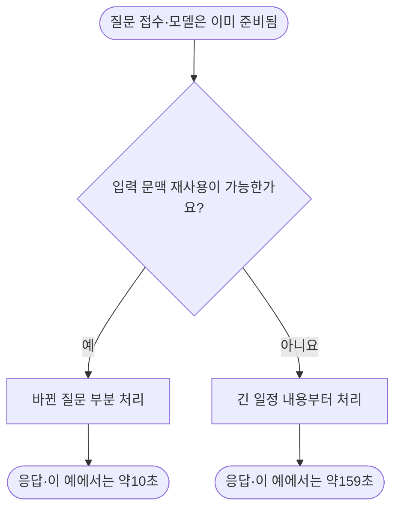

# Oracle ARM의 모델 상주·입력 지연·메모리·디스크 확인

[실측] 디스크는 이미20GB 이상 사용하며 메모리도 호스트 전체의20%를 넘는다. 현재 추론 도구는 llama.cpp다. 앞선 약159초는 모델 적재가 아니라 이미 준비된 모델의 긴 입력 처리 시간이다.

| 할 일 | 상태 | 진행 |
|---|---|---|
| 디스크·메모리·CPU 관측 | 완료 | 3/3 = 100% |
| 초기화·입력 처리·재사용 구분 | 완료 | 3/3 = 100% |
| 기존 자동 점검 지침 보완 | 완료 | 2/2 예약 지침 = 100% |

## 실제 관측

관측 시각은2026-10-09 22:44:08 KST다. 원본 폴더명의2020은 생성 이름이며 실제 관측시각이 아니다. 디스크·RAM은 해당 시각 단일 관측, CPU는 직전300.07초의 시간 가중 평균이다. 아래 GB는10억 바이트다.

| 항목 | 실사용 / 기준 전체 | 비율·판정 |
|---|---|---|
| 루트 디스크 | 48.480927744 / 102.888095744GB | 47.12%, 20GB 확인선 충족 |
| 호스트 RAM | 4.485369856 / 12.503744512GB | 35.87%, 20% 관측 목표 충족 |
| 추론 작업 CPU | 평균1.793858628 / 2코어 | 89.69%, 최근5분 목표 충족 |
| 현재 동시2접수 D3 | 234 / 360답안 | 65.00%, 실행 중 |

호스트 RAM은`MemTotal−MemAvailable`이다. 추론 프로세스 익명 메모리는3.786215424GB, 파일 매핑은5.308026880GB, 프로세스 RSS는9.094242304GB다. RSS와 서비스 전체 메모리9.508732928GB에는 회수 가능한 파일 캐시가 포함될 수 있어 호스트 실사용과 더하거나 같은 뜻으로 쓰지 않는다. 프로세스 스왑은0이다.

남은 디스크는54.390390784GB다. 기계 전체 CPU busy90.22%, steal0.17%를 함께 관측했다. 추론 프로세스는관측 시점에23294초(6시간28분14초)째 살아 있었고 시스템 서비스 재시작 수는0이다. 현재 프로세스의 실행파일은llama-server이며 CPU2스레드·GPU offload0·동시 슬롯2다. 이 확인 범위는 현재 추론 경로이며 기계에 다른 도구가 전혀 설치되지 않았다는 뜻이 아니다.

## 159초는 무엇을 잰 값인가

같은 Q4 모델의 기존 직렬 캐시 교대 시험에서 로그와 답안을 대조했다. 새 학습·추론이나 재시작은 수행하지 않았다. 기존 실행기 버전은llama.cpp bed0a8566이며 기존 합친 학습판의 정확한oos 레시피는 아직 미확인이다.

| 단계·조건 | 입력 처리 | 답 생성 | 관측 시간 |
|---|---|---|---|
| 모델 초기화·준비 | 해당 없음 | 해당 없음 | 로그 시작 후4.07초, 요청 시간과 별도 |
| 이미 준비됨, 입력1798토큰 처음 처리 | 157.596초 | 1.210초 | 요청158.811초 |
| 같은 모델 계속 켜짐, 입력1712토큰 재사용·새89토큰 | 8.825초 | 1.215초 | 요청10.044초 |
| 캐시 끔, 첫 요청 이후59회 | 별도 원본 보관 | 별도 원본 보관 | 중앙값159.396초 |

모델 가중치가 메모리에 있다는 것과 이전 입력을 계산한 결과를 재사용할 수 있다는 것은 다르다. 초기화 로그의model loaded는 모든 매핑 페이지를 물리 RAM에 완전히 읽었다는 증명도 아니다. 그렇더라도 약159초의 대부분이 요청 입력 처리로 기록됐다는 사실은 분명하다. 항상 켜두면 초기화 비용은 피하지만 새 일정이나 재사용 실패의 긴 입력 처리까지 없어지는 것은 아니다.

위 시간은 고정 개발 입력의 직렬 시험 예다. 현재 실행 중인동시2접수 작업이나 일반적인 긴 자유 답변의 성능 보장이 아니다. 기존 교대 시험은4/4실행·240/240호출 완료, 고유문항60개이며 독립 정확도 표본을240개로 늘리지 않는다. 일반 신규 일정·다중 사용자 격리·독립 보류 검증과 제품 채택은 별도다.

## Oracle 공식 회수 조건과 운영 반영

[외부] [Oracle Always Free 공식 문서](https://docs.oracle.com/en-us/iaas/Content/FreeTier/freetier_topic-Always_Free_Resources.htm)는7일 관측에서 CPU95백분위·네트워크·A1메모리의 세 조건이 모두20% 미만인 경우를 유휴 컴퓨트로 설명한다. 디스크 사용량20GB 또는20%는 그 열거 조건에 없다. 현재 OS 자원 관측은OCI의7일 서비스 지표 판정과 동일하지 않다.

기존두 예약의 지침 파일에 호스트 RAM20%·디스크20GB 관측, 메모리 계산 정의, 모델 초기화와 입력 처리 분리를 추가했다. 예약 자체를 새로 만들거나 주기를 변경하지 않았다. 진행 중 작업을 중단하지 않았으며 추가 다운로드·의미 없는 파일/메모리 채우기·삭제·결제는 하지 않았다. 다음 자동 확인에서 같은 정의로 추적하고, 부족할 때 유효한 여행 작업과 대기 원인을 확인한다.

## 변경·검증·원본

- [읽기 전용 확인 도구](../../../../program/scripts/plan_qa_bench/check_arm_storage_latency_20261009.py): 개인 SSH 별칭은실행 인자로만 전달한다.
- [원본 관측](../../../../program/scripts/plan_qa_bench/results/arm_storage_latency_20261009_2020/observation.json) · [기존 답안 지연 분해](../../../../program/scripts/plan_qa_bench/results/arm_storage_latency_20261009_2020/latency_decomposition.json): 접속·프로세스 원문이 포함된git 제외 자료다.
- [날짜별 실행 상태](../../../../program/research/daily_rag_slm/arm_serving_2026-10-09.json) · [자동 점검 지침](../../../../program/research/daily_rag_slm/scheduled_instructions_2026-10-08.json): 과거 관측을 보존했다. 대기열 전체 숫자는 이전 관측시각을 별도 표기하며 이번 새 현재값으로 주장하지 않는다.
- [ARM 운영 절차](../../operations/arm-serving-queue.md): 메모리·디스크 정의와 지연 구분을 연결하고 기존 작업 흐름도를 시작·종료·조건이 보이도록 정리했다.

검증은 읽기 전용 원격 수집1/1 성공, JSON 재읽기와 신규 도구AST·로컬 링크·공용 자료 접속정보 검사로 수행한다. 제품 기능·모델 정확도·배포 완료를 새로 통과했다고 주장하지 않는다.

## 수정 직전 백업

- [daily_rag_slm 2026-10-09_225131_arm_runtime_storage](../../../../program/research/daily_rag_slm/_backup/2026-10-09_225131_arm_runtime_storage/)
- [operations 2026-10-09_225131_arm_runtime_storage](../../operations/_backup/2026-10-09_225131_arm_runtime_storage/)
- [wiki 2026-10-09_225131_arm_runtime_storage](../../_backup/2026-10-09_225131_arm_runtime_storage/)
