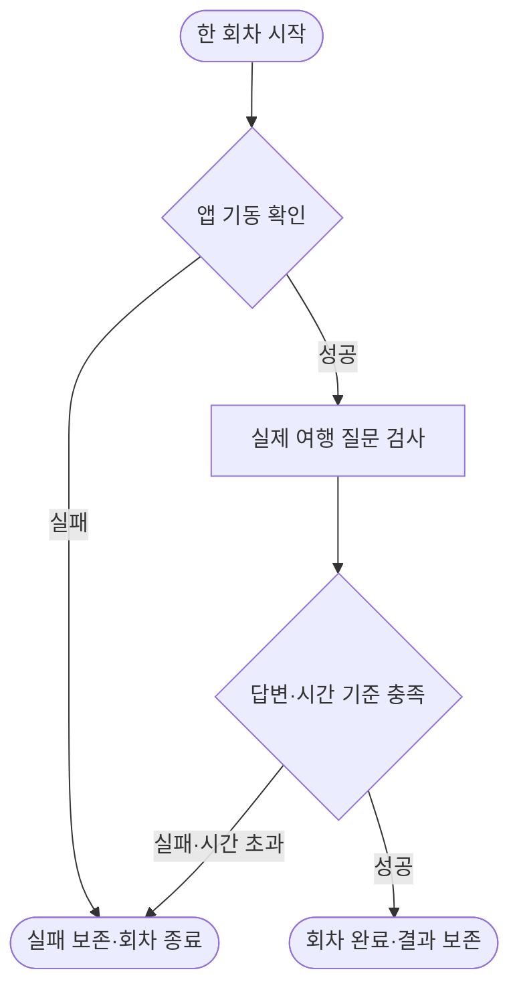

# 02시 GPU 추가 평가 회수와 Oracle ARM 질의 시간 초과

[실측] 지난 20시 정기 보고 뒤 추가 답안 40,320개와 다음 cosine 학습판을 회수했다. GPU 서버 A의 일감 소진을 확인해 누락 역할을 보충했고 다시 계산 중이다. Oracle ARM은 자료 전송·내부 앱 기동을 끝냈지만 첫 실제 질문 4개가 모두 시간 초과였다. 상용화·모델 채택·공개 서비스 완료가 아니다.

| 할 일 | 상태 | 진행 |
|---|---|---|
| 새 완료 평가 회수 | 22세트 | 40,320/40,320 = 100% |
| GPU 답안·로그 파일 해시 | 일치 | 92/92 = 100% |
| 세 번째 시드 cosine 학습판 파일 | 해시 재계산 | 18/18 = 100% |
| 세 번째 시드 cosine 기본 평가 | 호출 오류 0 | 835/835 = 100% |
| 세 번째 시드 FINCH 학습 | 02:18:57 KST 관측 | 300/654 = 45.87% |
| 새 누락 역할 등록 | 기존 단일 실행기 | 8/8 = 100% |
| 등록한 누락 역할 완료·회수 | 해석 실패 2 포함 | 3340/6680 = 50% |
| Oracle ARM 첫 HTTP 회차 | 질문 4개 시간 초과 | 7/11 = 63.64% |
| Oracle ARM 첫 회차 여행 질문 | 성공 0·실패 4 | 0/4 = 0% |
| Oracle ARM 수정 후보 격리 검사 | 운영 적용 전 | 22/22 = 100% |
| E 사람 검수 | CSV 직접 재계수 | 0/158 = 0% |
| 선택·근거·답변 예시 사람 검수 | 상태 기록 대조 | 0/24 = 0% |
| Saluki 추가 학습 | 실행 조건 대기 | 0/1 = 0% |

## 완료 평가의 의미

[실측] cosine 시드20261013의 D·D2·H·E 두 양자화판 18,130개와 시드20261014의 D·D2·D3·H·E 두 판 18,850개, 합계36,980개를 새로 회수했다. 직전 보고에서 보관한 시드20261013 D3 두 판720개를 새 완료분에 중복 합산하지 않았다. 새 복수 일정 선택 역할4세트3340개까지 합계40,320개다. 원본 입력의 문항ID집합·기대 문항 수·고유ID를 대조했으며 누락0이다. cosine 해석 실패0, 복수 선택의 기존 oos2 QAT 판 해석 실패2/835를 실패 그대로 보관했다. [cosine 검증](../../../../program/scripts/plan_qa_bench/results/heartbeat_20261010_0200/A_archive_verification.json) · [복수 선택 검증](../../../../program/scripts/plan_qa_bench/results/heartbeat_20261010_0200/A_multi_archive_verification.json).

우리 여행 자료로 학습한 Gemma-4-E4B-it 어댑터의 E 혼합문장 결과다. 4014개 전체 중 혼합2007개는 실제 요청1033·요청 없음974이며, 대조2007개도 원본에 보존했다. 실패·미완료를 분모에서 빼지 않는다. 오지목은 낮을수록 좋다.

| 우리 여행 학습판·실행 양자화 | 실제 요청 정답 | 요청 없음 오지목 |
|---|---|---|
| Q4_K_M cosine 시드20261013 | 930/1033 = 90.03% | 2/974 = 0.21% |
| QAT Q4_0 cosine 시드20261013 | 968/1033 = 93.71% | 2/974 = 0.21% |
| Q4_K_M cosine 시드20261014 | 879/1033 = 85.09% | 1/974 = 0.10% |
| QAT Q4_0 cosine 시드20261014 | 948/1033 = 91.77% | 2/974 = 0.21% |

[판단] 같은 학습 방법에서도 시드·양자화에 따라 정상 요청 점수가 달라진다. 일부 점수가 좋아졌다는 이유로 FINCH/cosine의 일반 우열이나 제품 채택을 확정하지 않는다. 마지막 FINCH 시드 완료 후 같은 문항을 짝지어 비교하고 반복 간 편차를 본다. E 표본 사람 검수0/158, 새 예시 사람0/24·모델0/24, 목표720개 독립 보류 자료의 작성·검수·해시고정은 완료 전이다. [검수 재계수](../../../../program/scripts/plan_qa_bench/results/heartbeat_20261010_0200/human_review_check.json) · [독립 검증 계획](../../../../program/research/daily_rag_slm/selection_answer_review_2026-10-09_v2.json).

시드20261014 cosine의 HF/GGUF·학습/변환 로그·기본 평가18파일 SHA를 부모도 다시 계산했다. 기본835개·호출 오류0,654/654갱신 완료다. 기존 자동 공급이 실제 완료 학습판 보관과 추가 평가10개 등록까지 수행한 첫 확인이며, 승인된 두 판 중1/2=50%다. FINCH는 아직 학습 중이다. [자동 공급·원본 검증](../../../../program/scripts/plan_qa_bench/results/gpu_management_20261009_1953/feeder/20261009T142738160462Z_cosine/verification.json).

## 현재 계산과 다음 일감

[실측 02:18:57 KST] GPU 서버 A는 등록131개 중 정상 완료103·오류 포함 완료22·실패2·실행1·준비3개, GPU78%, 여유3.71GiB다. 앞의 실패/오류 포함 완료는 과거 기록을 포함하는 누적 분모다. 01:57:49에는 앞123개가 전부 종료돼 GPU0%였으므로 연속 풀가동이라고 말하지 않는다. 누락된 학습판 복수 선택7개5845문항과 FrogNano 원본의 복수 선택1개835문항을 보충했다. 모델·어댑터·입력 해시를 확인했고 기존 worker PID·잠금을 유지하며 manifest 직전 백업 후 원자 교체했다. FrogNano는 우리 자료 추가 학습 없는 원본이며 이번 items 배열 생성과 이전 토큰 확률 선택은 별도 경로다. 같은 입력 정보를 주되 속도를 직접 섞어 비교하지 않는다. [원본 관측](../../../../program/scripts/plan_qa_bench/results/heartbeat_20261010_0200/A_final_0220.json) · [학습판 등록](../../../../program/scripts/plan_qa_bench/results/heartbeat_20261010_0200/A_multi_bc_registration.json) · [원본 누락 역할 등록](../../../../program/scripts/plan_qa_bench/results/heartbeat_20261010_0200/A_frog_multi_bc_registration.json).

[실측 같은 시각] GPU 서버 B는 FINCH 시드20261014 학습·GPU100%,300/654갱신·여유5.48GiB다. 현재 학습 뒤 즉시 실행 가능한 새 학습은0개로 준비3개 목표에 미달한다. Saluki·StandardOne·Spark·Jevify 후보군은 기존 가중치/실행기/학습 메모리·공간 선행 조건 기록이 남아 있으며 이번 회차 새 출시 재조사를 한 것은 아니다. Saluki27B는 동일 학습 가능한 가중치 표현·CUDA 역전파·16GB 자원·저장공간 검증 전이다. 준비 후보를 실행 가능한 일감으로 부풀리거나 불필요한 네 번째 시드로 채우지 않았다. 현재 학습 완료 후 기존 자동 공급기가 새 어댑터·기본 답안을 보관하고 GPU 서버 A 추가 평가10개를 등록한다. [현재 학습 원본](../../../../program/scripts/plan_qa_bench/results/heartbeat_20261010_0200/B_final_0220.json) · [학습 조건·재개](../../../../program/research/daily_rag_slm/saluki_finetune_2026-10-09.json).

## Oracle ARM: 기동과 질문 통과를 분리한다

[실측 02:19:03 KST] 승인 이동 자료67/67·203,806,783바이트 전송·해시 확인과 develop `210b020067a1e42f2622262adeb60d1f3d371668`의 ARM64 내부 배포는 완료다. 컨테이너5/5실행·관측 재시작/OOM0, API·웹200이다. 최초 HTTP 회차는7/11통과지만 여행 질문4/4가 각각 시간 초과했고 전체2400.73초 걸렸다. 인증·여행 생성·본인 조회·타인 차단7개 성공을 답변 정확도처럼 쓰지 않는다. 두 번째 회차는8/11개 저장 중이며 완료 전이므로 순위/정확도는 없다. 전체 대기열46개는 실패1·실행1·대기44이며 대기 시간21600초는 추정이다. 실패한 첫 프로필은 같은 배포 SHA에서 반복하지 않도록 기존 worker가 격리했다. [실제 HTTP 관측·답안](../../../../program/scripts/plan_qa_bench/results/heartbeat_20261010_0200/ARM_deployment_final_0219.json) · [첫 회차 실패 원본](../../../../program/scripts/plan_qa_bench/results/heartbeat_20261010_0200/ARM_first_batch_answers.json).

다음 회차는 기존 실행기가 배포·디스크·실패 프로필 조건을 확인한 뒤 시작한다. 현재 관측은 기동 성공 뒤 질문 시간 초과 경로다. 원인 수정 없이 실패 프로필을 초기화하지 않는다.

[실측 02:05:03~02:10:03 KST, 61표본·약305초 집계] 두 코어 전체 대비 기존 추론 workload CPU평균84.14%, 기계 전체 CPU92.99%, 가상화 대기0.19%다. RAM은 MemTotal−MemAvailable 기준6,465,073,152/12,503,744,512바이트=51.71%, 디스크는56.22/102.89GB=54.64% 사용·46.65GB여유다. CPU·RAM20%와 디스크20GB 목표는 이 관측에서 충족한다. 짧은 관측을24시간 연속 사용 또는 공급자 회수 정책 검증으로 확대하지 않는다. [자원 원본](../../../../program/scripts/plan_qa_bench/results/heartbeat_20261010_0200/ARM_resources_0210.json).

[실측·진단] 실행 도구는 상주 llama.cpp이며 기존 동시 접수2개 시험이350/360개 저장 중이었다(02:13:24관측). 두 슬롯 모두 처리 중이고 로그에서 문맥 처리337초·취소가 관측됐다. 상주 모델이어도 새 문맥 읽기와 큐 대기는 남는다. 이전 약159초/약10초는 같은 문맥 재사용 진단 조건이며 이번 앱 질문 성공 시간을 뜻하지 않는다. 동시 벤치마크와 앱의 공유·대기가 유력한 원인 후보지만 요청별 상관 추적 없이 단일 원인으로 확정하지 않는다. [슬롯·진행 원본](../../../../program/scripts/plan_qa_bench/results/heartbeat_20261010_0200/ARM_live_diagnosis_0213.json).

앱이 보낸 `think:false`를 연결부가 전달하지 않는 계약 누락과 예외 답안의 소요 시간 누락은 로컬에서 고쳤다. 새 별도 폴더에서 Linux 격리22/22시험 통과, 활성 앱·기존 추론 프로세스는 변경하지 않았다. **수정 후보 운영 적용0/1·시간 초과 해결 실측0/1**이다. 현재 HTTP 회차와 상위 요청이 끝난 뒤 배포 잠금·원본 백업 아래 적용하고, 문맥/동시 처리 배분·모델 동일성·실패 프로필 버전을 확인한 새 시도로 검증해야 한다. 설정 전달 보완만으로 시간 초과가 해결됐다고 말하지 않는다. mock 응답을 사용한 검사22/22(계약·실패·잠금)와 실서버 확인(실제 HTTP 첫 회차7/11·질문0/4)을 구분한다. [격리 시험과 재개 조건](../../../../program/scripts/plan_qa_bench/results/heartbeat_20261010_0200/ARM_staged_repair_verification.json) · [수정 전 코드](../../../deploy/arm/_backup/2026-10-10_0216_think_and_timeout_telemetry/).

## 다음6시간과 보존

1. 나머지 복수 항목 평가·FINCH 시드 학습의 완료 파일을 즉시 회수하고, 같은 문항·학습 여부·실패 분모로 비교한다. 기존 자동 공급·worker를 중복 시작하지 않는다.
2. Oracle ARM HTTP 실패 회차를 보존하며 현재 회차 종료 뒤 공유 추론의 대기·동시 접수 조건을 검증하고 수정 후보를 안전한 구간에 적용한다. 기계 자체5분 CD·6시간 공급을 유지하고 Codex 예약은 추가하지 않는다.
3. E 사람 검수·새 선택/답변 보류 자료와 Saluki 학습 조건을 별도 추적한다. 미검증 점수로 제품 채택하지 않는다. 새 날짜 일일 연구는 예정된 회차에서 수행하며 이번 정기 점검을 당일 논문 조사 완료로 표시하지 않는다.

새 결제·임대·기존 모델 삭제·외부 게시·push·공개 서비스 배포는 수행하지 않았다. GPU manifest 원본의 백업 위치는 등록 감사 JSON에, 기존 문서/상태 수정 직전 로컬 백업은 [문서 갱신 검증](../../../../program/scripts/plan_qa_bench/results/heartbeat_20261010_0200/documentation_verification.json)에 남긴다. 과거 날짜 보고와 실패 산출물은 보존한다.
