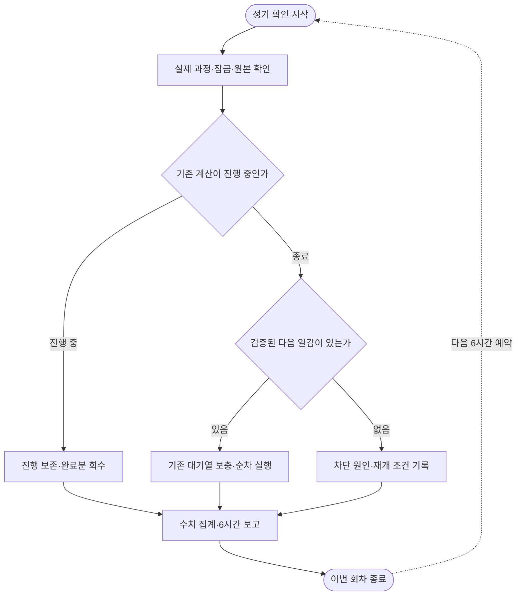

# 2026-10-10 08시 정기 보고

기존 GPU 대기열이 소진돼 두 GPU가 쉬고 있음을 발견했고, 누락 비교를 보충해 계산을 다시 시작했습니다. 세 난수 설정의 E 결과는 모두 합산 기준 2/4개만 통과했으므로 학습 방식·제품 모델을 승격하지 않습니다. Oracle ARM은 자체 일감 공급과 자원 목표를 충족하지만 응답 지연과 답변 내용 검증은 남아 있습니다.

| 할 일 | 상태 | 진행 |
|---|---|---|
| 새 완료 GPU 서버 A 답안 보관 | 완료 | 23,860/23,860 = 100.00% |
| 해당 원본 파일 해시 검증 | 완료 | 70/70 = 100.00% |
| FINCH 세 번째 시드 학습·기본 평가 | 완료 | 654/654 갱신·835/835 답안 = 각100% |
| GPU 서버 A 누락 역할 보충 | 등록·일부 실행 완료 | 6/6 = 100%, 총5,010문항 |
| GPU 서버 B 새 추론 조건 | 스모크 완료·본 비교 진행 | 스모크12/12, 본 완료1/6 = 16.67% |
| Oracle ARM 새 동시 접수 답안 보관 | 완료 | 360/360 = 100% |
| E 사람 검수 | 대기 | 0/158 = 0% |
| 새 선택·답변 개발 예시 사람 검수 | 대기 | 0/24 = 0% |

## 지난 보고 이후 완료한 일과 의미

02시 보고 이후 GPU 서버 B의 FINCH seed20261014 학습·변환·기본 평가가 ALLDONE으로 종료됐습니다. 어댑터·로그·기본 결과18/18파일을 로컬에서 다시 해시 대조했습니다. 입력2,613행을 모두 사용했고 필터링0,654/654갱신입니다. FINCH 학습률 상한5e-5가642/654 = 98.17% 갱신에 적용됐습니다. 이 실행에서는 대부분 상한에 걸렸으므로 FINCH 조절 자체가 큰 효과를 냈다고 해석하지 않습니다. 학습률 전체 추적·버전·기본5파일은 [보관 검산](../../../../program/scripts/plan_qa_bench/results/heartbeat_20261010_0800/B_adapter_verification.json)에 있습니다.

GPU 서버 A에서 추가로16개 평가,23,860문항을 보관했습니다. 실패·해석 실패6건은 FrogNano 복수 선택 시험에 있으며 전체835분모에 그대로 남겼습니다. 새 FINCH 단일 선택 다섯 세트×두 양자화 조건18,850문항에는 해석 실패0입니다. 보관과 정답 통과는 다릅니다. [14개 완료 회수](../../../../program/scripts/plan_qa_bench/results/heartbeat_20261010_0800/A_archive_verification.json) · [이번 추가 후 완료2개](../../../../program/scripts/plan_qa_bench/results/heartbeat_20261010_0800/A_extra/A_archive_verification.json).

Oracle ARM의 빈 장소 기준 자료와 검색 키는 별도 사용자 승인 작업에서 복구했습니다. 이름 있는 장소8/8개 좌표를 확인했고 문제 일정의 장소 좌표는8/10개로 복구했습니다. 구체 이름이 없는 숙소2개는 지어내지 않았습니다. 활동 후보의 영업시간 필터 수정은 로컬7/7통과이며 Oracle ARM 반영 전입니다. 진단 중 API 메모리 초과·자동 재시작1회와 그때 실패한 회차는 보존했습니다. [복구·한도·남은 문제](2026-10-10_0535_arm-place-source-recovery.md).

## 현재 계산과 즉시 실행 가능한 일감

07:55경 두 GPU는0%였고 기존 GPU 서버 A141개가 전부 종료돼 있었습니다. 이후 같은 작업자의 대기열을 백업·원자 교체했고 새 GPU 서버 A 작업자를 만들지 않았습니다. 2026-10-10 08:04:57 KST의 GPU 서버 A는 8126 MiB, 100 %이며147개 중 완료118·오류 포함 완료23·실패2·실행1·준비3개입니다. 종료143/147은 오류·실패를 포함하며 전부 합격했다는 뜻이 아닙니다. 여유공간3.63GiB, 기존 잠금 보유를 확인했습니다. [관측](../../../../program/scripts/plan_qa_bench/results/heartbeat_20261010_0800/A_post_refill.json).

추가6개는 새 FINCH 학습판 두 양자화 조건의 복수 선택, Saluki 원본 복수 선택, 기존oos1/oos3/oos2r 학습판의 Q4_K_M 복수 선택입니다. 같은 입력835개에서 여러 항목을 모두 고르는 역할이며 이전 단일 선택 시험의 반복이 아닙니다. 처음 두 개는 완료·회수했고 Saluki가 실행 중이며 세 개가 즉시 대기합니다. Saluki의 전체835개 완료 전 복수 선택 순위를 확정하지 않습니다. Saluki는 우리 여행 자료 추가 학습 없는 배포 원본이며 제작사 학습·양자화가 들어간 모델입니다. [원본과 추가 작업 정의](../../../../program/scripts/plan_qa_bench/results/heartbeat_20261010_0800/A_second_registration.json).

GPU 서버 B에는 보관 중인 Gemma-4-E4B-it 원본과 우리 여행 cosine/FINCH seed20261014 어댑터를 HF transformers＋bitsandbytes NF4로 실행하는 별도6개 조건(D3·MX)을 등록했습니다. 총13,122문항이며 원본12개 연결 시험을 통과한 뒤 시작했습니다. 스모크 정답은9/12로,12/12는 오류·해석 실패 없이 연결됐다는 뜻입니다. 08:09:10에는 GPU100%였고08:10경 다음 모델 적재 구간에는0%가 관측됐습니다. 원본D3은360/360완료,정상100/120 =83.33%·잡담 오지목16/240 =6.67%,해석 실패0입니다. 다음cosine D3 실행·나머지4개 대기, 작업자 생존과 잠금 보유를 확인했습니다. [새 관측기 실제 검증](../../../../program/scripts/plan_qa_bench/results/heartbeat_20261010_0800/B_observer_verified.json) · [원본D3 보관](../../../../program/scripts/plan_qa_bench/results/heartbeat_20261010_0800/B_original_d3_verification.json).

입력·문항·탐욕 생성·생각 끔·최대16출력토큰·4096문맥 제한·값 파싱은 기존 llama.cpp 조건에 맞췄습니다. 엔진과 NF4/Q4 양자화가 함께 다르며 HF는 요청 간 접두 캐시를 공유하지 않습니다. 따라서 원인을 엔진 하나로 단정하거나 다른 GPU 기계의 속도를 직접 비교하지 않습니다. 설치 버전은 torch 2.14.1+cu130,transformers 5.18.0,bitsandbytes 0.50.2입니다. [고정 실행 계약과 원본](../../../../program/scripts/plan_qa_bench/results/heartbeat_20261010_0800/B_smoke/contract.json).

Saluki 파인튜닝은0/1로 계속 조건 대기입니다. 동일 모델의 학습 가능한 표현·CUDA 역전파·16GB 실제 메모리·공간을 확인해야 하며 다른 기반 모델을 Saluki 학습판으로 바꾸어 부르지 않습니다. 새 결제·임대·기존 모델 삭제나 불필요한 네 번째 학습 시드 실행은 하지 않았습니다.

## E: 더 잘 잡는 것과 잘못 잡는 것을 함께 비교

아래는 **같은 Gemma-4-E4B-it QAT Q4_0 기반에 우리 여행 자료로 학습한 판**끼리입니다. 혼합 문장E는 실제 요청1,033개·요청 없음974개이며 매 실행 전체MX4,014개를 저장했습니다. 같은 문항을 반복한 세 시드를 독립6,021문항으로 합치지 않습니다. 오류·미완료0이며 사람 정답 검수 전 개발·회귀 진단입니다.

| 학습 난수 설정 | cosine 정상 정답↑ | cosine 요청 없음 오지목↓ | FINCH 정상 정답↑ | FINCH 요청 없음 오지목↓ | 사전 합산 기준 |
|---|---|---|---|---|---|
| 20261012 | 991/1,033 = 95.93% | 10/974 = 1.03% | 960/1,033 = 92.93% | 3/974 = 0.31% | 2/4·2/4 = 각50% |
| 20261013 | 968/1,033 = 93.71% | 2/974 = 0.21% | 942/1,033 = 91.19% | 7/974 = 0.72% | 2/4·2/4 = 각50% |
| 20261014 | 948/1,033 = 91.77% | 2/974 = 0.21% | 968/1,033 = 93.71% | 9/974 = 0.92% | 2/4·2/4 = 각50% |

FINCH 세 번째 시드만 보면 정상 요청을20개 더 맞히지만 잡담 오지목이7개 늘었습니다. 첫째·둘째 시드에서는 정상 정답 방향이 반대였으므로 일관된 개선으로 채택할 수 없습니다. 여섯 실행 모두 합산4기준 중2개만 통과합니다. 특히 잡담 혼합으로 생기는 정상 선택 손실2%p이하 기준을 모두 넘었습니다. 합격 기준은 정답95%이상·오지목1%이하·선택 손실2%p이하·오지목 증가1%p이하이며 MX3/MX4/MX5a의 별도3% 기준도 유지합니다.

| 실행 | 정상 정답률 일정별 95% 구간 | 요청만 있는 짝 대비 선택 손실 | 오지목 증가 |
|---|---|---|---|
| cosine_20261012 | 94.81–97.07% | 2.90%p | -0.41%p |
| cosine_20261013 | 92.33–95.01% | 4.55%p | -0.31%p |
| cosine_20261014 | 90.25–93.35% | 5.03%p | -0.31%p |
| finch_20261012 | 91.43–94.31% | 6.29%p | 0.10%p |
| finch_20261013 | 89.36–92.91% | 6.78%p | 0.10%p |
| finch_20261014 | 92.38–95.01% | 3.48%p | -0.51%p |

구간은 일정 단위 군집 부트스트랩2,000회·seed7입니다. 모델별 원본 해시·실패 포함 계수·짝 비교는 [E 재집계](../../../../program/scripts/plan_qa_bench/results/heartbeat_20261010_0800/E_seed_comparison.json)에 있습니다. 개별 문항의 정확검정만으로 일정 간 상관이나 독립 검증 부족을 없애지 않습니다.

## Oracle ARM: 자원 목표와 실제 응답 품질

2026-10-10 08:02:09 KST,최근300.07초 표본의 작업 CPU 평균은 두 코어 전체 대비84.33%입니다. 기계 전체 busy93.36%·steal0.186%이며 최근5분20%목표를 충족했습니다. 현재 연속 표본 관측은 약5.42시간으로24시간 유지 증거가 아닙니다. service MemoryCurrent에는 파일 캐시가 포함됩니다.

2026-10-10 08:01:54 KST의 MemTotal−MemAvailable 기준 사용량은5.99/11.65GiB = 51.41%입니다. 프로세스 전용 메모리나 앱만의 사용량은 아닙니다. 디스크 사용은58.13/102.89GB = 56.50%,여유41.67GiB로 사용자 요청20GB 이상을 충족합니다. [기계·앱 관측](../../../../program/scripts/plan_qa_bench/results/heartbeat_20261010_0800/ARM_app_snapshot.json).

벤치마크14설정 중7완료·1실행·6대기이며 캐시 없음 시험68/360저장 중입니다. 새 동시 접수 시험은360/360답안,정상107/120 =89.17%,잡담 오지목28/240 =11.67%,해석 실패0입니다. 지연 중앙값185.33초·95백분위339.71초·최대428.39초입니다. 모델을 이미 띄운 동시 처리·공존 부하 조건의 실측으로, 첫 적재 시간이나 단독 요청 속도로 바꿔 해석하지 않습니다. 기존e4bt 합친 학습판의 정확한oos 레시피 대조는 아직 미완료입니다. 반복soak를 독립 정확도 표본에 합치지 않습니다. [보관 답안](../../../../program/scripts/plan_qa_bench/results/heartbeat_20261010_0800/ARM_archive/completed/e4bt_q4_d3_concurrent2/answers.jsonl) · [요약](../../../../program/scripts/plan_qa_bench/results/heartbeat_20261010_0800/ARM_archive/completed/e4bt_q4_d3_concurrent2/summary.json).

cs 프로젝트 서버의 Oracle ARM HTTP 작업열은 완료16·실패3·실행1·대기41개입니다. 자체6시간 공급 서비스·develop 갱신 타이머·두 작업자 모두active입니다. 준비 시간6.13시간은 추정이며 6시간 실제 무중단 가동 증명이 아닙니다. 최근완료 회차 관측은2026-10-10 07:55:25 KST,HTTP 계약11/11 =100%입니다. 인증·응답 모양·상태 검사이며 여행 답변 정확도나 모델 JSON 내용 통과가 아닙니다. 과거 모델JSON 실패와 메모리 진단 중 연결 실패는 그대로 남겼고 원인 미해결 두 프로필을 자동 재시도하지 않습니다. 현재 서비스 지연·내부 답변 의미까지 상용 합격으로 판단하지 않습니다.

## 남은 검증과 다음6시간

E 사람 검수는 현재CSV0/158,새 대상 선택·근거·답변 예시의 사람 검수/모델 실측은 각각0/24입니다. 새 예시는 고유 일정1개로 독립 평가 가족 검증이 안 됐습니다. 새 보류720개는 작성·검수·중복 확인·해시 고정 완료 전이며 기존 점수로 대체하지 않습니다. [현재 검수 대조](../../../../program/scripts/plan_qa_bench/results/heartbeat_20261010_0800/human_review_check.json).

다음 회차까지 GPU 서버 B의 HF 조건6개와 GPU 서버 A의 Saluki/기존 학습판 복수 역할 답안을 회수하고 같은 입력의 원본·학습판·양자화 조건을 구분해 집계합니다. Oracle ARM 캐시 없음 완료분과 실제 앱 응답의 의미·실패를 회수하며 실행 중 작업은 유지합니다. 사람 검수와 새 독립 일정·출처 기반 자료 준비를 이어가고 개발 결과만으로 제품 모델을 승격하지 않습니다. 오늘 새 논문 조사·신모델 출시 재확인을 완료했다는 표시를 하지 않았으며 오전10시 일일 연구 예약은 유지합니다.

6시간 정기 보고 예약은 기존rag-strata 하나를 그대로 사용했고 새 예약은 만들지 않았습니다. 변경 전 백업 경로는 [구조화 기록](../../../../program/research/daily_rag_slm/six_hour_report_2026-10-10_0800.json)의backups에 있습니다. 원본 실행·실패·과거 날짜 기록은 보존합니다.

백업: [변경 전 보존 1](../../../../final_project_cs/wiki/_backup/2026-10-10_081409_six_hour_report/) · [변경 전 보존 2](../../../../final_project_cs/wiki/operations/_backup/2026-10-10_081409_six_hour_report/) · [변경 전 보존 3](../../../../program/research/daily_rag_slm/_backup/2026-10-10_081409_six_hour_report/) · [보고서 직전 판](_backup/2026-10-10_0817_report_punctuation/)

## 보고 마감 관측

08:15:30 KST 캡처에서 GPU 서버 A는 8142 MiB, 100 %,Saluki 복수 선택356/835 =42.63% 저장·준비3개입니다. 08:15:29 KST 캡처에서 GPU 서버 B는 10087 MiB, 86 %,cosine D3 223/360 =61.94% 저장·본 완료1/6 =16.67%·다음 준비4개입니다. 이 진행률은 저장 수이며 정답률이 아닙니다. [GPU 서버 A 마감 원본](../../../../program/scripts/plan_qa_bench/results/heartbeat_20261010_0800/A_closing_snapshot.json) · [GPU 서버 B 마감 원본](../../../../program/scripts/plan_qa_bench/results/heartbeat_20261010_0800/B_closing_snapshot.json).

마감 갱신 전 백업: [상태 기록](../../../../program/research/daily_rag_slm/_backup/2026-10-10_0816_closing_observation/) · [리포트](_backup/2026-10-10_0816_closing_observation/).
