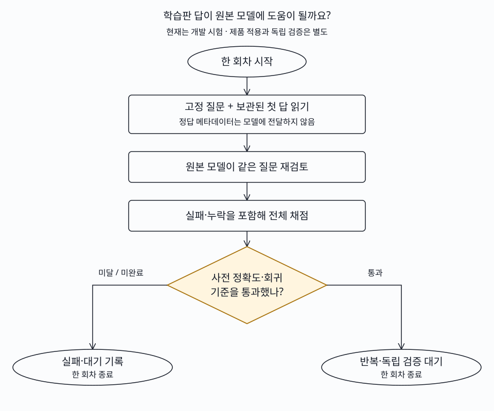

# 일일 연구와 실제 시험

학습판의 답을 원본 모델이 재검토하는 방법을 구현·실행했으나 D3에서는 정상 요청 회복을 확인하지 못했습니다. 혼합 질의 시험은 이어가며 제품 모델은 바꾸지 않았습니다.

| 할 일 | 상태 | 진행 |
|---|---|---|
| 선정 논문 검토 | 완료 | 4/4 = 100% |
| 기존 후보 revision 확인 | 변경 없음 | 9/9 = 100% |
| 신규 모델 조건 확인 | 검토·실행 대기 | 2/2 = 100% |
| 구현 로직 검사 | 통과 | 7/7 = 100% |
| 재검토 본 평가 | D3 완료·E 진행 | 1080/13122 = 8.23% |
| E 사람 표본 검수 | 대기 | 0/158 = 0.00% |

기록 시각: 2026-10-10T01:28:52.252411+00:00; GPU/ARM 관측 시각은 아래 표마다 구분합니다. 논문 발표일은 10월8일이고 오늘 확인한 연구입니다. 전 세계 최신 발표를 망라했다는 뜻은 아닙니다. 검색 개선과 일정 항목 선택 개선을 분리합니다.

## 선정 근거와 적용 범위

| 연구·공식 근거 | 현재 문제와 연결 | 비용·한계와 결정 |
|---|---|---|
| [SFT-as-Context v1](https://arxiv.org/html/2610.11132v1), 10월8일 | 학습 후 정상 요청을 놓치는 회귀를 원본 모델 재검토로 줄일 후보 | 두 번 추론이 필요합니다. 기존 첫 답을 재사용한 개발 시험만 구현했고 실제 두 모델 상주 지연은 미측정입니다. |
| [PASS v1](https://arxiv.org/html/2610.12345v1), 10월8일 | 덜 배운 개념에 학습 예산을 배분하는 후보 | 학습 자료 내부의 개념·부모 모델 표현 검사가 먼저 필요합니다. E 정답으로 자료를 고르면 평가 누출이므로 구현 대기입니다. |
| [H2CE v1](https://arxiv.org/html/2610.11277v1), 10월8일 | 식당·활동 장소 검색에서 의미와 거리·평점의 실제 수치를 함께 재정렬 | 장소 정답 검수와 ARM 비용 검사가 먼저입니다. K=10의 추가 쌍 비교와 비공개 학습 자료 한계가 있어 오늘 검색 효과를 주장하지 않습니다. |
| [MetaEncoder v1](https://arxiv.org/html/2610.11316v1), 10월8일 · [공식 구현](https://github.com/facebook/meta-encoder-eval) | 고정 선택지 표현을 미리 계산하는 후보 | 약30B·59.55GB 가중치, 접근 조건 대기입니다. 작은 모델 범위와 현재 GPU 자원에 맞지 않아 내려받지 않았습니다. |

방법·실험 조건·한계·개발/보류 자료·합격 기준·재개 지점은 [선정 원본](../../../../program/research/daily_rag_slm/2026-10-10_sources_and_review_v1.json)에 있습니다. 저자 원문을 읽고 별도 여행 적용판을 만들었으며 저자 전체 구현의 재현으로 표시하지 않습니다. 논문의 공개 점수를 우리 실측으로 옮기지 않았습니다.

## 답안 재검토 시험

고정 첫 시드 cosine·FINCH 답과 원본 자체 답을 각각 원본 Gemma-4-E4B-it Q4_K_M에 참고로 넣습니다. 원래 일정·질문과 원문 답 문자열만 입력하며 정답·정답 여부·확률은 넣지 않습니다. 부모 자체 답 대조는 두 번째 지시문 효과를 구분하기 위한 조건입니다. 정답 메타데이터는 오프라인 집계에만 사용합니다.

[사전 고정 계약](../../../../program/research/daily_rag_slm/2026-10-10_context_prereg_v1.json): 4096문맥·16출력토큰·temperature0·seed0·생각 끔, 동일 부모 가중치와 기존 파싱 규칙입니다. 토큰 초과·호출 실패·해석 실패는 문항을 남깁니다. 엄격 JSON 진단도 따로 기록합니다. 논문은 일부 길고 비정상인 참고 답을 빼고 원본만 추론하는 대체 경로가 있으므로 이 시험은 문자 그대로의 재현이 아닙니다.

| D3 조건·학습 여부 | 정상 요청 정답 | 요청 없음 오지목 | 해석 실패/전체 |
|---|---:|---:|---:|
| 첫 답: cosine 우리 학습판 | 105/120 = 87.50% | 4/240 = 1.67% | 0/360 |
| 원본 재검토: cosine 우리 학습판 | 105/120 = 87.50% | 5/240 = 2.08% | 0/360 |
| 첫 답: FINCH 우리 학습판 | 105/120 = 87.50% | 0/240 = 0.00% | 0/360 |
| 원본 재검토: FINCH 우리 학습판 | 105/120 = 87.50% | 5/240 = 2.08% | 0/360 |
| 첫 답: 원본 자체 답 대조 | 103/120 = 85.83% | 19/240 = 7.92% | 2/360 |
| 원본 재검토: 원본 자체 답 대조 | 103/120 = 85.83% | 19/240 = 7.92% | 2/360 |

두 학습판 모두 재검토 후 정상 정답은105/120으로 그대로이고 오지목은5/240입니다. 사전 기준 정상≥95%·오지목≤1%를 통과하지 못했습니다. 원본 자체 답 조건의 해석 실패2개도 전체360개 분모에 포함했습니다. 기존 첫 답을 재사용했으므로 첫 답과 두 번째 답 시간 합은 실서비스 두 모델 동시 상주 지연이 아닙니다. 같은 평가를 보며 지시문을 다시 조정하지 않고, E 세 조건을 완료한 뒤 전체 개발 결과로 기각/다음 연구 여부를 판단합니다. Wilson 구간과 같은 문항 정확검정은 [재계수](../../../../program/scripts/plan_qa_bench/results/daily_20261010_1003/daily_recount_v2.json)·[짝 비교](../../../../program/scripts/plan_qa_bench/results/daily_20261010_1003/context_D3_paired_comparison.json)에 있습니다. 반복 일정의 독립 표본이라고 해석하지 않습니다.

## 새로 회수한 기존 시험

복수 항목 응답 형식은 기존 단일 항목 응답과 다르므로 과거 B/E 단일 항목 점수와 섞지 않습니다. 아래는 같은835문항·같은 items 배열 출력 형식에서 B769와 C66을 분리한 것입니다. Saluki는 우리 자료 학습 없는 배포 원본이며 Gemma 세 판은 우리 자료로 학습했습니다. 이것만으로 원본끼리의 일반 우열을 확정하지 않습니다.

| 조건 | B 단일·없음 정확 일치 | C 두 항목 전체 일치 | 해석 실패 |
|---|---:|---:|---:|
| Saluki 배포 원본 | 666/769 = 86.61% | 59/66 = 89.39% | 1/835 |
| Gemma E4B oos1 Q4_K_M 학습판 | 750/769 = 97.53% | 56/66 = 84.85% | 0/835 |
| Gemma E4B oos3 Q4_K_M 학습판 | 751/769 = 97.66% | 60/66 = 90.91% | 0/835 |
| Gemma E4B oos2r Q4_K_M 학습판 | 751/769 = 97.66% | 54/66 = 81.82% | 0/835 |

GPU 서버 B의 같은 HF NF4 조건에서는 세 번째 시드 cosine346/360·FINCH348/360을 회수했습니다. 정상 요청은 각각106/120·108/120이고 잡담 오지목은 각각0/240입니다. 높은 합산 점수만으로 정상 요청 기준을 통과했다고 쓰지 않습니다. 원본 E는 정상952/1033·오지목174/974·합산 기준1/4이며 학습판 E는 진행 중입니다. 엔진과 양자화가 함께 바뀐 진단이고 GPU 서버 A와 속도를 직접 비교하지 않습니다.

새 완료8074행(복수 역할3340 + HF NF44734)을 보관했고 파일59/59개 해시를 검증했습니다. 새 재검토1080행은 별도로 파일15/15개를 검증했습니다. 재사용한 과거 첫 답13122행을 새 실측으로 더하지 않습니다.

## 실행·대기·자원

| 기계 | 관측·실행 | 다음 준비 작업 |
|---|---|---|
| GPU 서버 A | 2026-10-10T01:23:49.660749+00:00, 3372 MiB, 88 %; 기존 작업자·잠금 유지 | 재검토 D3 3/3 종료, E 1실행·2대기; 이후 누락 oos2 복수 항목835문항1조건을 추가해154등록(과거 종료 포함) |
| GPU 서버 B | 기존 NF4 cosine E 실행·FINCH E 대기 | 종료·PID 소멸·잠금 해제 뒤 oos1/oos2r D3/E 4조건8748문항과 각12문항 스모크 |
| Oracle ARM | 2026-10-10T01:19:42.392068+00:00, 최근 300.08초 두 코어 대비 CPU 84.49% | 기존 D3 캐시 없음 시험101/360 진행; 중단·중복 없음 |

Oracle ARM 별도 자원 관측 2026-10-10T01:23:46.200069+00:00: 호스트 RAM 7.166/12.504GB = 57.31% (MemTotal−MemAvailable), 루트 디스크 58.130/102.888GB 사용, 가용 44.742GB입니다. 서비스 MemoryCurrent 약7.21GB는 익명 메모리만의 값이 아니며 파일 캐시를 포함합니다. 최근5분 호스트CPU92.73%·steal0.17%, 두 코어 대비 작업CPU84.49%입니다. 7일 OCI 판정이나24시간 지속 달성을 뜻하지 않습니다. 앱의 HTTP 성공을 일정 답변 정확도로 쓰지 않습니다.

신규 공식 후보 [MetaEncoder](https://huggingface.co/facebook/meta-encoder)는 revision `3d0df704aa5bf66d9c49da1393181f33e893e5f7`, [Darwin-27B-ZTC](https://huggingface.co/FINAL-Bench/Darwin-27B-ZTC)는 `2b4bb9e22687b89e3c5703696b575ea2d2774da8`입니다. 각각59.55GB·51.25GB 가중치이며 우리 자료 학습 없는 결정/인코더 배포판입니다. MetaEncoder는 Apache 본문은 읽었지만 NOTICE 접근401·접근 조건이 대기이고, Darwin은 카드 Apache 선언과 포함 코드 MIT 본문만 확인해 가중치 라이선스 본문 확인은 대기입니다. 둘 다 원본 여행 시험·소형 상위권 판정·추가 학습 자격을 얻은 상태가 아닙니다. 기존9후보 revision은 모두 동일해 다시 내려받지 않았습니다.

## 다음 재개와 검증 한계

- 기존 GPU 작업자를 그대로 두고 재검토 E와 NF4 학습판·후속 조건을 회수합니다. 실패한 시도를 원인 수정 없이 다시 실행하지 않습니다.
- D3 재검토는 기준 실패이므로 제품 승격이나 나머지 시드 확장을 자동으로 진행하지 않습니다. E까지 완료 후 사전 계약에 따라 결정합니다.
- E 사람 검수0/158·새 독립720문항 고정 대기는 유지합니다. 사람 판단을 자동으로 채우거나 기존 평가를 독립 보류로 이름만 바꾸지 않습니다.
- StandardOne-3B는 선택지 점수 실행기·8192문맥 검증이 필요합니다. GPU 서버 B의 임시 공유 메모리 공간은 후보이지만62GB 컨테이너 한도·3GiB 여유·기존 작업 보존을 확인하고 준비합니다. Saluki 동일 학습 가중치·CUDA 스모크 조건도 유지합니다.

## 근거와 백업

[일일 실행 상태](../../../../program/research/daily_rag_slm/2026-10-10.json) · [원본 증거 폴더](../../../../program/scripts/plan_qa_bench/results/daily_20261010_1003/) · [후보 목록](../../../../program/research/daily_rag_slm/model_release_watchlist.json). 기존 산출물 수정 직전 백업은 [이번 백업 목록](../../../../program/research/daily_rag_slm/2026-10-10_daily_backups.json)에서 확인합니다.
