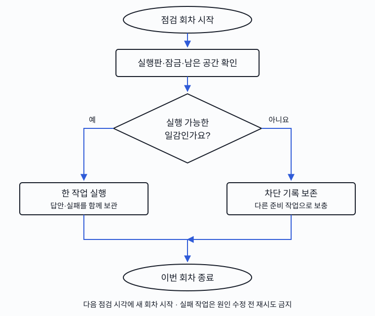

# 2026-10-10 14시 GPU·Oracle ARM 6시간 현황

답안 재검토 시험은 끝났지만 채택 기준에 실패했습니다. GPU 서버 A의 유휴 상태를 확인해 유효한 진단을 보충했고, Oracle ARM의 실제 앱 시험 대기열 결함을 수정했습니다. 새 모델 채택·실서비스 배포·신규 학습 완료를 뜻하지 않습니다.

| 할 일 | 상태 | 진행 |
|---|---|---|
| 세 기계 실행·잠금 확인 | 완료 | 3/3 = 100% |
| 신규 모델 답안 회수 | 완료 | 22,369/22,369 = 100% |
| 모델 파일 해시 검증 | 통과 | 58/58 = 100% |
| ARM HTTP 원본 파일 검증 | 통과 | 56/56 = 100% |
| 답안 재검토 개발 시험 | 기준 실패 | 13,122/13,122 = 100% |
| E 사람 검수 | 대기 | 0/158 = 0% |

## 지난 보고 이후 달라진 것

08시 보고 이후 오전10시 연구를 한 번 수행했습니다. 최근 논문4개·모델 revision9개와 신규 후보2개 검토는 오늘 기록에 있으며 이번 회차에 중복하지 않았습니다. 오전 실행한 재검토 D3/E 6조건이 전부 끝났습니다. 기존 첫 답은 재사용했으며 재검토 E에서 해석 실패5건, D3 부모 자체 검토에서2건을 분모에 남겼습니다. 호출 오류·미완료는0건입니다.

아래는 E 혼합 문장 2,007개 중 정상 요청1,033개와 요청 없음974개의 결과입니다. 같은 자료의 대조 문장2,007개까지 포함하면 조건당4,014개입니다. 정상 정답은 높을수록, 오지목은 낮을수록 좋습니다. 모든 실패·미완료는 원래 분모에 포함합니다.

| 모델·경로·우리 학습 여부 | 정상 요청 정답 | 요청 없음 오지목 | 상태 |
|---|---|---|---|
| cosine 시드20261012 Q4_K_M, 우리 학습판의 첫 답 | 947/1,033 = 91.67% | 3/974 = 0.31% | 기존 고정 개발 기준 미달 |
| 위 답을 원본 Gemma가 재검토 | 940/1,033 = 91.00% | 64/974 = 6.57% | 미채택 |
| FINCH 시드20261012 Q4_K_M, 우리 학습판의 첫 답 | 932/1,033 = 90.22% | 4/974 = 0.41% | 기존 고정 개발 기준 미달 |
| 위 답을 원본 Gemma가 재검토 | 925/1,033 = 89.55% | 64/974 = 6.57% | 미채택 |
| cosine 시드20261014 HF NF4, 우리 학습판 | 759/1,033 = 73.48% | 0/974 = 0.00% | 합산2/4·미채택 |
| FINCH 시드20261014 HF NF4, 우리 학습판 | 928/1,033 = 89.84% | 4/974 = 0.41% | 합산2/4·미채택 |

재검토의 혼합 문장 전체 정답률 변화는 cosine −3.39%p(일정군 bootstrap95% −4.64~−2.28), FINCH −3.34%p(−4.64~−2.24)입니다. 같은 문항 정확검정 p는 각각2.13e−10·8.69e−9이며, 일정군59개·bootstrap2,000회·시드7입니다. 이 고정 개발 시험의 회귀이며 논문 방법 일반의 실패나 전체 모델 순위를 뜻하지 않습니다. 정답률과 말로 한 확신도·토큰 확률을 혼합하지 않았습니다.

HF NF4와 llama.cpp GGUF는 양자화뿐 아니라 실행 도구와 계약 경로가 다릅니다. 이 결과만으로 양자화 원인이나 기계 간 속도 우열을 단정하지 않습니다. NF4의 오지목0건만으로 정상 요청 회귀를 무시하지 않습니다. 원래 사전 기준 정상95%·오지목1%·선택손실2%p·오지목증가1%p를 유지합니다.

누락 B/C 조건도 회수했습니다. Gemma Q4_K_M 우리 oos2 학습판의 단일/없음 정확도는752/769=97.79%, 두 항목 완전 일치는52/66=78.79%입니다. 64토큰 items 배열 계약으로 오류·해석 실패0/835이며 옛 단일 선택 결과와 합치지 않습니다.

## 현재 실행과 다음 일감

관측은 2026-10-10 14:11 KST입니다. GPU 사용률은 순간값이며 6시간 평균이나 계속 풀가동의 증거가 아닙니다.

| 기계·역할 | 현재 | 즉시 대기 | 조건 대기 |
|---|---|---|---|
| GPU 서버 A | FINCH 시드20261014의 D3 후보 역순 진단 시작 | 5조건·16,416문항 | Saluki 학습 표현·CUDA·공간 |
| GPU 서버 B | oos1 HF NF4 E 1,743/4,014 = 43.42% 저장 | oos2r E 1조건 | 뒤에 oos2/oos3 본 비교4조건8,748문항·연결24문항 |
| Oracle ARM 모델 시험 | 기존 nocache D3 추론 | 기존 등록 대기6조건 | 새 모델 다운로드 안 함 |
| Oracle ARM 앱 HTTP | language_style 안정성1회 실행 | 준비19회, 최근 시간 기준 추정 약6.23시간 중 잔여 | 실패 프로필 대기45회 |

GPU 서버 A는 13:58 관측 때 기존154조건이 끝나 유휴였습니다. 기존 일꾼·잠금을 유지한 채8조건17,496문항을 추가했습니다. 정상 요청 회귀가 후보 표시 위치에 민감한지 보기 위해 후보 문장 순서만 역순으로 바꿉니다. ID·고유명사·고객 질문·앞 대화·정답을 보존했고4,374/4,374 왕복 확인과 잘못된 입력 거부1/1을 통과했습니다. 원본2종과 우리 학습판2종의 D3/E를 비교합니다. 이미 본 문항의 진단으로 독립 보류 자료가 아닙니다. 입력 해시·시드·실행기와 2%p 정상 감소·1%p 오지목 증가·99% 선택 일치 경계를 실행 전 고정했습니다.

14:11 관측까지 두 D3 조건720/17,496=4.12%를 회수했습니다. 역순 Gemma 원본(우리 학습 없음)의 정상96/120·오지목22/240, cosine 시드20261014 우리 학습판96/120·오지목0/240입니다. 전체8조건 완료 전 순위나 위치 효과는 확정하지 않습니다. 14:11 GPU 서버 A의96MiB·0%는 새 조건 준비 순간값이고 GPU 서버 B는10,265MiB·62%였습니다. A 남은 공간3,771,789,312바이트, B5,631,000,576바이트입니다. 기존 모델 삭제·새 다운로드는 하지 않았습니다.

GPU 서버 B의 처음 원본/cosine/FINCH HF NF4 D3/E는6/6조건13,122/13,122 완료입니다. oos1/oos2r 후속 연결과 D3는744/744 회수했으며 두 E는 이어집니다. 후속 dispatcher는 살아 있고 잠금을 보유하며 기존 일꾼 종료·완료 표지·잠금 해제 후에만 다음 누락 비교를 시작합니다. 새 학습이나 기존 완료 조건 재실행을 예약한 것이 아닙니다.

## Oracle ARM: 자원 목표와 앱 검사를 분리

14:11:20 KST 종료 최근300.08초 시간 가중 평균은 두 코어 전체 대비 workload CPU83.92%, 호스트 CPU93.18%, steal0.19%입니다. 20% 이상 연속 관측은 약11.58시간으로 24시간 유지 증거가 아닙니다. 별도 상주 모델의 새 입력 처리 시험이며 초기화·같은 문맥 캐시 적중·동시 접수 지연을 섞지 않습니다.

14:11:21 KST 메모리는(MemTotal−MemAvailable)/MemTotal=(12,503,744,512−6,124,810,240)/12,503,744,512=51.02%입니다. 서비스 cgroup7,413,571,584바이트에는 회수 가능한 파일 캐시가 포함됩니다. 루트 디스크는58,131,476,480/102,888,095,744=56.50%, 약58.13GB 실사용·44.74GB 가용입니다. 사용자 확인선20GB를 넘었으므로 의미 없는 파일·메모리 채우기는 하지 않습니다. OS 순간/5분 수치는 Oracle의7일 유휴 판정과 다릅니다. [공식 판정 본문](https://docs.oracle.com/en-us/iaas/Content/FreeTier/freetier_topic-Always_Free_Resources.htm)을 이번 회차에도 열어 재확인했습니다. CPU95백분위·네트워크·A1 메모리의 세 조건을 함께 보며 디스크 사용량은 열거된 판정 항목이 아닙니다. 디스크20GB를 공식 회수 면제 조건으로 쓰지 않습니다.

기존 앱 대기열은 완료22·실패3·대기45건인데, 그45건이 모두 현재 배포판에서 실패로 막혀 실제 준비는0건이었습니다. 그런데 남은6시간 추정에45건을 넣어 성공 프로필을 보충하지 않았습니다. 최근 성공 HTTP 요약11/11은09:48 KST의 과거 결과이며14시 새 성공으로 쓰지 않습니다.

현재 배포판의 허용 프로필만 합산·등록하도록 계산을 수정했습니다. 배포 잠금과 실행 작업0건을 확인하고 원본 코드·상태를 직전 백업한 뒤 유휴 앱 일꾼만 교체했습니다. 모델 벤치마크·실행 중 질의·Docker 앱 배포·CD 타이머를 중단하지 않았습니다. 새 성공 프로필20회가 등록돼1회가 실행 중·19회 준비이며 차단45건과 실패3건은 보존됩니다. 준비 시간22,437초는 최근 완료 시간 EWMA에 따른 추정이지6시간 실측이 아닙니다. [결함 원인·수정](debugs/2026-10-10_1415_arm-blocked-horizon.md).

mock 응답·대기열 로직 검사15/15=100%입니다. mock 서버를 띄운 시험은 아닙니다. 실서버 확인(서버 응답): Oracle ARM 실제 HTTP 새 회차 시작·기존 완료/실패 원본56파일 회수 확인; 수정 후 새 회차11/11 완료·답변 의미 정확도는 아직 확인 전입니다. 반복11개 계약 검사를 독립 여행 정확도 표본으로 합치지 않습니다.

## 다음6시간·검증 대기

1. 후보 역순 진단의 종료 답안을 회수해 원래 표시 순서와 같은 문항 비교·일정군 구간을 계산합니다. 입력이나 합격선을 결과에 맞춰 바꾸지 않습니다.
2. GPU 서버 B oos1/oos2r E를 회수하고 연결검사 성공 뒤 oos2/oos3 누락 조건을 이어갑니다. 실패 문항을 제외하거나 자동 재시도하지 않습니다.
3. Oracle ARM은 성공 조건의 HTTP 지연·오류·메모리 안정성 시험을 계속 공급합니다. 차단된 context_cache/mixed_travel 시간 초과는 별도 원인 수정 전 재실행하지 않습니다. 관측 가능한 준비 시간과 실제 완료 시간을 구분합니다.
4. E 사람 검수0/158, 새720개 독립 보류 자료 미고정, 선택·근거·답변 개발 예시24개/고유 일정1개, Saluki 동일 모델 학습 표현·메모리 조건은 남았습니다. AI 검토를 사람 검수로 대신 쓰지 않습니다. Saluki 개발 결과·원본 비교와 파인튜닝·제품 채택은 별개입니다.

Strata 저장 한도 중단과 MAI·oos3/oos2r 지정 완료 결과는 보존합니다. 새 결제·임대·기존 모델 삭제·push·외부 게시·실서비스 배포·중복 예약은 하지 않았습니다.

## 원본·재개·백업

- [이번 회수와 관측 원본](../../../../program/scripts/plan_qa_bench/results/heartbeat_20261010_1400/) — 기계별 관측, 답안, 파일 SHA, 입력, 실패 보존, 등록·수정·회귀 로그입니다.
- [재계수와 Wilson 구간](../../../../program/scripts/plan_qa_bench/results/heartbeat_20261010_1400/recount.json) · [E 같은 문항·일정군 구간](../../../../program/scripts/plan_qa_bench/results/heartbeat_20261010_1400/context_E_paired.json).
- [구조화 현재 상태](../../../../program/research/daily_rag_slm/six_hour_report_2026-10-10_1400.json) · [후보 표시 순서 사전 고정](../../../../program/research/daily_rag_slm/2026-10-10_candidate_order_prereg_v1.json).
- [수정 코드](../../../deploy/arm/serving_queue.py) · [신규 회귀 검사](../../../deploy/arm/test_ready_horizon.py) · [회귀 로그](../../../../program/scripts/plan_qa_bench/results/heartbeat_20261010_1400/ARM_queue_regression.json).
- [코드·검사 백업](../../../deploy/arm/_backup/2026-10-10_1415_ready_horizon/) · [보고·상태 백업](../../../../program/research/daily_rag_slm/_backup/2026-10-10_1415_six_hour_close/). 원격 manifest·앱 코드·큐의 직전 백업 경로는 개인 원본 기록에만 보관합니다.
- [그림 HTML](assets/2026-10-10_1400_ready-queue.html). 기존6시간 예약과 일일 연구 예약은 유지하며 새 예약은 만들지 않았습니다.

검증 마감: 새 리포트 연결14/14 정상, 상태 JSON5/5 읽기 성공, 변경 Python4/4 컴파일 성공, 접근성 포함 그림 검사1/1 통과입니다. 검사 범위는 이번 파일이며 저장소 전체 정합성 검사가 아닙니다. 로컬 새 회귀 검사 첫 시도의 시험 fixture 누락3건은 수정 후6/6, Oracle ARM 기존 회귀 포함15/15로 확인했습니다. 그림 title/desc 식별자 검사 첫 실패도 직전 백업 후 수정했습니다.
