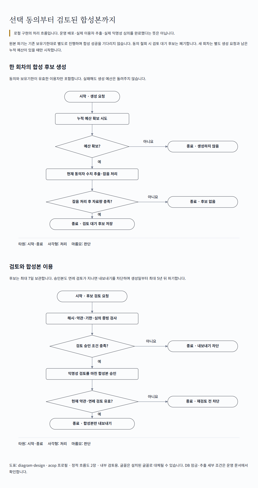

# 서비스 개선 선택 동의와 합성 자료 처리

서비스 개선에 사용할 수 있는 별도 선택 동의와 합성 후보의 생성·검토·보관 경로를 로컬 코드에 구현했다. 원본 보유기간은 연장하지 않는다. 실제 이용자 자료의 합성·익명성 심의·운영 배포를 완료했다는 보고가 아니다.

| 할 일 | 상태 | 진행 |
|---|---|---|
| 새 처리 코드·임시 DB 검증 | 통과 | 88/88 = 100% |
| 기존 동의 HTTP 회귀 시험 | 통과 | 24/24 = 100% |
| 웹 동의 관련 단위 시험 | 통과 | 27/27 = 100% |
| mock 서버 시험 (화면 반응) | 통과 | 19/19 = 100% |
| 실제 이용자 합성본 심의 | 미실행 | 0/1 = 0% |
| 운영 배포 | 미실행 | 0/1 = 0% |

분모: 첫 행은 이번 신규 단위 시험 76개와 실제 PostgreSQL 임시 DB 시험 12개다. 기존 동의 HTTP 회귀 시험은 별도의 새 임시 DB에서 실행한 `test_consents.py`의 24개 시험이다. 웹 단위 시험은 동의 기능 폴더의 3개 파일에 있는 27개 시험이다. 화면 시험은 `consent.spec.ts`의 19개 시나리오다. 합계 158/158 시험이 통과했으며, 이 수치를 전체 제품의 완성도로 해석하지 않는다.

실서버 확인 (서버 응답): **했음 — 임시 PostgreSQL DB에 연결한 실제 동의 HTTP 라우터에서 기본 false, 선택 동의 기록, 철회, 본문 해시 저장을 확인했다.** 공개 운영 cs 프로젝트 서버를 호출한 확인은 아니다.

## 달라진 동작

- 선택 코드 `service_improvement`를 추가했다. 필수는 기존 두 항목이고 새 항목은 기본 false다. 거부하거나 철회해도 기본 서비스를 이용할 수 있다. 약관 기본 버전은 웹·cs 프로젝트 서버 설정·mock 서버 모두 `2026-10-10.1`이다. 보유기간 운영 변경분 `+ret{N}`도 따른다.
- 최신 동의가 있는 최근 웹 이용자의 여행 인원·일정 일수·하루 일정 개수만 구간 값으로 처리한다. 사용자당 최신 여행 한 개로 기여량을 제한한다. 원문·위치·민감정보·예약번호·날짜 원값·이용자 연결표는 합성본에 남기지 않는다.
- 27개 고정 조합에 이산 잡음을 넣고 고정 개수의 합성 행을 생성한다. 반복 생성은 tenant 누적 예산 4회로 제한하고, 실패·철회·후보 만료에도 예산을 되돌리지 않는다. 동시에 6개 요청을 보내도 4개만 예산을 확보했다.
- 후보는 7일 보관한다. 해시·현재 약관·기한·검토 증빙이 맞아야 승인하고 승인 전 내보내기는 막는다. 승인본도 연례 검토가 유효해야 내보낼 수 있으며 생성일부터 최대 1,825일 보관한다. 원본 정리를 마친 뒤 합성본 만료 정리를 실행하므로 합성 정리 실패가 원본 정리를 막지 않는다.

필수 또는 개선 동의 철회 시 검토 대기 후보를 같은 DB 트랜잭션에서 폐기한다. 후보 정리에 실패하면 동의 기록도 되돌아간다. 이미 검토·승인된 연결표 없는 합성본은 개인별 기여를 찾아 회수할 수 없음을 새 약관에 명시했다.

## 검증 근거

| 근거 | 확인한 것 |
|---|---|
| [신규 처리 시험](../evidence/2026-10-10_service_improvement/pytest-final.log) | 동의·현재 버전·기한·최신 여행 제한, 원문 출력 금지, 검토/만료/철회, 실패 시 예산 소비, 동시 요청 제한 |
| [기존 동의 HTTP 회귀 시험](../evidence/2026-10-10_service_improvement/consent-regression.log) | 필수 동의·버전 변경·증빙·CSRF·철회·만료 등 기존 동작 24개 |
| [웹 동의 시험](../evidence/2026-10-10_service_improvement/vitest-final.log) | 새 항목·한영 약관·해시·동기화·선택 항목 처리 |
| [화면 시험](../evidence/2026-10-10_service_improvement/playwright-v2.log) | 선택 넷 표시, 필수 둘만으로 이용, 개선 동의/철회와 기본 서비스 유지 |
| [타입 검사](../evidence/2026-10-10_service_improvement/typecheck.log) | TypeScript 오류 없이 종료 |
| [린트](../evidence/2026-10-10_service_improvement/ruff-final.log) | 변경한 Python 기능과 관련 시험 통과 |
| [흐름도 검사](../evidence/2026-10-10_service_improvement/diagram-check-v2.log) | 접근성·단일 HTML 정적 검사 통과 |

초기 시험의 환경 오류도 보존했다. 제한된 실행 환경의 로컬 DB 연결 차단과 Node 임시 파일 오류는 로컬 실행으로 재검증했다. 전용 Chromium 파일이 없어 첫 화면 시험은 실행되지 못했고, 설치된 Edge로 같은 19개 시나리오를 다시 실행해 통과했다. 실패 로그를 성공 로그로 덮어쓰지 않았다.

[확대 가능한 흐름도](../evidence/2026-10-10_service_improvement/service-improvement-flow.html) · [휴대폰 화면](../evidence/2026-10-10_service_improvement/improvement-mobile.png) · [데스크톱 화면](../evidence/2026-10-10_service_improvement/improvement-desktop.png).

## 운영 반영 전 남은 것

1. 마이그레이션과 새 웹 약관을 함께 운영 반영하고 사람에게 새 선택 동의를 받는다. 기존 동의로 대신하지 않는다.
2. 실제 후보에 대해 적법한 이용 근거·재식별 공격·유용성 검토를 하고 증빙을 보존한다. 시험용 심의 증빙은 실제 승인에 사용하지 않는다. 이산 잡음의 수학적 구성은 법률상 익명성이나 구현의 형식 검증 완료를 뜻하지 않는다.
3. 원본 정리의 운영 실행 상태를 별도로 확인한다. 기존 회원 자료 정리 설정 `retention.purge_mode`는 **dry_run 그대로**이며, 이 작업에서 실사용자 원본을 파기하거나 설정을 켜지 않았다. 기존 작업의 약관상 파기 의무가 자동으로 운영 충족됐다고 선언하지 않는다.
4. 승인본을 내보낸 뒤 외부에 복사한 파일·학습 자료의 만료와 재검토는 운영자가 함께 관리해야 한다. 현재 정리 작업의 자동 삭제 범위는 cs 프로젝트 DB의 합성 표다. 내보내기는 자동 배포/학습을 실행하지 않는다.

## 관련 파일과 보존

- [운영 계약](../../operations/service-improvement.md): 범위·대체할 수 없는 사람 검토·정책·법령 출처.
- [동의 API 계약](../../external/rest-endpoints.md): 여섯 항목과 철회 동작.
- [구현 전 백업](../../../_backup/2026-10-10_0221_service_improvement/): 기존 변경을 포함한 원본 사본. 다른 작업자의 변경을 초기화하지 않았다.
- [증거 폴더](../evidence/2026-10-10_service_improvement/): 성공/실패 로그·그림·화면·재현 도구. 접속 비밀이나 실제 고객 자료를 기록하지 않았다.

커밋·푸시·운영 배포·외부 메시지 전송은 실행하지 않았다.
