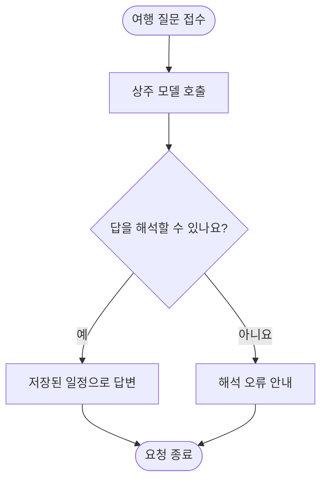

# Oracle ARM 모델 연결과 대화 실패 판정 점검

## 미해결

`[실측 2026-10-11 03:23~03:26 KST]` 모델 연결은 살아 있으나 실제 대화에 구조화 답 해석 실패가 있고, 자동 검사가 오류 안내를 성공으로 세었다. 앱·DB 기동을 사용자 요청 처리의 정상으로 일반화할 수 없다.

| 확인 | 결과 | 분모 |
|---|---|---|
| 최근 완료 3회차 대화 | 정상 답변 9/12 = 75% | 회차당 실제 대화 4개, 같은 합성 여행 반복이며 독립 정확도가 아님 |
| 해석 실패 | 3/12 = 25% | 실패도 포함한 전체 대화 |
| 기존 검사 표시 | 33/33 = 100% | 인증·등록·조회 21개와 대화 12개를 합친 HTTP 검사. 실제 대화 성공률이 아님 |
| 대화 시간 | 약252~325초 | 위 12개, 모델 벤치마크 동시 실행 |

## 재현과 원인 범위

위치: [serving_checks.py](../../../deploy/arm/serving_checks.py)의 `run`이 답변 문자열 존재와 `error` 키 부재만 확인했다. [trip_messages.py](../../../app/domains/travel_ops/components/conversation/trip_messages.py)의 `_run_decision`은 모델 실패도 HTTP 200과 비어 있지 않은 오류 안내로 반환한다. 따라서 `status=escalated`, `reason=decision_failed`, `failure=OllamaContentError`가 있어도 통과 처리했다.

모델 중계기는 실제 llama.cpp 상주 모델과 식별자가 일치했고 `/api/chat` 200 호출을 기록했다. 앱의 실제 설정과 중계기의 모델 경로를 대조했다. 이전 관측용 포트가 현재 리스닝하지 않는다는 사실은 앱 연결 실패의 근거가 아니다. 현재 앱의 실제 설정은 다른 정상 엔드포인트를 사용한다. 개인 접속 정보는 기록하지 않는다.

`[미확보]` 구조화 출력 실패의 직접 원인은 원문 답변 재현으로 확인 중이다. 연결된 모델은 기존 `e4bt` 합친 학습판이며 정확한 oos 레시피는 이 점검으로 확정하지 않는다. 단순 연결 정상·HTTP 200을 모델 출력 정상으로 쓰지 않는다. CPU 2코어에서 앱과 모델 벤치마크가 같은 추론 슬롯을 공유하고 있으므로 지연의 대기·입력 처리·생성을 분리해야 한다.

## 위험과 정정

고객에게는 해석 오류 안내 또는 수분의 대기가 발생한다. 실패 시 일정을 변경하지 않는 앱 동작은 유지한다. 이전 198/198 등 HTTP 계약 검사 결과는 원본 그대로 보존하며 **실제 답변 성공 또는 정상 운영의 증거로 사용할 수 없다**. 이번 3회차 33개를 기존 판정으로 세면 33/33이지만 실제 대화 오류를 실패로 세면 최대30/33이다. 이전 모든 회차의 소급 재판정은 아직 완료하지 않았다.

## 근거

- [시점별 원본 근거 폴더](../../../../program/scripts/plan_qa_bench/results/oracle_llm_diagnosis_20261011_032310/) — git 제외, 실제 설정·프로세스·로그·최근 답안 원문. 민감한 접속 정보가 있어 공용 문서에 복사하지 않는다.
- [최근 완료 답안](../../../../program/scripts/plan_qa_bench/results/oracle_llm_diagnosis_20261011_032310/recent_answers.json) — 합성 여행 대화 12개.
- [운영 기준](../../operations/arm-serving-queue.md) — 실행 중 작업 중단·중복 없이 점검한다.

## 수정·검증 상태

`[실측 03:28 KST]` 완료된 전체 61회차의 대화 244개를 새 기준으로 소급 대조했다. 134/244 = 54.9%가 정상 답변이고 110/244 = 45.1%는 `decision_failed`였다. 전부 같은 `language_style` 프로필의 반복이며 독립 정확도가 아니다. 현재 실행 중·과거 실패 회차의 부분 답안을 섞으면 259개이므로 이를 완료 61회차의 분모와 섞지 않는다. 원본 상태·요약은 덮어쓰지 않았다.

`[실측]` 합성 여행 첫 질문을 앱 컨테이너의 실제 설정으로 직접 호출해 HTTP 200·올바른 결정 객체를 확인했다. 총247.06초, 캐시1,045토큰·추가 입력146토큰 처리13.91초·출력166토큰 생성48.28초였다. 총시간과 모델이 반환한 계산시간의 차이 약184.87초는 연결·중계·대기 등을 포함한 잔여 시간이며 정확히 전부 대기라고 단정하지 않는다. 모델 상주가 빠른 전체 응답을 보장하지 않는다.

### 검사 수정

- `travel-answer-v2`: `status=answered`, 성공한 결정 종류, 오류/실패 부재, 합성 일정의 정해진 시각을 함께 확인한다. 복합 시간 질문은 두 시각 모두 확인한다.
- mock 서버 시험 13/13 = 100% (검사·대기열 회귀, 화면 반응 검사는 해당 없음). 실제 오류 안내문·잘못된 시각·복합 답 누락을 성공으로 세지 않는 시험을 포함한다.
- 실서버 확인 (서버 응답): 했음. 앱의 기존 대화 244개 소급 대조, 앱 내부 모델 실제 호출1건, 앱·DB·중계기·텍스트/임베딩 프로세스 확인. 수정된 검사로 새로운 전체 HTTP 회차를 완료한 것은 아직 아니다.
- `[실측 03:36 KST]` Oracle ARM의 일회성 적용 작업이 기존 회차 종료 뒤 배포 잠금을 획득해 시험 작업자만 안전하게 교체했다. 설치된 검사 해시는 `d76480d852f91fc0dd555570100f20df8ac66b77e8d60960fdf69d2d41689909`이며 로컬 수정판과 같다. 시험 작업자와 모델 벤치마크는 모두 active, 모델 PID는 기존266244로 유지됐다. 앱 컨테이너·진행 중 모델 작업은 중단하지 않았다. 수정된 검사로 새 전체 회차를 완료한 것은 아직 아니다. [실제 반영 근거](../../../../program/scripts/plan_qa_bench/results/oracle_llm_diagnosis_20261011_032310/close_snapshot.json).

### 대화 이력을 넣은 실제 실패 재현

`[실측]` 같은 합성 여행의 고객/앱 대화 6턴과 중국어 첫 일정 시간 질문을 앱 컨테이너에서 실제 모델로 보냈다. 396.53초 뒤 HTTP 200이었지만 `completion_tokens=400`, `message.content=""`, `JSONDecodeError`였다. 모델이 출력 상한을 모두 쓰고 빈 본문을 돌려주는 경우를 직접 확인했다. 추가 입력 처리31.94초·출력 생성107.67초이며 나머지 시간에는 중계·전송·대기 등이 포함된다.

[원본 재현 답변](../../../../program/scripts/plan_qa_bench/results/oracle_llm_diagnosis_20261011_032310/actual_history_response.json). 현재 중계기는 빈 문자열도 `done=true`인 HTTP 200으로 내보낸다. 템플릿의 `enable_thinking=false` 전달과 실제 출력의 생각 채널 분리·생성 종료의 관계는 추가 확인 대상이다. 빈 본문의 근본 원인이 토큰 상한뿐이라고 단정하거나, 상한을 늘리는 것만으로 해결됐다고 쓰지 않는다. 모델·중계기의 실제 답변 오류는 아직 미해결이며 자동 검사 오판 수정과 구분한다.

로컬 백업: [검사·시험](../../../deploy/arm/_backup/2026-10-11_0327_semantic_failure/), [운영 문서](../../operations/_backup/2026-10-11_0334_semantic_failure/), [리포트 초안](./_backup/2026-10-11_0334_diagnosis_update/). 원격 백업 위치는 적용 완료 근거에 보관하며 공용 문서에는 접속 정보를 넣지 않는다.

이 그림은 앱의 현재 처리 경로이며, 모델 연결 성공이 곧 정상 답변 성공이라는 뜻이 아니다. 출력 실패의 직접 원인 재현과 수정판 적용 확인을 이어간다. 실제 모델 응답의 오류 원인을 고쳤다는 의미로 문서를 닫지 않는다.
