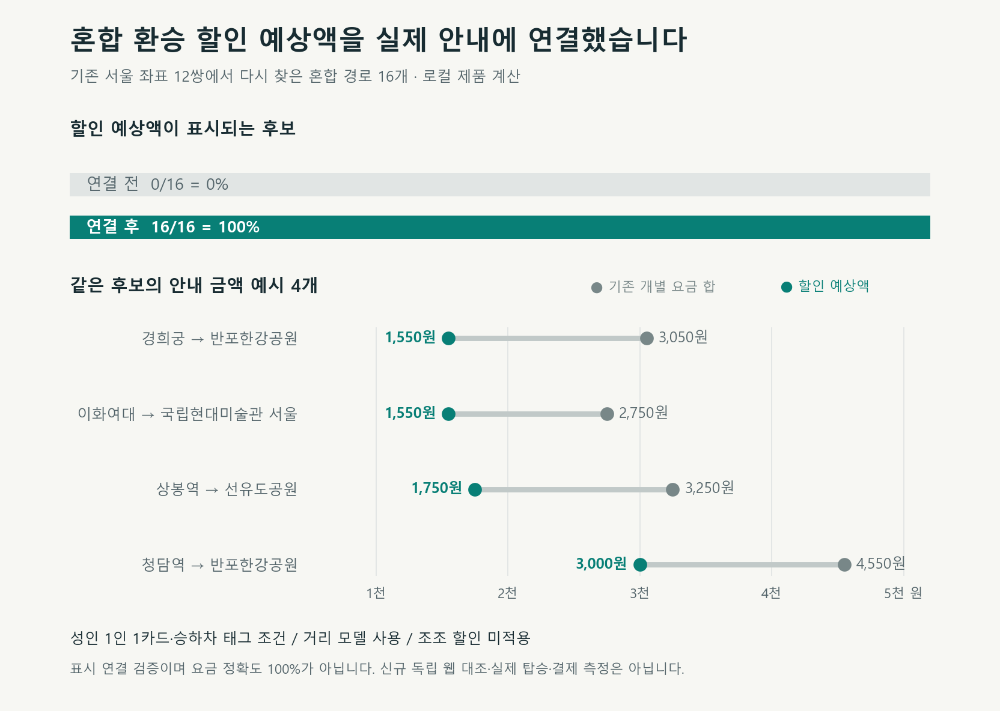

# 혼합 환승 할인 예상액의 제품 연결

서울 버스와 지하철을 갈아타는 경로에서 할인 전 개별 요금 합만 안내하던 동작을 고쳤습니다. 로컬 제품 탐색은 확인된 구간 거리와 환승 조건으로 할인 예상액을 안내합니다.

| 할 일 | 상태 | 진행 |
|---|---|---|
| 서울 좌표 재탐색 | 완료 | 12/12 = 100% |
| 혼합 후보 할인 표시 | 확인 | 16/16 = 100% |
| 신규 운임·제외 조건 시험 | 통과 | 38/38 = 100% |
| 관련 시험 | 기존 불일치7 | 172/179 = 96.1% |

작성 2026-10-11T04:39:52.410744+09:00. 분모16은 기존 개발 표본에서 고른 서울12쌍의 현재 탐색에 나온 버스 포함 환승 후보 수입니다. 100%는 표시 연결 비율이며 운임 정확도나 전체21개 기능 완료율이 아닙니다. 신규38은 관련179에 포함됩니다.

## 바뀐 안내와 계산 조건

경희궁→반포한강공원 후보는 기존3,050원에서1,550원, 청담역→반포한강공원 광역버스 포함 후보는4,550원에서3,000원 예상액으로 바뀌었습니다. 변경 전 값은 같은 구간열의 할인 전 개별 요금 합이고, 변경 후는 현재 제품의 fare_krw·label에서 확인했습니다. 16/16개 모두 할인 전 합보다 낮았습니다. 경로·시각·도보·추천 순위를 이 비교를 위해 바꾸지 않았습니다.

성인 1인1카드·승하차 태그 조건을 안내 문구에 표시합니다. 버스 노선ID·승하차 순번·정류소ID를 대조하고 완전한 연속 구간 거리만 합산합니다. 기존 지하철 공표 거리·허용 추정 거리의 범위 상단을 사용합니다. 개찰 안 지하철 환승은 한 승차로 묶으며 별도 철도 추가운임을 잃지 않도록 더합니다. 조조 할인은 적용하지 않습니다.

동일 버스 노선 재승차, 낮30분/야간60분의 후속 승차 기준 창 초과, 5회 초과 승차, 최대 이용시간 초과, 거리 누락·잘못된 정류소 식별값·지원 밖 유형에는 할인을 적용하지 않고 기존 개별 요금 합 안내로 대체합니다. 서울 광역은 기본구간30km, 그 밖 지원 유형은10km이며 초과5km마다100원 규칙을 연결했습니다.

공식 근거: [서울시 통합환승 할인제](https://news.seoul.go.kr/traffic/transfer_discount)와 [서울시 노선정보 응답 항목](https://www.data.go.kr/data/15000193/openapi.do)을2026-10-11 확인했습니다. 공식 구간거리가 교통카드 청구 운임거리와 같다는 보장은 확인하지 않았으며 거리 모델 예상액으로 표시합니다. 새 논문 알고리즘을 적용한 작업으로 보고하지 않습니다.

## 검증 근거와 남은 문제

수정 전 새 시험30개 실패를 보존했습니다. 최초 제품 예시에서3,050원과 기대1,550원의 차이를 재현했으며, 이후 버스→버스·5회 승차·별도운임·광역30km 경계를 추가한 최종 신규38개가 통과했습니다. 최종 관련179개 중172개 통과,7개 실패,건너뜀0개입니다. 할인 연결을 끈 별도 대조에서도 동일7개 실패를 확인했으며 기대 결과를 자동 교체하지 않았습니다. [기존 불일치 기록](debugs/2026-10-11_0439_이동_기존기대결과_불일치.md). Ruff 변경 코드·신규 시험 검사 통과입니다. 일부 실행 종료 후 pyreadline3 콘솔 정리 경고가 나왔으며 시험 XML·종료코드를 함께 보존했습니다.

초기 재생 집계는 환승 보행 결과 행을 승차 결과에 섞어 연결0건으로 잘못 집계했습니다. 제품 응답의 할인 문구/금액은 정상이었고, 승차 시각 행만 대조하는v2에서14/16으로 정정했습니다. 광역 연결 후 실제 제품 탐색을 다시 실행한v3에서16/16을 확인했습니다. 원본v1·정정v2·최종v3을 모두 보존했습니다. 이는 새 독립 검증 표본이 아니라 기존 개발 좌표의 재사용입니다. 새 웹 대조0건, 실제 탑승/결제0건입니다.

mock 서버 시험(화면 반응): 안 했음.
실서버 확인(서버 응답): 안 했음 — 로컬 이동 계산기를 실행했으며 cs 프로젝트 서버 HTTP 응답·운영 화면은 확인하지 않았습니다.

제한API 호출0회입니다. 제품 재생·최종 관련 시험의 외부 연결 시도는 각각0회였으며 소켓 연결을 차단했습니다. 공급자별 공유 일일 사용량·잔여량·갱신 시각은 확인하지 못했으므로0으로 기록하지 않고 미확인으로 보존합니다. 20% 예비량 규칙·운영 한도·예약 주기·알림 정책을 변경하지 않았습니다.

착수 시 이전498개 코드·시험·자료 해시 중496개가 일치했고 다른 작업자가 수정한2개 파일은 보존했습니다. 커밋·푸시·배포·외부 메시지·결제를 실행하지 않았습니다. 21개 기능의 전체 완료를 선언하지 않습니다.

## 파일과 백업

- [운임 계산](../../../app/domains/travel_ops/instances/mobility/engine/options.py): 조건부 할인 예상액을 계산합니다.
- [제품 연결](../../../app/domains/travel_ops/instances/mobility/engine/plan.py): 기존 응답 금액·문구에 연결합니다.
- [운임 규칙](../../../app/domains/travel_ops/instances/mobility/engine/rules/rules_v0.3.json): 서울 광역30km와 거리 모델의 적용 조건입니다.
- [새 시험](../../../tests/unit/travel/mobility/test_transfer_fare_product_v1.py): 신규38개 조건입니다.
- [실행 로그·서울 후보 원문·해시](../evidence/2026-10-11_0421_혼합환승_제품운임_연결/): 명령·실패·최종 결과를 보존했습니다.
- [백업 명세](../evidence/2026-10-11_0421_혼합환승_제품운임_연결/backup-manifest-v1.json): 덮어쓰기 전 판과 경로·SHA-256을 기록했습니다. 대체 전 코드는legacy에도 보존했습니다.
