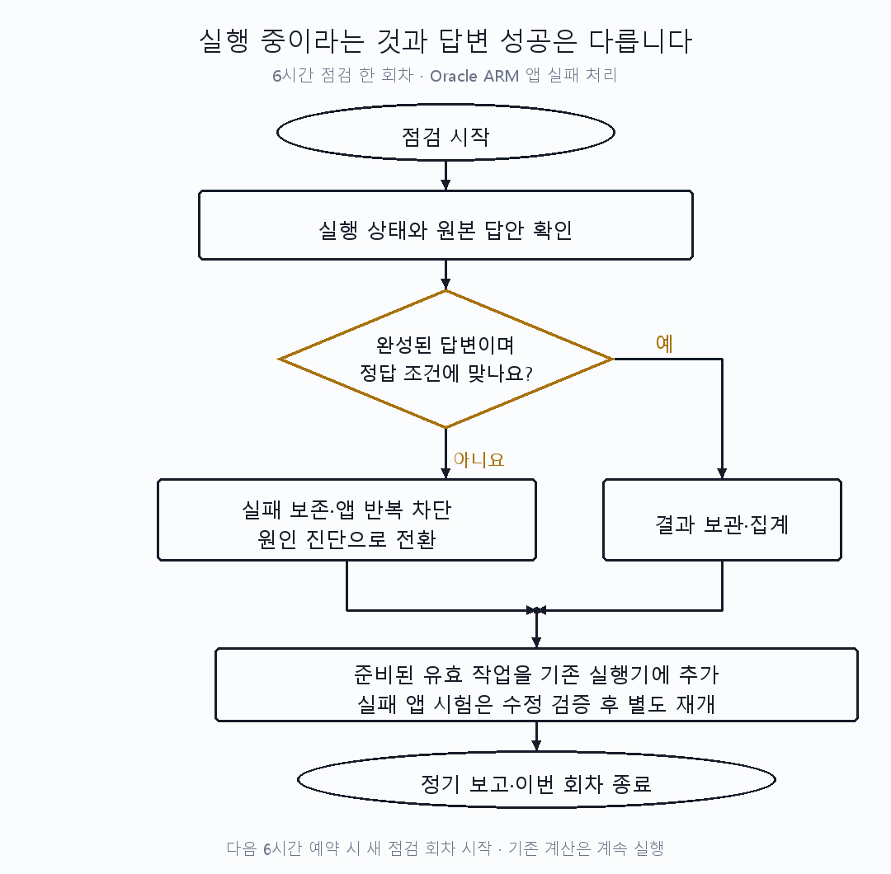

# 08시 정기 설명·현황

GPU 서버 A/B의 멈춘 계산을 재개하고 다음 일을 등록했습니다. Oracle ARM 모델은 연결되어 있지만 실제 앱 답변 경로는 아직 정상으로 검증되지 않았습니다.

| 할 일 | 상태 | 진행 |
|---|---|---|
| 실제 기계·잠금 점검 | 완료 | 3/3 = 100% |
| 새 GPU 답안 압축 회수 | 완료 | 35,004/35,004 = 100% |
| 회수한 추가 후보 순서 비교 | 완료·기준 미달 | 16/16 = 100%, 전체 기준 통과0/16 = 0% |
| GPU 서버 B 기존 본 비교 | 누락 재개 | 3/8 = 37.5% |
| GPU 앱 출력 계약 진단 | 5판 완료 | 5/5 = 100%, 240/240회 회수 |
| 유한6시간 안정성 시험 | 등록·실행 중 | 등록1/1 = 100%, 실행 완료0/1 = 0% |
| Oracle ARM 최신 앱 검사 | 실패 보존 | 10/11 = 90.9% |
| E 사람 검수 | 미완료 | 0/158 = 0% |

[실측] 기계 관측은 **2026-10-11 08:19:43 KST** 전후이며 진단 전체 원본 추가 회수와 안정성 시험 시작 확인은08:24 이후입니다. 답안 회수 수는08시 초 회수한 고정 묶음이며 이후 진단 호출·새로 완료한 GPU 서버 B 작업은 별도로 구분합니다. 이전 정기 보고는 [02시 기록](2026-10-11_0200_six-hour-gpu-arm-report.md), 앱 실패 정정은 [03시 장애 기록](2026-10-11_0323_arm-llm-response-failure.md)입니다.

## 1. 지난 보고 이후 실제 완료와 판단

목적은 후보 순서에 기대는 답변인지, 정상 요청을 보존하면서 잡담 오지목을 줄이는지 확인하는 것입니다. 새 회수35,004행은 본 평가34,992행과 연결 검사12행입니다. GPU 서버 A의 QAT14개 실행30,618행, GPU 서버 B의 본 비교2개4,374행·연결12행을 회수했습니다. HTTP 오류0행, 해석 실패3행을 원문·분모에 남겼습니다. 새 묶음98/98파일과 기존 비교 기준·ARM 완료 묶음을 포함한185/185파일의 해시를 대조했습니다. 기준 묶음은 신규 답안 수에 다시 더하지 않았습니다.

[실측] 동일 문항의 선택지 표시 순서를 뒤집은 추가 비교16개는 사전 기준 전체를 통과하지 못했습니다. 기존 [사전 계획](../../../../program/research/daily_rag_slm/2026-10-11_candidate_order_representation_prereg_v1.json)의 정상 요청 감소≤2%p, 오지목 증가≤1%p, 선택 일치≥99%를 적용했습니다. 이 표현 방식 대조가 끝나면 같은 순서 시험을 계속 늘리지 않습니다.

아래는 E의 자유문장 혼합 부분2,007문항입니다. 정상 요청1,033·요청 없음974이며, 같은2,007개 대조 문장은 별도입니다. 수치는 원래 순서 → 뒤집은 순서입니다.

| 모델 표현·우리 학습 여부 | 정상 요청 정답 | 요청 없음 오지목 | 선택 일치 | 사전 기준 | 정답률 차이95%구간 |
|---|---|---|---|---|---|
| QAT 원본(우리 학습 없음) | 978 → 969/1033 | 207 → 247/974 | 1823/2007 = 90.8% | 1/3 | [-3.83, -1.11]%p |
| QAT + oos1(우리 학습) | 865 → 825/1033 | 28 → 17/974 | 1877/2007 = 93.5% | 1/3 | [-2.46, -0.44]%p |
| QAT + oos2(우리 학습) | 939 → 938/1033 | 65 → 58/974 | 1908/2007 = 95.1% | 2/3 | [-0.49, 1.14]%p |
| QAT + oos3(우리 학습) | 980 → 951/1033 | 80 → 73/974 | 1900/2007 = 94.7% | 1/3 | [-2.00, -0.25]%p |
| QAT + oos2r(우리 학습) | 926 → 888/1033 | 5 → 5/974 | 1916/2007 = 95.5% | 1/3 | [-2.83, -0.94]%p |
| QAT + cosine 시드20261014(우리 학습) | 948 → 934/1033 | 2 → 3/974 | 1924/2007 = 95.9% | 2/3 | [-1.50, 0.05]%p |
| QAT + FINCH 시드20261014(우리 학습) | 968 → 949/1033 | 9 → 9/974 | 1946/2007 = 97.0% | 2/3 | [-1.53, -0.35]%p |
| HF NF4 + oos1(우리 학습) | 857 → 827/1033 | 22 → 18/974 | 1894/2007 = 94.4% | 1/3 | [-2.23, -0.46]%p |

구간은 일정군59개를 단위로 seed7·2,000회 재표집한 전체 혼합 정답률 차이(역순−원순)입니다. 같은 개발 문항이며 독립 검증이 아닙니다. 원본 모델도 개발사 학습을 거친 배포판입니다. HF NF4와 GGUF 대조는 추론 엔진과 양자화가 함께 달라 단일 원인으로 해석하지 않습니다. HF oos1의 E 혼합 요청 없음에는 해석 실패1건도 있어 오지목18/974와 보수적 오지목·해석 실패19/974를 구분합니다. 다른 해석 실패도 [원본 재계수](../../../../program/scripts/plan_qa_bench/results/heartbeat_20261011_0800/)에서 확인합니다.

## 2. GPU 작업 재개와 앱 형식 진단

[실측] 이번 점검 시작 때 GPU 서버 A/B가 모두 유휴 상태였습니다. 계속 풀가동했다고 할 수 없습니다. GPU 서버 A는 기존 등록184개가 종료된 상태였고, 기존 실행기에 앱 형식 진단5개와 유한6시간 안정성 시험1개를 추가했습니다. 실행기342497의 생존·파일 잠금을 유지했습니다.

GPU 서버 B는 본 비교6개가 등록되지 않은 연결 검사3개를 기다려 모두 건너뛰었는데도 전체 완료 표식이 남아 있었습니다. **완료 표식만으로 전체 완료를 판단한 것은 잘못입니다.** 기존 완료2개·답안·표식은 보존하고 미실행6개만 새 대기열에 연결했습니다. 새 연결 검사3/3은 완료됐습니다. 기존8개 본 비교는 완료3/8, 현재1개 실행·나머지4개 대기입니다. 옛 대기6개와 옮긴6개를 중복 계산하지 않습니다.

아래 작업·자원 표는08:19 관측입니다.08:24 추가 확인에서는 QAT 두 판이 모두 종료되고6시간 안정성 시험이 실행 중이며 즉시 대기0개입니다. 신규 QAT 실패 표현은 원인 수정 없이 안정성 시험에 넣지 않았습니다.

| 기계 | 08:19 계산 | 08:19 다음 준비 작업 | 관측 순간 GPU | 남은 공간 |
|---|---|---|---|---|
| GPU 서버 A | QAT 원본 앱 진단 35/48 | QAT FINCH 진단·6시간 안정성 시험 | 3058 MiB, 96 % | 3.45GiB |
| GPU 서버 B | oos3 D3 역순 226/360 | 기존 누락 비교4개 | 10087 MiB, 100 % | 5.18GiB |

현재 순간 사용률을 지난6시간 가동률로 해석하지 않습니다. GPU 서버 B 의존성 누락·미완료 완료표식 방지 코드는 로컬4/4검사를 통과했습니다. 실행 중인 복구 대기열 코드를 바꾸지 않았고, 복구는 올바른 작업 목록으로 적용했습니다. 새 방지 코드의 원격 실행기 반영은 다음 안전한 경계에서 별도 검증합니다.

새 앱 형식 진단은 현재 앱의 프롬프트·JSON 형식을 가상 서울 일정1개·질문6개·대화 이력2조건에 적용합니다. 출력 한도400/800을 ABBA로 비교해 모델당48회입니다. 학습·문턱·프롬프트를 이 결과로 바꾸지 않았습니다. 아래 정답은 **요청 종류·대상·질문 항목 필드 일치**이며 최종 고객 답변 품질 점수가 아닙니다. 미완료도48회 분모에 남겼습니다.

| 모델 | 저장 | 필드 일치/예정 | 빈 답변 | 상태 |
|---|---|---|---|---|
| Gemma-4-E4B-it Q4_K_M 원본(우리 학습 없음) | 48/48 = 100.0% | 47/48 = 97.9% | 1 | 완료 |
| 같은 기반 + FINCH 시드20261014(우리 학습) | 48/48 = 100.0% | 48/48 = 100.0% | 0 | 완료 |
| Underdog-Saluki-27B-1.0 IQ2-mix 원본(우리 학습 없음) | 48/48 = 100.0% | 48/48 = 100.0% | 0 | 완료 |
| Gemma-4-E4B-it QAT Q4_0 원본(우리 학습 없음) | 48/48 = 100.0% | 47/48 = 97.9% | 1 | 완료 |
| 같은 QAT 기반 + FINCH 시드20261014(우리 학습) | 48/48 = 100.0% | 47/48 = 97.9% | 1 | 완료 |

원본 Q4_K_M의400토큰 조건은23/24,800조건은24/24였습니다. 한 번의 실패는 빈 답변과 `finish_reason=length`가 함께 기록됐습니다. FINCH와 Saluki의48/48은 같은12조건을 반복한 소규모 진단으로, E 전체 성능이나 독립 정확도로 일반화하지 않습니다. 두 QAT 표현도 각각 빈 답변1회와 출력 한도 종료1회가 남아47/48이며, 모든240회 원본을 보존했습니다.

[6시간 안정성 계획](../../../../program/research/daily_rag_slm/2026-10-11_app_schema_soak_prereg_v2.json)은 이미48/48을 통과한 FINCH 표현만 대상으로 합니다. 새 기동 전에도 원본 선행 답안을 다시 검사합니다. 1·2동시 접수를1시간씩 교대하고 출력 한도800,2슬롯·총 문맥8,192토큰을 고정해 오류·지연·메모리 추세를 기록합니다. 6시간 관측 또는 연속3회 실패 시 종료하며 자동 재시작하지 않습니다. 반복 질문을 독립 정확도에 합산하지 않습니다. 처음 등록은 줄바꿈 변환에 따른 코드 해시 불일치로 작업 목록 변경 전에 거절됐고, 미사용 파일과 계획v1을 보존한 뒤 전송 바이트 해시를 고정한v2로 등록했습니다. Oracle ARM 앱 배포나 모델 교체는 하지 않았습니다.

## 3. Oracle ARM: 자원은 충족, 실제 앱 답변은 미해결

[실측] 수정한 앱 검사는 최신 회차11개를 모두 시도해10/11을 통과했습니다. 실패한 중국어 대화 응답에는 잘린 JSON이 들어 있었습니다. 이전의 빈 문자열 사례와 같은 것으로 합쳐 단정하지 않습니다. 원인 수정 없이 실패 프로필을 반복하지 않도록 앱 작업63개가 모두 차단돼 있고 즉시 준비된 앱 작업은0/63입니다. 이전 검사로 통과한 추가5회차55/55는 HTTP·옛 검사 통과일 뿐 실제 답변 성공으로 합산하지 않습니다.

현재 Oracle ARM 추론 실행 파일은08:24 재확인에서도 `llama-server`였습니다. vLLM으로 운용되고 있다는 근거가 아닙니다. 동일한 상주 Oracle ARM 모델을 직접 관측한 별도 합성 중국어 이력 조건은400/800토큰 두 호출 모두 JSON과 기대 필드가 맞았습니다(2/2). 지연은178.6초·181.7초,각197개 출력 토큰이며 종료 이유는 둘 다 `stop`,캐시 적중1토큰입니다. **실패가 이번 두 호출에서 재현되지 않았다는 뜻이며 앱 장애 해결 증거가 아닙니다.** 모델을 계속 켜도 새 입력 문맥 처리와 생성 비용이 남습니다. 모델 벤치마크 동시 실행 조건이며 깨끗한 단독 지연과 비교하지 않습니다.

| 자원·작업 | 관측·분모 | 판단 |
|---|---|---|
| 모델 작업 CPU | 최근300.1초, 두 코어 전체 대비 85.18/100 = 85.18% | 이번5분20%목표 충족 |
| 기계 전체 CPU·가상화 대기 | 93.47% · 0.196% | 모델 작업 값과 분리 |
| 기계 메모리 | 6.70/12.50GB = 53.58% | 현재20%목표 충족 |
| 루트 디스크 실사용 | 58.13/102.89GB = 56.50% | 20GB초과, 여유44.74GB |
| 모델 벤치마크 설정 완료 | 8/14 = 57.1% | 현재 E 1112/4014 = 27.7% 저장 |
| 앱 대기 | 실행 가능0/63 = 0%, 차단63/63 = 100% | 수정·회귀 검증 필요 |

메모리는 `MemTotal−MemAvailable` 기준입니다. 작업 묶음 메모리7.93GB에는 파일 캐시가 포함돼 같은 의미가 아닙니다. 최근 관측의20%연속 충족은 약3.77시간이며24시간이나OCI7일 판정을 보장하지 않습니다. [외부·2026-10-11 확인] [Oracle 공식 유휴 판정](https://docs.oracle.com/en-us/iaas/Content/FreeTier/freetier_topic-Always_Free_Resources.htm)은7일 CPU95백분위·네트워크·A1메모리 조건을 사용하며 디스크 사용량을 해당 항목으로 열거하지 않습니다.

새로 끝난 ARM D3 캐시 미사용 시험은360/360저장,정답318/360 = 88.3%,정상 요청107/120 = 89.2%,요청 없음 오지목29/240 = 12.1%,오류·해석 실패0/360입니다. p50 275.9초·p95 343.4초이며 앱 시험 동시 실행 조건입니다. 합친 학습판의 정확한 oos 계보는 미대조 상태라 특정 oos 모델로 부르지 않습니다. E 진행 답안을 전체 정확도로 발표하지 않습니다. 앱 CD·보충·작업 소비와 모델 벤치마크 서비스는 모두 활성 상태지만, 그것이 실제 답변 정상이나 실서비스 배포 완료를 뜻하지 않습니다.

## 4. 검증 대기와 다음6시간

E 원본·분할·검수 파일4/4의 해시가 직전 점검과 같고 사람 판정은0/158입니다. 독립 보류 자료의 작성·정답 검수·중복 확인·해시 고정·최종 실행은 아직 완료되지 않았습니다. [E 현재 재확인](../../../../program/scripts/plan_qa_bench/results/heartbeat_20261011_0800/E_file_recheck_v2.json).

Saluki 추가 학습은0/1입니다. [동일 모델 학습 준비 기록](../../../../program/research/daily_rag_slm/saluki_finetune_2026-10-09.json)의 정확한 가중치 학습 표현·CUDA 역전파·실제 학습 메모리·저장공간 조건을 해결하지 못했습니다. 이번 앱 진단 통과는 학습 가능성 증명이 아닙니다. 다른 기본 모델을 Saluki로 바꾸어 부르지 않습니다.

1. GPU 서버 B의 남은 고정 비교를 완료 시 회수하고 기준에 따라 위치 견고성 진단을 닫습니다. 완료한 같은 작업은 다시 돌리지 않습니다.
2. GPU 서버 A의 QAT 진단 회수는 끝났으며 시작한 유한6시간 안정성 시험의 오류·지연·메모리를 확인합니다. 08:24에 실제 실행 시작을 확인했으며6시간 가동 완료는 아닙니다.
3. Oracle ARM의 빈 답변·잘린 JSON과 종료 이유·대화 이력을 연결해 정확한 모델·앱 회귀를 검증한 뒤 실패 프로필 재개를 판단합니다. 현재63개 차단을 임의 해제하지 않습니다.
4. 기존10시 일일 논문·신모델 조사를 유지하고 E 사람 검수·독립 보류를 이어갑니다. 이번 유지보수는 논문 조사 완료로 표시하지 않았고 예약을 새로 만들지 않았습니다.

이 PC 남은 공간은 관측 당시0.130GB뿐입니다. 로그는 압축 회수했으며 큰 모델 가중치 로컬 회수·새 다운로드는 공간 확보 전 대기입니다. 기존 모델·사용자 파일은 삭제하지 않았습니다.

## 변경·검증·원본

로컬 변경은 [대기열 의존성·완료 검사](../../../../program/scripts/plan_qa_bench/server/queues/hf_nf4_contract_queue.py), [앱 출력 계약 진단](../../../../program/scripts/plan_qa_bench/server/app_schema_diagnostic_20261011.py), [유한 안정성 실행기](../../../../program/scripts/plan_qa_bench/server/app_schema_soak_20261011.py)입니다. 로컬 검사4+3+3 = **10/10통과**이며 [명령·원문 출력](../../../../program/scripts/plan_qa_bench/results/heartbeat_20261011_0800/local_verification_close.json)에 남겼습니다. mock 서버 시험은 이번 회차에 하지 않았습니다. 실서버 확인은 했습니다: 기존 GPU 모델 실제 호출과 Oracle ARM 모델 직접2회·기존 앱 완료 회차·서비스·잠금을 확인했습니다. 앱 전체 회귀와 장애 해결 확인은 미완료입니다.

- [구조화 현재 상태](../../../../program/research/daily_rag_slm/six_hour_report_2026-10-11_0800.json) — 관측 시각·분모·완료와 대기 구분.
- [원본 묶음](../../../../program/scripts/plan_qa_bench/results/heartbeat_20261011_0800/) — 압축 답안, 재계수, 파일 해시, 원본 응답 및 등록 기록. 개인 접속 정보가 포함될 수 있는 비공개 원본은 git 밖에 보관.
- [앱 진단 사전 계획](../../../../program/research/daily_rag_slm/2026-10-11_app_schema_diagnostic_prereg_v1.json) · [QAT 추가 사전 계획](../../../../program/research/daily_rag_slm/2026-10-11_app_schema_diagnostic_prereg_v2_qat.json) — 고정 질문·출력 한도·실험 종료 조건.
- [변경 직전 문서·상태 백업 목록](../../../../program/scripts/plan_qa_bench/results/heartbeat_20261011_0800/backup_manifest.json) · [대기열 코드 백업](../../../../program/scripts/plan_qa_bench/server/queues/_backup/2026-10-11_0810_dependency_guard/) · [자료 색인 백업](../../../../datasets/_backup/2026-10-11_080443_app_schema/) — 과거 근거는 보존.

[08:24 추가 원본](../../../../program/scripts/plan_qa_bench/results/heartbeat_20261011_0800/A_postreport_start_check.json) · [5판 최종 진단](../../../../program/scripts/plan_qa_bench/results/heartbeat_20261011_0800/schema_diagnostic_summary_complete.json) · [Oracle ARM 실행 도구 재확인](../../../../program/scripts/plan_qa_bench/results/heartbeat_20261011_0800/ARM_runtime_postreport.json).

[실측08:26 추가] 6시간 안정성 시험은 실제 질의18/18을 처리했고 오류0/18, 관측 경과96.3/21,600초 = 0.45%입니다. 초기 성공을6시간 안정성 통과나 독립 정확도로 합산하지 않습니다. [초기 실제 진행 원본](../../../../program/scripts/plan_qa_bench/results/heartbeat_20261011_0800/A_soak_progress_check.json).
