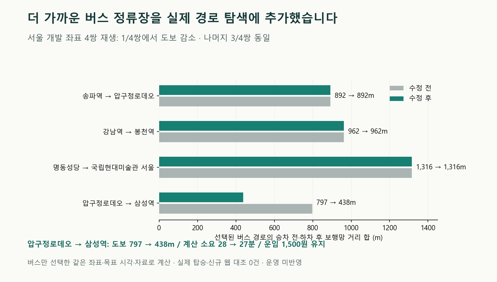

# 버스 접근 정류장 후보 복구 검증

버스 탐색에서 누락하던 가까운 승하차 정류장 쌍을 추가했습니다. 같은 입력의 서울 개발 표본4쌍 중1쌍에서 걷는 거리가 감소했습니다. 전체 실사용 완료나 운영 반영을 뜻하지 않습니다.

| 할 일 | 상태 | 진행 |
|---|---|---|
| 노선별 접근 후보 생성 수정 | 완료 | 1/1 = 100% |
| 신규 후보 시험 | 통과 | 11/11 = 100% |
| 관련 회귀시험 | 기존 실패7개 | 220/227 = 96.9% |
| 가장 이른 도착·후보 시험 | 통과 | 44/44 = 100% |
| 서울 전후 재생 | 결과 확인 | 4/4 = 100% |
| 선택 경로의 도보 감소 | 개발 표본 한정 | 1/4 = 25% |

## 달라진 경로

| 구간 | 접근 도보 | 계산 소요 |
|---|---|---|
| 송파역→압구정로데오 | 892→892m | 62→62분 |
| 강남역→봉천역 | 962→962m | 64→64분 |
| 명동성당→국립현대미술관 서울 | 1316→1316m | 37→37분 |
| 압구정로데오→삼성역 | 797→438m | 28→27분 |

압구정로데오→삼성역의 143번은 청담초등학교앞→무역센터에서 한양아파트.압구정로데오역→삼성역3번출구로 바뀌었습니다. 같은 출발09:47, 목표10:30, 운임1,500원으로 도보797→438m(감소359/797m = 45.0%), 계산 소요28→27분입니다. 기존 후보도 함께 재판정하며 새 후보가 유효할 때만 안내합니다.

## 원인과 수정 범위

기존 탐색은 노선별로 승하차 사이 정류장 수가 가장 적은 쌍 하나만 남겼습니다. 이 방식은 차를 적게 타더라도 더 멀리 걷게 만들 수 있습니다. 기존 쌍을 보존하고, 같은 반경 안에서 승차 전·하차 후 직선 도보 합이 최소인 별도 쌍을 최대 한 개 더 판정하도록 고쳤습니다. 노선당 최대2개로 검증량 증가를 제한하며 전체 조합의 최적해는 보장하지 않습니다. 도보 정책은 직선1.2km이며 표의 거리는 두 접근 구간의 보행망 거리 합이므로1.2km를 넘을 수 있습니다.

두 후보 모두 기존 운행·방향·도로망 접근 계산·공통 출발 재검증·표시 상한을 거칩니다. 가장 이른 도착 목표 생성에도 같은 쌍을 적용했습니다. 공개 응답 필드·운임·혼합 후보 선택 정책·운영 설정은 바꾸지 않았습니다. 수정 파일은 `engine/bus.py`, `engine/plan.py`, 신규 `test_bus_access_pairs_v1.py`, 기존 `test_plan_v1.py`의 복구 시험 한 곳입니다.

재판정 시험의 첫 후보 고정은 최신 출발 선택으로 바꾸었습니다. 함수는 도보 순으로 반환하므로 첫 후보가 최신 출발이라는 전제는 맞지 않습니다. 원래405번13:58·41분과 추가405번13:13·78분을 각각 자기 출발에서 다시 판정해 모두 성립함을 확인했습니다. 복구 여부·소요·공통 출발의 검증 문장은 유지했습니다. 골든 정답을 재생성하지 않았습니다.

남산타워↔이태원405번은 두 방향 모두 생성되지만 선택된 지하철의 공통 출발 시각보다2~3분 먼저 떠나야 하므로 현재 후보에서 제외됩니다. 이 정상 제외를 이번 정류장 생성 결함과 혼동하지 않습니다.

## 검증 조건과 남은 실패

자료는 기존 `fresh_experiment_100_design.json`의 서울 개발 좌표를 재사용했습니다. 접근+승차 단순 모델에서 개선 가능성을 보인 사례 중4쌍을 선택한 개발 표본이며 독립 검증이 아닙니다. 주간3쌍은2026-10-08 10:30 도착, 강남역→봉천역은2026-10-09 01:30 도착으로 고정했습니다. 수단 선택은 버스만, 단계는planning, 외부 통신은 차단했습니다. 감소한 시간은 제품 모델 계산이며 실제 탑승을 측정한 시간이 아닙니다. 정확한 좌표와 실행 원문은 [재생 전](../evidence/2026-10-11_0918_버스접근방향_진단/product-before.json)·[재생 후](../evidence/2026-10-11_0918_버스접근방향_진단/product-after.json)에 있습니다.

신규 시험은 수정 전10개 중9개 실패를 재현한 뒤 확장된11개가 통과했습니다. 가장 이른 도착 시험은44개 통과·전체층12개 제외입니다. 관련 최종 시험은220개 통과·7개 실패·건너뜀0이며, 접근 후보를 끈 별도 대조는209/216와 같은 실패7개입니다. 실패: test_golden, test_contract_keys, test_golden_all_modes, test_option_ids_mode_tag, test_bus_from_place_recheck, test_replan_fare_known_locked, test_bus_cap_zero_keeps_planned. [기존 기대 불일치 결함](debugs/2026-10-11_0439_이동_기존기대결과_불일치.md)은 열려 있습니다. 전체 회귀 통과로 발표하지 않습니다. Ruff4파일 통과입니다. Python 종료 뒤 pyreadline3 정리 경고는 시험 결과와 분리하여 원문에 남겼습니다.

mock 서버 시험: 안 했음(화면 반응 미확인).

실서버 확인(서버 응답): 안 했음. cs 프로젝트 서버 HTTP 응답·실제 탑승·결제·새 웹 대조는 이번에 측정하지 않았고 로컬 제품 탐색 함수를 실행했습니다.

API 예비량: 제한 API 호출0회, 재시도0회, 제품 재생·관련 시험의 차단된 외부 연결 시도0회입니다. 공급자별 공유 누적 사용량·잔여량·갱신 시각을 확인하지 못했으므로 해당 API를 호출하지 않았습니다. 예비량을 실제 확인했다고 주장하지 않으며 운영 한도·예약 주기·알림 정책은 변경하지 않았습니다.

시작 시 이전 코드·시험·자료498/499, 산출물44/44 해시가 일치했습니다. 달라진 공용 설정1개는 다른 작업자의 변경으로 보존했습니다. 코드 수정 전 백업3개와 대체 코드 보존본, 후속 덮어쓰기 전 백업은 [백업 목록](../evidence/2026-10-11_0918_버스접근방향_진단/backups-final.json)에 있습니다. 최종 코드·자료·산출물 해시는 같은 근거 폴더의 `integrity-final.json`에 보존합니다. 커밋·푸시·배포·외부 메시지 전송은 하지 않았습니다.

## 연구 근거와 다음 범위

[RAPTOR 원 연구의 공식 소개](https://www.microsoft.com/en-us/research/publication/round-based-public-transit-routing/)는 도착 시각과 환승 수를 함께 다루는 경로 탐색을 설명합니다(2012-01 공개,2026-10-11 조회). 정류장 개수 하나만으로 전체 여정을 선택해서는 안 된다는 구현 판단의 맥락으로 참고했습니다. 이번 수정은RAPTOR 구현이나 최적성 증명이 아닌, 기존 생성기에 접근 도보 후보를 하나 추가한 제한된 개선입니다. 서울 버스 데이터는 공개 자료의 기존 보유본을 재사용했습니다.

다음은 기존7개 기대 불일치를 제품 계약과 보행망 구성별로 정리하고, 새 웹 표본으로 현재 경로·시각의 오차를 검증하는 일입니다. 전체21개 기능 각각의 제품 경로·대체 소스·허용 오차·새 표본 근거 확인 전에는 전체 완료로 올리지 않습니다.

재현: 워크스페이스 루트에서 `python .tmp/mobility_complete_20261008/replay_bus_access_20261011.py before` / `after`, `test_bus_access_related_20261011.py related-final`을 실행했습니다. 출력은 독점 새 이름으로 생성하므로 재실행에는 새stage/출력 폴더를 사용해야 합니다. 실행 스크립트 사본은 근거 폴더 `reproduction/`에 있습니다.
