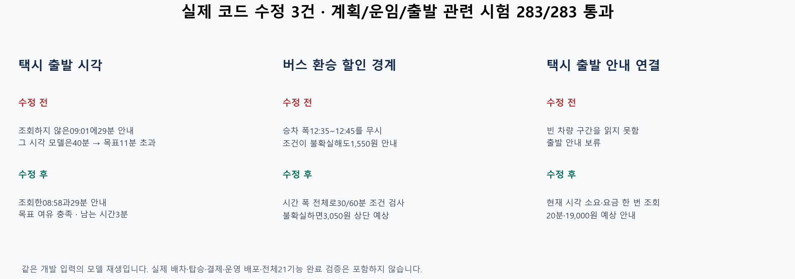

# 택시 출발·환승 운임 결함 3건 수정과 기존 실패 7건 정리

택시 시각 불일치, 후속 버스 할인 경계 누락, 택시 출발 안내 보류를 실제 코드에서 수정했습니다. 관련 시험283/283이 통과했습니다. 로컬 구현·검증 결과이며 전체 실사용 완료나 운영 반영을 뜻하지 않습니다.

| 할 일 | 상태 | 진행 |
|---|---|---|
| 재현한 실제 결함 수정 | 완료 | 3/3 = 100% |
| 신규 회귀 시험 | 통과 | 55/55 = 100% |
| 기존 실패 정리 | 해결 | 7/7 = 100% |
| 전체 계획 시험 | 통과 | 56/56 = 100% |
| 운임·출발 관련 시험 | 통과 | 227/227 = 100% |
| 전체21기능의 엄격 완료 | 아직 미충족 | 0/21 = 0% |

시험 분모283은 서로 다른 두 실행의56+227개이며 신규55개는 그 안에 포함됩니다. 전체21기능 분모는 기존 준비도 목록의21개 기능이며 제품 경로·대체 소스·허용 오차·새 표본 검증을 모두 충족해야 완료입니다. 시험 통과율을 실사용 준비율로 바꾸지 않습니다.

## 달라진 동작과 근거

택시 역산은 최대6번 안에서 실제 조회해 성립한 출발만 반환합니다. 조회하지 않은 새 출발에 이전 시간대의 소요·요금을 붙이던 문제를 제거했습니다. 통제 교통 입력에서 기존09:01·29분 안내는 그 시각 모델40분을 적용하면 여유 포함 목표보다11분 늦었습니다. 현재08:58·29분은 목표를 만족하고3분이 남습니다. 전역 최적 출발을 보장하는 탐색은 아닙니다.

후속 버스 환승은 평균 승차 한 점 대신 기존 모델의 승차 시간 폭 전체를 검사합니다. 서울시의 환승 시간은 후승 승차 시각을 기준으로 주간30분·21시~익일07시60분입니다. 07시·21시·자정 경계에서 폭을 나눠 검사하고 입력을 확인할 수 없으면 기존 할인 전 상단 예상액을 유지합니다. [서울시 통합환승 할인제도](https://news.seoul.go.kr/traffic/transfer_discount),2026-10-11 확인. 승차 폭은 기존 배차 모델이지 실제 최대 대기시간의 측정값이 아닙니다. 첫 승차·지하철 개찰 시각 불확실성은 이번 수정 범위 밖입니다.

택시 계획은 내부 출발 문맥에서 직접 택시임을 명시합니다. 현재 장소·자료 판·동행 조건을 확인한 뒤 현재 시각을 분 단위 올림해 차량 모델에 한 번 질의합니다. 같은 조회의 거리·소요·예상 요금을 출발 안내에 연결하고, 사전 여유 부족은 재계획, 조회 실패나 잘못된 수치는 안내 중단으로 반환합니다. 옛 빈 vehicle 문맥을 택시로 추정하지 않습니다. 기존 일정·공개 route 스키마는 보존됩니다. 배차 대기·실제 탑승·결제 측정은 없습니다.

## 기존 실패 7건의 처리

골든 두 개의 변경54항목을 검토했습니다. 선택 수단·노선·운임은 유지됐고 보행망 접근 거리·소요, 연결 시각, 추가 정류장 쌍·GTX-A 후보의 제외 사유가 달라졌습니다. [검토한 차이](../evidence/2026-10-11_parallel_sonnet_finish/golden-reviewed-changes.json)에 원값·새값·검토 원인을 남겼고 전체 동일 비교를 유지했습니다. 시험은 로컬 보행망과 제한 API 비활성 조건을 명시합니다. 기존 별도 재판정·도착 여유·코어 등록 검사가56/56 안에 그대로 포함됩니다. 현재 제외되는GTX-A 서울/서울역 표기 후보를 유효 경로로 승격한 것은 아닙니다.

자료 판 기대에는 실제 지하철 역 자료 해시를 추가했습니다. 버스·지하철 혼합 접두를 단일 버스로 읽던 시험을 구분했습니다. 전체 수단의14:00 출발에서는405가 늦어 제외되므로 이를 명시적으로 검사하며, 버스 전용의13:58 출발·접근 도보 중복 없음·표시 상한0에서도 계획 버스 보존을 따로 확인합니다. 요금 재계획 시험은13:58에 지하철도 다시 판정한 공통 시각 후보로1,550−1,500=50원 비교를 유지합니다. 실제 환승 결제와 동일하다고 단정하지 않습니다.

## Claude CLI 병렬 검토와 실행 조건

사용자가 승인한 비밀값 제외 최대12개 소스·시험 파일만 전달했습니다. 도구·MCP·브라우저를 끈 Claude CLI의 초기 운임/출발 병렬 검토2개와 수정본 추가 병렬 검토2개가 실제 모델claude-sonnet-5-5로 응답했습니다. 코드 수정은 검토 제안을 재현한 뒤 Codex가 수행했습니다. UTC 승차 문자열 때문에 고객 시각이 틀린다는 초기 제안은 안내 출력이 이미 한국 시각으로 변환하므로 기각했습니다. [검토 입력·응답](../evidence/2026-10-11_parallel_sonnet_finish/claude-approved/) · [추가 검토](../evidence/2026-10-11_parallel_sonnet_finish/claude-review-fixes/).

최종 [실행 요약](../evidence/2026-10-11_parallel_sonnet_finish/completion-summary.json), [계획 시험56개](../evidence/2026-10-11_parallel_sonnet_finish/plan-regression-after.log), [관련 시험227개](../evidence/2026-10-11_parallel_sonnet_finish/final-related.log), [수정 전후 개발 재생](../evidence/2026-10-11_parallel_sonnet_finish/fixes-before-after.json), [Ruff10파일](../evidence/2026-10-11_parallel_sonnet_finish/ruff-final.log)을 보존했습니다. 일부 중간 실행은 공용 코어 조립 중 파일 미확보와 시험 편집 시점의 구문 오류로 실패했고 최종 재실행에서 해소됐습니다. 중간 실패 로그도 삭제하지 않았습니다. Python 종료 후pyreadline3 정리 경고는pytest 종료코드0과 구분합니다.

mock 서버 시험(화면 반응): 안 했음.

실서버 확인(서버 응답): 안 했음. cs 프로젝트 서버 HTTP·운영 배포·외부 알림 전송은 검증하지 않았습니다. 로컬 제품 계획·재검증·안내 생성 함수를 실행했습니다.

## API 예비량·백업·남은 범위

제한 데이터API 호출0회·재시도0회이며 최종 시험과 개발 재생의 외부 연결 시도0회입니다. 공급자별 공유 누적 사용량·잔여량·갱신 시각을 확인하지 못했으므로 해당 API를 호출하지 않았습니다. 20% 예비량을 실측 확인했다고 주장하지 않습니다. Claude CLI의 승인된 코드 검토 통신은 별도입니다. 운영 한도·예약 주기·알림 정책은 바꾸지 않았고 커밋·푸시·배포·결제·외부 메시지 전송을 수행하지 않았습니다.

수정 직전 원본·대체 코드·골든·위키·결함 기록을 보존했습니다. [전체 백업 목록](../evidence/2026-10-11_parallel_sonnet_finish/backups-final.json)과 [최종 해시](../evidence/2026-10-11_parallel_sonnet_finish/integrity-final-v3.json)로 확인할 수 있습니다. 데이터 원본은 수정하지 않았습니다.

전체21기능 완료는 아직0/21입니다. 실시간 후속 환승·급행/순환선·정렬된 새 웹 표본·복잡한 도로 제약·실탑승/결제·운영 제품 확인은 기존 남은 범위대로 유지합니다. 이번55개는 개발 회귀 시험이며 독립 표본 검증으로 부르지 않습니다.

## 별도 문서 상태 검사

이번에 닫은 결함 기록4/4은 해결 상태와 검증 링크를 확인했습니다. 전체 결함 문서 형식 검사 실행은146/161 통과·15실패였습니다. 기존 다른 기록의 해결/부분 해결 표제가 규정된 상태 형식과 달랐으며 제품 계산 시험 실패와는 별도입니다. 공유 문서의 작성 중 변경은 덮어쓰지 않았습니다. [이번 기록 확인과 전체 문서 검사 내역](../evidence/2026-10-11_parallel_sonnet_finish/record-closure-check.json) · [문서 검사 원문](../evidence/2026-10-11_parallel_sonnet_finish/debug-records-final.log). 저장소 전체의 모든 검사가 통과했다고 발표하지 않습니다.

## 공용 조립의 후속 변경 확인

검증 후 공용 조립·감시 실행 파일4개의 추가 변경을 해시로 발견하고 보존했습니다. 그 상태에서 신규 회귀55/55를 다시 실행해 통과했습니다. 재실행55개는 앞의283개에 포함된 시험이므로338개 고유 시험이라고 합산하지 않습니다. 전체283개 실행 시점과 이후 공용 파일 변경을 [최종 해시](../evidence/2026-10-11_parallel_sonnet_finish/integrity-final-v3.json)에 구분했습니다. [후속 조립 확인55개](../evidence/2026-10-11_parallel_sonnet_finish/shared-assembly-smoke.log).
