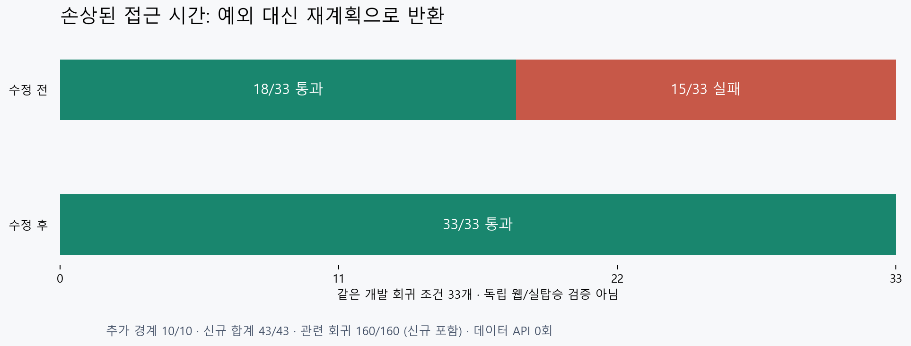

# 출발 접근 시간 범위 검사 복구 검증

잘못 저장된 대중교통 접근 시간이 예외로 안내 호출을 중단하던 결함을 수정했습니다. 손상 문맥은 API 조회 전에 재계획으로 반환하고 다음 정상 안내는 계속 생성합니다. 정상 제품 생성값이 손상됐다는 관측이나 운영 장애 측정은 아닙니다.

| 할 일 | 상태 | 진행 |
|---|---|---|
| 접근 시간 결함 수정 | 완료 | 1/1 = 100% |
| 신규 경계 회귀 | 통과 | 43/43 = 100% |
| 출발·안내·감시 관련 회귀 | 통과 | 160/160 = 100% |
| 전체21기능 실사용 기준 충족 | 미충족 | 0/21 = 0% |

신규43개는 관련160개에 포함됩니다. 0/21은 제품 경로·대체 소스·허용 오차·새 표본 검증을 기능별로 모두 확인한 개수이며 코드 구현률이 아닙니다. 앞 회차283개와 중복이 있으므로 더하지 않습니다.

## 범위와 원인

현재 wiki의 출발 문맥·현재 출발 재검증 계약 안에서 최소 단위로 처리했습니다. 시작 시 앞 회차507개 코드·시험·자료 해시를 다시 읽었습니다. 다른 작업자의6개 변경은 보존했고 소유한 출발 관측 파일1개만 수정했습니다. 저장된 접근 시간은 내부 JSON의 int/float이며 `math.isfinite`만으로 초대형 정수를 검사하면 OverflowError가 나고, 유한한 초대형 실수도 timedelta 변환에서 실패합니다. [Python 공식 datetime 문서](https://docs.python.org/3/library/datetime.html)와 [공식 예외 문서](https://docs.python.org/3.12/library/exceptions.html)의 범위 예외를 확인하고 실제 입력으로 재현했습니다.

각 접근·이탈 시간 및 두 항목의 합을 기존 SERVICE_DAY_MAX_MIN=1800 안에서 먼저 검사합니다. bool·NaN·무한대·음수·초대형 정수/실수·누락은 access_context_invalid로 반환하며 자르기·0 대체를 하지 않습니다. 정상 0·소수 분·상한 값은 유효하고 실제 기한 성립 여부는 기존 판정이 결정합니다. 거리1.2km 정책·공개 계약·운영 서비스 한도는 변경하지 않았습니다.

## 실행 근거

수정 전 신규33조건은18통과·15실패였고, 그중 OverflowError 실패는7개였습니다. 15개 전부가 예외라는 뜻은 아닙니다. 수정 후 같은33조건33통과, Sonnet 검토 후 추가한 누락·정확 상한 경계10조건도 통과했습니다. 최종160/160, 실패·오류·skip0입니다. [수정 전 로그](../evidence/2026-10-11_2116_departure_time_bounds/heartbeat-access-before.log) · [최종 로그](../evidence/2026-10-11_2116_departure_time_bounds/heartbeat-access-assembled.log) · [XML](../evidence/2026-10-11_2116_departure_time_bounds/heartbeat-access-assembled.xml) · [실행 명령](../evidence/2026-10-11_2116_departure_time_bounds/heartbeat-access-assembled-run.json). 종료 뒤 pyreadline3 정리 경고는 pytest의 성공 종료코드0과 구분합니다. Ruff2파일 통과입니다.

사용자가 승인한12개 파일 중 departure_observer.py 하나의 발췌만 Claude CLI Sonnet5.5에 보냈습니다. 도구·외부 파일 접근을 끄고 모델 응답의 claude-sonnet-5-5를 확인했습니다. 구체 반례를 찾지 못했다는 코드 검토이며 Claude가 시험을 실행했다고 주장하지 않습니다. 검토 제안의 정확 상한·합 상한·누락 시험을 추가했습니다. [검토 원문](../evidence/2026-10-11_2116_departure_time_bounds/claude-review-readable.md) · [전송 범위](../evidence/2026-10-11_2116_departure_time_bounds/claude-export-manifest.json).

## API 예비량과 한계

지도·공공데이터 API는 호출하지 않았습니다. 공유 누적 사용량·실제 제한 단위·갱신 시각을 이 실행에서 신뢰할 수 있게 확인하지 못했으므로 사용 가능 예산을0으로 취급했습니다. 조회 전후 공급자 누적·잔여·갱신 시각은 미확인이고 이번 데이터 호출0회, 실패·재시도0회입니다. 별도로 승인된 Claude CLI 코드 검토1회는 데이터 수집 호출과 구분합니다. [API 기록](../evidence/2026-10-11_2116_departure_time_bounds/api-budget.json).

실제 탑승·결제·배포된 cs 프로젝트 서버 확인은 안 했습니다. mock 서버 화면 시험은 시행하지 않았습니다. 단위·안내 소비 시험은 통제한 개발 자료이며 독립 검증이 아닙니다. 실시간 후속 환승·급행/순환선·복잡한 회전 제약·정렬된 새 웹 표본은 계속 남습니다. 커밋·푸시·배포·외부 메시지는 수행하지 않았습니다.

## 변경과 보존

- [수정 코드](../../../app/domains/travel_ops/instances/mobility/engine/departure_observer.py) — 시간 범위 검사.
- [신규 시험](../../../tests/unit/travel/mobility/test_departure_access_bounds_v1.py) —43조건.
- [검토 가능한 차이](../evidence/2026-10-11_2116_departure_time_bounds/source-change.diff).
- [원본 백업 목록](../evidence/2026-10-11_2116_departure_time_bounds/backups.json) — 소스·wiki 원본; 코드 원본은 legacy에도 보존.
- [시작 해시](../evidence/2026-10-11_2116_departure_time_bounds/start-integrity.json) · [최종 해시](../evidence/2026-10-11_2116_departure_time_bounds/final-integrity.json).

최종 감사: 작업 중 공용 조립·설정·되잡기 실행 파일3개의 추가 변경을 보존했습니다. 같은160개를 다시 실행해160/160 통과했고, 시험 실행 시점과 이후 최종 파일 해시는 구분해 보존했습니다. 중복 실행이므로320개로 합산하지 않습니다. 그림을 직접 열어 글자와 범례를 확인했습니다. 앞 회차의 준비도0/21은 그대로이며 새 독립 웹 표본·실제 탑승 검증은 추가되지 않았습니다.

검토 보완 판정: 저장 문맥은 JSON int/float이며 소수 분을 뜻합니다. Fraction/Decimal/numpy 숫자를 새로 허용하는 계약 변경은 하지 않았습니다. 직접 도보·택시 모델 반환값의 전 범위 예외 방어는 이 대중교통 접근 시간 수정의 완료 범위에 포함하지 않습니다.
