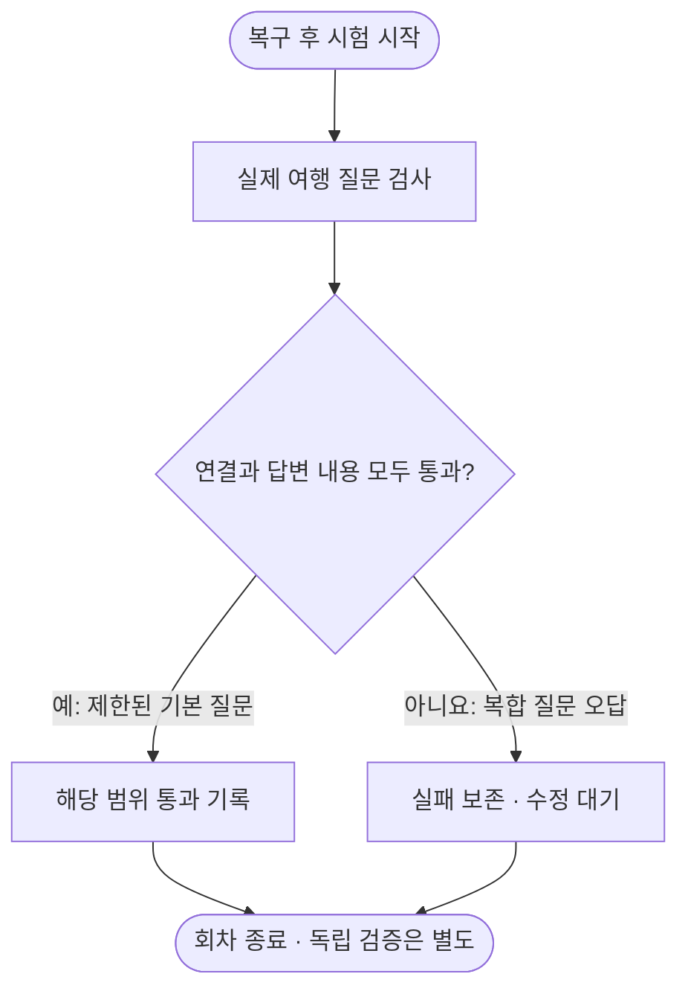

# 2026-10-11 22시 정기 현황

Oracle ARM의 답변 연결은 복구됐고 세 기계 모두 실제 추론 중입니다. 복합 질문 오답과 독립 검증은 남았습니다.

| 할 일 | 상태 | 진행 |
|---|---|---|
| 이번 신규 GPU 일반 답변 회수 | 완료 | 192/192 = 100% |
| Oracle ARM 완료 MX 회수 | 완료 | 4,014/4,014 = 100% |
| 원본 파일 해시 대조 | 완료 | 49/49 = 100% |
| 신규 GPU 비교 등록 | 완료 | 7/7 = 100% |
| Oracle ARM 자동 반복 회귀 | 통과 | 33/33 = 100% |
| E 사람 검수 | 대기 | 0/158 = 0% |

[실측] 관측 시각은 **2026-10-11 22:37~22:38 KST**입니다. 마지막 저장된 정기 보고는 [14시 기록](2026-10-11_1400_six-hour-gpu-arm-report.md)입니다. 그 뒤 사람 요청으로 수행한 [Oracle 답변 복구](2026-10-11_oracle_answer_repair.md)를 새 성과로 중복 집계하지 않았습니다. 이 회차는 새 논문 조사나 새 학습을 수행한 회차가 아닙니다.

## 답변 복구가 뜻하는 것

복구 전에는 앱이 질의하는 모델과 공유 시험의 모델이 달라 연결이 실패했습니다. 앱 전용 상주 모델과 준비 검사, 빈 답변 보호를 반영했고 기존 시험 모델은 유지했습니다. 전체 원인은 [복구 리포트](2026-10-11_oracle_answer_repair.md)가 소유합니다.

이번에 내부 자동 작업자가 새로 마친3회차는33/33 검사, 실제 질의12/12 통과했습니다. 같은 합성 여행과 누적 대화를 재사용한 안정성 회귀입니다. 별도3회차의 각4문항 지연은 **76.77~87.30초**였습니다. CPU llama.cpp가 이미 켜진 조건이며 기존 모델 시험과 겹친 관측입니다. 단독 서빙 지연·새 독립 정확도·모든 질문의 성공률로 일반화하지 않습니다.

점심 시각을 운영시간으로 잘못 해석하거나, 두 시각을 한꺼번에 물으면 하나만 답하는 결함은 그대로 남았습니다. 앞선 혼합 질문은 실제 답변2/4, 전체 HTTP 절차9/11입니다. 현재 반복 회귀의 성공과 합치지 않습니다. 공개 브라우저4/4와 별도 Python HTTPS0/5도 이전 근거에 그대로 보존했습니다.

도식은 설명용6노드·정적 흐름도이며 프로젝트 프로필과 `diagram-design`의 흐름도 가이드를 적용했습니다. 한 회차의 종료를 뜻하며 전체 제품 완료를 뜻하지 않습니다.

## GPU 결과의 의미와 현재 작업

[실측] GPU 서버 B의 같은 Gemma-4-E4B-it 기반 HF NF4 일반 생성에서 현재 앱 형식과 내용까지 맞는지 확인했습니다. 고정12조건에400·800토큰을 교대하고 각 조건을 반복해48회입니다. 800토큰24/24 통과 때만 별도6시간 안정성 시험을 실행합니다. 형식을 강제하는 GPU 서버 A 결과와 같은 엔진 성능인 것처럼 비교하지 않습니다.

| 모델 조건 | 형식·내용 정답 | JSON 해석 실패 | 후속 반복 안정성 |
|---|---|---|---|
| 원본(우리 추가 학습 없음) | 24/48 = 50.00% | 24/48 | 0/0 · 실행 안 함 |
| FINCH·세 번째 시드(우리 여행 학습) | 32/48 = 66.67% | 6/48 | 0/0 · 실행 안 함 |
| cosine·세 번째 시드(우리 여행 학습) | 28/48 = 58.33% | 10/48 | 0/0 · 실행 안 함 |
| 기존 보강판 oos2r(우리 여행 학습) | 48/48 = 100.00% | 0/48 | 4960/4960 = 100% |
| 기존 보강판 oos3(우리 여행 학습) | 16/48 = 33.33% | 0/48 | 0/0 · 실행 안 함 |

원본24/48은14시 이미 회수한 결과입니다. 이번 신규 회수는 나머지4조건192회이며 재집계로 원본48회를 신규 분모에 더하지 않았습니다. 각48회에는 오답·해석 실패를 포함합니다. 일반 생성에서 기존 보강판이 유리하지만, E 정상 요청 손실과 독립 검증을 통과했다는 뜻은 아닙니다. `completed` 표시는 프로세스·저장 완료이며 oos3의 내용 정답16/48을 품질 합격으로 바꾸지 않습니다.

[실측] GPU 서버 A에서 FINCH 여행 학습판4,773/4,773, Saluki27B 배포 원본(우리 추가 학습 없음)8,874/8,874로 각각6시간 안정성 시험을 마쳤습니다. 이들은12조건 반복 관측이며 서로 다른 모델의 독립 정확도 표본으로 합산하지 않습니다. Saluki 원본의 안정성과 Saluki 파인튜닝0/1을 구분합니다.

| 기계 | 현재 계산 | 즉시 대기 | 준비 조건 대기 | 순간 GPU 사용률 | 남은 공간 |
|---|---|---|---|---|---|
| GPU 서버 A | 원본 Gemma Q4_K_M 안정성 1개 | 4개 | Saluki 동일 가중치 학습 준비 | 68% | 3.40GiB |
| GPU 서버 B | 초기 FINCH 학습판 일반 생성 1개 | 3개 | 합격 조건의 안정성 실행 | 26% | 5.16GiB |
| Oracle ARM | 앱 질의와 QAT 원본 D3 | 앱32개 | 혼합 질문21개 차단 | GPU 없음 | 39.54GiB |

GPU 서버 A는 기존 단일 실행기·잠금을 유지했고 미측정 cosine 세 번째 시드 및 기존 oos2r/oos3 학습판의 형식 강제 경로3개144회를 보충했습니다. 현재 원본 안정성1,837/1,837 관측과 다음 QAT 원본6시간이 먼저 실행됩니다. GPU 서버 B는 종료·잠금 해제·GPU 계산0개를 전체 점검한 뒤, 기존 초기·두 번째 시드 FINCH/cosine4개192회를 단일 실행기에 등록했습니다. 각 조건은 합격 때만 최대6시간 안정성으로 이어집니다. 실패하면 시간을 채우려고 반복하지 않으므로24시간 가동이나 다음6시간 내내 계산을 보장하는 수치로 쓰지 않습니다.

옛 의존성 대기열에 남은6항목은 오전 대체 대기열에서 이미 끝난 동일 시험입니다. 준비된 신규 일감으로 세지 않았고 재실행하지 않았습니다.

## Oracle ARM 자원과 완료 모델 시험

| 관측값 | 정의·범위 | 실측 |
|---|---|---|
| 시험 작업 CPU | 최근 300.17초 · 두 코어 전체 기준 | 0.762/2코어 = 38.10% |
| 호스트 CPU | 같은 최근5분 · 앱·기타 포함 | 99.40% |
| 가상 CPU 대기 | 같은 창의 steal | 0.33% |
| 호스트 메모리 | (전체−사용 가능)/전체 | 9.648/12.504GB = 77.16% |
| 루트 디스크 | statvfs 사용/총량 · 십진 GB | 60.41/102.89GB = 58.72% |
| 디스크 사용20GB 기준 | 의미 있는 기존 자료·모델·앱 | 충족 · 남은 공간 42.46GB |

CPU38.10%는 원래 모델 시험 서비스의 작업 사용률이며, 별도 앱 모델까지 모두 합친 프로세스 CPU 합계가 아닙니다. 호스트 CPU99.40%와 구분합니다.5초 표본 약5분 관측으로24시간 또는 클라우드7일 판정을 주장하지 않습니다.

앱 모델의 익명 메모리는 2.90GiB, 파일 기반 비례 메모리(PSS)는 0.23GiB입니다. 원래 시험 모델은 익명3.15GiB·파일PSS0.24GiB입니다. 이 값은 회수 가능한 호스트 캐시와 구분하며 RSS의 공유 페이지를 중복 합산하지 않습니다. 메모리·디스크를 채우기 위한 무의미한 부하는 만들지 않았습니다.

완료 MX는4,014/4,014 저장,3,637/4,014 = 90.61% 정답, 해석 실패0개를 회수했습니다. `e4bt`는 기존 합친 여행 학습판이며 정확한 oos 레시피 대조 전 특정 보강판으로 단정하지 않습니다. 앱 전용 QAT 원본(우리 추가 학습 없음)과 다른 모델 조건입니다. 진행 중 QAT 원본 D3는185/360 저장이며 미완료175개를 분모에 남깁니다. 현재까지 정답172/360 =47.78%는 완료 전 하한일 뿐 최종 정확도가 아닙니다.

## 검증 대기와 다음6시간

1. GPU 서버 A 현재 원본·다음 QAT 안정성이 끝나면 답안·오류·자원 로그를 회수합니다. 새 학습판3개는 같은 질문·출력 예산에서 형식 강제 방식의 차이를 검사합니다.
2. GPU 서버 B 새4조건의 일반 생성 결과를 회수합니다. 사전24/24 관문을 통과한 조건만6시간 안정성 시험으로 잇고 실패한 조건은 원인 수정 전 반복하지 않습니다.
3. Oracle ARM의 내부 CD·6시간 일감 공급·상시 작업자를 유지합니다. 혼합 요청 의미 해석과 복수 대상 계약은 별도 로컬 검토·회귀 후 반영합니다. 기존 D3와 앱 질의를 중단하지 않습니다.
4. E 사람 검수0/158, 독립 보류720개 작성·고정·실측 대기, Saluki 동일 모델 학습0/1을 유지합니다. 독립 보류로 프롬프트를 조정하거나 개발 점수만으로 제품 모델을 승격하지 않습니다.

새 예약·결제·임대·모델 삭제·외부 게시·push는 수행하지 않았습니다. 이번 회차의 앱 코드 배포도 없습니다. 앞선 답변 복구와 현재 개발 브랜치 연결을 전체 제품의 실서비스 배포 완료로 표시하지 않습니다.

## 등록 실패·정정·백업

자동 승인 심사는 첫 보충 시도를 중복 실행 위험 때문에 거절했습니다. 읽기 전용 전체 PID·잠금·GPU 계산·동일 조건 감사를 추가하고 쓰기 직전 재검사를 넣은 후 승인된 실행만 진행했습니다.

등록 보조 스크립트의 들여쓰기 오류로 GPU 서버 A 신규 항목3개가 중복 기입됐습니다. 반환 출력 해석 실패 뒤 재실행하지 않고 manifest를 읽어 확인했습니다. 원본193개가 그대로임과 신규 항목 모두 미실행임을 확인하고, 백업 후 동일 중복3건만 제거했습니다. 등록 항목196개와 ID196개를 대조했으며 원본193개 항목 내용과 현재 실행기PID가 보존됐습니다. 보조 스크립트도 백업 후 수정했습니다. 작업·모델·답안을 삭제하지 않았습니다.

원격 manifest 백업은 GPU 서버 A 작업 폴더의 `_backup`에 있습니다. 실제 접속 정보·절대 원격 경로는 공용 문서에 적지 않고 [로컬 원본 증거](../../../../program/scripts/plan_qa_bench/results/heartbeat_20261011_2230/)의 비공개 등록 기록으로 찾습니다. 첫 감사 파일의 재관측은 같은 파일명으로 저장돼 이전 판을 보존하지 못했습니다. 첫 전체 감사의 요약 출력은 실행 기록에 남아 있으며 이후 최종 관측은 별도 closing 파일로 보존했습니다. 향후 관측 파일도 시각별 새 이름을 사용합니다.

## 근거와 재개 위치

- [구조화 상태](../../../../program/research/daily_rag_slm/six_hour_report_2026-10-11_2240.json) — 분모·현재 작업·남은 검증·다음6시간.
- [원본 답안과 SHA-256 대조](../../../../program/scripts/plan_qa_bench/results/heartbeat_20261011_2230/) — GPU 두 압축본·Oracle 완료 MX·현재 프로세스/자원/자동 질의 결과.
- [추가 비교 사전 조건](../../../../program/research/daily_rag_slm/2026-10-11_app_completion_missing_prereg_v2.json) — 새7조건, 동일 질문·형식, 무학습·무다운로드.
- [백업 목록](../../../../program/research/daily_rag_slm/six_hour_report_2026-10-11_2240_backups.json) — 변경 직전 문서·상태 원본.
- [Oracle 답변 복구 원본](2026-10-11_oracle_answer_repair.md) — 실제 배포 파일·회귀·브라우저·혼합 질문 실패.
