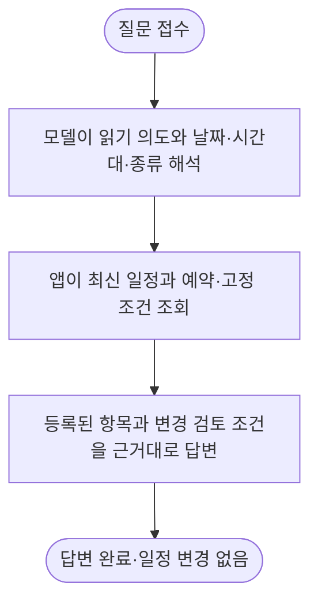

# 오후 일정 변경 조건 질문의 오해와 범위 조회 보완

사용자 질문을 실제 Oracle ARM 앱에서 재현했고, 기존 일정의 변경 조건 조회를 새 장소 추천으로 오해하는 결함을 확인했습니다. 범위 조회 기능과 읽기·변경 구분을 로컬에 구현했으나 최초 모델 시험의 말투 변경 실패를 수정2판의 개발 진단에서 보완했습니다. 별도 문장 검증과 응답 지연은 미해결이므로 **운영에는 적용하지 않았습니다**.

| 할 일 | 상태 | 진행 |
|---|---|---|
| 로컬 범위·보호·기존 사실 단위 검사 | 통과 | 48/48 = 100% |
| 고정 모델 출력으로 앱·DB 채팅 회귀 | 통과 | 24/24 = 100% |
| 계약·보안 회귀 | 통과 | 312/312 = 100% |
| 실제 모델 최초 개발 시험 | 기준 미달 | 1/3 = 33.3% |
| 같은 원본의 로컬 판독 재생 | 기준 미달 | 2/3 = 66.7% |
| 수정 지시문·로컬 판독 개발 진단 | 의미 일치·독립 검증 전 | 3/3 = 100% |
| 독립 보류 검증·운영 반영 | 대기 | 각각 0/1 = 0% |

## 재현과 원인

2026-10-11 22시대 현재 여행 화면에서 「오후 일정 중에 바꿀 수 있는 일정이 뭐가 있어?」를 한 번 전송했습니다. 화면에는 오전 경복궁 항목 하나가 표시됐습니다. 화면은 기다리기를 중지했고, 앱의 해당 요청 기록은 약164초 뒤 `propose_alternatives`·대상 없음으로 끝나 어느 일정을 말하는지 되물었습니다. 화면 재전송은 하지 않았습니다.

모델 연결은 살아 있었고 모델도 상주 중이었습니다. 앱 전용 경로는 llama.cpp의 Gemma-4-E4B QAT 원본이며 우리 자료 추가 학습판이 아닙니다. 따라서 이번 오답을 PostgreSQL 연결 실패나 모델 미적재로 설명하지 않습니다. DB의 장소 검색·추천 전체가 정상이라는 결론도 아닙니다.

기존 결정 단위는 단일 일정 대상과 사실 종류를 고르게 했습니다. 날짜·시간대·종류를 묶은 기존 일정 조회 계약이 없었고, 지시문은 「뭐 있어」를 대체 장소 추천의 예로 들었습니다. 새 기능에서도 표현을 바꾸면 같은 오해가 재현됐습니다. 단어 하나에 분기 규칙을 덧붙이는 대신 조회 범위를 모델이 해석하고 앱이 최신 일정에 적용하도록 보완했습니다.

## 로컬 구현과 보호 범위

- [범위 조회 구현](../../../app/domains/travel_ops/components/conversation/schedule_query.py): 날짜·시간대·종류로 최신 항목을 고릅니다. 오후는 한국 시간 시작 시각 12:00 이상18:00 미만입니다. 범위가 비면 다른 시간대 항목을 대신 고르지 않습니다.
- [요청 해석](../../../app/domains/travel_ops/components/conversation/decision_unit.py): `answer_fact/schedule`·`answer_fact/changeability`와 `query`를 추가했습니다. 기존 일정 조회·새 장소 추천·변경 실행을 구분하고, 잘못된 범위·쓰기 행동·단일 대상·변경 이력 대상의 혼합은 거부합니다. 완전히 같은 읽기 후보의 반복만 정리하며 원본 출력은 보존합니다.
- [앱 답변 경로](../../../app/domains/travel_ops/components/conversation/trip_messages.py): 최신 DB 항목에 조회를 적용해 답하고 일정 버전·예약·고정을 변경하지 않습니다. 고정·예약·보호·장소 미연결·미지원 종류를 구분합니다. 예약 기록 부재를 무예약이나 실제 변경 확정으로 쓰지 않습니다.

현재 화면에서 확인한 오전 항목 하나만 있는 여행의 기대 답은 「전체 여행 날짜 오후 범위에는 등록된 일정이 없어요. 일정을 바꾸지는 않았어요.」입니다. 오후 항목이 있을 때는 항목별 변경 검토 조건을 보여 주며, 실제 대체 후보의 시간·이동 조건 검증은 별도 업무입니다.

## 실제 모델 개발 진단

여행 합성 자료3개로 원래 질문, 날짜·말투 변경, 기존 시간 질문을 순차 시험했습니다. 모델과 앱 코드는 운영 상태 그대로이고, 시험 요청에만 수정 지시문·출력 계약을 전달했습니다. seed는 명시적으로 고정하지 않았고 각 조건1회입니다. 독립 정확도나 모델 순위 비교가 아닙니다.

| 개발 문장 | 최초 원본 출력 | 시간 | 로컬 판독 재생 |
|---|---|---:|---|
| 오후 중 변경 가능한 일정 | 읽기·오후 범위는 맞음, 같은 후보를 중복 출력 | 201.95초 | 같은 읽기 중복 정리 후 수용 |
| 둘째 날 오후 변경 가능한 활동·지금 바꾸지 않음 | 범위는 맞음, 행동·사실 종류 오해 | 378.90초 | 거부·실패 보존 |
| 첫 일정 시작 시각 | 기존 단일 사실 해석 통과 | 328.08초 | 수용 |

원본 엄격 판정은1/3이며 후처리 재생2/3로 원본을 고쳐 쓰지 않았습니다. 조회 결과가 맞아도 이 지연이면 운영 답변 복구로 채택하지 않습니다. 모델 상주 중 측정이며 전체 시간이 초기 적재 시간이라는 증거가 아닙니다. 자동 앱 시험이 같은 앱 모델을 사용하고 별도 모델 시험도 같은 두 코어를 사용합니다. 대기·입력 처리·생성·CPU 경쟁의 기여도는 아직 분리 측정하지 않았습니다.

수정2판은 추천을 「새 대체 장소 찾기」로 한정하고 기존 항목의 변경 조건 문의를 읽기로 명시했습니다. 같은 개발 문장 재시험 중입니다. 같은 문항 반복은 독립 표본에 합산하지 않습니다.

## 검사 범위와 남은 일

mock 모델 출력 시험: 단위48/48와 앱·로컬 DB24/24입니다. 실제 모델 정확도나 Oracle ARM 운영 적용의 증거로 사용하지 않습니다. 이번 화면 반응에 대한 mock 서버 시험은 실시하지 않았습니다.

실서버 확인(Oracle ARM cs 프로젝트 앱 응답): 사용자 원문1회, 잘못된 추천 해석과 화면 시간 초과를 확인했습니다. 이후 직접 모델3문항은 위 개발 진단이며 운영 앱의 새 기능 시험이 아닙니다.

최초 로컬 실행은 네트워크 제한으로 E2E3통과·20오류였고, 접근을 허용한 재실행은24/24였습니다. 계약·보안 최초 실행은 최소3실패·4오류 관측 뒤 중단했으며 전체 분모를 확정하지 않았습니다. 같은 환경 제한을 해소한 재실행은312/312입니다. 실패·중단 원본을 성공 실행과 합치지 않습니다.

재개 순서:

1. 수정2판 실제 답안 회수와 원본·판독 결과 분리 집계. 실패한 표현을 합격으로 완화하지 않습니다.
2. 개발과 다른 여행·말투·다국어·예약·고정·조회/실행 혼합의 보류 문항을 고정하고 최종 검증합니다. 기존 E의 선택률만으로 이 앱 기능을 합격 처리하지 않습니다.
3. 사용자 요청과 자동 시험의 접수 대기·문맥 처리·생성 시간을 분리 계측합니다. 사용자 요청 우선 처리, 짧은 출력 계약, 같은 모델의 실행 조건 비교를 별도 시험합니다. 실행 중인 기존 평가를 중단하지 않습니다.
4. 해당 기능과 기존 채팅·보호 회귀, 실제 화면 제한 내 지연 검증을 통과한 최소 변경만 Oracle ARM에 적용합니다. 현재 로컬의 다른 개선을 파일째 덮어쓰지 않습니다.

구현자 자체 검토이며 독립 검토 완료를 주장하지 않습니다. 이번 작업에서 모델 추가 학습·모델 교체·배포·push·새 과금·기존 평가 중단은 하지 않았습니다.

## 원본·백업

- [실행 원본](../../../../program/scripts/plan_qa_bench/results/scoped_query_20261011/): 입력·모델 원본 JSONL·판독 재생·JUnit·실행 상태·코드 해시입니다. 개인 실행 정보가 있어 git에서 제외합니다. 비어 있는 최초 `runtime_before.json`은 유효 근거로 사용하지 않습니다.
- [구조화 상태](../../../../program/research/daily_rag_slm/scoped_query_repair_2026-10-11_v1.json): 단계별 상태와 실행 중 재시험의 회수 방법입니다.
- [첫 코드 백업](../../../app/domains/travel_ops/components/conversation/_backup/2026-10-11_225249_scoped_read/): 구현 직전 원본입니다. 후속 백업은 구조화 상태의 목록을 따릅니다.
- [현재 조회 계약](../../external/rest-endpoints/web-intakes.md): 지속 사실의 정본이며 수치는 이 리포트와 실행 원본에서 확인합니다.

## 23시30분 중간 회수

수정2판의 범위 질문2개는 모두 읽기·변경 조건·날짜·오후·종류를 올바르게 골랐습니다. 같은 읽기 후보 반복은 원본에 남고 로컬 판독에서 정리됩니다. 기존 시간 질문 회귀1개는 아직 실행 중이며, 개발 범위 질문2/2를 전체3/3 또는 독립 검증으로 확대하지 않습니다. 실제 시간은325.74초·385.77초로 서비스 지연 문제는 여전히 미해결입니다.

추가 Oracle ARM 모델 로그에서 문맥 저장 상태105.349MiB가 설정64MiB를 넘어 재사용을 건너뛴 경고를 확인했습니다. 이는 적재 여부와 문맥 재사용이 다르다는 직접 근거입니다. 이 경고만으로 지연 전체의 원인을 확정하지 않습니다. 모델·진행 중 평가를 재시작하지 않았고, 전송 왕복·입력 처리·생성 시간을 수집하는 별도 진단 실행 파일만 준비했습니다.

로컬 후속 검사는 빈 장소 객체와 읽기 후보의 잘못된 자료형도 거부하며48/48 통과입니다. 첫 실행의44개와 중간45개를 독립 표본으로 합산하지 않습니다.

## 23시35분 최종 개발 진단 회수

수정2판의 원문·말투 변경·기존 시간 질문3개를 모두 회수했습니다. 로컬 검증기가 같은 읽기 후보만 정리한 뒤의 의미 판정은3/3입니다. 원본의 빈 후보 목록까지 요구한 엄격 표현 판정은1/3이며 해당 원본을 바꾸지 않습니다. 처음 두 답은 같은 읽기 후보를 반복했지만 행동·사실·범위·빈 대상은 일치했고 마지막 기존 시간 답은 원본 그대로 통과했습니다. 최초 판과 같은 개발 문항을 반복했으므로 정확도 향상의 독립 증거가 아닙니다.

응답 시간은325.74초·385.77초·339.07초입니다. 모델 상주 중 측정이며 운영 응답 속도 기준은 여전히 미달입니다. 최종 로컬 코드의 앱·DB 범위 조회 추가 확인1/1도 통과했습니다. 앞서 실행한24개 회귀의 반복 확인이므로 새로운 독립 정확도 표본으로 합산하지 않습니다.

현재 상태는 로컬 구현·개발 진단 완료, 독립 보류 검증·지연 개선·Oracle ARM 적용 미완료입니다. 실제 모델 추가 시험은 종료했고 기존 자동 평가·학습·앱 모델의 실행 설정은 변경하지 않았습니다.
