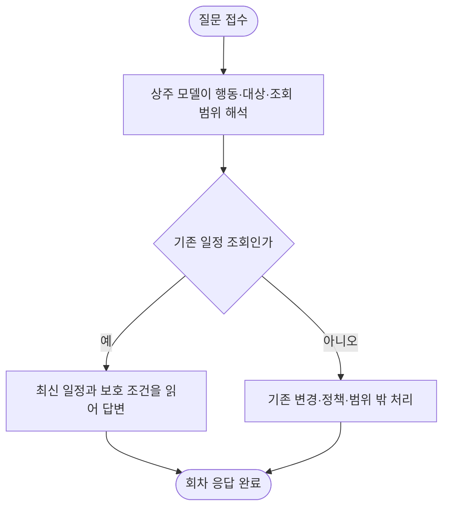

# Oracle ARM 질문 오해와 응답 지연의 분리 진단

질문 오해는 기존 일정의 날짜·시간대 범위를 읽는 계약 누락과 추천 쪽으로 유도한 지시문에서 재현됐습니다. 같은 배포 원본 모델로 범위 조회를 보완한 별도 고정 8문항은 모두 맞았습니다. 지연에는 입력 처리, 요청 경쟁, 앱 CPU 상한이 함께 관측됐습니다. 모델 가중치 추가 학습 실패로 단정할 근거가 아닙니다.

운영 API에 최소 세 파일을 반영했습니다. 실제 HTTP 최종 결과는 아래 표를 따릅니다. CPU 우선 배정과 상한 조정은 이미 반영했습니다. 10초 응답이나 제품 전체 해결을 주장하지 않습니다.

| 할 일 | 상태 | 진행 |
|---|---|---|
| 실제 모델·도구·가중치 계보 확인 | 완료 | 1/1 = 100% |
| 입력 축약 개발 비교 | 완료·축약판 미채택 | 6/6 = 100% |
| 범위 조회 별도 실제 모델 문항 | 통과 | 8/8 = 100% |
| 최소 후보 단위 검사 | 통과 | 44/44 = 100% |
| Oracle 동일 이미지·실제 DB·고정 모델 연결 검사 | 최종판 통과 | 4/4 = 100% |
| 운영 API 최소 수정 반영 | 완료 | 1/1 = 100% |
| 실제 모델·운영 HTTP 두 질문 | 완료 | 2/2 = 100% |

관측 기준: **2026-10-11T15:51:02.672378+00:00 UTC**, 한국 시간은 UTC+9입니다. 미완료·실패는 각각 계획 분모에 남깁니다.

## 원인과 확인 범위

현재 앱 추론은 **Gemma-4-E4B QAT Q4_0 배포 원본**, 우리 자료 추가 학습 없음입니다. 개발사 학습·QAT는 포함된 배포판입니다. 실행 도구는 llama.cpp이며 앱이 쓰는 것은 Ollama 호환 연결기입니다. vLLM이나 Ollama 엔진을 실제 사용한다고 기록하지 않습니다. 상주 상태·실행 명령·모델 파일 계보를 대조했습니다. LoRA 목록이 비었다는 관측 하나만으로 합친 학습 여부를 추론하지 않았습니다.

기존 결정 단위에는 단일 항목과 사실 종류만 있었고, 「오후에 바꿀 수 있는 항목 목록」을 읽는 범위 계약이 빠져 있었습니다. 새 지시문은 조회와 변경을 구분하고, 앱은 최신 일정의 범위·예약·고정·장소 조건을 읽어 답합니다. DB나 연결 전체를 원인으로 단정하지 않습니다. 장소 검색·추천 전 경로의 정상 여부도 이번 범위 검증으로 확대하지 않습니다.

## 속도 실측과 실제 조정

동일 기존 시간 질문을 A/B/A/B로 비교했습니다. 시드·온도·모델·질문을 고정했고, 공유 CPU 및 자동 HTTP 시험이 공존했습니다. 각 조건 두 번뿐이므로 p95·전체 제품 개선율을 계산하지 않습니다.

| 조건 | 의미 정답 | 입력 처리 범위 | 전체 응답 범위 |
|---|---|---|---|
| 기존 긴 계약 | 2/2 = 100% | 131.20~134.43초 | 232.47~341.47초 |
| 짧은 계약 | 0/2 = 0% | 62.20~64.27초 | 258.86~259.74초 |

축약판의 추가 개발 두 문항도 실패했습니다. 따라서 축약판 전체 의미 정답은 0/4이며 제품에 연결하지 않았습니다. JSON 형식 통과 6/6을 의미 정답 6/6으로 쓰지 않습니다. [개발 원본·집계](../../../../program/scripts/plan_qa_bench/results/arm_latency_20261011/compact_final_v1.json).

모델이 메모리에 올라가 있어도 새 문맥을 읽고 답을 생성하는 시간이 듭니다. 엔진 처리 시간 밖 잔여 시간은 62.87~178.70초였지만 이를 순수 대기 시간으로 단정하지 않습니다. 연결기 모델 확인·요청 대기·통신 등이 포함됩니다. 별도 관측에서는 연결기와 엔진에 요청 연결 각각 두 개, 실제 계산 슬롯 한 개가 있었습니다.

앱 모델의 CPU 상한이 전체 두 코어의 60%였음을 확인했습니다. 벤치마크 CPUWeight를 20, 앱을 200으로 유지하고 앱 상한을 전체 두 코어의 **90%**로 조정했습니다. 모델과 지속 벤치마크의 PID는 그대로입니다. 재부팅용 설정도 저장했지만 재부팅 시험은 하지 않았습니다. 기존 평가를 중단하거나 의미 없는 CPU 작업을 만들지 않았습니다. 짧은 CPU 관측만으로 지연 개선 배수를 주장하지 않습니다.

문맥 저장 시 약105MiB 상태가 64MiB 캐시 한도를 넘는 경고도 확인했습니다. 캐시 상한 조정의 적용·실측은 아래 후속 상태를 따릅니다. 다중 사용자 메모리 회귀는 별도로 필요합니다.

## 모델 해석 개선 검증

개발 세 문항과 다른 표현·일정을 가진 별도 고정 8문항을 실행했습니다. 날짜·시간대·식사 조회, 주소, 시간, 실제 변경, 취소 정책, 여행 밖 요청을 포함하며 모델 출력 원문과 앱의 판독을 따로 보관했습니다. 원문 예상 필드 일치와 앱 판독 의미 일치 모두 8/8입니다. 실행 후 해당 세트로 지시문을 다시 튜닝하지 않았습니다.

이는 개발자가 작성한 표적 보류 점검입니다. 사람 검수 완료·제품 최종 독립 보류 통과나 새 모델 채택으로 표시하지 않습니다. [고정 입력](../../../../program/scripts/plan_qa_bench/results/arm_latency_20261012/scope_holdout_v2_inputs.json) · [최종 판독·질문별 시간](../../../../program/scripts/plan_qa_bench/results/arm_latency_20261012/scope_checkpoint_002648_audited.json).

이 시험에서 전체 시간은 첫 문항192.39초, 이후62.40·58.00·29.86·29.06·28.02·28.70·29.39초였습니다. 문항·캐시 조건이 다르므로 이를 CPU 조정 전후 효과나 항상29초라는 보장으로 쓰지 않습니다. 기존 D/E 선택 시험을 이번 실제 앱 생성 정확도와 합산하지 않습니다.

## 앱 연결 검사와 검사 중 장애

운영 코드에서 필요한 세 파일만 새 후보로 구성하고 해시·차이를 보관했습니다. 최신 로컬 전체에는 다른 세션의 서비스 안내·업무 재개 변경이 있어 통째로 복사하지 않았습니다. 최소 후보 단위 검사는44/44 통과했습니다. 같은 후보를 최신 로컬 앱에 넣은 연결 검사는 함수 인자 차이로0/1 실패했습니다. 최초 샌드박스 TCP 거절도 원본에 남겼습니다.

별도 앱 검사를 운영 API 컨테이너 안에서 실행한 것은 잘못된 검사 배치였습니다. 기본 앱 자동 생성이 추가 초기화를 수행했고, 컨테이너 메모리 부족으로 기존 uvicorn 프로세스가 종료됐습니다. 00:26:48 KST 자동 재시작 후 건강 상태가 회복됐습니다. 재시작 이후 memory.events의0만 보고 과거 OOM을 부정하지 않았고, 커널 종료 기록을 확인했습니다. 이는 이번 검사에서 발생시킨 장애이며 사용자 최초 오답의 원인으로 바꿔 쓰지 않습니다.

이후 기존 이미지를 쓰는 별도 검사 컨테이너에768MiB·0.5CPU 상한을 두고 외부 포트를 열지 않았습니다. 규칙 파일 누락, 기본 앱 자동 생성으로 이동 자료 초기화가 발생한 두 실패판을 보존했습니다. 최종판은 규칙 볼륨 읽기 전용·기본 인스턴스 자동 생성 제외·고정 모델 출력으로 실제 앱 팩토리와 DB를 연결해 답변·범위·근거·일정 불변4/4를 통과했습니다. 이4개는 실제 LLM 답변이나 공개 HTTP 확인이 아닙니다. [분리 검사 원본](../../../../program/scripts/plan_qa_bench/results/arm_latency_20261012/scoped_runtime_candidate_v1/oracle_isolated_container_fixed_model_v4.json).

## 운영 반영과 실제 HTTP

기존 배포 잠금과 자동 검사 회차 종료를 기다리고, 모델 계산이 비어 있는지 확인한 뒤 적용하도록 Oracle ARM 자체 일회성 작업을 등록했습니다. 기존 파일의 해시가 검증 기준과 다르면 적용을 중지합니다. 수정 직전 원본을 백업한 뒤 세 파일만 원자적으로 교체하며 API만 재시작합니다. DB·worker·모델·기존 지속 벤치마크는 재시작 대상이 아닙니다.

| 실제 HTTP 질문 | 결과 | 전체 시간 |
|---|---|---|
| scope | 통과 | 179.41초 |
| time | 통과 | 58.10초 |

현재 컨테이너 쓰기 계층의 긴급 수정은 같은 컨테이너 재시작 뒤 유지됩니다. 새 develop 이미지로 교체되면 다시 검증·반영해야 합니다. CD 전체가 영구히 새 수정판으로 바뀌었다고 표시하지 않습니다. 작업 적용 여부는 [최신 회수](../../../../program/scripts/plan_qa_bench/results/arm_latency_20261012/scope_apply_checkpoint_004132.json)에서 확인합니다.

## 캐시 용량 조정 후속 검증

문맥 캐시64→256MiB 조정은 **적용 완료**입니다. 같은 모델 파일·지시문·조회 로직을 유지하며, 기존 자동 앱 회차 종료와 모델 계산 유휴를 확인한 뒤 앱 모델만 다시 기동하도록 기계 내부 일회성 작업을 등록했습니다. 모델 가중치·지속 벤치마크는 교체·중단 대상이 아닙니다. 이전 설정과 실행 인자를 먼저 백업합니다.

| 조정 후 실제 HTTP 질문 | 결과 | 전체 시간 |
|---|---|---|
| scope | 통과 | 179.53초 |
| time | 통과 | 63.26초 |

회수 완료는 2/2입니다. 모델 재기동 뒤 첫 입력과 후속 입력을 구분합니다. 앞선 시험과 대화 이력·캐시·CPU 경합이 모두 같지 않으므로 이 두 실행으로 캐시 단독 개선 배수를 계산하지 않습니다. 반복·다중 사용자·자원 검증 전 전체 지연 해결이나 제품 채택으로 표시하지 않습니다.

최종 엔진 기록은 다음과 같습니다. 재기동 후 건강 상태가 준비된 뒤 측정했으며, 아래 시간에는 모델 파일을 처음 올리는 시간이 들어 있지 않습니다.

| 실제 요청 | 입력 읽기 | 출력 생성 | 엔진 합계 | HTTP 전체 |
|---|---|---|---|---|
| 오후 변경 가능 목록 | 1,830토큰 / 133.58초 | 149토큰 / 45.72초 | 179.30초 | 179.53초 |
| 기존 일정 방문 시각 | 466토큰 / 37.28초 | 68토큰 / 25.75초 | 63.03초 | 63.26초 |

이 두 요청은 전체 시간 대부분이 실제 입력 처리와 생성입니다. 첫 요청의 입력 처리율은13.70토큰/초, 생성 처리율은3.24토큰/초였습니다. 현재 질문 지연을 모델 재적재나 PostgreSQL 대기만으로 설명할 수 없습니다. 앞선 비교에서는 엔진 밖 잔여 시간이 컸지만, 그 원인을 이번 두 요청에 그대로 적용하지 않습니다. 캐시256MiB와 CPU 조정 뒤에도179.53초·63.26초이므로 **실측 속도 개선은 아직 입증하지 못했습니다.** 상주하면10초라는 보장도 없습니다.

다음 속도 후보는 필드·안전 조건을 보존한 입력 재작성, 불필요한 반복 해석 출력 억제, 요청 경쟁 분리 계측입니다. 실패한 짧은 계약을 재채택하거나 이미 본8문항으로 반복 조정하지 않습니다. 새 개발 자료에서 후보를 고정한 뒤 별도 보류 자료와 같은 조건의 교대 반복으로 정확도·지연을 함께 검증해야 합니다. 가중치 추가 학습은 이 운영 연결·계약 보완과 분리하며, 이번8/8을 파인튜닝 효과로 쓰지 않습니다.

## 근거·백업·재개

- [이번 원본·해시·후보·검사 실패와 최종 회수](../../../../program/scripts/plan_qa_bench/results/arm_latency_20261012/) — 접속·환경 정보가 포함될 수 있는 git 제외 경로입니다.
- [앞선 개발 비교·자원 관측](../../../../program/scripts/plan_qa_bench/results/arm_latency_20261011/) — 조건을 바꾸기 전 원본을 보존합니다.
- [기존 오후 조회 보완 기록](2026-10-11_2320_afternoon-scope-query.md) — 이전 구현과 개발 시험이며 당시 미배포 사실을 보존합니다.
- [CPU 우선 배정 설정](../../../deploy/arm/benchmark-app-priority.conf) · [앱 CPU 상한 설정](../../../deploy/arm/app-interactive-cpu.conf) — 개인 인프라 값 없이 저장한 재현 가능한 설정입니다.
- [입력 축약 실험 코드](../../../../program/scripts/plan_qa_bench/server/compact_decision_v1.py) — 채택하지 않은 실험 구현입니다. 안전 판독 검사18/18과 실제 의미 실패를 구분합니다.

운영 파일 백업 원문은 적용 회수의 `source_backup_and_apply.json`에 있고, CPU 이전 속성·원격 백업 위치는 `cpu_priority_persistent_v1.json`·`app_cpu_capacity_v1.json`에 있습니다. 로컬 도구 변경 직전 백업은 [.tmp 백업](../../../../.tmp/_backup/)입니다.

재개: 최소 운영 수정·캐시 설정·실제 HTTP 각2건과 일정 불변 회수는 완료했습니다. 다음은 새 입력 후보의 개발 자료 고정 → 별도 보류 의미 검증 → 같은 조건의 반복 지연·요청 대기 계측 → 새 develop 이미지에 최소 수정 포함 후 재검증입니다. 추가 학습은 먼저 이번 해석 계약과 기존 정상 요청을 보존하는 조건을 고정하고 기존 학습판·원본과 분리해 비교합니다. 현재 장애를 이유로 승인된 자료를 일괄 변경하거나 검증 없이 가중치를 교체하지 않습니다.
