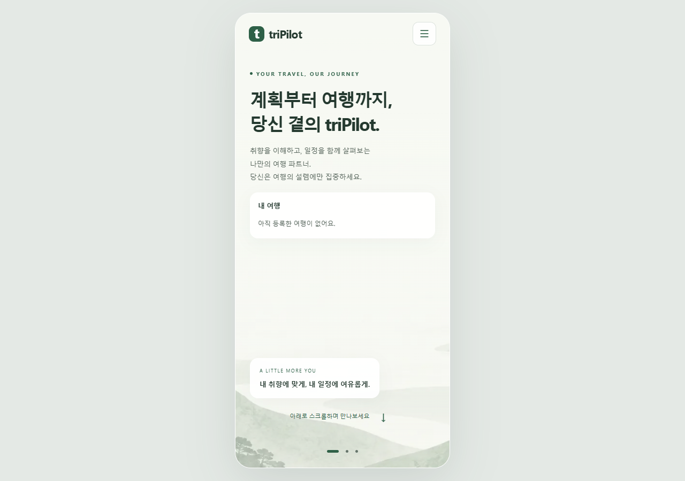

# 공개 화면 장애 복구와 후속 검사 상태

기록 시각: 2026-10-12 12:55 KST. 공개 첫 화면은 실제 Chrome에서 정상 표시됐다. 이 기록은 화면 복구와 읽기 전용 응답 확인이며, 고객 업무 변경·알림 발송이나 후속 후보 배포 완료를 의미하지 않는다.

| 할 일 | 상태 | 진행 |
|---|---|---|
| 공개 첫 화면과 상태 주소 | HTTP 200 | 2/2 = 100% |
| 실제 Chrome 화면 | 정상 표시 | 1/1 = 100% |
| 추가 용량 관리 별도 세션 인계 | 완료 | 1/1 = 100% |
| 복구 후보 필수 검사·시나리오 | 실행·원인 수정 중 | 분모 집계 중 |

## 관측한 장애와 복구

운영 기계에서 WSL Ubuntu가 중지됐고 기동 시 `Wsl/Service/CreateInstance/E_FAIL`이 발생했다. 호스트 디스크 여유 공간은 당시 6,230,016바이트였다. 사용자 승인에 따라 다른 프로젝트의 빌드 캐시 두 폴더를 다른 드라이브에 보존 이동했으며, 파일 11,536개의 상대 경로·크기·SHA-256 대조와 기존 경로의 연결 확인을 완료했다. 합계 파일 크기는 3,769,853,569바이트다.

이동 직후에도 WSL 기동 실패가 지속됐다. 등록 배포판이 Ubuntu 하나이며 실행 중인 배포판이 없음을 확인한 뒤 WSL 종료·기동을 수행했고 기존 컨테이너가 실행됐다. 따라서 **디스크 부족만으로 직접 원인을 확정하지 않는다**. WSL 기동 실패는 관측했고 기동 복구 뒤 서비스 회복을 확인했다. 과거에 확보한 60GB가 언제 어떤 파일로 소비됐는지는 이번 기록으로 입증하지 못했다.

12:45 KST 재확인에서 WSL은 Running이며 cs 프로젝트 API·web·admin·DB는 healthy, worker는 실행 중이었다. 공개 첫 화면은 HTTP 200·28,322바이트, 상태 주소는 HTTP 200·15바이트였다. 이 시점 호스트 E 드라이브 여유 공간은 3,479,199,744바이트다. 이 수치는 장기 운영 여유가 충분하다는 판정이 아니다.

## 실제 화면 확인

Chrome headless로 실제 공개 주소를 열어 페이지 제목과 본문을 읽고 화면을 저장했다. 브라우저 페이지 오류 0건, 실패한 요청 0건을 기록했다. 로그인·결제·고객 여행 변경은 실행하지 않았다.

mock 서버 시험: 이번 화면 복구 확인에서는 실행하지 않음.

실서버 확인(서버 응답): 했음. 공개 첫 화면·상태 주소 GET과 실제 Chrome 렌더링, 기존 컨테이너 실행 상태를 확인했다.

## 후속 검사와 배포 상태 정정

오전 매니저 배포 기준 소스와 이전 플러그인 후보를 비교하면, 이전 수정 52개 중 49개가 개선 전 기준선과 같고 3개는 별도 병합이 필요했다. 따라서 새벽의 플러그인 운영 반영 기록은 해당 시점의 증거이며 현재 운영 상태를 그대로 설명하지 않는다. 현재 API·worker의 이미지와 코드 해시는 비공개 증거에 별도 보존했다.

별도 격리 후보에서 이전 수정과 최신 매니저 채팅 변경을 병합하고, 선택 버스 키 선언·은퇴 MCP 파일·옛 커머스 권한의 기존 관문 실패를 수정 중이다. 옛 커머스 시험 자료 15파일을 현재 여행 자료로 대응시켰고 엄격한 재유입 검사에서 위반 0건을 확인했다. 이 정적 검사 결과를 전체 필수 시험 통과로 바꾸어 쓰지 않는다.

Claude Sonnet 5.5의 제한된 정적 검토는 오래된 일정 목록으로 사실 답변을 만드는 병합 문제와 복수 조회 재시도 문맥의 불일치 가능성을 지적했다. 관련 실행 증거와 수정이 완료되기 전에는 후보 배포나 플러그인 전체 복구 완료를 선언하지 않는다.

## 증거와 보존

원문 명령 결과·공개 응답·Chrome JSON·이동 manifest·후보 소스 해시·격리 PostgreSQL 시험 로그는 git 밖 작업 증거에 보존했다. 접속 구성과 인증값은 공개 문서에 넣지 않았다. 이 문서를 추가하며 이전 기록을 수정하지 않았다. wiki 상태 문서 수정 전 사본은 [백업](../../_backup/2026-10-12_1255_public_recovery/)에 있다.

추가 용량 확보와 재발 방지 조사는 사용자 지시에 따라 별도 세션에 인계했다. Docker가 회수 가능하다고 표시한 캐시 전체를 삭제하지 않았으며 DB 볼륨·학습 모델·앱 이미지와 복원 이미지를 보존했다.
