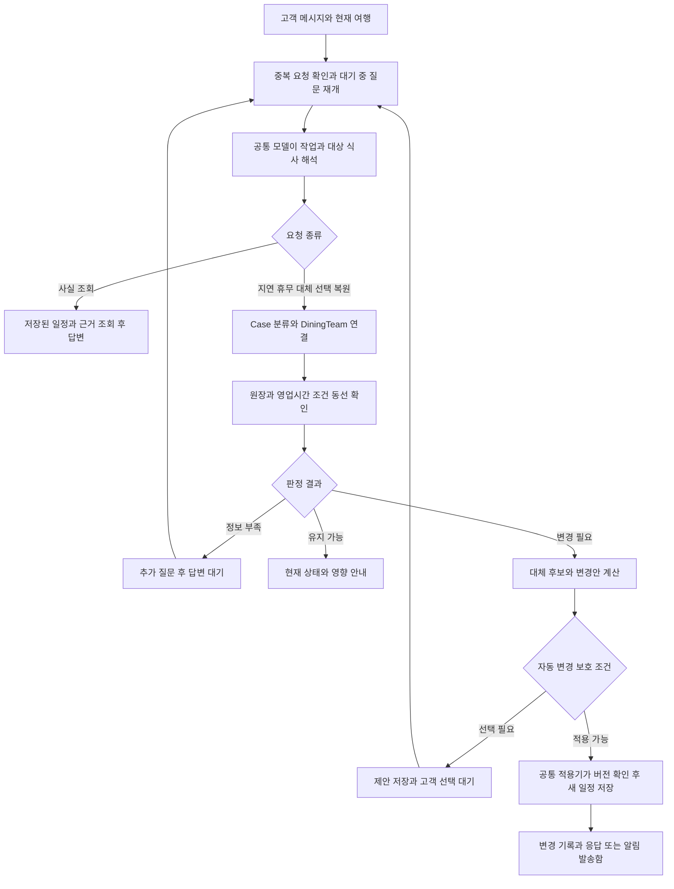

# Dining 브랜치 반영 상태와 실제 실행 흐름

[실측 2026-10-12 KST] **다이닝의 핵심 요청 처리와 음식 결 기반 대체 순위는 develop에 들어갔다. role-dining에는 후속 기능 변경 5개와 동기화 병합 2개가 더 있으며, PR #42가 열려 있다.** 배포 기록으로 같은 다이닝 실행 코드의 기동은 확인되지만, 현재 서버 SHA와 원장 데이터 최신성은 미확보다.

- 수행: Codex. 원격 Git·GitHub PR/Checks 조회와 고정 커밋 코드 분석.
- 기준: develop `c612c994f8d3a668175cd742e8d8c6778cb38476`, role-dining `93dd3efb8fbbe12591577894c3d984edc66d956b`.
- 범위: 브랜치 반영, 기존 배포 증거, 실행 경로. 이번 조사에서 고객 일정 변경·DB 조회·테스트 재실행·서버 재배포는 하지 않았다.
- 전체 기능 완료율·서버 데이터 반영률: 분모 모름. 커밋 수를 기능 완료율로 환산하지 않는다.
- 조회 명령과 상태 원문 요약: [근거 기록](../evidence/2026-10-12_2210_Dining_브랜치와_develop_근거.md).

## 브랜치와 PR

| 대상 | 고정 SHA | 마지막 커밋 시각 KST | 상태 |
|---|---|---|---|
| develop | `c612c994` | 2026-10-12 21:11:27 | PR #41의 공통 CI 수정까지 포함 |
| role-dining | `93dd3efb` | 2026-10-12 21:42:59 | 최신 develop을 모두 포함하고 7커밋 앞섬 |

[실측] `git rev-list --left-right --count develop...role-dining`은 `0 7`. 직접 파일 차이는 18개, 추가 2,695줄·삭제 32줄이다. 앱 실행 코드의 차이는 `instances/dining/ledger.py`의 3글자 동네 이름 오인 방지이고, 나머지는 마이그레이션·적재/검수 도구·시험·문서다.

| PR | 확인 상태 | 반영 범위 |
|---|---|---|
| [#37](https://github.com/SKNETWORKS-FAMILY-AICAMP/SKN32-FINAL-6TEAM/pull/37) | 10월 12일 10:23:53 병합 | 고객이 고른 식당과 원장 연결, 짧은 이름 탐색, 영업시간 추출 수정, 수동 분류 적재, 품질 채점 보정 |
| [#39](https://github.com/SKNETWORKS-FAMILY-AICAMP/SKN32-FINAL-6TEAM/pull/39) | 10월 12일 11:06:41 병합 | 음식 결 19종, 같은 결 우선 대체 순위, 일정 생성 후보의 category/style 누락 수정 |
| [#40](https://github.com/SKNETWORKS-FAMILY-AICAMP/SKN32-FINAL-6TEAM/pull/40) | 닫힘·병합 안 됨 | 후속 변경을 담았던 이전 PR |
| [#42](https://github.com/SKNETWORKS-FAMILY-AICAMP/SKN32-FINAL-6TEAM/pull/42) | 열림·병합 안 됨·충돌 없음 | 아래 변경을 최신 develop에 반영할 현재 PR |

develop에 아직 없는 실제 변경은 다음과 같다.

| 커밋 | 변경 |
|---|---|
| `fc591f6f` | 뷔페·코스/다이닝 결 추가, 에스프레소 등 분류 오탐 낱말 수정 |
| `22216d85` | 성수동 같은 3글자 지역명이 유일한 상호 앞부분으로 잘못 매칭되는 문제 방지 |
| `ba33e179` | 분류·음식 결 드롭다운 검수 엑셀 생성과 XLSX 적재 |
| `5541fd09` | 미쉐린 요리 종류를 음식 결 첫 근거로 사용, 불명확한 종류는 사람 검수 |
| `566a8409` | 할랄 시트의 일반 식당은 식당·영업 근거만 넣고 할랄 속성을 붙이지 않음 |

`b7bfca44`, `93dd3efb`는 develop 동기화 병합이다. 기존 핵심 다이닝 흐름을 새로 만드는 커밋으로 세지 않는다.

## 배포와 데이터

[실측 GitHub 조회] develop과 PR #42 모두 확인된 CI 작업이 각각 **5/5 = 100% 성공**이다. PR #42의 [CI develop](https://github.com/SKNETWORKS-FAMILY-AICAMP/SKN32-FINAL-6TEAM/actions/runs/38251138833)은 21:48:36, [CI main](https://github.com/SKNETWORKS-FAMILY-AICAMP/SKN32-FINAL-6TEAM/actions/runs/38251138848)은 21:56:14 KST 완료됐다. 시험 통과는 병합·배포 완료와 별개다.

[기존 실측 기록] 마지막으로 확인한 서버 기록은 10월 12일 16:46~16:48, 실행 커밋 `439487e5`다. API/web healthy, worker running, 각 재시작 0, 감시 7회·배달 7회 오류 0이 기록돼 있다. 이 커밋과 develop의 dining/planning/conversation/watch 트리는 **4/4 = 100% 동일**하다. 따라서 현재 develop의 다이닝 실행 코드와 같은 코드가 정상 기동한 기록은 있다. 고객 일정 변경과 실제 외부 알림 수신은 그 기록에서도 검증하지 않았다.

근거: [배포 후속 보고](2026-10-12_manager_recovery_release_followup.md), [배포 요약 원문](../evidence/2026-10-12_manager_recovery/deployment-final-summary.json).

[코드 확인] 배포는 서버 systemd가 5분마다 설정 브랜치를 확인하는 방식이다. GitHub Actions CI가 배포 완료를 보증하지 않는다. 실제 추적 브랜치는 서버 `autodeploy.conf`에 있다. [배포 방식](https://github.com/SKNETWORKS-FAMILY-AICAMP/SKN32-FINAL-6TEAM/blob/c612c994f8d3a668175cd742e8d8c6778cb38476/final_project_cs/deploy/README.md#L53).

[미확보] 현재 서버 실행 SHA, 활성 모델/운영 설정, 원장 건수와 최신 검수 데이터 적용 여부. PR #37의 영업시간 파서 수정과 Git 밖 검수 데이터는 서버 원장을 다시 채워야 반영된다. 음식 결 규칙은 마이그레이션 231의 `refresh_style()`이 기존 원장에 적용될 수 있지만, 이것이 최신 원장 원문·검수 시트 전체를 적재하는 것은 아니다. PR #42의 로컬 원장 통계를 서버 통계로 사용하지 않는다.

## 실제 요청 처리 흐름

[코드 확인] 아래는 고정 develop의 정상 경로다. 설정 기본값은 `travel.decision_unit.mode: on`이며 운영 설정으로 바꿀 수 있다.

| 단계 | 코드에서 실제로 하는 일 | 근거 |
|---|---|---|
| 접수 | 웹 `/v1/web/trips/{trip_id}/messages`, 에이전트 `/v1/trips/{trip_id}/messages`가 같은 처리 함수로 들어간다 | `entry/trip_api.py:1026,1936` |
| 대화 복구 | 같은 request_id 재처리 방지, 처리 중 Case와 대기 질문 재개 | `components/conversation/trip_messages.py:262,335` |
| 해석 | 일정·변경 이력·앞 대화·화면 선택을 보고 모델이 작업과 대상을 구조화한다. 모델 실패 시 on 모드에서는 일정을 바꾸지 않는다 | `trip_messages.py:347,619,703`, `decision_unit.py:283` |
| 업무 라우팅 | Case 분류 후 capability를 정하고 Controller가 DiningTeam 실행 | `case_dispatch.py:74`, `instances/dining/team.py:154` |
| 판정 | 원장 연결과 예정 시각에 맞춰 영업·조건·식사 성립 여부를 확인. 정보 부족을 모름으로 유지 | `instances/dining/ledger.py:188`, `team.py:190,248` |
| 재계획 | 근처 원장 후보, 방문 가능 시간, 앞뒤 이동, 뒤 일정, 결제 조건, 음식 유사도 등을 계산 | `instances/dining/nearby.py:31`, `components/planning/replan.py:415` |
| 적용 | Team은 변경 제안을 반환하고 Controller와 ItineraryApply가 실제 저장. 기준 버전 일치 시 새 일정 버전 추가 | `instances/_shared/itinerary_team.py:304`, `components/actions/itinerary_actions.py:125`, `components/itinerary/itinerary.py:477` |

코드 위치는 모두 `final_project_cs/app/domains/travel_ops/` 아래다. 원문은 [공통 메시지 처리](https://github.com/SKNETWORKS-FAMILY-AICAMP/SKN32-FINAL-6TEAM/blob/c612c994f8d3a668175cd742e8d8c6778cb38476/final_project_cs/app/domains/travel_ops/components/conversation/trip_messages.py#L262), [DiningTeam](https://github.com/SKNETWORKS-FAMILY-AICAMP/SKN32-FINAL-6TEAM/blob/c612c994f8d3a668175cd742e8d8c6778cb38476/final_project_cs/app/domains/travel_ops/instances/dining/team.py#L154), [일정 적용기](https://github.com/SKNETWORKS-FAMILY-AICAMP/SKN32-FINAL-6TEAM/blob/c612c994f8d3a668175cd742e8d8c6778cb38476/final_project_cs/app/domains/travel_ops/components/actions/itinerary_actions.py#L125)를 기준으로 읽는다.

## 기능별 처리와 유스케이스 보정

| 기능 | 현재 동작과 유스케이스에 적을 경계 |
|---|---|
| 영업시간 확인 | 원장 DB의 예정 시각 판정. 예정 영업시간과 현장 개점 확인은 다르다. 매 요청마다 실시간 Google 조회를 하는 구조가 아니다 |
| 식이 등 조건 확인 | 충족·불충족·모름을 나눈다. DN05의 과거 불충족 분기 누락 설명은 현재 구현에 맞춰 고쳐야 한다 |
| 지연 신고 | 분이 없으면 추가 질문. 늦어진 시각에 식사가 가능한지와 뒤 일정 영향을 계산한다. 가능하다는 안내만으로 저장 시각을 바꾸지는 않는다 |
| 현장 휴무 신고 | 고객 신고를 근거로 대체 후보 계산. 방문 시각과 후속 일정의 성립 여부를 함께 본다 |
| 대체 식당 비교 | 동선 허용 여부를 우선 고려하고, 같은 브랜드→메뉴 말→음식 결→큰 분류→모름→다름 순으로 유사도를 구분한다 |
| 고객 선택 | 저장 후보·장소·버전·후속 일정 충돌 확인. 저장 대안 선택 시 Dining 영업 상태의 새 조회는 없다 |
| 되돌리기 | 해당 과거 버전의 전체 일정을 새 버전으로 저장. 식당 하나만 되돌리는 것으로 그리면 안 된다. 영업 재조회도 없다 |
| 새벽 점검 | 아래 worker 경로로 연결돼 있다. 닫힘이면 후보 계산 후 보호 조건에 따라 변경 또는 선택 요청 |
| DN13 하루 식사 점검 | `sweep_day` 함수·테스트는 있지만 app/scripts의 서비스 호출은 없다 |
| DN14 방문 임박 점검 | 60분/20분 점검·중복 방지·발송함 helper가 있지만 호출 일꾼과 수집 어댑터 연결이 없다 |
| DN16 설문 식이 변환 | dining의 채식/할랄 변환 함수는 서비스 호출이 없다. 미쉐린·노포 취향은 별도 planning 설문 경로로 연결돼 있다 |

[코드 확인] 다이닝 자체의 영업·조건 판정과 후보 계산은 원장·규칙 기반이다. 공통 LLM은 작업·대상·사실 질문·복원 대상을 해석하며 설정에 따라 일정 항목 지목에도 쓰인다. 따라서 전체 다이닝 서비스에 LLM이 없다고 표현하면 잘못이다.

[코드 확인] `Candidate.rank`에는 `price_rank`, `extra_cost_krw`가 있다. 가격을 순위에 쓰지 않는다는 주석과 실제 코드가 일치하지 않으므로 가격 표시 전용이라고 단정하지 않는다. 명시 결제 조건은 후보 제외에도 쓰인다. [순위 구현](https://github.com/SKNETWORKS-FAMILY-AICAMP/SKN32-FINAL-6TEAM/blob/c612c994f8d3a668175cd742e8d8c6778cb38476/final_project_cs/app/domains/travel_ops/components/planning/replan.py#L127).

[코드 확인] 자동 변경은 전체 일정에 새 위반이 생기는지 검사한다. 직접 선택·복원은 적용기에서 D-020과 `introduced_violations` 검사를 생략한다. 이 경로의 버전 검사는 영업 재조회나 모든 업무 조건 검증을 대신하지 않는다. 따라서 모든 변경이 같은 검사 흐름을 거친다고 그리면 안 된다.

## 자동 점검과 실제 배달

[코드 확인] `deploy/worker.sh`는 스위퍼와 발송 일꾼을 실행한 뒤 60초 쉰다. 새벽에는 `run_sweepers → DawnCheck.tick`이 03:00 이상~08:00 미만에 식당·활동을 항목/날짜별 한 번 점검한다. Google로 계획한 시작~종료 시각의 영업을 판정하고, 닫힘이면 원장 후보를 보충해 대체 계산으로 들어간다.

고정·예약·먼저 묻기 조건을 보호하고, 자동 변경 전 일정 전체를 재판정한다. 후보가 전혀 없으면 unresolved 집계로 끝나는 분기도 있어 모든 점검 실패에 알림을 보장하지 않는다. 발송함 기록과 외부 채널 실제 수신은 별도 단계다.

낮의 `trip_cases` 감시는 180초 주기로 90분 앞 일정을 살피며 기상·재난·도로 통제 등으로 Case를 만든다. 이것을 식당의 임시휴무·대기를 60분/20분 전에 재조회하는 DN14와 같은 기능으로 그리면 안 된다.

근거: [새벽 점검](https://github.com/SKNETWORKS-FAMILY-AICAMP/SKN32-FINAL-6TEAM/blob/c612c994f8d3a668175cd742e8d8c6778cb38476/final_project_cs/app/domains/travel_ops/components/watch/dawn_check.py#L101), [변경 보호와 적용](https://github.com/SKNETWORKS-FAMILY-AICAMP/SKN32-FINAL-6TEAM/blob/c612c994f8d3a668175cd742e8d8c6778cb38476/final_project_cs/app/domains/travel_ops/components/planning/pending.py#L493), [미연결 임박 점검 부품](https://github.com/SKNETWORKS-FAMILY-AICAMP/SKN32-FINAL-6TEAM/blob/c612c994f8d3a668175cd742e8d8c6778cb38476/final_project_cs/app/domains/travel_ops/instances/dining/tick.py#L108).

## 검증 범위

[실측] 최신 원격 SHA와 차이, PR 병합 여부, CI 완료 상태를 조회했다. 호출 경로는 고정 커밋에서 읽었으며, 현재 체크아웃의 코드와 섞지 않았다. 기존 파일의 사용자 변경은 보존했다.

[기존 시험] 새벽 점검은 `tests/scenario/test_dawn_check.py`의 FakeSource 시나리오가 있고, 일일/임박/설문 부품도 단위·통합 시험이 있다. 이 시험의 존재와 과거 통과 기록은 실제 수집 어댑터 연결이나 현장 영업 검증을 의미하지 않는다.

[미확보] 실제 서버에서 고객 메시지→다이닝 판단→변경/선택→알림 수신까지의 현재 종단 결과. 이번 요청의 결과는 브랜치·구현·기존 배포 증거의 조사이며 운영 기능 전수 통과 판정이 아니다.

## 관계

- [Dining Team](../../teams/dining.md) — 팀 책임과 기존 작업 기록.
- [근거 기록](../evidence/2026-10-12_2210_Dining_브랜치와_develop_근거.md) — 고정 SHA와 조회 결과.
