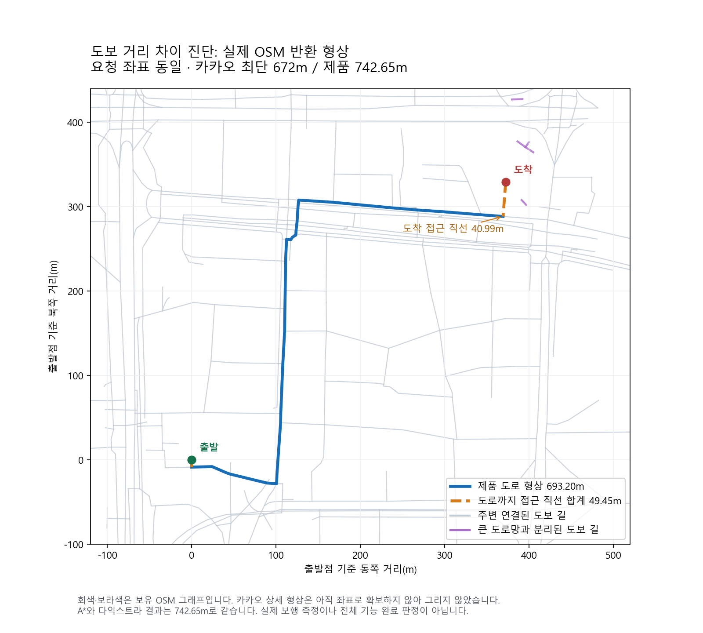

# 2026-10-12 보정값·직접 도보 폴백 제거와 경로 진단

직접 도보 계산에서 경로 조회 실패와 불확실한 도로 밖 접근을 임의 거리로 대신하는 처리를 제거했습니다. 특정 OD·영수증 요금에 맞춘 보정값을 넣지 않았습니다. 차량 탐색의 복수 도착 후보 처리 결함도 일반 반례로 재현해 수정했습니다. 최종 차량 회귀 결과는 별도 보고서에 연결합니다.

| 할 일 | 상태 | 진행 |
|---|---|---|
| 직접 도보의 조회 실패 대체 계산 제거 | 계획·시간대 추정·출발 재확인 적용 | 3/3 = 100% |
| 직접 도보 관련 시험 | 통과 | 52/52 = 100% |
| 최신 OSM 원본 확보 | 제공 MD5 일치·제품 미적용 | 1/1 = 100% |
| 신규 웹 도보 값 수집 | 브라우저 접근 실패 | 0/3 = 0% |
| TMAP 실제 한도·갱신·공유 사용량 | 계정 미확인 | 0/3 = 0% |

분모: 직접 도보 적용 3개는 일정 계획, 시간대 추정, 현재 출발 재검증입니다. 52개는 `walk-no-fallback-v3.xml`의 실제 수집된 시험입니다. 동일 시험의 중간 실행 47개·49개를 합산하지 않습니다. 이 표는 21기능 전체 실사용 완료율이 아닙니다.

## 무엇을 바꿨나

- 보행 라우터가 없거나 응답을 못 얻으면 직선거리×우회계수로 거리·ETA를 만들지 않습니다. 경로 없음(`no_path`)과 조회 근거 상실(`unavailable`)을 구분합니다.
- 도로 밖 접근이 길어 연결을 보장하지 못하는 `optimistic` 응답도 직선계수로 연장하지 않습니다. 계획·시간대 추정에서는 직접 도보 후보가 제외되고 출발 재검증은 `fatal/walk_source_unavailable`로 반환합니다. 실제 경로 없음은 재계획 대상으로 유지합니다.
- 계단 등 유효한 보행망 내부 시간은 유지합니다. 성공 경로의 속도 정책을 웹 표본에 맞춰 바꾸지 않았습니다.
- 실제 조립된 출발 안내 함수에서 조회 장애·접근 미검증·경로 없음 3가지 경우 모두 저장 ETA(시험값999분)나 새 출발 문구를 발행하지 않는 것을 확인했습니다.

## 검증 결과와 범위

[최종 직접 도보 로그](walk-no-fallback-v3.log) · [기계 집계 XML](walk-no-fallback-v3.xml). 합성 보행 그래프와 실제 조립 함수의 회귀이며 실제 보행 측정이 아닙니다. 첫 실행의 날짜·입력 보존 시험 2개는 이전 직선 대체 계산에 의존하고 있어 실패했습니다. 해당 시험에 명시적인 합성 보행망 응답을 공급한 뒤 날짜 경계·입력 보존 조건을 그대로 재검증했습니다. 최초 실패 로그와 XML도 보존했습니다. 종료 시 콘솔 정리 예외는 본문 시험 이후 발생했으며 로그에 남겼습니다.

mock 서버 시험: 이번 실행에서 하지 않았습니다(화면 반응 확인 범위 아님).

실서버 확인(서버 응답): 안 했습니다. x600 서버의 cs 프로젝트 서버 HTTP·DB 응답과 휴대폰 지도 SDK 표시는 이번 검증 범위가 아닙니다.

## 아직 남은 계산과 소스

이번 제거는 장소 사이 직접 도보에 적용했습니다. 역·정류장 접근의 `_eff`, 연결통로 계수, 별도 환승 도보 추정·지도 형상의 직선 연결까지 모두 제거되었다고 말하지 않습니다. `plan.py`, `plan_estimate.py`, `verify_time.py`, `route_shape.py`를 검색한 범위에서 남은 처리를 확인했으며 다른 이름·동적 경로까지 전수 감사한 상태는 아닙니다. 이 남은 처리를 최신 실제 보행 링크로 바꾸고 소스 부족 때 숫자를 생성하지 않도록 후속 검증이 필요합니다.

## 실제 도보 거리 차이

같은 요청 좌표에서 카카오 최단 표시 672m, 실제 제품 반환742.65m로 기존 거리 오차10% 밖입니다. 제품 형상은 도로693.20m+도로까지 직선 접근49.45m입니다. A*와 순수 Dijkstra 결과가 같았습니다. 카카오는 중간 골목·교량·횡단보도를 통과하고 제품은 다른 도로 축으로 우회합니다. 웹 상세 경로의 좌표를 확보하지 못했으므로 정확한 중간 형상을 지어내어 그리지 않았습니다.

[웹·제품 중간 경로 대조](../../../../../datasets/mobility/raw/mobility_walk_web_20261012_v2/REPORT-v2.md). 새 OD 3쌍은 제품 실행 전에 동결했으나 브라우저 목록이 비고 공개 URL의 실제 결과에도 접근하지 못해 신규 정답 관측은0/3입니다. 선정·링크 준비를 골든 수집으로 세지 않습니다.

## 새 지도 원본

[Geofabrik 일별 원자료](https://download.geofabrik.de/asia/south-korea.html)를 별도 폴더에 내려받았습니다. 원본289,058,579바이트, 제공MD5 `df6f9430a975f927c08f4afddade7f97` 일치, SHA-256 `a856bb1e43c968612b2339af0e01da8bb972e10ba21ca86b9d91aac4d1d64505`입니다. 기존 원자료와 제품 그래프는 덮어쓰지 않았습니다. © OpenStreetMap contributors, [ODbL1.0](https://opendatacommons.org/licenses/odbl/1-0/).

[원본 확보·해시 근거](../../../../../datasets/mobility/raw/osm_20261012_v1/REPORT.md). 파일 확보와 현재 제품 적용을 구분합니다.

## 택시 계산 근거

[택시 기본요금 소진 단계 조사](taxi-research/REPORT.md). 전기식 미터 검정 기준·서울 운임 공고에서 기본요금 단계가 별도 존재함을 확인했습니다. 현재 계산은 기본시간 소진 없이 전체 저속 시간을 즉시 후속 요금으로 더하므로 구조가 누락됐습니다. 다만 서울 미터의 실제 초기 펄스 설정은 확보하지 못했습니다. 유도값366.412초를 실측 설정처럼 공제하거나 단거리 전부 시간요금을 없애서 웹4800원에 맞추지 않았습니다. 새 코드를 영수증4건의 과소 예측 원인 해결로 표시하지 않습니다. 개인 영수증은 이번 작업에서 열거나 전송하지 않았습니다.

## 필요한 키와 연결 준비

[TMAP 무료체험 키1개 준비 안내](api-guide/TMAP-key-preparation-20261012-v1.md). 도보 경로·거리·형상을 같은 입력으로 대조할 수 있는 공식 API 후보입니다. 새 제품 연동은 미구현입니다. 키만 추가하면 작동한다고 표시하지 않습니다. 공개 경로안내 한도는1000건/일이지만 실제 계정 제한 단위·갱신·공유 사용량을 확인하고20%를 남길 원자적 예산 보호 장치가 준비되기 전까지0회 호출합니다. TMAP 응답은24시간 이후 재사용하지 않도록 구현해야 합니다. 카카오 도보 API는 일반 REST키 외에 제휴 승인이 필요합니다.

## 소넷 실행과 검토

[실제 소넷 응답](claude-walk-result-v3.json) · [사용량](claude-usage-v1.json). Claude CLI2.1.287, `claude-sonnet-5-5`, effort medium입니다. 입력2·캐시 생성9067·캐시 재사용1467·출력12814토큰(추론9167포함), 표시 비용0.1647054USD, 계정 잔여율은 조회하지 못했습니다. Windows 명령 길이 실패와 제한 실행 환경 DNS실패 후 표준 승인된 네트워크 실행에서 응답을 받았습니다. 일반 도로 탐색 함수8개만 발췌했으며 비밀값·개인자료는 전송하지 않았습니다.

소넷의 지적은 그대로 채택하지 않았습니다. 실제 코드의 최대속도100km/h 상한 때문에 ‘120km/h 도로가 휴리스틱을 깨뜨린다’는 주장은 현재 코드에 적용되지 않았습니다. 반면 복수 도착 후보끼리의 거리를 고정12m로 가정하는 문제는 일반 반례에서 A*14.462초 대 Dijkstra11.593초로 재현됐습니다. 차량 탐색 회귀 결과를 확인한 뒤 최종 근거를 보존합니다.

## 기존 21기능 근거와 백업

[이전 종합21기능 표](../2026-10-12_mobility_web21_golden/feature-status-v3.md)는 당시 실행 결과입니다. 이번 변경의 전체21기능 실사용 완료율을 의미하지 않습니다. 앞선 지하철 웹6경로 운임·운행종류·같은범위 시간 각각6/6과 실제 결제·신규 웹 대조·휴대폰 지도 검증의 서로 다른 분모를 유지합니다.

직접 도보 코드·시험·wiki 변경 전 [백업](../../../../_backup/2026-10-12_163442_walk_no_fallback/)과 데이터 등록 전 [백업](../../../../../datasets/_backup/2026-10-12_164237_mobility_public_osm_walk/)을 보존했습니다. 제한 개발자API0회·운영 변경0회·커밋/푸시0회입니다.
