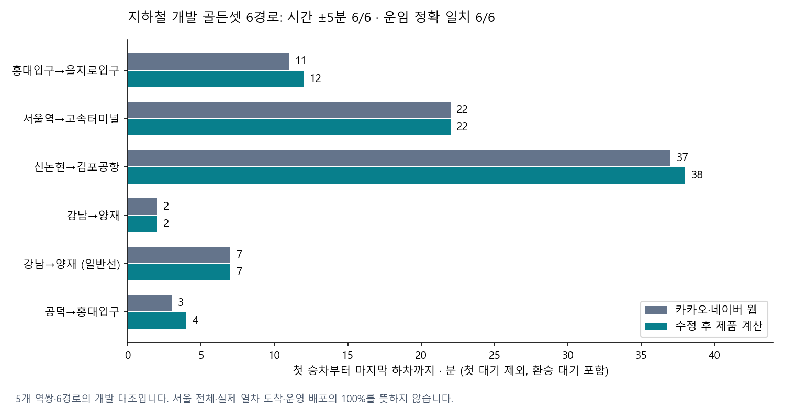

# 소비자 웹 골든셋 채택과 제품 결함 수정 — 2026-10-12

카카오·네이버 조회값을 골든셋으로 채택하고 계산과 화면 연결을 고쳤습니다. 지하철 6경로는 요금·정차/운행종류·동일범위 시간 모두 통과했습니다. 21개 기능은 아래 상세표에서 확인된 범위와 남은 결함을 각각 표시합니다.

| 할 일 | 상태 | 진행 |
|---|---|---|
| 지하철 웹 경로 요금·시간·운행종류 | 세 항목 모두 통과 | 6/6 = 100% |
| 혼합 환승 운임 | 실제 요금 계산 일치 | 3/3 = 100% |
| 같은 방향 빠른 환승칸·출구 내부 계산 | 공개 웹값과 일치 | 2/2 = 100% |
| 급행 종류의 지도 모델 전달 | 실제 경로 재생 일치 | 2/2 = 100% |

이 표의 분모는 각각 조회 경로 또는 확인 항목입니다. 시험 수·공표 셀 수를 합쳐 전체 기능 완료율로 바꾸지 않습니다. [전체 21개 기능과 실제 실행 범위](feature-status-v3.md), [상세 JSON](feature-status-v3.json)을 보존했습니다. 전체 실사용 완료율은 미해결 결함과 운영 확인이 남아 있어 100%로 판정하지 않았습니다.

## 실제 고친 제품 동작

역간 평균 시간을 매 구간 올림하면서 탈 수 있는 환승 열차를 놓치던 계산에 공식 정차 시각을 연결했습니다. 강남→교대→양재 일반선 경로는 잘못된 15분에서 웹과 같은 7분으로 바뀌었습니다. 승차 준비까지는 초 단위로 계산하고, 외부 도착분 표시 때만 올립니다. 보행 속도·환승 여유·웹 허용오차는 늘리지 않았습니다.

공식 보조표는 기존 승차편의 노선·역·요일·방향·출발초·종착역·정차 순서가 유일하게 맞을 때만 적용합니다. 2·3호선 기존 승차행 59204/68953 = 85.9%에 연결했고, 나머지는 기존 계산을 유지합니다. 원문 정차104614/104614행을 그대로 보존했습니다. 시간표의 예정 시각이며 현재 열차의 실도착을 측정한 값은 아닙니다.

선택한 열차를 혼잡·환승칸·지도 안내에서 다시 찾을 때도 같은 정확 도착초를 사용하도록 고쳤습니다. 급행 정보가 지도 모델까지 전달되지 않던 누락도 고쳐, 실제 선택 편성이 확인된 구간에만 ‘급행’을 표시합니다. 서로 다른 편성·손상된 값에는 급행 표시를 추측하지 않습니다.

| 지하철 경로 | 웹 운임(원) | 제품 운임(원) | 웹 시간(분) | 제품 시간(분) | 결과 |
|---|---:|---:|---:|---:|---|
|홍대입구→을지로입구|1550|1550|11|12|통과|
|서울역→고속터미널|1550|1550|22|22|통과|
|신논현→김포공항|1850|1850|37|38|통과|
|강남→양재|2550|2550|2|2|통과|
|강남→양재 (일반선)|1550|1550|7|7|통과|
|공덕→홍대입구|1550|1550|3|4|통과|

요금은 성인 교통카드 원 단위 일치, 시간은 최초 진단부터 사용한 ±5분입니다. 첫 승차~마지막 하차 범위이며 초기 대기는 제외하고 환승 대기는 포함합니다. 5개 역쌍에서 일반/별도운임 대안 때문에 6경로가 됩니다. 개발 자료이며 새 독립 보류 표본으로 부르지 않습니다. [최종 재생](subway-final-comparison-v2.json).

## 다른 기능의 확보된 근거와 남은 실패

혼합 2호선+3호선+01A, 신분당+3호선+01A, 420+01A의 요금은 각각1650·2350·1500원으로 실제 운임 계산과 일치했습니다. 가장 빠른 철도 경로 하나만 남겨 저렴한 일반선 대안을 생성 전에 지우던 결함을 고쳤습니다. 기존 빠른 경로를 유지하면서 정책에 명시된 별도운임 노선을 피하는 대안 최대1개를 추가합니다. 기존 환승상한·허용소요배수·중복제거·판정상한을 유지하고 버스 승차창 힌트에도 추가 철도 소요를 반영합니다. 후보 생성은2/3→3/3, 공통 출발시각의 최종 제공은1/3→2/3으로 개선됐습니다. 일반선1650원44분, 신분당2350원43분이 실제 출력됐습니다. 420+01A는 더 이른 출발을 요구해 공통 출발시각 계약상 제외됐으며 제외 이유를 보존했습니다.

교대 2→3호선 빠른 환승칸1-1 및 동대입구6번 출구의 내부 계산은 같은 방향 웹 상세와 맞았습니다. 혼합 옵션의 고객 표시 완료를 뜻하지 않습니다. 환승칸 표시 전용 계약의 기본off를 임의 변경하지 않았습니다.

[혼합 최종 재생·원인·수정·58/58 시험](mixed-replay-v1-REPORT-final-v2.md)을 보존했습니다. 현재 일정의 후보 제공2/3을 후보 생성3/3이나 운임3/3과 섞지 않습니다. 같은 좌표 직행 버스도 기본 역산 설정으로 실제 제공됐고1500원은 웹과 일치합니다. 시간은 웹11분·제품17분이며 첫 대기 포함 여부와 접근 경로가 같다고 확인되지 않아 동일범위 시간 통과로 세지 않습니다.

9호선 일반/급행 공표 평균혼잡8208/8208셀, TOPIS 사건 분류42/42건, 따릉이 관측 재고3/3곳은 제품 조회·분류와 일치했습니다. 공표 평균혼잡은 현재 특정 열차의 혼잡을 뜻하지 않습니다. 사건 분류는 경로 영향 탐지율이 아니며, 재고 재생은 실제 대여·반납 거래를 뜻하지 않습니다.

같은 요청 좌표의 새 도보 최단 웹672m·11분에 제품743m·12분입니다. 시간은 기존±5분에 들지만 거리+10.57%는 기존±10%를 벗어나 실패로 보존했습니다. 자동차 웹 표시1.0km·4분·예상택시4800원에 제품862.7m·228초·미터5500원입니다. 시간 차는 작으나 택시+14.58%는 기존 웹±10%를 벗어납니다. 웹1.0km는 반올림 표시이고, 요청 좌표 일치가 실제 도로 형상 일치를 증명하지 않습니다. 개인 택시 제공4건의 미터 과소추정과 이 공개 웹 비교는 별개로 유지합니다.

자전거 웹4분은 순수 주행이고 제품 따릉이16분은 접근·대여·반납을 포함하므로 직접 정확도 비율을 만들지 않습니다. 네이버 장소 쌍은 압축 좌표를 확인하지 못해 서로 다른 지도 중심좌표로 정답을 맞추지 않았습니다. 직접 도로를 걷거나 결제해야만 웹 검증을 인정한다는 조건은 두지 않았습니다.

택시의 기본거리 내부 저속시간을 즉시 이후시간 요율로 전부 더하는 현재 계산에는 기본시간 소진 단계가 빠져 있습니다. [전기식 검정기준 별표5](https://www.law.go.kr/LSW/flDownload.do?bylClsCd=200201&flSeq=135450657) 전체의 정의·시간검정·제한적 동시병산 검사를 조사했습니다. 다만 서울의 초기 기본 펄스 소진 알고리즘과 정확한 기본시간 초는 아직 확정하지 못했습니다. 기본거리 안의 시간요금을 무조건0으로 만들거나 일정 초를 일괄 공제해 웹4800원에 맞추는 수정은 하지 않았습니다. 이 공개 웹 견적을 실제 미터 결제 정답으로 바꾸지 않습니다.

## 실행·검토·보존

최종 선택 열차·혼잡·예측 연결20/20, 정밀 보조표 공통 경로/manifest/재적재24/24, 시각·급행·환승 관련 회귀114/114, 보조표 미사용 기존 계산22/22, 순환선 종료 경계2/2를 각각 통과했습니다. 범위가 겹치는 시험은 합산하지 않습니다. [JUnit 집계](executed-checks-v1.json), [현재 코드 SHA-256](source-hashes-v1.json).

실제 Claude CLI `claude-sonnet-5-5`로 정밀 정차 연결 설계를 검토했습니다. 공개 알고리즘 조건만 전달했고 개인 영수증·키·환경 파일은 전달하지 않았습니다. 이 호출의 입력2·캐시생성2400·캐시읽기1467·출력4172토큰, 도구보고비용 $0.0516174입니다. 계정 잔여 한도는 확인되지 않았습니다. 결과 원문과 프롬프트를 보존했습니다.

mock 서버 시험: 이번 추가 단위는 새 mock 화면시험을 하지 않았습니다. 이전 상품 선택 화면의 mock 시험4/4 결과와 구분합니다.

실서버 확인(서버 응답): 이번 단위에서 x600 서버의 cs 프로젝트 서버 HTTP/DB 왕복은 하지 않았습니다. 지도 모델 재생을 실제 휴대폰 지도·SDK 렌더 확인으로 바꾸지 않습니다. 커밋·푸시·배포는 하지 않았습니다.

제한 있는 개발자 API0회입니다. 공급자 공유 사용량·잔여량·갱신시각이 확인되지 않아 예산을 확보하거나 호출하지 않았습니다. 20% 예비량·운영 한도·예약주기를 유지했습니다. [API 소비 기록](api-budget-v1.json).

Windows 저장 공간 부족으로 중단된 시험·0바이트 출력을 통과에서 제외하고, 공간이 돌아온 뒤 새 이름으로 재실행했습니다. 기존 실패 로그는 지우지 않았습니다. 변경 전 백업은 코드·시험 부모의 `_backup/2026-10-12_*`, 공용 계약은 [wiki 백업](../../../_backup/2026-10-12_115030_mobility_web_contract/)에 있습니다. 개인 영수증 자료는 별도 개인 전용 보관 위치를 유지했고 이 보고서에 옮기지 않았습니다.

수집·재생 데이터는 저장소 밖 데이터 폴더에 보존합니다. [소비자 지도 관측](../../../../../datasets/mobility/raw/mobility_web21_20261012_v1/REPORT.md), [공식 초 단위 시간표](../../../../../datasets/mobility/raw/subway_train_precision_20261012_v1/REPORT.md), [공식 웹 혼잡·사건·재고](../../../../../datasets/mobility/raw/live_web_golden_20261012_v1/REPORT.md).

작성시각: 2026-10-12T12:11:43.947779+09:00.
