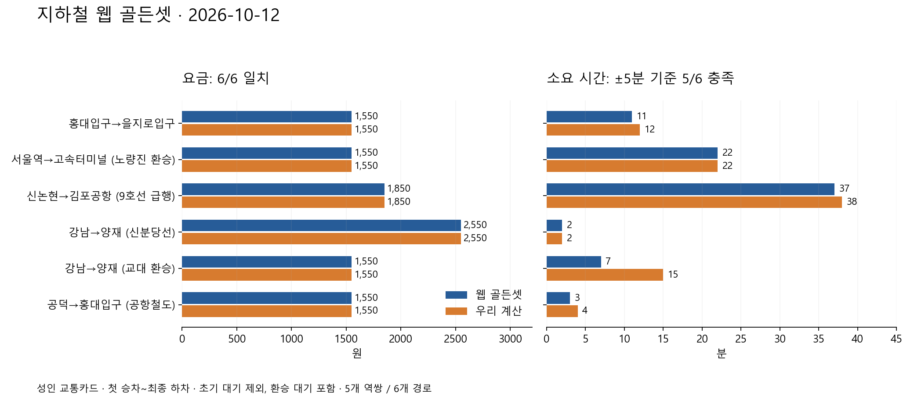

# 지하철 웹 골든셋 채택·제품 요금 수정 (2026-10-12)

카카오·네이버에서 조회한 지하철 값을 사용자 지시대로 골든셋 정답으로 채택했습니다. 실제 계산과 대조해 공항철도 요금 누락을 수정했고, 새 6개 경로의 요금은 전부 일치합니다. 교대 환승의 시간 차이는 실패 사례로 보존했습니다.

| 할 일 | 상태 | 진행 |
|---|---|---|
| 카카오·네이버 대표 구간 조회 | 두 지도 요금·소요 일치 | 5/5 = 100% |
| 경로별 골든셋 등록 | 최소요금 대안 포함 | 6/6 = 100% |
| 로컬 제품 요금 대조 | 원 단위 일치 | 6/6 = 100% |
| 선택 편성의 운행 종류·정차 경로 대응 | 일치 | 6/6 = 100% |
| 동일 범위 소요 시간 대조 | 개발 기준 ±5분 | 5/6 = 83.3% |
| 관련 운임 회귀 시험 | 통과 | 143/143 = 100% |

분모는 이번에 조회한 공개 역쌍 5개·서로 다른 경로 6개입니다. 21개 기능 전체 완료율이나 서울 전체 정확도가 아닙니다. 이 웹 골든셋 작업에 현장 탑승·결제를 추가 필수 조건으로 붙이지 않습니다. 실제 현재 도착 오차를 잰 것으로 바꾸지도 않습니다.



## 정답과 실제 계산

| 출발→도착·선택 경로 | 웹 요금 | 우리 요금 | 웹 소요 | 우리 소요 | 차이 |
|---|---:|---:|---:|---:|---:|
| 홍대입구→을지로입구·2호선 | 1,550원 | 1,550원 | 11분 | 12분 | +1분 |
| 서울역→고속터미널·노량진 환승 | 1,550원 | 1,550원 | 22분 | 22분 | 0분 |
| 신논현→김포공항·9호선 급행 | 1,850원 | 1,850원 | 37분 | 38분 | +1분 |
| 강남→양재·신분당선 직행 | 2,550원 | 2,550원 | 2분 | 2분 | 0분 |
| 강남→양재·교대 환승 | 1,550원 | 1,550원 | 7분 | 15분 | **+8분** |
| 공덕→홍대입구·공항철도 일반 | 1,550원 | 1,550원 | 3분 | 4분 | +1분 |

성인 선후불 교통카드·첫 승차부터 최종 하차까지입니다. 환승 도보와 환승 대기는 포함하고 첫 승차 전 대기는 제외합니다. 강남→양재의 원래 엔진 ETA 5분은 첫 대기 3분+승차 2분이므로 웹 승차 시간과 비교할 때 2분을 씁니다. 출발 안내 ETA 5분 자체는 삭제하지 않았습니다. 요금은 원 단위 일치, 시간은 최초 진단부터 사용한 ±5분 개발 진단 기준입니다. 시간이 정확히 같은 것은 2/6이며 시간차 합 11분·MAE 1.83분·최대 +8분입니다. 이 기준을 제품의 시간 오차 보장치로 쓰지 않습니다.

최초 입력의 서울역을 `서울`로 넘긴 실수는 골든셋 v2에서 명시적 대응으로 고쳤습니다. 최초 결과 v1을 그대로 보존하며 이 입력 실수를 제품 경로 실패로 세지 않습니다. 서울역→노량진은 엔진의 열차 전체 분류가 급행이지만, 비교 구간에서는 웹과 동일하게 서울역→남영→용산→노량진에 정차합니다. v3은 이 구간 정차 순서로 대응하고 구간 밖 급행 이름 차이를 경로 불일치로 세지 않습니다.

## 웹 관측·중복 제외

관측일은 2026-10-12 월요일입니다. 네이버 최초 관측 10:45~10:49 KST, 카카오 관측 10:50~10:51 KST이며 각 원문에 UTC ISO 시각을 보존했습니다. 카카오 조회 조건은 평일 10:50, 네이버 최초는 조회 당시 출발 기준입니다. 홍대입구·서울역·신논현·공덕의 선택 승차/하차 시각은 두 지도에서 같았습니다. 강남 신분당선의 선택 열차는 네이버10:49→10:51·카카오10:57→10:59로 다르므로 요금과 승차 소요만 비교하고 동일 열차 출발 정확도에 합산하지 않습니다.

네이버 강남→양재 최소요금 경로는 같은 최초 화면에서 얻은 별도 경로 1개입니다. 10:52 강남 승차→10:53 교대 하차→75m 도보→10:55 교대 3호선 승차→10:59 양재 하차를 11시대 재조회에서 다시 확인했습니다. 빠른 환승은 1-1칸, 빠른 하차는 3-3·7-4칸입니다. 다른 시각의 9분 반복 경로는 보조 근거이며 신규 역쌍으로 세지 않습니다.

네이버 최단시간·최소환승이 동일한 카드 결과인 경우 중복하지 않았습니다. 홍대입구 고정시각 반복 1개와 카카오 자동완성이 강남구청→양재시민의숲을 고른 제외 1개도 원형만 보존합니다. 카카오·네이버 합계 10개 기본 관측은 10개의 독립 경로가 아닙니다. 이 자료는 개발 골든셋이며 미공개 독립 평가셋이 아닙니다.

출처: [카카오 지하철 검색](https://map.kakao.com/), [네이버 공덕→홍대입구](https://map.naver.com/p/subway/1000/4002/4003/-?c=15.00,0,0,0,dh). 딥링크를 다시 열면 시각과 추천 경로가 바뀔 수 있어 보존한 화면·DOM 관측을 정답 시점의 근거로 사용합니다.

## 공항철도 요금 누락 수정

공항철도는 기존 추정 거리 운임의 허용 노선에 포함되지 않아 공덕→홍대입구도 요금이 나오지 않았습니다. 일반열차 수도권 구간의 [공식 성인 카드 역간 운임표](https://www.airportrailroad.com/train/normal/fare)를 대체 소스로 연결했습니다. [여객운송약관](https://www.airportrailroad.com/policy/transport) 전체 장을 확인했으며 조조는 제12조6항의 기본운임 20% 할인에 따릅니다.

서울역~청라국제도시 9역의 36쌍만 적용합니다. 같은 일반열차 여정을 구간으로 나눠 넣어도 처음·마지막 역의 요금을 한 번 부과하고, 역순도 처리합니다. 독립운임 구간·직통열차·다른 지하철 노선 혼합·단절·역주행에는 표를 대신 적용하지 않습니다. 표 밖 구간을 수도권 기본요금으로 낮추지 않습니다. 버스 혼합의 기존 상단 합산은 공항철도 구성요금에 조조 할인을 적용하지 않습니다.

조조는 기본 1,550원의 20%인 310원만 빼며 거리 추가액 전체를 할인하지 않습니다. 승차시각에서 개찰시각을 추정하는 기존 15분 창은 유지합니다. 06:30~06:44는 확정 요금 미정·상단 정가이고 06:45부터 정가로 계산합니다. 현재 관측한 공식 표의 확인일은 2026-10-12이며 과거 모든 이용일에 같은 판이었다고 주장하지 않습니다.

수정은 [공표 운임 계산](../../../../app/domains/travel_ops/instances/mobility/engine/special_rail.py), [제품 요금 합성](../../../../app/domains/travel_ops/instances/mobility/engine/options.py), [정책 적재](../../../../app/domains/travel_ops/instances/mobility/engine/runtime.py), [공식 운임 정책](../../../../app/domains/travel_ops/instances/mobility/engine/rules/special_rail_fares_v1.json), [새 회귀 시험](../../../../tests/unit/travel/mobility/test_arex_published_fare.py)입니다. 신규35/35·관련 전체143/143을 통과했습니다.

## 남은 시간 결함

교대 환승은 첫 2호선 승차를 2.2분으로 추정해 10:55 하차로 올림하고, 환승 도보 1.3분을 2분으로 올린 뒤 10:57 이후 열차를 찾습니다. 그래서 웹의 10:55 열차를 놓치고 11:02 열차를 고르며, 마지막 승차 4.5분도 5분으로 올려 11:07에 도착합니다. 웹은 10:53 하차·10:55 환승·10:59 도착입니다.

이 사례를 맞추려고 환승 시간을 없애거나 여섯 경로의 정답을 제품 계산에 직접 넣지 않았습니다. 다음 수정 대상은 열차별 출발·도착 시각을 보존하는 자료 보강과 분 단위 반올림 누적입니다. 실패 1/6을 그대로 남겨 이후 개선이 실제로 이 차이를 줄이는지 검사합니다. 역간 추정 시간을 낮추는 것만으로 환승 가능을 보장하지 않습니다.

## 재실행·검증 근거

작업 폴더 루트에서 실행합니다. 이미 있는 출력에는 쓰기를 거절하므로 `--out`에는 새 파일명을 지정합니다.

```powershell
python final_project_cs/scripts/mobility/compare_subway_web_golden.py --golden datasets/mobility/raw/subway_web_golden_20261012_v1/golden-v3.json --data-dir datasets/mobility/processed --out datasets/mobility/raw/subway_web_golden_20261012_v1/comparison-next.json --check fare
```

이번 실행은 종료0·요금6/6·운행종류/정차6/6·시간5/6·네트워크 시도0입니다. `--check all`은 남은 시간 결함 때문에 실패해야 정상입니다. 네트워크 연결 함수를 차단하고 개발자 API 인자를 비워 재생했습니다. 결과는 고객 API 전체 흐름이 아닌 실제 로컬 계산 함수 `verify_case`와 `fare_of`의 실행입니다.

mock 서버 시험: 이번 단위에서 미수행(화면 반응 확인 범위 아님).

실서버 확인: 이번 단위에서 안 했음(x600 서버의 cs 프로젝트 서버 응답·운영 배포). 카카오·네이버 웹은 실제 공개 화면을 조회했습니다.

지도 개발자 API 호출0회입니다. 공급자별 공유 일일 사용량을 확인하지 못해 개발자 API는 호출하지 않았으며, 남은 일일량·갱신 시각은 확인 불가입니다. 20% 예비 규칙과 운영 서비스 한도는 바꾸지 않았습니다.

Claude CLI Sonnet 5.5를 `sonnet` 별칭·medium으로 실제 실행했습니다. 웹 조건·중복·운행 종류 대조 절차를 검토했고 직접 웹 조회는 Codex가 수행했습니다. 개인 영수증·환경 파일·인증키 전송0개, Claude 웹 검색0회입니다. 입력3,719토큰(일반2·캐시생성3,182·캐시읽기535), 출력2,907토큰, 표시 비용$0.041909, 계정 잔여율 확인 불가입니다. 첫 샌드박스 시도의 DNS 실패 후 승인된 재실행이 성공했으며 실패 시도를 성공 실행으로 합산하지 않습니다.

작업 기준 HEAD는 `38f9e08cb08cafba6ce2f66ff7b08c19788cf1d1`이며 미커밋 공동 작업 트리입니다. 실제 코드·규칙·데이터 해시는 비교 결과의 `source_hashes`에 보존했습니다. 커밋·푸시·배포는 실행하지 않았습니다.

## 보존 위치·백업

- [원문·골든셋 v3·비교 결과 v3](../../../../../datasets/mobility/raw/subway_web_golden_20261012_v1/) — 공개 역쌍 사실·화면·관측 시각·해시, 개인 자료 없음.
- [재사용 비교 도구](../../../../scripts/mobility/compare_subway_web_golden.py) — 첫 대기 범위·선택 편성·요금을 대조합니다.
- [시험 기록](arex-test-results-v1.json) — 첫 시험의 기대 오류/임시 폴더 오류와 최종143통과를 함께 보존합니다.
- [운임 코드 수정 전 백업](../../../../app/domains/travel_ops/instances/mobility/engine/_backup/2026-10-12_110043_arex_published_fare/) — 4개 기존 파일.
- [wiki 수정 전 백업](../../../teams/_backup/2026-10-12_105850_subway_web_golden_contract/) — 새 계약 추가 전 문서.
- [비교 도구 초기판 백업](../../../../scripts/mobility/_backup/2026-10-12_110605_subway_golden_service_scope/) — 구간 정차 대응 추가 전 코드.

기존 원문·골든셋 v1/v2·비교 v1/v2와 개인 택시 자료는 덮어쓰지 않았습니다. 새 그림의 [재생성 코드](render_comparison.py)는 기존 그림이 있으면 종료합니다.


## 공식 운임 골든셋 추가 검증

같은 공항철도 공식 페이지의 행·열 숫자를 정책 JSON과 독립적으로 추출한 골든셋36쌍을 별도로 보존했습니다. 정책과의 전사 대조36/36, 실제 `fare_of` 양방향 대조72/72가 일치했습니다. 소비자 지도6개 경로와 합산하지 않습니다. 이는 단일 일반열차 성인카드의 운임표 검증이며 시간·도보·결제 측정이 아닙니다.

[공식 운임 정답36쌍](../../../../../datasets/mobility/raw/subway_web_golden_20261012_v1/published-arex-fare-golden-v1.json) · [양방향 실행 결과72개](../../../../../datasets/mobility/raw/subway_web_golden_20261012_v1/arex-fare-golden-comparison-v1.json). 이번 추가 전 보고서는 같은 폴더의 `_backup/`에 보존했습니다.
