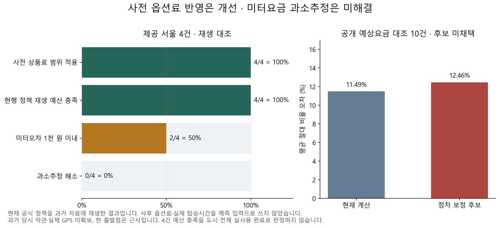

# 사전 옵션료의 실제 제품 연결과 과소추정 재검증

2026-10-12. 사후 영수증의 옵션료 없이도 공식 상품료 범위를 예산에 포함하도록 계산·저장·출발 재확인·웹 상품 선택을 연결했습니다. 제공 서울4건 모두 이 예산 안에 들어갑니다. **미터요금4건 과소추정은 아직 해결하지 못했습니다.** 이 결과를 택시 실사용100% 또는 전체21기능 완료로 판정하지 않습니다.

| 할 일 | 상태 | 진행 |
|---|---|---|
| 공식 상품료 범위 지원 | 일반·KM·투루·캡시·마이캡 | 5/5 = 100% |
| 제공 서울4건 사전 상품료 적용 | 현재 정책 재생 | 4/4 = 100% |
| 사전 상품료 포함 예산 충족 | 현재 정책 재생 | 4/4 = 100% |
| 미터요금 오차1천원 이내 | 미달 | 2/4 = 50% |
| 미터요금 과소추정 해소 | 미해결 | 0/4 = 0% |
| 요금·저장·출발 관련 Python 회귀 | 외부망 차단 통과 | 279/279 = 100% |
| 화면 관련 단위시험 | 통과 | 39/39 = 100% |
| mock 서버 시험 | 화면 반응 통과 | 4/4 = 100% |

각 분모는 해당 행에 명시한 지원 상품·제공 표본·실제 testcase 수입니다. 작업별 수를 합쳐 제품 완료율을 만들지 않습니다. 이전0/21·제공자료 대조 완료를 이 표의 예산 충족으로 대체하지 않습니다. 전체21기능을 새로 전수 평가한 작업도 아닙니다.

## 사용자에게 달라지는 점

등록 전 계획 확인 화면에서 이 여행의 호출 상품을 선택해 저장하면 모든 택시 구간에 같은 상품 조건으로 다시 계산합니다. 실제 결제 후 금액을 채우지 않아도 서울 공식 즉시호출료 범위 상단을 한 번 더합니다. 일반호출은 별도 플랫폼료0원이며 브랜드별 블루 상품과 구분해 표시합니다.

저장 성공 전에는 현재 상품을 바꾸지 않습니다. 저장 실패나 동시 수정 충돌 때 기존 상품과 사용자가 고르던 값을 보존합니다. 상품 변경으로 일정 판이 바뀌면 이전 요금 후보를 버리고 다시 조회합니다. 이전 요청이 늦게 도착해도 새 판의 후보를 덮지 않습니다. 새로고침 후에도 저장한 상품을 읽습니다.

이 입력은 서울 즉시호출5상품의 공식 범위를 사용합니다. 예약·브랜드 미상 상품·앱 견적 직접 입력·등록 후 상품 변경·실제 호출/배차/결제는 이번 웹 범위 밖입니다. 옛 cs 프로젝트 서버 응답이 기능을 제공하지 않으면 입력을 표시하지 않습니다. 운영 반영은 하지 않았습니다.

## 실제4건 재대조의 의미

개인 전용 폴더의 기존 좌표·출발시각·상품 식별을 사용해 외부 통신을 차단한 상태에서 다시 계산했습니다. 실제 미터요금·총결제액은 예측 완료 뒤 오차 계산에서만 읽었습니다. 실제 탑승시간과 사후 옵션료를 예측 입력에 쓰지 않았고, 개인4건으로 보정률을 학습하지 않았습니다. 기존 예산여유37%도 바꾸지 않았습니다.

현재 공식 정책의 상품료 범위 상단을 합산한 예산은4/4건 실제 총액을 포함했습니다. 미터 점추정 평균 절대오차는1,125원이고 과소추정은4/4건, 오차1천원 이내는2/4건입니다. 계산 결함 수정 전 같은 자료의 평균 절대오차1,100원보다25원 나빠졌습니다. 신고된 심야 기본금액을 올바르게 적용해 한 건이100원 낮아진 영향이며 과소추정 해소로 보고하지 않습니다.

이 결과는 현재 정책을 과거 이용 자료에 재생한 대조입니다. 당시 사전 견적이나 과거 당일 약관 판본은 확보하지 못했습니다. GPS 실주행거리도 없고 출발점 하나는 한남동 근사입니다. 따라서 새 독립 검증이나 과거 출발 전 실제 예측 성공률로 부르지 않습니다. 금액·이동경로·날짜·카드·개인 표본별 상세는 공용 작업 폴더에 넣지 않았습니다. [익명 집계](receipt-aggregate-v1.json)에 조건과 실제 분자·분모를 보존했습니다.

## 공식 옵션료 근거

- [일반호출 유료서비스 약관](https://policy.kakaomobility.com/viewer/?pageCode=PAID_SERVICE&subPageCode=index&version=7)과 [KM 승객약관](https://www.kmscorp.co.kr/terms), [투루 승객약관](https://turutaxi.com/service-policy/)의 확인 범위는 제품 카탈로그에 보존했습니다. KM 직접판/검색색인 판의 일치와 투루 직접502/검색색인 확인을 구별합니다.
- [캡시 공식 승객약관 PDF](https://cabsy.kr/legal/terms.pdf)의8쪽 전체를 렌더 이미지로 읽었습니다. 서울 즉시호출 제9조 범위를 사용하고 예약 요금과 구분합니다. 명시 시행일은 확인하지 못했습니다. 원본 SHA-256은 `2ce423700c7f2f1f96308586af861c3fee73fc1986959b470c707a6db4fbe20c`입니다.
- [마이캡 공식 승객약관](https://www.blackpin.co.kr/?mode=policy)의 동적 화면 제1~23조·부칙 전체를 읽었습니다. 제9조 서울 범위와 부칙 시행2025-03-05를 확인했습니다. 기존 정적 HTML에서 못 찾은 약관을 브라우저에서 확인한 것이며, 약관 부재가 아니었습니다. [화면 관측 근거](../../../../../datasets/mobility/raw/official_mycap_20261012_v3/screen-observed-facts-v1.json)를 보존했습니다.

네 블루 브랜드의 서울 즉시호출 이용료 범위는03~22시0~3천원,22~03시0~5천원입니다. 상단은 실제 옵션료 점예측이나 총결제 상한이 아닙니다. 출발시각을 약관 시간대에 대응하는 예산 가정이며 호출/승차가 시간 경계를 넘을 때 앱 재확인이 필요합니다. 예약 요금을 섞지 않습니다. 확인일·원문·시행일의 확인 한계는 [정책 카탈로그](../../../../app/domains/travel_ops/instances/mobility/engine/rules/taxi_call_policies_v1.json)에 있습니다.

## 고친 계산 결함과 남은 원인

도로 조각의 경계 꼭짓점을 앞 구간에 중복 배정하던 오류를 중점 선택으로 고쳤습니다. 긴 조각이 정시·자정을 넘으면 새 시간대·요일 속도를 사용하고, 양수 프로파일 속도를 임의3km/h로 높이던 처리를 제거했습니다. 같은 절대시각을 서울 시간대로 정규화하며 심야 기본금액과 추가 단위요율을 분리했습니다.

합성 재현과 공개 실제 도로3개에서 이 결함과 수정 동작을 확인했습니다. 공개 도로3개 저속시간은0→28초,0→10초,0→6초로 바뀌었습니다. 이 재현을 제공4건의 실제 정차시간이나 개별 원인 확정으로 전용하지 않습니다. 제공4건에서는 과소추정이 남습니다.

평균 링크속도에는 정차·주행의 분포가 없으므로 단일 평균이15.72km/h를 넘는다고 실제 저속/정차시간이0이라고 할 수 없습니다. 같은 평균속도를 갖는 정속 이동과 정차 후 빠른 이동을 별도 재현했습니다. 이미 평균에 포함된 시간을 이동시간 위에 다시 더하는 방식도 쓰지 않습니다. 실제 미터 펄스 누적, 기본거리 내부 시간, 심야 경계의 구간별 요율은 상세 상태기계 확인이 더 필요합니다.

[정차·통행시간 분포 연구](https://arxiv.org/html/1302.6617v1)는 링크에 대응한 GPS 시계열과 정차 관측을 사용합니다. 그 전제가 없는 우리 평균속도 자료에 정차율을 그대로 가져오지 않았습니다. [서울 교통자료 현황](https://t-data.seoul.go.kr/assets/images/srvyPdf/%E2%98%85%EB%8D%B0%EC%9D%B4%ED%84%B0%EC%A0%9C%EA%B3%B5%ED%98%84%ED%99%A9202503.pdf)·[빅데이터 캠퍼스 자료 안내](https://bigdata.seoul.go.kr/data/selectPageListSampleDataSet.do)의 추가 공개자료 탐색도 기록했습니다. 이번 확인 범위에서 원격으로 즉시 취득할 수 있는 서울 GPS·정차·요금 동시 관측자료는 확보하지 못했습니다. 데이터가 존재하지 않는다는 뜻은 아닙니다.

## 공개자료 보정 후보의 채택 판단

기존153개 계산군·40개 검증군·7개 제외를 보존하고 현재 코드로193개를 재생했습니다. 통행료와 옵션료 정의가 명확한 계산군30개만 적합했습니다. 조건에 따라 전역 중앙값을 먼저 동결했고 해시를 보존한 뒤 기존 검증군을1회만 평가했습니다. 개인4건은 이 과정에서 접근하지 않았습니다.

명확한 검증10건에서 현재 경로 기준 MAE는1,150→1,140원이지만 MAPE는11.49→12.46%,1천원 이내는6/10→4/10으로 나빠졌습니다. 기준거리 고정 MAE도750→820원입니다. 정의가 섞인 전체40건만 보면 개선되지만 이를 근거로 물리 정차시간 보정을 채택하지 않았습니다. [집계와 모델 동결 근거](stop-proxy-aggregate-v1.json), [데이터 보고서](../../../../../datasets/mobility/raw/taxi_stop_model_20261012_v2/REPORT.md)를 보존했습니다. 실측 정차자료의 식별 가능성과 별도 새 검증이 다음 채택 조건입니다.

## 시험·화면·환경 확인

Python279개는 선택한16개 파일에서 실행된 고유 testcase 합집합입니다. 마이캡 포함 공식 시간 경계, 중복 수수료 차단, 견적 만료, 출발 재계산, 상품 변경, 저장값 손상 거절, 확정 조건·장소key 보존을 포함합니다. 외부 socket 통신을 차단하고 표준 IPC만 허용했습니다. live/slow/mobility_full 표시 시험 중1개는 선택에서 제외했고 통과 수에 넣지 않았습니다. [JUnit](python-result.xml), [실행 기록](verification-v1.json)을 보존했습니다.

화면 단위시험39개는 응답 변환19·이동후보8·상품 파서12입니다. 임시 캐시 수집 오류가 난 이전 시험도 지우지 않고 threads 실행으로 해소한 최종 결과와 구분했습니다. TypeScript 타입검사와 변경 파일 정적검사를 통과했습니다.

**mock 서버 시험4/4 = 100% (화면 반응)**:375px·1280px에서 상품 저장/새로고침/409실패 시 기존값 보존/가로넘침 방지2개와, 이미 읽은 후보·늦게 도착한 이전 후보 폐기2개입니다. 같은 로컬 mock 응답을 고쳐 새 계약을 재현했으며 실제 DB 저장이나 실제 요금 계산 HTTP 왕복을 한 것은 아닙니다. [로그](mock-browser-output.log), [375px 화면](mock-product-375.png), [1280px 화면](mock-product-1280.png)을 보존했습니다. 지도 배경은 외부 지도를 호출하지 않는 시험용 단색 타일입니다. 이 화면으로 지도 경로 정확도를 판정하지 않습니다.

**실서버 확인(서버 응답): 안 했음.** x600 서버의 cs 프로젝트 서버 API·실제 DB 트랜잭션 왕복·운영 화면·운영 반영·실제 택시 호출/결제는 이번 작업에서 확인하지 않았습니다.

## 보존과 다음 완료 조건

변경 전 코드·계약·시험·생성 스크립트를 각 부모 `_backup/`에 복사했습니다. [백업 목록](backup-manifest-v1.json)과 [현재 코드·자료 SHA-256](source-data-sha256-v2.json)을 보존했습니다. 지난 보고서와 실패 로그는 덮어쓰지 않았습니다. 개인 상세결과는 공용·Git 밖의 기존 개인 전용 폴더에 새 이름으로 보존했습니다.

개발자 API 호출은0회입니다. 전체 공유 사용량과 원자적 예산 확보를 확인하지 못했으므로 호출하지 않았고, [API 예비량 기록](api-budget-v1.json)에 현재 누적·잔여·갱신시각의 미확인을 빈 값으로 명시했습니다. 운영 한도·예약주기·알림정책을 바꾸지 않았습니다. 커밋·푸시·배포·외부 메시지·결제는0건입니다.

남은 완료 조건은 미터 과소추정의 검증 가능한 원인·데이터 보강, 후보 동결 후 새 표본 검증, 실제 cs 프로젝트 서버와 DB 왕복 확인입니다. 기존4건을 반복 통과시키거나 예산을 늘려 이 조건을 대신하지 않습니다. 전체21기능의 제품 경로·대체 소스·허용 오차·새 검증도 각각 충족해야 전체 완료입니다.

### 최종 공통 의존 코드 변경 확인

최초 산출물 해시 저장 뒤 다른 작업자가 공통 장소 검색 후보 코드 `candidates.py`를 변경했습니다. 해당 변경을 덮어쓰지 않았습니다. 기존 해시와 불일치1건을 [첫 감사 기록](artifact-audit-v1.json)에 그대로 보존했습니다. 이후 현재 코드로 관련 웹 회귀85/85를 외부망 차단하여 다시 실행했고 실행 전후 공통 입력 코드 해시가 같았습니다. [최종 JUnit](web-final-result.xml)과 [실행 전후 해시](web-final-execution.json)를 보존했습니다. 전체279개에85개를 더해 시험 수를 부풀리지 않습니다. 현재113파일 해시는v2이고 최초v1도 보존했습니다.
