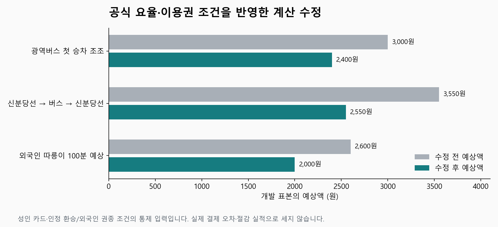
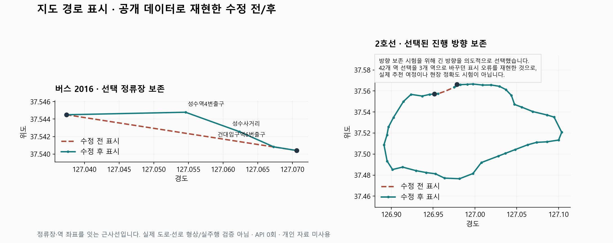

# 웹 근거로 확인한 이동 결함 수정과 21개 기능의 남은 범위

공식 문서와 보유 공개 자료로 재현한 12개 개선 묶음을 코드·제품 출력에 반영하고, 관련 고유 시험657/657을 통과했습니다. 현장 측정과 운영 환경 확인은 별도입니다.

| 할 일 | 상태 | 진행 |
|---|---|---|
| 이번 재현한 개선 묶음 | 수정·검증 | 12/12 = 100% |
| 관련 고유 개발 시험 | 통과 | 657/657 = 100% |
| 보유 버스 정류장 구조 | 검사 통과 | 717/717 노선 = 100% |
| 새 유효 도보 웹 표본 | 접근 제한으로 미확보 | 0/2 = 0% |
| 전체 기능 실사용 관문 | 미충족 | 0/21 = 0% |

12는 아래에 정의한 이번 개선 묶음 수입니다. 웹으로 해결 가능한 모든 일의 분모나 21개 기능의 완료 수가 아닙니다. 657은 최종 통합651개, 현재 공개 회전 자료 검사1개, 재생성 도구5개의 시험 클래스·이름 합집합입니다. 이전 재실행·실패·중복 시험을 더하지 않았습니다.

## 사용자가 보게 되는 변화

| 개선 묶음 | 이전 동작 | 수정 후 동작 |
|---|---|---|
| 광역버스 첫 승차 조조 | 적격 광역 유형 누락 | 조건이 맞으면 성인 카드3,000원→2,400원 |
| 신분당선 재승차 별도운임 | 버스 양쪽 철도 묶음마다 중복 합산 | 인정 환승 연쇄 전체에서 구간별 별도운임1회 합산 |
| 혼합 환승 첫 버스 조조 | 항상 조조 미적용 예상액 | 첫 승차 시간폭·유형·환승 조건이 확인될 때 첫 기본요금20%만 차감 |
| 따릉이 권종·반납 경고 | 가장 싼 표와 공통60분을 사용 | 이용 가능한 권종의 기본시간·초과요금 합계로 선택, 해당 권종 기준으로 경고 |
| 새벽 운행일 경계 | 03:59의 초 올림 뒤 다른 운행일로 변경 가능 | 올림 전 운행일을 보존해 같은 운행일28:00으로 재계산 |
| 일반·급행 혼잡 및 자료 | 완행 자료만 남고 종류 혼동 가능 | 종류별 조회, 누락 급행2,432행 복원, 미상 종류를 완행으로 단정하지 않음 |
| 급행 자료 재삭제 방지 | 재생성 기본값이 급행 삭제 | 기본 재생성에서 일반·급행 모두 보존 |
| 승용차 회전 제한 | 버스·화물차만 예외인3관계도 누락 | 정확히 대응하는3관계를 승용차 탐색에 적용 |
| 빠른 버스 환승 후보 | 첫 노선에 직행이 있으면 환승 후보를 생성 전 제거 | 최종 소요·환승·도보 비교까지 보존 |
| 버스 제외 안내 분류 | 버스→버스 환승도 직행 개수에 포함 | 단일 버스만 직행으로 집계 |
| 지도 경유선·진행 방향 | 버스 직선, 순환선 방향을 짧은 쪽으로 다시 선택 | 선택 노선의 정류장 순서·선택 편성의 역 경유 방향 보존 |
| 접수→등록 선택 경로 | 지도용 내부 문맥 소실 | 검증된 출발 시각의 선택 후보만 저장·전달; 공개 접수 응답에서는 내부 필드 제외 |

세 금액 비교는 통제 입력의 예상액입니다. 실제 절감 실적이나 독립 결제 정확도가 아닙니다. 신분당선 표본은 강남→양재, 버스, 양재시민의숲→청계산입구이고, 자전거 표본은 외국인 구매 경로에서100분 연속 이용을 예상한 경우입니다.

지도 공개 개발 재생2구간에서 접수확인·등록 출력·원래 선택 구간2/2가 일치했습니다. 버스2016의 순번103~105 정류장3개를 보존합니다. 지하철은 방향 보존 결함을 드러내기 위해 긴 방향42역을 의도적으로 선택한 시험이며, 이 긴 경로를 실제 추천했다는 뜻이 아닙니다. 표시선은 역·정류장을 잇는 근사선으로 실제 도로·선로 곡선과 다릅니다. 문맥이 없는 옛 저장본에서 선택한 버스 정류장·열차 방향을 임의 복원하지 않습니다.

## 공식 원문과 적용 전제

2026-10-12에 공개된 원문을 확인했습니다. 문서 수정일과 운임 시행일을 구별하고, 다른 자료 형식의 규칙을 서울 API의 필드라고 단정하지 않았습니다.

- [서울시 버스 이용방법](https://news.seoul.go.kr/traffic/archives/1706)·[교통 요금 안내](https://news.seoul.go.kr/traffic/traffic_price): 광역 조조 요율과 첫 기본요금만 할인하는 혼합 환승 규칙. 후속 수단의 기본요금 차액·거리 추가·별도 철도운임에20%를 곱하지 않습니다. 마을→시내 공식 예는960+300=1,260원입니다.
- [신분당선 운송약관](https://www.shinbundang.co.kr/policy/policy1.jsp)·[신사~강남 약관](https://www.shinbundang.co.kr/policy/policy1_2.jsp): 인정 환승 연쇄의 별도운임 합산을 적용했습니다. 약관 최신 수정일을 새 운임 시행일로 쓰지 않았습니다.
- [서울시 따릉이 요금](https://news.seoul.go.kr/traffic/archives/33719)·[외국인 이용 안내](https://english.visitseoul.net/tours/Explore-Seoul-on-a-Seoul-Bike/18469): 일반 구매1·2·3시간권과 외국인 구매 경로의 제공 권종을 구별했습니다. 외국인3시간권 판매 가능 여부와 별도24시간권의 연속 대여 조건은 확인하지 못해 임의 적용하지 않았습니다. 구매 자격은 현재 모델의 설정이며 실제 결제 인증 검증이 아닙니다.
- [GTFS 운행일·정류장·형상 명세](https://gtfs.org/documentation/schedule/reference/): 운행일과 달력 날짜, 정류장 순서와 실제 형상을 구별했습니다. 서울의04:00 경계 자체는 기존 프로젝트 계약입니다. 연속 순번 검사는 보유 서울 가공자료에 한정합니다.
- [OSM 회전 제한](https://wiki.openstreetmap.org/wiki/Turn_restrictions)·[조건부 제한](https://wiki.openstreetmap.org/wiki/Conditional_restrictions): 버스·화물차 예외를 승용차 예외로 확대하지 않았습니다. 택시·psv·motorcar 예외나 시간 조건은 이번3관계와 구별했습니다.
- [서울시9호선 혼잡 자료](https://data.seoul.go.kr/dataList/OA-22197/F/1/datasetView.do): 역·방향·요일·30분 평균 통계입니다. 일반·급행을 나누되 현재 차량의 실시간 혼잡 측정으로 보고하지 않습니다.
- [RAPTOR 원논문](https://www.microsoft.com/en-us/research/publication/round-based-public-transit-routing/): 도착 시각과 환승 횟수의 비교 전제를 확인했습니다. 현재 버스 자료는 완전한 편성 시간표가 아니므로 논문의 알고리즘을 그대로 넣으면 된다고 가정하지 않았습니다. 직행 존재만으로 환승을 지우는 오류부터 고쳤습니다.

혼합 조조는 첫 버스의 정류장 도착 추정부터 배차폭 끝까지06:30 이전이고 적격 유형·유효 시간값·기존 환승 인정 조건을 모두 통과할 때만 적용합니다. 지하철 첫 개찰 시각·시간폭 경계·카드 자격이 불명확하면 기존 보수적 상단 예상액을 유지합니다. 하차 태그와1인1카드는 모델 전제이며 실제 태그를 측정한 것이 아닙니다.

## 코드·데이터·재생성

- [요금 계산](../../../app/domains/travel_ops/instances/mobility/engine/options.py)·[제품 출력](../../../app/domains/travel_ops/instances/mobility/engine/plan.py)·[요금 규칙](../../../app/domains/travel_ops/instances/mobility/engine/rules/rules_v0.3.json): 조조·별도운임·표시 분류를 연결했습니다. [요금 상세](2026-10-12_0040_공식요율_광역조조와신분당선환승_수정검증.md)·[혼합 조조 상세](2026-10-12_0100_혼합환승_첫버스조조_조건부연결검증.md).
- [따릉이 계산](../../../app/domains/travel_ops/instances/mobility/engine/bike.py)·[시각 검증](../../../app/domains/travel_ops/instances/mobility/engine/verify_time.py)·[출발 관측](../../../app/domains/travel_ops/instances/mobility/engine/departure_observer.py)·[혼잡 조회](../../../app/domains/travel_ops/instances/mobility/engine/congestion.py): 권종 기준과 시간·운행 종류를 보존합니다.
- [버스 후보 생성](../../../app/domains/travel_ops/instances/mobility/engine/candidates.py): 빠른 환승 복구. [상세 재현](2026-10-12_0045_직행존재로사라진_버스환승후보_복구검증.md).
- [지도 출력](../../../app/domains/travel_ops/instances/mobility/route_shape.py)·[선택 구간 변환](../../../app/domains/travel_ops/instances/mobility/shape_transit.py)·[선택 문맥 저장](../../../app/domains/travel_ops/instances/mobility/engine/departure_context.py)·[접수 이동](../../../app/domains/travel_ops/components/intake/moves.py)·[접수 확인](../../../app/domains/travel_ops/components/intake/review.py)·[등록 이동](../../../app/domains/travel_ops/components/intake/registered_moves.py): 같은 선택 경로를 접수와 등록 후 출력에 전달합니다.
- [회전 자료 생성기](../../../scripts/mobility/build_car_turn_policy_v1.py): `--include-car-exceptions`를 추가했습니다. 기존2,487단순 관계와2,219동일도로 유턴 관계를 보존하고3개를 추가했습니다. 현재4,709/6,258 =75.25%는 보유 추출 관계 중 적용한 수이며, 현실 법규의 커버리지나 정확도가 아닙니다. 노드·간선 해시는 유지했고 모든4,709관계의 연결을 실제 그래프 적재 검사로 확인했습니다.
- [자료 축약 도구](../../../../datasets/mobility/scripts/reduce_75.py): 기본 급행 보존으로 재발을 막았습니다. [재생성 상세](2026-10-12_0115_자료재생성_9호선급행보존_검증.md). 실제 자료 전체를 다시 만드는 작업이나 `--clean` 실행은 하지 않았습니다.

보유9호선 일반5,776행이 백업의 일반 행과 동일한지 확인한 뒤 누락 급행2,432행만 복원했습니다. 현재8,208행의 SHA-256은 `1b680c5dd069334b9a3fb4e03f0cbe7ab8cca35ed05792994775b007c70e9ae0`입니다. 원문·수집일을 새 수집으로 바꾸지 않았고 현재 가공자료 명세의 해시·행수만 맞췄습니다. [복원 근거](../evidence/2026-10-12_mobility_web_fixes/timing/public-data-recovery.json).

## 최종 검증과 실패 기록

| 검사 범위 | 최종 결과 | 근거 |
|---|---|---|
| 관련 시험 파일 합집합 | 651/651, 실패·오류·skip0 | [통합 JUnit](../evidence/2026-10-12_mobility_web_fixes/integrated/result.xml) |
| 현재 공개 승용차 회전 자료 적재 | 1/1 | [공개 자료 검사](../evidence/2026-10-12_mobility_web_fixes/car/public.xml) |
| 새 빈 폴더의 재생성 CLI·혼잡 조회 | 5/5 | [CLI 검사](../evidence/2026-10-12_mobility_web_fixes/crowd-regeneration/after.xml) |
| 고유 시험 합계 | 657/657 | [중복 제거 집계](../evidence/2026-10-12_mobility_web_fixes/verification-summary-v1.json) |
| 통합 실행 중 소스 변경 | 0건 | [실행 인자·전후 해시](../evidence/2026-10-12_mobility_web_fixes/integrated/execution.json) |

통합 실행은216.52초입니다. 22개는 기본 선택 조건에 따라 제외됐으며 실행 통과 수에 포함하지 않았습니다. 별도 공개 회전 자료1건은 명시적으로 전체층 표기를 선택해 실행했습니다. 전체 이동 시험 전부나 전체 cs 프로젝트 서버 시험을 실행했다는 뜻이 아닙니다.

처음 확대 실행은198/199통과·1실패였습니다. 실제 경로·시간·요금·일정은 기존 공개 개발 골든과 같고, 제외 안내 한 곳만 달랐습니다. 수정 전 버스 후보 생성 메서드만 복원하면 옛 골든 전체가 일치했습니다. 새 후보로 드러난 환승/직행 집계 결함을 먼저 고친 뒤, 출력 대중교통4개와 도보1개를 별도로 재판정하고 공개 개발 골든을 백업·갱신했습니다. [진단](../evidence/2026-10-12_mobility_web_fixes/golden/diagnosis.json)·[갱신 근거](../evidence/2026-10-12_mobility_web_fixes/golden/update.json). 개인 골든셋을 갱신하거나 이 개발 표본을 독립 검증이라고 부르지 않았습니다.

앞선 확대 실행이69개에서 멈춘 것으로 보였으나, 상세 재실행의 스택과 완료 결과로 실제 데이터 계획·최종 출발 역산 계산에 시간이 걸린 것을 확인했습니다. Windows 내부 통신 때문이라는 앞선 추정은 확정 근거가 아니었습니다. 시험 입력·import·경로 오타로 실패한 중간 실행도 원래 작업 기록에 보존했습니다.

자료 폴더를 설정하지 않은 직접 점검은 예상대로 입력 없음으로 끝났고([초기 점검](../evidence/2026-10-12_mobility_web_fixes/datacheck-v1.json)), 공개 자료 폴더를 명시한 최종 점검은 `ok=true`, `missing=[]`, `mismatched=[]`입니다([최종 점검](../evidence/2026-10-12_mobility_web_fixes/datacheck-v2.json)). 이것을 운영 설정 확인으로 확대하지 않습니다.

mock 서버 시험(화면 반응): 이번 작업에서는 수행하지 않았습니다.

실서버 확인(서버 응답): cs 프로젝트 서버의 실제 HTTP·휴대폰 화면·배포 확인은 안 했습니다. 개발자 API 호출0회입니다.

## 21개 전체를 완료로 보지 않는 이유

[21개 기능별 표](../evidence/2026-10-12_mobility_web_fixes/readiness-21-v1.md)와 [현재 코드122개·데이터36개의 해시 및 확인 기준](../evidence/2026-10-12_mobility_web_fixes/current-readiness-and-hashes-v1.json)에 각각의 제품 코드·대체 소스·기존 허용오차·남은 개발과 검증을 보존했습니다. 지정 함수·클래스 존재21/21은 정적 확인입니다.

실증 외에도 개발이 남았습니다. 차량 via-way·시간 조건부 제한, 보행·자전거 허용 접근 태그를 보강한 그래프, 버스3대 이상 다중환승, 연령·카드 자격 입력, 지하철 첫 개찰 조조 시각, 실제 도로·선로 지도 형상 등을 이번 수정만으로 완료했다고 보지 않습니다. 실제 탑승·결제·재고·사건 회수율 및 사건 이후 저장·알림·최신 링크의 운영 연결도 별도입니다.

도보는 공개 지도3곳에 접근했지만 연결 가능한 CUA 브라우저가0개였고 IAB·Chrome 탭 생성도 불가했습니다. 정적 웹 조회는 접근 실패 또는 robots 제한으로 추천 도보선과 출입점을 보여주지 않았습니다. 따라서 새 유효 표본0/2이며, 다른 출입점·시각·과거 웹값을 혼합해 통과시키지 않았습니다. [URL·시각·접근 실패 범위](../evidence/2026-10-12_mobility_web_fixes/walking/access-evidence.json). 비공개 웹 API 직접 호출로 우회하지 않았습니다.

## 보존·소비 제한

기존 소스·가공자료·공개 개발 골든·문서는 수정 전에 백업했습니다. 주요 백업은 [문서](../../teams/_backup/2026-10-12_010000_web_recovery_docs/), [따릉이 계산](../../../app/domains/travel_ops/instances/mobility/engine/_backup/2026-10-12_003136_web_bike_fare/), [요금 규칙](../../../app/domains/travel_ops/instances/mobility/engine/rules/_backup/2026-10-12_003136_web_fares/), [회전 생성기](../../../scripts/mobility/_backup/2026-10-12_car_exception/), [공개 골든](../../../tests/unit/travel/mobility/_backup/2026-10-12_verified_bus_transfer_candidates/), [축약 도구](../../../../datasets/mobility/scripts/_backup/2026-10-12_0110_preserve_line9_express/)입니다. 다른 작업자의 조립 장애 전파 변경 등은 보존했습니다.

새 그림은 새 이름v1/v2로 남겼고, 기존 보고서·로그·그림을 덮어쓰지 않았습니다. 공개 영수증 원문·결제수단·개인 좌표는 읽거나 외부 모델에 보내지 않았습니다. 개인 자료 보관 정책은 이전 기록대로 유지합니다.

공급자·키·프로젝트 전체의 일일 누적 사용량·잔여량·갱신 시각은 미조회·미확인입니다. 공유 예산을 확보하지 못했으므로 제한 API를 호출하지 않았습니다. 이번 작업의 개발자 API·개인 자료 접근·커밋·푸시·배포·외부 메시지 전송·결제는 모두0건입니다. 공개 웹 문서 열람은 개발자 API 사용과 구분합니다. 운영 서비스 한도나 예약 주기는 바꾸지 않았습니다.
