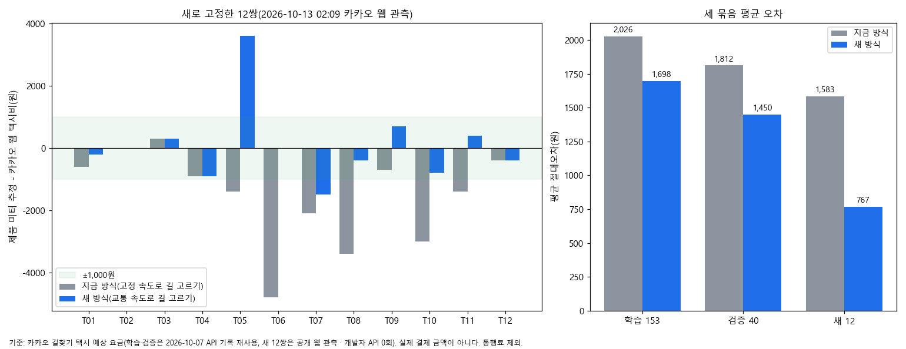

# 택시 요금 과소 추정 — 길을 고를 때도 교통 속도를 쓴다 (Claude, 2026-10-13 새벽)

택시 미터 추정이 실제보다 낮게 나오던 원인 하나를 찾아 로컬 작업 폴더에서 고쳤습니다. 자동차 길찾기가 **막힘을 모르는 고정 속도로 길을 고르고**, 고른 뒤에만 서울시 교통 속도(TOPIS)로 시간을 쟀습니다. 그래서 짧지만 막히는 길을 골라 거리가 짧게 나왔습니다. 이제 길을 고를 때도 같은 교통 속도를 씁니다.

| 할 일 | 상태 | 진행 |
|---|---|---|
| 원인 분해(거리·시간) | 끝 | 193/193쌍 |
| 지금 방식 재현(저장값과 같은지) | 같음 | 153/153 = 100% |
| 학습 153쌍 ±1,000원 안 | 개선 | 45 → 60/153 (29% → 39%) |
| 검증 40쌍(계산 전 고정 · 1회 평가) ±1,000원 안 | 개선 | 18 → 20/40 (45% → 50%) |
| 새 12쌍(제품 계산 전 고정) ±1,000원 안 | 개선 | 6 → 10/12 (50% → 83%) |
| 제품 경로 = 시험 계산 | 같음 | 12/12 = 100% |
| 이동 모듈·택시 시험 | 통과(정답 파일 4건 제외) | 1,575/1,579 = 99.7% |
| 실제 결제 영수증 4건 재평가 | 안 함 | 0/4 |
| x600 서버 반영 | 안 함 | 0/1 |

기준값은 카카오 길찾기 택시 **예상** 요금입니다. 학습·검증은 2026-10-07 API 기록을 재사용했고, 새 12쌍은 공개 웹 화면에서 관측했습니다(개발자 API 0회). 실제 결제 금액이 아닙니다. 통행료는 뺐습니다.

## 1. 원인 찾기

기존 공개 비교 193쌍([current-predictions-v1.json](../../../../../datasets/mobility/raw/taxi_stop_model_20261012_v2/current-predictions-v1.json))을 거리와 시간으로 나눠 봤습니다.

- 제품 경로 거리 ÷ 카카오 거리 중앙값 **0.938**. 69쌍(36%)은 0.9 미만입니다.
- 제품 소요 ÷ 카카오 소요 중앙값 0.897.
- 미터 추정이 카카오보다 낮은 쌍은 165/193입니다.
- 코드 확인: 자동차 길 선택 비용은 `graph_router.HW_KMH`(도로급 고정 속도)였고, TOPIS 는 `CarGraph.compute` 에서 고른 길의 시간을 잴 때만 썼습니다.
- 예(신사→성수 방면 G79): 카카오 웹 「거리우선」은 10.3 km · 15,800원이고, 「내비추천」은 15.3 km · 20,100원입니다(02시 관측). 제품은 9.5 km 로 거리 최단에 가까운 길을 골랐습니다.

## 2. 고친 것(로컬 작업 폴더 · 커밋 안 함)

| 파일 | 바꾼 것 |
|---|---|
| `engine/car_route_cost.py`(새 파일) | 간선 속도 = TOPIS 링크(요일형·시) → 도로급 계수 → 골목 정적 속도. `CarGraph.compute` 와 같은 순서·값이고, 출발 시각 하나로 고정 |
| `engine/graph_router.py` | `route(..., car_cost=None)` — 있으면 그 비용으로 고름. 응답에 `route_cost` 근거 |
| `engine/car_turn_search.py` | 회전 제한 탐색도 같은 비용을 받음 |
| `engine/car.py` | `CarService` 가 대응표를 처음 한 번 올려 넘김. 못 쓰면 고정 속도 + 이유를 `routing_evidence.route_cost` 에 남김 |
| `tests/unit/travel/mobility/test_car_route_cost_v1.py`(새 파일) | 합성 그래프 6개(새벽엔 큰길 · 퇴근엔 골목 · 대체 순서 · 배열 정렬 · 못 쓸 때 이유) |

- 자료: [build_car_edge_topis_link_v1.py](../../../../../datasets/mobility/scripts/build_car_edge_topis_link_v1.py) → `datasets/mobility/processed/mobility/car_edge_link_v1/`(새 폴더, git 밖, 2.0 MB 안팎). 자동차 간선 359,818개 중 TOPIS 링크가 붙은 간선은 정방향 28,730개 · 역방향 13,893개입니다. 링크가 붙지 않은 간선은 도로급 계수나 골목 속도를 씁니다. 붙는 비율은 서울 큰길 위주입니다(서울 밖·골목은 링크가 없습니다).
- 대응표의 입력 도로 그래프 md5 가 라우터 그래프와 다르면 쓰지 않습니다. 이때는 고정 속도로 고르고, 이유를 근거에 남깁니다.
- 바꾸지 않은 것: 요금식(`taxi_fare`) · 예산 여유 37% · 통행료 · 호출료 규칙. 숫자를 맞추는 보정 계수는 넣지 않았습니다.
- 백업: [_backup/2026-10-13_0215_taxi_topis_route_cost/](../../../../_backup/2026-10-13_0215_taxi_topis_route_cost/)

## 3. 검증

| 묶음 | 평균 절대오차 | ±1,000원 안 | 낮게 잡은 쌍 | 거리 비 중앙값 |
|---|---|---|---|---|
| 학습 153 — 지금 → 새 | 2,026 → 1,698원 | 45 → 60 | 133 → 115 | 0.929 → 0.955 |
| 검증 40 — 지금 → 새 | 1,812 → 1,450원 | 18 → 20 | 32 → 27 | 0.962 → 0.990 |
| 새 12 — 지금 → 새 | 1,583 → 767원 | 6 → 10 | 10 → 6 | 0.923 → 1.007 |

- 학습 153 으로 방식을 확인했습니다. 검증 40 은 스크립트·대응표 해시를 고정한 뒤 한 번만 돌렸습니다([frozen-before-validation-v1.sha256](frozen-before-validation-v1.sha256)). 결과를 보고 고치지 않았습니다.
- 새 12쌍은 그 뒤 좌표를 먼저 고정하고([od-frozen-v1.json](../../../../../datasets/mobility/raw/taxi_web_20261013_v1/od-frozen-v1.json)) 카카오 웹에서 관측했습니다([kakao-car-observed-v1.json](../../../../../datasets/mobility/raw/taxi_web_20261013_v1/kakao-car-observed-v1.json)). 제품 계산은 같은 출발 시각(02:09 · 심야 할증)으로 했습니다.
- 지금 방식 재현: 바꾸기 전 계산으로 153쌍을 다시 돌려 저장값과 153/153 같았습니다([static-training-v1.json](static-training-v1.json)). 그러니 개선은 길 선택 비용 덕분입니다.
- 제품 경로(`CarService.leg`)로 새 12쌍을 다시 계산해 시험 계산과 12/12 같았습니다.
- 시험: 이동 모듈 + 택시 시험 1,575 통과 · 4 실패([after-taxi-routecost.xml](after-taxi-routecost.xml)). 실패 4건은 `test_plan_v1` 예시 정답 파일 건(이번 변경 전부터 있음)입니다. 예시 일정에는 택시 후보가 없어 이번 변경과 무관함을 확인했습니다.

## 4. 남은 것

1. **아직 낮게 잡는 쪽이 남았습니다.** 학습 115/153 · 검증 27/40 이 카카오보다 낮습니다. 평균 속도만 있으면 신호 대기 같은 정차 시간이 시간요금에 잡히지 않는 구조 문제가 남아 있습니다. 앞 세션의 정차 대용값은 검증에서 나빠 채택하지 않았습니다(2026-10-12 보고서). 고치려면 실측 정차 자료(GPS·미터 기록)가 필요합니다.
2. **가끔 너무 돌아갑니다.** 새 12쌍 중 T05(DDP→여의도)는 +3,600원(15.0 km 대 10.8 km)이고, T11(2.6 km 구간)은 4.2 km 로 돌아갑니다. 새벽 평균 속도로 큰길을 지나치게 선호한 것으로 보입니다. 방향별 속도(지금은 느린 쪽 하나)와 회전 비용은 아직 검증하지 않았습니다.
3. **실제 결제 영수증 4건은 다시 평가하지 않았습니다.** 평가 스크립트와 자료가 개인 전용 폴더에 있습니다. 그 폴더 위치를 이번 확인 범위(.tmp 의 .py 검색)에서 찾지 못했고, 개인 자료를 직접 열지 않았습니다.
4. **x600 서버에는 아직 반영하지 않았습니다.** 대응표 폴더를 x600 서버 자료 폴더에 올리고, 코드를 커밋·푸시하면 자동 배포로 반영됩니다. x600 서버의 입력 자료 3개 md5 가 이 PC 와 같음은 확인했습니다(읽기만 함).

| 파일 | SHA-256 |
|---|---|
| engine/car_route_cost.py | 2f7a44c851267dfe003460232ad0faea4e1dbb6d6db629912f6b8a2471c6ee59 |
| engine/car.py | c6a92215481adc85594ee710493ebb94205e6157bc8efb7925451f61665f0dfe |
| engine/graph_router.py | 8ead2e1f695dd6c52779c8e41cc16d1268835c413bd162432cfe08a5559b183f |
| engine/car_turn_search.py | fe3b68bdb6a5bf6b343b2b6fa7e4c51d5f2d35690837433de16916c947160e95 |
| tests/…/test_car_route_cost_v1.py | 37b65a99debb6ad580688ea55d4f5466a7a65b12b071142b758e3397f9ece4e7 |
| datasets/…/build_car_edge_topis_link_v1.py | 17e966d0da3f9a221a3694f8d12f14d1e93e698c16881581b524b909ff7532c4 |
| car_edge_link_v1/edge_link.jsonl.gz | md5 d6331cca17f5dccb5899e0f717d2a32a |

mock 서버 시험(화면 반응): 안 했음.
실서버 확인(서버 응답): 안 했음 — x600 서버의 cs 프로젝트 서버에는 반영 전입니다.
