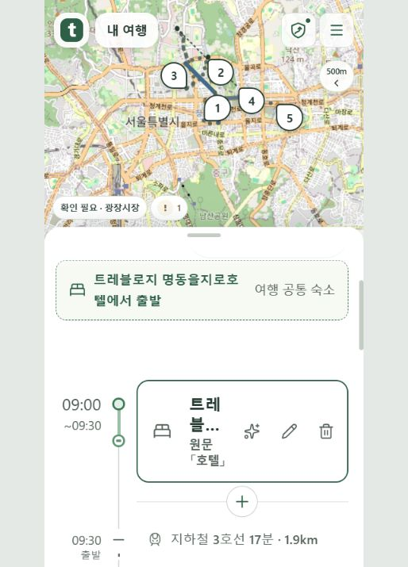

# 검증 화면 지도 경로 표시 수정 — 2026-10-17

검증 화면의 지도 높이와 초기 축척을 보완하고, 경로 조회 실패를 표시해 다시 읽을 수 있게 했다. 공개 배포 고객 웹에서 두 날짜의 경로 8개와 경로 선택 안내를 확인했다.

| 확인 | 결과 | 범위 |
|---|---|---|
| 새 단위 시험 | 6/6 = 100% | 카메라 여백·접수 경로 오류/재시도·검증 판 캐시 분리 |
| 로컬 타입 검사 | 1/1 = 100% | 고객 웹 tsc |
| 배포 후보 웹 단위 | 801/801 = 100% | 기존 공개 배포 소스를 보존한 Linux 이미지 전체 |
| 배포 후보 검사 | 4/4 = 100% | eslint·tsc·vitest·Next build |
| 실제 화면 경로 | 8/8 = 100% | 자체 시험 접수 1건, 이틀 각각 4개 |
| 화면 폭 | 2/2 = 100% | 375·1280px, 가로 넘침 없음 |

## 원인과 수정

- 자체 시험 접수 저장본에서 이동 8개와 경로선 8개가 생성됐다. 이 사례의 경로 생성은 API 키 누락으로 막힌 상태가 아니었다. 도로 그래프·역 좌표를 이용한다. 차가운 별도 프로세스의 경로선 계산은 1회 13.59초였으며 일반 성능 수치로 확대하지 않는다.
- 브라우저의 지도 스타일 미적용 상태에서 지도 컨테이너 높이 0px를 관찰했다. 새로고침 후 같은 배포판의 스타일이 적용됐으므로, 자산 전송 실패의 근본 원인은 확정하지 않는다. 핵심 지도 크기를 인라인 스타일로 유지해 스타일 지연 시 높이가 사라지지 않게 했다.
- 높이 306px인 지도에 위 114px·아래 126px를 고정 예약해 실제 경로 영역이 약 66px로 좁았다. 검증 시트는 이미 지도 밖으로 잘려 있으므로 아래 겹침을 76→20px로 고쳤다. 세 지도 제공자의 카메라 여백은 실제 지도 높이의 절반 이상을 지리에 남긴다. 같은 예시 기본 화면의 거리 눈금이 5km→2km로 바뀌었다.
- 접수 검증·등록 여행 수정 화면에서 경로 조회 예외를 `null` 성공으로 바꾸던 처리를 없앴다. 같은 검증 판에서 실패를 표시하고 「경로 다시 불러오기」로 다시 읽는다. 1초 이상 읽을 때 경로 진행 문구를 표시한다. 검증 판이 바뀌면 해당 판의 경로를 다시 읽는다. 외부 HTTP 응답 계약은 변경하지 않았다.

## 실제 화면과 운영 적용

- 첫날·둘째 날 각각 SVG 선택 경로 4개를 확인했다. 둘째 날 경로를 누르면 「창덕궁 → 청계천」 이동 줄과 지하철 3호선→1호선, 출발·도착·역 안내가 열렸다.
- 공통 숙소와 호텔 조식의 숙박 아이콘을 유지했다. 여행 등록 전 검증 화면에서 확인했으며 고객 여행 등록·예약·결제를 실행하지 않았다.
- [첫날](../evidence/2026-10-17_intake-map-routes/after-day1-map.jpg) · [경로 선택](../evidence/2026-10-17_intake-map-routes/after-route-selected.jpg) · [375px](../evidence/2026-10-17_intake-map-routes/after-375.jpg) · [1280px](../evidence/2026-10-17_intake-map-routes/after-1280.jpg).
- 배포 판본 `intake-map-routes-20261017-v1`, 고객 웹 소스 14개 해시 일치, 건강 검사와 30초 관찰 통과·재시작 0. 고객 API·감시 작업·DB·관리자 앱의 컨테이너를 보존했고 SQL은 실행하지 않았다. 기존 이미지·실행 설정은 배포 전 보존했으며 실패 시 같은 이미지로 복구하는 검사를 유지했다.
- 실제 배포 소스와 Git 기준의 차이 1개(접수 화면의 등록 후 입력 초안 비우기 호출 유무)는 3방향 병합으로 보존했다. 이번 수정 전체가 운영 이미지의 다른 모든 파일과 일치한다는 뜻은 아니다.

mock 서버 시험: 이번 변경에서 별도 실행 안 함. 단위 시험 6/6·배포 후보 전체 단위 801/801은 위 범위다.

실서버 확인: 했음 — 자체 시험 접수 저장본의 경로 8개·실제 브라우저의 날짜별 지도 경로 8개·경로 선택·공통 숙소·두 화면 폭. 경로 조회 실패와 수동 재시도는 단위 시험으로 확인했으며 실제 장애를 운영 환경에 주입하지 않았다. 구글·네이버 SDK 화면은 이번에 확인하지 않았다.

## 인계와 한계

사용자 요청으로 커밋·최신 develop 통합·양쪽 원격 푸시·CI 완료 확인은 기존 `git commit push` 세션에 인계한다. 공통 숙소/조식/아이콘 수정이 포함된 매니저 기준 `7fe1b89048ab6af6662a11b64b46116bb596fa25`와 이번 지도 패치를 함께 검토한다. develop 통합 후의 시험 결과는 담당 세션이 별도 기록한다.

사전 확인 당시 개인·팀 develop은 `6fc4a2d5cf61365289ad05c9f38f1e41f20d66e1`로 같고 팀 CI 3개는 성공했다. 개인 CI 3개는 GitHub 계정 결제·사용 한도로 실행 차단돼 있으며 이번 코드의 검사 실패로 확정하지 않는다. 최종 푸시·CI 완료 결과는 이 기록 시점에 대기다.

로컬 원본·데이터셋·sparse 설정은 변경하지 않았다. 변경 전 코드 9개의 백업은 작업 폴더 내 `_backup/2026-10-17_route-map/`에 있다. 이번 변경은 자체 검토이며 독립 에이전트 검토는 하지 않았다.
