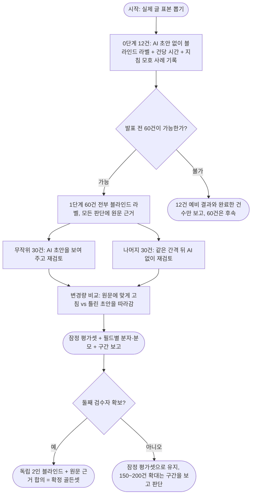

# 계획서 입구 골든셋 최종안 — Claude · Codex 2회차 합의 (2026-10-23)

**결론: 골든셋은 「12건으로 시간과 지침을 먼저 확인 → 가능한 범위에서 약 60건을 AI 초안 없이 먼저 라벨 → 무작위 30건만 AI 초안을 보여 준 재검토로 AI에 끌리는 정도를 측정」하는 2단계로 만듭니다. 검수자가 1명인 동안은 이 결과를 「확정 골든셋」이 아니라 「잠정 평가셋」이라고 부릅니다. 앞서 제가 권한 「150~200건 + 합격선 4개」 안은 Codex 검토에서 근거 부족으로 수정됐습니다.**

| 할 일 | 상태 | 진행 |
|---|---|---|
| 골든셋 설계 Claude · Codex 논의 | 끝 (2회차 합의) | 2/2 회차 = 100% |
| 앞선 제안 3가지의 근거 · 이유 정리 | 끝 (수정 반영) | 3/3 = 100% |
| 12건 예비 라벨 · 60건 라벨링 | **안 했음** (사람 일) | 0/60 = 0% |
| 모델로 직접 잰 검증 | 안 했음 | 분모 없음 |

작성: Claude(보조 세션) · 2026-10-23 · 유료 API 호출 없음(Codex 는 사용자 승인 계정의 CLI) · 저장소의 다른 파일은 고치지 않음 · 커밋하지 않음.
**검토자: 기계(Codex 본계정 gpt-6-sol) 1회차 · 2회차. 사람이 검토했다는 뜻이 아닙니다.**

> **갱신 (2026-10-23, 사용자 확인):** 둘째 사람 검수자는 없고, 검수자는 **사람 1명(사용자) + AI 2명(Claude · Codex)** 입니다. 사람 1명이므로 아래 「잠정 평가셋」 규칙은 그대로입니다. 12건 예비 라벨은 이 구성으로 준비했습니다: [준비 기록](2026-10-23_골든셋_12건_예비라벨_준비.md).

**(처음 질문) 사용자가 정할 것:** 둘째 검수자를 구할 수 있는지(있으면 독립 2인 블라인드로 바꿀 수 있어 신뢰도가 크게 올라갑니다). 없으면 아래 최종안 그대로 「잠정 평가셋」으로 진행합니다.

---

## 1. 최종안

| 단계 | 할 일 | 이유 |
|---|---|---|
| 표집 | 실제 사람 글(서울 일정형 자동 표시 2,463건)에서 출처(Reddit · 블로그) × 시각 표시(많음 · 적음)를 주된 기준으로 약 60건. 글 종류(계획 · 후기 · 섞임 · 일정 아님)와 언어는 라벨 뒤에 보고. 목표 배분 36/9/6/9(계획/후기/섞임/일정 아님)는 **목적 표본**이지 실제 비율이 아님 | 4개 축을 모두 곱하면 32칸이라 60건으로 칸마다 비교할 수 없음(Codex). 실제 글 종류 비율은 지금 모름 |
| 0단계 | 12건을 검수자 1명이 AI 초안 없이 [GUIDE.md](C:\Users\playdata2\Documents\final_workspace\datasets\travel\plan_samples\korea\seoul\gold\GUIDE.md) 기준으로 글 단위 라벨. 건당 소요 시간, 지침이 모호했던 사례를 기록. 3건은 24시간 뒤 재라벨 | 검수자 1명 · 발표 3일 전이라 12건의 실제 시간을 알기 전에는 60건 완료를 약속할 수 없음 |
| 1단계 | 60건 **모두** 먼저 블라인드 라벨(모든 판단에 원문 근거 한 줄). 그 뒤 무작위 30건에만 AI 초안을 보여 주고 재검토, 나머지 30건은 같은 간격 뒤 AI 없이 재검토(대조군) | 서로 다른 글을 30/30으로 나누면 글 난도 차이와 AI 영향을 가를 수 없음(Codex 반박 수용) |
| 변경 세기 | 재검토 변경을 「원문에 맞게 고침」과 「틀린 초안을 따라감」으로 나눠 센다. 일부러 틀리게 한 함정 항목은 최종 정답과 분리 보관, 통과 기준에 쓰지 않음 | 둘을 섞어 세면 앵커링을 과장함(Codex) |
| 채점 | 항목 짝 맞춤(같은 일차 + 이름 정규화 일치)과 「시각 없음」 처리를 **채점 전에 고정**. 시각은 정확 일치로 보고, ±15분은 원문에 시각이 적혀 있을 때만 보조로 보고. 원문에 없는 시각에 근처 값을 붙이면 맞음으로 세지 않음. 필드별(일차 · 순서 · 시각 · 장소 · 종류) 분자/분모, 원문에 없는 장소 · 시각을 낸 비율 | GUIDE.md 의 「원문에 없는 시각 · 장소는 쓰지 않는다」와 일치. 구조화 추출 채점은 필드별로 지표를 달리하는 것이 관행 [외부-검색요약](https://www.alphaxiv.org/abs/2602.12247.md) |
| 합격선 | κ 0.6 · 차이 10%p · 함정 2/5 · F1 0.7 같은 **합격선은 쓰지 않음**. 대신 분자 · 분모, 글 단위 구간, 불일치 · 근거 없는 출력 사례를 보고. 지침 수정이 필요한 불일치 유형이 나오면 확대 전에 지침부터 고침 | 60건에서는 구간이 너무 넓음(5절 계산) |
| 분리 | 같은 작성자 · 스레드 · 재게시는 학습과 골든셋에 함께 넣지 않음. 골든셋은 학습 · 프롬프트 조정에 쓰지 않음. 이용 조건상 내부 실험 한정 | Lee 외 [외부-초록](https://arxiv.org/abs/2107.06499) · plan_samples REPORT 의 이용 조건 기록 |
| 이름 | 검수자 1명이면 **잠정 평가셋**, 독립 2인 블라인드 + 원문 근거 합의가 되면 **확정 골든셋** | 1명의 최초 라벨도 틀릴 수 있음 |

---

## 2. Claude · Codex 논의 기록

| 회차 | Claude | Codex | 결과 |
|---|---|---|---|
| 1회차 (서로 의견을 못 본 채 따로) | D (약 60개, 같은 사람이 30/30, 확신 0.6) | D (60건, 독립 2인 + 제3자, 12건 예비부터, 확신 medium) | **선택지 일치.** 세부(사람 수 · 앵커링 측정 · 첫 단계 규모) 차이 |
| 2회차 (Claude 의 합친 설계를 Codex 가 비판) | 합친 설계 제출 | D 유지 + 반박 6 · 수용 5 | Claude 가 반박 대부분을 수용 → **합의** |

**Claude 가 바꾼 점 (Codex 근거를 받아들여)**
1. 같은 사람이 서로 다른 글을 30/30으로 나눠 앵커링을 재는 방식 → 철회. 60건 모두 먼저 블라인드 후 무작위 30건만 AI 재검토 + 대조 30건.
2. 두 AI 초안(Claude · Codex)을 「서로 독립인 기계 라벨러」로 쓰는 폴백 → 철회. Claude 초안은 실제 글 196건(글 단위), Codex 초안은 계획서 항목 958개(항목 단위)로 **대상 · 단위가 달라** 독립이라는 근거도, 같은 글에 둘 다 있다는 확인도 없음.
3. 「불일치 항목만 사람이 재판정」 → 철회. 둘이 함께 틀린 항목을 놓침. 모든 최종 라벨에 원문 근거를 남김.
4. 합격선 4개 → 철회(5절 계산).
5. 층 32칸 → 출처 × 시각 표시 2×2 가 주 기준.

**기각한 Codex 근거:** 없음. **남은 반대 의견:** 없음. 다만 Codex 가 남긴 한계 — 검수자 1명의 최초 라벨 오류, 60건 완료는 12건 시간을 재기 전에는 약속 못 함 — 는 그대로 위험으로 남습니다.

원본(보관 위치): [논의 기록 폴더](../evidence/2026-10-23_plan_golden_consensus/) — 1회차 [질문](../evidence/2026-10-23_plan_golden_consensus/q.md) · [Claude 입장(호출 전 고정)](../evidence/2026-10-23_plan_golden_consensus/claude_r1.md) · [Codex 1회차](../evidence/2026-10-23_plan_golden_consensus/r1_main.json) · 2회차 [질문](../evidence/2026-10-23_plan_golden_consensus/q_r2.md) · [Codex 2회차](../evidence/2026-10-23_plan_golden_consensus/r2_main.json) · [결정 기록](../evidence/2026-10-23_plan_golden_consensus/decision.md).

---

## 3. 앞서 제안한 세 가지 — 근거와 이유 (논의 뒤 수정 반영)

### 제안 1. 「계획서 골든셋: 실제 글 150~200개를 사람이 글 단위로 확정, 그중 50개 블라인드」 → **수정: 12건 → 60건 2단계 + 잠정 평가셋**

| 구분 | 내용 |
|---|---|
| 처음 이유 | 실제 사람 글에 대한 정답 평가가 0개라 계획서 입구 성능을 잴 수 없다. 모든 기존 사람 확인이 AI 답을 본 방식이다. |
| 근거 | ① 계획서 입구 평가는 합성 글 개발 25 · 시험 60뿐, 사람이 확인한 평가 0 ([분해표](2026-10-23_통합자료_입구별_행수_분해표.md) [실측-저장소]) ② 계획서 항목 958개 중 101개(10.5%)만 사람 확인, 모두 AI 초안을 본 단일 검토자 방식 ([plan_samples REPORT](C:\Users\playdata2\Documents\final_workspace\datasets\travel\plan_samples\REPORT.md) · [사람 정답 파일](C:\Users\playdata2\Documents\final_workspace\datasets\core\사람검수_대기_모음\확인화면\_사람답\replay_plan_items_v2__최연우__all__20261021_1633.json) [실측-저장소]) ③ 유명 시험 세트에도 라벨 오류가 평균 3.3% 이상이고 모델 순위가 바뀔 수 있음 [외부-초록](https://arxiv.org/abs/2103.14749) ④ 평가 세트는 학습 전에 따로 만들어 둔다 [외부-공식문서](https://developers.openai.com/api/docs/guides/fine-tuning-best-practices) ⑤ 실제 로그를 읽고 업무를 아는 사람이 이진 판정으로 라벨 [외부-블로그](https://hamel.dev/blog/posts/evals/) |
| 왜 바꿨나 | 150~200건 · 독립 2인은 검수자 1명 · 발표 3일 전이라 실현 가능성을 확인하지 못함. 같은 사람의 30/30 앵커링 측정은 글 난도와 섞임(Codex). |
| 수정 후 | 1절 최종안. 150~200건은 60건의 구간을 보고 판단하는 후속으로 둠. |

### 제안 2. 「학습 자료: 실제 글에 서로 다른 계열 AI 2~3개의 다수결 라벨, 불일치만 사람, 합성은 보충」 → **수정: 은색 라벨 사용 결정은 독립 검증 뒤로 미룸**

| 구분 | 내용 |
|---|---|
| 처음 이유 | 학습 18,478행 중 계획서 입구가 879행(4.8%)뿐이고 전부 합성 · 구조 자료. 실제 글은 12만 건이지만 정답이 없다. |
| 근거 | ① AI 라벨로 학습한 분류기는 사람 라벨 학습보다 낮고 불안정하며 오류가 체계적 [외부-초록](https://arxiv.org/abs/2504.15432) ② 여러 AI 라벨을 노이즈 있는 라벨러로 보고 합치는 약한 지도, 단순 다수결이 강한 기준선 [외부-검색요약](https://snorkel.ai/?p=9869) ③ 합성만 많으면 깔끔한 쪽으로 치우침(plan_samples REPORT 한계) [실측-저장소] ④ 실제 고객 글이 주력이어야 한다는 권고(합성은 보충) [외부-블로그](https://hamel.dev/blog/posts/evals/) |
| Codex 가 짚은 약점 | 서로 다른 AI 판정 모델 9개가 실제로는 약 2표 분량이라는 보고(오류가 겹침) [외부-초록](https://arxiv.org/abs/2605.29800)와 같은 이유로 **다수결이 안전하지 않을 수 있음**. 불일치만 사람이 보면 함께 틀린 항목을 놓침. 두 AI 초안은 대상 · 단위가 달라 독립 라벨러가 아님. |
| 수정 후 | 실제 글을 학습에 쓰는 방향은 유지하되, **AI 다수결 은색 라벨을 학습에 넣을지는 골든셋 60건으로 AI 초안 정확도를 잰 뒤**에 정한다. 그 전까지 학습 자료는 합성 · 구조 자료와 사람 확정 라벨 중심. 원문 이용 조건상 내부 실험 한정. |

### 제안 3. 「입구마다 따로 평가」 → **유지**

| 구분 | 내용 |
|---|---|
| 이유 | 한 모델에 여러 입구를 섞으면 자료가 많은 입구 쪽으로 쏠려 적은 입구가 약해질 수 있다. 우리 자료는 질의 60.9% · 계획서 4.8% · 감시 2.0%라 쏠림 위험이 크다. |
| 근거 | ① 학습 입구별 행 수 ([분해표](2026-10-23_통합자료_입구별_행수_분해표.md) [실측-저장소]) ② 혼합 지시 학습은 표본이 많은 과제 쪽으로 쏠린다는 보고(2025 IJCAI 다중 LoRA) [외부-검색요약, 본문 미확인](https://www.ijcai.org/proceedings/2025/0772.pdf) ③ 과제 간 간섭을 줄이려는 연구(LoRI) [외부-검색요약](https://arxiv.org/pdf/2504.07448) ④ Tulu 3 도 여러 기술 자료를 섞되 개발용 · 보지 않은 평가용을 나눔 [외부-초록](https://arxiv.org/abs/2411.15124) ⑤ 입구마다 출력 모양이 다르면 지표도 다름(구조화 추출은 필드별 채점) [외부-검색요약](https://www.alphaxiv.org/abs/2602.12247.md) |
| 한계 | ②는 검색 요약만 봤고 우리 모델에서 쏠림이 실제로 일어나는지는 **재 본 적이 없다.** [미확인] 평가표를 입구별로 나누면 확인할 수 있다. |

---

## 4. F 평가(대상 선택·근거·답변 통합 평가)와의 관계

앞서 물으신 「F 셋」을 저장소의 F-v1~v3 계약([문서](C:\Users\playdata2\Documents\final_workspace\final_project_cs\wiki\quality\selection-grounded-answer-evaluation.md))으로 본 것이 맞다면: 개발 예시 24개의 구조 검사만 했고 사람 검수 0/24 · 모델 평가 0/24라 **시험 세트로는 아직 없지만**, 「잘못 고름 · 근거 못 찾음 · 근거 보고도 틀리게 답함」을 단계별로 나누는 설계는 이 골든셋의 채점(필드별 분리 · 전체 성공률)에 재사용할 수 있습니다. [추정] F가 다른 것을 가리켰다면 알려 주세요.

---

## 5. 계산 — 규모별 구간 (95%, 정규 근사) [계산]

| 건수 | 정답률 80% 부근 오차폭 | 정답률 50% 부근 | 오류 0건일 때 단측 95% 상한 |
|---:|---:|---:|---:|
| 12 | ±22.6%p | ±28.3%p | 22.1% |
| 30 | ±14.3%p | ±17.9%p | 9.5% |
| 60 | ±10.1%p | ±12.7%p | 4.9% |
| 150 | ±6.4%p | ±8.0%p | 2.0% |
| 200 | ±5.5%p | ±6.9%p | 1.5% |

- 30건 대 30건의 정답률 차이(둘 다 50% 부근)는 ±25.3%p, 함정 5건 중 0건을 따라 해도 실제 추종률의 단측 95% 상한은 약 45.1%입니다. 그래서 「차이 10%p 이하」나 「함정 2/5 이하」를 합격선으로 쓰지 않습니다.
- 글 한 편 안의 여러 항목은 서로 독립이 아니므로 위 숫자는 글 단위 건수 기준입니다. 항목 단위로 세면 구간이 더 좁아 보이지만 과대평가입니다. [추정]

---

## 6. 확인하지 못한 것

| 확인하지 못한 것 | 비고 |
|---|---|
| 검수 화면 12번이 글 단위(일차 · 순서 · 시각) 정답을 받는지 | 화면을 열어 보지 않음. 받지 못하면 도구 준비가 0단계 앞에 필요 |
| 12건의 실제 소요 시간 · 60건 완료 가능성 | 사람 일, 측정 전 |
| 둘째 검수자 확보 | 사용자 몫 |
| Claude 초안 196건과 Codex 초안 958항목이 같은 글 · 같은 항목 정의를 공유하는지 | 확인하지 않음 |
| 서울 일정형 2,463건 중 실제 「계획」인 글의 비율 | 규칙 표시일 뿐 |
| 다중 과제 쏠림이 우리 모델에서 실제로 일어나는지 | 입구별 평가로만 확인 가능 |
| Codex 의견의 한계 | 기계 검토이며 사람 검토가 아님. 같은 계열 편향을 모두 배제하지 못함 |
