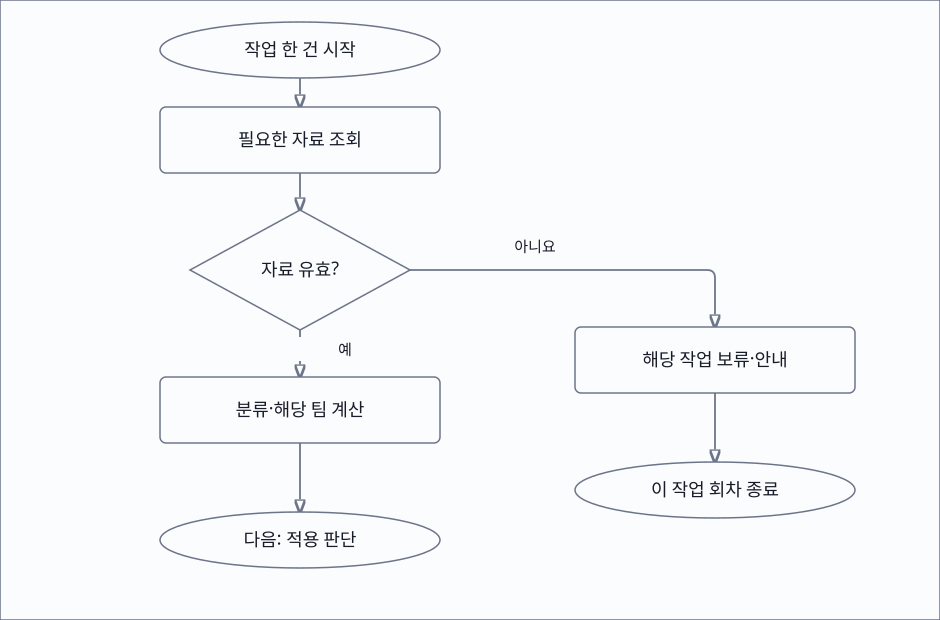
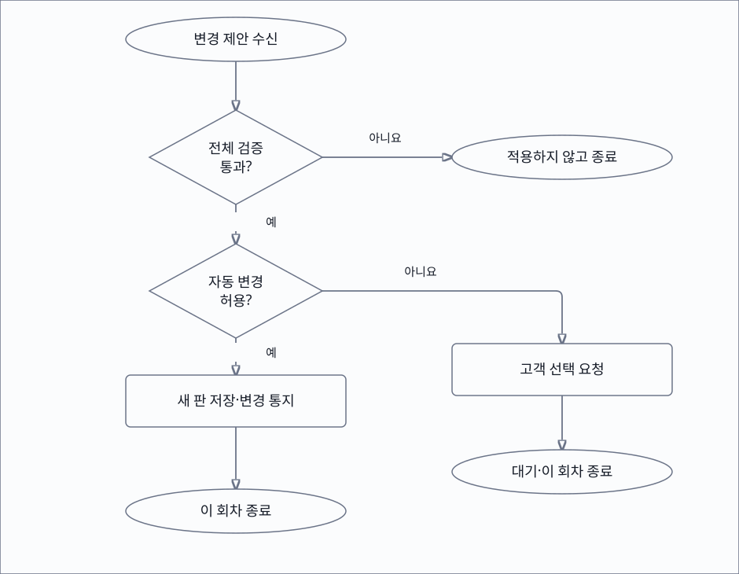

# triPilot 구현계획서 v12

triPilot은 여행 일정을 구성·검증하고, 여행 중 변화를 확인해 고객 설정에 따라 조정하는 제품입니다. **이 문서는 현재 wiki를 찾고 구현 상태를 이해하는 안내서이며, 최종 인수 전 검토본입니다.** 사양 정본은 [wiki](../../wiki/index.md)입니다. [v11](A-COP_구현계획서_v11.md)은 2026-09-10 당시 기록으로 보존합니다.

| 할 일 | 상태 | 진행 |
|---|---|---|
| 최신 공통 전체 시험 | 통과·건너뜀 | 892/904 = 99% |
| 단독 시나리오 재검증 | 통과 | 4/4 = 100% |
| 최신 여행 전체 원본 | 종료·후속 검증 | 6,892/6,946 = 99% |

기준 날짜는 2026-10-12입니다. 아래 ‘구현’은 별도 표시가 없으면 현재 로컬 작업 트리 기준이며 운영 환경 적용을 뜻하지 않습니다. 최종 판정·소스 해시·미해결 조건은 [제품 전체 기준선 검토본](../baseline/triPilot-baseline-2026-10-12.md)에 모읍니다.

## 고객이 이용하는 방식

고객 웹에서 여행을 입력하고 최초 일정 구성과 검증 결과를 확인합니다. 개인 AI는 인증된 고객의 여행 API·MCP 도구를 사용합니다. 공유 링크를 받은 사람은 그 계약이 허용한 최신 일정을 읽습니다. 세 경로는 같은 여행 상태를 사용합니다. 지원 도시는 서울부터 검증하며, 확인하지 않은 도시·장소까지 지원한다고 표시하지 않습니다. [제품 범위](../../wiki/product/scope.md).

| 이용 방식 | 허용 범위 | 구현 확인의 한계 |
|---|---|---|
| 고객 웹 | 본인 여행 입력·조회·변경 요청·설정 | 화면 반응과 실제 외부 자료 응답을 분리 |
| 개인 AI | 고객이 동의한 읽기·쓰기 도구 | OAuth 격리 시험 완료, 실제 클라이언트 등록·종단 연결 미확인 |
| 공유 계획서 | 공유 계약의 읽기 범위 | 로그인·개인 AI 자격과 별개의 권한 |

정확한 요청·응답은 [REST 계약](../../final_project_cs/wiki/external/rest-endpoints.md), 개인 AI 도구는 [MCP 계약](../../final_project_cs/wiki/external/mcp-tools.md), 로그인·권한 동의는 [OAuth 계약](../../final_project_cs/wiki/external/personal-ai-oauth.md)을 따릅니다. v11의 ‘계획 생성은 하지 않는다’·‘접점 둘’은 현재 범위를 뒤집는 근거가 아닙니다.

## 일정 변경을 결정하고 실행하는 책임

분류 에이전트는 고객 요청·일정·상황·선호를 보고 담당 팀, 순서, 우선순위와 의존 관계를 정합니다. 실행 장치는 없는 팀·허용하지 않은 도구·잘못된 순서·예산 초과·오래된 입력을 거절하고 검증된 계획만 실행합니다. Activity가 다른 팀의 계산을 대신하거나 Controller가 새로운 업무 판단자가 되는 구조는 아닙니다.

| 담당 | 하는 일 | 변경 경계 |
|---|---|---|
| Activity | 관광·자연·문화·레포츠·쇼핑 장소의 활동 판정 | 허용 도구 조회 후 제안 반환 |
| Dining | 식사 일정·휴무 관측·대체 식당 판정 | 영업시간표를 실제 개점 관측으로 바꾸지 않음 |
| Mobility | 이동 경로·출발·시간·요금 근거 계산 | 예산 추정과 실제 결제액을 구분 |
| Booking Handoff | 업체 예약 관련 후속 단계 | MVP 밖, 거래 승인 필요 |
| Lodging·Flight | 등록된 예약 정보 취급 | 등록만으로 변경 지원을 주장하지 않음 |

Team은 변경 제안을 반환합니다. Controller와 등록된 적용기는 본인 권한·현재 버전·고정 항목·설정·안전을 다시 확인한 뒤 저장합니다. 동시에 두 요청이 와도 같은 변경은 한 번 저장되고, 일정 판과 통지가 함께 맞아야 합니다. 상세 계약은 [Team 경계](../../final_project_cs/wiki/teams/team-boundary.md), [분류 실행 계획](../../final_project_cs/wiki/teams/classification-execution-plan.md), [팀 조립](../../final_project_cs/wiki/teams/composition.md)에 있습니다.

현재 다중 팀 실행의 검증 범위는 **한 여행의 감시 묶음**입니다. 일반 채팅의 모든 복합 업무를 동일 실행기로 분해하거나 새 취향 기억 서비스를 완성했다는 뜻은 아닙니다. 담당의 단위 179/179와 격리 PostgreSQL 마지막 129/129는 [구현·실행 보고서](../research/baseline_completion_2026-10-12/tasks/orchestration/report.md)에 보존합니다. 실제 모델 품질·원격 A2A 조정은 미확인입니다.

## 자료 확인과 적용의 흐름

자료 확인은 작업 한 건의 흐름입니다. 보류한 작업의 다음 시작 조건은 다음 예약 회차 또는 명시적 재시도입니다. 독립 작업은 계속 확인합니다.

위 그림은 변경 제안 이후입니다. 변경이 필요 없는 조회는 기존 상태로 끝납니다. 자동 변경 허용은 지킴이 설정·고정·안전을 함께 확인합니다. 고객 선택이 오면 최신 상태에서 새 회차를 시작합니다. 업체 거래의 별도 승인 절차는 그림 밖의 계약입니다.

## 항로 지킴이와 고객 선택

항로 지킴이를 명시적으로 켜면 필요한 조정을 계산하고 전체 일정을 다시 검증해 새 판을 저장한 뒤 이유를 알립니다. 꺼짐·설문 미응답은 먼저 고객에게 묻습니다. 고객이 고정한 항목은 자동 교체하지 않으며, 예약이 있다는 이유만으로 모든 일정 변경을 금지하지도 않습니다. 업체 예약 취소·결제·환급은 별도 승인 경계입니다. [현재 설문 결정](../../wiki/decisions/D-020-trip-survey-and-ask-first.md).

예를 들어 야외 일정이 불가능해지면 켜진 여행은 검증된 실내 대안으로 조정할 수 있습니다. 고정한 공연이거나 지킴이가 꺼진 여행은 고객 선택을 기다립니다. 재난으로 정지한 여행은 자정에 저절로 재개하지 않습니다.

조회 실패는 그 자료가 필요한 작업과 의존 작업만 보류합니다. 기존 일정과 독립적으로 확인할 수 있는 작업은 유지합니다. 고객에게 확인 시각·오류·유지한 일정·다음 재확인을 알립니다. 모든 기능을 끄거나 상주 상담원에게 넘기는 것으로 대신하지 않습니다. [장애 격리 결정](../../wiki/decisions/D-018-decision15-stop-paths.md).

## 모니터링·자료·알림

모니터링 툴의 실행 간격과 실제 감지 시간은 다릅니다. 원본 게시 지연, 수집 시각, 캐시 유효시간, 판정·통지 시각을 각각 확인합니다. ‘3분 주기’만으로 사건을 3분 안에 찾는다고 보장하지 않습니다. [실행 간격 결정](../../wiki/decisions/D-017-watch-cadence-golden-time.md).

식당 상태는 무료 자료를 먼저 확인합니다. 운영에 허용된 성공 관측이 해당 방문 구간까지 유효해야 하며, 자료가 없으면 검증 불가로 남깁니다. 낮 감시·새벽 점검·Team 재확인은 같은 정책을 사용합니다. 새벽 유료 조회도 꺼짐 기본값·시간 창·여행/하루 상한·HTTP별 공급 예산을 통과해야 합니다. 기존 가격 비교 경로의 별도 결정과 실제 자료 충족률은 최종 확인 대상입니다. [무인 운영·조회 정책](../../final_project_cs/wiki/operations/unattended-operations.md).

변경 통지, 하루 시작 안내, 각 항목 출발 안내는 서로 다른 시점입니다. 출발 시각은 시작 시각에서 이동 시간과 여유를 빼 계산합니다. 알림을 보았는지와 고객 계획서 링크를 열었는지는 별개이며, 최신 상태는 저장된 계획서에서 확인합니다. [알림 계약](../../wiki/architecture/notifications.md).

## 인증·개인정보·개발자 진단

고객 웹은 게스트·회원의 세션 쿠키와 쓰기 요청의 CSRF 검사를 사용합니다. 개인 AI는 사전 등록된 클라이언트와 정확한 callback, 고객 로그인·권한 동의, PKCE를 거칩니다. 코드·refresh 재사용, 만료·폐기·권한 범위를 검사합니다. 키를 공유 링크나 브라우저 로그인 대신 쓰지 않습니다. 실제 개인 AI 등록값과 공개 HTTPS·쿠키 설정 확인은 남아 있습니다. [인증 검증과 한계](../research/baseline_completion_2026-10-12/tasks/auth/report.md).

고객의 문제 신고·건의는 서비스 개선 기록이며 개별 상담 답변 대기 절차가 아닙니다. 개발자·QA 운영 화면은 결함과 자료 정책을 확인하는 곳입니다. 고객 문제를 대신 수정하는 상주 상담원 화면이 아닙니다. 진단은 고정 오류 코드와 소유 UUID를 별도 트랜잭션에 저장하며 DB 장애 때 비공개 대기 파일로 넘깁니다. 작업 일꾼이 재전송·보존 정리를 수행합니다. 파일까지 실패하면 수집 저하를 드러냅니다.

고객 파기 시 OAuth·진단 개인 연결을 지우고, 보존 기록 때문에 고객 행만 남더라도 파기 표지를 적용해 대기 기록이 개인정보를 되살리지 않게 합니다. 상세는 [개인정보·회귀](../../final_project_cs/wiki/records/reports/2026-10-12_0552_privacy-regression-integration.md), [최초 분류·라우팅 진단](../../final_project_cs/wiki/records/reports/2026-10-12_0603_initial-diagnostics-integration.md), [삭제·경쟁 검증](../../final_project_cs/wiki/records/reports/2026-10-12_0520_diagnostic-delete-integration.md)에 있습니다.

## DB·자료·모델 판본

DB의 논리 구조와 환경별 실제 적용은 [데이터 허브](../../final_project_cs/wiki/data/index.md)·[구조 명세](../../final_project_cs/wiki/data/schema/index.md)·[SQL 자동 목록](../../final_project_cs/wiki/data/migration-inventory.generated.md)에서 확인합니다. SQL 파일이 있다는 것과 업무 DB에 적용했다는 것은 다릅니다. 이번 통합은 새 전용 시험 DB만 사용했습니다.

실제 데이터와 부속 스크립트는 datasets 전체 Git 제외 규칙을 따릅니다. 현재 ignore 예외는 정리했지만 이미 추적 중인 57개는 별도 검토 대상입니다. 파일이나 Git 이력은 삭제하지 않았습니다. 쇼핑몰 자료는 현재 여행 판단·평가·시연에 쓰지 않습니다. [D-023](../../wiki/decisions/D-023-no-commerce-assets-in-use.md).

모델은 정확한 이름·원본 판본·우리 학습 여부·어댑터·양자화·엔진·자료 해시를 연결합니다. Jev 계열 모델 중 **학습 없는 Winnow-E4B**와 **우리 여행 자료로 가르친 Winnow-E4B**는 별도 비교군입니다. 실험 완료를 서비스 채택·배포로 해석하지 않습니다. [현재 평가 절차](../../final_project_cs/wiki/quality/slm-model-evaluation.md)와 [모델 판본·독립 보고서](../../final_project_cs/wiki/quality/model-version-reports.md)를 연결하며 별도 제품 정본을 만들지 않습니다.

Oracle ARM의 기존 원본 Gemma-4-E4B QAT Q4_0 모델 연결에서는 장소 임베딩 적격 2,041/2,041, 안내 검색 6/6, 채팅 진단 4/4를 확인한 다른 담당의 기록이 있습니다. 채팅 59.80~68.53초 지연은 남습니다. 이 네 질의는 독립 제품 정확도 평가가 아닙니다. [원본 실행 기록](../../final_project_cs/wiki/records/reports/2026-10-12_0454_arm-search-model-repair.md).

## 검증과 환경 반영을 읽는 방법

공통·여행 시험은 명시적 파일 목록으로 나누며 미분류·중복 파일은 오류입니다. 규칙 등록 수, 수집한 시험 수, 실제 통과 수를 합치지 않습니다. [불변식 집계](../../final_project_cs/wiki/quality/invariant-summary.generated.md)와 [여행 출시 관문](../../wiki/delivery/release-gate.md)은 서로 다른 자료입니다.

| 환경 | 이번에 확인한 것 | 남은 것 |
|---|---|---|
| 로컬 전용 PostgreSQL | 현재 안전 SQL·선택 회귀·공통 전체 | 검색·실자료 전제 |
| x600 서버의 cs 프로젝트 서버 | 다른 담당의 실제 채팅·배포 기록 재사용 | 이번 신규 SQL·정책·볼륨 적용 인수 미확인 |
| Oracle ARM 실험 앱·모델 | 다른 담당의 검색·채팅 관측 재사용 | 지연·전체 제품 인수 |
| GPU 서버 연구 | 판본별 학습·평가 기록 연결 | 공개 고객 요청 가동 증거와 별개 |

mock 서버 시험(화면 반응): 고객 UI 담당 52/52, 인증 화면 8/8, 운영 화면 9/9 등의 원본 범위를 각각 연결합니다. 수치를 하나의 제품 정확도로 합치지 않습니다.

실서버 확인(서버 응답): 이번 통합에서 외부 제공처·운영 cs 프로젝트 서버를 새로 호출하지 않았습니다. 다른 담당의 날짜가 있는 관측은 [환경 현황](../../final_project_cs/wiki/operations/current-state.md)과 원 보고서로 확인합니다.

## 최종 확정 전 남은 조건

공통·여행 전체 원본과 후속 DB·보안·계약 재시험을 대조했습니다. 전체 원본은 통과만 있는 실행이 아니며, 검색·실자료 전제가 남습니다. [최신 통합 검토](../../final_project_cs/wiki/records/reports/2026-10-12_0644_whole-suite-integration-review.md)에 원본과 후속 결과를 연결했습니다. 여행 규정 검색의 자료 전제16개와 실제 요식·택시 자료 건너뜀을 원본과 확인합니다. 실제 개인 AI 클라이언트 등록·공개 HTTPS·쿠키·callback 종단 연결은 자격·환경 확인이 필요합니다. 무료 관측 대상 충족률·실제 운영 볼륨·업무 DB 반영은 이번 권한으로 수행하지 않습니다.

21:40 KST 후속 관측: 식당·이동 자료 부족7개는 해소됐습니다(12/12). 여행 규정 검색은 학습 없는 원본 BGE-M3 실제 벡터로17/17 통과했습니다. 자료·도로 수정 뒤 후속 회귀는 2,119/2,137이며, 실패18개는 모두 이동 단위 시험으로 21:33 재확인에서도 그대로입니다(이동 담당 판정 대기). 상세는 [후속 기록](../../final_project_cs/wiki/records/reports/2026-10-12_2130_followup-data-regression.md)에 있습니다.

도로 사건의 방향 판정 실패와 택시 실사용 오차는 관련 보고서를 검토해 남은 결함으로 추적합니다. 문서 상태나 검산 예시 하나를 고쳐 전체 정확도를 통과로 만들지 않습니다. 전체 추적은 [25개 통합표](../research/baseline_completion_2026-10-12/tasks/integration/integration-table.md)에 있습니다.

변경은 wiki 결정·계약 → 구현 → 영향 시험 → 해시·환경 증거 → 안내서·기준선 갱신 순서로 진행합니다. 이번 작업은 업무 DB 변경·배포·원격 재시작·고객 알림·유료 호출·commit·push를 수행하지 않습니다. 모든 필수 결과를 판정하기 전에는 v12와 제품 전체 기준선을 완료본으로 표시하지 않습니다.

독립 검증 담당은 수정 영향192/192와 전체·후속 원본7/7회 대조를 완료했습니다. [최종 독립 인계](../../program/research/baseline_completion_2026-10-12/tasks/verification/final-handoff-2026-10-12.md)의 미충족23개·외부 종단·환경 한계를 그대로 따릅니다. 독립 재시험 통과도 제품 전체 인수 완료를 뜻하지 않습니다.
