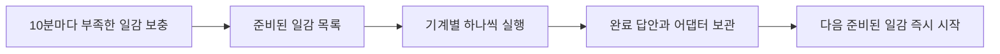

# GPU 학습과 평가 대기열 운영

기존 GPU 서버 A/B가 다음 준비된 일을 자동으로 시작하도록 대기열을 채웠습니다. GPU 서버 A는 평가 17개, GPU 서버 B는 본 학습 5개가 예약돼 있고 두 기계에서 계산이 시작됐습니다. 10분마다 남은 일감을 확인·보충하고 일일 논문·신모델 조사 결과도 연결합니다.

| 할 일 | 상태 | 진행 |
|---|---|---|
| GPU 두 기계 확인 | 완료 | 2/2 = 100% |
| GPU 서버 A 평가 예약 | 등록 | 17/17 = 100% |
| GPU 서버 B 본 학습 예약 | 유지·재개 | 5/5 = 100% |
| 새 대기열 로직 검사 | 통과 | 4/4 = 100% |

표의 100%는 예약 등록·확인 완료율입니다. 평가나 본 학습이 모두 끝났다는 뜻은 아닙니다.

## GPU 서버 A

보관 중인 원본 모델로 비교 범위의 빈칸을 채웁니다. 모두 우리 자료 추가 학습이 없는 배포판입니다. FrogNano와 Jev 계열 모델 중 Winnow-E4B에는 개발사 학습이 있음을 구분합니다.

| 모델 | 예약한 시험 | 시험 수 | 예정 문항 |
|---|---|---:|---:|
| FrogNano-4B-2609 우리 학습 없음 | 어려운 문장·혼합 요청 | 2 | 5,330 |
| Gemma-4-E4B-it Q4_K_M 우리 학습 없음 | 일반·새 잡담·직접 선택·어려운·혼합 | 5 | 9,425 |
| Gemma-4-12B-it Q4_K_M 우리 학습 없음 | 같은 다섯 시험 | 5 | 9,425 |
| Jev 계열 모델 중 Winnow-E4B Q8_0 우리 학습 없음 | 같은 다섯 시험 | 5 | 9,425 |
| 합계 | | 17 | 33,605 |

문항 수는 평가 입력 목록과 일감 목록에서 셌습니다. 과거 일반 생성 답안과 이번 확률 기록 경로는 구분합니다. 양자화가 다른 모델끼리 같은 모델 실행기 속도 비교라고 쓰지 않습니다. FrogNano의 기존 일반·잡담·직접 선택 완료 답안은 다시 실행하지 않습니다.

09:48 확인 당시 첫 어려운 문장 시험은 답안 98/1,316개를 저장했고 GPU 메모리 4,666MiB·사용률 52%였습니다. 이는 확인 순간 값이며 앞으로의 사용률 보장이나 평균이 아닙니다. 나머지 16개 시험이 이어서 대기합니다.

지속 실행기는 준비된 모델과 입력이 있는 일을 골라 한 번에 하나만 실행합니다. 끝난 작업을 다시 시작하지 않고 실패·해석 실패도 기록합니다. 초기 실행 흔적이 있는데 완료되지 않았으면 원본을 보존하고 재개 판단을 기다립니다. 상태 파일을 바꾸기 전 이전 판을 자동 백업합니다. 일감을 모두 소진하면 30초 간격으로 새 목록을 기다리므로 worker를 다시 띄울 필요가 없습니다.

실행 위치는 GPU 서버 A의 `/tmp/tripilot-a-backlog-20261008`이며 worker PID는 확인 당시 342497입니다. `manifest.json`이 일감, `state.json`이 실행 상태, `queue.log`가 순서 기록이고 각 작업 폴더에 원본 답안·환경·입력 해시·로그가 있습니다. 완료 답안은 임시 공간에만 두지 말고 아래 로컬 결과 폴더에 즉시 회수합니다.

## GPU 서버 B

학습 자료 선택 때문에 생긴 대기를 해제했습니다. 기존 승인된 첫 보강 자료를 선택했으며 이미 실행 중인 대기열을 중단하거나 새 사본을 시작하지 않았습니다.

| 본 학습 작업 | 현재 순서 |
|---|---|
| Jev 계열 모델 중 Winnow-E4B에 우리 자료로 학습 | 스모크 후 본 학습 |
| spark-s1-4b-v6에 우리 자료로 학습 | 앞 모델 완료 뒤 |
| Jev 계열 모델 중 jevify-gemma4-e4b에 우리 자료로 학습 | 앞 모델 완료 뒤 |
| Gemma 두 번째 보강 자료·낮은 코사인 학습률 | 기존 세 모델 완료 뒤 |
| 같은 자료·손실에 따른 학습률 조절 | 대조 학습 완료 뒤 |

첫 세 모델은 기존 B54, 뒤 두 실험은 B56입니다. 각각 짧은 검증·변환·기본 평가를 포함하지만 표의 5는 본 학습 변형 수입니다. 09:48 확인 당시 Winnow-E4B의 짧은 검증은 16문항·4 optimizer 갱신을 끝냈고 다음 본 학습으로 이어지는 단계였습니다. 학습 부분 0.9분, 최대 GPU 메모리 10.6GB였습니다. 본 학습 완료로 세지 않습니다.

기본 평가와 어댑터가 끝나면 로컬에 보관하고 GPU 서버 A의 해당 기반 호환을 확인한 뒤 추가 평가를 보충합니다. 다른 기반의 어댑터를 원본 Gemma에 무조건 붙이지 않습니다. 모델 구조·기반·양자화 조건을 기록합니다.

## 계속 보충할 우선순위

기계별 준비된 대기 일감이 3개 미만이면 누락된 원본 비교, 완료 학습판 추가 평가, 유망 신모델 원본 시험, 상위권 소형 모델의 새 학습, 판단에 필요한 반복·양자화·보정·검색 회귀 시험을 구체화해 넣습니다. 한 일이 자료·공간을 기다리면 다른 준비된 일을 먼저 실행합니다. 준비 중 후보와 즉시 실행 가능한 일감을 혼동하지 않습니다.

기존 GPU 자원과 공간을 사용합니다. 새 결제·임대·기존 모델 삭제·실행 중 작업 중단은 추가하지 않습니다. 같은 결과를 확인 없이 반복해 시간을 채우지 않습니다. 실제로 준비 가능한 작업이 자원 때문에 모두 막히면 막힌 이유와 필요한 조치를 보고합니다. 통상적인 단계 변화는 조용히 유지하고 완료·실패·판단 가능한 비교 결과만 알립니다.

## 로컬 기록

- [일감 목록](/C:/Users/playdata2/Documents/final_workspace/program/scripts/plan_qa_bench/server/queues/manifest_A_backlog_20261008.json): GPU 서버 A에 등록한 17개 평가입니다.
- [순차 실행기](/C:/Users/playdata2/Documents/final_workspace/program/scripts/plan_qa_bench/server/gpu_eval_queue.py): 새 평가 순서·실패·중복 방지·상태 백업을 처리합니다.
- [대기열 요약](/C:/Users/playdata2/Documents/final_workspace/program/research/daily_rag_slm/gpu_backlog_2026-10-08.json): 기계별 예약 수와 이어갈 위치입니다.
- [결과 보관 폴더](/C:/Users/playdata2/Documents/final_workspace/program/scripts/plan_qa_bench/results/gpu_backlog_20261008): 대기열 상태와 완료 답안을 회수하는 곳입니다.
- [변경 전 백업](/C:/Users/playdata2/Documents/final_workspace/program/research/daily_rag_slm/_backup/2026-10-08_gpu_backlog_before): 두 자동 작업과 일일 상태의 이전 판입니다.

기존 30분 확인은 사용자의 지속 보충 지시에 따라 10분 주기의 대기열 관리로 바꿨습니다. 기존 작업이 끝나면 중지하던 조건도 이번 지시로 대체했습니다. 매일 오전 10시 논문·신모델 조사 예약은 그대로 유지합니다.
