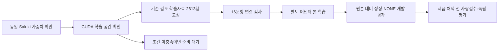

# Saluki 27B 여행 질의 파인튜닝 준비와 재개 계획

살루키의 첫 실험은 이미 만든 **여행 보강 학습자료 2,613행을 그대로 적용**하는 단일 판으로 진행합니다. 새 자료나 새 평가셋 완성을 기다리지 않고, 동일 살루키의 학습 경로·자원이 준비되면 기존 자료로 연결 검사부터 시작합니다. 현재 제공 파일·설치판·공간 조건은 아직 미충족이며 본 학습은 시작하지 않았습니다.

| 할 일 | 상태 | 진행 |
|---|---|---|
| 공식 모델·관련 표현 확인 | 완료 | 4/4 = 100% |
| 기존 GPU 기계 자원 확인 | 완료 | 2/2 = 100% |
| 첫 판 학습 정답 계약 확인 | 완료 | 2,613/2,613 = 100% |
| 추가 어려운 문장 AI 합의 | 확인 | 900/900 = 100% |
| GPU 학습 연결 검사 | 조건 대기 | 0/1 = 0% |
| 본 학습 | 조건 대기 | 0/1 = 0% |

여기서 ‘조건 대기’는 학습 승인이 부족하다는 뜻이 아닙니다. 27B 살루키의 별도 파인튜닝은 사용자가 승인했습니다. 다른 모델을 살루키라고 부르거나 현재 실행 중인 학습을 끄면서 진행하지 않도록 준비 조건을 확인한 상태입니다.

## 해결할 문제와 성공 기준

[실측] 학습 없는 `ConwayResearch/Underdog-Saluki-27B-1.0` 원본 IQ2-mix의 E 평가는 정상 요청 **997/1,033 = 96.52%**, 요청 없음 오지목 **157/974 = 16.12%**입니다. 이는 특정 모델·양자화·입력 계약의 1회 개발 시험이며 일반적인 모델 우열이나 독립 검증 통과가 아닙니다. 상세 비교 수치 정본은 [기존 비교 리포트](../../../final_project_cs/wiki/records/reports/2026-10-09_1116_saluki-all-abcde-comparison.md)입니다.

학습 후보 선정 기준은 ‘정상 요청을 계속 알아보고 오지목을 줄이는가’입니다. 사전 제안 기준은 정상 요청의 원본 대비 차이에서 신뢰구간 하한이 **−1%p 이상**, 독립 보류 자료의 요청 없음 오지목 **2% 이하**입니다. 수치는 목표이며 아직 통과하지 않았습니다. 같은 문항 쌍의 차이와 구간, 실패·미완료를 포함한 분모를 함께 보고합니다. 작은 자료에서 통계적 구분이 안 되면 자료를 늘리거나 검증 대기로 남깁니다.

## 정확한 모델과 현재 제한

공식 제공 파일과 실측 환경의 세부 값은 [전용 상태·학습 레시피](saluki_finetune_2026-10-09.json), [원본 사전 확인](../../scripts/plan_qa_bench/results/saluki_finetune_preflight_20261009_113242/summary.json), [설치판 확인](../../scripts/plan_qa_bench/results/saluki_finetune_preflight_20261009_113242/B_runtime.json)에 보관했습니다. 관측 시각은 **2026-10-09 11:32:46~47 KST**입니다.

| 확인 대상 | 확인 결과 | 의미 |
|---|---|---|
| [공식 Saluki](https://huggingface.co/ConwayResearch/Underdog-Saluki-27B-1.0) | revision `1336c0b5d74dfe6ad7f793577092f5effd9f97c6`, 7개 파일 전체 목록 확인 | IQ2-mix GGUF·vision projector·문서만 확인, 이 revision에 HF 학습 가중치 없음 |
| [다른 Underdog](https://huggingface.co/ConwayResearch/Underdog-27B-1.0) | MLX 4bit QAT, 약 16.05GB | 살루키와 다른 배포판, 자동 대체 금지 |
| [Qwen 원본](https://huggingface.co/Qwen/Qwen3.8-27B) | HF 전체 약 55.56GB | 같은 기반 구조지만 동일 살루키 가중치가 아님 |
| GPU 서버 A/B | 각각 약 16GB GPU, 루트 여유 약 4.27/6.52GB | 27B 훈련 메모리·변환 공간 충족을 실측하지 못함 |
| GPU 서버 B 설치판 | Transformers 5.18.0, GGUF 지원 목록에 qwen35 미확인, quantizer 학습 가능 표시 False | 기존 경로로 정확한 살루키 CUDA 역전파가 검증되지 않음 |

[외부] [Transformers 5.19 GGUF 문서](https://huggingface.co/docs/transformers/v5.19.0/quantization/gguf)는 Qwen3.5 packed 읽기 경로와 복원 경로를 설명합니다. packed 커널의 기본 지원은 MPS이며, 이것이 현재 GPU 서버 B의 CUDA 학습을 보장하지 않습니다. **GGUF라는 이유만으로 영구적으로 학습 불가능하다고 결론 내리지 않습니다.** 최신 구현의 CUDA 역전파, 정확한 가중치 계보, 필요한 RAM·공간을 검증하면 재개할 수 있습니다.

[추정] 27B를 단순히 4bit로 세면 13.5GB이나 이는 가중치만의 하한입니다. 임베딩·출력 표, 양자화 메타데이터, 어댑터·기울기·활성값이 추가됩니다. GPU 16GB에 들어간다고 보고하지 않습니다. 공유 `/workspace`의 큰 `df` 수치도 실제 사용자 할당량의 증거로 쓰지 않습니다.

[외부] Saluki Apache-2.0 LICENSE와 NOTICE 전체를 읽었습니다. 파생물의 라이선스·NOTICE·변경 표시 의무를 유지합니다. 이번 작업은 외부 게시·배포를 수행하지 않습니다. DoRA 원본 저장소 코드를 복사하지 않으며 적용한다면 PEFT 구현과 그 라이선스를 별도로 확인합니다.

## 기존 방법보다 개선할 것

1. **기존 검토 자료를 그대로 먼저 적용합니다.** `train_oos2`는 기존 1,713행과 AI가 서로 합의한 어려운 문장 900행을 합친 2,613행입니다. 별도 1,713행 학습을 선행 필수로 늘리지 않으며 정상/NONE 비율을 임의로 다시 맞추지 않습니다. D/E 평가 문장을 학습으로 옮기지 않습니다.
2. **학습을 약하게 시작하고 정상 요청 손실을 같이 봅니다.** rank8·최대 학습률 2e−5·1에폭 cosine을 첫 단일 판으로 제안합니다. 다른 기반 모델의 정상 요청 회귀가 살루키에도 반드시 발생한다고 단정하지 않습니다. 살루키 원본과 학습판의 정상 요청·잡담 오지목을 동시에 비교합니다.
3. **첫 학습과 제품 채택을 분리합니다.** 새 대조쌍 작성·새 F 완성·새 독립 보류 자료는 첫 연결 검사나 본 학습의 필수조건이 아닙니다. 사람 검수·독립 최종검증은 제품 채택에 필요합니다. 새 근거 답변 기능은 별도 연구로 유지합니다.
4. **평가와 양자화를 따로 확인합니다.** 동일 모델의 학습 전후를 먼저 비교하고, 배포 양자화 뒤에도 같은 시험을 반복합니다. FINCH·DoRA·rank16·추가 선호학습은 첫 판 결과 뒤 필요할 때만 검토하며 첫 판을 막지 않습니다.

## 2026-10-09까지 확인한 1차 연구

| 자료·버전 | 가져올 아이디어 | 적용 조건·비용·한계 |
|---|---|---|
| [QLoRA](https://arxiv.org/abs/2305.14314), 2023-05-23 | 고정 저정밀 본체와 작은 어댑터로 메모리 절약 | 정확한 모델의 지원되는 표현 필요. 논문의 48GB 결과는 우리 16GB 훈련 성공이 아님 |
| [DoRA](https://arxiv.org/abs/2402.09353), v6 2024-07-09 | 크기·방향으로 나눠 어댑터 표현력 보강 | 낮은 학습률·추가 메모리 측정 필요. 첫 판에 같이 넣어 효과를 섞지 않음 |
| [R-Tuning](https://aclanthology.org/2024.naacl-long.394/), NAACL 2024 | 알아야 할 때와 답을 삼갈 때를 구분하는 훈련 | 사실 무지와 요청 부재는 다름. 우리 문제에는 요청/NONE 대조 쌍으로 제한 적용 |
| [AutoQRA](https://arxiv.org/abs/2602.22268), v1 2026-02-25 | 양자화 비트와 어댑터 rank를 메모리 한도 안에서 함께 선택 | 탐색 자체가 비쌈. 우선 rank8·rank16 두 후보만 준비, 살루키 IQ2 호환 미검증 |
| [QUASAR](https://arxiv.org/abs/2608.13966), v2 2026-10-05 | 학습 중 양자화 복원 오차를 손실에 맞춰 보정 | 원본 고정밀 잠재 가중치와 많은 학습 필요. 첫 여행 SFT에 바로 쓰지 않음. [공식 구현](https://github.com/vincentcounathe/quasar-qat) 확인 |
| [BQ-LoRA](https://arxiv.org/abs/2609.12896), v1 2026-09-11 | 비슷한 행동 궤적의 과대 학습을 줄이는 분포 관리 | 여행 일정·의도군 균형 샘플링에 참고. 원 논문 알고리즘을 구현했다고 표시하지 않음 |

위 연구의 공개 점수는 우리 여행 프로젝트의 개선 실측이 아닙니다. 발표·수정일과 확인일(2026-10-09)을 구분했습니다.

## 데이터 확인과 남은 검수

[실측] 첫 판 자료는 [기존 train_oos2 원문](../../../datasets/travel/train_oos2/train_oos2.jsonl)이며 SHA256은 `07e6f7156883f9adb91812b2306b6dd813f60b189ae1da2610ae8c20d2d55a3c`입니다. [검토 범위 대조](../../scripts/plan_qa_bench/results/saluki_finetune_preflight_20261009_113242/reviewed_train_oos2_audit_1206.json)에서 총2,613행·정상1,377행·NONE1,236행, 추가900행 중 정상300·NONE600을 확인했습니다. 기존1,713행은 1,713/1,713 그대로 남았고, 전체 완성문 정답은2,613/2,613 일치했습니다.

[실측] 추가900행의 원본은 H-train 생성/라벨 자료입니다. 생성 모델 `gpt-6.1-sol`, 별도 라벨 모델 `gpt-6-luna`의 일치(`agree`) 상태900/900·정답 일치900/900을 원문에서 확인했습니다. AI 합의이며 **사람이 900행을 검수했다고 말하지 않습니다.** 첫1,713행은 기존 증류자료1,313＋잡담 부정400이며, 모든1,713행이 두 AI 적대 검토를 통과했다고 확대하지 않습니다. 추가판 생성 시 H-test/D2/D3와 3-gram Jaccard≥0.6 후보99개를 제외했고 H-train에서 기존 모델 오답을 우선 뽑았습니다. 이는 개발 채굴 근거이며 독립 최종 검증을 대신하지 않습니다.

[실측] 선택한 첫 판2,613행 전체를 다시 읽어 정답과 학습 완성문의 일치, JSON 형식, 중복을 검사했습니다. [자료 검사 결과](../../scripts/plan_qa_bench/results/saluki_finetune_preflight_20261009_113242/data_audit_oos2_1208.json)에 입력 해시와 세트별 분모를 고정했습니다. 전체 입력의 학습 내부 중복은 0개이고, 질문만 같은 행은 33개 초과분이 있어 일정이 다른 대조인지 검수해야 합니다.

D·D2·D3·H·E의 혼합/대조 **9,425행**과 첫 판 학습2,613행을 비교한 정확 질문/입력 중복은 **0/9,425**입니다. E혼합/대조 4,014행은 실제 E혼합 2,007개와 각각 연결된 대조 2,007개이며 새 정확도 분모로 합치지 않습니다. 정확 중복 0은 의미 유사·같은 일정군·원천 자료의 독립성을 증명하지 않습니다. 사람 정답 검수, 의미 중복 검사, 새 일정군 보류 자료를 만들고 해시 고정하는 일이 남았습니다.

첫 판은 기존2,613행을 그대로 사용하며 새50/35/15 재샘플링을 하지 않습니다. 기존 시험은 원본 대비 개발·회귀 진단에 씁니다. 제품 채택 전에는 새 독립 보류 목표 정상240·요청없음480개와 사람 검수를 완료하고 실패·미완료를 전부 분모에 둡니다.

## 재개 순서와 실행 조건

준비 항목 이름은 `saluki27b_sft_r8_s20261019_pending`입니다. **실제 GPU 실행 대기열에는 등록하지 않았습니다.** 충족하지 못한 앞 작업이 다른 준비된 작업을 막지 않게 합니다. [실행 조건 검사기](../../scripts/plan_qa_bench/server/queues/saluki_train_gate_20261009.py)는 동일 모델·계보·역전파·공간·자료·잠금·실패 재시도 조건을 확인하고 GPU 프로세스를 띄우거나 중단하지 않습니다.

동일 모델의 학습 표현이 확보되고 실제 할당량이 충분하면 CPU 토큰 길이 검사 후 16문항·2갱신 연결 검사를 합니다. 512→2,048→4,096토큰을 순서대로 확인하되 일정·질문을 자르거나 긴 행을 조용히 제외하지 않습니다. 손실/기울기의 유한값, 어댑터 변경, 본체 고정, 실제 CUDA·RAM 최고 사용량과 여유를 기록합니다. 실패 시 새 원인 수정 전 재시작하지 않습니다.

성공하면 기존 GPU 작업·잠금을 확인해 별도 출력 이름으로 1회 본 학습, 유망 판의 두 번째 seed, 학습 전후와 양자화 후 평가를 순서대로 등록합니다. 새로운 결제·임대·모델 삭제 없이 가능한 조건에서만 재개합니다. 사용자가 다시 승인할 필요는 없습니다.

## 관계

- [모델 비교·추가 학습 정본](../../../final_project_cs/wiki/quality/slm-model-evaluation.md) — 제품 채택과 학습 후보를 구분합니다.
- [GPU 운영 정본](../../../final_project_cs/wiki/operations/gpu-work-queue.md) — 실행·잠금·회수 규칙을 따릅니다.
- [전용 상태·레시피](saluki_finetune_2026-10-09.json) — 같은 준비 항목의 다음 확인 지점입니다.
- [이번 실측 리포트](../../../final_project_cs/wiki/records/reports/2026-10-09_1200_saluki-finetune-preflight.md) — 조사·구현·실측·미실행을 구분합니다.
