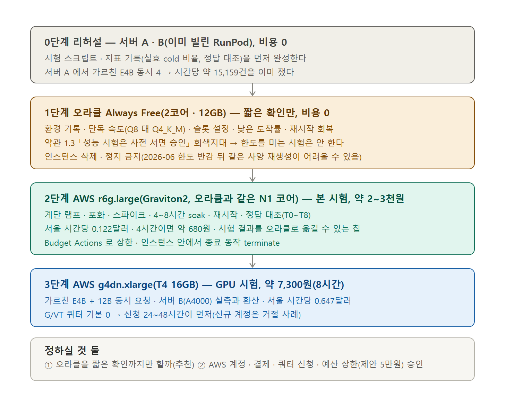

# 선별 모델 부하 시험 계획 — 오라클 Always Free · 아마존(AWS) (2026-10-07, 계획만 — 아직 아무것도 돌리지 않음)

사용자 요청: 「선별된 모델들의 부하 시험 계획은? 오라클 · 아마존 각각의 서버 한도 안에서 얼마나 버티는지 실험해야 한다. 일단 계획만 잡아봐, 자료조사 철저하게」. 자료조사는 2026-10-07 에 조사 담당이 공식 문서 · 2차 자료 29개 질문으로 했다(확인 22 · 부분 6 · 미확인 1). 모든 사실의 출처 URL 은 맨 아래 「근거 표」.

## 한눈에

- **오라클은 기술적으로 시험할 수 있지만 약관이 회색지대**다: 오라클 클라우드 서비스 약관 1.3 에 「서비스의 성능 시험은 오라클 사전 서면 승인 필요(서비스 명세서가 허용하는 범위 제외)」가 있고, Always Free 에는 승인 받을 창구가 없다. 우리 시험이 이 조항에 해당하는지는 **확정하지 못했다**(법무 판단 `[미확인]`). → 오라클에서는 **짧은 확인 시험**만 하고 **본 시험은 AWS 에서 같은 칩 계열로** 한다.
- **AWS 에서 가장 닮은 시험대는 Graviton2 `r6g.large`**(오라클 Ampere Altra 와 같은 Neoverse N1 코어 계열 · 2 vCPU · 16GB, 서울 시간당 0.122달러). 4시간 시험이 약 0.49달러(약 680원)다. GPU(g4dn · g5)는 신규 계정에서 **쿼터 신청이 먼저**(G/VT vCPU 기본 0).
- **큰 함정 셋**: ①오라클 A1 한도가 2026-06 에 4코어·24GB → 2코어·12GB 로 조용히 반감됐고 8월 이후 집행이 보도됐다 — **시험 중 인스턴스를 지우거나 멈췄다 켜지 않는다**(같은 사양으로 되살리기 어려울 수 있음) ②「하루 4,700건」은 하루 균등 분포 가정이다 — 피크 한 시간에 하루의 15% 가 몰리고 새 일정 첫 질문이 10% 면 가동률 100% 에서도 **하루 약 1,320건**, 50% 가동이면 약 660건 `[계산]` ③llama-server 기본값(캐시 RAM 8GiB · 슬롯 선택 규칙)과 빌드 버전이 결과를 좌우하고, **동시 요청에서 다른 대화 내용이 새 슬롯에 복원되는 알려진 버그(#27148)** 가 있어 시험 중 정답 대조가 필요하다.
- 정하실 것 둘이 맨 아래에 있다(오라클 시험 범위 · AWS 시험 승인과 예산 상한).

## 1. 무엇을 시험하나 — 선별 모델과 알고 싶은 것

| 모델(선별) | 쓰임 | 어디서 시험 가능한가 |
|---|---|---|
| 가르친 Gemma-4 E4B(GGUF Q8_0 8.0GB · Q4_K_M 5.3GB, 최종 학습판은 oos2r · oos1 결과로 확정) | 일정 항목 짚기 | 오라클 ARM(실측 있음) · AWS Graviton(r6g) · AWS GPU |
| 임베딩 bge-m3(Q8_0 0.6GB) | 규정 검색 · 앞단 | 오라클 ARM(실측: 질의 1건 0.075초, 규정 조각 300토큰 0.72초) |
| gemma4:12b(Q4_K_M 7.4GB, 서비스의 결정 단위) | 결정 | CPU 로는 부적합(오라클 실측: 첫 질문 7분 · 여유 메모리 0.5GB) → **GPU 시험만** |
| (선택) 검토자 Qwen3.5-4B 원본 | 짧은 확인 질문 | 오라클 ARM(읽기 약 19토큰/초 · 건당 약 8초 예상) |

알고 싶은 것 일곱: Q1 피크 기준 하루 몇 건 · Q2 지연(p50/p95) · Q3 동시 사용자 몇 명까지 · Q4 새 일정 첫 질문(cold)과 이어지는 질문(warm)이 섞일 때 포화점 · Q5 장시간(메모리 · 캐시 누수) · Q6 재시작 뒤 회복 · Q7 월 비용 대비 처리량.

## 2. 시험 설계 (조사에서 나온 방법론을 우리 워크로드에 맞춘 것)

1. **시험 단위는 질문이 아니라 일정(세션)**. 일정 도착은 포아송(개방 모델, k6 `arrival-rate` 방식), 일정 안의 후속 질문은 생각 시간을 둔 폐쇄 루프 — 「부분 개방」이 우리 사용 패턴과 같다. 세션당 질문 수 K = 1/s (s = 새 일정 첫 질문 비율 10~30% → K ≈ 10~3.3). 고정 동시 사용자만 쓰면 서버가 느려질 때 도착이 줄어 느려진 순간을 덜 재는 편향(coordinated omission)이 생긴다.
2. **s 를 입력값으로 박지 않는다.** 살아 있는 일정 수(리틀의 법칙: L = λ × W)가 슬롯 수와 `--cache-ram` 용량을 넘으면 warm 이어야 할 질문이 cold 로 돌아가 실효 cold 비율이 올라간다. 요청마다 `cache_n ÷ 프롬프트 토큰`을 기록해 **실효 cold 비율을 결과로 낸다**.
3. **지표**: 요청 지연 p50 · p95 · 최댓값(표본이 59건 미만이면 p95 대신 최댓값), 서버 timings(읽는 시간 `prompt_ms` · 생성 시간 `predicted_ms` · 건너뛴 토큰 `cache_n`), 오류율, 큐(`requests_deferred`), 메모리(RSS · 여유), CPU steal · 실제 클럭, 모델 큐 대기와 「워밍 도중 들어온 질문 비율」. TTFT · ITL 은 출력이 약 10토큰 비스트리밍이라 의미가 약하다 `[판단]`.
4. **서비스 시간이 극단으로 갈린다**(오라클 실측: cold 112.5초 · warm 7.7초, 변동계수² ≈ 3.0) — 평균이 아니라 cold · warm 을 따로 본다. 제품의 「규칙이 먼저 답하고 모델은 뒤에서 일정을 읽어 둔다」 구조라면 지표를 둘로 나눈다: **사용자 체감 지연(규칙 답)** 과 **모델 큐**.
5. **정답 대조**: 동시 요청의 정답을 단독 실행 정답과 비교한다(llama.cpp #27148 대화 혼선 검사). 회피책은 `--cache-ram 0` 또는 `--parallel 1` 이고 시험에서 설정별로 비교한다.
6. **입력은 합성만**(MX · D3 · H 시험 문장과 합성 일정). 사용자 데이터는 쓰지 않는다 — AWS 무료 플랜은 평가 목적이라 민감 데이터 처리에 쓰지 말라는 조항, 오라클 Always Free 는 비운영 · SLA 없음, 그리고 위 #27148 같은 혼선 경로.

### 시험 종류와 순서

| 번호 | 시험 | 목적 | 어떻게 | 길이 |
|---|---|---|---|---|
| T0 | 환경 기록 | 결과를 빌드에 묶인 사실로 만든다 | `llama-server --version` 빌드 번호 · 시작 로그 `system_info`(NEON · DOTPROD · MATMUL_INT8 · SVE) · `lscpu` 기능 목록 · 수정판 해시 | 10분 |
| T1 | 단독 처리 속도 | Q8 대 Q4_K_M 의 순서가 빌드 탓인지 | `llama-bench`(pp · tg, `-r 5`) 를 양자화별로 · 최신 master 로 다시 빌드한 것과 현재 빌드를 교대로 | 1시간 |
| T2 | 슬롯 · 캐시 설정 | 슬롯이 처리량이 아니라 캐시 보관함인지 | `-np` 1 · 2 · 4 × `id_slot` 고정 대 자동 선택(`-sps`) × `--cache-ram` 명시값. 각 설정에서 warm 질문의 `cache_n` 보존율 | 2시간 |
| T3 | 계단 램프 | 도착률별 지연 곡선 | 일정 도착률을 단계로 올림(예: 시간당 5 · 10 · 20 · 40 일정), 단계당 약 500요청 | 3~4시간 |
| T4 | 포화 | 한계 처리량 · 포화점 | 개방 모델로 도착률을 한계 위까지(범용 확장성 법칙 N = 1 · 2 · 3 · 4 점을 맞춰 α · β 추정, 닫힌 시스템 N* = (S+Z)/S 와 대조) | 2시간 |
| T5 | 스파이크 | 피크 시간 몰림 | 평소의 4~6배를 10분 | 1시간 |
| T6 | soak | 메모리 · 캐시 누수, 오라클 유휴 판정 | 평균 부하로 4~8시간, 메모리 · 지연 추세 | 4~8시간 |
| T7 | 장애 복구 | 재시작 직후 cold 폭증 · 큐 회복 | 서버 프로세스 재시작(인스턴스는 건드리지 않음) 후 회복 시간 | 30분 |
| T8 | 정답 대조 | 동시 요청 혼선 | T3 · T4 중 요청의 정답을 단독 실행 정답과 비교 | T3 과 함께 |

도구: 부하 발생은 **k6**(개방 · 폐쇄 실행기 모두 · AGPL-3.0) 또는 이미 있는 `program/scripts/plan_qa_bench/server/llama_conc_bench.py` 를 일정 단위로 확장. **GuideLLM**(Apache-2.0 · sweep · poisson · concurrent) 은 llama-server 대상 공식 보증이 없어 시험대에서 먼저 확인. `llama-bench` 는 단일 인스턴스 측정이라 동시성 시험이 아니고, `llama-batched-bench` 의 `-npl` · `-pps`(공유 프롬프트)는 접두 공유 근사에만 쓴다. 한국어 LLM 서빙 부하 시험 문서는 못 찾았다. 부하 발생기는 서버와 같은 리전의 다른 기계(오라클 AMD Micro 는 50Mbps 라 약함)에서 돌리고, 서버 안 localhost 측정과 외부 측정을 둘 다 남긴다.

## 3. 서버별 계획

### 3-1. 오라클 Always Free (2코어 · 12GB Ampere A1) — 짧은 확인만

- 한도(공식 문서): A1 월 1,500 OCPU시간 + 9,000 GB시간(= 2 OCPU · 12GB), 부트+블록 합계 200GB, 아웃바운드 월 10TB, A1 대역폭은 OCPU 당 1Gbps. 우리 시험 전송량은 요청 약 7KB 라 수 MB 수준 — 한도와 무관.
- **유휴 회수**: 7일 동안 CPU 95퍼센타일 20% 미만 **그리고** 네트워크 20% 미만 **그리고**(A1 만) 메모리 20% 미만이면 회수 대상. 시험 중에는 문제없고, 상시 운영에서는 8GB 모델이 상주해 메모리가 12GB 의 약 2/3 라 유휴로 안 잡힐 수 있다 `[예상]`.
- **하지 않을 것**: 인스턴스 삭제 · 정지 후 재시작(한도 반감 이후 같은 사양으로 재생성이 안 될 수 있음), 한도 초과 요청, 포트 스캔 · 취약점 스캔(약관 금지).
- **할 것(약관 회색지대를 존중한 최소 범위)**: T0 · T1 · T2 와 T3 의 낮은 단계 몇 개 · T7. 모두 **우리 인스턴스에서 우리 앱 모양 그대로**(실제 사용 흐름의 소규모 재현) 돌리는 수준이고, 한도를 밀어붙이는 T4 · T5 · T6 은 하지 않는다. 이미 같은 기계에서 한 실측(10-06~07)은 같은 범위의 시험이다.
- 사전 과제: 약관 1.3 의 「서비스 명세서가 허용하는 범위」 예외가 Always Free 에 있는지(서비스 명세서 · 보안 시험 정책 본문은 조사 때 403 이라 못 읽음), 결과를 발표 · 문서로 공개할 때 benchmarking 공개 문구에 걸리는지 — **사용자 · 팀 판단**.

### 3-2. AWS — 본 시험

| 시험대 | 서울 시간당 | 월(730h · 1,400원/달러) | 용도 | 시험 비용 예 |
|---|---:|---:|---|---|
| **r6g.large**(Graviton2, Neoverse N1, 2 vCPU · 16GB) | 0.122 달러 | 약 12.5만원 | **오라클과 같은 칩 계열의 본 시험(T0~T8)** | 4시간 약 0.49 달러 ≈ 680원 · 8시간 약 1,400원 |
| c7g.xlarge(Graviton3, V1: i8mm · SVE 있음) | 0.1632 | 약 16.7만원 | 결과를 오라클로 옮길 수 없는 **다른 칩** — 비교용으로만 | — |
| t3.medium(2 vCPU · 4GB, x86) | 0.052 | 약 5.3만원 | 모델 서빙 부적합(4GB). 앱 서버용 가격 확인만. 버스트: 기준선 20%, 초과분 vCPU시간당 0.05달러 | — |
| **g4dn.xlarge**(T4 16GB · 4 vCPU) | 0.647 | 약 66.1만원 | GPU 시험: 가르친 E4B + 12B 동시 요청, 서버 A · B(RunPod)와 환산 | 8시간 약 5.2 달러 ≈ 7,300원(스팟 0.19~0.32 달러/시간) |
| g5.xlarge(A10G 24GB) | 1.237 | 약 126.4만원 | 더 큰 GPU 비교(선택) | 8시간 약 9.9 달러 ≈ 13,900원 |

- 가격은 서울(ap-northeast-2) 값이고 **기존 보고서가 쓴 버지니아 값보다 약 23% 비싸다**(g4dn 월 53.8만 → 66.1만원). 스팟 가격은 출처마다 달라 시험 직전 확인.
- **GPU 쿼터**: 「Running On-Demand G and VT instances」 기본 0 · 「All G and VT Spot」 기본 0. Service Quotas 에서 신청(g4dn.xlarge 는 4 vCPU 필요), 신규 · 저사용 계정은 거절 · 8 vCPU 상한 사례(일화), 응답 24~48시간. **쿼터 신청을 먼저 낸다.** 무료 플랜(2025-07-15 이후 가입: 크레딧 100달러 + 활동 100달러, 6개월)은 GPU 가 사실상 안 맞아 유료 플랜이 필요하고, 크레딧이 GPU 에 적용되는지는 명시 문장이 없다.
- 부하 시험 정책: EC2 는 사전 승인 없이 시험 가능, DoS · 모의 DoS · 요청 폭주는 금지(침투 시험 정책), 25Gbps 를 넘는 트래픽은 조절될 수 있다. 우리 시험은 시간당 수십~수백 요청이라 해당 없음.
- **비용 통제**: 예산 알림은 하루 최대 3회 갱신이라 사후 알림일 뿐 상한이 아니다 → **Budget Actions**(IAM 거부 정책 또는 지정 EC2 정지 자동 실행) · 쿼터를 4 vCPU(1대)로만 신청 · 인스턴스 안 종료 동작을 terminate 로(`InstanceInitiatedShutdownBehavior`) · 시험 스크립트 끝에서 `shutdown`. 스팟은 언제든 회수될 수 있어 T6(soak)에는 온디맨드.

### 3-3. 리허설(비용 0) — 서버 A · B(RunPod)

시험 스크립트와 지표 기록을 먼저 서버 A(RTX 2000 Ada) · 서버 B(A4000)에서 돌려 고친 뒤 오라클 · AWS 에 올린다. 서버 A 에서는 이미 가르친 E4B 동시 4 에서 시간당 약 15,159건을 쟀고(마스터 문서 §92-14 · 비용 보고서 §3-2) 같은 스크립트(`llama_conc_bench.py`)를 일정 단위로 바꾼 것이 T3 의 기준이 된다.

## 4. 성공 기준 (시험 전에 고정하는 제안 — 팀 결정 필요)

| 지표 | 기준(제안) | 근거 |
|---|---|---|
| warm 질문 p95 | 15초 이내 | 발표 29번 상용화 기준표의 응답 시간 SLA(양식) |
| 사용자 체감 지연(규칙 답) | 15초 이내 | 같은 SLA, 모델 cold 112초는 뒤에서 워밍 |
| 오류율 | 1% 이하 | 제안 |
| 동시 대 단독 정답 일치 | 100% | #27148 혼선 검사 |
| 모델 큐 | 워밍 도중 들어온 질문 비율과 대기 시간을 보고(기준은 측정 뒤 정함) | cold · warm 극단 분포 |
| 피크 기준 하루 처리량 | 오라클 약 920건(가동 70%) · 660건(50%) 을 시험이 확인하는지 | 시간당 198건(s=10%) ÷ 0.15 `[계산]` |

피크 계산: 시간당 처리량 198건(s=10%, Q8, 동시 1) → 하루 상한 198 ÷ 0.15 = 1,320건(가동 100%), 70% 920건, 50% 660건. s=30% 는 시간당 92건 → 613 · 307건, s=0%(전부 warm)는 466건 → 3,107 · 1,553건 `[계산, 균등 분포 가정을 피크 기준으로 바꾼 값]`.

## 5. 위험 · 근거 약한 곳

- 오라클 쪽 근거 중 **한도 반감(2026-06) · 8월 18일 집행 · 회수 = 정지 · 종량제 한도**는 2차 자료와 커뮤니티 글이고 공식 본문에서 날짜를 못 찾았다(종량제 A1 한도는 지원 답변이 「4/24 유지」와 「2/12 초과분 과금」으로 엇갈림).
- 오라클 보안 시험 정책(DoS · 부하 시험 금지 요약)은 **검색 요약만** — 본문이 403 이라 직접 못 읽었다. CSA 1.3 문구는 영국판 2023-06 서식 본문(미국판 403).
- llama.cpp 문서는 master 기준이라 오라클 박스 빌드와 다를 수 있다(`-sps` 기본값이 README 0.10 대 튜토리얼 0.5 로 충돌). ARM 에서 Q4_K_M 이 Q8 보다 느린 **정확한 원인은 못 찾았다**(가설: 재배열 커널이 양자화별로 다른 시점에 들어옴 — Q4_K 는 2025-11 PR #17494, N1 은 i8mm 없이 dotprod 만 사용). 그래서 T0 · T1 이 먼저다.
- 열 · 스로틀링 · NUMA 근거는 못 찾았다(VM 안 관측 어려움 — steal 시간과 클럭을 같이 기록).
- AWS 서울 데이터 전송 요율 · 인바운드 · 공인 IPv4 요금 · g4dn 절약 플랜 서울 할인율은 미확인 — 시험 전송량이 작아 영향은 미미할 것으로 본다. 스팟 가격 · 신규 계정 GPU 쿼터 거절률은 출처가 일화 · 제3자뿐.
- WebFetch 요약기가 가격 한 줄을 틀리게 옮긴 것을 조사 중 한 번 잡았다 — 결정에 쓸 숫자는 원문 재확인.

## 6. 일정 · 비용 요약(계획)

| 단계 | 내용 | 걸리는 시간 | 비용 | 선행 |
|---|---|---|---|---|
| 0 | 쿼터 신청(g4dn 4 vCPU) · 약관 판단 · AWS 예산 상한 설정 | 신청 24~48시간 | 0 | 사용자 결정 |
| 1 | 리허설 — 서버 A · B(RunPod)에서 시험 스크립트 완성 | 0.5일 | 0(이미 빌린 서버) | 최종 학습판 확정 |
| 2 | 오라클 짧은 확인(T0 · T1 · T2 · T3 낮은 단계 · T7) | 약 6~8시간 | 0 | 약관 판단 |
| 3 | AWS r6g.large 본 시험(T0~T8) | 약 12~16시간(연속 가동 아님) | 약 2,000~3,000원 | 1 |
| 4 | AWS g4dn.xlarge GPU 시험(E4B + 12B 동시) | 약 8시간 | 약 7,300원(온디맨드) | 쿼터 승인 |
| 5 | 결과 → 하루 건수 · 비용 표 갱신(발표 · 비용 보고서) | 0.5일 | 0 | 3 · 4 |

## 7. 정하실 것

1. **오라클에서 어디까지 시험할까요?** (가) 짧은 확인만(T0 · T1 · T2 · T3 낮은 단계 · T7) — **추천**: 약관 1.3 의 회색지대를 피하고 본 시험은 AWS 에서 한다. (나) 본 시험까지 오라클에서 — 한도 안이어도 약관 해석이 미확인이라 위험하고, 한도 반감 이후 인스턴스를 잃으면 되살리기 어렵다. (다) 오라클 시험을 안 함 — 이미 있는 실측(10-06~07)만 쓴다.
2. **AWS 시험을 승인하시겠어요?** 계정 · 결제 수단 · 쿼터 신청 · 예산 상한(제안: 시험 전체 5만원)이 필요합니다. 결제를 쓰는 일이라 제가 시작하지 않고 승인을 기다립니다. 승인 전에는 서버 A · B 리허설(비용 0)까지만 합니다.

## 근거 표 (조사 담당 보고 — 2026-10-07 읽음, 「본문 읽음」은 요약기를 거친 것)

| 영역 | 사실 | 출처 URL | 확인 |
|---|---|---|---|
| 오라클 | A1 월 1,500 OCPU시간 · 9,000 GB시간 = 2 OCPU · 12GB | https://docs.oracle.com/en-us/iaas/Content/FreeTier/resourceref.htm | 본문 |
| 오라클 | 한도 반감(2026-06) · 8월 18일 집행 보도 · 종량제 한도 충돌 | https://www.infoq.com/news/2026/07/oracle-cloud-free-tier-limits/ · https://linuxiac.com/oracle-quietly-cuts-free-tier-ampere-a1-resources-in-half/ · https://terminalbytes.com/oracle-cloud-free-tier-changes-2026/ | 2차 |
| 오라클 | 한도 초과 A1 비활성 · 삭제, 한도 증설 불가 | https://docs.oracle.com/en-us/iaas/Content/FreeTier/freetier.htm · https://docs.oracle.com/en-us/iaas/Content/General/Concepts/servicelimits.htm | 본문 |
| 오라클 | 부트 볼륨 · 합계 200GB · 월 10TB · OCPU 당 1Gbps · Altra Q80-30 3.0GHz | https://docs.oracle.com/en-us/iaas/Content/FreeTier/freetier_topic-Always_Free_Resources.htm · https://docs.oracle.com/en-us/iaas/Content/Compute/References/computeshapes.htm | 본문 |
| 오라클 | 유휴 회수: 7일 · CPU 95퍼센타일 · 네트워크 · A1 은 메모리 모두 20% 미만(이력 10→15→20%) | resourceref.htm · https://blog.51sec.org/2023/02/oracle-cloud-cleaning-up-idle-compute.html | 공식 + 2차 |
| 오라클 | CSA 1.3: 성능 시험은 사전 서면 승인(명세서 허용 범위 제외) · 포트 · 취약점 스캔 금지 | https://assets.applytosupply.digitalmarketplace.service.gov.uk/g-cloud-14/documents/702001/555484208241614-terms-and-conditions-2024-05-01-1345.pdf | 본문(영국판) |
| 오라클 | 보안 시험 정책(DoS · 부하 시험 금지 요약) | https://docs.oracle.com/iaas/Content/Security/Concepts/security_testing-policy.htm | **검색 요약만(403)** |
| AWS | 서울 시간당: t3.medium 0.052 · r6g.large 0.122 · c7g.xlarge 0.1632 · g4dn.xlarge 0.647 · g5.xlarge 1.237 | https://ec2.shop?region=ap-northeast-2 (제3자, 일부 AWS 계산기 · devzero · doit 와 대조) | 부분 대조 |
| AWS | GPU 쿼터 기본 0(G/VT) · 표준 5 vCPU, Service Quotas 신청 | https://docs.aws.amazon.com/ec2/latest/instancetypes/ec2-instance-quotas.html · https://docs.aws.amazon.com/AWSEC2/latest/UserGuide/ec2-resource-limits.html | 본문 |
| AWS | 무료 플랜(2025-07-15 이후): 크레딧 · 6개월 · 무료 대상 EC2 | https://docs.aws.amazon.com/awsaccountbilling/latest/aboutv2/free-tier-plans.html · https://docs.aws.amazon.com/AWSEC2/latest/UserGuide/ec2-free-tier-usage.md | 본문 |
| AWS | 부하 시험 정책 · 침투 시험 정책 | https://aws.amazon.com/security/penetration-testing/ · https://aws.amazon.com/ec2/testing/ | 본문 |
| AWS | 예산 알림 하루 3회 · Budget Actions · 종료 동작 · 스팟 회수 | https://docs.aws.amazon.com/cost-management/latest/userguide/budgets-managing-costs.html · https://docs.aws.amazon.com/AWSEC2/latest/UserGuide/Using_ChangingInstanceInitiatedShutdownBehavior.html · https://docs.aws.amazon.com/AWSEC2/latest/UserGuide/spot-interruptions.html | 본문 |
| AWS | Graviton2 = Neoverse N1 = 오라클 Altra 계열 코어, 1 vCPU = 물리 코어 | https://github.com/aws/aws-graviton-getting-started/blob/main/README.md | 본문 |
| 방법론 | 지표 정의(TTFT · ITL · 종단 지연) | https://developer.nvidia.com/blog/llm-benchmarking-fundamental-concepts/ | 본문 |
| 방법론 | 폐쇄 대 개방 · 부분 개방 | https://grafana.com/docs/k6/latest/using-k6/scenarios/concepts/open-vs-closed/ · https://www.usenix.org/legacy/event/nsdi06/tech/full_papers/schroeder/schroeder_html/ | 본문 |
| 방법론 | 리틀의 법칙 · 범용 확장성 법칙 | https://en.wikipedia.org/wiki/Little%27s_law · https://www.perfdynamics.com/Manifesto/USLscalability.html | 본문 / 검색 요약 |
| 방법론 | llama-server 슬롯 · 캐시 · 지표 | https://raw.githubusercontent.com/ggml-org/llama.cpp/master/tools/server/README.md · https://github.com/ggml-org/llama.cpp/discussions/13606 | 본문 |
| 방법론 | 알려진 문제: #22942(슬롯 간 접두 체크포인트) · #27148(동시 요청 대화 혼선) | https://github.com/ggml-org/llama.cpp/issues/22942 · https://github.com/ggml-org/llama.cpp/issues/27148 | 본문 |
| 방법론 | llama-bench · batched-bench · server/bench(k6) | https://raw.githubusercontent.com/ggml-org/llama.cpp/master/tools/llama-bench/README.md · .../tools/batched-bench/README.md · https://github.com/ggml-org/llama.cpp/tree/master/tools/server/bench | 본문 |
| 방법론 | vLLM bench · GuideLLM · k6 · Locust · vegeta | https://docs.vllm.ai/en/latest/benchmarking/cli/ · https://github.com/vllm-project/guidellm · https://docs.locust.io/en/stable/writing-a-locustfile.html | 본문 |
| ARM | llama.cpp ARM 커널 연혁(PR #5780 · #10446 · #17494) | https://github.com/ggml-org/llama.cpp/pull/17494 · https://github.com/ggml-org/llama.cpp/pull/10446 · https://github.com/ggml-org/llama.cpp/pull/5780 | PR 본문 |
| ARM | Neoverse N1 = Armv8.2-A, dotprod 있고 i8mm · SVE 없음 | https://en.wikipedia.org/wiki/ARM_Neoverse | 위키 본문 · flag 는 검색 요약 |
