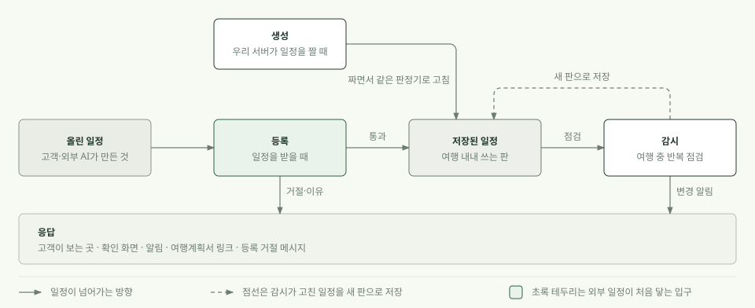

# 여행자 확인 체크리스트 — 85항목 길별 상세 (2026-10-03)

> 이 문서는 [v2 판정표](여행자_확인_체크리스트_v2_2026-10-03.md)의 66항목에 **추가 19항목**을 더해, 모두 **분류별로 하나도 빼지 않고** 풀어 쓴 상세판이다. 항목마다 「네 길(생성·등록·감시·응답)에서 어떻게 확인하는지」를 쉬운 말로 적었다. 추가 항목은 번호 앞에 ＋ 를 붙였다. 체크박스만 있는 짧은 판은 [여행자_확인_체크리스트_85항목_점검표_2026-10-03.md](여행자_확인_체크리스트_85항목_점검표_2026-10-03.md).

## 한눈에

- **결론**: 사람이 일정표를 믿기 전에 하는 확인 중 서버 일정 판정 범위 안의 **85가지**를 13개 분류로 정리했다(원래 66 + 추가 19). 원래 66가지 중 **46가지(46/66 = 69%)는 일부 길·조건에서 이미 판정**하고, **2가지는 보여 주기만** 하며, **18가지(18/66 = 27%)는 어느 길에도 없다**. 모든 길에서 판정하는 항목은 하나도 없다.
- **추가 19가지**: 서버가 이미 하는 일에서 거꾸로 찾은 9가지와 여행자 관점에서 Codex가 찾은 10가지다. 추가 19가지 중 11가지는 일부 길에서 판정하고, 8가지는 어느 길에도 없다(코드를 읽어 확인한 값).
- **그래서 달라지는 것**: 「이 확인은 된다/안 된다」가 아니라 「어느 길에서는 되고 어느 길에서는 안 된다」로 읽어야 한다. 같은 확인도 일정을 짤 때와 받을 때와 지켜볼 때가 다르다.
- **현재 코드와 맞는지 점검했다**: 원래 66항목의 네 길 칸·확인 방법·근거를 2026-10-03 10:30 작업 트리와 대조했고, 어긋난 64칸(32항목)을 고쳤다. 추가 19항목은 처음부터 코드를 읽어 만들었다. 자세한 것은 「현재 코드와 맞춘 결과」 절.
- **2차 갱신(cs 반영 후)**: 같은 날 12시 30분 무렵 cs 세션이 H3·L2·T13·O4·T5·T7·T8·T9·I1을 서버 코드에 반영했다(로컬 커밋, push 전). 그 변경과 닿는 26항목을 새 코드와 다시 대조해 57칸(17항목)을 고쳤다. 자세한 것은 5-1절.
- **3차 갱신(cs 적대 검토 보완 후)**: cs 세션이 다른 AI의 반증으로 나온 결함을 고쳤고(커밋 ee784437), 그 변경과 닿는 18항목을 다시 대조해 56칸(15항목)을 고쳤다. 자세한 것은 5-2절.
- **정할 것**: 아래 「우선순위 1」 항목을 서버 세션에 넘길지(이 문서는 판단만 담았고 서버에는 아무것도 요청하지 않았다). 추가 항목의 우선순위는 제안일 뿐이다.

| 할 일 | 상태 | 진행 |
|---|---|---|
| 원래 66항목 분류별 상세 정리 | 끝 | 66/66 = 100% |
| 추가 19항목 찾기 | 끝 | 서버 쪽 9 + 여행자 쪽 10 = 19개 |
| 추가 19항목의 네 길 판정을 코드로 확인 | 끝 | 19/19 = 100% |
| 쉬운 말 다시쓰기(원래 항목) | 끝 | 66/66 = 100% |
| 현재 코드와 대조(원래 항목) | 끝 | 66/66 = 100% 항목 확인(고친 항목 32) |
| 체크리스트만 있는 판 | 끝 | 1/1 = 100% |
| 서버에 규칙 추가 | 미착수 | 0건 요청 |

## 1. 이 문서 읽는 법

### 1-1. 네 길

같은 확인이라도 서버가 **어느 때** 하느냐에 따라 코드가 다르다. 이 문서는 그 때를 네 길로 나눈다.

| 길 | 언제 | 쉬운 설명 |
|---|---|---|
| 생성 | 우리 서버가 일정을 **짤 때** | 짜면서 같은 판정기로 훑고, 위반이 나오면 스스로 고친다(최대 3회). |
| 등록 | 고객이나 외부 AI가 만든 일정을 **받을 때** | 직접 등록·MCP(개인 AI 연결구)·「읽은 일정 확인」 화면이 모두 여기다. 위반이면 거절하거나 확인 필요로 표시한다. |
| 감시 | 여행 **중** 서버가 반복해서 지켜볼 때 | 날씨·통제·영업 같은 바깥 사정이 바뀌면 일정을 고치거나 고객에게 묻는다. |
| 응답 | 결과를 **고객에게 내보낼 때** | 확인 화면의 검사 줄, 등록 거절 메시지, 알림, 여행계획서 링크가 여기다. 판정은 했는데 내보내지 않으면 고객은 모른다. |

**예: 「일정끼리 겹치지 않는가」** — 생성 길은 겹치면 뒤 항목을 밀어 스스로 고친다. 등록 길은 겹치면 거절하고 이유를 알려 준다. 감시 길은 자동 변경을 적용하기 직전에만 본다. 응답 길은 거절 메시지와 확인 화면 줄로 알린다. 한 확인이 네 길에서 서로 다르게 도는 것이 정상이고, **어느 길이 비었는지**가 이 문서가 보여 주려는 것이다.

### 1-2. 칸의 기호

| 기호 | 뜻 |
|---|---|
| ● 판정 | 그 길에서 실제로 판정한다 |
| ◐ 일부 | 값이 있을 때만, 어떤 경로에서만, 어떤 때에만 판정한다 |
| · 안 함 | 그 길에는 코드가 없다(찾은 범위에서 안 나왔다는 뜻이다) |
| ◇ 구성 보장 | 만드는 방식 때문에 어긋날 수 없을 뿐 검사하는 것은 아니다 |

### 1-3. 우선순위와 다음 조치

- **우선순위 1** 외부 연구가 상위 결함으로 꼽았고, 값은 이미 있어 규칙만 더하면 되며, 대표 시연에 걸리는 것. **2** 고객 입력이나 외부 소스를 이어야 하는 것. **3** 소스가 없어 보류하는 것.
- **다음 조치** 규칙 추가(값은 이미 있는데 판정이 안 걸림) · 입력 연결(고객 입력이 서버에 안 닿음) · 배선(만들어 둔 코드를 아무도 안 부름) · 소스 필요(데이터 자체가 없음) · 고객 확인 · 유지.
- 우선순위와 다음 조치는 v2 자료의 판단(Claude·Codex 합의)을 그대로 옮겼다. 이 문서에서 새로 매기지 않았다.

### 1-4. 「값이 없을 때」 칸이 말하는 것

프로젝트 정책(2026-09-10 결정 15)은 **값을 모르는 상황을 만들지 않는다**이다. 필요한 값마다 대체 소스를 두고, 1차가 안 되면 대체로 값을 낸다. 대체까지 안 되면 치명 결함으로 보고 서버를 멈춘다. 카드의 「값이 없을 때」 칸은 **코드가 실제로 어떻게 하는지**를 적었다. 정책대로 멈추거나 대체하는 곳도 있고, 값이 없으면 판정하지 않고 통과시키는 곳도 있다. 후자는 정책과 어긋난 자리이고, 외부 연구가 꼽은 흔한 결함이 여기서 새어 나간다.

### 1-5. 항목 카드 보는 순서

카드마다 **왜 확인하나 → 네 길 표 → 확인 방법·통과 기준 → 값이 없을 때 → 근거 링크** 순서다. 근거는 맨 아래에 두었으니, 위만 읽어도 뜻이 통한다.

## 2. 분류별 한눈 표

| 분류 | 항목 수 | 그중 추가＋ | 일부 길에서 판정 | 보여 주기만 | 어느 길에도 없음 |
|---|---|---|---|---|---|
| 장소 | 3 | 0 | 3 | 0 | 0 |
| 열림 | 9 | 2 | 6 | 1 | 2 |
| 시간·짜임새 | 14 | 4 | 12 | 0 | 2 |
| 신뢰 | 4 | 2 | 4 | 0 | 0 |
| 예약 | 11 | 2 | 4 | 0 | 7 |
| 길·교통 | 15 | 3 | 13 | 1 | 1 |
| 날씨 | 5 | 0 | 2 | 0 | 3 |
| 먹기 | 6 | 1 | 2 | 0 | 4 |
| 돈 | 4 | 0 | 3 | 0 | 1 |
| 일행 | 8 | 1 | 2 | 0 | 6 |
| 당일 | 4 | 2 | 4 | 0 | 0 |
| 안전 | 1 | 1 | 1 | 0 | 0 |
| 입력 | 1 | 1 | 1 | 0 | 0 |
| **합계** | **85** | **19** | **57** | **2** | **26** |

길별 개수(85항목 중, 괄호는 그중 추가＋):

| 길 | ● 판정 | ◐ 일부 | · 안 함 | ◇ 구성 보장 |
|---|---|---|---|---|
| 생성 | 9 (3) | 30 (3) | 44 (12) | 2 (1) |
| 등록 | 1 (1) | 38 (5) | 46 (13) | 0 (0) |
| 감시 | 2 (2) | 43 (7) | 39 (9) | 1 (1) |
| 응답 | 6 (3) | 51 (8) | 28 (8) | 0 (0) |

## 2-1. 추가 19항목 (2026-10-03 오후)

66개 목록이 두 AI 초안을 합친 것이라 빠진 것이 있을 수 있어, 두 방향에서 더 찾았다. 두 방향의 후보가 **하나도 겹치지 않았다**. 각 방향에 빠진 것이 더 있을 수 있다는 뜻이다.

- **서버 쪽 9가지 (코드에서 거꾸로)**: 서버가 이미 하고 있는데 66개 목록에 대응 항목이 없는 것. 코드 위치로 확인했다.
- **여행자 쪽 10가지 (Codex)**: 66개 목록을 보여 주고 빠진 확인을 독립적으로 찾게 한 결과. 근거는 일반 운영 지식이고 실제 여행자 표본이나 시설 규정으로 확인한 것이 아니다. 확신도(높음·중간)는 Codex가 붙였다.

| 번호 | 확인 | 분류 | 어디서 나왔나 | 지금 상태 | 우선(제안) | 다음 조치(제안) |
|---|---|---|---|---|---|---|
| ＋S1 | 지진·재난문자·기상특보 같은 안전 사건이 일정 날짜에 걸려 있지 않은지 | 안전 | 서버 코드에서 거꾸로 | 일부 길·조건에서 판정 | 2 | 배선 |
| ＋I1 | 일정에 이름·날짜·장소·시각·인원이 빠짐없이 적혔는지 | 입력 | 서버 코드에서 거꾸로 | 일부 길·조건에서 판정 | 1 | 규칙 추가 |
| ＋T13 | 하루 일정이 하루 마감 시각(22:00) 안에 끝나는지 | 시간·짜임새 | 서버 코드에서 거꾸로 | 일부 길·조건에서 판정 | 1 | 규칙 추가 |
| ＋T14 | 내가 정한(고정·예약한) 일정과 부딪히지 않는지 | 시간·짜임새 | 서버 코드에서 거꾸로 | 일부 길·조건에서 판정 | 3 | 유지 |
| ＋L5 | 서비스가 일정을 바꾸기 전에 먼저 묻는지, 내가 고정한 일정은 바꾸지 않는지 | 당일 | 서버 코드에서 거꾸로 | 일부 길·조건에서 판정 | 3 | 유지 |
| ＋M15 | 몇 시에 나서야 하는지(시작 − 이동 시간 − 여유) 알려 주는지 | 길·교통 | 서버 코드에서 거꾸로 | 일부 길·조건에서 판정 | 1 | 배선 |
| ＋M16 | 지금 위치를 출발지로 써도 될 만큼 위치가 정확한지 | 길·교통 | 서버 코드에서 거꾸로 | 일부 길·조건에서 판정 | 3 | 유지 |
| ＋H3 | 일정의 시각이 서울 시각 기준으로 적혔는지 | 신뢰 | 서버 코드에서 거꾸로 | 일부 길·조건에서 판정 | 3 | 배선 |
| ＋H4 | 안내문 번역이 원문의 시각·금액을 바꾸지 않았는지 | 신뢰 | 서버 코드에서 거꾸로 | 일부 길·조건에서 판정 | 3 | 유지 |
| ＋O8 | 보려는 공연·시연·행사가 방문 날짜와 시각에 실제로 진행되는지 | 열림 | 여행자 관점(Codex), 확신 높음 | 어느 길에도 없음 | 3 | 소스 필요 |
| ＋O9 | 장소가 열려 있는 시간에 그 장소가 든 건물·단지의 출입구도 이용할 수 있는지 | 열림 | 여행자 관점(Codex), 확신 중간 | 어느 길에도 없음 | 3 | 소스 필요 |
| ＋R10 | 가진 입장권이 일정에 적힌 전시·체험·유료 구역까지 포함하는지 | 예약 | 여행자 관점(Codex), 확신 높음 | 어느 길에도 없음 | 3 | 고객 확인 |
| ＋R11 | 중간에 나갔다가 다시 들어와야 한다면 재입장이 허용되는지 | 예약 | 여행자 관점(Codex), 확신 중간 | 어느 길에도 없음 | 3 | 소스 필요 |
| ＋T11 | 큰 궁궐·공원·복합시설에서 입구에서 목적 지점까지 걷는 시간을 잡았는지 | 시간·짜임새 | 여행자 관점(Codex), 확신 높음 | 어느 길에도 없음 | 3 | 소스 필요 |
| ＋T12 | 연속된 여행 날짜의 걷기·활동량을 합쳐도 일행이 감당할 수 있는지 | 시간·짜임새 | 여행자 관점(Codex), 확신 중간 | 일부 길·조건에서 판정 | 2 | 규칙 추가 |
| ＋M14 | 휠체어·유모차를 쓰는 일행이 예정된 지하철역·환승역에서 운행 중인 엘리베이터를 이용할 수 있는지 | 길·교통 | 여행자 관점(Codex), 확신 높음 | 어느 길에도 없음 | 3 | 소스 필요 |
| ＋F6 | 예약 없이 식당에 갈 때 일행 전체가 함께 앉을 자리가 있는지 | 먹기 | 여행자 관점(Codex), 확신 중간 | 어느 길에도 없음 | 3 | 소스 필요 |
| ＋G8 | 체험의 키·건강 상태·활동 능력 같은 참가 조건을 일행이 충족하는지 | 일행 | 여행자 관점(Codex), 확신 높음 | 어느 길에도 없음 | 3 | 소스 필요 |
| ＋L4 | 당일 현장 대기가 예상보다 길어졌을 때 다음 확정 일정에 제때 갈 수 있는지 | 당일 | 여행자 관점(Codex), 확신 높음 | 일부 길·조건에서 판정 | 1 | 규칙 추가 |

### 구조 제안 (번호는 바꾸지 않았다)

Codex가 기존 항목을 쪼개거나 합치자고 했다. 번호가 바뀌면 다른 문서와 어긋나므로 **제안으로만 적는다**. 정해지면 반영한다.

| 제안 | 번호 | 내용 |
|---|---|---|
| 쪼개기 | G2 | 복장·신발 조건 / 촬영 규정 / 반입 금지 물품 |
| 쪼개기 | G5 | 어린이의 입장·동반 조건 / 반려동물 동반 조건 |
| 쪼개기 | M9 | 그 시각 택시 이용 가능성 / 승차 위치 / 도로 정체를 반영한 시간 |
| 쪼개기 | W4 | 일몰·야간 시각이 방문 목적에 맞는지 / 야간 이용과 귀로가 안전한지 |
| 쪼개기 | R7 | 단체 규모 조건 / 어린이 예약 조건 / 외국인 예약 조건 |
| 합치기 | C2 · C3 | 「현장에서 쓸 결제 수단이 통하는지」로 합칠 수 있다(현금만 받는지는 그 결과 중 하나). C4는 예약 단계 승인까지 포함하므로 따로 둔다 |

## 3. 분류별 상세

## 3-1. 장소 (3가지)

일정에 적힌 이름이 실제로 있는 그 장소를 가리키는지 본다.

| 번호 | 확인 | 생성 | 등록 | 감시 | 응답 | 우선 | 다음 조치 |
|---|---|---|---|---|---|---|---|
| P1 | 일정의 이름이 실제 있는 그 장소인지  (같은 이름의 다른 곳·다른 지점이 아닌지 포함) | ◐ 일부 | ◐ 일부 | ◐ 일부 | ◐ 일부 | 2 | 규칙 추가 |
| P2 | 폐업·이전·장기 휴업하지 않았는지 | ◐ 일부 | ◐ 일부 | ◐ 일부 | ◐ 일부 | 2 | 유지 |
| P3 | 주소·지도 핀·입구가 일정의 설명과 맞는지 | · 안 함 | ◐ 일부 | · 안 함 | ◐ 일부 | 2 | 규칙 추가 |

### P1 · 일정의 이름이 실제 있는 그 장소인지  (같은 이름의 다른 곳·다른 지점이 아닌지 포함)

일정에 적힌 이름이 실제 있는 그 장소가 아니면, 고객은 같은 이름의 다른 곳이나 다른 지점으로 가게 된다. 가서야 틀린 것을 알면 그 시간대 일정이 통째로 어긋난다. 예: 같은 이름의 다른 지점을 일정에 넣어 엉뚱한 곳으로 찾아간다.

단위: 일정 항목 하나 · 우선순위 2 · 다음 조치 규칙 추가 · 지금 상태: 일부 길·조건에서 판정

| 길 | 판정 | 어떻게 |
|---|---|---|
| 생성 | ◐ 일부 | 일정 후보는 우리 서버 DB와 관광공사 목록에서만 나오므로 지어낸 장소는 들어가지 않는다. 다만 실제 있는 곳인지 따로 대조하는 단계는 없고, 같은 곳이 두 번 들어간 것만 걸러 낸다. |
| 등록 | ◐ 일부 | 고객이 올린 글을 일정으로 읽는 단계(일정 읽기)에서만 확인한다. 이름이 정확히 같은 곳, 오타를 고려한 곳, 관광공사 목록, 카카오 지도 순으로 찾고, 끝내 정하지 못하면 등록 거절(422)한다(같은 이름의 지점이 여럿이면 하나를 임시로 골라 「확인 필요」로 표시하고, 확인 화면에서 고객이 후보·검색·지도로 직접 고른 장소는 이름을 다시 대조하지 않고 서울 범위와 값의 모양만 본다). 직접 등록(직접 등록 경로와 개인 AI 연결구(MCP))은 보낸 장소를 그대로 받는다. |
| 감시 | ◐ 일부 | 새벽 3시에 구글 지도에서 장소 이름으로 검색해 300m 안에서 가장 가까운 곳을 짝짓는다. 실패하면 기록만 남기고 알림도 일정 변경도 하지 않는다. |
| 응답 | ◐ 일부 | 「읽은 일정 확인」 화면의 장소 줄에서만 보여 준다. |

- **확인 방법** 장소 이름과 좌표를 공식 목록(관광공사·지도)에서 찾아 맞대어 본다.
- **통과 기준** 공식 목록에 1곳 이상 일치하고 좌표가 가까워야 한다(300m 이내).
- **값이 없을 때** 장소를 찾지 못하면 등록을 막는다(등록 거절(422)). 구글을 부르지 못하면 치명 오류(서버가 해당 일을 멈추는 상태)로 세고 다시 시도한다.
- **메모** 구글 짝짓기는 이름을 비교하지 않고 가장 가까운 곳을 그대로 받는다. 장소 변경을 감시하는 기능은 만들어져 있지만 불러 쓰는 곳이 0건이다.
- **근거** [places.py:118-205,276-298](../../final_project_cs/app/modules/travel_ops/intake/places.py#L118) · [pipeline.py:462-474,590-619,759-795](../../final_project_cs/app/modules/travel_ops/intake/pipeline.py#L462) · [assemble.py:177-180](../../final_project_cs/app/modules/travel_ops/intake/assemble.py#L177) · [google_places.py:106-127](../../final_project_cs/app/infrastructure/travel/google_places.py#L106) · [review.py:85-136](../../final_project_cs/app/modules/travel_ops/intake/review.py#L85)
- **현재 코드와 맞춰 고친 칸** 등록

### P2 · 폐업·이전·장기 휴업하지 않았는지

이미 폐업했거나 이전했거나 오래 쉬는 곳을 일정에 넣으면 고객이 헛걸음하게 된다. 대체할 곳을 찾을 시간도 현장에서는 없다. 예: 폐업한 식당을 점심 일정에 넣는다.

단위: 일정 항목 하나 · 우선순위 2 · 다음 조치 유지 · 지금 상태: 일부 길·조건에서 판정

| 길 | 판정 | 어떻게 |
|---|---|---|
| 생성 | ◐ 일부 | 식당 원장(식당 정보를 따로 모아 둔 서버 안 목록)에서 폐업으로 적힌 식당은, 원장을 다시 채우는 작업을 할 때 서버의 장소 기본 정보에 모든 요일이 휴무로 덮어 쓰여 쉬는 날 검사에 걸린다. 원장에 없는 장소의 폐업이나 이전은 보지 못한다. |
| 등록 | ◐ 일부 | 「읽은 일정 확인」 화면은 우리 장소 목록(식당 원장에서 올린 식당)에서 찾은 곳이 폐업으로 적혀 있으면 모든 요일 휴무로 읽어 쉬는 날 검사에 걸린다. 직접 등록(직접 등록 경로와 개인 AI 연결구(MCP))은 보낸 영업시간만 보므로 폐업 여부를 서버가 따로 확인하지 않는다. 원장과 장소 기본 정보의 동기화는 원장을 채우는 스크립트를 돌릴 때만 일어난다. |
| 감시 | ◐ 일부 | 새벽 3시에 구글 지도의 영업 상태를 보아 영구 휴업이나 임시 휴업이면 그날의 활동·식당을 다른 곳으로 바꾼다. 바꾸기 전에 일정 전체를 다시 판정해 앞뒤 일정과 새로 안 맞는 곳이 생기면(겹침·영업시간·이동 시간 등) 바꾸지 않는다. 새벽 확인의 대체안은 하나라 다음 순위 안을 시험하지 않고, 고객에게 먼저 묻는 경우는 이 재판정 없이 묻는다. 구글 접속 키와 호출 한도가 있을 때만 한다. |
| 응답 | ◐ 일부 | 닫힘으로 바꿀 때의 알림 문구에 실린다. 대체할 곳을 찾았어도 일정 전체 재판정에 걸려 바꾸지 못하면 「○○ — 오늘은 쉬는 곳이에요. 바꿀 곳을 찾았지만 일정 전체와 맞지 않아 일정은 그대로 두었어요」라는 알림이 나가며, 원인은 알려진 것만 한국어 문장으로 바꿔 싣고 모르는 원인 코드는 싣지 않는다. 열려 있다는 결과는 내보내지 않는다. |

- **확인 방법** 지도 서비스의 영업 상태를 조회한다.
- **통과 기준** 영구 휴업도 임시 휴업도 아니어야 한다.
- **값이 없을 때** 구글 접속 키가 없으면 「꺼짐」으로 보고한다. 호출이 실패하면 치명 오류로 세고 다시 시도한다. 영업 상태 값이 없으면 영업시간으로 판정하고, 영업시간 칸도 없으면 「알 수 없음」으로 두고 일정을 바꾸지 않는다.
- **메모** 이전한 곳을 스스로 가려내는 코드는 없다. 사람이 확인한 폐업·이전만 원장 적재 스크립트가 원장에 반영한다.
- **근거** [google_places.py:138-154](../../final_project_cs/app/infrastructure/travel/google_places.py#L138) · [dawn_check.py:85-90,114-179](../../final_project_cs/app/modules/travel_ops/dawn_check.py#L85) · [itinerary_changes.py:714-748](../../final_project_cs/app/modules/travel_ops/itinerary_changes.py#L714) · [222_dining_core_sync.sql:68-87](../../final_project_cs/app/infrastructure/db/migrations/222_dining_core_sync.sql#L68) · [rebuild.py:102-104,118](../../final_project_cs/scripts/dining/rebuild.py#L102) · [make_closure_sql.py:1-22](../../final_project_cs/scripts/dining/make_closure_sql.py#L1) · [review.py:163-196](../../final_project_cs/app/modules/travel_ops/intake/review.py#L163) · [hours.py:51-83,95-104](../../final_project_cs/app/modules/travel_ops/intake/hours.py#L51) · [trip_api.py:602-613](../../final_project_cs/app/modules/travel_ops/trip_api.py#L602) · [pending.py:174-215](../../final_project_cs/app/modules/travel_ops/pending.py#L174) · [pending.py:485-492](../../final_project_cs/app/modules/travel_ops/pending.py#L485)
- **3차 갱신(cs 적대 검토 보완 후)에서 고친 칸** 응답
- **2차 갱신(cs 반영 후)에서 고친 칸** 감시, 응답
- **현재 코드와 맞춰 고친 칸** 값이 없을 때, 등록, 메모

### P3 · 주소·지도 핀·입구가 일정의 설명과 맞는지

주소와 지도 핀, 입구가 일정의 설명과 다르면 고객이 엉뚱한 위치에서 헤맨다. 특히 지도 핀이 잘못 찍혀 있으면 길 안내까지 틀어진다. 예: 주소는 한 건물을 가리키는데 지도 핀은 다른 골목에 찍혀 있다.

단위: 일정 항목 하나 · 우선순위 2 · 다음 조치 규칙 추가 · 지금 상태: 일부 길·조건에서 판정

| 길 | 판정 | 어떻게 |
|---|---|---|
| 생성 | · 안 함 | 이 길에는 없다. |
| 등록 | ◐ 일부 | 일정 읽기 단계에서만 하며, 주소가 「서울」로 시작할 때와 고객이 고른 좌표가 서울 사각 범위 안일 때에 한해서다. 직접 등록에는 좌표 범위 검사가 없다. |
| 감시 | · 안 함 | 이 길에는 없다. |
| 응답 | ◐ 일부 | 주소를 출처와 함께 보여 주고 지도 링크를 만들어, 고객이 핀 위치를 눈으로 확인하게 한다. 입구는 확인하지 않는다. |

- **확인 방법** 주소를 좌표로 바꿔 지도 핀과 맞대어 본다.
- **통과 기준** 주소 좌표와 핀 사이 거리가 기준(예: 300m) 이내여야 한다.
- **값이 없을 때** 주소가 없으면 「주소는 모르겠어요」라고 적고 좌표 링크를 붙인다. 좌표가 없으면 그 장소를 지도에서 뺀다.
- **메모** 서버가 주소와 좌표의 일치를 검증하는 코드는 없다. 관광공사 정보가 바뀌었는지 지문(내용을 요약한 값)으로 비교하는 기능은 만들어져 있지만 불러 쓰는 곳이 0건이다.
- **근거** [pipeline.py:298,459-474,606](../../final_project_cs/app/modules/travel_ops/intake/pipeline.py#L298) · [kakao_local.py:90](../../final_project_cs/app/infrastructure/travel/kakao_local.py#L90) · [trip_api.py:340-352](../../final_project_cs/app/modules/travel_ops/trip_api.py#L340) · [place_info.py:82-85,109-118](../../final_project_cs/app/modules/travel_ops/place_info.py#L82) · [trip_facts.py:463-474](../../final_project_cs/app/modules/travel_ops/trip_facts.py#L463)

## 3-2. 열림 (9가지)

가려는 시각에 문이 열려 있는지, 머무는 동안 닫지 않는지 본다.

| 번호 | 확인 | 생성 | 등록 | 감시 | 응답 | 우선 | 다음 조치 |
|---|---|---|---|---|---|---|---|
| O1 | 방문 요일이 정기 휴무·공휴일·대체공휴일에 걸리지 않는지 | ◐ 일부 | ◐ 일부 | ◐ 일부 | ◐ 일부 | 1 | 규칙 추가 |
| O2 | 도착 시각이 영업시간·입장 마감 안인지 | ● 판정 | ◐ 일부 | ◐ 일부 | ● 판정 | 1 | 유지 |
| O3 | 머무는 동안 문 닫기 전에 끝나는지 | ● 판정 | ◐ 일부 | ◐ 일부 | ● 판정 | 1 | 유지 |
| O4 | 식당의 브레이크타임·라스트오더에 걸리지 않는지 | ◐ 일부 | ◐ 일부 | ◐ 일부 | ◐ 일부 | 1 | 규칙 추가 |
| O5 | 그 요일·그 끼니에 영업하는 곳인지 | ◐ 일부 | ◐ 일부 | ◐ 일부 | ◐ 일부 | 1 | 유지 |
| O6 | 가려는 전시·체험·구역이 따로 닫혀 있지 않은지  (전시 교체·보수 포함) | · 안 함 | · 안 함 | · 안 함 | ◐ 일부 | 3 | 소스 필요 |
| O7 | 당일 임시 휴무·단축 영업 공지가 없는지 | · 안 함 | · 안 함 | ◐ 일부 | ◐ 일부 | 2 | 소스 필요 |
| ＋O8 | 보려는 공연·시연·행사가 방문 날짜와 시각에 실제로 진행되는지 | · 안 함 | · 안 함 | · 안 함 | · 안 함 | 3 | 소스 필요 |
| ＋O9 | 장소가 열려 있는 시간에 그 장소가 든 건물·단지의 출입구도 이용할 수 있는지 | · 안 함 | · 안 함 | · 안 함 | · 안 함 | 3 | 소스 필요 |

### O1 · 방문 요일이 정기 휴무·공휴일·대체공휴일에 걸리지 않는지

방문 요일이 정기 휴무나 공휴일에 걸리면 문이 닫혀 있어 들어가지 못한다. 일정 전체가 그 장소를 기준으로 짜여 있으면 하루가 무너진다. 예: 화요일이 휴관인 곳을 화요일에 넣는다.

단위: 일정 항목 하나 · 우선순위 1 · 다음 조치 규칙 추가 · 지금 상태: 일부 길·조건에서 판정

| 길 | 판정 | 어떻게 |
|---|---|---|
| 생성 | ◐ 일부 | 정기 휴무는 판정한다. 원문에서 요일표를 만들고, 쉬는 날에 걸리면 장소를 바꾼다. 공휴일·대체공휴일은 판정하지 않는다(달력과 맞대어 보지 않는다). |
| 등록 | ◐ 일부 | 보낸 요일별 영업시간표가 있을 때만 판정한다. 「읽은 일정 확인」 화면은, 식당 원장과 이어진 식당의 방문일이 공휴일(설·추석 앞뒤 1일 포함)이고 명절 영업 규칙이 없으면 「공휴일 조건이 있어요」라는 경고 줄을 보인다. 이 경고는 휴무로 판정하지 않고 확정도 막지 않는다. |
| 감시 | ◐ 일부 | 새벽 3시의 구글 판정에 의존한다. 대체 식당에는 식당 원장의 명절 경고를 붙인다. |
| 응답 | ◐ 일부 | 등록 거절(422)의 쉬는 날 사유와 완화 조건, 확인 화면의 휴무일 줄, 채팅의 「쉬는 날(원문)」 안내, 식당 담당 모듈 답의 「명절이나 공휴일이라 영업시간이 다를 수 있다」 경고(원장 식당만)로 나간다. |

- **확인 방법** 방문 날짜의 요일·공휴일 여부를 휴무일과 맞대어 본다.
- **통과 기준** 방문일이 정기 휴무일이나 공휴일 휴무에 해당하지 않아야 한다.
- **값이 없을 때** 요일표가 없으면 건너뛰고 통과로 둔다. 생성 길은 영업시간을 알고 본 칸이 전체 m칸 중 n칸인지 공개한다.
- **메모** 공휴일 달력은 식당 원장을 만드는 데이터베이스 설정 안에 따로 들어 있고 식당 경고에만 연결된다. 휴무 판정은 공휴일을 보지 않는다. 활동 장소의 공휴일 휴관은 관광공사 원문 조건 문구로만 남고 판정되지 않는다. 코드만 보고 한 의심: 식당 원장을 서버 장소 정보로 옮기는 동기화가 적재 시점 다음 주 한 주를 요일표로 굳혀 버려, 격주나 특정일 휴무가 그 주에 걸리면 매주 그 요일이 휴무가 되고 걸리지 않으면 휴무가 사라질 수 있다.
- **근거** [itinerary_checks.py:119-127](../../final_project_cs/app/modules/travel_ops/itinerary_checks.py#L119) · [place_hours.py:61-81,253-258](../../final_project_cs/app/modules/travel_ops/place_hours.py#L61) · [review.py:163-191](../../final_project_cs/app/modules/travel_ops/intake/review.py#L163) · [hours.py:76-80,132-157](../../final_project_cs/app/modules/travel_ops/intake/hours.py#L76) · [team.py:181-196](../../final_project_cs/app/modules/travel_ops/dining/team.py#L181) · [replan.py:286-289](../../final_project_cs/app/modules/travel_ops/replan.py#L286) · [trip_facts.py:484-485](../../final_project_cs/app/modules/travel_ops/trip_facts.py#L484) · [203_dining_holiday.sql:78-111](../../final_project_cs/app/infrastructure/db/migrations/203_dining_holiday.sql#L78)

### O2 · 도착 시각이 영업시간·입장 마감 안인지

문 열기 전이나 입장 마감 뒤에 도착하면 들어가지 못한다. 기다리거나 돌아서야 해서 뒤 일정까지 밀린다. 예: 오전 일찍 도착했는데 그곳은 아직 문을 열기 전이다.

단위: 일정 항목 하나 · 우선순위 1 · 다음 조치 유지 · 지금 상태: 일부 길·조건에서 판정

| 길 | 판정 | 어떻게 |
|---|---|---|
| 생성 | ● 판정 | 일정 판정기(일정 한 벌을 훑어 위반을 찾는 검사)가 여는 시각 전 도착이나 입장 마감 후 도착을 찾으면, 시작을 여는 시각으로 미루거나 장소를 바꾼다. |
| 등록 | ◐ 일부 | 보낸 영업시간이 있을 때만 판정한다(서버가 따로 조회하지 않는다). 「읽은 일정 확인」 화면은 서버 DB와 관광공사 값으로 판정해 보여 주지만, 거기서 확정할 때 다시 만드는 등록 몸통에는 영업시간이 실리지 않아 등록 판정은 영업시간을 보지 않는다. 화면의 전체 자동 추천은 여는 시각 전이면 여는 시각 이후로 미루고 닫는 시각을 넘으면 끝을 줄여 다시 판정한다(머무는 시간이 30분 이상 남을 때). |
| 감시 | ◐ 일부 | 새벽 3시의 구글 판정(그날 활동·식당만)과, 대체 후보가 그 시간 동안 열려 있는지 보는 판정으로 한다. 서버가 자동으로 바꿀 때는(낮 감시 3분마다 등 담당 팀 모듈·시나리오 감시·새벽 3시 확인 모두) 바꾸기 전에 일정 전체를 다시 판정하고, 최고 안이 걸리면 다음 순위 안이 있을 때 차례로 시험한다(새벽 3시 확인의 대체안에는 다음 순위 안이 없다). 다 걸리면 바꾸지 않고 「일정은 그대로 두었어요」를 알린다. 고객에게 먼저 묻는 경우의 새벽 확인·시나리오 감시는 이 재판정을 거치지 않는다. |
| 응답 | ● 판정 | 등록 거절(422)에 여는 시각 전 도착 같은 사유와 완화 조건이 실리고, 확인 화면의 운영시간 줄에도 나온다. |

- **확인 방법** 시작 시각을 여는 시각 및 입장 마감과 맞대어 본다.
- **통과 기준** 여는 시각 ≤ 시작 시각 ≤ 입장 마감이어야 한다.
- **값이 없을 때** 영업시간이 없으면 건너뛰고 통과로 둔다. 생성 길은 영업시간을 아는 칸 수를 적는다.
- **메모** 같은 일정 판정기를 생성·등록·확인 화면·자동 변경 직전이 함께 쓴다.
- **근거** [itinerary_checks.py:130-142](../../final_project_cs/app/modules/travel_ops/itinerary_checks.py#L130) · [planner.py:636-650,957-982](../../final_project_cs/app/modules/travel_ops/planner.py#L636) · [itinerary_team.py:309-318](../../final_project_cs/app/modules/travel_ops/itinerary_team.py#L309) · [itinerary_fit.py:87-119](../../final_project_cs/app/modules/travel_ops/itinerary_fit.py#L87) · [itinerary_actions.py:68-79,176-180,296-298](../../final_project_cs/app/modules/travel_ops/itinerary_actions.py#L68) · [dawn_check.py:166-179](../../final_project_cs/app/modules/travel_ops/dawn_check.py#L166) · [pending.py:433-477](../../final_project_cs/app/modules/travel_ops/pending.py#L433) · [assemble.py:257-280](../../final_project_cs/app/modules/travel_ops/intake/assemble.py#L257) · [autofix.py:198-252](../../final_project_cs/app/modules/travel_ops/intake/autofix.py#L198)
- **2차 갱신(cs 반영 후)에서 고친 칸** 감시
- **현재 코드와 맞춰 고친 칸** 감시, 등록

### O3 · 머무는 동안 문 닫기 전에 끝나는지

머무는 동안 문을 닫으면 도중에 나와야 하거나 마저 보지 못한다. 일정이 끝나는 시각이 닫는 시각을 넘는지 미리 봐야 한다. 예: 닫는 시각이 지난 뒤까지 관람하도록 일정을 짠다.

단위: 일정 항목 하나 · 우선순위 1 · 다음 조치 유지 · 지금 상태: 일부 길·조건에서 판정

| 길 | 판정 | 어떻게 |
|---|---|---|
| 생성 | ● 판정 | 닫는 시각 뒤에 끝나는 항목을 찾으면 장소를 바꾼다. 시작을 당겨 맞추지는 않는다. |
| 등록 | ◐ 일부 | 보낸 영업시간이 있을 때만 판정한다. 끝 시각이 없으면 시작 시각만 비교한다. 「읽은 일정 확인」 화면의 전체 자동 추천은 닫는 시각을 넘는 일정의 끝을 닫는 시각까지로 줄여 다시 판정한다(머무는 시간이 30분 이상 남을 때). |
| 감시 | ◐ 일부 | 구글 판정은 시작부터 끝까지 전체를 영업 구간 하나가 덮어야 「열림」으로 본다. |
| 응답 | ● 판정 | 등록 거절(422)에 닫는 시각 뒤 종료 같은 사유가 실리고, 확인 화면의 운영시간 줄에도 「N시에 닫아요」 주의가 나온다. |

- **확인 방법** 끝 시각을 닫는 시각과 맞대어 본다.
- **통과 기준** 끝 시각 ≤ 닫는 시각이어야 한다.
- **값이 없을 때** 끝 시각이 없으면 시작 시각을 끝 시각으로 본다. 영업시간이 없으면 건너뛴다.
- **메모** 닫는 시각이 00:00인 곳은 그날 23:59로 읽는다(새벽 영업은 자정까지만 인정). 끝 시각을 날짜 없이 시각만 떼어 비교하므로, 자정을 넘겨 끝나는 항목(23:30~00:30)은 닫는 시각 뒤 종료를 놓친다.
- **근거** [itinerary_checks.py:121-123,134-137](../../final_project_cs/app/modules/travel_ops/itinerary_checks.py#L121) · [place_hours.py:53-58](../../final_project_cs/app/modules/travel_ops/place_hours.py#L53) · [google_places.py:155-171](../../final_project_cs/app/infrastructure/travel/google_places.py#L155) · [review.py:201-202](../../final_project_cs/app/modules/travel_ops/intake/review.py#L201) · [autofix.py:243-252](../../final_project_cs/app/modules/travel_ops/intake/autofix.py#L243)
- **현재 코드와 맞춰 고친 칸** 등록, 응답

### O4 · 식당의 브레이크타임·라스트오더에 걸리지 않는지

브레이크타임이나 라스트오더(마지막 주문 시각)에 걸리면 식당에 도착해도 주문하지 못한다. 끼니를 놓치면 그날 일정이 크게 흔들린다. 예: 브레이크타임이 한창인 시간에 식당에 도착한다.

단위: 일정 항목 하나 · 우선순위 1 · 다음 조치 규칙 추가 · 지금 상태: 일부 길·조건에서 판정

| 길 | 판정 | 어떻게 |
|---|---|---|
| 생성 | ◐ 일부 | 브레이크타임은 장소 속성에 읽을 수 있는 브레이크 칸이 있는 곳만 판정한다(읽을 수 없는 모양이면 모름으로 본다). 라스트오더는 입장 마감과 시작 시각만 비교하며, 도착 20분 전 여유 규칙은 쓰지 않는다(식당 원장에서 올린 식당은 요일표에 라스트오더 칸이 없어 이 비교를 받지 못한다). |
| 등록 | ◐ 일부 | 웹 요청(REST)이나 개인 AI 연결구로 하는 직접 등록은 20분 여유로 거절하지 않고(입장·주문 마감 시각 뒤에 시작하는 것만 거절한다), 등록한 뒤 응답의 경고 목록에 라스트오더 경고를 싣는다. 경고는 보낸 값이 아니라 저장된 장소 정보의 영업시간·브레이크로 판단해 식당 원장과 이어지지 않은 식당도 받고, 둘 다 모르면 말하지 않는다. 라스트오더를 아는 경우(브레이크 앞은 그 여유 값이 있을 때만)에는 도착 20분 뒤가 그 시각을 넘을 때, 모르는 경우에는 식사가 영업 종료나 브레이크 시작 1시간 안에 끝날 때 낸다. 일정 판정기가 이미 위반으로 잡는 식사(영업하지 않는 시각·브레이크에 걸침 등)는 이 경고에서 빼고, 자정이나 새벽에 닫는 곳(마감이 23:59로 읽히는 곳)은 마감 임박 경고를 내지 않는다. 「읽은 일정 확인」 화면은 식당 원장과 이어진 식당이면, 도착 20분 뒤가 라스트오더를 넘을 때 「마지막 주문이 지났을 수 있어요」, 라스트오더를 모르면서 마감 60분 안일 때 「마지막 주문을 확인해 주세요」 경고를 보인다. 이 경고는 확인 필요 개수에 들어가 화면의 「등록 가능」 표시를 늦추지만, 서버의 등록 요청 자체는 막지 않는다. |
| 감시 | ◐ 일부 | 대체 식당 후보는 도착 시각을 서울 시각으로 읽어 브레이크타임 판정과 라스트오더 20분 기준에 못 미치면 탈락시키고(브레이크 앞 라스트오더 값을 모르면 브레이크 시작을 마지막 주문으로 본다), 라스트오더를 모르면서 마감 60분 안이면 경고한다. 자정이나 새벽에 닫는 곳(마감이 23:59로 읽히는 곳)은 이 경고를 내지 않는다. 이미 일정에 있는 항목은 구글 영업 구간이 덮는지로 간접 판정한다. |
| 응답 | ◐ 일부 | 경고문이 변경 알림과 다른 안에 함께 실린다. 확인 화면에는 브레이크타임에 걸린다는 표시가 나온다. 받은 일정의 라스트오더 경고는 등록 응답과 여행 조회·계획서 링크의 데이터(JSON)·개인 AI 연결구 일정 보기의 경고 목록에 식당 이름과 함께 실리고, 계획서 링크 화면(HTML)에는 그려지지 않는다. |

- **확인 방법** 브레이크타임과 라스트오더를 식사 시간과 맞대어 본다.
- **통과 기준** 식사 시간대가 브레이크타임과 겹치지 않고, 라스트오더 20분 전에 도착해야 한다.
- **값이 없을 때** 브레이크 속성이 없거나 읽을 수 없는 모양이면 판정하지 않는다. 라스트오더를 모르는데 마감이 임박했으면 탈락시키지 않고 경고한다(자정이나 새벽 마감 곳은 제외). 받은 일정의 경고는 장소 정보에 적힌 값만 보므로, 식당 원장이 마지막 주문을 아는 식당도 장소 정보에 그 값이 없으면 확인하라는 경고가 나올 수 있다. 받은 일정의 경고 점검이 오류로 멈추면 그 점검만 건너뛰고 나머지 경고는 그대로 나가며, 멈춘 점검 이름을 적은 「일부 점검(식당 마지막 주문)을 하지 못했어요」 경고가 실린다.
- **메모** 20분 규칙은 대체 후보를 고를 때, 「읽은 일정 확인」 화면(식당 원장 판정), 받은 일정의 경고(저장된 장소 정보 판정)에서 쓴다. 받은 일정의 경고는 라스트오더 값을 아는 것만 20분 규칙으로 세고, 브레이크 앞 라스트오더 값을 모르면 대체 후보 판정과 달리 브레이크 시작을 마지막 주문으로 보지 않는다(그때는 식사가 브레이크 시작 1시간 안에 끝날 때 「마지막 주문을 확인해 주세요」만 낸다). 하루 점검과 방문 전 점검은 서비스 코드·스크립트·설정에서 불러 쓰는 곳이 0건이고 시험 코드에서만 실행된다. 식당 원장 동기화에서 브레이크타임은 한 주에서 처음 찾은 요일의 값을 모든 요일에 쓴다.
- **근거** [itinerary_checks.py:130-159](../../final_project_cs/app/modules/travel_ops/itinerary_checks.py#L130) · [replan.py:129-241](../../final_project_cs/app/modules/travel_ops/replan.py#L129) · [sweep.py:96-136](../../final_project_cs/app/modules/travel_ops/dining/sweep.py#L96) · [hours.py:22-23,139,147](../../final_project_cs/app/modules/travel_ops/intake/hours.py#L22) · [review.py:209-212,335-337,392](../../final_project_cs/app/modules/travel_ops/intake/review.py#L209) · [221_dining_core_promote.sql:33-49](../../final_project_cs/app/infrastructure/db/migrations/221_dining_core_promote.sql#L33) · [itinerary_quality.py:262-287](../../final_project_cs/app/modules/travel_ops/itinerary_quality.py#L262) · [trip_api.py:323-341](../../final_project_cs/app/modules/travel_ops/trip_api.py#L323) · [place_hours.py:84-96](../../final_project_cs/app/modules/travel_ops/place_hours.py#L84)
- **3차 갱신(cs 적대 검토 보완 후)에서 고친 칸** 감시, 값이 없을 때, 등록, 메모, 생성
- **2차 갱신(cs 반영 후)에서 고친 칸** 등록, 메모, 응답
- **현재 코드와 맞춰 고친 칸** 등록, 메모, 생성

### O5 · 그 요일·그 끼니에 영업하는 곳인지

그 요일 그 끼니에 문을 열지 않는 식당을 넣으면 끼니를 해결하지 못한다. 식당은 영업하는 시간대가 끼니마다 다를 수 있다. 예: 저녁에만 여는 식당을 점심 일정에 넣는다.

단위: 일정 항목 하나 · 우선순위 1 · 다음 조치 유지 · 지금 상태: 일부 길·조건에서 판정

| 길 | 판정 | 어떻게 |
|---|---|---|
| 생성 | ◐ 일부 | 아침은 08:00에 열고 09:00까지 여는 곳만 쓴다(시간을 모르면 새벽 확인에 맡긴다). 점심은 12시 이후, 저녁은 18시 이후 칸에 놓고, O1(쉬는 날에 걸리지 않는가)·O2(영업시간 안에 도착하는가)와 같은 판정을 적용한다. |
| 등록 | ◐ 일부 | O1·O2와 같은 판정을 쓴다. 끼니별 규칙은 없다. |
| 감시 | ◐ 일부 | 식당은 새벽 3시의 구글 판정으로 본다. 대체 후보는 식당 원장의 해당 시간 영업 여부를 먼저 보고, 없으면 서버 장소 정보의 영업시간을 본다. |
| 응답 | ◐ 일부 | O1·O2의 응답과 같다. |

- **확인 방법** 끼니 시각대에 그 식당이 여는지 맞대어 본다.
- **통과 기준** 점심(12시 이후)·저녁(18시 이후) 칸에서 영업 중이어야 한다.
- **값이 없을 때** 영업시간을 모르면 건너뛴다. 생성 길은 아침 후보에 영업시간을 모른다고 적어 새벽 확인에 넘긴다.
- **메모** 끼니 단위의 영업 여부는 따로 없고 시각·요일 판정으로 풀어 쓴 것이다. 아침 후보 판정은 하루 한 칸 영업시간만 보고 요일별 표는 보지 않는다. 그래서 요일표만 있는 곳(식당 원장에서 올린 식당 전부)은 「모름」으로 들어가 영업시간을 모른다고 적히고, 뒤에서 일정 판정기가 요일표로 여는 시각 전 도착을 잡아 장소를 바꾼다.
- **근거** [planner.py:448-475,691-696](../../final_project_cs/app/modules/travel_ops/planner.py#L448) · [replan.py:326-346](../../final_project_cs/app/modules/travel_ops/replan.py#L326) · [dawn_check.py:98-101](../../final_project_cs/app/modules/travel_ops/dawn_check.py#L98)

### O6 · 가려는 전시·체험·구역이 따로 닫혀 있지 않은지  (전시 교체·보수 포함)

장소 자체는 열려 있어도 보려던 전시나 체험, 구역이 따로 닫혀 있으면 목적을 이루지 못한다. 전시 교체나 보수는 장소 전체의 영업시간에는 드러나지 않는다. 예: 박물관은 열었지만 가려던 전시실이 교체 공사로 닫혀 있다.

단위: 일정 항목 하나 · 우선순위 3 · 다음 조치 소스 필요 · 지금 상태: 표시만(판정 없음)

| 길 | 판정 | 어떻게 |
|---|---|---|
| 생성 | · 안 함 | 이 길에는 없다. |
| 등록 | · 안 함 | 이 길에는 없다. |
| 감시 | · 안 함 | 이 길에는 없다. |
| 응답 | ◐ 일부 | 관광공사 원문의 휴무·운영 문구를 그대로 보여 준다. 구역별로 해석하지는 않는다. |

- **확인 방법** 구역이나 전시의 임시 폐쇄 공지를 확인한다.
- **통과 기준** 공지에 폐쇄나 교체가 없어야 한다.
- **값이 없을 때** 해당 사항이 없다.
- **메모** 장소 하나 단위의 영업시간 칸만 있다. 코드 검색 도구 두 가지(코덱스·클로드)로 찾았으나 둘 다 해당 코드를 찾지 못했다.
- **근거** [place_info.py:112-116](../../final_project_cs/app/modules/travel_ops/place_info.py#L112) · [trip_facts.py:477-491](../../final_project_cs/app/modules/travel_ops/trip_facts.py#L477)

### O7 · 당일 임시 휴무·단축 영업 공지가 없는지

당일 임시 휴무나 단축 영업 공지를 놓치면 문이 닫혔거나 일찍 닫는 곳에 가게 된다. 평소 영업시간만으로는 이런 날을 알 수 없다. 예: 당일 임시 휴무 공지가 났는데 모르고 찾아간다.

단위: 일정 항목 하나 · 우선순위 2 · 다음 조치 소스 필요 · 지금 상태: 일부 길·조건에서 판정

| 길 | 판정 | 어떻게 |
|---|---|---|
| 생성 | · 안 함 | 이 길에는 없다. |
| 등록 | · 안 함 | 이 길에는 없다. |
| 감시 | ◐ 일부 | 새벽 3시에 구글 영업시간(특별 영업일·임시 휴업 반영)을 하루 한 번 본다. 닫힘이면 대체를 찾아 바꾸기 전에 일정 전체를 다시 판정한다(고객에게 먼저 묻는 경우는 제외). 낮에 자동으로 감지하는 기능은 코드 주석에 「아직 구현 전」이라고 되어 있다. 고객이 「오늘 임시휴무」를 신고하면 임시휴무 대체 처리로 장소를 바꾸되, 쓰기 직전에 일정 전체를 다시 판정해 앞뒤와 안 맞으면 바꾸지 않는다. |
| 응답 | ◐ 일부 | 새벽 3시 확인에서 닫힘으로 나오고 대체할 곳을 찾으면 바꾸거나 먼저 묻는 알림을 보낸다. 찾았어도 일정 전체 재판정에 걸리면 바꾸지 않고 「○○ — 오늘은 쉬는 곳이에요. 바꿀 곳을 찾았지만 일정 전체와 맞지 않아 일정은 그대로 두었어요」를 알린다(원인은 알려진 것만 한국어로 싣는다). 대체할 곳을 못 찾으면 고객에게 알리지 않는다. 고객이 신고한 경우에는 대체 안내를 하고, 대체를 찾았어도 일정 전체 재판정에 걸리면 바꾸지 않았다고 답한다. |

- **확인 방법** 당일 공지·특별 영업일·임시휴무를 확인한다.
- **통과 기준** 단축이나 휴무 공지가 없어야 한다(새벽 3시 확인과 낮 신고 처리 기준).
- **값이 없을 때** 구글을 부르지 못하면 치명 오류로 세고 다시 시도한다. 영업시간이 없으면 「알 수 없음」으로 두고 일정을 바꾸지 않는다. 구글 접속 키가 없으면 「꺼짐」으로 보고한다.
- **메모** 새벽 3시 이후 낮 동안의 공지나 단축 영업은 시스템이 스스로 찾지 못하고 고객 신고에만 기댄다.
- **근거** [dawn_check.py:10-11,98-101,148-179](../../final_project_cs/app/modules/travel_ops/dawn_check.py#L10) · [itinerary_changes.py:657-710](../../final_project_cs/app/modules/travel_ops/itinerary_changes.py#L657) · [google_places.py:151](../../final_project_cs/app/infrastructure/travel/google_places.py#L151) · [pending.py:174-215](../../final_project_cs/app/modules/travel_ops/pending.py#L174) · [pending.py:485-492](../../final_project_cs/app/modules/travel_ops/pending.py#L485) · [trip_desk.py:243-278](../../final_project_cs/app/modules/travel_ops/trip_desk.py#L243)
- **3차 갱신(cs 적대 검토 보완 후)에서 고친 칸** 감시, 응답
- **2차 갱신(cs 반영 후)에서 고친 칸** 감시, 응답
- **현재 코드와 맞춰 고친 칸** 응답

### ＋O8 · 보려는 공연·시연·행사가 방문 날짜와 시각에 실제로 진행되는지

공연·시연·행사는 열리는 날과 시각이 정해져 있어 그 시각이 아닌 때 가면 보지 못하고 돌아선다. 정해진 시각에만 하는 공연을 시작이 지난 뒤에 도착하도록 일정에 잡아 못 본다.

추가 항목(2026-10-03) · 여행자 관점에서 Codex가 찾음(확신 높음) · 단위: 일정 항목 하나 · 우선순위 3(제안) · 다음 조치 소스 필요(제안) · 지금 상태: 어느 길에도 없음

| 길 | 판정 | 어떻게 |
|---|---|---|
| 생성 | · 안 함 | 일정 후보로 쓰는 관광공사 장소 종류에 행사·공연·축제가 들어 있지 않아 일정을 짤 때 행사 진행 여부를 볼 일이 없다. |
| 등록 | · 안 함 | 받은 일정 항목은 영업시간·브레이크 타임·입장 마감만 견주고, 공연이나 행사의 진행 날짜와 회차 시각을 견주는 판정은 찾지 못했다. |
| 감시 | · 안 함 | 감시가 보는 것은 날씨·재난·교통·휴무 등이고 보려는 행사가 그날 진행되는지는 보지 않는다. 시내 집회·행사 소식은 길 통제로만 쓴다. |
| 응답 | · 안 함 | 행사 진행 여부를 판정하지 않으므로 이에 관한 안내나 거절 문장도 없다. |

- **확인 방법** 공연·시연·행사 항목을 그 행사의 진행 날짜와 회차 시각과 견준다.
- **통과 기준** 방문 날짜가 진행 기간에 들고, 방문 시각이 한 회차의 시작 전에 도착해 관람 시간을 채운다.
- **값이 없을 때** 행사 일정을 담은 값이 없어 서버는 아무것도 판정하지 않는다. 그 항목은 일반 영업시간만으로 판정돼 행사 일정은 모른 채 통과한다.
- **메모** 코드에서 못 찾았다. 관광공사의 행사·공연·축제 종류는 종류 이름표에 한 줄 있을 뿐 진행 날짜나 회차 시각을 읽어 오는 코드는 없다. 관광공사 자료가 이 값을 주는지는 이 코드 읽기로는 알 수 없다. 궁궐의 정해진 시각 프로그램도 일반 영업시간 칸으로는 담을 수 없다.
- **근거** [tour_api.py:55-60](../../final_project_cs/app/infrastructure/travel/tour_api.py#L55) · [planner.py:114-118](../../final_project_cs/app/modules/travel_ops/planner.py#L114) · [catalog_pool.py:28](../../final_project_cs/app/modules/travel_ops/catalog_pool.py#L28) · [utic.py:55-60](../../final_project_cs/app/infrastructure/travel/utic.py#L55) · [its_traffic.py:46](../../final_project_cs/app/infrastructure/travel/its_traffic.py#L46) · [itinerary_checks.py:8-14](../../final_project_cs/app/modules/travel_ops/itinerary_checks.py#L8)
- **찾아본 범위** `행사|공연|축제|festival|searchFestival|eventstartdate|eventenddate|수문장|교대식|시연|퍼레이드` 를 app/ 의 *.py 에서 대소문자 무시로 찾았다. 행사·공연·축제(관광공사 15번 종류)는 이름표 한 줄(tour_api.py)에만 나오고, 진행 날짜·회차 시각을 읽는 코드는 0건. 「시연」은 모두 발표용 시연 모드를 뜻했고, 집회·행사는 도로 통제 소식(UTIC·ITS)으로만 나왔다 / `eventstartdate|eventenddate|playtime|usetimefestival|festival` 를 저장소의 *.py·*.sql·*.yaml 에서 대소문자 무시로 찾았고 관련 코드 0건(「playtime」 은 이름 속 글자 일치였다) / `수문장|행사정보|searchFestival|공연 일정|공연·행사|축제 일정|프로그램 일정` 를 저장소의 *.py·*.md·*.yaml·*.sql·*.json 에서 찾았고 코드·문서에는 0건(백업 덤프 한 곳에만 나옴). 이 방법이 놓칠 수 있는 것: 다른 이름으로 부르는 행사 칸
- **우선순위를 그렇게 본 이유(제안)** 행사의 진행 날짜와 회차 시각을 담은 자료를 아직 읽어 오지 않아 판정할 값 자체가 없다.

### ＋O9 · 장소가 열려 있는 시간에 그 장소가 든 건물·단지의 출입구도 이용할 수 있는지

장소가 열려 있어도 그 장소가 든 건물이나 단지의 출입구가 닫혀 있으면 들어갈 수 없다. 놓치면 문 앞에서 돌아선다. 단지 안 전시관은 열려 있는데 단지 정문이 일찍 잠겨 들어가지 못한다.

추가 항목(2026-10-03) · 여행자 관점에서 Codex가 찾음(확신 중간) · 단위: 일정 항목 하나 · 우선순위 3(제안) · 다음 조치 소스 필요(제안) · 지금 상태: 어느 길에도 없음

| 길 | 판정 | 어떻게 |
|---|---|---|
| 생성 | · 안 함 | 장소의 시간 값은 요일별 영업시간·브레이크 타임·입장 마감뿐이고 건물이나 단지의 출입 시간 칸이 없어 일정을 짤 때 보지 않는다. |
| 등록 | · 안 함 | 일정 판정기는 장소 자신의 영업시간과 브레이크 타임만 견준다. 장소가 속한 건물이나 단지의 출입 시간은 견주지 않는다. |
| 감시 | · 안 함 | 감시와 새벽 확인도 장소 자신의 영업 여부만 본다. 건물·단지 출입구 상태를 보는 곳은 찾지 못했다. |
| 응답 | · 안 함 | 건물·단지 출입 시간을 판정하지 않으므로 이에 관한 안내나 거절 문장이 없다. |

- **확인 방법** 장소가 든 건물·단지의 출입 가능 시간을 장소의 방문 시각과 견준다.
- **통과 기준** 방문 시각과 관람 시간이 장소의 영업시간과 그 장소가 든 건물·단지 출입구의 이용 시간에 모두 든다.
- **값이 없을 때** 건물·단지 출입 시간 값이 없어 서버는 판정하지 않는다. 장소 자신의 영업시간만 맞으면 통과한다.
- **메모** 코드에서 못 찾았다. 일정의 장소 하나는 영업시간 한 벌만 가지며, 장소가 다른 장소 안에 든다는 관계를 담는 칸도 찾지 못했다. 코드 주석은 관광공사 좌표가 건물 입구가 아니라 부지 중심일 때가 있다고 적는다.
- **근거** [place_hours.py:17-19](../../final_project_cs/app/modules/travel_ops/place_hours.py#L17) · [place_hours.py:61-81](../../final_project_cs/app/modules/travel_ops/place_hours.py#L61) · [place_hours.py:290-296](../../final_project_cs/app/modules/travel_ops/place_hours.py#L290) · [itinerary_checks.py:101-137](../../final_project_cs/app/modules/travel_ops/itinerary_checks.py#L101)
- **찾아본 범위** `출입구|출입문|매표|입장권` 을 app/ 의 *.py·*.sql 에서 대소문자 무시로 찾았고 출입 시간 칸은 0건 / `parent_place|parent_id|inside_of|within_place|입점|건물|단지|복합몰|입주` 를 app/ 의 *.py 에서 대소문자 무시로 찾았다. 「건물」 은 같은 곳 후보를 거르는 설명과 좌표 설명에만 나오고 건물·단지의 출입 시간을 다루는 코드는 0건 / `입장|entry|entrance` 를 app/modules/travel_ops 의 *.py 에서 찾았고 장소의 입장 마감 시각(마지막 입장) 말고는 0건
- **우선순위를 그렇게 본 이유(제안)** 건물·단지의 출입 시간과 장소가 어느 건물에 드는지를 담은 자료가 없어 판정할 값 자체가 없다.

## 3-3. 시간·짜임새 (14가지)

하루 안의 시간이 서로 맞는지, 하루 모양이 무리 없는지 본다.

| 번호 | 확인 | 생성 | 등록 | 감시 | 응답 | 우선 | 다음 조치 |
|---|---|---|---|---|---|---|---|
| T1 | 관람·체험에 필요한 시간을 충분히 잡았는지 | · 안 함 | ◐ 일부 | · 안 함 | · 안 함 | 3 | 소스 필요 |
| T2 | 식사 시간이 다음 일정과 맞는지 | ● 판정 | ◐ 일부 | ◐ 일부 | ◐ 일부 | 1 | 규칙 추가 |
| T3 | 입장 대기·보안검사·매표 시간을 반영했는지 | · 안 함 | ◐ 일부 | · 안 함 | ◐ 일부 | 2 | 입력 연결 |
| T4 | 사진·짐 보관·화장실에 쓸 여유 시간이 있는지 | · 안 함 | · 안 함 | · 안 함 | · 안 함 | 3 | 고객 확인 |
| T5 | 일정끼리 겹치거나 사이가 0분인 곳이 없는지 | ● 판정 | ◐ 일부 | ◐ 일부 | ● 판정 | 3 | 유지 |
| T6 | 하루 길이·걷는 양이 일행의 체력에 맞고 쉴 틈이 있는지 | ◐ 일부 | ◐ 일부 | ◐ 일부 | ◐ 일부 | 2 | 규칙 추가 |
| T7 | 점심·저녁 끼니가 제때 들어 있는지 | ◐ 일부 | ◐ 일부 | · 안 함 | ◐ 일부 | 3 | 유지 |
| T8 | 같은 장소를 두 번 잡지 않았는지 | ● 판정 | ◐ 일부 | ◐ 일부 | ◐ 일부 | 3 | 유지 |
| T9 | 하루 동선이 지도 위에서 왔다 갔다 하지 않는지 | ◐ 일부 | ◐ 일부 | · 안 함 | ◐ 일부 | 3 | 유지 |
| T10 | 날짜와 요일이 서로 맞는지 | ◇ 구성 보장 | · 안 함 | · 안 함 | ◐ 일부 | 1 | 규칙 추가 |
| ＋T13 | 하루 일정이 하루 마감 시각(22:00) 안에 끝나는지 | ● 판정 | ◐ 일부 | ◐ 일부 | ◐ 일부 | 1 | 규칙 추가 |
| ＋T14 | 내가 정한(고정·예약한) 일정과 부딪히지 않는지 | ◐ 일부 | ◐ 일부 | ● 판정 | ◐ 일부 | 3 | 유지 |
| ＋T11 | 큰 궁궐·공원·복합시설에서 입구에서 목적 지점까지 걷는 시간을 잡았는지 | · 안 함 | · 안 함 | · 안 함 | · 안 함 | 3 | 소스 필요 |
| ＋T12 | 연속된 여행 날짜의 걷기·활동량을 합쳐도 일행이 감당할 수 있는지 | ◐ 일부 | · 안 함 | ◐ 일부 | ◐ 일부 | 2 | 규칙 추가 |

### T1 · 관람·체험에 필요한 시간을 충분히 잡았는지

장소마다 둘러보거나 체험하는 데 걸리는 시간이 다른데, 이를 무시하고 시간을 짧게 잡으면 일행이 다 보지 못한 채 다음 장소로 떠나야 한다. 예: 두 시간은 봐야 하는 박물관에 30분만 배정한다.

단위: 일정 항목 하나 · 우선순위 3 · 다음 조치 소스 필요 · 지금 상태: 일부 길·조건에서 판정

| 길 | 판정 | 어떻게 |
|---|---|---|
| 생성 | · 안 함 | 장소별 필요 시간과 맞춰 보지 않는다. 활동은 90분, 식사는 60분으로 정해 넣을 뿐이다. |
| 등록 | ◐ 일부 | 일정 읽기 단계(고객이 올린 글을 일정으로 읽는 단계)의 「전체 자동 추천」이 항목의 시간을 줄여서 30분 미만이 되면 시간을 못 맞춘 것으로 본다. 그 밖의 일반 판정은 끝 시각이 시작 시각보다 빠르거나 같은지 보는 것뿐이다. |
| 감시 | · 안 함 | 이 길에는 없다. |
| 응답 | · 안 함 | 이 길에는 없다. |

- **확인 방법** 장소별 권장 관람 시간과 일정에 잡은 길이를 견준다.
- **통과 기준** 일정에 배정한 시간이 장소별 권장 최소 시간 이상이면 통과한다.
- **값이 없을 때** 값을 모를 때의 처리는 해당 없음이다.
- **메모** 장소별 권장 관람 시간을 담는 칸 자체가 없다.
- **근거** [planner.py:79-80](../../final_project_cs/app/modules/travel_ops/planner.py#L79) · [autofix.py:26,231](../../final_project_cs/app/modules/travel_ops/intake/autofix.py#L26) · [itinerary_checks.py:87-91](../../final_project_cs/app/modules/travel_ops/itinerary_checks.py#L87)

### T2 · 식사 시간이 다음 일정과 맞는지

식사가 끝나는 시각과 다음 일정이 시작하는 시각 사이에 이동할 틈이 없으면 일행이 다음 일정에 늦거나 식사를 서둘러 끝내야 한다. 예: 점심이 끝나는 시각에 곧바로 다른 동네의 관람이 시작되도록 잡는다.

단위: 일정 항목 하나 · 우선순위 1 · 다음 조치 규칙 추가 · 지금 상태: 일부 길·조건에서 판정

| 길 | 판정 | 어떻게 |
|---|---|---|
| 생성 | ● 판정 | 식사를 60분으로 잡고, 그 뒤에 이동 시간과 여유 10분을 비운 다음 다음 일정을 배치한다. 겹침과 이동 시간도 함께 판정한다. |
| 등록 | ◐ 일부 | 식사 전용 규칙은 없다. 일반 항목과 똑같이 겹침을 보고, 이동 항목이 있으면 그 길이가 예상 이동 시간보다 짧은지, 이동 항목 없이 구가 다른 장소가 붙어 있고 간격이 0분인지도 본다. 「읽은 일정 확인」 화면은 이와 별개로 앞 일정 끝에서 다음 일정까지 이동해 닿는지를 이동 계산기(못 구하면 직선 어림값)로 재서, 늦게 닿으면 그 일정을 확인 필요로 센다(서버의 등록 확정은 이 늦음으로 거절하지 않는다). |
| 감시 | ◐ 일부 | 대체 식당 후보는 끝 시각이 다음 일정 시작을 넘으면 탈락시키고, 자동으로 쓰는 대체는 쓰기 직전에 일정 전체를 다시 판정해 앞뒤와 새로 겹치면 바꾸지 않는다. 고객이 「N분 늦는다」고 신고하면 그 식사가 아직 성립하는지(도착은 서울 시각으로 바꿔 읽는다) 확인하고, 성립하면 식사가 늦게 끝나는 만큼 다음 일정이 밀려 영업시간·브레이크타임·입장 마감에 걸리는지, 예약·고정 일정이 제자리에서 늦는지도 보아 걸리면 알린다(일정은 바꾸지 않는다). |
| 응답 | ◐ 일부 | 임시휴무 신고로 식당을 바꿀 때 뒤에 활동이 있고 새 식당이 그 시작 전에 끝나면 통지문에 「이후 ○○ 일정에는 영향이 없습니다」가 붙는다. 늦는다는 신고에서 식사는 괜찮지만 뒤 일정이 걸리면 어느 일정이 왜 걸리는지 답으로 알리고(예약·고정 일정은 원래 시각에 늦는다고 말한다), 대체를 찾았어도 일정 전체 재판정에 걸리면 바꾸지 않았다고 답하며, 등록 거절(422)을 할 때는 겹침 사유가 응답에 실린다. |

- **확인 방법** 식사 길이에 이동 시간과 여유를 더한 시간이 다음 일정 시작 전에 들어가는지 본다.
- **통과 기준** 다음 일정 시작에서 식사 끝을 뺀 값이 이동 시간과 여유의 합 이상이면 통과한다.
- **값이 없을 때** 식사 끝 시각이 없으면 길이를 0으로 보기 때문에 겹침을 잡지 못한다. 다음 일정이 없으면 이 확인은 해당 없음이다. 늦는다는 신고를 볼 때만은 식사 끝 시각이 없으면 1시간으로 보고, 밀린 뒤 일정의 끝 시각이 없으면 끝을 지어내지 않는다.
- **메모** 식사는 별도 항목 종류의 규칙을 따르지 않고 일반 일정 판정을 그대로 탄다.
- **근거** [planner.py:653-705](../../final_project_cs/app/modules/travel_ops/planner.py#L653) · [replan.py:349-350,570-571](../../final_project_cs/app/modules/travel_ops/replan.py#L349) · [itinerary_changes.py:603-654](../../final_project_cs/app/modules/travel_ops/itinerary_changes.py#L603) · [itinerary_delay.py:29-92](../../final_project_cs/app/modules/travel_ops/itinerary_delay.py#L29) · [moves.py:96-139](../../final_project_cs/app/modules/travel_ops/intake/moves.py#L96) · [trip_desk.py:243-278](../../final_project_cs/app/modules/travel_ops/trip_desk.py#L243)
- **3차 갱신(cs 적대 검토 보완 후)에서 고친 칸** 감시, 값이 없을 때, 응답
- **2차 갱신(cs 반영 후)에서 고친 칸** 감시, 값이 없을 때, 응답
- **현재 코드와 맞춰 고친 칸** 등록

### T3 · 입장 대기·보안검사·매표 시간을 반영했는지

인기 있는 곳은 입구에서 줄을 서거나 보안검사를 받거나 표를 사느라 시간이 걸린다. 이 시간을 빼고 짜면 첫 일정부터 밀려 뒤 일정까지 어긋난다. 예: 보안검사가 있는 곳에 시작 시각 딱 맞춰 도착하도록 잡는다.

단위: 일정 항목 하나 · 우선순위 2 · 다음 조치 입력 연결 · 지금 상태: 일부 길·조건에서 판정

| 길 | 판정 | 어떻게 |
|---|---|---|
| 생성 | · 안 함 | 도착한 뒤 일괄 여유 10분을 둘 뿐이다. 장소별 대기 시간 값은 읽지 않는다. |
| 등록 | ◐ 일부 | 밀도 설정(하루를 얼마나 빡빡하게 채울지 고객이 정한 값)이 있고 고객이 항목에 예약 정보를 실어 보냈을 때만 도착 여유(식당 15분, 그 밖 30분, 고객이 분을 직접 적으면 그 값)를 하루 밀도에 더한다. 대기 시간 입력은 그 항목 소요 안에 이미 든 시간으로 보고 합계에 적어 둘 뿐 밀도에 더하지 않으며, 항목 소요보다 길거나 숫자가 아니면 그날을 「잴 수 없음」으로 둔다. 관측용이라 거절하지는 않는다. |
| 감시 | · 안 함 | 이 길에는 없다. |
| 응답 | ◐ 일부 | 같은 조건에서 밀도 경고가 경고 목록으로 나간다. 대기 시간 입력이 없는 항목이 몇 개인지도 센다. |

- **확인 방법** 예약 도착 여유와 대기 시간이 일정에 반영됐는지 본다.
- **통과 기준** 도착 여유가 예약은 30분, 식당은 15분 이상이고 대기 시간 입력이 반영되면 통과한다.
- **값이 없을 때** 대기 시간 입력이 없으면 0분으로 계산하고, 입력이 없는 항목 수만 센다.
- **메모** 서버가 대기·보안검사 시간을 스스로 구하는 소스는 없고, 고객이 넣은 입력만 쓴다. 그 입력도 예약 도착 여유만 밀도에 더해지고 대기 시간은 기록만 된다.
- **근거** [density.py:133-136,148-155,185](../../final_project_cs/app/modules/travel_ops/density.py#L133) · [planner.py:88](../../final_project_cs/app/modules/travel_ops/planner.py#L88) · [guardrails.yaml:442-447](../../final_project_cs/config/guardrails.yaml#L442)
- **현재 코드와 맞춰 고친 칸** 등록, 메모

### T4 · 사진·짐 보관·화장실에 쓸 여유 시간이 있는지

사진을 찍고, 짐을 맡기고, 화장실에 다녀오는 데는 시간이 든다. 이 시간이 일정에 없으면 일행은 다음 일정에 늦거나 이것들을 포기해야 한다. 예: 짐 보관소에 줄을 서느라 다음 장소의 시작 시각을 놓친다.

단위: 일정 항목 하나 · 우선순위 3 · 다음 조치 고객 확인 · 지금 상태: 어느 길에도 없음

| 길 | 판정 | 어떻게 |
|---|---|---|
| 생성 | · 안 함 | 이 길에는 없다. |
| 등록 | · 안 함 | 이 길에는 없다. |
| 감시 | · 안 함 | 이 길에는 없다. |
| 응답 | · 안 함 | 이 길에는 없다. |

- **확인 방법** 짐 보관·화장실·사진에 쓸 시간 여유가 있는지 본다.
- **통과 기준** 일괄 여유 외에 고객이 말한 여유가 일정에 반영되면 통과한다.
- **값이 없을 때** 값을 모를 때의 처리는 해당 없음이다.
- **메모** 가장 가까운 것은 이동 편의 설정이 「쉬어야 함」일 때 걸은 거리 30m당 2분을 하루 밀도 계산에만 더하는 것(밀도 설정이 있을 때)과, 일정 짤 때 두는 일괄 여유 10분이다.
- **근거** [density.py:146-147](../../final_project_cs/app/modules/travel_ops/density.py#L146) · [planner.py:88](../../final_project_cs/app/modules/travel_ops/planner.py#L88)
- **현재 코드와 맞춰 고친 칸** 메모

### T5 · 일정끼리 겹치거나 사이가 0분인 곳이 없는지

일정이 서로 겹치면 일행은 둘 중 한 곳을 포기해야 한다. 이동할 틈이 없을 때도 앞 장소에서 제때 떠나지 못해 뒤 일정에 늦는다. 예: 앞 일정이 끝나는 시각에 다른 구의 다음 일정이 곧바로 시작되도록 잡는다.

단위: 하루 전체 · 우선순위 3 · 다음 조치 유지(2차 갱신: cs 반영으로 바뀜) · 지금 상태: 일부 길·조건에서 판정

| 길 | 판정 | 어떻게 |
|---|---|---|
| 생성 | ● 판정 | 일정 판정기(일정 한 벌을 훑어 위반을 찾는 검사)를 돌려 고치는 일을 최대 3회 하고, 이동 항목을 넣은 뒤 한 번 더 돌린다. 겹치면 뒤 항목을 뒤로 밀고, 이동 항목을 넣는 단계가 이동 시간과 여유를 비워 둔다. 이동 계산기(시간표 판정)가 켜져 있으면 이동 항목을 그 시간표로 채우고, 앞 일정이 끝난 뒤 떠나서는 늦게 닿는 구간은 뒤 일정을 밀어 다시 판정한다(못 채우면 직선 어림값). |
| 등록 | ◐ 일부 | 간격이 0분 미만일 때만 겹침으로 잡으므로, 앞 항목의 끝과 뒤 항목의 시작이 정확히 같은 경우(0분)는 겹침이 아니다. 0분 간격은 두 항목 모두 이동 항목이 아니고 두 장소의 구를 모두 알며 서로 다를 때만 「이동 항목 없이 구가 다른 장소가 붙어 있고 간격이 0분」으로 잡는다. 이동 항목이 있으면 그 길이가 고른 이동 수단(없으면 계획한 수단)의 예상 이동 시간보다 짧을 때 잡고, 이동 항목이 없는 구간은 소요 시간을 모르므로 통과시킨다. 「읽은 일정 확인」 화면은 이와 별개로 같은 날 앞뒤 장소 사이를 이동 계산기(못 구하면 직선 어림값)로 재서, 앞 일정이 끝난 뒤 떠나면 다음 일정에 늦게 닿는 구간을 확인 필요로 센다. |
| 감시 | ◐ 일부 | 자동 변경을 쓰기 전에만 이 확인을 한다. 담당 팀이 고른 대체 안을 현재 일정에 얹어 보고 바꾼 뒤 새로 생기는 위반(바꾸기 전에 이미 있던 것은 제외)이 있으면, 다음 순위 안(최대 2개)을 차례로 같은 확인에 넣어 통과하는 첫 안을 쓰고, 모두 걸리면 바꾸지 않고 고객에게 「일정은 그대로 두었어요」를 알린다. 처리 건(Case) 쪽 여행 버전은 적용 단계에서 마지막 안전망으로 한 번 더 보고, 같은 여행의 문제 묶음은 항목마다 누적해 확인한 뒤 합친 결과를 한 번 더 확인한다. 시나리오용 여행 버전의 3분 감시와 03:00 새벽 확인, 그리고 고객이 「늦어요」·「문 닫았대요」로 신고해 서버가 자동으로 고른 대체(채팅·웹·개인 AI 연결구 모두 같은 신고 처리 길을 지난다)도 쓰기 직전에 같은 확인을 거치지만 마지막 안전망은 없고, 새벽 확인과 신고 길의 대체 안은 하나뿐이라 걸리면 곧바로 그대로 둔다. 이 세 길에서 묻기로 한 변경(고정 일정·먼저 물어보기 설정)은 이 확인 없이 제안에 실리고, 고객이 직접 고른 변경(다른 안 고르기·되돌리기)은 확인하지 않으며, 일정 전체를 주기적으로 다시 점검하는 일은 없다. |
| 응답 | ● 판정 | 등록 거절(422)과 함께 이유와 완화 조건을 돌려준다. 확인 화면에는 겹침과 늦게 닿음을 보여 주는 줄이 있다. 자동 변경이 일정 전체 확인에 걸려 바뀌지 않으면 고객에게 「일정은 그대로 두었어요」 알림이 나가고, 신고 길에서는 알림 대신 신고에 대한 답으로 같은 뜻의 문장(바꿀 곳을 찾았지만 일정 전체와 맞지 않아 일정은 그대로 두었다)을 돌려준다. |

- **확인 방법** 일정 항목끼리 시간이 겹치는지, 이동이 가능한지 본다.
- **통과 기준** 겹침이 0이고 이동 항목의 길이가 계획한 이동 수단의 소요 시간 이상이면 통과한다.
- **값이 없을 때** 끝 시각이 없으면 시작 시각을 끝 시각으로 본다. 구나 경로를 모르면 0분 간격도 통과시킨다.
- **메모** 이동 항목이 없는 구간은 소요 시간을 모르므로 등록 판정에서는 0분 간격만 걸린다. 확인 화면의 늦게 닿음은 등록 버튼 판단용이고, 서버의 등록 확정은 그것으로 거절하지 않는다.
- **근거** [itinerary_checks.py:163-188](../../final_project_cs/app/modules/travel_ops/itinerary_checks.py#L163) · [planner.py:718-741,1342-1385](../../final_project_cs/app/modules/travel_ops/planner.py#L718) · [itinerary_actions.py:27-30,68-79,176-180,296-298](../../final_project_cs/app/modules/travel_ops/itinerary_actions.py#L27) · [itinerary_fit.py:87-119](../../final_project_cs/app/modules/travel_ops/itinerary_fit.py#L87) · [itinerary_team.py:310-318](../../final_project_cs/app/modules/travel_ops/itinerary_team.py#L310) · [pending.py:174-192,465-493](../../final_project_cs/app/modules/travel_ops/pending.py#L174) · [trip_watch.py:175-191](../../final_project_cs/app/modules/travel_ops/trip_watch.py#L175) · [dawn_check.py:170-179](../../final_project_cs/app/modules/travel_ops/dawn_check.py#L170) · [trip_watch_batch.py:248-259](../../final_project_cs/app/modules/travel_ops/trip_watch_batch.py#L248) · [moves.py:96-139](../../final_project_cs/app/modules/travel_ops/intake/moves.py#L96) · [review.py:353-375](../../final_project_cs/app/modules/travel_ops/intake/review.py#L353) · [trip_desk.py:243-278](../../final_project_cs/app/modules/travel_ops/trip_desk.py#L243)
- **3차 갱신(cs 적대 검토 보완 후)에서 고친 칸** 감시, 응답
- **2차 갱신(cs 반영 후)에서 고친 칸** 감시
- **현재 코드와 맞춰 고친 칸** 감시, 등록, 메모, 생성, 응답

### T6 · 하루 길이·걷는 양이 일행의 체력에 맞고 쉴 틈이 있는지

하루가 너무 길거나 많이 걷게 짜이면 일행이 지쳐 뒤 일정을 소화하지 못한다. 체력이 약한 일행에게는 쉴 틈이 없는 일정이 특히 부담이 된다. 예: 오래 걷기 힘든 일행에게 쉬는 시간 없이 하루 종일 이동하는 코스를 넣는다.

단위: 하루 전체 · 우선순위 2 · 다음 조치 규칙 추가 · 지금 상태: 일부 길·조건에서 판정

| 길 | 판정 | 어떻게 |
|---|---|---|
| 생성 | ◐ 일부 | 하루 마감이 22:00를 넘으면 「하루 마감 초과」로 거절한다. 설문의 여행 속도 답에서 나온 밀도 목표가 있으면 그에 맞춰 하루 활동 수를 정하고, 없으면 하루 2곳으로 고정한다. 한 구간의 도보 환산 시간에는 60분 상한을 두고, 하루에 걷는 총량은 재지 않는다. |
| 등록 | ◐ 일부 | 밀도 설정(하루를 얼마나 빡빡하게 채울지 고객이 정한 값)이나 설문의 여행 속도 답이 있을 때만 하루 점유율을 관측한다. 점유율이 넘어도 밀도 초과 경고를 낼 뿐 거절하거나 다시 조정하지 않는다. 이와 별개로 밀도 설정이 없어도 그날 마지막 일정(이동 제외)이 하루 마감(22:00) 뒤에 끝나면 늦게 끝나는 항목 이름을 담은 「하루 마감 초과」 경고를 등록 응답의 경고 목록에 싣지만 거절하지 않는다. |
| 감시 | ◐ 일부 | 자동 변경(감시)이 대체 안을 고를 때만 본다. 바꾼 뒤 하루가 목표를 새로 넘거나, 이미 넘은 날의 점유율이 허용 오차(2%p)보다 더 오르거나, 잴 수 있던 날을 못 재게 되면 그 안을 뒤로 미루고 그런 문제가 없는 안을 먼저 쓴다. 그런 안이 하나도 없으면 가장 덜 나쁜 안을 쓰되 알림에 무엇이 어떻게 빡빡해졌는지 적는다(설정을 「막음」으로 바꾸면 구조 위반처럼 막는다). 이 판단은 처리 건(Case) 쪽 여행 버전과 시나리오용 여행 버전의 3분 감시·03:00 새벽 확인이 모두 거치며, 새벽 확인의 대체 안은 하나뿐이라 순위를 바꿀 수 없고 기본 설정에서는 그 안을 쓰면서 알림에 적는다. 밀도 목표가 없는 여행에는 영향이 없다. |
| 응답 | ◐ 일부 | 밀도 경고와 하루 마감 초과 경고를 같은 경고 목록으로 내보내고, 일정 짜기 초안에 붙는 밀도 정보로도 보여 준다. 자동 변경이 하루를 더 빡빡하게 만드는 안밖에 없어 그 안을 쓰면 알림에 무엇이 어떻게 빡빡해졌는지 적는다. |

- **확인 방법** 하루 밀도와 걷는 양, 쉴 틈이 있는지 본다.
- **통과 기준** 하루 점유율이 목표 이내이고 하루 마감이 22:00 이내이면 통과한다.
- **값이 없을 때** 하루의 시간 범위, 종료 시각, 이동 시간을 모르면 「잴 수 없음」과 그 사유를 남긴다. 밀도 설정이 없으면 밀도 쪽 경고는 없다(하루 마감 초과 경고는 설정과 상관없이 나오며, 끝 시각이 없는 항목은 시작 시각에 끝나는 것으로 본다).
- **메모** 체력은 밀도 목표로만 환산된다. 등록·조회에서는 관측용이라 거절하지 않고, 감시의 자동 변경만 밀도를 안의 순위를 정하는 데 쓴다.
- **근거** [planner.py:835-872,1538-1554](../../final_project_cs/app/modules/travel_ops/planner.py#L835) · [density.py:58-194,197-250](../../final_project_cs/app/modules/travel_ops/density.py#L58) · [survey.py:82-105](../../final_project_cs/app/modules/travel_ops/survey.py#L82) · [itinerary_fit.py:87-119](../../final_project_cs/app/modules/travel_ops/itinerary_fit.py#L87) · [pending.py:466-477](../../final_project_cs/app/modules/travel_ops/pending.py#L466) · [itinerary_quality.py:168-185](../../final_project_cs/app/modules/travel_ops/itinerary_quality.py#L168) · [trip_api.py:323-341](../../final_project_cs/app/modules/travel_ops/trip_api.py#L323) · [guardrails.yaml:455-462](../../final_project_cs/config/guardrails.yaml#L455)
- **2차 갱신(cs 반영 후)에서 고친 칸** 감시, 값이 없을 때, 등록, 응답
- **현재 코드와 맞춰 고친 칸** 감시, 메모, 응답

### T7 · 점심·저녁 끼니가 제때 들어 있는지

점심이나 저녁이 빠진 하루를 그대로 내보내면 일행이 끼니를 해결할 곳을 직접 찾아야 한다. 예: 오후 내내 관광 일정만 있고 저녁 식사 항목이 없다.

단위: 하루 전체 · 우선순위 3 · 다음 조치 유지(2차 갱신: cs 반영으로 바뀜) · 지금 상태: 일부 길·조건에서 판정

| 길 | 판정 | 어떻게 |
|---|---|---|
| 생성 | ◐ 일부 | 새로 짤 때는 구성으로 보장한다. 하루에 식사 2곳(아침은 선택)을 넣고, 점심은 12:00 이후, 저녁은 18:00 이후의 칸에 놓으며, 이 조건으로 일정을 채우지 못하면 「일정이 모자람」으로 거절한다. 다만 고객이 정한 일정에 끼워 짤 때는 고정 일정과 겹치거나 고정 식사와 가까운 식사를 빼고 다시 채우지 않아 끼니가 빠질 수 있다. 짠 일정을 바로 등록한 응답에는 받은 일정과 같은 끼니 경고가 붙지만, 초안만 받는 길에는 없다. |
| 등록 | ◐ 일부 | 일정 판정기(일정 한 벌을 훑어 위반을 찾는 검사)에는 끼니 규칙이 없어 등록을 거절하지 않지만, 등록 응답(직접 등록·개인 AI 연결구(MCP) 등록·읽은 일정 확인 화면의 등록)의 경고 목록에 「끼니 빠짐」 경고가 실린다. 그날 활동·식사 항목(이동·숙소·항공은 세지 않는다)이 2개 이상이고 점심 시간대(11:30~14:00)나 저녁 시간대(17:30~20:30)를 처음부터 끝까지 덮는데, 그 시간대와 겹치는 식사 항목이 없고 그 시간대 안의 가장 긴 빈 시간도 60분 미만일 때 나오며, 밀도 설정과 상관없이 항상 돌고 끄는 설정은 없다. 일정 읽기 단계(고객이 올린 글을 일정으로 읽는 단계)는 시각이 없는 항목을 놓을 때 원문에 끼니 말이 있으면 아침 8시·점심 12시·저녁 18시에, 끼니 말이 없는 식사는 앞 항목이 없거나 12시까지 끝나면 12시 아니면 18시에 둘 뿐이며, 등록 전의 확인 화면에는 끼니 경고가 없다. |
| 감시 | · 안 함 | 이 길에는 없다. |
| 응답 | ◐ 일부 | 식사 항목의 시작 시각을 서울 시각으로 바꿔 읽어 끼니 이름표(10시 전 아침, 16시 전 점심, 그 뒤 저녁)를 붙이고, 일정 생성기가 아침이라고 표시한 항목은 그 표시를 먼저 따른다. 끼니 빠짐 경고는 일정 조회 응답, 개인 AI 연결구(MCP)의 여행 조회 결과, 계획서 링크의 JSON 응답의 경고 목록에도 싣고(조회할 때마다 최신 일정으로 다시 계산한다), 계획서 링크의 웹 페이지(HTML)에는 싣지 않는다. |

- **확인 방법** 하루가 점심·저녁 시간대를 덮는데 그 시간대에 식사 항목이 있는지 보고, 없으면 일정 사이에 식사할 틈(그 시간대 안의 가장 긴 빈 시간)이 60분 이상인지 본다.
- **통과 기준** 그날 일정이 점심 시간대(11:30~14:00)나 저녁 시간대(17:30~20:30)를 처음부터 끝까지 덮을 때, 그 시간대와 겹치는 식사 항목이 있거나 그 시간대 안에 일정이 없는 빈 시간이 60분 이상이면 통과한다. 아침은 보지 않는다.
- **값이 없을 때** 활동·식사 항목(이동·숙소·항공은 세지 않는다)이 2개 미만이거나 일정이 그 시간대를 다 덮지 않으면(늦게 도착·일찍 끝남) 보지 않는다. 식사 종류로 표시된 항목만 식사로 세므로 외부 일정이 다른 이름을 쓰면 끼니가 없다고 잘못 알릴 수 있고, 식사 항목이 없어도 60분 이상 빈 틈이 있으면 자유 시간으로 보고 알리지 않는다. 식사 항목의 끝 시각이 없으면 1시간으로 본다. 점검이 오류로 멈추면 그 점검만 건너뛰고 나머지 경고는 그대로 나가며, 멈춘 점검 이름을 적은 「일부 점검(끼니)을 하지 못했어요」 경고가 실린다.
- **메모** 끼니는 우리 서버가 직접 짠 일정만 구성으로 보장한다. 외부에서 받은 일정은 거절하지 않고 경고로만 알리며, 시간대·최소 항목 수·식사할 틈(60분)·끼니 이름표의 경계 시각(10시·16시)은 우리가 고른 값이다(측정하지 않았다).
- **근거** [planner.py:81-82,691-696,1331-1335,1489-1508](../../final_project_cs/app/modules/travel_ops/planner.py#L81) · [assemble.py:38-40,226-236](../../final_project_cs/app/modules/travel_ops/intake/assemble.py#L38) · [trip_api.py:291-298,325-343,634-635](../../final_project_cs/app/modules/travel_ops/trip_api.py#L291) · [itinerary_quality.py:39-84,133-173](../../final_project_cs/app/modules/travel_ops/itinerary_quality.py#L39) · [guardrails.yaml:463-475](../../final_project_cs/config/guardrails.yaml#L463)
- **3차 갱신(cs 적대 검토 보완 후)에서 고친 칸** 값이 없을 때, 등록, 메모, 응답, 통과 기준, 확인 방법
- **2차 갱신(cs 반영 후)에서 고친 칸** 값이 없을 때, 등록, 메모, 생성, 응답, 통과 기준, 확인 방법
- **현재 코드와 맞춰 고친 칸** 등록, 생성

### T8 · 같은 장소를 두 번 잡지 않았는지

같은 장소가 일정에 두 번 들어 있으면 일행은 이미 다녀온 곳에 시간을 다시 쓰고 다른 곳을 볼 기회를 잃는다. 예: 첫날 다녀온 궁궐을 셋째 날 일정에 또 넣는다.

단위: 하루 전체 · 우선순위 3 · 다음 조치 유지(2차 갱신: cs 반영으로 바뀜) · 지금 상태: 일부 길·조건에서 판정

| 길 | 판정 | 어떻게 |
|---|---|---|
| 생성 | ● 판정 | 활동에서 같은 주소이거나, 30m 이내이거나, 이름의 첫 낱말이 같고 1.5km 이내이면 같은 곳으로 보고 중복을 없앤다. 날마다 이미 쓴 장소는 다시 쓰지 못하게 하고, 고객이 고정한 일정에 든 장소도 후보에서 뺀다. |
| 등록 | ◐ 일부 | 등록을 거절하지는 않지만 등록 응답(직접 등록·개인 AI 연결구(MCP) 등록·읽은 일정 확인 화면의 등록)의 경고 목록에 「같은 곳 두 번」 경고가 실린다. 같은 날 안에서 활동은 같은 장소 번호이거나 같은 주소·30m 이내·이름 첫 낱말이 같고 1.5km 이내일 때, 식당은 같은 장소 번호·식당 원장 번호·같은 이름일 때만 같은 곳으로 보며, 다른 날에 다시 넣은 곳은 보지 않는다. 장소 식별 키가 겹치는지와 순번이 겹치는지 보는 검사는 따로 있지만 같은 곳인지는 보지 않고, 「읽은 일정 확인」 화면의 대체 후보와 장소 검색에서는 같은 날 다른 일정에 이미 든 곳(이름이 같고 300m 안)을 후보에서 뺀다. |
| 감시 | ◐ 일부 | 대체 후보를 고를 때만, 아직 일정에 쓰지 않은 장소 목록과 다른 곳 판정으로 이미 일정에 든 곳을 뺀다. 기존 일정 안의 중복 자체는 찾지 않는다. |
| 응답 | ◐ 일부 | 등록 응답과 같은 「같은 곳 두 번」 경고를 일정 조회 응답, 개인 AI 연결구(MCP)의 여행 조회 결과, 계획서 링크의 JSON 응답의 경고 목록에도 싣는다(조회할 때마다 최신 일정으로 다시 계산하며, 같은 날 안의 같은 곳만 본다). 계획서 링크의 웹 페이지(HTML)에는 싣지 않는다. |

- **확인 방법** 같은 날 안에 같은 장소가 두 번 들어 있는지 본다.
- **통과 기준** 같은 날 안에서 같은 곳으로 보는 활동 쌍(같은 주소·30m 이내·이름 첫 낱말이 같고 1.5km 이내)과 식당 쌍(같은 장소 번호·원장 번호·같은 이름)이 0이면 통과한다.
- **값이 없을 때** 활동은 좌표를 모르면 같은 주소인지만 보고 이름은 비교하지 않는다(이름 첫 낱말 규칙은 거리가 필요하다). 식당은 거리를 보지 않고 장소 번호·원장 번호·이름만 본다. 확인 화면의 후보 거르기는 좌표를 모르면 이름만 비교한다. 같은 곳 점검이 오류로 멈추면 그 점검만 건너뛰고 나머지 경고는 그대로 나가며, 멈춘 점검 이름을 적은 「일부 점검(같은 곳 두 번)을 하지 못했어요」 경고가 실린다.
- **메모** 외부에서 받은 일정의 같은 곳 두 번은 거절하지 않고 같은 날 안의 것만 경고로 알린다. 다른 날에 다시 넣은 곳(예: 첫날 궁궐을 셋째 날에 또 넣기)은 어디서도 잡지 못한다. 생성 길의 식당은 같은 행(키)만 막고, 거리·이름 기준의 같은 곳 판정은 활동에만 쓴다.
- **근거** [planner.py:397-409,1284,1433-1449](../../final_project_cs/app/modules/travel_ops/planner.py#L397) · [itinerary_changes.py:256-272,290-314,367-380](../../final_project_cs/app/modules/travel_ops/itinerary_changes.py#L256) · [candidates.py:187-219,297,356](../../final_project_cs/app/modules/travel_ops/intake/candidates.py#L187) · [itinerary_quality.py:65-84,97-129](../../final_project_cs/app/modules/travel_ops/itinerary_quality.py#L65) · [trip_api.py:323-341,632-633](../../final_project_cs/app/modules/travel_ops/trip_api.py#L323)
- **3차 갱신(cs 적대 검토 보완 후)에서 고친 칸** 값이 없을 때
- **2차 갱신(cs 반영 후)에서 고친 칸** 값이 없을 때, 등록, 메모, 응답, 통과 기준, 확인 방법
- **현재 코드와 맞춰 고친 칸** 등록

### T9 · 하루 동선이 지도 위에서 왔다 갔다 하지 않는지

하루 동선이 지도 위에서 왔다 갔다 하면 같은 길을 돌아가느라 이동 시간이 늘고 그만큼 볼 시간이 줄어든다. 예: 북쪽 장소를 갔다가 남쪽 장소를 거쳐 다시 북쪽 장소로 돌아오게 잡는다.

단위: 하루 전체 · 우선순위 3 · 다음 조치 유지(2차 갱신: cs 반영으로 바뀜) · 지금 상태: 일부 길·조건에서 판정

| 길 | 판정 | 어떻게 |
|---|---|---|
| 생성 | ◐ 일부 | 하루를 같은 구의 장소끼리 묶고, 식당은 가까운 순으로 고른다. 방문 순서를 최적으로 만들거나 되돌아가는지 검사하지는 않는다. 짠 일정을 바로 등록한 응답에는 받은 일정과 같은 동선 경고가 붙지만, 초안만 받는 길에는 없다. |
| 등록 | ◐ 일부 | 일정 판정기(일정 한 벌을 훑어 위반을 찾는 검사)는 동선을 보지 않아 거절하지 않는다(이동 항목 없이 구가 다른 장소가 붙어 있고 간격이 0분일 때만 잡는다). 대신 등록 응답의 경고 목록에 「왔다 갔다」 경고가 실린다 — 그날 좌표가 있는 활동이 3~8곳이고, 시간 순서로 도는 길이가 가장 짧은 순서의 1.5배 이상이면서 3km 이상 더 길 때이며, 더 짧은 순서도 함께 알려 준다. 식사는 빼고, 활동 가운데 시간이 정해진 일정(예약·고객 고정)이 둘 이상인 날은 보지 않으며, 밀도 설정과 상관없이 항상 돌고 끄는 설정은 없다. |
| 감시 | · 안 함 | 동선을 확인하지 않는다. 우회 정도를 계산하는 기능은 품절된 매장의 대체 후보를 고를 때만 쓴다. |
| 응답 | ◐ 일부 | 같은 경고를 일정 조회 응답, 개인 AI 연결구(MCP)의 여행 조회 결과, 계획서 링크의 JSON 응답의 경고 목록에 싣는다(조회할 때마다 최신 일정으로 다시 계산한다). 지도 보기 화면의 번호 핀과 구간 링크는 보여 줄 뿐 판정은 아니다. |

- **확인 방법** 그날 활동 장소를 시간 순서대로 도는 길이를, 같은 곳들을 가장 짧게 도는 순서의 길이와 견준다.
- **통과 기준** 도는 길이가 가장 짧은 순서의 1.5배 미만이거나 그 차이가 3km 미만이면 통과한다. 두 값은 우리가 고른 값이며 측정하지 않았다.
- **값이 없을 때** 구를 모르면 생성 때 묶음에서 남는 자리에 채운다. 경고 쪽은 좌표 없는 활동을 계산에서 빼고, 활동이 3곳 미만이거나 8곳을 넘는 날은 보지 않는다. 가장 짧은 순서는 처음과 끝이 자유로운 열린 경로라 숙소에서 출발하는 일정이면 실제 최단이 더 길어 경고가 덜 나온다. 동선 점검이 오류로 멈추면 그 점검만 건너뛰고 나머지 경고는 그대로 나가며, 멈춘 점검 이름을 적은 「일부 점검(동선)을 하지 못했어요」 경고가 실린다.
- **메모** 개인 AI 연결구(MCP)의 일정 등록 도구 설명은 「동선」을 판정하고 통과하면 등록한다고 적지만, 동선은 경고로만 나가고 등록을 막지 않는다. 설명 문구를 고쳐야 한다.
- **근거** [planner.py:412-435](../../final_project_cs/app/modules/travel_ops/planner.py#L412) · [itinerary_checks.py:179-187](../../final_project_cs/app/modules/travel_ops/itinerary_checks.py#L179) · [itinerary_quality.py:177-238](../../final_project_cs/app/modules/travel_ops/itinerary_quality.py#L177) · [trip_api.py:323-341,632-633](../../final_project_cs/app/modules/travel_ops/trip_api.py#L323) · [mcp_server.py:338](../../final_project_cs/app/modules/travel_ops/mcp_server.py#L338) · [guardrails.yaml:476-482](../../final_project_cs/config/guardrails.yaml#L476)
- **3차 갱신(cs 적대 검토 보완 후)에서 고친 칸** 값이 없을 때
- **2차 갱신(cs 반영 후)에서 고친 칸** 값이 없을 때, 등록, 메모, 생성, 응답, 통과 기준, 확인 방법

### T10 · 날짜와 요일이 서로 맞는지

날짜와 요일이 어긋난 일정이 나가면 고객이 달력과 다른 요일로 알고 엉뚱한 날 움직일 수 있다. 예: 실제 요일과 다른 요일 표기가 붙은 날짜가 일정에 그대로 나간다.

단위: 여행 · 우선순위 1 · 다음 조치 규칙 추가 · 지금 상태: 일부 길·조건에서 판정

| 길 | 판정 | 어떻게 |
|---|---|---|
| 생성 | ◇ 구성 보장 | 구성으로 보장한다. 날짜를 서버가 정하고 요일은 그 날짜에서 계산하므로 어긋날 수 없다. 검증을 하는 것은 아니다. |
| 등록 | · 안 함 | 등록 요청의 항목 시작 시각 칸에는 날짜와 시각 값만 있고 요일을 넣는 칸이 없다. 일정 읽기 단계(고객이 올린 글을 일정으로 읽는 단계)도 「(월)」 같은 요일 표기를 읽지 않는다. |
| 감시 | · 안 함 | 이 길에는 없다. |
| 응답 | ◐ 일부 | 요일 표기는 날짜에서 계산해 붙인다. 입력에 있던 요일과 대조하지는 않는다. |

- **확인 방법** 날짜와 요일 표기가 서로 맞는지 본다.
- **통과 기준** 표기된 요일이 달력상 요일과 같으면 통과한다.
- **값이 없을 때** 날짜를 모르면 「날짜를 모르겠어요」라고 답하고, 등록 때는 날짜 없음 사유로 거절(422)한다. 날짜를 지어내지 않는다.
- **메모** 별도 AI 검토 도구(코덱스)는 생성 길을 완전 판정으로 봤으나, 구성상 보장일 뿐 검증이 아니어서 「구성상 보장」으로 분류했다.
- **근거** [trip_facts.py:84-85](../../final_project_cs/app/modules/travel_ops/trip_facts.py#L84) · [dates.py:1-119](../../final_project_cs/app/modules/travel_ops/intake/dates.py#L1) · [review.py:172-178](../../final_project_cs/app/modules/travel_ops/intake/review.py#L172)

### ＋T13 · 하루 일정이 하루 마감 시각(22:00) 안에 끝나는지

하루 일정이 정해진 마감 시각(22:00)을 넘으면 밤늦게까지 이어져 고객이 지치거나 다음 날 일정이 흔들린다. 놓치면 늦은 밤까지 이어지는 일정이 그대로 등록되고, 감시가 바꾸는 안도 하루를 더 늘릴 수 있다. 마지막 저녁 식사가 밤 11시에 끝나는 일정표가 그대로 등록돼, 하루가 마감 시각을 한참 넘겨 이어진다.

추가 항목(2026-10-03) · 서버 코드에서 거꾸로 찾음 · 단위: 하루 전체 · 우선순위 1(제안) · 다음 조치 규칙 추가(제안) · 지금 상태: 일부 길·조건에서 판정

| 길 | 판정 | 어떻게 |
|---|---|---|
| 생성 | ● 판정 | 일정 생성기는 하루를 짠 뒤 마지막 항목의 끝이 22:00을 넘으면 '하루 마감 초과'로 거절한다. 하루 활동 수를 밀도 목표에 맞출 때도 22:00 안에 끝나는 가장 많은 수를 고르고, 고치다 밀려 넘긴 경우와 이동 항목을 넣고 나서 넘긴 경우를 각각 따로 거절하며 항목 이름과 시각을 거절 이유에 적는다. |
| 등록 | ◐ 일부 | 일정 판정기는 하루가 몇 시에 끝나야 하는지 모르는 채 판정해서 마감 초과로 등록을 거절하는 코드가 없다. 대신 등록한 뒤 응답의 경고 목록(살펴볼 점)에, 활동·식사 항목(이동·숙소·항공은 뺀다) 중 시작한 날의 22:00(서울 시각) 뒤에 끝나는 항목을 이름과 끝 시각으로 알린다. 이 마감은 설정 파일의 기본 하루 창 끝이며, 하루 밀도 설정이 있는 여행(고객이 하루 시간을 줬거나 설문 답으로 서버가 기본 창을 채운 여행)은 이 경고를 건너뛰고 하루 밀도 경고가 창 밖 일정을 알린다. 읽은 일정 확인 화면의 미리보기에는 마감 비교가 없다. |
| 감시 | ◐ 일부 | 활동 자동 변경은 원래 시각을 그대로 두므로 하루 끝을 늘리지 않지만, 식사를 늦추는 안과 이동 안은 다음 일정과만 견주고 22:00과는 견주지 않는다. 고객이 「늦어요」라고 알릴 때 뒤 일정을 밀어 보는 계산도 영업·휴무·브레이크·입장 마감과 예약·고정만 견주고 22:00은 견주지 않으며 일정은 바꾸지 않는다. 하루 밀도 목표가 있는 여행만, 바꾼 뒤 창 밖으로 나가는 안을 뒤로 미루고 더 나은 안이 없으면 그 안을 쓰고 알림에 '하루 일정이 얼마나 빡빡한지 확인하지 못했어요'로 적는다(담당 팀 모듈·시나리오 감시·새벽 3시 확인이 자동으로 바꿀 때와, 고객이 채팅으로 「늦어요」·「문 닫았대요」를 알려 자동으로 고른 대체 모두 같다). |
| 응답 | ◐ 일부 | 일정 짜기 거절(422)은 '항목이 하루 마감(22:00)을 넘었다'와 항목별 끝 시각, 줄이는 방법을 돌려준다. 하루 밀도 설정이 없는 여행은 등록 응답과 여행 조회·계획서 링크의 데이터(JSON)·개인 AI 연결구 일정 보기의 경고 목록에 「항목 이름들 — 00:00에 끝나 하루 마감(22:00)을 넘는다」 한 줄과 앞당기거나 줄이라는 안내를 따로 싣고, 밀도 설정이 있는 여행은 이 줄 대신 밀도 경고가 실린다. 계획서 링크 화면(HTML)은 경고를 그리지 않는다. |

- **확인 방법** 하루(일정에 적힌 날)마다 마지막 항목의 끝 시각을 하루 마감 22:00과 견준다.
- **통과 기준** 그날의 모든 항목이 22:00 이전에 끝나면 통과한다.
- **값이 없을 때** 끝 시각이 비어 있으면 생성기와 등록 경고 모두 시작 시각으로 견준다. 등록 길의 하루 밀도 계산은 끝 시각이 없는 항목을 '종료 누락'으로 적어 밀도를 잴 수 없다고 경고하며, 이는 하루 시간 창이 있는 여행에서만 나온다. 등록 경고의 마감 비교는 하루 시간 창이 없는 여행에서만 하고(창이 있으면 밀도 계산이 창 밖을 이미 알린다), 활동·식사만 센다(이동·숙소·항공은 뺀다). 점검이 오류로 멈추면 그 점검만 건너뛰고 나머지 경고는 그대로 나가며, 멈춘 점검 이름을 적은 「일부 점검(하루 마감)을 하지 못했어요」 경고가 실린다.
- **메모** 일정 짜기의 22:00은 설정 파일의 기본 하루 창(08:00~22:00)을 고정해 쓰는 값이고 고객이 정한 하루 창은 읽지 않는다. 받은 일정의 마감 경고도 같은 22:00을 쓰되, 하루 밀도 설정이 있는 여행은 그 창을 쓰는 밀도 경고에 맡기고 이 경고를 내지 않는다. 고객이 올린 일정 사이를 채우는 길(고정 일정 끼우기)은 끼운 뒤 마감 비교를 다시 하지 않는다(코드에서 찾지 못함). 생성기 주석은 하루 마감을 '일정의 성립 조건이 아니라 상품의 약속'이라고 적어 두었고, 받은 일정에는 현재 거절하지 않고 경고만 한다.
- **근거** [planner.py:56-75](../../final_project_cs/app/modules/travel_ops/planner.py#L56) · [planner.py:835-872](../../final_project_cs/app/modules/travel_ops/planner.py#L835) · [planner.py:1368-1368](../../final_project_cs/app/modules/travel_ops/planner.py#L1368) · [planner.py:1385-1385](../../final_project_cs/app/modules/travel_ops/planner.py#L1385) · [planner.py:1458-1535](../../final_project_cs/app/modules/travel_ops/planner.py#L1458) · [planner.py:1538-1554](../../final_project_cs/app/modules/travel_ops/planner.py#L1538) · [itinerary_checks.py:100-118](../../final_project_cs/app/modules/travel_ops/itinerary_checks.py#L100) · [density.py:124-128](../../final_project_cs/app/modules/travel_ops/density.py#L124) · [density.py:213-219](../../final_project_cs/app/modules/travel_ops/density.py#L213) · [density.py:228-250](../../final_project_cs/app/modules/travel_ops/density.py#L228) · [survey.py:82-104](../../final_project_cs/app/modules/travel_ops/survey.py#L82) · [guardrails.yaml:240-243](../../final_project_cs/config/guardrails.yaml#L240) · [guardrails.yaml:455-462](../../final_project_cs/config/guardrails.yaml#L455) · [trip_api.py:323-341](../../final_project_cs/app/modules/travel_ops/trip_api.py#L323) · [itinerary_fit.py:87-119](../../final_project_cs/app/modules/travel_ops/itinerary_fit.py#L87) · [itinerary_team.py:294-318](../../final_project_cs/app/modules/travel_ops/itinerary_team.py#L294) · [itinerary.py:42-55](../../final_project_cs/app/modules/travel_ops/itinerary.py#L42) · [itinerary_changes.py:1081-1089](../../final_project_cs/app/modules/travel_ops/itinerary_changes.py#L1081) · [itinerary_quality.py:39-84](../../final_project_cs/app/modules/travel_ops/itinerary_quality.py#L39) · [itinerary_quality.py:242-258](../../final_project_cs/app/modules/travel_ops/itinerary_quality.py#L242) · [itinerary_delay.py:57-80](../../final_project_cs/app/modules/travel_ops/itinerary_delay.py#L57) · [pending.py:482-493](../../final_project_cs/app/modules/travel_ops/pending.py#L482) · [trip_desk.py:243-278](../../final_project_cs/app/modules/travel_ops/trip_desk.py#L243)
- **찾아본 범위** `DAY_END|day_window|default_end|day_overflow|22:00` 를 app/ 의 *.py 와 config 의 *.yaml 에서 찾았고, 마감 시각과 견주는 코드는 planner.py(생성), survey.py(기본 창 채움), density.py(창 끝 비교), itinerary_quality.py(받은 일정 경고, df3503b6) 넷뿐이다(오전 조사에서는 셋이었다). 일정 판정기(itinerary_checks.py), 읽은 일정 확인 화면(intake/), 자동 변경 계산(itinerary_changes.py, replan.py)에는 0건이다. 이 방법이 놓칠 수 있는 것: 시각 상수를 다른 이름으로 쓰는 코드. / `22:00|마감|DAY_END` 를 app/modules/travel_ops/intake/*.py 에서 찾았고 '입장 마감' 문구 두 곳 외에 하루 마감 비교는 0건이다.
- **우선순위를 그렇게 본 이유(제안)** 22:00 값과 마감 거절 코드가 생성기에 이미 있으므로 같은 비교를 등록·확인 화면·자동 변경 안 검사에 더하면 되고, 거절로 둘지 경고로 둘지만 정하면 된다.
- **3차 갱신(cs 적대 검토 보완 후)에서 고친 칸** 감시, 값이 없을 때, 등록, 메모, 응답
- **2차 갱신(cs 반영 후)에서 고친 칸** 감시, 값이 없을 때, 등록, 메모, 응답

### ＋T14 · 내가 정한(고정·예약한) 일정과 부딪히지 않는지

고객이 이미 고정했거나 예약한 일정과 시간이 겹치면 둘 중 하나는 갈 수 없다. 놓치면 예약한 곳에 못 가거나, 서버가 넣은 새 항목이 고객이 정한 일정을 밀어낸다. 13시 식당을 예약해 고정했는데, 그 앞에 서버가 넣은 활동이 13시 20분까지 이어진다.

추가 항목(2026-10-03) · 서버 코드에서 거꾸로 찾음 · 단위: 하루 전체 · 우선순위 3(제안) · 다음 조치 유지(제안) · 지금 상태: 일부 길·조건에서 판정

| 길 | 판정 | 어떻게 |
|---|---|---|
| 생성 | ◐ 일부 | 고객이 올린 일정을 두고 빈 곳만 채우는 길에서만 고정 일정을 지킨다. 읽은 항목 전부를 고정으로 보고, 짠 항목이 고정 일정의 앞뒤 30분 안에 걸리거나 고정 식사와 150분 안에 가까운 식사면 뺀다. 이동 자리를 내려면 고정 일정이 밀려야 하는 경우에는 그 바로 앞의 짠 항목을 뺀다. |
| 등록 | ◐ 일부 | 일정 판정기는 모든 항목 쌍의 시간 겹침을 찾아 등록 거절(422)로 돌려주고, 고정·예약 항목을 따로 구별하지 않고 같은 기준으로 본다. 앞뒤 이동 시간 부족은 이동 항목이 있을 때, 또는 간격이 0분이고 구가 서로 다를 때만 잡는다. 읽은 일정 확인 화면은 시간표 계산으로 늦게 닿는 구간까지 보이지만 등록 요청은 그 결과를 다시 보지 않는다. |
| 감시 | ● 판정 | 자동 변경은 고정한 일정·잠긴 예약·예약번호가 있는 일정을 바꾸지 않고 묻기만 하며, 3분 감시는 고정 항목도 점검은 한다. 식사 후보는 다음 일정과 겹치면, 이동 후보는 다음 일정에 늦게 닿으면 후보 단계에서 탈락시키고, 바꾸기 전에 일정 전체를 다시 판정해 앞뒤(고정 일정 포함)와 새로 겹치거나 이동이 안 닿으면 그 안을 쓰지 않는다. 다음 순위 안까지 다 걸리면 일정을 그대로 두고 알린다. 이 전체 재판정은 처리 건(Case) 쪽 여행 버전, 시나리오용 여행 버전의 3분 감시·03:00 새벽 확인, 고객이 「늦어요」·「문 닫았대요」로 신고해 서버가 자동으로 고른 대체(채팅·웹·개인 AI 연결구)가 모두 거치며, 새벽 확인과 신고 길의 대체 안은 하나뿐이라 걸리면 곧바로 그대로 둔다. |
| 응답 | ◐ 일부 | 등록이 겹침으로 거절되면 어느 두 항목이 몇 시에 겹치는지와 고치는 방법을 문장으로 돌려주고, 고정 일정 사이를 채우는 일정 짜기 응답은 고정 일정 때문에 뺀 항목과 이유를 목록으로 싣는다. 감시가 고정 일정과 안 맞는 안을 걸러낸 경우 고객에게는 '※ ○순위(이름)은(는) 일정과 안 맞아 ○순위로 골랐어요' 또는 '일정은 그대로 두었어요'만 가고, 어느 고정 일정과 부딪혔는지는 말하지 않으며, 신고 길에서는 같은 뜻의 문장을 알림 대신 신고에 대한 답으로 돌려준다. 고객이 「N분 늦어요」라고 신고했는데 그 뒤 첫 식사가 그대로 괜찮을 때는, 늦은 만큼 겹치게 되는 뒤 일정 가운데 고정·예약·잠긴 일정을 밀지 않고 제자리에서 늦는 것으로 세어 그 이름과 원래 시각(「예약·고정한 시각에 늦는다」)을 문장으로 알린다(일정은 바꾸지 않는다). |

- **확인 방법** 같은 날 항목을 시간순으로 놓고, 고정·예약한 항목의 앞뒤로 다른 항목의 시간이 겹치거나 이동할 틈이 없는지 본다.
- **통과 기준** 고정·예약한 항목과 겹치는 항목이 없고 앞뒤 이동이 닿으면 통과한다.
- **값이 없을 때** 끝 시각이 없으면 시작 시각을 끝으로 보고, 구를 모르는 장소 사이는 이동 시간 부족을 판정하지 않는다. 고정 일정 때문에 자동 변경 안이 모두 걸리면 일정을 바꾸지 않고 '그대로 두었어요'를 알린다.
- **메모** 일정 판정기에는 고객 고정 여부를 보는 코드가 없고, 고정·예약 보호는 감시의 바꿀지·물을지 판정과 일정 짜기의 끼우기 길, 늦음 신고의 뒤 일정 확인(같은 표시를 따로 읽는다)에만 있다. 일정 짜기의 30분·150분 여백은 고정 일정을 입력받는 읽은 일정 길에서만 쓰이며, 고정 일정을 입력받지 않는 일반 일정 짜기 길에는 해당이 없다. 시간표 계산으로 늦게 닿는 구간은 확인 화면의 '확인 필요'일 뿐 등록 요청이 다시 막지 않는다.
- **근거** [planner.py:1426-1535](../../final_project_cs/app/modules/travel_ops/planner.py#L1426) · [trip_api.py:1275-1314](../../final_project_cs/app/modules/travel_ops/trip_api.py#L1275) · [itinerary_checks.py:163-188](../../final_project_cs/app/modules/travel_ops/itinerary_checks.py#L163) · [review.py:304-326](../../final_project_cs/app/modules/travel_ops/intake/review.py#L304) · [review.py:376-392](../../final_project_cs/app/modules/travel_ops/intake/review.py#L376) · [autofix.py:116-118](../../final_project_cs/app/modules/travel_ops/intake/autofix.py#L116) · [autofix.py:198-252](../../final_project_cs/app/modules/travel_ops/intake/autofix.py#L198) · [assemble.py:128-133](../../final_project_cs/app/modules/travel_ops/intake/assemble.py#L128) · [pending.py:58-68](../../final_project_cs/app/modules/travel_ops/pending.py#L58) · [pending.py:79-89](../../final_project_cs/app/modules/travel_ops/pending.py#L79) · [pending.py:174-215](../../final_project_cs/app/modules/travel_ops/pending.py#L174) · [itinerary_actions.py:68-79](../../final_project_cs/app/modules/travel_ops/itinerary_actions.py#L68) · [itinerary_actions.py:176-180](../../final_project_cs/app/modules/travel_ops/itinerary_actions.py#L176) · [itinerary_fit.py:62-79](../../final_project_cs/app/modules/travel_ops/itinerary_fit.py#L62) · [itinerary_fit.py:87-119](../../final_project_cs/app/modules/travel_ops/itinerary_fit.py#L87) · [replan.py:348-350](../../final_project_cs/app/modules/travel_ops/replan.py#L348) · [replan.py:390-393](../../final_project_cs/app/modules/travel_ops/replan.py#L390) · [itinerary_changes.py:914-920](../../final_project_cs/app/modules/travel_ops/itinerary_changes.py#L914) · [itinerary_changes.py:953-980](../../final_project_cs/app/modules/travel_ops/itinerary_changes.py#L953) · [trip_watch_cases.py:128-134](../../final_project_cs/app/modules/travel_ops/trip_watch_cases.py#L128) · [trip_watch.py:76-82](../../final_project_cs/app/modules/travel_ops/trip_watch.py#L76) · [trip_api.py:602-613](../../final_project_cs/app/modules/travel_ops/trip_api.py#L602) · [pending.py:485-492](../../final_project_cs/app/modules/travel_ops/pending.py#L485) · [dawn_check.py:170-179](../../final_project_cs/app/modules/travel_ops/dawn_check.py#L170) · [itinerary_changes.py:630-639,714-748,817-854](../../final_project_cs/app/modules/travel_ops/itinerary_changes.py#L630) · [itinerary_delay.py:52-80](../../final_project_cs/app/modules/travel_ops/itinerary_delay.py#L52) · [trip_desk.py:243-278](../../final_project_cs/app/modules/travel_ops/trip_desk.py#L243)
- **찾아본 범위** `customer_pinned|locked|fixed` 를 app/ 의 *.py 에서 찾았고, 일정 판정기(itinerary_checks.py)에는 0건이다(고정 여부를 따로 보지 않는 근거). 자동 변경의 보호 판정은 pending.py 가 맡고, 늦음 신고의 뒤 일정 확인(itinerary_delay.py:52-54)과 받은 일정 품질 경고(itinerary_quality.py:178-181)도 같은 표시를 따로 읽는다. 끼우기는 planner.py 한 곳에 있다. 이 방법이 놓칠 수 있는 것: 항목 상세에 다른 이름으로 달린 고정 표시. / `plan_around(` 를 app/ 의 *.py 에서 찾았고 호출은 trip_api.py 의 읽은 일정 길 한 곳뿐이다(일반 일정 짜기 길에 고정 입력이 없다는 근거).
- **우선순위를 그렇게 본 이유(제안)** 자동 변경은 고정 일정을 바꾸지 않고 앞뒤 겹침도 전체 재판정으로 거르며 등록도 겹침을 막고 있어 손볼 곳이 없다 — 고객에게 어느 고정 일정과 부딪혔는지 말해 주는 문구만 나중에 다듬으면 된다.
- **3차 갱신(cs 적대 검토 보완 후)에서 고친 칸** 감시, 메모, 응답
- **2차 갱신(cs 반영 후)에서 고친 칸** 감시, 응답

### ＋T11 · 큰 궁궐·공원·복합시설에서 입구에서 목적 지점까지 걷는 시간을 잡았는지

큰 궁궐·공원·복합시설은 정문에서 보려는 건물이나 공간까지 걷는 시간이 따로 든다. 이 시간을 빼고 일정을 잡으면 도착 시각이 맞아도 관람이 늦게 시작되고 뒤 일정이 밀린다. 역에서 궁궐 정문까지 가는 시간만 잡았는데, 정문에서 보려는 전각까지 걷느라 정해 둔 관람 시각을 넘긴다.

추가 항목(2026-10-03) · 여행자 관점에서 Codex가 찾음(확신 높음) · 단위: 일정 항목 하나 · 우선순위 3(제안) · 다음 조치 소스 필요(제안) · 지금 상태: 어느 길에도 없음

| 길 | 판정 | 어떻게 |
|---|---|---|
| 생성 | · 안 함 | 일정 짜기는 장소를 좌표 한 점으로 다루어 점과 점 사이 이동 시간만 잰다. 도착한 뒤에는 장소 크기와 상관없이 일률 10분을 여유로 두고 활동 한 곳에 90분을 준다. 정문에서 목적 지점까지 걷는 시간을 따로 잡는 규칙은 찾지 못했다. |
| 등록 | · 안 함 | 직접 등록의 일정 판정은 이동 항목의 길이가 고른 수단의 소요 이상인지만 보고, 이동 항목이 없는 구간은 간격이 0분이고 구가 다를 때만 건다. 읽은 일정 확인 화면의 이동 시간표도 장소 좌표 한 점 사이를 재므로 장소 안에서 걷는 시간은 보지 않는다. |
| 감시 | · 안 함 | 감시와 자동 변경은 대체 장소로 바꿀 때 이동 계산기로 새 이동을 다시 재지만, 이 계산도 장소 좌표 한 점 사이이며 장소 안 걷기는 넣지 않는다. |
| 응답 | · 안 함 | 판정 결과를 내보내는 화면·알림·거절 메시지에서 장소 안 걷기를 알리거나 경고하는 문구는 찾지 못했다. |

- **확인 방법** 큰 장소는 정문에서 목적 지점까지 걷는 시간을 장소별로 알아 도착 뒤 여유에 더하고, 앞 일정 끝에서 다음 시작까지의 간격과 비교한다.
- **통과 기준** 다음 항목 시작까지 남는 시간이 이동 시간과 장소 안 걷는 시간의 합 이상이다.
- **값이 없을 때** 서버는 장소 크기를 모르므로 아무 표시 없이 일률 10분 여유만 두고 지나간다. 모른다고 알리지도 않는다.
- **메모** 가장 가까운 것은 도착 뒤 일률 10분 여유다. 장소 크기와 무관한 시간 자리이고 검사가 아니라서 N 으로 두었다(부분 확인 P 로 볼지는 판단이 갈린다). 코드 주석은 관광공사 좌표가 궁궐·공원처럼 건물 입구가 아니라 부지 중심인 곳이 있다고 적고 있어, 이동 계산이 장소 중심에서 중심으로 재어진다는 뜻이다. 하루 밀도(하루 시간 중 일정이 차지하는 비율) 계산은 여행 제약에 첫 방문 표시가 있으면 하루 첫 항목에 30분, 예약 항목에는 도착 여유(식당 15분·그 외 30분)를 부담으로 더하지만 시각은 바꾸지 않는다. 같은 단지 안 장소를 한 번만 넣는 규칙(같은 주소·30m 안·이름 첫 낱말이 같고 1.5km 안)은 중복을 막을 뿐 걷는 시간과 무관하다. 역 출구 좌표 표는 정류장↔역 환승에만 쓰이고 관광지 입구에는 쓰이지 않는다. 장소 크기·입구 좌표를 담은 값은 코드에서 찾지 못했다.
- **근거** [planner.py:79-88](../../final_project_cs/app/modules/travel_ops/planner.py#L79) · [planner.py:618-633](../../final_project_cs/app/modules/travel_ops/planner.py#L618) · [planner.py:685-690](../../final_project_cs/app/modules/travel_ops/planner.py#L685) · [planner.py:778-802](../../final_project_cs/app/modules/travel_ops/planner.py#L778) · [planner.py:397-408](../../final_project_cs/app/modules/travel_ops/planner.py#L397) · [plan.py:557-575](../../final_project_cs/app/modules/travel_ops/mobility/engine/plan.py#L557) · [wiring.py:164-170](../../final_project_cs/app/modules/travel_ops/mobility/wiring.py#L164) · [guardrails.yaml:630-644](../../final_project_cs/config/guardrails.yaml#L630) · [density.py:133-138](../../final_project_cs/app/modules/travel_ops/density.py#L133) · [guardrails.yaml:437-449](../../final_project_cs/config/guardrails.yaml#L437) · [itinerary_checks.py:140-165](../../final_project_cs/app/modules/travel_ops/itinerary_checks.py#L140) · [moves.py:1-12](../../final_project_cs/app/modules/travel_ops/intake/moves.py#L1) · [assemble.py:232-235](../../final_project_cs/app/modules/travel_ops/intake/assemble.py#L232) · [place_hours.py:290-293](../../final_project_cs/app/modules/travel_ops/place_hours.py#L290) · [itinerary_changes.py:278-312](../../final_project_cs/app/modules/travel_ops/itinerary_changes.py#L278) · [exits.py:1-12](../../final_project_cs/app/modules/travel_ops/mobility/engine/exits.py#L1) · [heritage.py:1-25](../../final_project_cs/app/infrastructure/travel/heritage.py#L1)
- **찾아본 범위** `entrance|정문|면적|area_m2|site_area|구내|경내|campus|inner_walk|walk_inside|large_site|big_place` 를 app/ 의 *.py 전체에서 찾았고 장소 안 걷기와 관련된 것은 0건이다(지하철 출구 좌표 표의 이름만 나왔다) / `입구` 를 app/ 의 *.py 전체 24건 모두 훑었고 역 이름(건대입구·홍대입구)과 접속 창구를 뜻하는 말이 대부분이다. 관광지 입구 뜻은 부지 중심 좌표를 말하는 주석 한 곳(place_hours.py:290)뿐이고 그 값을 쓰는 걷기 계산은 없다 / `MOVE_BUFFER_MIN|ARRIVAL_BUFFER` 를 app/ 의 *.py 에서 찾았다: 일률 10분 여유 상수(planner.py:88)와 그것을 쓰는 곳 몇 군데뿐이다 / 이 항목 N 칸은 장소 크기·입구 데이터를 읽거나 쓰는 코드가 app/ 전체에 없다는 검색 결과이며, 데이터 폴더는 읽지 않았다
- **우선순위를 그렇게 본 이유(제안)** 장소 크기·입구 위치를 담은 값이 어디에도 없고 관광공사 좌표가 부지 중심인 곳도 있어, 걷기 시간을 낼 소스를 먼저 정해야 한다.

### ＋T12 · 연속된 여행 날짜의 걷기·활동량을 합쳐도 일행이 감당할 수 있는지

며칠을 연달아 많이 걷고 많이 돌아다니면 하루하루는 괜찮아도 뒤쪽 날에 일행이 지친다. 하루 단위로만 보면 여행 후반에 일행이 따라가지 못하는 일정을 놓친다. 매일 일행이 원한 여유 안에 드는 일정인데 닷새 내내 비슷한 강도라 넷째 날부터 일행이 쉬고 싶어 한다.

추가 항목(2026-10-03) · 여행자 관점에서 Codex가 찾음(확신 중간) · 단위: 여행 전체 · 우선순위 2(제안) · 다음 조치 규칙 추가(제안) · 지금 상태: 일부 길·조건에서 판정

| 길 | 판정 | 어떻게 |
|---|---|---|
| 생성 | ◐ 일부 | 일정 짜기는 날마다 따로, 하루 일정이 일행이 고른 여유 목표(널널 40%·적당 55%·빡빡 70%, 하루 시간 중 일정이 차지하는 비율)를 넘지 않는 가장 많은 활동 수(1~4곳)를 정한다. 날과 날 사이를 합치거나 앞날의 강도를 뒷날에 반영하지 않는다. 여유 목표가 없는 요청은 하루 2곳으로 고정한다. |
| 등록 | · 안 함 | 등록 판정과 읽은 일정 확인 화면은 하루 밀도를 재지 않는다. 등록 때는 설문의 여행 속도 답을 하루 밀도 목표로 바꿔 저장만 한다. |
| 감시 | ◐ 일부 | 자동 변경이 일정을 바꿀 때 바꾸기 전후의 하루 밀도를 날짜별로 비교해, 목표 안에서 밖으로 넘어가거나 이미 넘은 날이 더 나빠지는 안을 뒤로 미룬다. 날짜별 비교만 하며 밀도 목표가 없는 여행은 보지 않는다. 3분 감시 자체는 밀도를 보지 않는다. |
| 응답 | ◐ 일부 | 여행 조회 응답이 날짜별 밀도 결과와 목표를 넘은 날의 경고를 내보낸다. 거절 없이 알리기만 하고 날짜 단위이며 연속된 날을 묶어 말하지 않는다. |

- **확인 방법** 날짜별 밀도 결과를 연속된 날로 이어 여러 날의 누적 부담이나 연속 초과일을 일행의 여유 목표와 비교한다.
- **통과 기준** 연속된 여러 날을 합쳐도 일행이 고른 여유 목표 안에 든다(연속 초과일 수나 누적 기준값은 코드에 정해져 있지 않다).
- **값이 없을 때** 여유 목표나 하루 활동 시간이 없으면 서버는 밀도를 재지 않고 아무 경고도 내지 않는다. 일정 짜기는 하루 2곳 기본으로 짜고, 잴 수 없는 날은 잴 수 없다고 기록한다.
- **메모** 일행 체력 입력은 여행 제약의 쉼이 필요함 표시 하나뿐이고 설문에는 체력 문항이 없다. 이 표시가 있으면 걷는 이동 30m당 2분을 하루 밀도에 더하고 환승 상한을 1회로 줄이지만, 이 표시는 피로가 쌓이는 정도와 무관하게 여행 전체에 같이 걸린다. 설문의 여행 속도 답은 하루 밀도 목표로만 쓰인다. 일정 짜기는 활동 1곳으로도 목표를 넘으면 초과라고 기록하고 그대로 짠다. 이동 계산기 규칙 파일에는 피로 높음 계수가 있으나 근거 없음 등급이고 꺼져 있다.
- **근거** [density.py:58-65](../../final_project_cs/app/modules/travel_ops/density.py#L58) · [density.py:86-117](../../final_project_cs/app/modules/travel_ops/density.py#L86) · [density.py:118-191](../../final_project_cs/app/modules/travel_ops/density.py#L118) · [density.py:228-250](../../final_project_cs/app/modules/travel_ops/density.py#L228) · [planner.py:835-872](../../final_project_cs/app/modules/travel_ops/planner.py#L835) · [planner.py:1227-1228](../../final_project_cs/app/modules/travel_ops/planner.py#L1227) · [planner.py:1310-1312](../../final_project_cs/app/modules/travel_ops/planner.py#L1310) · [survey.py:33-53](../../final_project_cs/app/modules/travel_ops/survey.py#L33) · [survey.py:61-108](../../final_project_cs/app/modules/travel_ops/survey.py#L61) · [guardrails.yaml:229-236](../../final_project_cs/config/guardrails.yaml#L229) · [guardrails.yaml:432-462](../../final_project_cs/config/guardrails.yaml#L432) · [itinerary_fit.py:88-122](../../final_project_cs/app/modules/travel_ops/itinerary_fit.py#L88) · [trip_api.py:322-341](../../final_project_cs/app/modules/travel_ops/trip_api.py#L322) · [trip_api.py:572-580](../../final_project_cs/app/modules/travel_ops/trip_api.py#L572) · [plan.py:152-169](../../final_project_cs/app/modules/travel_ops/mobility/engine/plan.py#L152) · [rules_v0.3.json:128-135](../../final_project_cs/app/modules/travel_ops/mobility/engine/rules/rules_v0.3.json#L128)
- **찾아본 범위** `measure_density|density_regressions` 를 app/ 의 *.py 에서 찾았다: 호출처는 일정 짜기(planner.py)·여행 조회 응답(trip_api.py)·자동 변경 재판정(itinerary_fit.py)뿐이고, 읽은 일정 확인(intake/)·개인 AI 연결구(MCP, mcp_server.py)·등록 판정에는 0건이다 / `연속|cumulative|누적|consecutive|stamina|체력|피로|fatigue|걸음|보행 거리` 를 app/modules/travel_ops 의 *.py 에서 찾았다(이동 계산기 내부의 버스 속도·시간표 파일은 누적 뜻이 달라 뺐다): 여러 날을 합치는 코드는 안 나왔고 피로 관련은 환승 상한 규칙 이름뿐이다 / `days` 를 묶어 합산하는 반복을 density.py 에서 읽었고 날짜마다 따로 add 를 부르는 구조뿐이다(density.py:118-191)
- **우선순위를 그렇게 본 이유(제안)** 날짜별 밀도 값은 이미 나오지만 연속·누적 기준값이 코드에도 근거에도 없고 일행 체력 입력도 쉼 필요 여부 하나뿐이라, 기준을 정하는 일이 먼저다.

## 3-4. 신뢰 (4가지)

서버가 낸 확인 결과를 믿어도 되는 근거(출처·확인 시각)가 따라오는지 본다.

| 번호 | 확인 | 생성 | 등록 | 감시 | 응답 | 우선 | 다음 조치 |
|---|---|---|---|---|---|---|---|
| H1 | 확인한 정보가 언제 기준인지 보여 줍니다 | ◐ 일부 | ◐ 일부 | ◐ 일부 | ◐ 일부 | 2 | 규칙 추가 |
| H2 | 확인한 정보의 출처가 공식인지 보여 줍니다 | ◐ 일부 | ◐ 일부 | ◐ 일부 | ◐ 일부 | 2 | 규칙 추가 |
| ＋H3 | 일정의 시각이 서울 시각 기준으로 적혔는지 | ● 판정 | ● 판정 | ◐ 일부 | ◐ 일부 | 3 | 배선 |
| ＋H4 | 안내문 번역이 원문의 시각·금액을 바꾸지 않았는지 | · 안 함 | · 안 함 | ◇ 구성 보장 | ● 판정 | 3 | 유지 |

### H1 · 확인한 정보가 언제 기준인지 보여 줍니다

확인한 정보가 언제 기준인지 모르면 오래된 정보를 최신으로 믿고 움직일 수 있다. 고객이 값을 얼마나 믿어도 되는지 판단하려면 기준 시각이 필요하다. 예: 몇 달 전에 읽어 둔 영업시간을 오늘 확인한 값으로 믿고 찾아간다.

단위: 일정 항목 하나 · 우선순위 2 · 다음 조치 규칙 추가 · 지금 상태: 일부 길·조건에서 판정

| 길 | 판정 | 어떻게 |
|---|---|---|
| 생성 | ◐ 일부 | 이번 계획에서 관광공사를 새로 읽은 곳에만 영업시간을 읽은 시각이 붙는다. 영업시간을 이미 아는 곳과 식당 원장에서 올린 식당은 새로 읽지 않는다. 그 시각도 원천 정보가 갱신된 시각이 아니라 우리 서버가 읽은 시각이다. |
| 등록 | ◐ 일부 | 서버가 값의 기준 시각을 붙이지 않는다. 일정 읽기 검사 결과에 결과를 만든 시각만 들어 있다. |
| 감시 | ◐ 일부 | 원인 기록에 확인한 시각과 확정한 시각이 저장된다. 알림 문구에는 「새벽에 확인」 정도만 적힌다. |
| 응답 | ◐ 일부 | 출발 안내에 「경로 확인 HH:MM」, 식당 담당 모듈의 답에 「확인 시각」, 예보에 「…기준…현장 확인 아님」이 붙는다. 일정 상세와 채팅의 운영시간 답에는 기준 시각이 없다. |

- **확인 방법** 고객에게 보이는 값에 읽은 시각이 붙어 있는지 본다.
- **통과 기준** 영업시간과 예보 값마다 기준 시각이 표시되어야 한다.
- **값이 없을 때** 확인하지 않은 경로에는 시각을 붙이지 않는다. 확인 시각이 없으면 「확인했다」고 하지 않는다.
- **메모** 고객 화면에 보이는 운영시간 값은 읽은 시각이 나가지 않는 경로가 대부분이다.
- **근거** [planner.py:1083-1085,1108-1122,1137-1141](../../final_project_cs/app/modules/travel_ops/planner.py#L1083) · [trip_reminders.py:160-176,334-337](../../final_project_cs/app/modules/travel_ops/trip_reminders.py#L160) · [team.py:191-193](../../final_project_cs/app/modules/travel_ops/dining/team.py#L191)

### H2 · 확인한 정보의 출처가 공식인지 보여 줍니다

정보의 출처가 공식인지 모르면 틀릴 수 있는 값을 확정된 사실로 받아들이게 된다. 출처를 보여 주어야 고객이 값을 어디까지 믿을지 정할 수 있다. 예: 출처를 알 수 없는 영업시간을 공식 발표로 믿고 일정을 짠다.

단위: 일정 항목 하나 · 우선순위 2 · 다음 조치 규칙 추가 · 지금 상태: 일부 길·조건에서 판정

| 길 | 판정 | 어떻게 |
|---|---|---|
| 생성 | ◐ 일부 | 영업시간 출처가 관광공사로 기록되고, 일정에 넣은 장소를 출처별로 센 집계가 일정 초안 응답에 실린다. |
| 등록 | ◐ 일부 | 「읽은 일정 확인」 화면의 장소 줄에 「관광공사/카카오 지도/우리 장소 목록/직접 고른 곳」 라벨이 붙는다. 운영시간 줄에는 출처가 없다. |
| 감시 | ◐ 일부 | 원인 기록에 출처(구글 지도 등)가 남는다. 알림 문구에는 구글 출처가 나오지 않는다. |
| 응답 | ◐ 일부 | 장소 정보 응답에 출처·영업시간 출처·출처 주석(ⓒ한국관광공사·미쉐린 가이드)이 실리고, 채팅에는 「출처 관광공사/식당 원장」, 계획서 링크 하단에는 출처가 나온다. 공식과 비공식을 구분하는 표시는 없다. |

- **확인 방법** 값에 출처가 붙어 있는지 본다.
- **통과 기준** 출처 이름이 표시되어야 한다(공식인지 비공식인지 구분 포함).
- **값이 없을 때** 출처를 모르면 해당 칸을 비워 두고, 문구에도 적지 않는다.
- **메모** 출처 이름만 보이고 공식 여부를 구분해 표시하는 곳은 없다.
- **근거** [place_info.py:88-118](../../final_project_cs/app/modules/travel_ops/place_info.py#L88) · [trip_facts.py:231-259,336,471](../../final_project_cs/app/modules/travel_ops/trip_facts.py#L231) · [trip_api.py:456-457](../../final_project_cs/app/modules/travel_ops/trip_api.py#L456) · [planner.py:1122,1417-1421](../../final_project_cs/app/modules/travel_ops/planner.py#L1122)
- **현재 코드와 맞춰 고친 칸** 생성

### ＋H3 · 일정의 시각이 서울 시각 기준으로 적혔는지

외부 AI가 서울이 아닌 시간대(예: 세계 표준시)로 시각을 보내면 영업 전·영업 후·쉬는 날 판정이 몇 시간 또는 하루 어긋난다. 열려 있는 곳을 닫았다고 거절하거나 닫힌 곳을 통과시킨다. 서울 오전 10시 방문을 세계 표준시(UTC)로 새벽 1시라고 적어 보내도, 일정 판정기가 서울 오전 10시로 바꿔 읽어 같은 판정을 한다. 고치기 전에는 새벽 1시로 읽어 「아직 열기 전」이라고 거절했다.

추가 항목(2026-10-03) · 서버 코드에서 거꾸로 찾음 · 단위: 일정 항목 하나 · 우선순위 3(제안) · 다음 조치 배선(제안) · 지금 상태: 일부 길·조건에서 판정

| 길 | 판정 | 어떻게 |
|---|---|---|
| 생성 | ● 판정 | 일정을 짤 때 시각은 처음부터 서울 시간대로 만들고, 영업시간 맞춤과 쉬는 날 판정 때도 서울 시각으로 바꿔 읽는다. 짠 일정을 일정 판정기(일정 한 벌을 훑어 위반을 찾는 검사)에 넣을 때도 같은 서울 시각이다. |
| 등록 | ● 판정 | 시간대 없이 온 시각은 서울 시각으로 붙여 판정하고, 세계 표준시처럼 다른 시간대가 붙어 온 시각은 등록 입구가 서울 시각으로 바꿔 판정기에 넘기고 저장한다. 일정 판정기(일정 한 벌을 훑어 위반을 찾는 검사)는 영업 전·마감 뒤·쉬는 날·브레이크 타임·입장 마감을 서울 시각으로 견주고 거절 메시지의 시각도 서울 시각으로 적는다. 하루 밀도, 일정 품질 경고, 설문으로 하루 시간 창을 채울 때의 날짜 계산도 서울 시각으로 읽으며, 일정 판정기와 품질 경고는 시간대가 있는 값과 없는 값이 한 일정에 섞여도 오류로 멈추지 않는다. 직접 등록과 개인 AI 연결구(MCP)는 같은 등록 본문을 지나므로 같고, 「읽은 일정 확인」 화면은 날짜와 시각 글자에 서울 시간대를 붙여 만들어 어긋나지 않는다. |
| 감시 | ◐ 일부 | 여행 중 감시와 자동 변경 전 일정 전체 재판정은 DB(데이터를 저장하는 서버)에서 읽은 시각으로 일정 판정기를 돌린다. DB 접속에 시간대를 지정하지 않아 읽힌 시각의 시간대는 DB 서버 설정을 따르지만, 일정 판정기와 대체 식당 판정(영업·브레이크 타임·라스트오더)이 도착 시각을 서울 시각으로 바꿔 읽고 식당 원장의 데이터베이스 함수도 서울 시각으로 바꿔 읽으므로, 이 판정들의 결과는 그 설정과 상관없다. 자동 변경이 만드는 알림 문장의 시각(새벽 확인 사유, 바꾼 식당 안내의 「입장」 시각과 라스트오더 문구, 감시가 활동을 바꾼 알림의 「오전·오후」)도 서울 시각으로 찍는다(응답 칸 참고). 다만 날씨 예보 소스는 예보가 닿는 날 수를 셀 때 서버 PC의 오늘 날짜를 쓰고, 서울이 아닌 서버에서 돌려 본 적은 없다. |
| 응답 | ◐ 일부 | 하루 시작·다음 일정·이동 안내와 채팅 답의 시각 문구는 서울로 바꿔 쓰고, 등록 거절 메시지·일정 품질 경고·응답의 끼니 이름표·되돌리기 안내의 「N일차 점심」 이름표·「늦어요」 신고로 식당을 바꾸는 안내의 도착 시각도 서울 시각이다. 새벽 확인으로 바꾼 알림의 사유 문장, 바꿀 곳을 못 찾았다는 안내, 바꾼 식당 안내의 「입장」 시각, 감시가 활동을 바꾼 알림의 「오전·오후」, 고객 요청으로 바꾼 알림의 「시작」 시각, 조건을 푼 다른 안의 시각도 서울 시각이다. 일정 응답의 시작·끝 시각을 서울(+09:00)로 내보내므로 계획서 링크 화면과 지도의 날짜 묶음, 개인 AI 연결구의 한 줄 요약도 서울 시각이고, 예약 변경 링크 화면의 시각도 서울로 바꿔 찍는다. 다만 변경 링크의 JSON 응답, 버전 기록의 만든 시각, 보류 제안 후보의 시작 시각은 시간대 표시를 단 채 저장된 시간대 그대로 내보내고 서울로 바꾸지 않는다. |

- **확인 방법** 시간대가 붙은 시각을 서울 시각으로 바꾼 뒤 날짜와 시계 숫자를 영업시간·브레이크 타임과 견주는지, 같은 순간을 다른 시간대로 적어도 판정과 안내 시각이 같은지 본다.
- **통과 기준** 같은 순간을 세계 표준시로 보내든 +09:00으로 보내든 판정 결과와 안내에 적힌 시각이 같다.
- **값이 없을 때** 시간대가 없는 시각은 서울 시각으로 읽는다. 시각 칸이 비어 있으면 필수 값이라 등록을 거절한다. 시간대가 붙어 온 시각은 일정 판정기가 서울 시각으로 바꿔 판정하고, 화면·알림 문장에 찍는 시각도 서울 시계로 찍는다. 놓치는 것은 서울로 바꾸지 않고 내보내는 몇몇 기계용 시각 값(응답 칸 참고)과, 날씨 예보가 닿는 날 수를 서버 PC 날짜로 세는 한 곳(감시 칸 참고)이다.
- **메모** 코드를 읽어 얻은 결과이고 이 확인에서는 실행하지 못했다. 영업시간 맞춤은 2026-09-29 에, 일정 판정기는 2026-10-03 에 서울 시각 변환을 고쳤고, 시험 7건이 같은 순간을 세계 표준시와 서울 시각으로 보내 판정이 같은지 본다. 같은 날 보완으로 시간대 있는 값과 없는 값이 섞여도 판정이 멈추지 않게 했고, 자정을 넘기는 항목이 마감·브레이크 검사를 빠져나가지 않게 했으며(마감이 자정으로 적힌 곳은 진짜 닫는 시각을 몰라 위반으로 세지 않는다), 대체 식당 판정도 도착 시각을 서울로 읽게 했다(시험 있음). 일정 품질 경고·하루 밀도·이동 계산·새벽 확인·채팅 답의 시각 문구도 서울로 바꿔 읽는다. 이어서 시(時)와 날짜를 직접 읽던 곳(응답의 끼니 이름표, 되돌리기 안내의 자리 이름, 채팅의 끼니 말 찾기, 설문 날짜 계산, 새벽 확인 알림 문장의 시각)을 서울로 바꿔 읽게 했고, 그 뒤 남은 자리(바꾼 식당 안내의 「입장」 시각과 라스트오더 문구, 감시가 활동을 바꾼 알림의 「오전·오후」, 고객 요청으로 바꾼 알림의 「시작」 시각, 조건을 푼 다른 안의 시각, 일정 응답의 시작·끝 시각, 예약 변경 링크 화면의 시각, 날씨 예보 칸 고르기)도 2026-10-03 14시 무렵 서울로 바꿨다. 이 두 보완을 지키는 시험은 한 파일 11건(정적 시험 2건 포함)이고 세계 표준시로 온 시각으로 본다. 날씨 시험은 서울이 아닌 서버를 흉내 낼 수 없어 고른 칸의 시각만 본다. 알림 문장의 정적 시험은 시각 속성이나 변수를 서식에 바로 넣은 줄을 훑지만, 훑는 파일은 일정을 바꾸는 파일과 대체 식당 판정 파일 둘뿐이다. cs 세션 말로는 이 PC 의 DB 세션이 서울이라 UTC 서버 환경은 직접 재현하지 못했다.
- **근거** [trip_api.py:264-269](../../final_project_cs/app/modules/travel_ops/trip_api.py#L264) · [trip_api.py:301-307](../../final_project_cs/app/modules/travel_ops/trip_api.py#L301) · [trip_api.py:332](../../final_project_cs/app/modules/travel_ops/trip_api.py#L332) · [trip_api.py:578-579](../../final_project_cs/app/modules/travel_ops/trip_api.py#L578) · [trip_api.py:605-611](../../final_project_cs/app/modules/travel_ops/trip_api.py#L605) · [trip_api.py:685-691](../../final_project_cs/app/modules/travel_ops/trip_api.py#L685) · [itinerary_checks.py:57-79](../../final_project_cs/app/modules/travel_ops/itinerary_checks.py#L57) · [itinerary_checks.py:66-67](../../final_project_cs/app/modules/travel_ops/itinerary_checks.py#L66) · [itinerary_checks.py:90-91](../../final_project_cs/app/modules/travel_ops/itinerary_checks.py#L90) · [itinerary_checks.py:104-122](../../final_project_cs/app/modules/travel_ops/itinerary_checks.py#L104) · [itinerary_checks.py:125-164](../../final_project_cs/app/modules/travel_ops/itinerary_checks.py#L125) · [place_hours.py:104-124](../../final_project_cs/app/modules/travel_ops/place_hours.py#L104) · [planner.py:615](../../final_project_cs/app/modules/travel_ops/planner.py#L615) · [planner.py:917-918](../../final_project_cs/app/modules/travel_ops/planner.py#L917) · [planner.py:970](../../final_project_cs/app/modules/travel_ops/planner.py#L970) · [itinerary.py:76-88](../../final_project_cs/app/modules/travel_ops/itinerary.py#L76) · [itinerary.py:287-303](../../final_project_cs/app/modules/travel_ops/itinerary.py#L287) · [session.py:19-22](../../final_project_cs/app/infrastructure/db/session.py#L19) · [itinerary_actions.py:68-79](../../final_project_cs/app/modules/travel_ops/itinerary_actions.py#L68) · [itinerary_quality.py:56-60](../../final_project_cs/app/modules/travel_ops/itinerary_quality.py#L56) · [itinerary_quality.py:247-258](../../final_project_cs/app/modules/travel_ops/itinerary_quality.py#L247) · [itinerary_quality.py:276-278](../../final_project_cs/app/modules/travel_ops/itinerary_quality.py#L276) · [density.py:27-32](../../final_project_cs/app/modules/travel_ops/density.py#L27) · [density.py:111](../../final_project_cs/app/modules/travel_ops/density.py#L111) · [dawn_check.py:91-96](../../final_project_cs/app/modules/travel_ops/dawn_check.py#L91) · [trip_reminders.py:89-95](../../final_project_cs/app/modules/travel_ops/trip_reminders.py#L89) · [trip_replies.py:50-65](../../final_project_cs/app/modules/travel_ops/trip_replies.py#L50) · [trip_api.py:388](../../final_project_cs/app/modules/travel_ops/trip_api.py#L388) · [trip_api.py:429-430](../../final_project_cs/app/modules/travel_ops/trip_api.py#L429) · [trip_api.py:895](../../final_project_cs/app/modules/travel_ops/trip_api.py#L895) · [mcp_server.py:183-208](../../final_project_cs/app/modules/travel_ops/mcp_server.py#L183) · [change_link.py:191-201](../../final_project_cs/app/modules/travel_ops/change_link.py#L191) · [change_link.py:222-236](../../final_project_cs/app/modules/travel_ops/change_link.py#L222) · [itinerary_changes.py:745-746](../../final_project_cs/app/modules/travel_ops/itinerary_changes.py#L745) · [itinerary_changes.py:847-848](../../final_project_cs/app/modules/travel_ops/itinerary_changes.py#L847) · [itinerary_changes.py:942-943](../../final_project_cs/app/modules/travel_ops/itinerary_changes.py#L942) · [itinerary_changes.py:1089](../../final_project_cs/app/modules/travel_ops/itinerary_changes.py#L1089) · [itinerary_changes.py:1212](../../final_project_cs/app/modules/travel_ops/itinerary_changes.py#L1212) · [replan.py:121-122](../../final_project_cs/app/modules/travel_ops/replan.py#L121) · [replan.py:129-132](../../final_project_cs/app/modules/travel_ops/replan.py#L129) · [replan.py:185-241](../../final_project_cs/app/modules/travel_ops/replan.py#L185) · [replan.py:463-464](../../final_project_cs/app/modules/travel_ops/replan.py#L463) · [replan.py:521](../../final_project_cs/app/modules/travel_ops/replan.py#L521) · [replan.py:557-563](../../final_project_cs/app/modules/travel_ops/replan.py#L557) · [review.py:71-77](../../final_project_cs/app/modules/travel_ops/intake/review.py#L71) · [assemble.py:356-357](../../final_project_cs/app/modules/travel_ops/intake/assemble.py#L356) · [plan.py:34](../../final_project_cs/app/modules/travel_ops/mobility/engine/plan.py#L34) · [plan.py:94](../../final_project_cs/app/modules/travel_ops/mobility/engine/plan.py#L94) · [itinerary_changes.py:626](../../final_project_cs/app/modules/travel_ops/itinerary_changes.py#L626) · [itinerary_changes.py:653](../../final_project_cs/app/modules/travel_ops/itinerary_changes.py#L653) · [itinerary_changes.py:1235-1243](../../final_project_cs/app/modules/travel_ops/itinerary_changes.py#L1235) · [itinerary_changes.py:1270](../../final_project_cs/app/modules/travel_ops/itinerary_changes.py#L1270) · [itinerary_changes.py:1277](../../final_project_cs/app/modules/travel_ops/itinerary_changes.py#L1277) · [trip_messages.py:132-136](../../final_project_cs/app/modules/travel_ops/trip_messages.py#L132) · [itinerary_team.py:365-371](../../final_project_cs/app/modules/travel_ops/itinerary_team.py#L365) · [open_meteo.py:44-55](../../final_project_cs/app/infrastructure/travel/open_meteo.py#L44) · [open_meteo.py:92-100](../../final_project_cs/app/infrastructure/travel/open_meteo.py#L92) · [201_dining_core_link.sql:247-250](../../final_project_cs/app/infrastructure/db/migrations/201_dining_core_link.sql#L247) · [203_dining_holiday.sql:182-186](../../final_project_cs/app/infrastructure/db/migrations/203_dining_holiday.sql#L182)
- **찾아본 범위** `astimezone|tzinfo|KST|ZoneInfo` 를 app/modules/travel_ops/itinerary_checks.py 에서 찾았다. 2026-10-03 오전 조사에서는 0건이었으나 e8bc8c1f·ee784437 이후에는 판정 입구(_seoul · seoul_part)에서만 시간대를 서울로 바꾸고 나머지는 서울로 맞춘 값을 읽는다. 이 방법이 놓칠 수 있는 것: 부르기 전에 다른 곳에서 바꿔 넘기는 경로 — 등록 쪽 변환 함수는 시간대 없는 시각에만 서울을 붙이는 것을 따로 확인했다 / `timezone|TimeZone|SET TIME ZONE|options=` 를 app/ 의 *.py 에서 찾았고 DB 접속(app/infrastructure/db/session.py)에서 시간대를 지정하는 곳은 0건 / `TZ|timezone|PGTZ|Asia/Seoul` 를 docker-compose*, Dockerfile*, .env.example, deploy/, infra/ 에서 찾았고 0건. 이 방법이 놓칠 수 있는 것: 저장소 밖 서버 설정(DB 서버의 시간대)
- **우선순위를 그렇게 본 이유(제안)** 2026-10-03 14시 무렵 커밋(77212350)으로 화면·알림 문장의 시각은 모두 서울이 됐다. 남은 일은 날씨 예보 범위 계산 한 곳과 기계용 시각 값 몇 개를 서울로 맞추는 것뿐이라 우선순위 1 은 낡았다(제안값 — 정책에 맞게 조정).
- **3차 갱신(cs 적대 검토 보완 후)에서 고친 칸** 감시, 값이 없을 때, 등록, 메모, 응답
- **2차 갱신(cs 반영 후)에서 고친 칸** 감시, 값이 없을 때, 등록, 메모, 예, 응답

### ＋H4 · 안내문 번역이 원문의 시각·금액을 바꾸지 않았는지

번역이 시각·금액·예약번호를 바꾸면 고객이 틀린 시각에 나서거나 틀린 금액을 믿는다. 번역이 실패해 한국어가 나가는 것보다 해로운 오류다. 14시 10분 출발 안내가 번역 중에 다른 시각으로 바뀌어 나가면 고객이 엉뚱한 시각에 숙소를 나선다.

추가 항목(2026-10-03) · 서버 코드에서 거꾸로 찾음 · 단위: 일정 항목 하나 · 우선순위 3(제안) · 다음 조치 유지(제안) · 지금 상태: 일부 길·조건에서 판정

| 길 | 판정 | 어떻게 |
|---|---|---|
| 생성 | · 안 함 | 일정 생성에는 번역이 없다. 일정은 한국어 원값으로 만들어 내보내고, 다른 언어로 옮기는 일은 고객의 개인 AI가 맡는다. |
| 등록 | · 안 함 | 일정 등록과 「읽은 일정 확인」에는 번역이 없다. 다만 고객 글에서 시각과 이름을 읽을 때 모델이 값을 바꿔 적지 못하도록, 원문에 글자 그대로 있는 인용만 받고 시각은 규칙으로 다시 읽는다. |
| 감시 | ◇ 구성 보장 | 하루 시작·다음 일정·출발 안내는 시각·장소 이름·소요 분을 값 자리로 빼고 문구 틀만 옮긴 뒤, 알림마다 원값을 채워 넣는다. 번역이 시각을 바꿀 길이 처음부터 없지만 이는 만드는 방식 때문이고, 번역 결과를 검사하는 것은 아니다. |
| 응답 | ● 판정 | 알림을 보낼 때 고객 언어로 옮기고, 번역문의 숫자를 원문과 출현 횟수까지 맞춰 하나라도 빠지거나 새 숫자가 생기면 그 번역을 버린다. 값 자리가 있는 안내는 자리 이름과 개수가 같은지도 본다. 버려지거나 번역 모델이 실패하면 한국어 원문에 「번역 실패」 표시를 붙여 보내고 실패 횟수를 센다. |

- **확인 방법** 번역문의 숫자를 원문과 출현 횟수까지 대조하고, 값이 든 안내는 문구 틀만 옮겨 값 자리의 이름별 개수를 대조한다.
- **통과 기준** 원문의 숫자가 횟수까지 번역문에 남고 새 숫자는 생기지 않으며, 값 자리가 이름별 개수까지 같다.
- **값이 없을 때** 대조가 어긋나면 그 번역을 쓰지 않고 한국어 원문에 「번역 실패」 표시를 붙여 보낸다. 번역 모델이 설정돼 있지 않으면 표시 없이 한국어 원문이 나간다.
- **메모** 숫자 대조는 순서를 보지 않는다. 원문의 두 시각을 서로 바꿔 적어도 숫자 모음이 같아 통과할 수 있다(코드를 읽어 낸 추론이고, 번역 시험 파일에서 이 경우를 다룬 시험은 찾지 못했다). 예약번호의 글자 부분·장소 이름·금액 단위는 모델에게 지키라고 시킬 뿐 서버가 확인하지 않는다. 변경 통지는 문장째 옮기고 안내류는 틀만 옮긴다. 계획서 링크 화면은 한국어 고정이라 번역하지 않는다.
- **근거** [translate.py:16-27](../../final_project_cs/app/infrastructure/notify/translate.py#L16) · [translate.py:41-51](../../final_project_cs/app/infrastructure/notify/translate.py#L41) · [phrase.py:43-62](../../final_project_cs/app/infrastructure/notify/phrase.py#L43) · [phrase.py:100-118](../../final_project_cs/app/infrastructure/notify/phrase.py#L100) · [discord.py:102-157](../../final_project_cs/app/infrastructure/notify/discord.py#L102) · [discord.py:189-204](../../final_project_cs/app/infrastructure/notify/discord.py#L189) · [discord.py:222-224](../../final_project_cs/app/infrastructure/notify/discord.py#L222) · [run_outbox_worker.py:33-46](../../final_project_cs/scripts/run_outbox_worker.py#L33) · [trip_reminders.py:137-210](../../final_project_cs/app/modules/travel_ops/trip_reminders.py#L137) · [itinerary.py:474-497](../../final_project_cs/app/modules/travel_ops/itinerary.py#L474) · [trip_api.py:422-439](../../final_project_cs/app/modules/travel_ops/trip_api.py#L422) · [llm_spans.py:21-29](../../final_project_cs/app/modules/travel_ops/intake/llm_spans.py#L21) · [llm_spans.py:62-70](../../final_project_cs/app/modules/travel_ops/intake/llm_spans.py#L62) · [llm_spans.py:79-87](../../final_project_cs/app/modules/travel_ops/intake/llm_spans.py#L79) · [test_notice_translation.py:34-48](../../final_project_cs/tests/unit/travel/test_notice_translation.py#L34)
- **찾아본 범위** `translat|번역` 를 app/ 의 *.py 에서 찾았다. 나온 파일은 notify/translate.py·notify/phrase.py·notify/discord.py·trip_reminders.py(문구 틀 만들기)·ollama_chat.py·core/settings.py 와, 번역하지 말라고 모델에 지시하는 intake/sources.py·intake/llm_spans.py 뿐이고 일정 생성(planner.py)·등록(trip_api.py)·일정 판정기에는 0건 / `locale` 을 app/modules/travel_ops/trip_api.py 에서 찾았다. 계획서 링크 화면을 만드는 부분에는 쓰이지 않고 화면 언어는 한국어로 고정돼 있다
- **우선순위를 그렇게 본 이유(제안)** 번역 뒤 숫자 대조와 값 자리 대조가 이미 있어 크게 손볼 곳이 없고, 숫자 순서가 바뀌는 경우만 작은 구멍으로 남는다.

## 3-5. 예약 (11가지)

예약·표가 필요한지, 예약한 내용이 일정과 같은지 본다. 예약을 바꾸거나 취소하는 실행은 MVP 다음 단계(예약 인계)라서 여기서는 확인만 다룬다.

| 번호 | 확인 | 생성 | 등록 | 감시 | 응답 | 우선 | 다음 조치 |
|---|---|---|---|---|---|---|---|
| R1 | 사전 예약·입장권이 꼭 필요한 곳인지 | · 안 함 | · 안 함 | · 안 함 | · 안 함 | 3 | 소스 필요 |
| R2 | 예약한 날짜·시간·인원·지점이 일정과 같은지 | · 안 함 | ◐ 일부 | ◐ 일부 | ◐ 일부 | 2 | 입력 연결 |
| R3 | 시간 지정 입장은 몇 분까지 늦어도 되는지 | · 안 함 | · 안 함 | · 안 함 | · 안 함 | 3 | 소스 필요 |
| R4 | 매진·현장 발권 조기 마감 가능성이 있는지 | · 안 함 | · 안 함 | · 안 함 | · 안 함 | 3 | 소스 필요 |
| R5 | 식당 예약이 확정이고 도착 기한이 언제인지 | · 안 함 | ◐ 일부 | ◐ 일부 | ◐ 일부 | 2 | 입력 연결 |
| R6 | 인기 식당의 대기 등록 방법과 예상 대기를 | · 안 함 | · 안 함 | · 안 함 | · 안 함 | 3 | 배선 |
| R7 | 단체·어린이·외국인 등 일행에 적용되는 예약 조건을 | ◐ 일부 | · 안 함 | ◐ 일부 | ◐ 일부 | 2 | 입력 연결 |
| R8 | 예약 확인서·QR·신분 확인 자료를 준비했는지 | · 안 함 | · 안 함 | · 안 함 | · 안 함 | 3 | 고객 확인 |
| R9 | 취소·변경·환불 마감 전에 조치할 수 있는지 | · 안 함 | · 안 함 | ◐ 일부 | ◐ 일부 | 2 | 규칙 추가 |
| ＋R10 | 가진 입장권이 일정에 적힌 전시·체험·유료 구역까지 포함하는지 | · 안 함 | · 안 함 | · 안 함 | · 안 함 | 3 | 고객 확인 |
| ＋R11 | 중간에 나갔다가 다시 들어와야 한다면 재입장이 허용되는지 | · 안 함 | · 안 함 | · 안 함 | · 안 함 | 3 | 소스 필요 |

### R1 · 사전 예약·입장권이 꼭 필요한 곳인지

사전 예약이나 입장권이 필요한 곳을 준비 없이 찾아가면 입장하지 못할 수 있다. 예: 사전 예약제로만 들어갈 수 있는 곳을 예약 없이 일정에 넣는다.

단위: 일정 항목 하나 · 우선순위 3 · 다음 조치 소스 필요 · 지금 상태: 어느 길에도 없음

| 길 | 판정 | 어떻게 |
|---|---|---|
| 생성 | · 안 함 | 이 길에는 없다. |
| 등록 | · 안 함 | 이 길에는 없다. |
| 감시 | · 안 함 | 이 길에는 없다. |
| 응답 | · 안 함 | 이 길에는 없다. |

- **확인 방법** 사전 예약이나 입장권이 필요한 곳인지 본다.
- **통과 기준** 필요 여부를 알고, 필요하면 예약이 있어야 통과한다.
- **값이 없을 때** 필요 여부를 담는 칸 자체가 없어 해당 없음이다. 채팅 답은 「예약 기록 없음(받은 예약 정보가 없어요)」이라고 한다.
- **메모** 예약·입장권이 필수인지 정하는 코드가 없고 표시만 있다. 식당 정보 저장소의 속성 목록에 예약 필수 속성이 있으나 이 속성을 채우는 스크립트가 없다. 값이 생기면 화면 태그는 원문 그대로 보여 준다.
- **근거** [itinerary_checks.py:101-137](../../final_project_cs/app/modules/travel_ops/itinerary_checks.py#L101) · [trip_facts.py:127-135,367-368](../../final_project_cs/app/modules/travel_ops/trip_facts.py#L127) · [trip_messages.py:859-861](../../final_project_cs/app/modules/travel_ops/trip_messages.py#L859) · [218_dining_michelin.sql:28-32](../../final_project_cs/app/infrastructure/db/migrations/218_dining_michelin.sql#L28)
- **현재 코드와 맞춰 고친 칸** 값이 없을 때

### R2 · 예약한 날짜·시간·인원·지점이 일정과 같은지

예약한 날짜·시간·인원·지점이 일정과 다르면 고객이 엉뚱한 시각이나 지점으로 찾아가게 된다. 예: 18시로 예약했는데 일정에는 19시로 적혀 있다.

단위: 일정 항목 하나 · 우선순위 2 · 다음 조치 입력 연결 · 지금 상태: 일부 길·조건에서 판정

| 길 | 판정 | 어떻게 |
|---|---|---|
| 생성 | · 안 함 | 이 길에는 없다. |
| 등록 | ◐ 일부 | 예약번호가 적혀 있는데 시각을 읽지 못한 항목에 한해서만 등록을 중단한다. |
| 감시 | ◐ 일부 | 감시가 문제를 발견하면 여는 처리 건으로 올라올 때만, 인원이 정원을 넘는지와 우리 쪽 예약 상태가 공급자 쪽 상태와 같은지를 본다. |
| 응답 | ◐ 일부 | 예약번호, 일시, 인원을 보여 줄 뿐 일정과 대조하지는 않는다. |

- **확인 방법** 예약의 날짜·시간·인원·지점이 일정 항목과 같은지 본다.
- **통과 기준** 예약 정보와 일정 항목이 일치하면 통과한다.
- **값이 없을 때** 대조할 칸이 없으면 건너뛴다. 예약이 없으면 해당 판정 담당 모듈(Team)이 「모름」으로 답한다.
- **메모** 예약의 날짜·시간·지점과 일정 항목의 시각을 맞춰 보는 코드를 찾지 못했다.
- **근거** [assemble.py:205-208](../../final_project_cs/app/modules/travel_ops/intake/assemble.py#L205) · [team.py:258-263](../../final_project_cs/app/modules/travel_ops/activity/team.py#L258) · [booking_handoff.py:75-92](../../final_project_cs/app/modules/travel_ops/booking_handoff.py#L75)

### R3 · 시간 지정 입장은 몇 분까지 늦어도 되는지

시간을 정해 입장하는 곳은 늦게 도착하면 입장이 막힐 수 있어서, 얼마나 늦어도 되는지 알아야 일정에 여유를 둘 수 있다. 예: 10시 입장 회차인데 앞 일정이 길어져 한참 늦게 도착한다.

단위: 일정 항목 하나 · 우선순위 3 · 다음 조치 소스 필요 · 지금 상태: 어느 길에도 없음

| 길 | 판정 | 어떻게 |
|---|---|---|
| 생성 | · 안 함 | 이 길에는 없다. |
| 등록 | · 안 함 | 이 길에는 없다. |
| 감시 | · 안 함 | 이 길에는 없다. |
| 응답 | · 안 함 | 이 길에는 없다. |

- **확인 방법** 시간 지정 입장에서 지각을 얼마나 허용하는지 본다.
- **통과 기준** 도착 예정 시각이 허용 분 이내이면 통과한다.
- **값이 없을 때** 입장 마감 시각을 모르면 통과시킨다.
- **메모** 시간대별 입장(타임슬롯)의 지각 허용 분이라는 개념이 없다. 가장 가까운 것은 입장·주문 마감 뒤에 시작하는 일정을 막는 검사이다.
- **근거** [itinerary_checks.py:125-129](../../final_project_cs/app/modules/travel_ops/itinerary_checks.py#L125) · [place_hours.py:89-109](../../final_project_cs/app/modules/travel_ops/place_hours.py#L89)

### R4 · 매진·현장 발권 조기 마감 가능성이 있는지

표가 매진되거나 현장 발권이 일찍 끝나면 일행이 찾아가고도 들어가지 못한다. 예: 현장에서만 표를 파는 곳에 갔는데 이미 매진이다.

단위: 일정 항목 하나 · 우선순위 3 · 다음 조치 소스 필요 · 지금 상태: 어느 길에도 없음

| 길 | 판정 | 어떻게 |
|---|---|---|
| 생성 | · 안 함 | 이 길에는 없다. |
| 등록 | · 안 함 | 이 길에는 없다. |
| 감시 | · 안 함 | 이 길에는 없다. |
| 응답 | · 안 함 | 이 길에는 없다. |

- **확인 방법** 매진이나 현장 발권 마감 여부를 본다.
- **통과 기준** 그 시각에 표가 남아 있으면 통과한다.
- **값이 없을 때** 표 수량을 담는 칸이 없다. 정원을 모르면 통과시킨다.
- **메모** 「품절」 신고는 기념품 같은 상품 재고에 관한 것이고 입장권 매진이 아니다.
- **근거** [team.py:136-157,258-263](../../final_project_cs/app/modules/travel_ops/activity/team.py#L136)

### R5 · 식당 예약이 확정이고 도착 기한이 언제인지

식당 예약이 확정되지 않았거나 도착 기한을 넘기면 예약한 자리를 잃을 수 있다. 예: 정해진 시각까지 도착해야 자리를 유지하는 식당에 앞 일정이 길어져 늦는다.

단위: 일정 항목 하나 · 우선순위 2 · 다음 조치 입력 연결 · 지금 상태: 일부 길·조건에서 판정

| 길 | 판정 | 어떻게 |
|---|---|---|
| 생성 | · 안 함 | 이 길에는 없다. |
| 등록 | ◐ 일부 | 항목에 예약 정보가 실려 오고 밀도 설정(하루를 얼마나 빡빡하게 채울지 고객이 정한 값)이 있을 때만, 도착 여유 15분(식당) 또는 30분을 하루 밀도에 더한다. 판정은 아니다. |
| 감시 | ◐ 일부 | 예약 확인 종류의 처리 건(감시가 문제를 발견하면 여는 처리 건)일 때 예약 상태가 일치하는지만 본다. 도착 기한은 보지 않는다. |
| 응답 | ◐ 일부 | 예약 상태 이름표나 「기록 없음」을 보여 주고, 밀도 경고도 함께 나간다. |

- **확인 방법** 식당 예약이 확정인지, 도착 기한이 언제인지 본다.
- **통과 기준** 예약이 확정이고 계획한 도착이 기한 이내이면 통과한다.
- **값이 없을 때** 공급자 쪽 상태나 예약이 없으면 「모름」으로 처리한다.
- **메모** 「언제까지 도착해야 하나」를 알려 주는 코드는 없다.
- **근거** [density.py:133-136](../../final_project_cs/app/modules/travel_ops/density.py#L133) · [booking_handoff.py:75-92](../../final_project_cs/app/modules/travel_ops/booking_handoff.py#L75) · [change_link.py:189-190](../../final_project_cs/app/modules/travel_ops/change_link.py#L189) · [trip_facts.py:127-135](../../final_project_cs/app/modules/travel_ops/trip_facts.py#L127)

### R6 · 인기 식당의 대기 등록 방법과 예상 대기를

줄을 서서 기다려야 하는 식당은 대기 등록 방법과 예상 대기 시간을 알아야 식사 시각과 다음 일정을 맞출 수 있다. 예: 대기 등록을 해야 들어갈 수 있는 식당에서 한참 줄을 서다가 다음 일정에 늦는다.

단위: 일정 항목 하나 · 우선순위 3 · 다음 조치 배선 · 지금 상태: 어느 길에도 없음

| 길 | 판정 | 어떻게 |
|---|---|---|
| 생성 | · 안 함 | 이 길에는 없다. |
| 등록 | · 안 함 | 이 길에는 없다. |
| 감시 | · 안 함 | 이 길에는 없다. |
| 응답 | · 안 함 | 이 길에는 없다. |

- **확인 방법** 웨이팅(줄 서기) 방식과 예상 대기 시간을 본다.
- **통과 기준** 대기 방식을 알고 그것을 일정에 반영했으면 통과한다.
- **값이 없을 때** 이 확인을 부르는 곳이 없어 연결되지 않은 상태이다.
- **메모** 웨이팅을 조회하고 알리는 코드는 있으나, 그것을 깨우는 쪽이 아직 없다. 앱 코드 안에서 이 작업을 부르는 곳은 0건이다.
- **근거** [tick.py:56-57,66](../../final_project_cs/app/modules/travel_ops/dining/tick.py#L56)

### R7 · 단체·어린이·외국인 등 일행에 적용되는 예약 조건을

단체, 어린이, 외국인 같은 일행 구성에 따라 받지 않거나 조건을 따로 두는 식당이 있어서, 맞지 않는 곳에 가면 입장이나 예약이 막힐 수 있다. 예: 아이를 데리고 가는데 아이 동반이 어려운 식당을 일정에 넣는다.

단위: 일정 항목 하나 · 우선순위 2 · 다음 조치 입력 연결 · 지금 상태: 일부 길·조건에서 판정

| 길 | 판정 | 어떻게 |
|---|---|---|
| 생성 | ◐ 일부 | 고객 문장에 「아이」·「아기」·「유아」·「어린이」 같은 낱말이 있으면 이름에 술집·포차·호프·이자카야·펍이 든 곳을 제외한다. 이름으로 거르는 것이고, 예약 조건을 확인하는 것은 아니다. |
| 등록 | · 안 함 | 이 길에는 없다. |
| 감시 | ◐ 일부 | 대체 식당을 고를 때 식이 제한 설정(고객이 정한 식단 조건)이 있으면, 식당 정보 저장소에서 맞다고 확인된 곳만 후보로 삼는다. 아이 동반 조건은 이 거르기에서 빠진다. |
| 응답 | ◐ 일부 | 채팅의 상세 답에 아이 동반·할랄·채식 태그를 붙인다. 식당 정보 저장소에 있는 식당에 한한다. |

- **확인 방법** 일행의 인원, 아이, 외국인 여부에 맞는 예약 조건인지 본다.
- **통과 기준** 예약 조건이 일행과 맞으면 통과한다.
- **값이 없을 때** 조건을 모르는 곳은 후보에서 제외하고, 감시가 여는 처리 건에서는 「모름」으로 답한다. 조건 값 자체가 없으면 거르지 않는다.
- **메모** 설문의 음식 답을 예약 조건으로 바꾸는 변환 기능은 부르는 곳이 없다. 단체·외국인 조건은 없다. 식당 정보 저장소의 최대 인원 속성도 표 정의에만 있을 뿐, 이를 쓰는 코드와 채워진 값이 0건이다.
- **근거** [planner.py:224,237-256](../../final_project_cs/app/modules/travel_ops/planner.py#L224) · [ledger.py:42-46,221](../../final_project_cs/app/modules/travel_ops/dining/ledger.py#L42) · [itinerary_changes.py:556](../../final_project_cs/app/modules/travel_ops/itinerary_changes.py#L556) · [trip_messages.py:859-882](../../final_project_cs/app/modules/travel_ops/trip_messages.py#L859) · [205_dining_attribute.sql:34-35](../../final_project_cs/app/infrastructure/db/migrations/205_dining_attribute.sql#L34)
- **현재 코드와 맞춰 고친 칸** 생성

### R8 · 예약 확인서·QR·신분 확인 자료를 준비했는지

예약 확인서, QR, 신분 확인 자료가 필요한 곳에 이것들 없이 가면 예약을 했어도 입장이 막힐 수 있다. 예: 신분 확인이 필요한 입장권을 예약해 놓고 신분증을 챙기지 않는다.

단위: 일정 항목 하나 · 우선순위 3 · 다음 조치 고객 확인 · 지금 상태: 어느 길에도 없음

| 길 | 판정 | 어떻게 |
|---|---|---|
| 생성 | · 안 함 | 이 길에는 없다. |
| 등록 | · 안 함 | 이 길에는 없다. |
| 감시 | · 안 함 | 이 길에는 없다. |
| 응답 | · 안 함 | 이 길에는 없다. |

- **확인 방법** 확인서·QR·신분 확인 자료를 준비했는지 본다.
- **통과 기준** 필요한 자료가 준비돼 있으면 통과한다.
- **값이 없을 때** 이 정보를 담는 칸이 없다.
- **메모** 확인서·QR·신분 자료를 준비했는지 보는 코드를 찾지 못했다.
- **근거** [itinerary_checks.py:80-98](../../final_project_cs/app/modules/travel_ops/itinerary_checks.py#L80)

### R9 · 취소·변경·환불 마감 전에 조치할 수 있는지

취소·변경·환불 마감이 지나면 위약금을 물거나 환불을 받지 못할 수 있다. 일정이 바뀌었다면 마감 전에 조치해야 손해를 줄인다. 예: 무료 취소 기한이 지난 뒤에야 일정 변경을 알고 예약을 취소하려 한다.

단위: 일정 항목 하나 · 우선순위 2 · 다음 조치 규칙 추가 · 지금 상태: 일부 길·조건에서 판정

| 길 | 판정 | 어떻게 |
|---|---|---|
| 생성 | · 안 함 | 이 길에는 없다. |
| 등록 | · 안 함 | 이 길에는 없다. |
| 감시 | ◐ 일부 | 고객 문의로 열린 취소 가능 여부 확인 처리 건(감시가 문제를 발견하면 여는 처리 건)일 때만, 시작까지 남은 시간을 예약 조건의 취소 기한과 위약금 구간에 견준다. 마감을 앞두고 먼저 알리는 알림은 없다. |
| 응답 | ◐ 일부 | 채팅에서 규정을 물을 때 항목에 예약이 연결돼 있으면 「취소 기한 N시간 전·위약금 기준」 문장으로 답한다. |

- **확인 방법** 취소·변경·환불 마감 전에 조치할 수 있는지 본다.
- **통과 기준** 마감 N시간 전에 알렸으면 통과한다.
- **값이 없을 때** 기한이 없으면 「모름」으로 처리한다. 위약금율이 없으면 금액을 만들지 않고 「확인되지 않았다」고 말한다.
- **메모** 마감 전에 먼저 알려 주는 감시는 없다. 자동 취소는 무료 취소 구간(출발 72시간 전) 안에서만 한다.
- **근거** [team.py:198-243](../../final_project_cs/app/modules/travel_ops/activity/team.py#L198) · [itinerary_team.py:204-234,419-426](../../final_project_cs/app/modules/travel_ops/itinerary_team.py#L204) · [guardrails.yaml:512-514](../../final_project_cs/config/guardrails.yaml#L512)

### ＋R10 · 가진 입장권이 일정에 적힌 전시·체험·유료 구역까지 포함하는지

가진 입장권이 일정에 넣은 전시·체험·유료 구역을 포함하지 않으면 현장에서 추가 요금을 내거나 들어가지 못한다. 기본 입장권으로 박물관에 가는데 일정에 넣은 특별 전시는 별도 표가 필요해 입구에서 막힌다.

추가 항목(2026-10-03) · 여행자 관점에서 Codex가 찾음(확신 높음) · 단위: 일정 항목 하나 · 우선순위 3(제안) · 다음 조치 고객 확인(제안) · 지금 상태: 어느 길에도 없음

| 길 | 판정 | 어떻게 |
|---|---|---|
| 생성 | · 안 함 | 일정을 짤 때 고객이 가진 입장권을 입력으로 받지 않고, 항목이 가리키는 전시·체험·구역을 입장권 범위와 견주는 단계도 없다. |
| 등록 | · 안 함 | 받은 항목에 예약이 있는지 여부(예약번호·예약 표시)만 기록하고, 입장권 종류나 포함 범위를 담는 칸과 판정은 찾지 못했다. |
| 감시 | · 안 함 | 감시는 예약이 있는 항목을 마음대로 바꾸지 않고 먼저 묻지만, 그 예약이 일정에 적힌 전시나 구역까지 포함하는지는 보지 않는다. |
| 응답 | · 안 함 | 예약 있음·기록 없음만 답한다. 입장권 범위에 관한 안내나 거절 문장은 없다. |

- **확인 방법** 일정 항목이 가리키는 전시·체험·구역이 고객이 가진 입장권의 포함 범위 안인지 견준다.
- **통과 기준** 항목에 적힌 전시·체험·유료 구역이 모두 입장권이 포함하는 범위 안이다.
- **값이 없을 때** 서버는 예약이 있는지 여부만 알고 입장권 범위는 몰라 판정하지 않는다. 예약 기록이 없으면 「기록 없음」으로 답하며 이를 예약하지 않았다는 말로 쓰지 않는다.
- **메모** 코드에서 못 찾았다. 활동 팀의 성립 점검은 인원이 정원을 넘는지와 날씨·특보만 본다. 입장권이 무엇을 포함하는지는 고객이 가진 표와 장소 규정에만 있고 둘 다 읽어 오는 곳이 없다.
- **근거** [010_domain_travel.sql:38-54](../../final_project_cs/app/infrastructure/db/migrations/010_domain_travel.sql#L38) · [trip_facts.py:127-135](../../final_project_cs/app/modules/travel_ops/trip_facts.py#L127) · [team.py:245-263](../../final_project_cs/app/modules/travel_ops/activity/team.py#L245) · [assemble.py:19](../../final_project_cs/app/modules/travel_ops/intake/assemble.py#L19) · [locked_bookings.py:18-37](../../final_project_cs/app/modules/travel_ops/locked_bookings.py#L18)
- **찾아본 범위** `입장권|티켓|ticket|admission|입장료|이용권|특별전|특별 전시|유료 구역|유료구역|재입장|매표` 를 app/ 의 *.py·*.sql 과 config/ 의 *.yaml 에서 대소문자 무시로 찾았다. 「이용권」 은 자전거·지하철 요금 설명에만 나왔고 입장권 범위 코드는 0건 / 예약 표(bookings) 의 열을 마이그레이션 010 에서 읽었다. 종류·상태·시작 시각·인원·정원·금액·잠김 열뿐이고 입장권 종류나 포함 범위 열은 없다
- **우선순위를 그렇게 본 이유(제안)** 어떤 입장권을 가졌는지는 고객만 알고, 그 표가 무엇을 포함하는지를 읽어 올 자료도 아직 없어 보류한다.

### ＋R11 · 중간에 나갔다가 다시 들어와야 한다면 재입장이 허용되는지

중간에 나갔다가 다시 들어와야 하는 일정인데 재입장이 안 되면 다시 표를 사거나 못 들어간다. 박물관을 관람하다 점심을 먹으러 나갔다가 돌아오는 일정을 짰는데 그곳이 재입장을 허용하지 않아 오후 관람을 못 한다.

추가 항목(2026-10-03) · 여행자 관점에서 Codex가 찾음(확신 중간) · 단위: 일정 항목 하나 · 우선순위 3(제안) · 다음 조치 소스 필요(제안) · 지금 상태: 어느 길에도 없음

| 길 | 판정 | 어떻게 |
|---|---|---|
| 생성 | · 안 함 | 장소에 재입장 허용 여부를 담는 칸이 없어 일정을 짤 때 보지 않는다. |
| 등록 | · 안 함 | 같은 곳을 하루에 두 번 넣으면 「살펴볼 점」 경고로 알리지만, 두 번째가 재입장으로 허용되는지는 따지지 않는다. |
| 감시 | · 안 함 | 감시와 새벽 확인에 재입장 규정을 보는 곳은 찾지 못했다. |
| 응답 | · 안 함 | 재입장 가능 여부를 판정하지 않으므로 이에 관한 안내나 거절 문장이 없다. |

- **확인 방법** 같은 장소에서 나갔다 다시 들어오는 일정이면 그 장소가 재입장을 허용하는지 견준다.
- **통과 기준** 일정에 같은 장소를 나갔다 다시 들어오는 구간이 있으면 그 장소의 재입장이 허용된다.
- **값이 없을 때** 재입장 규정 값이 없어 서버는 판정하지 않는다. 같은 곳을 두 번 넣은 일정은 경고만 붙고 그대로 받는다.
- **메모** 코드에서 못 찾았다. 같은 곳 두 번 경고는 가능은 하다고 보고 거절하지 않으며, 일부러 다시 가는 것이면 그대로 두라고 안내한다.
- **근거** [itinerary_quality.py:2-16](../../final_project_cs/app/modules/travel_ops/itinerary_quality.py#L2) · [itinerary_quality.py:67-82](../../final_project_cs/app/modules/travel_ops/itinerary_quality.py#L67) · [trip_api.py:323-341](../../final_project_cs/app/modules/travel_ops/trip_api.py#L323)
- **찾아본 범위** `재입장|재출입|re-?entry|입장 후 외출|중간 퇴장|다시 들어` 를 저장소의 *.py·*.sql·*.yaml 에서 대소문자 무시로 찾았고 재입장 규정 코드는 0건 / `입장권|티켓|출입구|출입문` 을 app/ 의 *.py 에서 찾았고 재입장 관련 칸은 0건. 이 방법이 놓칠 수 있는 것: 장소 속성 안의 자유 문장에 적힌 재입장 안내
- **우선순위를 그렇게 본 이유(제안)** 장소별 재입장 규정을 담은 자료가 없어 판정할 값 자체가 없다.

## 3-6. 길·교통 (15가지)

장소 사이를 실제로 갈 수 있는지, 길이 막히지 않았는지 본다.

| 번호 | 확인 | 생성 | 등록 | 감시 | 응답 | 우선 | 다음 조치 |
|---|---|---|---|---|---|---|---|
| M1 | 앞 장소에서 이 장소까지 이동 시간이 일정 간격 안에 들어가는지 | ● 판정 | ◐ 일부 | ◐ 일부 | ◐ 일부 | 1 | 유지 |
| M2 | 장소 사이에 실제로 탈 수 있는 경로가 있고 수단이 현실적인지 | ◐ 일부 | ◐ 일부 | ◐ 일부 | ◐ 일부 | 2 | 유지 |
| M3 | 이동 시간이 그 요일·그 시각 기준(혼잡 포함)인지 | ◐ 일부 | ◐ 일부 | ◐ 일부 | ◐ 일부 | 2 | 유지 |
| M4 | 환승·출구·역 안 걷는 시간이 들어 있는지 | ◐ 일부 | ◐ 일부 | ◐ 일부 | ◐ 일부 | 2 | 유지 |
| M5 | 버스 방향·승차 위치가 맞는지 | ◐ 일부 | · 안 함 | ◐ 일부 | ◐ 일부 | 2 | 규칙 추가 |
| M6 | 배차 간격이 한 대 놓쳐도 감당할 수 있는지 | ◐ 일부 | ◐ 일부 | · 안 함 | ◐ 일부 | 2 | 규칙 추가 |
| M7 | 막차·첫차 시간 안인지 | ◐ 일부 | ◐ 일부 | ◐ 일부 | ◐ 일부 | 2 | 유지 |
| M8 | 걷는 거리·경사·계단이 일행에게 무리가 아닌지 | ◐ 일부 | ◐ 일부 | ◐ 일부 | ◐ 일부 | 2 | 입력 연결 |
| M9 | 택시를 부를 수 있는지·승차 위치·예상 정체를 | · 안 함 | · 안 함 | ◐ 일부 | · 안 함 | 3 | 배선 |
| M10 | 행사·집회·공사로 길이 막히지 않는지 | · 안 함 | · 안 함 | ◐ 일부 | ◐ 일부 | 1 | 유지 |
| M11 | 지하철 장애·버스 우회가 없는지 | · 안 함 | · 안 함 | · 안 함 | ◐ 일부 | 3 | 소스 필요 |
| M12 | 첫 일정까지 숙소에서 갈 수 있고 마지막 일정 뒤 돌아올 수 있는지 | ◐ 일부 | ◐ 일부 | · 안 함 | ◐ 일부 | 3 | 규칙 추가 |
| ＋M15 | 몇 시에 나서야 하는지(시작 − 이동 시간 − 여유) 알려 주는지 | ● 판정 | ◐ 일부 | ◐ 일부 | ● 판정 | 1 | 배선 |
| ＋M16 | 지금 위치를 출발지로 써도 될 만큼 위치가 정확한지 | · 안 함 | · 안 함 | ◐ 일부 | ◐ 일부 | 3 | 유지 |
| ＋M14 | 휠체어·유모차를 쓰는 일행이 예정된 지하철역·환승역에서 운행 중인 엘리베이터를 이용할 수 있는지 | · 안 함 | · 안 함 | · 안 함 | · 안 함 | 3 | 소스 필요 |

### M1 · 앞 장소에서 이 장소까지 이동 시간이 일정 간격 안에 들어가는지

앞 장소에서 다음 장소까지 가는 데 걸리는 시간이 두 일정 사이 간격보다 길면 사람이 제때 도착하지 못한다. 놓치면 앞 일정이 끝나자마자 바로 출발해도 다음 일정에 늦는다. 예: 앞 장소가 끝나는 시각과 다음 장소가 시작하는 시각 사이 간격이 이동에 걸리는 시간보다 짧다.

단위: 이동 · 우선순위 1 · 다음 조치 유지 · 지금 상태: 일부 길·조건에서 판정

| 길 | 판정 | 어떻게 |
|---|---|---|
| 생성 | ● 판정 | 이동 계산기(지하철·버스·도보 경로와 소요 시간을 시간표로 계산하는 부분)가 이동 출발 시각을 「다음 시작 시각 − 이동 시간 − 여유」로 잡는다. 시간이 모자라면 뒤 일정을 밀고 다시 판정한다. 이동 계산기가 꺼져 있으면 어림값에 여유 10분을 더해 쓰고, 고객이 읽은 일정을 그대로 두고 빈 곳만 채우는 짜기(웹 「일정 짜 줘」의 기본)에서는 이동을 모두 계산기 없이 어림값에 여유 10분을 더해 다시 만든다. |
| 등록 | ◐ 일부 | 직접 등록(REST, 서버가 일정을 직접 받는 통로)에서는 이동 항목이 있을 때 그 길이가 계획한 이동 수단의 예상 이동 시간보다 짧으면 거절하고, 시간이 겹치는 항목도 거절한다. 이동 항목이 없으면 두 장소의 구가 다르고 간격이 0분일 때만 거절한다. 읽은 일정 확인 화면은 같은 날 이웃한 장소 쌍마다 이동 시간을 재서 다음 일정에 늦게 닿으면 「확인 필요」로 세고(한쪽 장소가 정해지지 않았으면 아직 못 잼으로 두고 세지 않는다), 「전체 자동 추천」은 늦게 닿는 구간의 시각을 앞뒤 이동에 맞춰 바꿔 준다(고정한 일정은 건드리지 않는다). |
| 감시 | ◐ 일부 | 장소를 교체할 때 바꾼 일정 전체를 등록 때와 같은 판정기로 다시 보아, 그 교체 때문에 새로 생기는 겹침·이동 시간 모자람·지역이 다른 0분 간격을 막고, 걸리면 다음 순위 안을 차례로 시험한다. 하루 밀도 목표가 있으면 이동시간이 모자라 하루를 못 재게 되는 안도 뒤로 미룬다. 실시간 지연을 반영해 예상 이동 시간을 다시 재지는 않는다. |
| 응답 | ◐ 일부 | 출발 알림에 이동 시각과 소요 시간을 싣고, 등록을 거절할 때는 이유와 고칠 방법(이동 항목을 ○분 이상으로 늘린다 등)을, 읽은 일정 확인 화면은 「HH:MM에 나서면 HH:MM 도착 · ○분 늦어요」 줄을 낸다. 하루 밀도 경고 중 「이동시간 누락/부족」 경고가 나가고, 채팅의 이동 질문에도 해당된다. |

- **확인 방법** 이동 시간이 다음 일정 시작 전에 닿는지 본다.
- **통과 기준** 출발 시각이 「다음 시작 − 이동 시간 − 여유」이고, 시간이 모자라면 일정을 다시 배치한다.
- **값이 없을 때** 좌표를 모르면 기본 20분을 쓰고 그 사실을 근거 문구에 적는다. 이동 계산기가 값을 못 채우면 어림값을 쓰고 추정으로 표시한다. 직접 등록에서는 예상 이동 시간이나 구 값이 없으면 통과시킨다.
- **메모** 직접 등록은 고객이 보낸 예상 이동 시간을 믿고 비교하며 실제 경로를 다시 계산하지 않는다. 이동 계산기가 꺼졌을 때의 어림값은 직선거리를 분당 80m로 나눈 값이고 60분에서 잘려, 먼 구간을 짧게 잡는다.
- **근거** [planner.py:718-806](../../final_project_cs/app/modules/travel_ops/planner.py#L718) · [itinerary_checks.py:152-177](../../final_project_cs/app/modules/travel_ops/itinerary_checks.py#L152) · [moves.py:96-139](../../final_project_cs/app/modules/travel_ops/intake/moves.py#L96) · [planner.py:1509-1511](../../final_project_cs/app/modules/travel_ops/planner.py#L1509) · [trip_api.py:139,1271,1302](../../final_project_cs/app/modules/travel_ops/trip_api.py#L139) · [review.py:353-375](../../final_project_cs/app/modules/travel_ops/intake/review.py#L353) · [autofix.py:52-86](../../final_project_cs/app/modules/travel_ops/intake/autofix.py#L52) · [itinerary_actions.py:68-79,176-180](../../final_project_cs/app/modules/travel_ops/itinerary_actions.py#L68) · [itinerary_fit.py:87-119](../../final_project_cs/app/modules/travel_ops/itinerary_fit.py#L87) · [pending.py:466-477](../../final_project_cs/app/modules/travel_ops/pending.py#L466) · [density.py:161-165,181](../../final_project_cs/app/modules/travel_ops/density.py#L161)
- **현재 코드와 맞춰 고친 칸** 감시, 등록, 생성, 응답

### M2 · 장소 사이에 실제로 탈 수 있는 경로가 있고 수단이 현실적인지

장소 사이에 실제로 탈 수 있는 지하철·버스·도보 경로가 없으면 일정이 종이 위에서만 성립한다. 놓치면 갈 방법이 없는데 이동 시간만 적힌 일정이 나간다. 예: 가까운 역이나 정류장이 없는 곳으로 지하철을 타고 간다고 적는다.

단위: 이동 · 우선순위 2 · 다음 조치 유지 · 지금 상태: 일부 길·조건에서 판정

| 길 | 판정 | 어떻게 |
|---|---|---|
| 생성 | ◐ 일부 | 이동 계산기(경로와 소요 시간을 시간표로 계산하는 부분)가 켜져 있으면 지하철·버스·도보 후보를 시간표와 노선으로 만들고, 도보 상한 안에 있는 역·정류장만 쓴다. 후보를 못 채우면 직선거리 어림값을 쓰는데, 이때는 경로가 실제로 있는지 확인하지 않는다. 고객이 읽은 일정을 그대로 두고 빈 곳만 채우는 짜기에서는 이동을 모두 계산기 없이 어림값으로 만들어 이 확인이 없다. |
| 등록 | ◐ 일부 | 읽은 일정 확인 화면은 이동 계산기로 확인한다. 직접 등록(REST, 서버가 일정을 직접 받는 통로)은 이동 수단 표기의 모양만 검사하고, 그 경로가 실제로 있는지는 보지 않는다. |
| 감시 | ◐ 일부 | 장소를 교체해서 앞뒤 이동을 이동 계산기로 다시 만들 때, 그리고 후보가 모두 막혀 경로를 다시 찾을 때만 판정한다. |
| 응답 | ◐ 일부 | 읽은 일정 확인 화면은 구간마다 경로와 수단·소요를 보이고, 계산기로 구하지 못한 구간에는 「직선거리로 어림했어요」라고 적는다. 채팅의 「여기서 가는 길」과 이동 질문에는 이동 계산기의 결과나 어림값(추정)으로 답하고, 여행계획서의 이동 항목에는 구글 지도의 대중교통 길찾기 링크를 붙인다. |

- **확인 방법** 추천한 대중교통 경로가 실제로 있는지 본다.
- **통과 기준** 시간표와 노선상 후보가 존재한다.
- **값이 없을 때** 이동 계산기가 못 채우면 어림값을 추정으로 표시하고 이유를 기록한다. 도보 상한 안에 역이 없으면 자료 없음으로 보고 어림값으로 넘어간다.
- **메모** 택시와 렌트카는 후보에 없다.
- **근거** [planner.py:738-741](../../final_project_cs/app/modules/travel_ops/planner.py#L738) · [route_uses.py:13-15](../../final_project_cs/app/modules/travel_ops/route_uses.py#L13) · [itinerary_changes.py:86-178](../../final_project_cs/app/modules/travel_ops/itinerary_changes.py#L86) · [itinerary_changes.py:504-541](../../final_project_cs/app/modules/travel_ops/itinerary_changes.py#L504) · [planner.py:1509-1511](../../final_project_cs/app/modules/travel_ops/planner.py#L1509) · [review.py:420-438](../../final_project_cs/app/modules/travel_ops/intake/review.py#L420) · [trip_api.py:348-352,378,387](../../final_project_cs/app/modules/travel_ops/trip_api.py#L348)
- **현재 코드와 맞춰 고친 칸** 생성, 응답

### M3 · 이동 시간이 그 요일·그 시각 기준(혼잡 포함)인지

같은 구간도 평일·주말·공휴일과 혼잡한 시간대에 따라 걸리는 시간이 다르다. 놓치면 한가한 때를 기준으로 잡은 이동 시간이 붐비는 때에는 모자란다. 예: 평일 낮 기준으로 잡은 이동 시간을 공휴일이나 주말에도 그대로 쓴다.

단위: 이동 · 우선순위 2 · 다음 조치 유지 · 지금 상태: 일부 길·조건에서 판정

| 길 | 판정 | 어떻게 |
|---|---|---|
| 생성 | ◐ 일부 | 이동 계산기(경로와 소요 시간을 시간표로 계산하는 부분)가 날짜를 평일·토요일·일요일·공휴일로 나누어 해당 시간표를 쓴다. 공휴일 표는 2026~27년 분이다. 버스 구간에는 시간대별 프로파일(시간대마다 다른 소요 값)을 쓴다. 지하철 혼잡은 혼잡이 극심하고 특정 조건의 일행일 때만 반영한다. 어림값 경로는 시각과 상관없는 일정한 값을 쓴다. |
| 등록 | ◐ 일부 | 읽은 일정 확인 화면의 이동 계산기만 판정한다. 직접 등록(REST, 서버가 일정을 직접 받는 통로)에는 이 확인이 없다. |
| 감시 | ◐ 일부 | 이동을 다시 만들 때만 판정한다. |
| 응답 | ◐ 일부 | 채팅의 이동 질문에 답할 때 해당된다. |

- **확인 방법** 이동하는 시각대(평일·주말·공휴일·혼잡)를 본다.
- **통과 기준** 그 날짜와 시각의 시간표로 계산한다.
- **값이 없을 때** 공휴일 표가 없는 해(2028년부터)는 날짜 범위 밖 오류가 나서 이동 계산기가 계산을 포기하고 어림값으로 넘어간다.
- **메모** 서비스가 넘기는 일행 정보에 큰 짐·영유아·고령자 항목이 없어서, 혼잡이 소요 시간을 바꾸는 일은 사실상 없다.
- **근거** [plan.py:537-560](../../final_project_cs/app/modules/travel_ops/mobility/engine/plan.py#L537) · [wiring.py:179-183](../../final_project_cs/app/modules/travel_ops/mobility/wiring.py#L179) · [verify_time.py:678-698](../../final_project_cs/app/modules/travel_ops/mobility/engine/verify_time.py#L678)

### M4 · 환승·출구·역 안 걷는 시간이 들어 있는지

환승 통로를 걷고, 출구로 나가고, 다음 차를 기다리는 시간은 지도 위 거리에 드러나지 않는다. 놓치면 실제로는 더 걸리는데 이동 시간이 짧게 잡힌다. 예: 지하철을 갈아탈 때 긴 환승 통로를 걷는 시간을 빼고 이동 시간을 적는다.

단위: 이동 · 우선순위 2 · 다음 조치 유지 · 지금 상태: 일부 길·조건에서 판정

| 길 | 판정 | 어떻게 |
|---|---|---|
| 생성 | ◐ 일부 | 이동 계산기(경로와 소요 시간을 시간표로 계산하는 부분)가 환승 도보 거리표, 처음 가는 길을 찾는 시간 가산, 환승 대기 추정, 정류장에서 역 출구까지의 도보를 반영한다. 역 안에서 개찰구부터 승강장까지 걷는 시간은 별도 값이 없다. |
| 등록 | ◐ 일부 | 읽은 일정 확인 화면의 이동 계산기만 판정한다. 직접 등록(REST, 서버가 일정을 직접 받는 통로)에는 이 확인이 없다. |
| 감시 | ◐ 일부 | 이동을 다시 만들 때만 판정한다. |
| 응답 | ◐ 일부 | 환승 도보와 대기 시간이 소요 합계에 포함되어 나가며, 분 단위로 따로 표시하지는 않는다. |

- **확인 방법** 환승 도보와 대기가 반영되었는지 본다.
- **통과 기준** 소요 시간에 환승 도보와 대기가 포함된다.
- **값이 없을 때** 환승 도보 거리표에 없는 환승은 대체값을 쓰고, 추정 또는 근거 없음으로 표시한다.
- **메모** 어림값 경로에는 이 항목이 없다.
- **근거** [candidates.py:49](../../final_project_cs/app/modules/travel_ops/mobility/engine/candidates.py#L49) · [verify_time.py:1634](../../final_project_cs/app/modules/travel_ops/mobility/engine/verify_time.py#L1634) · [transfer_walk.py:1-40](../../final_project_cs/app/modules/travel_ops/mobility/engine/transfer_walk.py#L1)

### M5 · 버스 방향·승차 위치가 맞는지

버스는 같은 정류장이라도 방향과 승차 위치가 다르면 엉뚱한 곳으로 간다. 놓치면 가려는 곳과 반대 방향으로 가는 버스를 타라고 안내하게 된다. 예: 가려는 곳과 반대 방향으로 가는 버스 노선을 추천한다.

단위: 이동 · 우선순위 2 · 다음 조치 규칙 추가 · 지금 상태: 일부 길·조건에서 판정

| 길 | 판정 | 어떻게 |
|---|---|---|
| 생성 | ◐ 일부 | 이동 계산기(경로와 소요 시간을 시간표로 계산하는 부분)가 노선의 정류장 순서에서 출발 정류장 다음에 도착 정류장이 오는 구간만 후보로 삼는다. 반대 방향이면 「반대 방향 노선」으로 보고 후보에서 제외한다. 타는 정류장과 내리는 정류장 이름이 경로 표시에 들어간다. |
| 등록 | · 안 함 | 직접 등록(REST, 서버가 일정을 직접 받는 통로)은 보낸 경로 정의의 방향과 정류장을 검증하지 않는다. 읽은 일정 확인 화면은 이동 계산기가 경로를 직접 고른다. |
| 감시 | ◐ 일부 | 이동 계산기가 경로를 다시 찾을 때만 판정한다. |
| 응답 | ◐ 일부 | 경로 표시에 노선과 정류장 이름이 나간다. |

- **확인 방법** 버스 방향과 승차 위치를 본다.
- **통과 기준** 정류장 순서상 가려는 방향으로 가는 노선이다.
- **값이 없을 때** 정류장이나 노선 정보가 없으면 알 수 없음(자료 없음)으로 보고 그 후보를 뺀다.
- **메모** 길 건너 반대편 정류장을 구분하는 일은 경고(버스 우회 경고) 수준에 그친다.
- **근거** [verify_time.py:733-739](../../final_project_cs/app/modules/travel_ops/mobility/engine/verify_time.py#L733) · [plan.py:304-316](../../final_project_cs/app/modules/travel_ops/mobility/engine/plan.py#L304) · [route_uses.py:40-47](../../final_project_cs/app/modules/travel_ops/route_uses.py#L40)

### M6 · 배차 간격이 한 대 놓쳐도 감당할 수 있는지

배차 간격이 긴 버스나 지하철을 한 대 놓치면 다음 차까지 오래 기다려야 한다. 놓치면 한 대만 놓쳐도 다음 일정에 늦는다. 예: 배차 간격이 긴 버스를 정류장에 도착하자마자 타는 것으로 계산해서 일정을 잡는다.

단위: 이동 · 우선순위 2 · 다음 조치 규칙 추가 · 지금 상태: 일부 길·조건에서 판정

| 길 | 판정 | 어떻게 |
|---|---|---|
| 생성 | ◐ 일부 | 버스는 최악의 대기 시간을 배차 간격 전체로 놓고, 가장 늦은 출발 시각도 같은 최악값으로 거꾸로 계산한다. 그래서 한 대를 놓쳐도 늦지 않게 출발 시각을 잡는다. 지하철 첫 승차는 시간표의 그 편을 기준으로 하고, 놓치는 경우는 정책으로 둔 여유 10분에만 기댄다. 매우 혼잡하고 특정 조건의 일행일 때만 다음 편을 기준으로 한다. |
| 등록 | ◐ 일부 | 읽은 일정 확인 화면은 시간표로 검증하지 못한 구간에 「열차·버스를 놓치면 늦을 수 있어요」라는 빠듯함 경고를 낸다. 직접 등록(REST, 서버가 일정을 직접 받는 통로)에는 이 확인이 없다. |
| 감시 | · 안 함 | 이 길에는 없다. |
| 응답 | ◐ 일부 | 읽은 일정 확인 화면의 경고 문구로 나간다. |

- **확인 방법** 배차 간격상 한 대를 놓쳐도 감당할 수 있는지 본다.
- **통과 기준** 다음 편을 타도 시작 시각 이전에 도착한다.
- **값이 없을 때** 배차 프로파일(시간대별 배차 자료)이 없으면 최악 소요를 최선 소요와 같은 값으로 두고 편차를 알 수 없다는 경고를 붙인다. 값을 지어내지 않는다.
- **메모** 코덱스(검토에 쓴 외부 도구)의 FULL(완전 판정) 평가는 지하철 첫 승차 때문에 과장되었다. 읽은 일정 확인 화면의 빠듯함 경고는 시간표로 검증하지 못한 구간에만 나온다.
- **근거** [verify_time.py:827-839,2274-2337,2446-2505](../../final_project_cs/app/modules/travel_ops/mobility/engine/verify_time.py#L827) · [plan.py:651-659](../../final_project_cs/app/modules/travel_ops/mobility/engine/plan.py#L651) · [moves.py:41-44](../../final_project_cs/app/modules/travel_ops/intake/moves.py#L41)

### M7 · 막차·첫차 시간 안인지

막차가 끊긴 뒤나 첫차가 오기 전에 대중교통으로 이동하라는 일정은 현실에서 성립하지 않는다. 놓치면 탈 차가 없는 시각의 이동이 일정에 들어간다. 예: 늦게 끝나는 저녁 일정 뒤에 이미 끊긴 막차로 돌아가는 이동을 넣는다.

단위: 하루 전체 · 우선순위 2 · 다음 조치 유지 · 지금 상태: 일부 길·조건에서 판정

| 길 | 판정 | 어떻게 |
|---|---|---|
| 생성 | ◐ 일부 | 이동 계산기(경로와 소요 시간을 시간표로 계산하는 부분)가 지하철·버스의 첫차와 막차를 반영하고, 운행일은 새벽 4시를 경계로 나눈다. 시간 안에 닿지 못하면 직선거리 어림값으로 넘어가며 거절하지 않는다. 이유는 점검 결과 안의 보정 기록에만 남는다. |
| 등록 | ◐ 일부 | 읽은 일정 확인 화면의 이동 계산기만 판정하고, 닿지 못하면 「어림」 경고를 낸다. 직접 등록(REST, 서버가 일정을 직접 받는 통로)에는 이 확인이 없다. |
| 감시 | ◐ 일부 | 이동을 다시 만들 때만 판정한다. |
| 응답 | ◐ 일부 | 채팅의 이동 질문에 답할 때 해당된다. |

- **확인 방법** 첫차와 막차 시간을 본다.
- **통과 기준** 운행 시간 안에 이동한다.
- **값이 없을 때** 시간표에 역이 없거나 버스 첫차·막차 자료가 없으면 알 수 없음으로 보고 어림값으로 넘어간다.
- **메모** 하루 마감 22:00 규칙이 밤 이동을 일부 막는다.
- **근거** [verify_time.py:552-585,784-825](../../final_project_cs/app/modules/travel_ops/mobility/engine/verify_time.py#L552) · [planner.py:738-741](../../final_project_cs/app/modules/travel_ops/planner.py#L738)

### M8 · 걷는 거리·경사·계단이 일행에게 무리가 아닌지

걷는 거리가 길거나 경사·계단이 많으면 어린이·어르신·짐이 있는 일행에게 무리가 된다. 놓치면 일행이 감당하기 힘든 도보 이동이 일정에 들어간다. 예: 유모차를 끄는 일행에게 계단이 많고 먼 길을 걸으라고 안내한다.

단위: 이동 · 우선순위 2 · 다음 조치 입력 연결 · 지금 상태: 일부 길·조건에서 판정

| 길 | 판정 | 어떻게 |
|---|---|---|
| 생성 | ◐ 일부 | 이동 계산기(경로와 소요 시간을 시간표로 계산하는 부분)가 도보 상한 1200m(직선거리) 안에 있는 역·정류장만 후보로 쓴다. 보행망 길찾기(걷는 길을 따라 거리를 재는 부분)가 있으면 실제 걷는 거리를 재고 「길 없음」도 가려낸다. 경사·계단·신호를 다루는 모델은 없다. |
| 등록 | ◐ 일부 | 이동 편의 설정이 「쉬어야 함」이면 이동 30m마다 2분의 휴식을 하루 밀도 계산(하루를 얼마나 빡빡하게 채우는지 재는 값)에 더한다. 이때는 경고만 한다. 읽은 일정 확인 화면은 이동 계산기로 확인한다. |
| 감시 | ◐ 일부 | 장소를 바꿔 이동을 이동 계산기로 다시 만들 때는 같은 도보 상한(1200m)이 적용된다. 하루 밀도 목표가 있고 이동 편의 설정이 「쉬어야 함」이면 이동의 도보 거리 30m마다 2분 휴식이 하루 밀도에 더해지므로, 자동 변경 뒤 그날이 목표를 새로 넘거나 더 넘기는 안은 뒤로 미룬다(더 나은 안이 없으면 감수하고 알림에 적는다). 경사·계단은 보지 않는다. |
| 응답 | ◐ 일부 | 밀도 경고로만 나간다. |

- **확인 방법** 도보 거리·경사·계단 부담을 본다.
- **통과 기준** 도보 상한(1200m, 유아·짐이 있으면 800m) 이내이다.
- **값이 없을 때** 좌표를 모르면 판정할 수 없다. 상한을 넘는 후보는 탈락시킨다.
- **메모** 규칙 문서가 경사를 반영하지 않는다고 명시한다. 유아·휠체어 상한은 서비스가 해당 표시를 넘기지 않아서 쓰이지 않는다.
- **근거** [guardrails.yaml:625-627](../../final_project_cs/config/guardrails.yaml#L625) · [verify_time.py:1514-1516](../../final_project_cs/app/modules/travel_ops/mobility/engine/verify_time.py#L1514) · [density.py:145-147](../../final_project_cs/app/modules/travel_ops/density.py#L145) · [density.py:228-250](../../final_project_cs/app/modules/travel_ops/density.py#L228) · [itinerary_fit.py:87-119](../../final_project_cs/app/modules/travel_ops/itinerary_fit.py#L87) · [itinerary_changes.py:133-145](../../final_project_cs/app/modules/travel_ops/itinerary_changes.py#L133) · [wiring.py:187-191](../../final_project_cs/app/modules/travel_ops/mobility/wiring.py#L187) · [guardrails.yaml:443,457-462](../../final_project_cs/config/guardrails.yaml#L443)
- **현재 코드와 맞춰 고친 칸** 감시

### M9 · 택시를 부를 수 있는지·승차 위치·예상 정체를

택시는 호출이 안 되거나 승차 위치가 불편하거나 길이 막히면 계획한 시간에 도착하지 못한다. 놓치면 택시로 가기로 한 구간이 실제로는 오래 걸리거나 타지 못할 수 있다. 예: 택시로 가기로 한 구간인데 그 시각에 도로가 막혀 계획한 시간보다 훨씬 오래 걸린다.

단위: 이동 · 우선순위 3 · 다음 조치 배선 · 지금 상태: 일부 길·조건에서 판정

| 길 | 판정 | 어떻게 |
|---|---|---|
| 생성 | · 안 함 | 이 길에는 없다. |
| 등록 | · 안 함 | 이 길에는 없다. |
| 감시 | ◐ 일부 | 일정 항목의 경로 정의에 택시 선택지가 소요 시간과 함께 실려 있을 때만 판정한다. 그때 서버가 그 택시를 대체 후보로 보고, 보낸 소요 시간을 그대로 써서 다음 일정에 늦는지와 도로 통제를 판정한다. 택시 소요 시간과 요금을 계산하거나, 호출 가능 여부와 승차 위치를 보지는 않는다. |
| 응답 | · 안 함 | 이 길에는 없다. |

- **확인 방법** 택시 호출 가능 여부·승차 위치·예상 정체를 본다.
- **통과 기준** 택시 후보의 소요 시간과 요금이 일정에 반영된다.
- **값이 없을 때** 경로 정의에 택시 선택지가 없으면 건너뛴다. 이동 계산기(경로와 소요 시간을 시간표로 계산하는 부분)는 자동차 경로 서비스가 연결되어 있지 않아 「자동차 경로 서버 꺼짐」 경고를 내고 근거 없음으로 표시한다.
- **메모** 택시 소요 시간 계산기는 만들어져 있으나, 이동 계산기를 만들 때 자동차 서비스를 넘기지 않아서 서비스 경로에는 닿지 않는다. 등록 길의 「이동 항목의 길이가 예상 이동 시간보다 짧음」 검사는 고객이 보낸 택시 예상 이동 시간으로 이동 항목의 길이만 비교하는 일반 검사이고 택시 판정이 아니라서, 등록은 N(그 길에는 없음)으로 뒀다. 코덱스(검토에 쓴 외부 도구)는 PARTIAL(일부 판정)로, 검토자는 「약한 P」로 봤으며 기준을 어떻게 고르느냐의 문제이다.
- **근거** [replan.py:306-351](../../final_project_cs/app/modules/travel_ops/replan.py#L306) · [itinerary_changes.py:464-474](../../final_project_cs/app/modules/travel_ops/itinerary_changes.py#L464) · [runtime.py:153-167](../../final_project_cs/app/modules/travel_ops/mobility/engine/runtime.py#L153) · [verify_time.py:260,273,1566-1567](../../final_project_cs/app/modules/travel_ops/mobility/engine/verify_time.py#L260)

### M10 · 행사·집회·공사로 길이 막히지 않는지

행사·집회·공사·사고로 길이 막히면 정해진 시간에 도착하지 못한다. 놓치면 막힌 길을 지나는 일정이 그대로 나간다. 예: 일정 시작 직전에 집회로 도로가 통제되는데 평소 길 그대로 안내한다.

단위: 이동 · 우선순위 1 · 다음 조치 유지 · 지금 상태: 일부 길·조건에서 판정

| 길 | 판정 | 어떻게 |
|---|---|---|
| 생성 | · 안 함 | 이 길에는 없다. |
| 등록 | · 안 함 | 이 길에는 없다. |
| 감시 | ◐ 일부 | 시작까지 90분 이내로 다가온 장소 항목을 본다. 장소 반경 1km 안의 사고·전체 차로 통제·집회·행사(공공 교통정보 두 곳, ITS와 UTIC에서 받음)는 이상(문제로 보는 단계)으로 보고, 일부 차로만 막는 공사는 주의 단계에 그친다. 이동 항목은 이동 수단 표기에 「도로:이름」이 있는 구간만 대조한다. 고객이 고정한 장소 일정도 같은 점검을 하되 바꾸지 않고 먼저 묻는다(대체할 곳이 없으면 알린다). |
| 응답 | ◐ 일부 | 여행계획서의 변경 이력에 원인으로 장소 항목은 「교통 통제」가, 이동 항목은 사건 요약(예: 「세종대로 전체 차로 통제(경찰청 UTIC 돌발정보)」)이 나가고, 장소 항목의 변경 통지 문장은 「운영 상황이 바뀌어」로 나간다. 점검 결과의 메모에는 시내 집회·행사 소스(UTIC)가 답하지 않았다는 사실이 남는다. |

- **확인 방법** 출발 직전의 도로 통제·집회·사고를 본다.
- **통과 기준** 경로상 이상(문제로 보는 단계) 통제가 없다.
- **값이 없을 때** 공공 교통정보 두 곳이 모두 실패하면 치명 오류(서버가 해당 일을 멈추는 상태)로 보고, 일정을 바꾸지도 알리지도 않는다. 한 곳만 답하면 일부만 받았다는 표시로 드러낸다. 접속 키가 없으면 연결 안 됨으로 표시한다.
- **메모** 이동 계산기나 일정 생성기가 만든 경로는 「도로:」 칸을 채우지 않아서 도로 통제 대조에서 빠진다.
- **근거** [disruptions.py:216-255](../../final_project_cs/app/infrastructure/travel/disruptions.py#L216) · [its_traffic.py:41-46](../../final_project_cs/app/infrastructure/travel/its_traffic.py#L41) · [utic.py:145-166](../../final_project_cs/app/infrastructure/travel/utic.py#L145) · [trip_watch_cases.py:127-137,229-248](../../final_project_cs/app/modules/travel_ops/trip_watch_cases.py#L127) · [trip_api.py:397-409](../../final_project_cs/app/modules/travel_ops/trip_api.py#L397) · [replan.py:417-427](../../final_project_cs/app/modules/travel_ops/replan.py#L417)
- **현재 코드와 맞춰 고친 칸** 감시, 응답

### M11 · 지하철 장애·버스 우회가 없는지

지하철 장애나 버스 우회가 있으면 계획한 노선이 그 시각에 다니지 않을 수 있다. 놓치면 다니지 않는 노선을 타라고 안내하게 된다. 예: 운행이 멈춘 지하철 구간을 지나는 경로를 그대로 안내한다.

단위: 이동 · 우선순위 3 · 다음 조치 소스 필요 · 지금 상태: 표시만(판정 없음)

| 길 | 판정 | 어떻게 |
|---|---|---|
| 생성 | · 안 함 | 이 길에는 없다. |
| 등록 | · 안 함 | 이 길에는 없다. |
| 감시 | · 안 함 | 이 길에는 없다. |
| 응답 | ◐ 일부 | 확인하지 못한 노선이면 출발 안내에서 「경로 확인 HH:MM」 문구를 뺀다. |

- **확인 방법** 지하철 장애와 버스 우회를 본다.
- **통과 기준** 실시간 운행 이상이 없다.
- **값이 없을 때** 지하철과 버스는 지원하지 않는 대상(unsupported)으로 세어 확인하지 못한 대상으로 처리하고, 안내 문구에서 확인 표시를 뺀다.
- **메모** 실시간 지하철·버스 자료 출처가 없다.
- **근거** [utic.py:148-162](../../final_project_cs/app/infrastructure/travel/utic.py#L148) · [trip_reminders.py:330-336](../../final_project_cs/app/modules/travel_ops/trip_reminders.py#L330) · [base.py:501](../../final_project_cs/app/infrastructure/travel/base.py#L501)

### M12 · 첫 일정까지 숙소에서 갈 수 있고 마지막 일정 뒤 돌아올 수 있는지

하루의 첫 일정에는 숙소에서 갈 수 있어야 하고, 마지막 일정 뒤에는 숙소로 돌아올 수 있어야 한다. 놓치면 첫 일정에 닿지 못하거나 일정이 끝난 뒤 돌아올 방법이 없다. 예: 마지막 일정이 끝나는 시각에는 숙소로 가는 대중교통이 이미 끊겨 있다.

단위: 하루 전체 · 우선순위 3 · 다음 조치 규칙 추가 · 지금 상태: 일부 길·조건에서 판정

| 길 | 판정 | 어떻게 |
|---|---|---|
| 생성 | ◐ 일부 | 웹의 「일정 짜 줘」에서 고객 일정에 숙소가 장소가 정해진 항목으로 들어 있을 때만, 그 항목과 짠 항목 사이의 이동을 일반 장소처럼 계산한다. 다만 읽은 일정을 그대로 두고 빈 곳만 채우는 이 짜기에서는 이동 계산기 없이 직선 어림값으로 계산한다. 숙소로 알아보고 계산하는 것은 아니다. 숙소를 지정하거나 하루 첫 출발과 귀가 이동을 만드는 기능은 없다. |
| 등록 | ◐ 일부 | 읽은 일정 확인 화면은 같은 날 이웃한 두 항목 사이의 이동을 모두 보므로, 숙소가 장소가 있는 항목이면 앞뒤 이동도 계산된다. 이름이 없는 호텔은 장소 없음으로 처리한다. |
| 감시 | · 안 함 | 이 길에는 없다. |
| 응답 | ◐ 일부 | 고객이 현재 위치를 보내 「여기서 ○○ 가는 길」을 물을 때만 해당한다. 숙소를 지정하는 기능은 없다. |

- **확인 방법** 숙소에서 출발하고 숙소로 돌아올 수 있는지 본다.
- **통과 기준** 첫 일정 전과 마지막 일정 후의 이동이 성립한다.
- **값이 없을 때** 숙소 위치를 모르면 운행일이 바뀌는 구간의 이동을 만들지 않는다(연결 안 됨).
- **메모** 숙소를 위치로 쓰는 코드는 고객이 품절을 신고했을 때 매장을 찾는 곳(귀가 동선)뿐이고 감시 반복에는 없다. 일반 검사가 우연히 덮는 수준이라서, 「그 항목을 의식해 판정하는가」를 기준으로 하면 N(그 길에는 없음)이 맞을 수 있다.
- **근거** [planner.py:1458-1511,744-806](../../final_project_cs/app/modules/travel_ops/planner.py#L1458) · [trip_api.py:1296-1301](../../final_project_cs/app/modules/travel_ops/trip_api.py#L1296) · [review.py:411-438](../../final_project_cs/app/modules/travel_ops/intake/review.py#L411) · [moves.py:96-139](../../final_project_cs/app/modules/travel_ops/intake/moves.py#L96) · [itinerary_changes.py:849-861](../../final_project_cs/app/modules/travel_ops/itinerary_changes.py#L849) · [plan.py:868-874](../../final_project_cs/app/modules/travel_ops/mobility/engine/plan.py#L868) · [team.py:145](../../final_project_cs/app/modules/travel_ops/activity/team.py#L145) · [trip_desk.py:119](../../final_project_cs/app/modules/travel_ops/trip_desk.py#L119)
- **현재 코드와 맞춰 고친 칸** 메모, 생성

### ＋M15 · 몇 시에 나서야 하는지(시작 − 이동 시간 − 여유) 알려 주는지

다음 일정 시각에 맞추려면 몇 시에 나서야 하는지 모르면 고객이 늦게 출발해 일정을 놓친다. 이동 시간만 알려 주면 도착 뒤 여유가 빠져 아슬아슬하다. 14시 시작 일정까지 40분 걸린다고만 알려 줘서 고객이 13시 20분에 나서고, 도착해서 자리 잡을 여유가 없다.

추가 항목(2026-10-03) · 서버 코드에서 거꾸로 찾음 · 단위: 항목 사이 이동 · 우선순위 1(제안) · 다음 조치 배선(제안) · 지금 상태: 일부 길·조건에서 판정

| 길 | 판정 | 어떻게 |
|---|---|---|
| 생성 | ● 판정 | 일정 생성기는 같은 날 이어지는 장소 사이마다 이동 항목을 넣고 출발 시각을 '다음 일정 시작 − 이동 시간 − 여유 10분'으로 거꾸로 잡는다. 이동 계산기(시간표 판정)가 켜져 있으면 그 계산기가 낸 출발 시각을 쓰고, 못 채운 구간은 직선거리를 도보 분당 80m로 환산한 어림값(60분 상한)을 쓰며 [추정]으로 적는다. |
| 등록 | ◐ 일부 | 읽은 일정 확인 화면은 구간마다 '○시에 나서면 ○시 도착, ○분 여유'를 계산해 보이지만(시간표 계산이 되면 계산기의 출발 시각, 안 되면 앞 일정이 끝나는 대로 떠난다고 본다), 등록되는 일정에는 이동 항목이 들어가지 않아 출발 시각이 일정에 남지 않는다. 직접 등록과 개인 AI 연결구(MCP) 길은 이동 항목을 보낸 경우에만 출발 시각이 생기고, 그 소요가 계획한 수단보다 짧으면 거절한다. 확인 화면의 '늦게 닿음'은 등록 단추를 막는 화면 규칙이고 등록 요청은 그 결과를 다시 보지 않는다. |
| 감시 | ◐ 일부 | 감시가 장소를 바꾸면 앞뒤 이동 항목을 새 장소 기준으로 다시 만들고, 이동 계산기가 켜져 있으면 출발 시각도 다시 계산한다. 경로에 통제가 걸렸을 때는 저장된 다른 수단 후보를 같은 출발 시각 기준으로 도착이 다음 일정에 늦는지만 보고, 후보가 모두 막히면 이동 계산기가 사고를 반영해 새 경로와 출발 시각을 다시 구한다. 지연 신고는 출발 시각을 다시 잡지 않는다. |
| 응답 | ● 판정 | 이동 항목이 시작하는 시각에 '○시 출발 — 장소 → 장소'와 다음 일정, 가는 방법(약 ○분, 확인한 경우에만 경로 확인 시각)이 담긴 출발 알림이 나가고, 앞 일정이 시작할 때는 '이동은 ○시 출발 예정'을 미리 알린다. 보낼 때 경로 사건을 조회해 계획한 수단에 사건이 걸려 있으면 낡은 경로를 알리지 않고, 답을 기다리는 일정으로 가는 이동에는 출발 안내 대신 '답을 기다리는 중' 안내를 보낸다. 개인 AI 연결구(MCP)의 일정 조회도 이동 항목을 시각과 함께 줄글로 보인다. |

- **확인 방법** 같은 날 이어지는 두 장소 사이마다 출발 시각을 '다음 일정 시작 − 이동 시간 − 여유'로 거꾸로 계산해 이동 항목의 시작 시각으로 넣고, 그 시각에 알린다.
- **통과 기준** 이어지는 장소 사이마다 출발 시각이 있고, 그 시각에 이동 시간과 여유를 더해도 다음 일정 시작보다 늦지 않으면 통과한다.
- **값이 없을 때** 경로를 못 읽으면 어림 이동 시간(직선거리를 도보 분당 80m로 환산, 60분 상한)을 쓰고 [추정]으로 적는다. 알림을 보낼 때 경로 사건 조회가 안 되면 치명 오류(서버가 해당 일을 멈추는 상태)로 세고 보내지 않으며, 이동 항목이 없는 구간은 출발 안내를 만들지 않는다.
- **메모** 읽은 일정을 등록하면 이동 항목이 일정에 들어가지 않는다 — 이동 항목을 일정에 처음 넣는 코드는 일정 생성기(일정 짜기와 고정 일정 사이 채우기) 한 곳뿐이고, 감시는 이미 있는 이동 항목을 바꾼다. 출발 시각이 일정에 박히려면 확인 화면이 계산한 구간 결과를 등록 몸통의 이동 항목으로 옮겨야 한다. 이동 항목은 있는데 경로 정의나 경로 사건 소스가 없으면 '어디로·언제'만 보내고 가는 방법은 뺀다.
- **근거** [planner.py:86-88](../../final_project_cs/app/modules/travel_ops/planner.py#L86) · [planner.py:618-633](../../final_project_cs/app/modules/travel_ops/planner.py#L618) · [planner.py:718-741](../../final_project_cs/app/modules/travel_ops/planner.py#L718) · [planner.py:744-806](../../final_project_cs/app/modules/travel_ops/planner.py#L744) · [planner.py:1372-1385](../../final_project_cs/app/modules/travel_ops/planner.py#L1372) · [trip_reminders.py:17-33](../../final_project_cs/app/modules/travel_ops/trip_reminders.py#L17) · [trip_reminders.py:124-133](../../final_project_cs/app/modules/travel_ops/trip_reminders.py#L124) · [trip_reminders.py:160-176](../../final_project_cs/app/modules/travel_ops/trip_reminders.py#L160) · [trip_reminders.py:183-191](../../final_project_cs/app/modules/travel_ops/trip_reminders.py#L183) · [trip_reminders.py:268-307](../../final_project_cs/app/modules/travel_ops/trip_reminders.py#L268) · [trip_reminders.py:310-337](../../final_project_cs/app/modules/travel_ops/trip_reminders.py#L310) · [run_sweepers.py:112-113](../../final_project_cs/scripts/run_sweepers.py#L112) · [run_sweepers.py:210-225](../../final_project_cs/scripts/run_sweepers.py#L210) · [itinerary_changes.py:86-178](../../final_project_cs/app/modules/travel_ops/itinerary_changes.py#L86) · [itinerary_changes.py:457-501](../../final_project_cs/app/modules/travel_ops/itinerary_changes.py#L457) · [replan.py:306-351](../../final_project_cs/app/modules/travel_ops/replan.py#L306) · [moves.py:96-141](../../final_project_cs/app/modules/travel_ops/intake/moves.py#L96) · [review.py:420-438](../../final_project_cs/app/modules/travel_ops/intake/review.py#L420) · [assemble.py:126-138](../../final_project_cs/app/modules/travel_ops/intake/assemble.py#L126) · [itinerary_checks.py:159-167](../../final_project_cs/app/modules/travel_ops/itinerary_checks.py#L159) · [trip_api.py:1197-1232](../../final_project_cs/app/modules/travel_ops/trip_api.py#L1197) · [trip_api.py:1284-1309](../../final_project_cs/app/modules/travel_ops/trip_api.py#L1284) · [mcp_server.py:191-201](../../final_project_cs/app/modules/travel_ops/mcp_server.py#L191)
- **찾아본 범위** `add_moves(` 를 app/ 의 *.py 에서 찾았고 호출은 planner.py 세 곳(하루 맞추기 시험, 최종 이동 넣기, 고정 일정 사이 채우기)뿐이다. 이동 항목을 만드는 코드는 planner.py(771·797)와 이동 계산기 안의 일괄 계획 함수 mobility/engine/plan.py(903)뿐이고, 읽은 일정 등록 길(intake/, trip_api.py 의 확인·등록 부분)에는 0건이다. 이 방법이 놓칠 수 있는 것: 이동 계산기를 명령줄 도구로 따로 돌려 만든 이동 항목을 직접 등록으로 넣는 경우. / `plan_doc|engine.plan` 을 app/ 와 scripts/ 의 *.py 에서 찾았고 이동 계산기 폴더 밖의 호출은 0건이다(일괄 계획 함수를 앱이 부르지 않는다는 근거).
- **우선순위를 그렇게 본 이유(제안)** 확인 화면이 이미 구간마다 출발·도착 시각을 계산하고 있어, 그 결과를 등록 몸통의 이동 항목으로 넘기면 읽은 일정에도 출발 알림이 생긴다.

### ＋M16 · 지금 위치를 출발지로 써도 될 만큼 위치가 정확한지

정확도가 낮거나 오래된 위치를 출발지로 쓰면 「여기서 가는 길」과 「가까운 식당」 안내가 실제 위치와 다른 곳을 기준으로 나와 엉뚱한 길을 안내한다. 실내에서 반경 몇 킬로미터로 흐릿하게 잡힌 위치를 출발지로 쓰면 다른 역 앞에서 출발하는 길을 안내한다.

추가 항목(2026-10-03) · 서버 코드에서 거꾸로 찾음 · 단위: 항목 사이 이동 · 우선순위 3(제안) · 다음 조치 유지(제안) · 지금 상태: 일부 길·조건에서 판정

| 길 | 판정 | 어떻게 |
|---|---|---|
| 생성 | · 안 함 | 일정 생성은 고객의 지금 위치를 입력으로 받지 않고 장소 좌표 사이만 잰다. |
| 등록 | · 안 함 | 일정 등록 본문에는 현재 위치 칸이 없다. 항목 사이 이동은 일정에 적힌 장소끼리의 이동으로만 본다. |
| 감시 | ◐ 일부 | 고객이 대화창으로 현재 위치가 필요한 질문(여기서 가는 길·가까운 식당·볼거리)을 하고 웹이 위치를 실어 보낼 때만 판정한다(고객 신고와 같은 문이다). 서울 바깥을 감싼 사각형 밖이면 쓰지 않고, 정확도 반경이 2000m 를 넘으면 출발지로 쓰지 않는다. 3분 감시와 새벽 확인은 고객 위치를 쓰지 않는다. |
| 응답 | ◐ 일부 | 쓸 수 없는 위치면 일정은 바꾸지 않고 이유를 답한다. 정확도 반경이 500m 를 넘으면 답 앞에 낮다는 한 문장을, 10분보다 오래된 위치면 낡았다는 한 문장을 붙이되 그 위치는 그대로 쓴다. 위치가 없으면 위치를 알려 달라는 문장과 위치 필요 표시를 돌려준다. |

- **확인 방법** 요청에 실린 위치의 서울 안 여부·정확도 반경·측정 시각을 보고, 쓸 수 없으면 일정을 바꾸지 않고 이유를 답한다.
- **통과 기준** 서울 안이고 정확도 반경이 2000m 이하이면 출발지로 쓴다. 500m 를 넘으면 낮다고 알리고, 측정한 지 10분이 넘은 위치는 낡았다고 알린다.
- **값이 없을 때** 위치가 없으면 일정을 바꾸지 않고 현재 위치를 알려 달라고 답한다. 정확도 값이 비어 있으면 정확도 검사를 건너뛰고 그대로 쓰며, 측정 시각이 비어 있으면 낡음 검사를 건너뛴다.
- **메모** 기준 값(500m·2000m·10분·서울 사각형)은 코드 주석에 우리가 고른 값이라고 적혀 있고 측정 근거는 없다. 정확도·시각이 비어 오는 요청과 미래 시각(기기 시계가 어긋난 경우)은 조용히 통과한다. 개인 AI 연결구(MCP)의 대화 도구에는 위치를 싣는 칸이 없어 이 길로는 늘 위치를 부탁하는 답만 나온다. 이 확인은 지금 위치에서 일정 장소까지의 이동에만 쓰이고 일정 항목끼리의 이동에는 쓰이지 않는다.
- **근거** [trip_here.py:20-28](../../final_project_cs/app/modules/travel_ops/trip_here.py#L20) · [trip_here.py:57-75](../../final_project_cs/app/modules/travel_ops/trip_here.py#L57) · [trip_here.py:120-135](../../final_project_cs/app/modules/travel_ops/trip_here.py#L120) · [trip_messages.py:646-649](../../final_project_cs/app/modules/travel_ops/trip_messages.py#L646) · [trip_messages.py:808-817](../../final_project_cs/app/modules/travel_ops/trip_messages.py#L808) · [trip_messages.py:820-856](../../final_project_cs/app/modules/travel_ops/trip_messages.py#L820) · [trip_api.py:208-217](../../final_project_cs/app/modules/travel_ops/trip_api.py#L208) · [trip_api.py:229](../../final_project_cs/app/modules/travel_ops/trip_api.py#L229) · [trip_api.py:800](../../final_project_cs/app/modules/travel_ops/trip_api.py#L800) · [trip_api.py:1471](../../final_project_cs/app/modules/travel_ops/trip_api.py#L1471) · [mcp_server.py:285-296](../../final_project_cs/app/modules/travel_ops/mcp_server.py#L285)
- **찾아본 범위** `location|accuracy|Fix\(|needs_location` 를 app/ 의 *.py 에서 찾았다. 고객 위치를 다루는 곳은 trip_here.py·trip_messages.py·trip_api.py(위치 입력 모양) 뿐이고, 일정 생성(planner.py)·등록 판정(itinerary_checks.py)·3분 감시(trip_watch.py)·개인 AI 연결구(mcp_server.py)에는 고객 위치 처리가 0건(나머지 location 은 구글 장소 응답 같은 바깥 소스 이야기)
- **우선순위를 그렇게 본 이유(제안)** 서울 안·정확도·낡음 세 점검이 이미 있어 유지한다. 개인 AI 연결구에 위치 칸이 없는 점과 빈 값이 조용히 통과하는 점은 필요가 생길 때 손본다.

### ＋M14 · 휠체어·유모차를 쓰는 일행이 예정된 지하철역·환승역에서 운행 중인 엘리베이터를 이용할 수 있는지

휠체어나 유모차를 쓰는 일행은 계단만 있는 역이나 엘리베이터가 멈춘 역을 지나지 못한다. 엘리베이터가 서 있는 역이 경로에 들어가면 현장에서 돌아가거나 아예 못 가게 된다. 유모차를 끄는 일행이 탈 환승역의 엘리베이터가 점검으로 멈춰 있어 계단 앞에서 길이 막힌다.

추가 항목(2026-10-03) · 여행자 관점에서 Codex가 찾음(확신 높음) · 단위: 항목 사이 이동 · 우선순위 3(제안) · 다음 조치 소스 필요(제안) · 지금 상태: 어느 길에도 없음

| 길 | 판정 | 어떻게 |
|---|---|---|
| 생성 | · 안 함 | 일정 짜기의 이동 계산은 일행에 휠체어·유모차가 있는지 받는 칸이 없고 역별 엘리베이터 운행 상태도 모른다. 여행 제약에 이동에 쉼이 필요함 표시가 있을 때만 환승 상한을 1회로 줄이고 하루 밀도에 걷는 30m당 2분을 더하는데, 이것은 엘리베이터 운행과 무관하다. |
| 등록 | · 안 함 | 등록 판정과 읽은 일정 확인 화면에는 접근성 판정이 없다. 확인 화면은 이동 계산기를 여행 제약 없이 부르므로 위의 쉼이 필요함 표시도 반영되지 않는다. |
| 감시 | · 안 함 | 감시와 자동 변경이 경로를 다시 계산할 때도 인원과 여행 제약을 비워서 이동 계산기를 부르므로 접근성 조건이 들어가지 않는다. 운행 사건 소스(노선 중단·무정차·구간 단절·버스 중단, 기상·재난·도로 통제·대기질·지진)에도 엘리베이터는 없다. |
| 응답 | · 안 함 | 응답 어디에서도 휠체어·유모차 안내나 엘리베이터 경고 문구를 찾지 못했다. |

- **확인 방법** 일행에 휠체어·유모차 표시가 있으면 경로가 지나는 승하차·환승 역마다 엘리베이터 운행 정보를 조회하고, 멈춘 역을 지나면 다른 경로나 대안을 낸다.
- **통과 기준** 경로의 모든 승하차·환승 역에서 엘리베이터가 운행 중이라고 확인된다.
- **값이 없을 때** 서버는 엘리베이터 상태를 모르므로 아무 표시 없이 일반 경로로 판정한다. 모른다고 알리지도 않는다.
- **메모** 고객 답변의 근거 문서(동행 조건 기준)는 가는 길 지하철역의 승강기 여부를 함께 본다고, 이동 보조가 필요하면 환승이 적은 경로를 고르고 항목 사이 여유를 15분보다 더 둔다고 적고 있다. 이를 수행하는 코드는 찾지 못했고 일정 짜기의 도착 뒤 여유는 일률 10분이다. 이동 계산기 규칙 파일에는 보조기구·유아·노인·짐 동행 계수와 환승·도보 상한이 정의돼 있지만, 일정 짜기가 일행에게 채워 넣는 값은 인원·쉼 필요·내국인 여부뿐이라 유아·노인·보조기구·짐 값은 채워지지 않고 보행 속도 보정 계수는 꺼져 있다. 규칙 파일의 환승 상한 근거 문장에 유아 동반은 환승마다 엘리베이터 탐색이 붙는다는 설명이 있을 뿐이다.
- **근거** [plan.py:152-169](../../final_project_cs/app/modules/travel_ops/mobility/engine/plan.py#L152) · [verify_time.py:1514-1516](../../final_project_cs/app/modules/travel_ops/mobility/engine/verify_time.py#L1514) · [verify_time.py:2041-2049](../../final_project_cs/app/modules/travel_ops/mobility/engine/verify_time.py#L2041) · [rules_v0.3.json:57-135](../../final_project_cs/app/modules/travel_ops/mobility/engine/rules/rules_v0.3.json#L57) · [rules_v0.3.json:313-340](../../final_project_cs/app/modules/travel_ops/mobility/engine/rules/rules_v0.3.json#L313) · [guardrails.yaml:636-644](../../final_project_cs/config/guardrails.yaml#L636) · [density.py:146-147](../../final_project_cs/app/modules/travel_ops/density.py#L146) · [planner.py:1372-1374](../../final_project_cs/app/modules/travel_ops/planner.py#L1372) · [review.py:255-262](../../final_project_cs/app/modules/travel_ops/intake/review.py#L255) · [itinerary_changes.py:133-134](../../final_project_cs/app/modules/travel_ops/itinerary_changes.py#L133) · [itinerary_changes.py:510-516](../../final_project_cs/app/modules/travel_ops/itinerary_changes.py#L510) · [disruptions.py:1-40](../../final_project_cs/app/infrastructure/travel/disruptions.py#L1)
- **찾아본 범위** knowledge/travel/documents/t12_access_companion-conditions.md:11 / knowledge/travel/documents/t12_access_companion-conditions.md:19 / knowledge/travel/documents/t12_access_companion-conditions.md:27-29 / knowledge/travel/documents/t12_access_companion-conditions.md:54-55 / `엘리베이터|elevator|승강기|휠체어|wheelchair|유모차|stroller|무장애|barrier|접근성|accessib` 를 app/ 의 *.py·*.json·*.yaml·*.sql 에서 찾았고 규칙 파일(rules_v0.3.json)의 근거 문장 세 줄 외에는 0건이다 / app/infrastructure/travel/ 의 파일 목록(대기질·기상·특보·지진·재난문자·도로·공휴일·공항·장소·카카오·구글 등)을 읽었고 지하철 엘리베이터 운행 정보 소스는 없다 / `mobility_aid|walk_warn|walk_pace` 를 app/ 의 *.py 에서 찾았고 0건이다: 보조기구 값을 채우는 코드와 도보 경고를 내는 코드는 없다 / 이 항목 N 칸은 app/ 코드 검색 결과이며, 데이터 폴더(datasets/)는 읽지 않았다
- **우선순위를 그렇게 본 이유(제안)** 역별 엘리베이터 운행 정보 소스가 연결돼 있지 않고 휠체어·유모차 표시를 받는 칸도 없어, 소스와 입력을 먼저 갖춰야 한다.

## 3-7. 날씨 (5가지)

날씨와 환경이 야외 일정에 영향을 주는지 본다.

| 번호 | 확인 | 생성 | 등록 | 감시 | 응답 | 우선 | 다음 조치 |
|---|---|---|---|---|---|---|---|
| W1 | 그 시간대의 비·눈·폭염·한파·특보가 야외 일정에 영향을 주지 않는지 | · 안 함 | · 안 함 | ◐ 일부 | ◐ 일부 | 1 | 유지 |
| W2 | 날씨 때문에 야외 행사·체험이 취소되거나 제한되지 않는지 | · 안 함 | · 안 함 | · 안 함 | · 안 함 | 3 | 소스 필요 |
| W3 | 미세먼지가 긴 야외 일정에 적합한지 | · 안 함 | · 안 함 | ◐ 일부 | ◐ 일부 | 2 | 유지 |
| W4 | 일몰·야간 시각이 야경·전망·촬영 목적에 맞는지, 밤 이용이 안전한지 | · 안 함 | · 안 함 | · 안 함 | · 안 함 | 3 | 소스 필요 |
| W5 | 벚꽃·단풍 같은 계절 경관이 방문 시기에 맞는지 | · 안 함 | · 안 함 | · 안 함 | · 안 함 | 3 | 소스 필요 |

### W1 · 그 시간대의 비·눈·폭염·한파·특보가 야외 일정에 영향을 주지 않는지

비·눈·폭염·한파·특보가 있으면 야외 일정은 하기 어렵거나 위험하다. 놓치면 날씨 때문에 하기 어려운 야외 일정이 그대로 남는다. 예: 호우 특보가 발효된 날 야외 전망대 일정을 그대로 둔다.

단위: 일정 항목 하나 · 우선순위 1 · 다음 조치 유지 · 지금 상태: 일부 길·조건에서 판정

| 길 | 판정 | 어떻게 |
|---|---|---|
| 생성 | · 안 함 | 이 길에는 없다. |
| 등록 | · 안 함 | 이 길에는 없다. |
| 감시 | ◐ 일부 | 날씨 영향이 있는 장소(날씨에 민감하다고 표시되었거나 모르는 장소)만 본다. 서울에 발효된 특보는 이상(문제로 보는 단계)이고, 예보 강수확률 60% 이상이나 풍속 40km/h 이상은 주의 단계에 그치며, 기온 값은 읽지만 판정에는 쓰지 않는다. 이상이 날씨 사건뿐이면 실내·야외를 모르는 곳이나 고객이 설문에서 대체를 직접 고르지 않은 경우 바로 바꾸지 않고 먼저 「바꿀까요?」를 묻고, 고정한 일정도 점검하되 바꾸지 않고 묻는다. |
| 응답 | ◐ 일부 | 활동 관련 처리 건(감시가 문제를 발견하면 여는 건)의 답에 예보 문구가 들어가고, 변경 통지에 「기상 악화가 예상되어」 문구가 나가며, 바로 바꾸지 않을 때는 특보 이름을 적은 「일정을 바꿀까요?」 질문 알림이 나간다. 날씨를 직접 묻는 질문에 대한 응답은 없다. |

- **확인 방법** 항목 시작 시각의 날씨(특보·강수·바람)를 본다.
- **통과 기준** 특보가 없고, 강수와 바람이 주의 기준 미만이다.
- **값이 없을 때** 예보나 특보 자료 출처가 실패하면 치명 오류(서버가 해당 일을 멈추는 상태)로 보고 일정을 바꾸지 않는다. 특보 접속 키가 없으면 연결 안 됨으로 표시한다. 실내인지 야외인지 모르면 야외로 보고 점검한다.
- **메모** 생성은 예보를 조회하지 않는다. 고객 문장에 「비가·더워·추워·미세먼지」 같은 낱말이 있을 때 실내 장소를 앞 순위로 둘 뿐이다. 예보는 항목 시작 시각이 속한 정시 칸 하나만 본다. 날씨형 재난문자(호우 등)도 날씨 영향 장소에는 이상으로 센다. 접속 키가 없으면 연결 안 됨으로 표시한다.
- **근거** [disruptions.py:137-181](../../final_project_cs/app/infrastructure/travel/disruptions.py#L137) · [trip_watch_cases.py:127-160](../../final_project_cs/app/modules/travel_ops/trip_watch_cases.py#L127) · [guardrails.yaml:517-526](../../final_project_cs/config/guardrails.yaml#L517) · [pending.py:98-127,129-140](../../final_project_cs/app/modules/travel_ops/pending.py#L98) · [team.py:474-502](../../final_project_cs/app/modules/travel_ops/activity/team.py#L474) · [survey.py:117-123](../../final_project_cs/app/modules/travel_ops/survey.py#L117)
- **현재 코드와 맞춰 고친 칸** 감시, 응답

### W2 · 날씨 때문에 야외 행사·체험이 취소되거나 제한되지 않는지

날씨 때문에 야외 행사나 체험이 취소되거나 제한되면 가도 즐길 수 없다. 놓치면 이미 취소된 행사를 보러 가는 일정이 그대로 나간다. 예: 비 때문에 취소된 야외 공연을 일정에 그대로 둔다.

단위: 일정 항목 하나 · 우선순위 3 · 다음 조치 소스 필요 · 지금 상태: 어느 길에도 없음

| 길 | 판정 | 어떻게 |
|---|---|---|
| 생성 | · 안 함 | 이 길에는 없다. |
| 등록 | · 안 함 | 이 길에는 없다. |
| 감시 | · 안 함 | 이 길에는 없다. |
| 응답 | · 안 함 | 이 길에는 없다. |

- **확인 방법** 날씨 때문에 행사나 체험이 취소되거나 제한되는지 본다.
- **통과 기준** 운영 공지상 취소나 제한이 없다.
- **값이 없을 때** 입력 칸이 없다. 이 확인 자체를 하지 않는다.
- **메모** 코드가 일부러 판정하지 않는다. 답에 「취소·순연 기준은 규정에서 확인되지 않아 판정하지 않았습니다」라는 문구를 붙인다. 코덱스(검토에 쓴 외부 도구)는 PARTIAL(일부 판정)로 봤으나, 이것은 날씨 감시일 뿐 행사 취소를 확인하는 것은 아니다.
- **근거** [team.py:344-390](../../final_project_cs/app/modules/travel_ops/activity/team.py#L344) · [guardrails.yaml:517-526](../../final_project_cs/config/guardrails.yaml#L517)

### W3 · 미세먼지가 긴 야외 일정에 적합한지

미세먼지가 심한 날 오래 야외에 있으면 건강에 무리가 간다. 놓치면 대기질이 나쁜 날에도 긴 야외 일정이 그대로 간다. 예: 미세먼지 주의보가 내린 날 하루 종일 걷는 야외 일정을 둔다.

단위: 하루 전체 · 우선순위 2 · 다음 조치 유지 · 지금 상태: 일부 길·조건에서 판정

| 길 | 판정 | 어떻게 |
|---|---|---|
| 생성 | · 안 함 | 이 길에는 없다. |
| 등록 | · 안 함 | 이 길에는 없다. |
| 감시 | ◐ 일부 | 날씨 영향이 있는 장소만 본다. 에어코리아(대기질 측정 서비스)의 1시간 측정값이 주의보 기준(PM10 150 이상, PM2.5 75 이상)을 넘으면 이상(문제로 보는 단계)이다. PM10은 미세먼지, PM2.5는 초미세먼지이고, 「나쁨」 이상은 주의 단계에 그친다. 이상이 날씨 사건뿐이면 실내·야외를 모르는 곳이나 고객이 설문에서 대체를 직접 고르지 않은 경우 바로 바꾸지 않고 먼저 「바꿀까요?」를 묻고, 고정한 일정도 점검하되 바꾸지 않고 묻는다. |
| 응답 | ◐ 일부 | 변경 통지에 「미세먼지 기준을 넘어 …」 문구가 나가고, 전망 장소에는 「시야 확보가 어려울 것으로」 문구가 붙으며, 바로 바꾸지 않을 때는 「미세먼지(PM10) 주의보 기준 초과」 같은 기준 초과 표시를 적은 「일정을 바꿀까요?」 질문 알림이 나간다. |

- **확인 방법** 미세먼지 등 대기질을 본다.
- **통과 기준** 주의보 기준 미만이다.
- **값이 없을 때** 에어코리아가 실패하면 다른 기상 모델 서비스(Open-Meteo)의 값으로 대체한다. 둘 다 실패하면 치명 오류(서버가 해당 일을 멈추는 상태)로 본다.
- **메모** 활동 길이는 고려하지 않고, 조회한 시점의 값만 본다.
- **근거** [disruptions.py:258-296](../../final_project_cs/app/infrastructure/travel/disruptions.py#L258) · [air_quality.py:38-55](../../final_project_cs/app/infrastructure/travel/air_quality.py#L38) · [replan.py:417-427](../../final_project_cs/app/modules/travel_ops/replan.py#L417) · [pending.py:98-127,129-140](../../final_project_cs/app/modules/travel_ops/pending.py#L98) · [survey.py:117-123](../../final_project_cs/app/modules/travel_ops/survey.py#L117)
- **현재 코드와 맞춰 고친 칸** 감시, 응답

### W4 · 일몰·야간 시각이 야경·전망·촬영 목적에 맞는지, 밤 이용이 안전한지

일몰 시각이 야경·전망·촬영 목적과 맞지 않거나 밤에 이용하기 안전하지 않으면, 그 일정의 목적이 사라지거나 위험해진다. 놓치면 목적과 시각이 어긋난 일정이 그대로 간다. 예: 야경을 보려고 넣은 일정이 해가 지기 전 시각에 잡혀 있다.

단위: 일정 항목 하나 · 우선순위 3 · 다음 조치 소스 필요 · 지금 상태: 어느 길에도 없음

| 길 | 판정 | 어떻게 |
|---|---|---|
| 생성 | · 안 함 | 이 길에는 없다. |
| 등록 | · 안 함 | 이 길에는 없다. |
| 감시 | · 안 함 | 이 길에는 없다. |
| 응답 | · 안 함 | 이 길에는 없다. |

- **확인 방법** 일몰·일출·야경·밤 안전을 본다.
- **통과 기준** 해당 활동이 일몰 뒤에 놓이지 않는다.
- **값이 없을 때** 입력 칸이 없다. 이 확인 자체를 하지 않는다.
- **메모** 일몰·일출·야경·밤 안전을 판정하는 코드가 없다. 관련된 것은 하루 마감 22:00 규칙뿐이다.
- **근거** [planner.py:75-79](../../final_project_cs/app/modules/travel_ops/planner.py#L75)

### W5 · 벚꽃·단풍 같은 계절 경관이 방문 시기에 맞는지

벚꽃·단풍 같은 계절 경관은 그 시기에 가야 볼 수 있다. 놓치면 경관이 아직 오지 않았거나 이미 지난 때에 보러 가게 된다. 예: 벚꽃을 보러 가는 일정을 꽃이 다 진 시기에 잡는다.

단위: 일정 항목 하나 · 우선순위 3 · 다음 조치 소스 필요 · 지금 상태: 어느 길에도 없음

| 길 | 판정 | 어떻게 |
|---|---|---|
| 생성 | · 안 함 | 이 길에는 없다. |
| 등록 | · 안 함 | 이 길에는 없다. |
| 감시 | · 안 함 | 이 길에는 없다. |
| 응답 | · 안 함 | 이 길에는 없다. |

- **확인 방법** 벚꽃·단풍 같은 경관이 방문 시기에 맞는지 본다.
- **통과 기준** 방문 시기가 경관 시기와 맞다.
- **값이 없을 때** 입력 칸이 없다. 이 확인 자체를 하지 않는다.
- **메모** 벚꽃·단풍 같은 계절 경관을 다루는 코드가 없다.
- **근거** [planner.py:75-79](../../final_project_cs/app/modules/travel_ops/planner.py#L75)

## 3-8. 먹기 (6가지)

식당의 메뉴와 이용 조건이 일행에게 맞는지 본다.

| 번호 | 확인 | 생성 | 등록 | 감시 | 응답 | 우선 | 다음 조치 |
|---|---|---|---|---|---|---|---|
| F1 | 메뉴가 일행의 알레르기·종교·채식 조건에 맞는지 | ◐ 일부 | · 안 함 | ◐ 일부 | ◐ 일부 | 1 | 입력 연결 |
| F2 | 먹으려던 메뉴가 그 요일·끼니에 파는지 | · 안 함 | · 안 함 | · 안 함 | · 안 함 | 3 | 소스 필요 |
| F3 | 재료 소진·조기 마감 가능성이 있는지 | ◐ 일부 | ◐ 일부 | ◐ 일부 | ◐ 일부 | 3 | 소스 필요 |
| F4 | 최소 주문·1인 1메뉴·식사 시간 제한이 일행과 맞는지 | · 안 함 | · 안 함 | · 안 함 | · 안 함 | 3 | 소스 필요 |
| F5 | 유아·휠체어·큰 짐과 함께 앉을 수 있는지 | · 안 함 | · 안 함 | · 안 함 | · 안 함 | 3 | 소스 필요 |
| ＋F6 | 예약 없이 식당에 갈 때 일행 전체가 함께 앉을 자리가 있는지 | · 안 함 | · 안 함 | · 안 함 | · 안 함 | 3 | 소스 필요 |

### F1 · 메뉴가 일행의 알레르기·종교·채식 조건에 맞는지

일행의 알레르기, 종교(할랄), 채식 조건에 맞지 않는 메뉴를 먹게 되면 건강을 해치거나 먹을 수 있는 음식이 없어 식사를 못 하게 될 수 있다. 예: 할랄 음식만 먹는 일행을 돼지고기 전문점에 넣는다.

단위: 일정 항목 하나 · 우선순위 1 · 다음 조치 입력 연결 · 지금 상태: 일부 길·조건에서 판정

| 길 | 판정 | 어떻게 |
|---|---|---|
| 생성 | ◐ 일부 | 서버가 일정을 짤 때 고객의 자유 문장에 부정 표현과 매운 음식·해산물·술 낱말이 함께 있으면, 후보 식당의 이름만 보고 걸러낸다. 알레르기·할랄·채식 낱말은 처리하지 않는다. |
| 등록 | · 안 함 | 이 길에는 없다. |
| 감시 | ◐ 일부 | 식당을 대체할 때 고객이 정한 식이 조건 설정이 있으면 식당 원장(서버가 모아 둔 식당 정보 표)에서 뽑은 후보 중 할랄·채식 조건이 맞다고 확인된 곳만 남긴다. 원장에서 후보가 하나도 없거나 후보가 모두 탈락하면 일반 장소 목록으로 대신 찾으며, 이때는 식이 조건을 검사하지 않는다. |
| 응답 | ◐ 일부 | 식당 상세 답변에는 식당 원장이 「그렇다」로 확인한 할랄·채식 태그만 표시한다. |

- **확인 방법** 일행의 알레르기·종교·채식 조건과 식당이 맞는지 본다.
- **통과 기준** 식당 원장이 조건 충족을 확인한 식당이면 통과한다.
- **값이 없을 때** 조건을 받지 못하면 검사하지 않는다. 식당 원장이 모르는 경우, 원장에서 후보를 고르는 경로는 그 식당을 후보에서 제외하고, 일반 장소 목록으로 대신 찾는 경로는 통과시킨다. 응답에는 모르는 태그를 싣지 않는다.
- **메모** 설문의 음식 세부 답을 식이 조건으로 바꾸는 코드는 어디에서도 불리지 않고, 쓰는 낱말도 어긋나 있다. 식당 조건 확인 기능은 현재 상태에 식이 조건을 채우는 코드가 없어 도달할 수 없다. 위험: 이 기능은 처리 흐름을 고르는 부분(컨트롤러)이 고를 길이 없어 도달할 수 없지만, 혹시 불리면 조건 목록이 늘 비어 「요청한 조건이 없어 별도 확인 없이 진행할 수 있습니다」라고 답한다. 거짓 안심이다.
- **근거** [planner.py:229-256](../../final_project_cs/app/modules/travel_ops/planner.py#L229) · [itinerary_changes.py:545-583](../../final_project_cs/app/modules/travel_ops/itinerary_changes.py#L545) · [ledger.py:221](../../final_project_cs/app/modules/travel_ops/dining/ledger.py#L221) · [219_dining_alternatives_diet.sql:65-67](../../final_project_cs/app/infrastructure/db/migrations/219_dining_alternatives_diet.sql#L65) · [trip_messages.py:859-882](../../final_project_cs/app/modules/travel_ops/trip_messages.py#L859)
- **현재 코드와 맞춰 고친 칸** 감시

### F2 · 먹으려던 메뉴가 그 요일·끼니에 파는지

먹으려던 메뉴를 그 요일이나 끼니에 팔지 않으면, 식당까지 찾아가고도 원하던 음식을 못 먹는다. 예: 점심에만 파는 메뉴를 먹으려고 저녁 식사 시간에 그 식당을 넣는다.

단위: 일정 항목 하나 · 우선순위 3 · 다음 조치 소스 필요 · 지금 상태: 어느 길에도 없음

| 길 | 판정 | 어떻게 |
|---|---|---|
| 생성 | · 안 함 | 이 길에는 없다. |
| 등록 | · 안 함 | 이 길에는 없다. |
| 감시 | · 안 함 | 이 길에는 없다. |
| 응답 | · 안 함 | 이 길에는 없다. |

- **확인 방법** 메뉴가 요일·끼니마다 제공되는지 본다.
- **통과 기준** 그 끼니에 원하는 메뉴를 제공하면 통과한다.
- **값이 없을 때** 해당 없음. 서버에 메뉴 단위 데이터가 없다.
- **메모** 서버는 메뉴를 보지 못한다. 장소 단위의 요일별 영업시간과 쉬는 시간(브레이크)으로만 대략 가늠한다.
- **근거** [place_hours.py:61-81](../../final_project_cs/app/modules/travel_ops/place_hours.py#L61)

### F3 · 재료 소진·조기 마감 가능성이 있는지

재료가 떨어졌거나 일찍 닫는 식당에 도착하면 식사를 못 하고, 뒤따르는 일정이 밀린다. 예: 주문 마감이 임박한 시각에 도착하도록 식당을 넣는다.

단위: 일정 항목 하나 · 우선순위 3 · 다음 조치 소스 필요 · 지금 상태: 일부 길·조건에서 판정

| 길 | 판정 | 어떻게 |
|---|---|---|
| 생성 | ◐ 일부 | 서버가 일정을 짤 때 마지막 입장·주문 시각을 아는 곳에 한해, 그 시각 뒤에 도착하는 후보를 거절하거나 다른 곳으로 교체한다. 재료 소진 데이터는 없다. |
| 등록 | ◐ 일부 | 일정 판정기(일정 한 벌을 훑어 위반을 찾는 검사)가 같은 조건으로 같은 확인을 한다. 등록한 뒤 응답의 경고 목록에는 마지막 주문 시각을 알 때 도착 20분 뒤가 그 시각을 넘으면 촉박하다는 경고를, 모를 때 식사가 마감 1시간 안에 끝나면 확인하라는 경고를 싣는다(O4 참고). 읽은 일정 확인 화면은 식당이 식당 원장과 이어져 있으면 여기에 더해, 도착 20분 뒤가 마지막 주문 시각을 넘으면 「마지막 주문이 지났을 수 있어요」, 닫을 시각이 가까우면 「마지막 주문을 확인해 주세요」 주의를 낸다. |
| 감시 | ◐ 일부 | 식당을 대체할 때 후보에만 적용한다: 라스트오더(마지막 주문 시각)를 알면 그 시각이 도착 시각에 20분을 더한 시각에 못 미치는 후보를 탈락시키고, 모르는데 식사가 마감 60분 이내에 끝나면 경고한다(자정이나 새벽에 닫는 곳, 곧 마감이 23:59로 읽히는 곳은 경고하지 않는다). 새벽 3시에는 구글에서 그날 일정 시각에 여는지를 한 번 확인한다. 여행 중 3분마다 도는 감시는 날씨·재난·교통 통제 같은 외부 사건만 보고, 예정된 식사의 영업시간이나 라스트오더는 반복해서 확인하지 않는다. |
| 응답 | ◐ 일부 | 변경 통지에 마감 경고 문구가 들어가고, 등록·생성 거절 응답에는 입장·주문 마감 위반의 이유와 완화 조건이 담긴다. 받은 일정의 마감 임박 경고는 등록 응답과 여행 조회·계획서 링크의 데이터(JSON)·개인 AI 연결구 일정 보기의 경고 목록에 실리고 계획서 링크 화면(HTML)에는 그려지지 않는다(O4 참고). 읽은 일정 확인 화면의 운영시간 줄에도 같은 주의가 나온다. |

- **확인 방법** 재료 소진이나 조기 마감 가능성을 본다.
- **통과 기준** 마감이 임박하지 않았으면 통과한다.
- **값이 없을 때** 라스트오더를 모르면 경고만 낸다. 영업시간을 모르면 등록과 생성에서는 통과시키고, 식당 대체 후보는 탈락시킨다. 읽은 일정 확인 화면은 운영시간을 못 찾으면 「모름」으로 표시하되 확인 필요로 세지는 않는다.
- **메모** 「마감 임박」은 보지만 「재료 소진」은 데이터가 없어 보지 못한다.
- **근거** [itinerary_checks.py:148-152](../../final_project_cs/app/modules/travel_ops/itinerary_checks.py#L148) · [replan.py:129-241](../../final_project_cs/app/modules/travel_ops/replan.py#L129) · [dawn_check.py:132-145](../../final_project_cs/app/modules/travel_ops/dawn_check.py#L132) · [review.py:203-212](../../final_project_cs/app/modules/travel_ops/intake/review.py#L203) · [hours.py:132-157](../../final_project_cs/app/modules/travel_ops/intake/hours.py#L132) · [itinerary_quality.py:262-287](../../final_project_cs/app/modules/travel_ops/itinerary_quality.py#L262)
- **3차 갱신(cs 적대 검토 보완 후)에서 고친 칸** 감시, 등록, 응답
- **현재 코드와 맞춰 고친 칸** 감시, 값이 없을 때, 등록, 응답

### F4 · 최소 주문·1인 1메뉴·식사 시간 제한이 일행과 맞는지

식당의 최소 주문, 1인 1메뉴 규칙, 식사 시간 제한이 일행이나 계획과 맞지 않으면 현장에서 곤란해질 수 있다. 예: 1인 1메뉴를 요구하는 식당에 음식을 나눠 먹으려는 일행을 넣는다.

단위: 일정 항목 하나 · 우선순위 3 · 다음 조치 소스 필요 · 지금 상태: 어느 길에도 없음

| 길 | 판정 | 어떻게 |
|---|---|---|
| 생성 | · 안 함 | 이 길에는 없다. |
| 등록 | · 안 함 | 이 길에는 없다. |
| 감시 | · 안 함 | 이 길에는 없다. |
| 응답 | · 안 함 | 이 길에는 없다. |

- **확인 방법** 최소 주문, 1인 1메뉴, 이용 시간 제한을 본다.
- **통과 기준** 식당 규칙이 일행과 계획에 충돌하지 않으면 통과한다.
- **값이 없을 때** 해당 없음. 이 확인 자체를 서버가 하지 않는다.
- **메모** 식당 이용 규칙 데이터 자체가 없다. 식사 길이는 60분으로 고정되어 있다.
- **근거** [planner.py:80](../../final_project_cs/app/modules/travel_ops/planner.py#L80)

### F5 · 유아·휠체어·큰 짐과 함께 앉을 수 있는지

유아, 휠체어, 큰 짐과 함께 앉을 자리가 없는 식당에 가면 식사 내내 불편하거나 자리를 잡지 못할 수 있다. 예: 유아용 의자가 필요한 일행을 유아용 의자가 없는 식당에 넣는다.

단위: 일정 항목 하나 · 우선순위 3 · 다음 조치 소스 필요 · 지금 상태: 어느 길에도 없음

| 길 | 판정 | 어떻게 |
|---|---|---|
| 생성 | · 안 함 | 이 길에는 없다. |
| 등록 | · 안 함 | 이 길에는 없다. |
| 감시 | · 안 함 | 이 길에는 없다. |
| 응답 | · 안 함 | 이 길에는 없다. |

- **확인 방법** 유아·휠체어·큰 짐과 함께 앉을 자리가 있는지 본다.
- **통과 기준** 좌석 설비가 있으면 통과한다.
- **값이 없을 때** 해당 없음. 이 확인 자체를 서버가 하지 않는다.
- **메모** 좌석과 동행 설비에 대한 데이터가 없다. 외부 검토 도구(코덱스)는 이동 계산 엔진의 유아·짐 표시를 「일부 지원」으로 봤으나, 그것은 식당 좌석 확인이 아니고 서비스가 그 표시를 채우지도 않는다.
- **찾아본 범위** (검색어 seat / 좌석 / high chair / 유아의자 / stroller / wheelchair / 수유 / ramp / 가족석 → 0건)

### ＋F6 · 예약 없이 식당에 갈 때 일행 전체가 함께 앉을 자리가 있는지

예약 없이 가는 식당은 일행이 한 자리에 앉을 수 있어야 한다. 좌석이 모자라거나 한 번에 받는 최대 인원이 일행보다 적으면 흩어져 앉거나 먹지 못하고 되돌아 나온다. 네 명이 예약 없이 간 작은 식당에 둘이 앉는 자리만 있어 일행이 함께 앉지 못한다.

추가 항목(2026-10-03) · 여행자 관점에서 Codex가 찾음(확신 중간) · 단위: 일정 항목 하나 · 우선순위 3(제안) · 다음 조치 소스 필요(제안) · 지금 상태: 어느 길에도 없음

| 길 | 판정 | 어떻게 |
|---|---|---|
| 생성 | · 안 함 | 일정 짜기는 식당 후보를 영업시간·거리·결제 조건·싫다고 한 이름 등으로 거를 뿐 일행 인원과 식당 좌석을 맞춰 보지 않는다. 일행 인원은 최대 4명 제한과 따릉이 대수 계산에만 쓴다. |
| 등록 | · 안 함 | 등록 판정은 일행 인원을 예산 합계 계산에만 쓰고, 읽은 일정 확인 화면은 인원이 1~4명 범위인지만 본다. 식당 좌석과 비교하는 곳은 없다. |
| 감시 | · 안 함 | 감시와 자동 변경에도 인원과 좌석을 맞추는 판정이 없다. 식당의 웨이팅 팀 수를 묻는 코드는 있으나 감시 틱이 부르지 않고(코드 머리말에 식당은 새벽에만 확인하고 당일은 고객 신고로 받는다고 적혀 있다), 이 코드도 대기 팀 수를 물을 뿐 좌석이 일행에게 충분한지는 묻지 않는다. |
| 응답 | · 안 함 | 응답에 좌석·최대 인원 안내가 없다. 장소 정보는 식당 속성의 이름만 태그로 싣고 최대 인원 같은 숫자 값은 싣지 않는다. |

- **확인 방법** 예약 없이 가는 식당마다 최대 인원이나 좌석 수를 알아 일행 인원과 비교하고, 모자라면 알리거나 다른 식당으로 바꾼다.
- **통과 기준** 식당의 최대 인원·좌석이 일행 인원 이상이라고 확인된다.
- **값이 없을 때** 서버는 식당 좌석과 최대 인원을 모르므로 아무 표시 없이 식당을 일정에 넣는다. 모른다고 알리지도 않는다.
- **메모** 식당 정보 저장소(요식 팀 표)의 속성 종류 목록에는 최대 인원 칸이 허용돼 있으나(DB 표를 만드는 SQL 파일 두 곳), 이 칸을 읽는 코드와 값을 넣는 코드를 서버 코드·스크립트·시험·평가 폴더에서 찾지 못했다. 값이 실제로 채워져 있는지는 데이터 폴더를 읽지 않아 확인하지 못했다. 신청 인원이 정원을 넘는지 대조하는 코드는 활동 예약 판정과 예약 제안 승인 재검증에만 있고, 예약 없는 식당 방문에는 걸리지 않는다. 고객 답변의 근거 문서는 예약이 선택인 곳은 예약 없이 가도 되지만 대기가 길 수 있다고만 적는다.
- **근거** [205_dining_attribute.sql:33-36](../../final_project_cs/app/infrastructure/db/migrations/205_dining_attribute.sql#L33) · [218_dining_michelin.sql:29-32](../../final_project_cs/app/infrastructure/db/migrations/218_dining_michelin.sql#L29) · [place_info.py:66-72](../../final_project_cs/app/modules/travel_ops/place_info.py#L66) · [place_info.py:75-84](../../final_project_cs/app/modules/travel_ops/place_info.py#L75) · [tick.py:56-73](../../final_project_cs/app/modules/travel_ops/dining/tick.py#L56) · [ledger.py:38-46](../../final_project_cs/app/modules/travel_ops/dining/ledger.py#L38) · [itinerary_checks.py:184-191](../../final_project_cs/app/modules/travel_ops/itinerary_checks.py#L184) · [planner.py:109](../../final_project_cs/app/modules/travel_ops/planner.py#L109) · [planner.py:155-159](../../final_project_cs/app/modules/travel_ops/planner.py#L155) · [assemble.py:145-149](../../final_project_cs/app/modules/travel_ops/intake/assemble.py#L145) · [team.py:256-263](../../final_project_cs/app/modules/travel_ops/activity/team.py#L256) · [verification_policy.py:43-47](../../final_project_cs/app/modules/travel_ops/verification_policy.py#L43)
- **찾아본 범위** knowledge/travel/documents/t02_activity_free-no-reservation.md:12 / `seat|좌석|capacity|정원|max_party|party_max|테이블|단체|group_size` 를 app/ 의 *.py·*.sql 에서 찾았다: 식당 쪽은 속성 코드 목록(마이그레이션 두 곳)뿐이고 그것을 읽는 코드는 0건이며, 정원 비교는 활동 예약 판정과 예약 제안 승인 재검증뿐이다 / `max_party_size` 를 app·scripts·tests·eval·wiki/external·config·knowledge·prompts 에서 찾았고 마이그레이션 두 파일 외에는 0건이다 / `tick_once|tick_one` 을 app/ 에서 찾았고 정의 파일 밖 호출은 0건이다(scripts/dining 과 tests/integration/dining 에서만 부른다) / `reservable|reservation_required` 를 app/ 의 *.py 에서 찾았고 판정에 쓰는 곳은 0건이다(속성 이름이 태그로 보일 뿐)
- **우선순위를 그렇게 본 이유(제안)** 식당 좌석·최대 인원 값을 넣거나 읽는 코드가 없고 칸 종류만 있어, 값을 채울 소스와 읽는 규칙을 모두 새로 이어야 한다.

## 3-9. 돈 (4가지)

비용과 결제 수단이 맞는지 본다.

| 번호 | 확인 | 생성 | 등록 | 감시 | 응답 | 우선 | 다음 조치 |
|---|---|---|---|---|---|---|---|
| C1 | 입장료·식사비·이동비가 예산에 드는지 | ◐ 일부 | ◐ 일부 | ◐ 일부 | ◐ 일부 | 1 | 입력 연결 |
| C2 | 쓰려는 결제 수단이 통하는지 | ◐ 일부 | ◐ 일부 | ◐ 일부 | ◐ 일부 | 1 | 입력 연결 |
| C3 | 현금만 받는 곳인지 | ◐ 일부 | ◐ 일부 | ◐ 일부 | ◐ 일부 | 1 | 입력 연결 |
| C4 | 외국 발행 카드가 예약·현장에서 받아지는지 | · 안 함 | · 안 함 | · 안 함 | · 안 함 | 3 | 소스 필요 |

### C1 · 입장료·식사비·이동비가 예산에 드는지

입장료, 식사비, 이동비가 쌓이면 하루 예산을 쉽게 넘긴다. 미리 확인하지 않으면 여행 중에 비용을 줄여야 하는 상황이 생긴다. 예: 예산을 정해 둔 날에 입장료가 비싼 곳과 비싼 식당을 연달아 넣는다.

단위: 여행 전체 · 우선순위 1 · 다음 조치 입력 연결 · 지금 상태: 일부 길·조건에서 판정

| 길 | 판정 | 어떻게 |
|---|---|---|
| 생성 | ◐ 일부 | 서버가 일정을 짤 때 고객이 정한 예산(원)이 있고 장소의 가격을 알 때만 예산 초과를 판정하며, 초과하면 더 싼 곳으로 교체한다. 이동비는 합에 넣지 않는다. |
| 등록 | ◐ 일부 | 일정 판정기(일정 한 벌을 훑어 위반을 찾는 검사)가 같은 확인을 한다. 외부 에이전트용 API나 웹 등록 입구(개인 AI 연결 포함)로 보낸 몸통에 예산이 있을 때만 하며, 읽은 일정 확인 화면은 예산을 보지 않는다. 거절하면 등록 거절(422) 응답에 이유와 완화 조건을 담는다. |
| 감시 | ◐ 일부 | 감시가 일정을 자동으로 바꾸기 전에 바꾼 일정 전체를 등록 때와 같은 판정기로 다시 판정해 새로 생긴 예산 초과를 막는다(바꾸기 전에 이미 넘었으면 이번 변경의 탓이 아니라 막지 않는다). 담당 팀이 먼저 이 판정을 해 최고 안이 걸리면 다음 순위 안을 차례로 시험하고(모두 걸리면 바꾸지 않고 「그대로 두었어요」를 알린다), 처리 건(Case) 쪽 여행 버전은 일정에 반영하는 부분이 쓰기 직전에 마지막 안전망으로 한 번 더 판정한다. 시나리오용 여행 버전의 3분 감시와 03:00 새벽 확인도 쓰기 직전에 같은 재판정을 거치지만 마지막 안전망은 없고, 새벽 확인의 대체 안은 하나뿐이다. 활동 대체는 가격 차이를 순위에만 쓰고 식당 대체는 가격을 보지 않는다. |
| 응답 | ◐ 일부 | 등록 거절 응답, 생성 결과에 담는 가격 확인 현황(가격을 아는 항목 수 / 전체 항목 수), 상세 답변에 저장된 가격으로 내보낸다. |

- **확인 방법** 일정 비용을 예산과 비교한다.
- **통과 기준** 여행 전체 일정의 입장료와 식사비를 더한 값(장소 가격 × 인원 수)이 예산 이하이면 통과하며, 이동비를 합에 넣을지는 정해야 한다.
- **값이 없을 때** 장소 가격이 없으면 0원으로 합산하므로 통과 쪽으로 기운다. 예산이 없으면 검사하지 않는다.
- **메모** 이동 요금은 계산과 표시만 하고 예산 합에는 들어가지 않는다. 웹 화면은 예산을 보내지 않는다. 서버의 웹 여행 입구는 제약 조건 설정을 받는다.
- **근거** [itinerary_checks.py:196-203](../../final_project_cs/app/modules/travel_ops/itinerary_checks.py#L196) · [itinerary_actions.py:58-79,176-180](../../final_project_cs/app/modules/travel_ops/itinerary_actions.py#L58) · [itinerary_fit.py:87-119](../../final_project_cs/app/modules/travel_ops/itinerary_fit.py#L87) · [trip_api.py:602-613](../../final_project_cs/app/modules/travel_ops/trip_api.py#L602) · [review.py:304](../../final_project_cs/app/modules/travel_ops/intake/review.py#L304) · [pending.py:466-477](../../final_project_cs/app/modules/travel_ops/pending.py#L466) · [trip_watch.py:175-191](../../final_project_cs/app/modules/travel_ops/trip_watch.py#L175) · [dawn_check.py:170-179](../../final_project_cs/app/modules/travel_ops/dawn_check.py#L170)
- **2차 갱신(cs 반영 후)에서 고친 칸** 감시
- **현재 코드와 맞춰 고친 칸** 감시, 등록, 통과 기준

### C2 · 쓰려는 결제 수단이 통하는지

가게가 고객이 쓰려는 결제 수단을 받지 않으면 현장에서 계산을 못 한다. 예: 카드를 받지 않는 가게에 카드만 들고 간다.

단위: 일정 항목 하나 · 우선순위 1 · 다음 조치 입력 연결 · 지금 상태: 일부 길·조건에서 판정

| 길 | 판정 | 어떻게 |
|---|---|---|
| 생성 | ◐ 일부 | 서버가 일정을 짤 때 고객의 결제 수단 설정이 있으면, 그 수단을 받지 않는 곳을 위반으로 보고 거절하거나 다른 곳으로 교체한다. 장소의 결제 수단 칸이 비어 있으면 통과시킨다. |
| 등록 | ◐ 일부 | 일정 판정기(일정 한 벌을 훑어 위반을 찾는 검사)가 같은 확인을 한다. 외부 에이전트용 API나 웹 등록 입구(개인 AI 연결 포함)로 보낸 몸통에 결제 조건이 있을 때만 하며, 읽은 일정 확인 화면은 결제를 보지 않는다. |
| 감시 | ◐ 일부 | 식당을 대체할 때 후보에 적용한다. 장소의 결제 수단에 없으면 탈락시키고, 칸이 비어 있어도 탈락시킨다. 활동 대체는 후보를 고를 때 결제를 보지 않지만, 바꾼 일정 전체 재판정에서 결제 조건을 어기면(장소의 결제 칸이 비어 있으면 통과) 다음 순위 안으로 넘어가고 모두 걸리면 바꾸지 않는다. |
| 응답 | ◐ 일부 | 식당 원장(서버가 모아 둔 식당 정보 표)의 카드 결제 태그, 상세 답변의 「결제(저장된 값)」 칸, 통지의 「카드 결제가 가능한」 문구, 등록·생성 거절 응답(이유와 완화 조건)으로 내보낸다. |

- **확인 방법** 고객이 쓰려는 결제 수단을 본다.
- **통과 기준** 원하는 결제 수단을 받는 곳이면 통과한다.
- **값이 없을 때** 고객의 결제 수단 설정이 없으면 검사하지 않는다. 장소의 결제 수단 칸이 비어 있으면 등록과 생성에서는 통과시키고 감시의 식당 대체에서는 탈락시킨다. 두 길의 취급이 서로 다르다.
- **메모** 고객이 결제 수단을 한 값(카드 또는 현금)으로 줄 때만 동작한다. 웹 화면은 결제 조건을 보내지 않는다. 서버 입구는 결제 조건을 받는다.
- **근거** [itinerary_checks.py:188-195](../../final_project_cs/app/modules/travel_ops/itinerary_checks.py#L188) · [replan.py:256,274-275](../../final_project_cs/app/modules/travel_ops/replan.py#L256) · [planner.py:991-1000](../../final_project_cs/app/modules/travel_ops/planner.py#L991) · [itinerary_actions.py:176-180](../../final_project_cs/app/modules/travel_ops/itinerary_actions.py#L176) · [review.py:304](../../final_project_cs/app/modules/travel_ops/intake/review.py#L304)
- **현재 코드와 맞춰 고친 칸** 감시, 등록, 응답

### C3 · 현금만 받는 곳인지

현금만 받는 곳인 줄 모르고 카드만 들고 가면 결제를 못 한다. 예: 현금만 받는 가게에 카드로 계산하려는 일행을 보낸다.

단위: 일정 항목 하나 · 우선순위 1 · 다음 조치 입력 연결 · 지금 상태: 일부 길·조건에서 판정

| 길 | 판정 | 어떻게 |
|---|---|---|
| 생성 | ◐ 일부 | C2(쓰려는 결제 수단이 통하는지)와 같은 검사가 이 확인을 겸한다. 고객이 카드로 결제하겠다고 했고 장소가 현금만 받는 곳으로 적혀 있을 때만 걸린다. |
| 등록 | ◐ 일부 | 생성과 같다. C2와 같은 검사를 같은 조건으로 쓴다. |
| 감시 | ◐ 일부 | 식당을 대체할 때 후보를 고르며 확인한다. 활동 대체는 후보를 고를 때 보지 않지만, 바꾼 일정 전체 재판정에서 같은 검사에 걸리면 다음 순위 안으로 넘어간다. |
| 응답 | ◐ 일부 | 상세 답변에 저장된 현금/카드 표시를 내보내고, 등록·생성이 이 검사 때문에 거절되면 결제 조건과 받는 수단이 다르다는 이유와 완화 조건을 응답에 담는다. |

- **확인 방법** 현금만 받는 곳인지 본다.
- **통과 기준** 카드를 원하는 경우 현금 전용인 곳이 아니면 통과한다.
- **값이 없을 때** 장소의 결제 수단 칸이 없으면 현금만 받는지 알 수 없으므로 통과시킨다.
- **메모** 별도의 「현금 전용」 판정은 없고, 결제 수단 확인에 딸려 나오는 결과이다. 외부 검토 도구(코덱스)는 「없음」으로 봤으나 일정 판정기의 코드에서 확인해 정정했다. 미쉐린 자료를 넣는 과정은 카드 결제 없음(현금만)을 식당 원장(서버가 모아 둔 식당 정보 표)에 넣지만, 서버 핵심 쪽 장소 속성의 결제 수단 칸으로는 옮겨 적지 않는다. 그래서 등록과 생성 판정에는 쓰이지 않는다.
- **근거** [itinerary_checks.py:191-195](../../final_project_cs/app/modules/travel_ops/itinerary_checks.py#L191) · [replan.py:274-275](../../final_project_cs/app/modules/travel_ops/replan.py#L274) · [trip_facts.py:529-531](../../final_project_cs/app/modules/travel_ops/trip_facts.py#L529) · [itinerary_actions.py:176-180](../../final_project_cs/app/modules/travel_ops/itinerary_actions.py#L176)
- **현재 코드와 맞춰 고친 칸** 감시, 응답

### C4 · 외국 발행 카드가 예약·현장에서 받아지는지

외국에서 발행한 카드가 예약이나 현장에서 받아지지 않으면 결제가 막힌다. 예: 해외 발행 카드를 받지 않는 곳을 예약해 둔다.

단위: 일정 항목 하나 · 우선순위 3 · 다음 조치 소스 필요 · 지금 상태: 어느 길에도 없음

| 길 | 판정 | 어떻게 |
|---|---|---|
| 생성 | · 안 함 | 이 길에는 없다. |
| 등록 | · 안 함 | 이 길에는 없다. |
| 감시 | · 안 함 | 이 길에는 없다. |
| 응답 | · 안 함 | 이 길에는 없다. |

- **확인 방법** 외국에서 발행한 카드를 쓸 수 있는지 본다.
- **통과 기준** 외국 카드 결제가 가능하면 통과한다.
- **값이 없을 때** 해당 없음. 이 확인 자체를 서버가 하지 않는다.
- **메모** 설문의 국내 여부 값은 이동 판정기가 남기는 외국인 표시 로그 값으로만 넘어간다.
- **찾아본 범위** (검색어 foreign card / 해외카드 / international / 외국 발행 → 장소 쪽 0건)

## 3-10. 일행 (8가지)

나이·언어·몸의 불편 같은 일행의 조건에 맞는 곳인지 본다.

| 번호 | 확인 | 생성 | 등록 | 감시 | 응답 | 우선 | 다음 조치 |
|---|---|---|---|---|---|---|---|
| G1 | 나이·국적에 따른 입장 조건·할인 증빙이 맞는지 | · 안 함 | · 안 함 | · 안 함 | · 안 함 | 3 | 소스 필요 |
| G2 | 복장·신발·촬영·반입 물품 규정에 맞는지 | · 안 함 | · 안 함 | · 안 함 | · 안 함 | 3 | 소스 필요 |
| G3 | 한국어 외 안내·주문 지원이 필요한 일행에게 되는지 | · 안 함 | · 안 함 | · 안 함 | · 안 함 | 3 | 소스 필요 |
| G4 | 휠체어·유모차로 출입구·엘리베이터·화장실을 쓸 수 있는지 | · 안 함 | · 안 함 | · 안 함 | · 안 함 | 2 | 입력 연결 |
| G5 | 어린이·반려동물 동반과 연령 제한이 일행에게 맞는지 | ◐ 일부 | · 안 함 | · 안 함 | ◐ 일부 | 2 | 입력 연결 |
| G6 | 큰 짐을 맡길 수 있는지 | · 안 함 | · 안 함 | · 안 함 | · 안 함 | 3 | 소스 필요 |
| G7 | 여행 취향·테마에 맞는 곳인지 | ◐ 일부 | · 안 함 | ◐ 일부 | ◐ 일부 | 2 | 입력 연결 |
| ＋G8 | 체험의 키·건강 상태·활동 능력 같은 참가 조건을 일행이 충족하는지 | · 안 함 | · 안 함 | · 안 함 | · 안 함 | 3 | 소스 필요 |

### G1 · 나이·국적에 따른 입장 조건·할인 증빙이 맞는지

나이나 국적에 따라 입장 조건이 달라지거나 할인에 증빙이 필요한 곳이 있다. 모르고 가면 입장이 막히거나 할인을 못 받을 수 있다. 예: 증빙이 필요한 할인을 기대하고 갔는데 증빙 서류를 챙기지 않았다.

단위: 일정 항목 하나 · 우선순위 3 · 다음 조치 소스 필요 · 지금 상태: 어느 길에도 없음

| 길 | 판정 | 어떻게 |
|---|---|---|
| 생성 | · 안 함 | 이 길에는 없다. |
| 등록 | · 안 함 | 이 길에는 없다. |
| 감시 | · 안 함 | 이 길에는 없다. |
| 응답 | · 안 함 | 이 길에는 없다. |

- **확인 방법** 나이·국적에 따른 입장 조건과 할인 증빙을 본다.
- **통과 기준** 입장 조건이 일행과 맞으면 통과한다.
- **값이 없을 때** 해당 없음. 이 확인 자체를 서버가 하지 않는다.
- **메모** 입장 조건 데이터가 없다. 외부 검토 도구(코덱스)가 「일부 지원」으로 본 것은 자전거 연령 제한이며, 이동 수단 쪽 일이다.
- **찾아본 범위** (검색어 국적 / nationality / passport / 여권 / 연령 / 할인 / discount / 증빙 → 0건. 따릉이 연령 제외만 app/modules/travel_ops/mobility/engine/bike.py:209-211)

### G2 · 복장·신발·촬영·반입 물품 규정에 맞는지

복장, 신발, 촬영, 반입 물품 규정을 어기면 입장을 거절당하거나 현장에서 제지를 받을 수 있다. 예: 복장 규정이 있는 장소에 규정에 맞지 않는 옷차림으로 간다.

단위: 일정 항목 하나 · 우선순위 3 · 다음 조치 소스 필요 · 지금 상태: 어느 길에도 없음

| 길 | 판정 | 어떻게 |
|---|---|---|
| 생성 | · 안 함 | 이 길에는 없다. |
| 등록 | · 안 함 | 이 길에는 없다. |
| 감시 | · 안 함 | 이 길에는 없다. |
| 응답 | · 안 함 | 이 길에는 없다. |

- **확인 방법** 복장·신발·촬영·반입 규정을 본다.
- **통과 기준** 규정 위반이 없으면 통과한다.
- **값이 없을 때** 해당 없음. 이 확인 자체를 서버가 하지 않는다.
- **메모** 장소 규정 데이터가 없다.
- **찾아본 범위** (검색어 복장 / dress / 신발 / 촬영 / 반입 / camera / drone → 0건)

### G3 · 한국어 외 안내·주문 지원이 필요한 일행에게 되는지

한국어를 하지 못하는 일행이 안내와 주문을 알아듣지 못하면 장소를 제대로 이용하기 어렵다. 예: 외국어 안내나 메뉴판이 없는 식당에 한국어를 못 하는 일행을 보낸다.

단위: 일정 항목 하나 · 우선순위 3 · 다음 조치 소스 필요 · 지금 상태: 어느 길에도 없음

| 길 | 판정 | 어떻게 |
|---|---|---|
| 생성 | · 안 함 | 이 길에는 없다. |
| 등록 | · 안 함 | 이 길에는 없다. |
| 감시 | · 안 함 | 이 길에는 없다. |
| 응답 | · 안 함 | 이 길에는 없다. |

- **확인 방법** 한국어 외 안내·주문 지원이 있는지 본다.
- **통과 기준** 외국어 지원이 있으면 통과한다.
- **값이 없을 때** 해당 없음. 이 확인 자체를 서버가 하지 않는다.
- **메모** 알림 문구를 고객 언어로 만드는 일은 있으나, 그것은 서버가 내보내는 글의 언어이다. 장소가 외국어를 지원하는지 확인하는 것이 아니다.
- **찾아본 범위** (검색어 영어 / english / 다국어 / 통역 / 메뉴판 / multilingual → 장소 단위 0건)

### G4 · 휠체어·유모차로 출입구·엘리베이터·화장실을 쓸 수 있는지

휠체어나 유모차로 출입구, 엘리베이터, 화장실을 쓸 수 없으면 그 장소에 들어가지 못하거나 이용하기 어렵다. 예: 엘리베이터가 없는 곳에 휠체어를 쓰는 일행을 보낸다.

단위: 일정 항목 하나 · 우선순위 2 · 다음 조치 입력 연결 · 지금 상태: 어느 길에도 없음

| 길 | 판정 | 어떻게 |
|---|---|---|
| 생성 | · 안 함 | 이 길에는 없다. |
| 등록 | · 안 함 | 이 길에는 없다. |
| 감시 | · 안 함 | 이 길에는 없다. |
| 응답 | · 안 함 | 이 길에는 없다. |

- **확인 방법** 휠체어·유모차로 쓸 수 있는 출입구·엘리베이터·화장실이 있는지 본다.
- **통과 기준** 접근 설비가 있으면 통과한다.
- **값이 없을 때** 해당 없음. 이 확인 자체를 서버가 하지 않는다.
- **메모** 장소의 설비는 보지 못한다. 이동 쪽에서 가늠하는 것만 있다. 이동 계산 엔진은 영유아·고령자·피로도 높음 표시가 있으면 환승 상한을, 영유아·큰 짐 표시가 있으면 걷는 거리 상한을 낮추며, 보행 보조 기구 표시는 규칙 파일에만 있고 엔진 코드가 읽지 않는다. 그러나 일행 정보를 만드는 부분은 인원 수·피로도 높음(이동 편의 설정이 「쉬어야 함」일 때)·외국인 표시만 채우고, 나머지 표시는 어디서도 채우지 않는다.
- **근거** [plan.py:152-169](../../final_project_cs/app/modules/travel_ops/mobility/engine/plan.py#L152) · [verify_time.py:1514-1516,1821-1824](../../final_project_cs/app/modules/travel_ops/mobility/engine/verify_time.py#L1514) · [guardrails.yaml:619-627](../../final_project_cs/config/guardrails.yaml#L619)
- **찾아본 범위** (검색어 wheelchair / 휠체어 / accessib / 엘리베이터 / 무장애 / 교통약자 / 화장실 / restroom → 코드 0건)
- **현재 코드와 맞춰 고친 칸** 메모

### G5 · 어린이·반려동물 동반과 연령 제한이 일행에게 맞는지

어린이나 반려동물을 데려갈 수 없는 곳이거나 연령 제한이 있는 곳에 가면 입장하지 못할 수 있다. 예: 연령 제한이 있는 장소에 어린이가 있는 일행을 넣는다.

단위: 일정 항목 하나 · 우선순위 2 · 다음 조치 입력 연결 · 지금 상태: 일부 길·조건에서 판정

| 길 | 판정 | 어떻게 |
|---|---|---|
| 생성 | ◐ 일부 | 서버가 일정을 짤 때 고객의 자유 문장에 아이·유아 낱말이 있으면, 이름에 술집·포차·호프·이자카야·펍이 붙은 후보를 뺀다. 이름의 키워드로만 거르며, 반려동물과 연령 제한은 보지 않는다. |
| 등록 | · 안 함 | 이 길에는 없다. |
| 감시 | · 안 함 | 이 길에서는 판정하지 않는다. 대체 식당을 고를 때 아이 동반 조건은 일부러 뺀다. |
| 응답 | ◐ 일부 | 식당 원장(서버가 모아 둔 식당 정보 표)이 「그렇다」로 확인한 아이 동반·반려동물 동반 태그를 상세 답변에 표시한다. |

- **확인 방법** 어린이·반려동물 동반과 연령 제한이 일행에게 맞는지 본다.
- **통과 기준** 동반이 가능하면 통과한다.
- **값이 없을 때** 자유 문장에 아이 낱말이 없으면 거르지 않는다. 식당 원장이 모르면 태그를 싣지 않는다.
- **메모** 식당 조건 확인 기능에 아이 동반 판정이 있으나, 그 입력(현재 상태의 식이 조건)을 채우는 코드가 없다. 「아이」라는 글자가 들어 있는지로 찾기 때문에 「아이스크림」「아이돌」이 들어간 문장에서도 술집·포차를 뺀다. 설문의 일행 정보는 쓰지 않는다.
- **근거** [planner.py:224-256](../../final_project_cs/app/modules/travel_ops/planner.py#L224) · [ledger.py:221](../../final_project_cs/app/modules/travel_ops/dining/ledger.py#L221) · [trip_messages.py:859-861](../../final_project_cs/app/modules/travel_ops/trip_messages.py#L859)

### G6 · 큰 짐을 맡길 수 있는지

큰 짐을 맡길 곳이 없으면 짐을 든 채로 다음 일정을 소화해야 해서 이동과 관광이 힘들어진다. 예: 짐 보관소가 없는 곳을 큰 짐을 든 채로 돌아보는 일정에 넣는다.

단위: 일정 항목 하나 · 우선순위 3 · 다음 조치 소스 필요 · 지금 상태: 어느 길에도 없음

| 길 | 판정 | 어떻게 |
|---|---|---|
| 생성 | · 안 함 | 이 길에는 없다. |
| 등록 | · 안 함 | 이 길에는 없다. |
| 감시 | · 안 함 | 이 길에는 없다. |
| 응답 | · 안 함 | 이 길에는 없다. |

- **확인 방법** 큰 짐을 맡길 수 있는지 본다.
- **통과 기준** 보관 시설이 있으면 통과한다.
- **값이 없을 때** 해당 없음. 이 확인 자체를 서버가 하지 않는다.
- **메모** 큰 짐 표시는 이동 계산 엔진이 걷는 거리 상한(800m)을 정하고, 혼잡한 열차에서 주의를 주거나 다음 편으로 미룰지 정하는 조건으로 쓰는 입력일 뿐이고, 그 값을 채우는 곳이 없다. 짐 보관 시설은 보지 못한다.
- **근거** [verify_time.py:1514-1516](../../final_project_cs/app/modules/travel_ops/mobility/engine/verify_time.py#L1514)
- **찾아본 범위** (검색어 짐 / luggage / locker / 사물함 / 수하물 / 보관 → 보관 데이터 0건)
- **현재 코드와 맞춰 고친 칸** 메모

### G7 · 여행 취향·테마에 맞는 곳인지

일행의 취향이나 여행 테마와 맞지 않는 곳으로 일정이 채워지면 일정표가 있어도 만족도가 떨어진다. 예: 실내 활동을 원하는 일행에게 야외 위주의 일정을 준다.

단위: 일정 항목 하나 · 우선순위 2 · 다음 조치 입력 연결 · 지금 상태: 일부 길·조건에서 판정

| 길 | 판정 | 어떻게 |
|---|---|---|
| 생성 | ◐ 일부 | 서버가 일정을 짤 때 자유 문장의 키워드로 실내나 야외를 먼저 놓고, 싫다고 한 낱말이 이름에 든 곳을 거르며, 아이 낱말이 있으면 아이 관련 거름도 한다. 언어 모델은 후보의 줄 번호 순서만 정한다. 규정 근거 검색(RAG, 문서에서 관련 내용을 찾아 붙이는 방식)은 근거 문구일 뿐 후보를 거르지 않는다. |
| 등록 | · 안 함 | 이 길에는 없다. |
| 감시 | ◐ 일부 | 활동을 대체할 때는 후보 순위에 관광공사 분류(1~3단계)와 같은 시군구인지를 점수로 매기며, 설문의 우선순위가 활동 중요(기본)이면 대분류를, 이동 중요이면 같은 시군구를 가장 무겁게 본다. 원래 곳이 브랜드 매장이면 같은 브랜드의 같은 시군구 후보를 가장 앞세운다. 식당은 식당 원장(서버가 모아 둔 식당 정보 표)의 「비슷한 곳」 기준을 쓴다. |
| 응답 | ◐ 일부 | 생성 결과에 일정 짜기의 취향 값과 규정 근거 검색 결과를 담아 내보낸다. |

- **확인 방법** 취향과 테마가 일정에 반영되었는지 본다.
- **통과 기준** 선호 키워드와 설문의 우선순위가 순위에 반영되면 통과한다.
- **값이 없을 때** 선호 문장이 비어 있으면 종류와 이름순의 기본 순위를 쓴다. 분류를 모르면 0점을 주되 후보는 잃지 않는다. 설문의 우선순위가 없으면 「활동이 중요」 순서를 쓴다.
- **메모** 설문의 테마, 테마 세부, 실내외, 음식/활동 세부 우선순위는 받아 두기만 하고 판정에는 쓰지 않는다.
- **근거** [planner.py:222-256,527-566](../../final_project_cs/app/modules/travel_ops/planner.py#L222) · [survey.py:33-53](../../final_project_cs/app/modules/travel_ops/survey.py#L33) · [similarity.py:34-68](../../final_project_cs/app/modules/travel_ops/activity/similarity.py#L34)
- **현재 코드와 맞춰 고친 칸** 감시

### ＋G8 · 체험의 키·건강 상태·활동 능력 같은 참가 조건을 일행이 충족하는지

키·나이·건강 제한이 있는 체험에 일행 중 한 명이라도 조건을 못 채우면 현장에서 입장을 거절당한다. 일행 전체의 그날 일정이 그 자리에서 무너진다. 키 제한이 있는 체험에 일행의 어린이가 키가 모자라 타지 못하고, 나머지 일행도 함께 대기하게 된다.

추가 항목(2026-10-03) · 여행자 관점에서 Codex가 찾음(확신 높음) · 단위: 일정 항목 하나 · 우선순위 3(제안) · 다음 조치 소스 필요(제안) · 지금 상태: 어느 길에도 없음

| 길 | 판정 | 어떻게 |
|---|---|---|
| 생성 | · 안 함 | 일정 짜기는 일행의 나이·키·건강 값을 받지 않는다. 활동 후보는 영업시간·거리·실내외·싫다고 말한 이름으로만 거르고, 선호 문장에 아이를 뜻하는 말이 있으면 이름에 술집류 낱말이 든 후보만 뺀다. |
| 등록 | · 안 함 | 등록 판정과 읽은 일정 확인 화면에는 참가 조건 판정이 없다. 설문의 여행자 구성은 글 한 줄로 받아 저장만 하고 어디서도 읽지 않는다. |
| 감시 | · 안 함 | 감시와 자동 변경이 대체 활동을 고를 때도 참가 조건을 보지 않는다. 비슷한 곳 점수는 분류·구·브랜드가 같은지만 따진다. |
| 응답 | · 안 함 | 응답에서 참가 조건을 알리거나 확인 필요라고 경고하는 문구를 활동에는 찾지 못했다. |

- **확인 방법** 일행 구성(나이·키·건강)을 여행마다 한 번 받아 두고, 활동 장소의 참가 조건과 맞춰 한 명이라도 못 하는 활동은 거르거나 알린다.
- **통과 기준** 일행 모두가 그 활동의 나이·키·건강 조건을 충족한다고 확인된다(조건이 확인되지 않으면 충족한다고 말하지 않는다).
- **값이 없을 때** 서버는 참가 조건과 일행 구성을 모르므로 아무 표시 없이 활동을 일정에 넣는다. 정책 문서의 제한이 확인되지 않으면 참가 가능하다고 말하지 않는다는 원칙을 지키는 코드는 찾지 못했다.
- **메모** 가장 가까운 것 셋. 첫째, 따릉이는 만 12세 이하 동반이면 이용 불가라는 규칙이 있으나 일행 구성 값(유아·13세 미만·나이 목록)을 채우는 코드가 없고 자전거는 기본 이동 수단 밖이며 설문으로도 켜지지 않아 실제 경로에서는 걸리지 않는다. 둘째, 활동 예약 판정은 신청 인원이 정원을 넘는지만 본다(정원은 참가 조건이 아니다). 셋째, 관광공사 상세 읽기는 운영시간·휴무·문의 전화만 가져오고 체험 연령 같은 칸은 읽지 않는다. 고객 답변의 근거 문서(동행 조건 기준)는 나이·키 제한이 확인되지 않은 활동이 하나라도 있으면 참가 가능이라고 말하지 않는다고 적고 있으나 이를 수행하는 코드는 찾지 못했다. 식당의 아이 동반 가능 속성은 식당 대안 고르기에만 쓰이고 설문에서는 꺼내지 않는다.
- **근거** [bike.py:204-214](../../final_project_cs/app/modules/travel_ops/mobility/engine/bike.py#L204) · [verify_time.py:1021-1026](../../final_project_cs/app/modules/travel_ops/mobility/engine/verify_time.py#L1021) · [rules_v0.3.json:2518-2528](../../final_project_cs/app/modules/travel_ops/mobility/engine/rules/rules_v0.3.json#L2518) · [plan.py:58-59](../../final_project_cs/app/modules/travel_ops/mobility/engine/plan.py#L58) · [plan.py:152-169](../../final_project_cs/app/modules/travel_ops/mobility/engine/plan.py#L152) · [wiring.py:96-110](../../final_project_cs/app/modules/travel_ops/mobility/wiring.py#L96) · [team.py:256-263](../../final_project_cs/app/modules/travel_ops/activity/team.py#L256) · [similarity.py:34-68](../../final_project_cs/app/modules/travel_ops/activity/similarity.py#L34) · [survey.py:2-13](../../final_project_cs/app/modules/travel_ops/survey.py#L2) · [survey.py:44-53](../../final_project_cs/app/modules/travel_ops/survey.py#L44) · [planner.py:224-256](../../final_project_cs/app/modules/travel_ops/planner.py#L224) · [planner.py:361-365](../../final_project_cs/app/modules/travel_ops/planner.py#L361) · [tour_api.py:169-199](../../final_project_cs/app/infrastructure/travel/tour_api.py#L169) · [survey.py:12-15](../../final_project_cs/app/modules/travel_ops/dining/survey.py#L12)
- **찾아본 범위** knowledge/travel/documents/t12_access_companion-conditions.md:12 / knowledge/travel/documents/t12_access_companion-conditions.md:30-31 / `restriction|usage_limit|이용 제한|참가 조건|참여 조건|age_range|min_age|max_age|height_cm|expagerange|chkbabycarriage|accomcount` 를 app/ 의 *.py 에서 찾았고 참가 조건 뜻은 0건이다(이용 제한 문구는 공공데이터 저장 주석뿐) / `child_under_13|ages|infant|elderly|luggage` 를 app/ 의 *.py 에서 찾았다: 값을 읽는 곳은 이동 계산기 내부(따릉이 연령 제외·혼잡 조건·환승 상한)뿐이고 값을 채우는 코드는 0건이다 / `survey.party|get(party)|.party` 를 app/ 의 *.py 에서 찾았고(이동 계산기 내부 제외) 설문 여행자 구성 글을 읽는 곳은 0건이다 / `휠체어|유모차|어린이|영유아|연령|나이` 를 app/ 의 *.py 에서 찾았고 활동 후보를 가르는 곳은 0건이다(아이 동반 말을 읽는 곳은 술집류 이름 제외 한 곳뿐)
- **우선순위를 그렇게 본 이유(제안)** 일행의 나이·키·건강 입력 칸과 장소별 참가 조건 값이 모두 없어, 두 쪽을 먼저 이어야 규칙을 걸 수 있다.

## 3-11. 당일 (4가지)

여행 중 일정이 늦어지거나 바뀔 때 뒤 일정이 아직 성립하는지 본다.

| 번호 | 확인 | 생성 | 등록 | 감시 | 응답 | 우선 | 다음 조치 |
|---|---|---|---|---|---|---|---|
| L1 | 지금 위치에서 다음 장소까지 새 도착 예정 시각이 예약을 지킬 수 있는지 | ◐ 일부 | ◐ 일부 | · 안 함 | ◐ 일부 | 2 | 입력 연결 |
| L2 | 앞 일정이 늦어졌을 때 뒤 일정이 아직 성립하는지 | · 안 함 | · 안 함 | ◐ 일부 | ◐ 일부 | 1 | 규칙 추가 |
| ＋L5 | 서비스가 일정을 바꾸기 전에 먼저 묻는지, 내가 고정한 일정은 바꾸지 않는지 | ◐ 일부 | ◐ 일부 | ● 판정 | ● 판정 | 3 | 유지 |
| ＋L4 | 당일 현장 대기가 예상보다 길어졌을 때 다음 확정 일정에 제때 갈 수 있는지 | · 안 함 | · 안 함 | ◐ 일부 | ◐ 일부 | 1 | 규칙 추가 |

### L1 · 지금 위치에서 다음 장소까지 새 도착 예정 시각이 예약을 지킬 수 있는지

일정을 보다가 늦어지면 다음 장소의 예약 시각을 지키지 못할 수 있다. 지금 있는 곳에서 가는 데 걸리는 시간을 따져 봐야 예약을 놓치기 전에 알 수 있다. 예: 지금 있는 곳에서 다음 장소까지 가는 데 걸리는 시간이 예약 시각까지 남은 시간보다 길다.

단위: 이동 · 우선순위 2 · 다음 조치 입력 연결 · 지금 상태: 일부 길·조건에서 판정

| 길 | 판정 | 어떻게 |
|---|---|---|
| 생성 | ◐ 일부 | 계획 시각 기준으로만 본다. 출발 시각은 다음 일정 시작에서 이동 시간과 여유를 뺀 값으로 거꾸로 계산하며, 현재 위치는 쓰지 않는다. |
| 등록 | ◐ 일부 | 이동 항목의 길이가 계획한 수단의 소요 시간보다 짧으면 등록을 거절한다. 「읽은 일정 확인」 화면은 앞 일정이 끝난 뒤 떠나 다음 일정 시작에 닿는지를 이동 계산기(시간표)로 구하고(못 구하면 직선 어림 [추정]), 여유 시간이 음수면 「일정보다 N분 늦어요」로 보여 확인 필요에 센다. 이것도 계획 시각 기준이다. |
| 감시 | · 안 함 | 이 길에는 없다. 위치 입력이 없고, 감시(3분마다)는 예보·기상특보·재난문자·지진·대기질·교통 통제 사건만 점검하며 영업 여부는 새벽 3시 확인이 따로 본다. 출발 알림은 계획된 출발 시각에 경로 사건만 다시 조회한다. |
| 응답 | ◐ 일부 | 채팅의 「지금 위치에서 ~ 가는 길」 답이 시간표 또는 직선 어림으로 소요 시간과 출발 시각을 말하지만, 예약·시작 시각과 맞대어 판정하지는 않는다. |

- **확인 방법** 지금 위치에서 다음 장소까지의 도착 시각을 예약 시각과 맞대어 본다.
- **통과 기준** 새 도착 시각 ≤ 예약·시작 시각이어야 한다.
- **값이 없을 때** 위치가 없으면 위치를 되묻고 일정은 바꾸지 않는다. 위치 정확도가 2km를 넘으면 거부한다. 경로 계산기가 실패하면 직선거리 어림으로 대신하고 답에 [추정]이라고 적는다.
- **메모** 이동 예외 판정은 현재 이동 상태를 구조화한 입력이 있어야 도는데, 그 입력을 만드는 앱 코드를 찾지 못했다.
- **근거** [trip_here.py:62-75,99-135](../../final_project_cs/app/modules/travel_ops/trip_here.py#L62) · [itinerary_checks.py:170-178](../../final_project_cs/app/modules/travel_ops/itinerary_checks.py#L170) · [review.py:420-438](../../final_project_cs/app/modules/travel_ops/intake/review.py#L420) · [moves.py:96-143](../../final_project_cs/app/modules/travel_ops/intake/moves.py#L96) · [trip_reminders.py:320-337](../../final_project_cs/app/modules/travel_ops/trip_reminders.py#L320) · [disruptions.py:1-30](../../final_project_cs/app/infrastructure/travel/disruptions.py#L1) · [guardrails.yaml:48-52](../../final_project_cs/config/guardrails.yaml#L48)
- **현재 코드와 맞춰 고친 칸** 감시, 값이 없을 때, 등록

### L2 · 앞 일정이 늦어졌을 때 뒤 일정이 아직 성립하는지

앞 일정이 늦어지면 뒤 일정의 영업시간이나 예약을 못 맞출 수 있다. 하나가 밀리면 뒤가 연쇄로 어긋나는지 따져야 한다. 예: 앞의 관람이 길어져 예약한 식당의 라스트오더에 맞추지 못한다.

단위: 하루 전체 · 우선순위 1 · 다음 조치 규칙 추가 · 지금 상태: 일부 길·조건에서 판정

| 길 | 판정 | 어떻게 |
|---|---|---|
| 생성 | · 안 함 | 이 길에는 없다. |
| 등록 | · 안 함 | 이 길에는 없다. |
| 감시 | ◐ 일부 | 고객이 「N분 늦어요」라고 신고할 때만 하며, 그날 지금 이후 첫 식사 하나를 N분 뒤 도착(서울 시각으로 바꿔 읽는다)으로 두고 영업·브레이크타임·라스트오더를 판정해 맞지 않으면 대체 식당을 찾는다. 대체 식당은 끝나는 시각이 바로 다음 항목 시작 전이어야 하고, 고른 안은 쓰기 직전에 일정 전체를 다시 판정해 앞뒤와 안 맞으면 바꾸지 않는다. 식사가 그대로 성립하면 식사가 늦게 끝나는 만큼 겹치는 뒤 일정을 차례로 밀어 보되, 예약번호가 있거나 잠겼거나 고객이 고정한 일정은 밀리지 않고 제자리에서 늦는 것으로 세어 「그 시각에 늦는다」로 알리고, 그 밖의 장소 일정(이동 항목은 계획된 길이대로 함께 밀린다)이 밀린 시각에 쉬는 날·영업시간·브레이크타임·입장 마감에 걸리면 그 이유로 알리기만 하고 일정은 바꾸지 않는다. 감시는 지연을 스스로 감지하지 못한다. |
| 응답 | ◐ 일부 | 「그대로 괜찮아요」, 뒤 일정이 걸린다는 안내, 대체 안내, 대체를 찾았지만 일정 전체와 맞지 않아 그대로 두었다는 안내, 「오늘 일정 없음」 중 하나의 문구로 답한다. 뒤 일정 안내는 어느 일정이 무엇에 걸리는지(밀린 일정은 몇 시에 시작하는지도)와 일정은 바꾸지 않았다는 말을 싣고, 시각을 바꿀 수 없는 예약·고정 일정이 아닌 걸린 곳에 한해 「○○ 바꿔줘」로 대체를 찾을 수 있다고 안내하며, 사람에게 넘기지 않고 처리한 답으로 센다. |

- **확인 방법** 앞 일정이 늦어졌을 때 뒤 일정이 성립하는지 본다.
- **통과 기준** 지연을 반영해도 영업·겹침·이동이 성립해야 한다.
- **값이 없을 때** 지연 분 수를 모르면 담당 팀은 「확인 필요」 결과로 두고 채팅은 기본 설정에서 몇 분인지 되묻는다. 식당 영업시간을 모르면 「맞는지 모름」으로 보고 대체를 찾으며(통과로 보지 않는다), 그날 지금 이후 식사 항목이 없으면 뒤 일정도 보지 않고 그렇게 답한다. 뒤 일정은 영업시간이나 예약번호 표시를 모르면 걸린 것으로 세지 않고, 이동 시간을 새로 재지 않고 이동 항목의 계획된 길이만큼 함께 밀며, 끝 시각이 없는 뒤 일정은 끝을 지어내지 않고 시작 시각만으로 영업시간을 보고, 늦어진 식사의 끝 시각이 없으면 1시간으로 본다.
- **메모** 담당 팀 모듈을 거치는 경로와 고객 신고(「늦어요」·「문 닫았대요」) 처리 창구 경로는 자동으로 고른 변경을 쓰기 전에 일정 전체를 다시 판정해, 새로 생기는 겹침·이동 부족·예산·결제 위반이 있으면 바꾸지 않는다. 고객이 직접 고른 변경(다른 안 고르기·되돌리기)은 막지 않는다.
- **근거** [itinerary_changes.py:603-654](../../final_project_cs/app/modules/travel_ops/itinerary_changes.py#L603) · [itinerary_delay.py:29-92](../../final_project_cs/app/modules/travel_ops/itinerary_delay.py#L29) · [itinerary_team.py:67-68,302-306](../../final_project_cs/app/modules/travel_ops/itinerary_team.py#L67) · [team.py:109-128](../../final_project_cs/app/modules/travel_ops/dining/team.py#L109) · [team.py:136-138](../../final_project_cs/app/modules/travel_ops/activity/team.py#L136) · [trip_desk.py:243-278](../../final_project_cs/app/modules/travel_ops/trip_desk.py#L243) · [trip_messages.py:724-727](../../final_project_cs/app/modules/travel_ops/trip_messages.py#L724)
- **3차 갱신(cs 적대 검토 보완 후)에서 고친 칸** 감시, 값이 없을 때, 메모, 응답
- **2차 갱신(cs 반영 후)에서 고친 칸** 감시, 값이 없을 때, 응답

### ＋L5 · 서비스가 일정을 바꾸기 전에 먼저 묻는지, 내가 고정한 일정은 바꾸지 않는지

서버가 고객 몰래 일정을 바꾸면 믿음을 잃고, 고객이 고정한 곳을 바꾸면 계획이 깨진다. 놓치면 고객이 정한 일정이 말없이 사라지거나 다른 곳으로 바뀐다. 고객이 꼭 가려고 고정한 미술관이 문을 닫는다는 소식이 나오자, 서버가 묻지 않고 다른 미술관으로 바꿔 버린다.

추가 항목(2026-10-03) · 서버 코드에서 거꾸로 찾음 · 단위: 하루 전체 · 우선순위 3(제안) · 다음 조치 유지(제안) · 지금 상태: 일부 길·조건에서 판정

| 길 | 판정 | 어떻게 |
|---|---|---|
| 생성 | ◐ 일부 | 일정을 새로 짤 때는 바꾸기 전에 묻는 단계가 없다(짜 달라는 요청이 곧 동의다). 고객이 올린 일정을 두고 빈 곳만 채우는 길에서만 그 일정을 옮기지도 바꾸지도 않고, 이 길은 '고정'으로 표시한 항목만이 아니라 읽은 항목 전부를 고정으로 취급한다. |
| 등록 | ◐ 일부 | 일정을 받는 입구는 일정을 바꾸지 않으므로 묻는 단계가 없다. 읽은 일정 확인 화면의 전체 자동 추천은 고객이 단추를 누른 뒤에만 새 판을 만들고 고정한 일정은 건드리지 않는다. 고정으로 표시한 항목과 예약번호가 있는 항목은 등록할 때 '변경 안 할 일정' 표시를 달고 들어간다. |
| 감시 | ● 판정 | 자동 변경은 항목마다 먼저 판정(바로 바꿀지, 물을지, 알리기만 할지)을 거친다. 고정한 일정·잠긴 예약·예약번호가 있는 일정은 어떤 사건이든 바꾸지 않고 묻고, 설문에서 '먼저 물어봐줘'를 고른 여행은 모두 묻고(안전 사건이면 바꾸지 않고 안전 알림과 다른 안을 보낸다), 날씨 사건만 걸린 활동은 고객이 설문에서 직접 '비슷한 곳으로 바꿔줘'를 고르지 않았다면 먼저 '바꿀까요?'를 묻는다. 그 밖의 사건(재난문자·지진·교통 통제·휴무 등)은 설문 답이 없으면 바로 바꾸고 알림에 되돌리기를 싣는다. |
| 응답 | ● 판정 | 묻는 알림은 안 1·2·3과 '답이 없으면 원래 일정을 그대로 둡니다'를 반드시 적고, 고객은 계획서 화면이나 개인 AI 연결구(MCP)의 제안 목록에서 안을 고르거나 그대로 두기를 고른다. 그 일정이 끝날 때까지 답이 없으면 제안을 닫고 바꾸지 않는다. 서버가 자동으로 바꾼 알림에는 되돌리기 정보가 붙는다. |

- **확인 방법** 바꿀 항목마다 고정·예약 표시, 설문의 '갑자기 일정이 꼬이면' 답, 사건 종류를 보고 바로 바꿀지·물을지·알리기만 할지 가른다.
- **통과 기준** 고정·예약한 일정은 고객이 직접 고르기 전까지 바뀌지 않고, 묻기로 정한 일정은 고객이 답해야만 바뀐다.
- **값이 없을 때** 설문에 답이 없으면 기본은 '비슷한 곳으로 바꾸기'로 보되 날씨 사건만 걸린 활동은 먼저 묻는다. 고객이 답하지 않으면 그 일정이 끝날 때 제안을 닫고 일정은 원래대로 둔다.
- **메모** 고객이 직접 고른 변경(다른 안 고르기·되돌리기·제안 고르기)은 이 판정을 거치지 않는다. 같은 판정이 3분 감시, 새벽 식당 확인, 고객 신고, 처리 건 적용기, 같은 여행 묶음 적용에 모두 쓰인다. 코드 주석은 '먼저 물어봐줘'가 아닌 여행은 안전 사건도 바로 바꾼다는 기본값을 2026-09-24 사용자 결정으로 적어 두었다. 고객 신고 중 휴무·지연도 같은 판정을 지난다.
- **근거** [pending.py:1-22](../../final_project_cs/app/modules/travel_ops/pending.py#L1) · [pending.py:57-88](../../final_project_cs/app/modules/travel_ops/pending.py#L57) · [pending.py:91-126](../../final_project_cs/app/modules/travel_ops/pending.py#L91) · [pending.py:202-224](../../final_project_cs/app/modules/travel_ops/pending.py#L202) · [pending.py:293-300](../../final_project_cs/app/modules/travel_ops/pending.py#L293) · [pending.py:314-378](../../final_project_cs/app/modules/travel_ops/pending.py#L314) · [pending.py:433-491](../../final_project_cs/app/modules/travel_ops/pending.py#L433) · [itinerary_actions.py:53-53](../../final_project_cs/app/modules/travel_ops/itinerary_actions.py#L53) · [itinerary_actions.py:170-180](../../final_project_cs/app/modules/travel_ops/itinerary_actions.py#L170) · [itinerary_actions.py:195-213](../../final_project_cs/app/modules/travel_ops/itinerary_actions.py#L195) · [itinerary_actions.py:256-287](../../final_project_cs/app/modules/travel_ops/itinerary_actions.py#L256) · [trip_watch.py:76-82](../../final_project_cs/app/modules/travel_ops/trip_watch.py#L76) · [trip_watch.py:104-135](../../final_project_cs/app/modules/travel_ops/trip_watch.py#L104) · [trip_watch.py:175-191](../../final_project_cs/app/modules/travel_ops/trip_watch.py#L175) · [trip_watch_cases.py:122-134](../../final_project_cs/app/modules/travel_ops/trip_watch_cases.py#L122) · [trip_watch_cases.py:207-227](../../final_project_cs/app/modules/travel_ops/trip_watch_cases.py#L207) · [trip_watch_batch.py:231-239](../../final_project_cs/app/modules/travel_ops/trip_watch_batch.py#L231) · [trip_desk.py:26-31](../../final_project_cs/app/modules/travel_ops/trip_desk.py#L26) · [trip_desk.py:243-254](../../final_project_cs/app/modules/travel_ops/trip_desk.py#L243) · [dawn_check.py:170-170](../../final_project_cs/app/modules/travel_ops/dawn_check.py#L170) · [survey.py:33-43](../../final_project_cs/app/modules/travel_ops/survey.py#L33) · [survey.py:111-123](../../final_project_cs/app/modules/travel_ops/survey.py#L111) · [planner.py:1458-1472](../../final_project_cs/app/modules/travel_ops/planner.py#L1458) · [trip_api.py:1275-1306](../../final_project_cs/app/modules/travel_ops/trip_api.py#L1275) · [autofix.py:116-118](../../final_project_cs/app/modules/travel_ops/intake/autofix.py#L116) · [assemble.py:128-133](../../final_project_cs/app/modules/travel_ops/intake/assemble.py#L128) · [trip_api.py:883-939](../../final_project_cs/app/modules/travel_ops/trip_api.py#L883) · [trip_api.py:1676-1695](../../final_project_cs/app/modules/travel_ops/trip_api.py#L1676) · [mcp_server.py:265-268](../../final_project_cs/app/modules/travel_ops/mcp_server.py#L265) · [mcp_server.py:322-326](../../final_project_cs/app/modules/travel_ops/mcp_server.py#L322)
- **찾아본 범위** `apply_or_ask|ask_consent|decide(` 를 app/ 의 *.py 에서 찾았고, 일정을 자동으로 쓰는 곳(3분 감시, 새벽 확인, 고객 신고, 감시 처리 건 적용기, 묶음 적용)이 모두 이 판정을 거친다. 판정을 우회해 항목을 바꾸는 쓰기 경로는 찾지 못했다. 이 방법이 놓칠 수 있는 것: 이름이 다른 새 쓰기 경로.
- **우선순위를 그렇게 본 이유(제안)** 바꿀지·물을지를 가르는 판정 한 곳을 모든 자동 변경 길이 이미 거치고 알림·제안 목록·무응답 처리까지 갖춰져 있어 손볼 곳이 없다.

### ＋L4 · 당일 현장 대기가 예상보다 길어졌을 때 다음 확정 일정에 제때 갈 수 있는지

줄이 길어 한 곳에서 예상보다 오래 머물면 뒤에 정해 둔 시각의 일정(예약 활동·식당·열차)에 맞추지 못한다. 늦는 줄 모르고 가다가 예약을 놓친다. 인기 가게 줄이 예상보다 한 시간 길어져, 뒤에 잡아 둔 예약 시각에 닿지 못한다.

추가 항목(2026-10-03) · 여행자 관점에서 Codex가 찾음(확신 높음) · 단위: 하루 전체 · 우선순위 1(제안) · 다음 조치 규칙 추가(제안) · 지금 상태: 일부 길·조건에서 판정

| 길 | 판정 | 어떻게 |
|---|---|---|
| 생성 | · 안 함 | 일정 짜기는 현장 대기 시간을 모르고 항목마다 정해진 길이(활동 90분·식사 60분)와 이동 뒤 일률 10분 여유만 둔다. 줄 서는 시간(대기 분) 주석을 항목에 달 수는 있으나 짜는 쪽은 달지 않아, 하루 밀도 계산에는 주석 없는 항목 수로만 남는다. |
| 등록 | · 안 함 | 등록 판정과 읽은 일정 확인 화면은 현장 대기를 보지 않는다. 항목에 대기 분 주석이 있으면 하루 밀도 계산이 그 값이 항목 길이 안인지만 확인하며, 다음 일정에 닿는지와는 이어지지 않는다. |
| 감시 | ◐ 일부 | 고객이 N분 늦는다고 신고하면 서버가 그날 다음 식사 항목을 N분 늦춰(도착은 서울 시각으로 바꿔 읽는다) 영업시간·브레이크타임·라스트오더 안에 드는지 보고, 안 되면 근처 대체 식당을 찾으며 대체 식당은 끝나는 시각이 다음 항목 시작 전이어야 하고, 고른 안은 쓰기 직전에 일정 전체를 다시 판정해 앞뒤와 안 맞으면 바꾸지 않는다. 식사가 그대로 성립하면 식사가 늦게 끝나는 만큼 겹치는 뒤 일정(이동 항목 포함)을 차례로 밀어 보되, 예약번호가 있거나 잠겼거나 고객이 고정한 일정은 밀리지 않고 제자리에서 늦는 것으로 세고, 그 밖의 일정이 밀린 시각에 영업시간·브레이크타임·입장 마감에 걸리면 알리고(일정은 바꾸지 않는다), 그날 지금 이후 식사가 없으면 아무것도 보지 않는다. 서버가 현장 대기를 스스로 알아내는 길은 없다. |
| 응답 | ◐ 일부 | 신고 결과를 대체 식당 안내, 대체를 찾았지만 일정 전체와 맞지 않아 그대로 두었다는 답, 뒤 일정이 걸린다는 안내(어느 일정이 무엇에 걸리는지와 일정은 바꾸지 않았다는 말 — 밀린 일정은 몇 시에 시작하는지도, 예약·고정 일정은 원래 시각에 늦는다는 말, 시각을 바꿀 수 없는 일정이 아닌 걸린 곳은 「○○ 바꿔줘」로 대체를 찾을 수 있다는 말), 그대로도 괜찮다는 답, 그 시각 뒤에 식사 일정이 없다는 답으로 돌려준다. 그대로도 괜찮다는 답은 식사와 식사 때문에 밀리는 뒤 일정까지 본 결과이며, 밀리지 않는 일정이나 영업시간·예약번호 표시를 모르는 일정은 걸린 것으로 세지 않는다. |

- **확인 방법** 고객이 알린 늦음(분)을 뒤따르는 확정 일정(식사가 아니어도 포함)의 시작 시각과 비교하고, 이동 시간까지 더해 제때 닿는지 본다.
- **통과 기준** 늦은 뒤의 도착 시각이 다음 확정 일정의 시작 이전이고 그 일정의 영업시간·예약 마감 안이다.
- **값이 없을 때** 신고가 없으면 서버는 현장 대기를 알 수 없어 아무것도 하지 않는다. 신고에 분이 없으면 웹 화면과 개인 에이전트 연결은 등록 거절(422)을 내고, 채팅은 문장에 없는 분을 만들지 않고 신고로 받지 않으며 기본 설정에서는 몇 분인지 되묻는다.
- **메모** 고객 신고만이 이 확인의 입력이다. 정책 문서는 늦음의 계산을 지금 위치와 남은 이동 시간에서 한다고, 날씨로 바꿀 때는 그날 남은 항목 전체를 다시 계산한다고 적고 있으나, 늦음 신고 처리 코드는 위치를 받지 않고 고객이 말한 분을 식사 시각에 더한 뒤 그 때문에 겹치는 뒤 일정(예약·고정이 아닌 것)만 이동 항목의 계획된 길이대로 밀어 볼 뿐 그날 남은 항목 전체를 다시 계산하지는 않는다. 신고 처리 창구 길(데스크)도 대체 안을 쓰기 전에 일정 전체 재판정을 하고(걸리면 바꾸지 않고 그렇게 답한다), 신고를 담당 팀이 받는 길에서도 자동 변경 전 재판정이 돈다. 식당의 웨이팅 팀 수를 묻는 코드는 있으나 감시에 연결돼 있지 않다.
- **근거** [itinerary_changes.py:603-654](../../final_project_cs/app/modules/travel_ops/itinerary_changes.py#L603) · [itinerary_delay.py:29-92](../../final_project_cs/app/modules/travel_ops/itinerary_delay.py#L29) · [trip_desk.py:96-103](../../final_project_cs/app/modules/travel_ops/trip_desk.py#L96) · [trip_desk.py:243-278](../../final_project_cs/app/modules/travel_ops/trip_desk.py#L243) · [replan.py:152-215](../../final_project_cs/app/modules/travel_ops/replan.py#L152) · [replan.py:346-350](../../final_project_cs/app/modules/travel_ops/replan.py#L346) · [itinerary_team.py:50-56](../../final_project_cs/app/modules/travel_ops/itinerary_team.py#L50) · [itinerary_team.py:302-306,309-318](../../final_project_cs/app/modules/travel_ops/itinerary_team.py#L302) · [trip_api.py:762-772](../../final_project_cs/app/modules/travel_ops/trip_api.py#L762) · [mcp_server.py:298-309](../../final_project_cs/app/modules/travel_ops/mcp_server.py#L298) · [trip_intake.py:64-81](../../final_project_cs/app/modules/travel_ops/trip_intake.py#L64) · [team.py:109-128](../../final_project_cs/app/modules/travel_ops/dining/team.py#L109) · [tick.py:49-66](../../final_project_cs/app/modules/travel_ops/dining/tick.py#L49) · [density.py:148-155](../../final_project_cs/app/modules/travel_ops/density.py#L148) · [planner.py:79-88](../../final_project_cs/app/modules/travel_ops/planner.py#L79) · [planner.py:685-690](../../final_project_cs/app/modules/travel_ops/planner.py#L685) · [trip_messages.py:724-727](../../final_project_cs/app/modules/travel_ops/trip_messages.py#L724)
- **찾아본 범위** knowledge/travel/documents/t06_dining_reservation-adjust.md:31-32 / knowledge/travel/documents/t04_weather_cancellation-standard.md:41-42 / `queue_minutes|웨이팅|줄 서|wait_minutes|혼잡|crowd` 를 app/ 의 *.py 에서 찾았다(이동 계산기 시간표 파일 제외): 현장 대기를 읽는 곳은 하루 밀도의 대기 주석 검사와 식당 대기 팀 수 확인 코드(감시 미연결)뿐이고 지하철 혼잡은 이동 계산기 내부다 / `delay|overrun|late|지연|늦` 을 trip_watch.py·watch.py·trip_watch_batch.py·trip_watch_cases.py·trip_reminders.py·trip_here.py 에서 찾았고 감시가 현장 대기·지연을 스스로 알아내는 코드는 0건이다(틱이 늦게 돌 때의 처리 문구만 나왔다) / `plan_delay|report_delay` 호출처를 app/ 에서 찾았다: 웹·개인 에이전트 신고(trip_api.py), 채팅(trip_messages.py), 개인 AI 연결구(MCP)의 신고 도구(mcp_server.py:302 는 delay 종류를 받는다), 식사 담당 팀(dining/team.py)이며 모두 고객이 알린 경우다 / `fit_change|introduced_violations|check_itinerary` 를 trip_messages.py 에서 찾았고 0건이다. trip_desk.py 는 ee784437 이전에는 0건이었으나 이후 일정 전체 재판정 호출이 생겼다(trip_desk.py:264-271)
- **우선순위를 그렇게 본 이유(제안)** 늦음 분과 일정 항목 시각은 이미 서버에 있는데 판정이 다음 식사 하나에만 걸려 있어, 뒤따르는 확정 일정 전체로 넓히는 규칙만 더하면 된다.
- **3차 갱신(cs 적대 검토 보완 후)에서 고친 칸** 감시, 값이 없을 때, 메모, 응답
- **2차 갱신(cs 반영 후)에서 고친 칸** 감시, 메모, 응답

## 3-12. 안전 (1가지)

지진·재난·특보처럼 여행자의 안전에 걸리는 사건이 일정에 닿는지 본다. 추가 분류(2026-10-03).

| 번호 | 확인 | 생성 | 등록 | 감시 | 응답 | 우선 | 다음 조치 |
|---|---|---|---|---|---|---|---|
| ＋S1 | 지진·재난문자·기상특보 같은 안전 사건이 일정 날짜에 걸려 있지 않은지 | · 안 함 | · 안 함 | ◐ 일부 | ◐ 일부 | 2 | 배선 |

### ＋S1 · 지진·재난문자·기상특보 같은 안전 사건이 일정 날짜에 걸려 있지 않은지

지진·재난문자·기상특보는 몸을 다칠 수 있는 사건이라, 일정의 날짜와 장소에 걸려 있는데 모르고 나가면 위험하다. 놓치면 고객이 위험한 곳으로 그대로 가거나, 알림을 받아도 안전 문제인지 모르고 지나친다. 여행 당일 오전에 일정 장소가 있는 지역에 호우 재난문자가 왔는데, 일정표에는 야외 활동이 그대로 남아 있다.

추가 항목(2026-10-03) · 서버 코드에서 거꾸로 찾음 · 단위: 하루 전체 · 우선순위 2(제안) · 다음 조치 배선(제안) · 지금 상태: 일부 길·조건에서 판정

| 길 | 판정 | 어떻게 |
|---|---|---|
| 생성 | · 안 함 | 일정을 짜는 곳은 지진·재난문자·기상특보를 부르지 않고, 후보 고르기·시각 배치·판정에 일정 안에 든 값만 쓴다. 그래서 짜는 순간 이미 걸려 있는 사건은 초안에 반영되지 않는다. |
| 등록 | · 안 함 | 일정을 받는 입구(직접 등록, 개인 AI 연결구(MCP), 읽은 일정 확인 화면)는 일정 판정기(일정 한 벌을 훑어 위반을 찾는 검사)만 돌리고 바깥 소스를 부르지 않는다. 판정기 설명에도 바깥 조회가 없다고 적혀 있어, 등록하는 순간 이미 걸려 있는 안전 사건은 알리지 않고 항목 시작 90분 전에 감시가 잡을 때까지 비어 있다. |
| 감시 | ◐ 일부 | 3분 주기 감시가 시작까지 90분 안에 든 활동·식사 항목마다 성립 점검(기상특보·재난문자·지진·교통 통제·대기질·예보를 한 번에 보는 검사)을 돌려, 지진(규모 4.0 이상·반경 100km·최근 24시간)·재난문자(서울, 해당 구)·기상특보가 걸리면 처리 건(감시가 문제를 발견하면 여는 건)을 연다. 기상특보와 날씨형 재난문자는 야외이거나 야외 여부를 모르는 장소에만 걸고, 하루 전체가 아니라 항목 시작 90분 전부터 본다. 소스가 연결되지 않은 칸은 '미연결'로 기록만 되고 판정은 통과로 나온다. |
| 응답 | ◐ 일부 | 서버가 바꾸지 않고 물었거나 바꿀 곳을 못 찾은 경우에는 '안전 알림 —'으로 시작하는 알림이 나가고 원인은 '규모 ○ 지진'처럼 사건 이름 한 줄로 쓰이며, 여러 항목이 겹치면 안전 줄이 맨 위에 온다. 서버가 자동으로 바꾼 경우의 변경 알림에는 안전 머리말이 없고, 활동은 '운영 상황이 바뀌어', 식사는 '주변에 ○○ 소식이 있어'로만 쓰인다. 외교부 여행경보는 도구만 등록돼 있고 알림에 쓰는 곳이 없다. |

- **확인 방법** 일정의 날짜·장소마다 성립 점검으로 지진(진앙 거리·규모), 재난문자(서울·해당 구), 기상특보(발효 중 여부와 경보 여부)를 조회해 사건이 걸렸는지 본다.
- **통과 기준** 조회가 모두 끝났고 걸린 사건이 하나도 없으면 통과이며, 사건이 하나라도 있으면 일정 변경 대상이다.
- **값이 없을 때** 조회가 대체 소스까지 실패하면 치명 오류(서버가 해당 일을 멈추는 상태)로 세고, 일정을 바꾸지도 고객에게 알리지도 않은 채 3분 뒤 회차에 다시 본다. 소스가 아예 연결되지 않은 경우는 '미연결'로 기록만 하고 판정은 통과로 나온다.
- **메모** 미확인: 운영 환경에서 재난문자·지진·기상특보 소스의 키가 실제로 채워져 있는지는 환경 파일을 읽지 않아 확인하지 못했다. 재난문자는 키가 없으면 2023-09 샘플 파일로 돌고, 그 기간 밖이면 '미연결'로 나와 판정이 통과한다. 기상특보는 서울을 덮는 발효 중 특보가 모두 사건이지만 '경보'만 안전 알림으로 분류한다. 고객이 직접 신고하는 종류는 지연·휴무·품절 셋뿐이라 안전 사건을 신고하는 길은 없다.
- **근거** [disruptions.py:95-134](../../final_project_cs/app/infrastructure/travel/disruptions.py#L95) · [disruptions.py:162-181](../../final_project_cs/app/infrastructure/travel/disruptions.py#L162) · [disruptions.py:183-213](../../final_project_cs/app/infrastructure/travel/disruptions.py#L183) · [disruptions.py:299-341](../../final_project_cs/app/infrastructure/travel/disruptions.py#L299) · [kma_earthquake.py:128-132](../../final_project_cs/app/infrastructure/travel/kma_earthquake.py#L128) · [guardrails.yaml:554-562](../../final_project_cs/config/guardrails.yaml#L554) · [trip_watch_cases.py:59-59](../../final_project_cs/app/modules/travel_ops/trip_watch_cases.py#L59) · [trip_watch_cases.py:122-161](../../final_project_cs/app/modules/travel_ops/trip_watch_cases.py#L122) · [itinerary.py:312-324](../../final_project_cs/app/modules/travel_ops/itinerary.py#L312) · [pending.py:37-54](../../final_project_cs/app/modules/travel_ops/pending.py#L37) · [pending.py:78-88](../../final_project_cs/app/modules/travel_ops/pending.py#L78) · [pending.py:173-199](../../final_project_cs/app/modules/travel_ops/pending.py#L173) · [pending.py:202-224](../../final_project_cs/app/modules/travel_ops/pending.py#L202) · [itinerary_actions.py:195-213](../../final_project_cs/app/modules/travel_ops/itinerary_actions.py#L195) · [trip_watch_batch.py:122-151](../../final_project_cs/app/modules/travel_ops/trip_watch_batch.py#L122) · [replan.py:417-427](../../final_project_cs/app/modules/travel_ops/replan.py#L417) · [replan.py:459-475](../../final_project_cs/app/modules/travel_ops/replan.py#L459) · [itinerary_changes.py:794-804](../../final_project_cs/app/modules/travel_ops/itinerary_changes.py#L794) · [itinerary_checks.py:1-21](../../final_project_cs/app/modules/travel_ops/itinerary_checks.py#L1) · [trip_api.py:188-197](../../final_project_cs/app/modules/travel_ops/trip_api.py#L188) · [trip_api.py:568-613](../../final_project_cs/app/modules/travel_ops/trip_api.py#L568) · [read_tools.py:458-480](../../final_project_cs/app/tools/read_tools.py#L458) · [read_tools.py:494-505](../../final_project_cs/app/tools/read_tools.py#L494) · [mofa.py:1-8](../../final_project_cs/app/infrastructure/travel/mofa.py#L1) · [disaster_msg.py:1-20](../../final_project_cs/app/infrastructure/travel/disaster_msg.py#L1) · [run_sweepers.py:100-110](../../final_project_cs/scripts/run_sweepers.py#L100)
- **찾아본 범위** `disruption|earthquake|disaster|safety|weather_warning|DisruptionCheck|재난|지진|특보` 를 app/modules/travel_ops 의 planner.py, intake/*.py, itinerary_checks.py, itinerary_quality.py, density.py, survey.py, mcp_server.py, trip_api.py 에서 찾았고, trip_api.py 의 알림 이름표 두 줄과 survey.py 의 설정 이름 말고는 0건이었다(g·r 칸을 N 으로 둔 근거). 이 방법이 놓칠 수 있는 것: 다른 이름으로 바깥 소스를 부르는 코드. / `DisruptionCheck` 를 app/ 의 *.py 에서 찾았고 점검기를 만들어 넘기는 자리(composition.py:317-322, read_tools.py:458-480)와 감시·신고·제안 고르기 쪽 호출뿐이다. 등록 본문(trip_api.py:568-633)과 일정 생성(planner.py)에서 부르는 곳은 0건이다. / `read.travel_advisory|read.weather_warning` 를 app/ 의 *.py 와 config 에서 찾았고 도구 등록(read_tools.py)과 설명 주석 외에 부르는 곳은 0건이다.
- **우선순위를 그렇게 본 이유(제안)** 점검기와 소스는 이미 있고 감시가 항목 시작 90분 전부터 잡으므로 급하지 않다 — 등록 직후 오늘·내일 시작 일정에 같은 점검을 이어 주고 자동 변경 알림에 안전 머리말을 붙이면 된다.

## 3-13. 입력 (1가지)

일정표 자체에 필수 정보가 빠짐없이 적혔는지 본다. 추가 분류(2026-10-03).

| 번호 | 확인 | 생성 | 등록 | 감시 | 응답 | 우선 | 다음 조치 |
|---|---|---|---|---|---|---|---|
| ＋I1 | 일정에 이름·날짜·장소·시각·인원이 빠짐없이 적혔는지 | ◇ 구성 보장 | ◐ 일부 | · 안 함 | ◐ 일부 | 1 | 규칙 추가 |

### ＋I1 · 일정에 이름·날짜·장소·시각·인원이 빠짐없이 적혔는지

이름·날짜·장소·시각·인원이 비어 있는 일정은 서버가 무엇을 확인해야 하는지 알 수 없다. 빈 칸을 모른 채 받으면 그 항목은 확인 없이 통과하거나 감시에서 조용히 빠진다. 고객이 올린 일정표의 한 줄에 장소 이름이 없는데도 등록돼, 그 항목은 영업시간도 날씨도 확인되지 않은 채 일정표에 남는다.

추가 항목(2026-10-03) · 서버 코드에서 거꾸로 찾음 · 단위: 일정 항목 하나 · 우선순위 1(제안) · 다음 조치 규칙 추가(제안) · 지금 상태: 일부 길·조건에서 판정

| 길 | 판정 | 어떻게 |
|---|---|---|
| 생성 | ◇ 구성 보장 | 일정 생성기가 항목의 이름·날짜·장소·시각을 직접 채우므로 빈 칸이 생기지 않는다. 요청의 도시(서울)·일수(최대 7일)·인원(최대 4명)은 짜기 전에 범위를 확인하고, 항목 수가 모자라게 짜이면 '일정이 짧아졌다'며 거절하지만 칸이 비었는지를 보는 검사는 아니다. |
| 등록 | ◐ 일부 | 일정 읽기(고객이 올린 글을 일정으로 읽는 단계)의 길은 이름·날짜·장소가 비면 등록을 막고(장소는 고객이 '장소 없음'으로 직접 둔 경우만 예외), 시각이 비면 규칙으로 채워 '규칙이 채움'으로 표시하되 예약번호가 있는데 시각이 없을 때만 막는다. 인원은 값이 있을 때 1~4명 범위만 보고 비어 있으면 통과시킨다. 직접 등록과 개인 AI 연결구(MCP) 길은 이름과 시작 시각만 필수이고 장소와 인원은 비어도 받으며 인원 상한(4명)도 보지 않는다. |
| 감시 | · 안 함 | 감시는 일정의 빈 칸을 검사하지 않는다. 장소가 없는 항목은 점검 대상에서 말없이 빠지고, 건너뛴 개수에도 세지 않는다. |
| 응답 | ◐ 일부 | 일정 읽기 길은 확인 화면에 문제 목록(어느 항목의 어느 칸이 왜 비었는지)을 보이고 등록 거절(422)에도 같은 목록과 한국어 이유를 싣는다. 직접 등록(REST)은 필수 칸이 비거나 형식이 틀리면 등록 거절(422)에 문제 칸의 위치와 오류 종류를 최대 20개까지 싣고(보낸 값은 싣지 않으며 이유 문장은 없다), 개인 AI 연결구(MCP)와 웹이 부르는 등록 길은 문제 칸의 위치와 검증기가 내는 이유 문장을 목록으로 싣는다. 개인 AI 연결구(MCP)는 서버가 돌려준 오류의 문제 목록과 문제 칸 목록(위치·오류 종류)을 오류 문장 끝에 그대로 붙여 AI 에게 보인다. |

- **확인 방법** 등록 요청 한 건마다 항목의 이름·날짜·시작 시각·장소와 여행의 인원이 채워졌는지 보고, 비었거나 범위 밖이면 어느 칸이 문제인지 이유와 함께 돌려준다.
- **통과 기준** 항목마다 이름·날짜·장소가 있고(장소는 고객이 '장소 없음'으로 직접 둔 경우만 예외) 인원이 비어 있거나 1~4명이면 통과한다.
- **값이 없을 때** 일정 읽기 길은 빈 칸을 문제 목록으로 돌려주고 등록하지 않으며, 시각이 비면 규칙으로 채워 표시한다. 직접 등록 길은 장소·인원이 비어도 그대로 받아 두고, 장소 없는 활동·식사 항목은 감시가 점검하지 않는다.
- **메모** 장소를 선택 칸으로 둔 이유는 이동 항목에 장소가 없어서로 보이지만, 활동·식사 항목에 장소를 요구하는 검사는 직접 등록 길에서 찾지 못했다. 중복 장소 키·중복 순번·없는 장소나 경로 참조·설문 모양·이동 노선 표기는 등록 입구가 거절한다. 인원 열에는 데이터베이스 제약도 없다.
- **근거** [assemble.py:114-150](../../final_project_cs/app/modules/travel_ops/intake/assemble.py#L114) · [assemble.py:154-192](../../final_project_cs/app/modules/travel_ops/intake/assemble.py#L154) · [assemble.py:195-223](../../final_project_cs/app/modules/travel_ops/intake/assemble.py#L195) · [review.py:104-109](../../final_project_cs/app/modules/travel_ops/intake/review.py#L104) · [pipeline.py:247-254](../../final_project_cs/app/modules/travel_ops/intake/pipeline.py#L247) · [pipeline.py:545-548](../../final_project_cs/app/modules/travel_ops/intake/pipeline.py#L545) · [trip_api.py:78-100](../../final_project_cs/app/modules/travel_ops/trip_api.py#L78) · [trip_api.py:568-613](../../final_project_cs/app/modules/travel_ops/trip_api.py#L568) · [trip_api.py:1197-1232](../../final_project_cs/app/modules/travel_ops/trip_api.py#L1197) · [errors.py:23-30](../../final_project_cs/app/presentation/errors.py#L23) · [mcp_server.py:69-79](../../final_project_cs/app/modules/travel_ops/mcp_server.py#L69) · [mcp_server.py:337-344](../../final_project_cs/app/modules/travel_ops/mcp_server.py#L337) · [trip_api.py:1365-1378](../../final_project_cs/app/modules/travel_ops/trip_api.py#L1365) · [trip_watch_cases.py:139-141](../../final_project_cs/app/modules/travel_ops/trip_watch_cases.py#L139) · [trip_watch.py:87-89](../../final_project_cs/app/modules/travel_ops/trip_watch.py#L87) · [planner.py:149-159](../../final_project_cs/app/modules/travel_ops/planner.py#L149) · [planner.py:1331-1335](../../final_project_cs/app/modules/travel_ops/planner.py#L1331) · [mcp_server.py:93-108](../../final_project_cs/app/modules/travel_ops/mcp_server.py#L93)
- **찾아본 범위** `party_size|MAX_PARTY` 를 app/modules/travel_ops 의 trip_api.py, intake/pipeline.py, intake/assemble.py, itinerary.py 에서 찾았고, 직접 등록 몸통(CreateTrip)에는 1 이상 조건만 있고 상한 4 는 일정 짜기·일정 읽기 길(assemble.py:146-149, 일정 짜기 요청 모델)에만 있다. 이 방법이 놓칠 수 있는 것: 다른 층의 상한 검사. / `party_size` 를 app/infrastructure/db/migrations 의 *.sql 에서 찾았고 열 정의(int, 비어도 됨)뿐이며 제약은 0건이다. / `place is None|item.place is None` 을 trip_watch.py·trip_watch_cases.py 에서 찾았고 두 곳 모두 말없이 건너뛰며 어떤 개수에도 세지 않는다(w 칸을 N 으로 둔 근거).
- **우선순위를 그렇게 본 이유(제안)** 이름·장소·인원 값은 이미 요청에 실려 오므로, 일정 읽기 길의 필수값 검사를 직접 등록 입구에도 걸고 비어 있는 칸 이름을 돌려주면 된다.
- **3차 갱신(cs 적대 검토 보완 후)에서 고친 칸** 응답
- **2차 갱신(cs 반영 후)에서 고친 칸** 응답

## 4. 범위 밖 6가지 (표에서 뺐다)

서버가 일정을 판정하는 범위가 아니라서 85가지에 넣지 않았다.

| 번호 | 확인 | 뺀 이유 |
|---|---|---|
| M13 | 공항·역 이동에 여유가 있는지 | 공항·역 이동 여유 — 서울 도시 안 일정이 대상이라 제외 |
| L3 | 일행이 흩어졌을 때 만날 곳과 연락 방법이 통하는지 | 일행이 흩어졌을 때 만날 곳·연락 — 고객 상황이라 서버가 알 수 없음 |
| X1 | 교통카드와 잔액이 준비됐는지 | 교통카드·잔액 준비 |
| X2 | 데이터·와이파이로 지도와 예약 QR을 쓸 수 있는지 | 데이터·와이파이로 지도·QR 사용 가능 |
| X3 | 휴대전화 배터리와 충전 수단이 충분한지 | 휴대전화 배터리·충전 |
| X4 | 항공·입국 절차 때문에 서울 일정의 시작·끝 시각이 바뀌지 않는지 | 항공·입국 절차로 서울 일정 시작·끝 시각이 바뀌는지 |

## 5. 현재 코드와 맞춘 결과

2026-10-03 10:30 기준 작업 트리(아직 커밋되지 않은 수정 포함)를 읽어 원래 66항목을 대조했다. 추가 19항목은 같은 날 11:30 무렵 작업 트리를 읽어 처음부터 만들었다. 대조한 칸 528개, 근거 179개. 어긋난 칸은 **64개(32항목)** 였다.

결과: 66항목 중 **34항목은 그대로 맞았고, 32항목에서 64칸을 고쳤다**(등록 칸 15 · 감시 칸 15 · 응답 칸 12 · 생성 칸 8 · 메모·값이 없을 때·통과 기준 14). 판정표의 큰 숫자(일부 길에서 판정 46 · 보여 주기만 2 · 어느 길에도 없음 18)는 그대로이고, **기호(●◐·◇)가 바뀐 곳은 네 칸**이다.

**기호가 바뀐 네 칸**

- T6 하루 길이·체력 · 감시: 안 함 → 일부. 오늘(70f824ca) 하루 밀도가 자동 변경의 순위 판단에 쓰이게 됐다. 하루를 더 빡빡하게 만드는 안은 뒤로 미룬다.
- M8 걷는 양·경사·계단 · 감시: 안 함 → 일부. 같은 변경으로 걷는 휴식 시간이 든 밀도가 자동 변경 선택에 쓰인다(조건부라 사람 확인이 필요하다고 검증이 남겼다).
- T8 같은 곳 두 번 · 등록: 안 함 → 일부. 「읽은 일정 확인」 화면의 대체 후보와 장소 검색이 같은 날 이미 든 곳을 후보에서 뺀다. 읽은 일정 안의 중복 자체를 찾는 검사는 여전히 없다.
- T7 끼니가 제때 있는가 · 생성: 구성 보장 → 일부. 새로 짤 때는 보장되지만, 고객이 정한 일정에 끼워 짤 때는 끼니가 빠질 수 있다.

**기호는 그대로인데 설명이 틀렸던 것 중 눈에 띄는 것**

- P2 폐업·이전 · 등록: 「등록이 걸러 낸다」는 틀렸다. 등록 판정은 보낸 장소 속성만 보고, 폐업 조회는 확인 화면의 DB 조회에서만 걸린다.
- O4 브레이크타임·라스트오더 · 생성: 식당 정보를 코어로 옮기는 단계가 라스트오더 칸을 만들지 않아, 일정을 짤 때 주 식당 후보에는 라스트오더 비교가 일어나지 않는다.
- O7 당일 임시휴무 · 응답: 「닫힘이면 알림」은 과장이었다. 대체안이 없으면 새벽 확인은 결과만 세고 고객 알림을 만들지 않는다.
- T5·C2·C3 · 감시: 「주기적으로 다시 점검하는 일이 없다」「활동 대체는 결제를 안 본다」는 오늘 들어온 3분 주기 감시와 전체 재판정 때문에 맞지 않거나 부분적으로만 맞다.
- C1 예산 · 단위: 코드는 하루가 아니라 **여행 전체** 항목의 가격 합을 예산 하나와 비교한다(그래서 이 문서는 단위를 여행 전체로 적었다).
- 웹 화면은 예산·결제 조건을 서버에 보내지 않는다(웹 앱 소스에서 해당 낱말 검색 0건). 서버 입구는 받는데 화면이 안 보내므로 C1·C2·C3은 웹 경로에서 사실상 꺼져 있다. 검색이 놓칠 수 있는 것: 문자열을 조립해 보내는 코드, 다른 확장자.

**코드를 읽다가 생긴 의심 하나** (시험으로 확인하지 않았다) — M12 첫 일정 출발·귀가: 일정 짜기의 「읽은 일정 유지」 경로에서, 장소 없음으로 둔 고정 항목이 이동 만들기에 들어가면 오류가 날 것으로 보인다. 실제로 터지는지는 서버 담당이 시험해 봐야 안다.

**기호 기준이 항목마다 달라 보이는 곳** (사람이 정할 것): M5 등록은 「안 함」인데 M3·M4·M7은 같은 근거로 「일부」이고, M6 감시는 「안 함」인데 M3~M5·M7은 「일부」다. M3~M8의 생성 칸에는 M1·M2와 같은 「직선 어림값」 주의가 똑같이 해당하지만 기호는 이미 「일부」라 고치지 않았다.

| 번호 | 칸 | 바뀐 점 | 근거 |
|---|---|---|---|
| P1 | 등록 | 같은 이름 지점이 여럿일 때의 확인 표시와, 고객이 후보·검색으로 고른 장소는 서버가 이름을 대조하지 않는다는 점이 칸에 없었다. | [places.py:133-149,276-298](../../final_project_cs/app/modules/travel_ops/intake/places.py#L133) · [pipeline.py:590-619,759-795](../../final_project_cs/app/modules/travel_ops/intake/pipeline.py#L590) · [review.py:85-136](../../final_project_cs/app/modules/travel_ops/intake/review.py#L85) |
| P2 | 등록 | 등록 판정은 보낸 장소 속성만 보고(원장 DB를 읽지 않음) 폐업 여부는 확인 화면의 DB 조회에서만 걸린다. 「등록이 걸러 낸다」는 틀렸다. | [review.py:163-196](../../final_project_cs/app/modules/travel_ops/intake/review.py#L163) · [hours.py:51-83,95-104](../../final_project_cs/app/modules/travel_ops/intake/hours.py#L51) · [trip_api.py:598-609](../../final_project_cs/app/modules/travel_ops/trip_api.py#L598) · [itinerary_checks.py:109-114](../../final_project_cs/app/modules/travel_ops/itinerary_checks.py#L109) |
| P2 | 값이 없을 때 | 영업 상태 값만 없다고 바로 「알 수 없음」이 되지 않고 영업시간 구간으로 계속 판정한다. 「알 수 없음」은 영업시간 칸이 없을 때다. | [google_places.py:138-154](../../final_project_cs/app/infrastructure/travel/google_places.py#L138) · [dawn_check.py:83-88,116-145](../../final_project_cs/app/modules/travel_ops/dawn_check.py#L83) |
| P2 | 메모 | 사람이 확인한 폐업·이전을 원장에 반영하는 적재 스크립트가 있어 「코드 없음」만으로는 부정확했다(자동 감지는 여전히 없다). | [make_closure_sql.py:1-22](../../final_project_cs/scripts/dining/make_closure_sql.py#L1) · [rebuild.py:118](../../final_project_cs/scripts/dining/rebuild.py#L118) |
| O2 | 등록 | 확인 화면에서 확정할 때 등록 몸통의 장소 속성에는 영업시간이 없어 등록 판정이 영업시간을 보지 않는다는 점과 전체 자동 추천이 칸에 없었다. | [assemble.py:257-280](../../final_project_cs/app/modules/travel_ops/intake/assemble.py#L257) · [trip_api.py:1194-1226](../../final_project_cs/app/modules/travel_ops/trip_api.py#L1194) · [autofix.py:198-252](../../final_project_cs/app/modules/travel_ops/intake/autofix.py#L198) |
| O2 | 감시 | 「처리 건의 버전 기준」이 모호했고, 다음 순위 안 시험(0d089d1a)이 빠졌으며, 새벽 3시 경로(apply_or_ask)는 전체 재판정이 없다는 구분이 없었다. | [itinerary_team.py:300-309](../../final_project_cs/app/modules/travel_ops/itinerary_team.py#L300) · [itinerary_fit.py:87-119](../../final_project_cs/app/modules/travel_ops/itinerary_fit.py#L87) · [itinerary_actions.py:68-79,176-180,296-298](../../final_project_cs/app/modules/travel_ops/itinerary_actions.py#L68) · [dawn_check.py:164-175](../../final_project_cs/app/modules/travel_ops/dawn_check.py#L164) · [pending.py:433-475](../../final_project_cs/app/modules/travel_ops/pending.py#L433) |
| O3 | 등록 | 전체 자동 추천(f34793d9)이 닫는 시각 초과를 끝 시각 줄이기로 푼다는 점이 칸에 없었다. | [autofix.py:26,243-252](../../final_project_cs/app/modules/travel_ops/intake/autofix.py#L26) |
| O3 | 응답 | 확인 화면에도 닫는 시각 초과 주의가 나가는데(O2 응답 칸에는 적혀 있음) 이 칸에는 422만 적혀 있었다. | [itinerary_checks.py:121-124](../../final_project_cs/app/modules/travel_ops/itinerary_checks.py#L121) · [review.py:201-202](../../final_project_cs/app/modules/travel_ops/intake/review.py#L201) |
| O4 | 생성 | 원장→코어 동기화가 열고 닫는 시각과 브레이크만 옮기고 라스트오더 칸을 만들지 않아, 생성의 주 식당 후보에는 라스트오더 비교가 일어나지 않는다. | [221_dining_core_promote.sql:33-49](../../final_project_cs/app/infrastructure/db/migrations/221_dining_core_promote.sql#L221) · [itinerary_checks.py:125-136](../../final_project_cs/app/modules/travel_ops/itinerary_checks.py#L125) |
| O4 | 등록 | 마지막 주문 경고는 운영시간 줄의 「주의」라 확인 필요 개수에 세어진다(공휴일 조건 경고는 휴무일 줄이라 세지 않음). 「확정은 안 막음」은 서버 기준으로만 맞다. | [review.py:209-212,335-337,392](../../final_project_cs/app/modules/travel_ops/intake/review.py#L209) · [hours.py:22-23,139,147](../../final_project_cs/app/modules/travel_ops/intake/hours.py#L22) |
| O4 | 메모 | 「20분 규칙은 대체 후보 고를 때만」이 같은 칸의 등록 설명(확인 화면은 20분을 씀)과 어긋났다. | [replan.py:136-191](../../final_project_cs/app/modules/travel_ops/replan.py#L136) · [hours.py:22-23,139,147](../../final_project_cs/app/modules/travel_ops/intake/hours.py#L22) |
| O7 | 응답 | 대체안이 없으면(NoChange) 새벽 확인은 결과만 세고 고객 알림을 만들지 않는다. 「닫힘이면 알림」은 과장이었다. | [dawn_check.py:146-175](../../final_project_cs/app/modules/travel_ops/dawn_check.py#L146) |
| L1 | 등록 | 확인 화면의 이동 계산 방식(시간표 계산기, 못 구하면 직선 어림)과 실제 문구가 칸에 없었다. | [review.py:420-438](../../final_project_cs/app/modules/travel_ops/intake/review.py#L420) · [moves.py:96-143](../../final_project_cs/app/modules/travel_ops/intake/moves.py#L96) |
| L1 | 감시 | 3분 감시의 점검 대상에 영업 사건은 없다(영업은 새벽 확인 몫). | [disruptions.py:1-30](../../final_project_cs/app/infrastructure/travel/disruptions.py#L1) · [guardrails.yaml:48-52](../../final_project_cs/config/guardrails.yaml#L48) · [trip_reminders.py:320-337](../../final_project_cs/app/modules/travel_ops/trip_reminders.py#L320) |
| L1 | 값이 없을 때 | 「입력에 [추정]으로 표시됨」은 오독이다. 코드는 고객에게 나가는 답 문장에 [추정]을 적는다. | [trip_here.py:62-75,99-117](../../final_project_cs/app/modules/travel_ops/trip_here.py#L62) |
| H2 | 생성 | by_source 는 후보 전체가 아니라 고른 장소(chosen)의 출처별 개수다. | [planner.py:1122,1417-1421](../../final_project_cs/app/modules/travel_ops/planner.py#L1122) |
| T2 | 등록 | 읽은 일정 확인 화면이 앞뒤 장소 사이 이동을 시간표/직선 어림값으로 재서 늦게 닿는 구간을 따로 잡는데 r 칸에 없었다 | [review.py:353-375](../../final_project_cs/app/modules/travel_ops/intake/review.py#L353) · [moves.py:96-139](../../final_project_cs/app/modules/travel_ops/intake/moves.py#L96) · [trip_api.py:1193-1228](../../final_project_cs/app/modules/travel_ops/trip_api.py#L1193) |
| T3 | 등록 | 대기 시간(queue_minutes)은 known_queue 로 기록만 되고 점유 시간(occupied) 합계에는 들어가지 않는다 — 더하는 것은 예약 도착 여유뿐이다 | [density.py:133-136](../../final_project_cs/app/modules/travel_ops/density.py#L133) · [density.py:148-155](../../final_project_cs/app/modules/travel_ops/density.py#L148) · [density.py:185](../../final_project_cs/app/modules/travel_ops/density.py#L185) |
| T3 | 메모 | 대기 시간 입력은 밀도 계산에 반영되지 않고 breakdown 에 기록만 된다 | [density.py:133-136](../../final_project_cs/app/modules/travel_ops/density.py#L133) · [density.py:148-155](../../final_project_cs/app/modules/travel_ops/density.py#L148) · [density.py:185](../../final_project_cs/app/modules/travel_ops/density.py#L185) |
| T4 | 메모 | 쉬는 시간은 일정에 들어가지 않고 밀도 측정의 점유 시간에만 더해지며 밀도 설정이 있어야 계산된다 | [density.py:58-60](../../final_project_cs/app/modules/travel_ops/density.py#L58) · [density.py:146-147](../../final_project_cs/app/modules/travel_ops/density.py#L146) · [planner.py:88](../../final_project_cs/app/modules/travel_ops/planner.py#L88) |
| T5 | 생성 | 이동 항목을 넣는 단계가 이동 계산기 시간표로 채우고 늦으면 뒤 일정을 밀어 다시 판정하는 동작이 설명에 없었다 | [planner.py:718-741](../../final_project_cs/app/modules/travel_ops/planner.py#L718) · [planner.py:1372-1376](../../final_project_cs/app/modules/travel_ops/planner.py#L1372) · [wiring.py:151-160](../../final_project_cs/app/modules/travel_ops/mobility/wiring.py#L151) |
| T5 | 등록 | 읽은 일정 확인 경로에서는 이동 항목이 없어도 앞뒤 장소 사이 이동 시간을 시간표/어림값으로 재서 늦게 닿는 구간을 잡는다 — 「이동 항목 없는 구간은 모름→통과」는 직접 등록·MCP 경로에만 맞다 | [itinerary_checks.py:70-77,140-165](../../final_project_cs/app/modules/travel_ops/itinerary_checks.py#L70) · [review.py:353-375](../../final_project_cs/app/modules/travel_ops/intake/review.py#L353) · [moves.py:96-139](../../final_project_cs/app/modules/travel_ops/intake/moves.py#L96) |
| T5 | 감시 | 확인이 담당 팀의 안 고르기 단계로 앞당겨지고(최고 안이 걸리면 다음 순위 안을 차례로 시험), 적용 단계는 마지막 안전망이 되었으며, 묶음은 누적 확인 후 합본 재확인을 한다 | [itinerary_team.py:301-309](../../final_project_cs/app/modules/travel_ops/itinerary_team.py#L301) · [itinerary_fit.py:87-119](../../final_project_cs/app/modules/travel_ops/itinerary_fit.py#L87) · [itinerary_changes.py:50-65](../../final_project_cs/app/modules/travel_ops/itinerary_changes.py#L50) · [itinerary_actions.py:68-79,176-180,296-298](../../final_project_cs/app/modules/travel_ops/itinerary_actions.py#L68) · [trip_watch_batch.py:226-233,242-259](../../final_project_cs/app/modules/travel_ops/trip_watch_batch.py#L226) · [pending.py:173-193](../../final_project_cs/app/modules/travel_ops/pending.py#L173) |
| T5 | 응답 | 자동 변경이 일정 전체 재판정에 걸렸을 때 고객에게 나가는 알림이 응답 칸에 빠져 있었다 | [trip_api.py:598-609](../../final_project_cs/app/modules/travel_ops/trip_api.py#L598) · [review.py:318-325](../../final_project_cs/app/modules/travel_ops/intake/review.py#L318) · [pending.py:173-193](../../final_project_cs/app/modules/travel_ops/pending.py#L173) · [trip_watch_cases.py:215-226](../../final_project_cs/app/modules/travel_ops/trip_watch_cases.py#L215) |
| T5 | 메모 | 확인 화면은 늦게 닿음을 따로 재지만 서버 등록은 check_itinerary 판정만으로 거절한다 — 두 경로를 구분해 적어야 맞다 | [itinerary_checks.py:156-165](../../final_project_cs/app/modules/travel_ops/itinerary_checks.py#L156) · [review.py:391-392](../../final_project_cs/app/modules/travel_ops/intake/review.py#L391) · [trip_api.py:1193-1228](../../final_project_cs/app/modules/travel_ops/trip_api.py#L1193) |
| T6 | 감시 (· 안 함 → ◐ 일부) | 70f824ca 로 밀도가 자동 변경의 순위 판단에 쓰이게 되었다(기본 설정은 뒤로 미룸) — 감시 칸이 N 이 아니다 | [itinerary_fit.py:13-16,87-119](../../final_project_cs/app/modules/travel_ops/itinerary_fit.py#L13) · [density.py:197-250](../../final_project_cs/app/modules/travel_ops/density.py#L197) · [guardrails.yaml:455-462](../../final_project_cs/config/guardrails.yaml#L455) |
| T6 | 응답 | 밀도 악화를 감수한 자동 변경의 알림 문장이 응답 칸에 빠져 있었다 | [itinerary_fit.py:62-79](../../final_project_cs/app/modules/travel_ops/itinerary_fit.py#L62) · [density.py:213-222](../../final_project_cs/app/modules/travel_ops/density.py#L213) · [trip_api.py:337](../../final_project_cs/app/modules/travel_ops/trip_api.py#L337) |
| T6 | 메모 | 「관측용으로만」은 D-019 개정(2026-10-03) 뒤에는 등록·조회에만 맞고 감시의 자동 변경 판단에는 쓰인다 | [trip_api.py:337,598-609](../../final_project_cs/app/modules/travel_ops/trip_api.py#L337) · [itinerary_fit.py:13-16,87-119](../../final_project_cs/app/modules/travel_ops/itinerary_fit.py#L13) · [density.py:1-4](../../final_project_cs/app/modules/travel_ops/density.py#L1) |
| T7 | 생성 (◇ 구성 보장 → ◐ 일부) | 읽은 일정을 유지하며 짜는 경로(plan_around)는 고정 일정과 부딪히는 식사를 빼고 대체하지 않아 끼니 보장이 깨질 수 있다 | [planner.py:1489-1508,1510-1529](../../final_project_cs/app/modules/travel_ops/planner.py#L1489) · [trip_api.py:1296-1302](../../final_project_cs/app/modules/travel_ops/trip_api.py#L1296) |
| T7 | 등록 | 끼니 말에 따른 배치 시각에 아침 8시가 있고, 끼니 말 없는 식사의 12시/18시 기준은 앞 항목이 12시 안에 끝나는지다 | [assemble.py:38-40,226-236](../../final_project_cs/app/modules/travel_ops/intake/assemble.py#L38) |
| T8 | 등록 (· 안 함 → ◐ 일부) | 확인 화면 후보·검색이 같은 날 일정에 이미 든 곳을 걸러 낸다 — 감시(w)와 같은 종류의 부분 확인이라 N 이 아니라 P | [candidates.py:187-219,297,318,356,369](../../final_project_cs/app/modules/travel_ops/intake/candidates.py#L187) · [trip_api.py:578-581](../../final_project_cs/app/modules/travel_ops/trip_api.py#L578) |
| R1 | 값이 없을 때 | 코드의 실제 문구는 「예약 기록 없음(받은 예약 정보가 없어요)」이고 채팅 답(trip_facts)에서 나온다 | [trip_facts.py:127-135](../../final_project_cs/app/modules/travel_ops/trip_facts.py#L127) · [trip_facts.py:367-368](../../final_project_cs/app/modules/travel_ops/trip_facts.py#L367) |
| R7 | 생성 | 아이 동반으로 읽는 낱말과 제외하는 이름 말이 코드에는 더 많다 | [planner.py:224,238,251-253](../../final_project_cs/app/modules/travel_ops/planner.py#L224) |
| M1 | 생성 | 읽은 일정을 두고 짜는 길(plan_around)은 add_moves 에 계산기를 넘기지 않아 이동을 전부 직선 어림값으로 다시 만든다 — 표는 계산기 기준만 적었다 | [planner.py:1509-1511](../../final_project_cs/app/modules/travel_ops/planner.py#L1509) · [trip_api.py:139,1271,1302](../../final_project_cs/app/modules/travel_ops/trip_api.py#L139) · [planner.py:1372-1374](../../final_project_cs/app/modules/travel_ops/planner.py#L1372) |
| M1 | 등록 | 확인 화면의 이동 검사는 날짜가 같은 이웃 쌍만 보고(날짜가 다르면 건너뜀), 새로 생긴 전체 자동 추천이 늦은 구간의 시각을 맞춰 준다 | [review.py:353-375](../../final_project_cs/app/modules/travel_ops/intake/review.py#L353) · [review.py:411-417](../../final_project_cs/app/modules/travel_ops/intake/review.py#L411) · [autofix.py:52-86](../../final_project_cs/app/modules/travel_ops/intake/autofix.py#L52) · [autofix.py:102-118](../../final_project_cs/app/modules/travel_ops/intake/autofix.py#L102) |
| M1 | 감시 | 10-03 에 자동 변경 전 전체 재판정(결정 9)·다음 순위 안 시험·밀도 반영이 들어와 감시 칸 설명이 옛 상태였다(칸 기호는 그대로 P) | [itinerary_actions.py:68-79,176-180](../../final_project_cs/app/modules/travel_ops/itinerary_actions.py#L68) · [itinerary_fit.py:87-119](../../final_project_cs/app/modules/travel_ops/itinerary_fit.py#L87) · [itinerary_team.py:300-309](../../final_project_cs/app/modules/travel_ops/itinerary_team.py#L300) · [density.py:161-165,228-250](../../final_project_cs/app/modules/travel_ops/density.py#L161) |
| M1 | 응답 | 거절 메시지(이유+완화 조건)와 확인 화면의 도착 줄이 응답 길인데 표에 빠져 있었다 | [itinerary_checks.py:147-155](../../final_project_cs/app/modules/travel_ops/itinerary_checks.py#L147) · [trip_api.py:605-609](../../final_project_cs/app/modules/travel_ops/trip_api.py#L605) · [review.py:420-438](../../final_project_cs/app/modules/travel_ops/intake/review.py#L420) · [density.py:164-165,181](../../final_project_cs/app/modules/travel_ops/density.py#L164) |
| M2 | 생성 | plan_around 가 add_moves 에 계산기를 넘기지 않아 읽은 일정을 둔 짜기(웹 기본)에서는 경로 존재 확인이 전혀 없다 | [planner.py:1509-1511](../../final_project_cs/app/modules/travel_ops/planner.py#L1509) · [trip_api.py:139,1271,1302](../../final_project_cs/app/modules/travel_ops/trip_api.py#L139) |
| M2 | 응답 | 구글 링크는 채팅 답이 아니라 여행계획서(이동 항목 map_url)에 붙고, 확인 화면의 경로·수단 줄이 빠져 있었다 | [review.py:420-438](../../final_project_cs/app/modules/travel_ops/intake/review.py#L420) · [trip_here.py:98-133](../../final_project_cs/app/modules/travel_ops/trip_here.py#L98) · [trip_api.py:348-352,378,387](../../final_project_cs/app/modules/travel_ops/trip_api.py#L348) |
| M8 | 감시 (· 안 함 → ◐ 일부) | 70f824ca 가 밀도(needs_rest 휴식 시간 포함)를 자동 변경 선택에 쓰고, 교체 때 이동을 계산기로 다시 만들며 도보 상한이 적용된다 — 감시 칸이 N 이던 것을 등록 칸과 같은 조건의 P 로(조건부) | [itinerary_changes.py:133-145](../../final_project_cs/app/modules/travel_ops/itinerary_changes.py#L133) · [density.py:145-147,228-250](../../final_project_cs/app/modules/travel_ops/density.py#L145) · [itinerary_fit.py:87-119](../../final_project_cs/app/modules/travel_ops/itinerary_fit.py#L87) · [wiring.py:187-191](../../final_project_cs/app/modules/travel_ops/mobility/wiring.py#L187) · [guardrails.yaml:443,457-462,625-627](../../final_project_cs/config/guardrails.yaml#L443) |
| M10 | 감시 | b859278f 로 고정한 일정도 점검 대상이 됐다(전에는 건너뜀) — 바꾸지 않고 묻거나 알림 | [trip_watch_cases.py:127-137](../../final_project_cs/app/modules/travel_ops/trip_watch_cases.py#L127) · [itinerary_actions.py:195-213](../../final_project_cs/app/modules/travel_ops/itinerary_actions.py#L195) |
| M10 | 응답 | 「교통 통제·운행 변경」 표시는 요약이 없는 route_event 원인에만 쓰이고, 실제 원인은 장소 항목 traffic_control(「교통 통제」)·이동 항목은 UTIC 요약 문장이다 | [trip_api.py:397-409](../../final_project_cs/app/modules/travel_ops/trip_api.py#L397) · [replan.py:417-427](../../final_project_cs/app/modules/travel_ops/replan.py#L417) · [utic.py:186-189](../../final_project_cs/app/infrastructure/travel/utic.py#L186) · [disruptions.py:253-254](../../final_project_cs/app/infrastructure/travel/disruptions.py#L253) |
| M12 | 생성 | plan_around 의 add_moves 는 계산기를 받지 않아 숙소 항목과의 이동도 어림값이다 | [planner.py:1509-1511](../../final_project_cs/app/modules/travel_ops/planner.py#L1509) · [trip_api.py:139,1271,1302](../../final_project_cs/app/modules/travel_ops/trip_api.py#L139) |
| M12 | 메모 | plan_nearby_store 는 감시 반복이 아니라 고객 신고(품절) 처리에서 부른다 | [itinerary_changes.py:849-861](../../final_project_cs/app/modules/travel_ops/itinerary_changes.py#L849) · [team.py:145](../../final_project_cs/app/modules/travel_ops/activity/team.py#L145) · [trip_desk.py:119](../../final_project_cs/app/modules/travel_ops/trip_desk.py#L119) |
| W1 | 감시 | 날씨 사건만 걸린 경우는 needs_consent 때문에 대체안 없이 먼저 묻는 것이 기본이고(자동 변경은 설문에서 직접 고른 경우뿐), 고정 일정은 점검은 하되 묻는다 — 「변경 대상」이라고만 적으면 틀린 인상 | [team.py:474-502](../../final_project_cs/app/modules/travel_ops/activity/team.py#L474) · [pending.py:98-127](../../final_project_cs/app/modules/travel_ops/pending.py#L98) · [survey.py:117-123](../../final_project_cs/app/modules/travel_ops/survey.py#L117) · [trip_watch_cases.py:127-137](../../final_project_cs/app/modules/travel_ops/trip_watch_cases.py#L127) |
| W1 | 응답 | 묻기 경로(consent_notice)의 알림이 응답 길에 빠져 있었다 | [replan.py:417-427](../../final_project_cs/app/modules/travel_ops/replan.py#L417) · [pending.py:129-140](../../final_project_cs/app/modules/travel_ops/pending.py#L129) · [team.py:304-325](../../final_project_cs/app/modules/travel_ops/activity/team.py#L304) |
| W3 | 감시 | 대기질도 WEATHER_ONLY 라서 W1 과 같이 먼저 묻는 길을 탄다 — 「이상 → 일정을 바꾼다」는 설문에서 대체를 직접 고른 경우에만 맞다 | [team.py:474-502](../../final_project_cs/app/modules/travel_ops/activity/team.py#L474) · [pending.py:98-127](../../final_project_cs/app/modules/travel_ops/pending.py#L98) · [survey.py:117-123](../../final_project_cs/app/modules/travel_ops/survey.py#L117) |
| W3 | 응답 | 묻기 경로(consent_notice)의 알림이 응답 길에 빠져 있었다 | [replan.py:417-427](../../final_project_cs/app/modules/travel_ops/replan.py#L417) · [pending.py:129-140](../../final_project_cs/app/modules/travel_ops/pending.py#L129) · [disruptions.py:284-288](../../final_project_cs/app/infrastructure/travel/disruptions.py#L284) |
| F1 | 감시 | 일반 장소 목록으로 되돌아가는 경우가 「원장 후보 0」만이 아니다. 원장 후보가 있어도 전부 탈락(닫힘 등)하면 같은 목록으로 되돌아가고 그 목록에는 식이 검사가 없다 | [itinerary_changes.py:545-562](../../final_project_cs/app/modules/travel_ops/itinerary_changes.py#L545) · [itinerary_changes.py:565-583](../../final_project_cs/app/modules/travel_ops/itinerary_changes.py#L565) · [219_dining_alternatives_diet.sql:65-67](../../final_project_cs/app/infrastructure/db/migrations/219_dining_alternatives_diet.sql#L219) · [ledger.py:221](../../final_project_cs/app/modules/travel_ops/dining/ledger.py#L221) |
| F3 | 등록 | 읽은 일정 확인 화면(f34793d9 이후)이 식당에는 요식 원장의 주문 여유(20분)·종료 임박 판정을 따로 더해 주의 줄을 낸다. 표엔 「같은 판정기, 같은 조건」뿐이었다 | [review.py:203-212](../../final_project_cs/app/modules/travel_ops/intake/review.py#L203) · [hours.py:76-80](../../final_project_cs/app/modules/travel_ops/intake/hours.py#L76) · [hours.py:132-157](../../final_project_cs/app/modules/travel_ops/intake/hours.py#L132) · [ledger.py:104-198](../../final_project_cs/app/modules/travel_ops/dining/ledger.py#L104) |
| F3 | 응답 | 응답 길이 통지뿐이 아니다. 등록·생성 거절 응답(422)과 읽은 일정 확인 화면의 운영시간 줄에도 마감 이유가 나간다 | [replan.py:514-516](../../final_project_cs/app/modules/travel_ops/replan.py#L514) · [trip_api.py:598-609](../../final_project_cs/app/modules/travel_ops/trip_api.py#L598) · [planner.py:1360-1367](../../final_project_cs/app/modules/travel_ops/planner.py#L1360) · [review.py:203-212](../../final_project_cs/app/modules/travel_ops/intake/review.py#L203) |
| F3 | 감시 | 「계속 감시하는 루프는 없다」가 오늘 들어온 3분 주기 감시(config/guardrails.yaml:51)와 헷갈린다. 3분 감시는 있으나 날씨·재난·통제 사건만 보고 식당 영업시간·라스트오더는 안 본다 | [replan.py:136-191](../../final_project_cs/app/modules/travel_ops/replan.py#L136) · [dawn_check.py:132-145](../../final_project_cs/app/modules/travel_ops/dawn_check.py#L132) · [guardrails.yaml:51](../../final_project_cs/config/guardrails.yaml#L51) · [disruptions.py:139-340](../../final_project_cs/app/infrastructure/travel/disruptions.py#L139) |
| F3 | 값이 없을 때 | 읽은 일정 확인 화면의 모름 처리(표시하되 확인 필요 개수에 안 셈)가 빠져 있었다 | [review.py:166-171](../../final_project_cs/app/modules/travel_ops/intake/review.py#L166) · [review.py:335-337](../../final_project_cs/app/modules/travel_ops/intake/review.py#L335) |
| C1 | 등록 | 예산을 받는 입구가 에이전트 API만이 아니다(웹 등록 입구와 MCP 제출도 같은 본문). 반대로 읽은 일정 확인 화면의 판정은 constraints 없이 불러 예산을 안 본다 | [trip_api.py:598-609](../../final_project_cs/app/modules/travel_ops/trip_api.py#L598) · [trip_api.py:1361-1374](../../final_project_cs/app/modules/travel_ops/trip_api.py#L1361) · [mcp_server.py:337-344](../../final_project_cs/app/modules/travel_ops/mcp_server.py#L337) · [review.py:304](../../final_project_cs/app/modules/travel_ops/intake/review.py#L304) |
| C1 | 감시 | 오늘 들어온 다음 순위 안 시험(담당 팀의 전체 재판정)과 일정 전체 단위 비교 규칙(예산은 종류만 비교)이 빠져 있었다 | [itinerary_actions.py:58-79](../../final_project_cs/app/modules/travel_ops/itinerary_actions.py#L58) · [itinerary_actions.py:176-180](../../final_project_cs/app/modules/travel_ops/itinerary_actions.py#L176) · [itinerary_fit.py:87-119](../../final_project_cs/app/modules/travel_ops/itinerary_fit.py#L87) · [itinerary_team.py:301-309](../../final_project_cs/app/modules/travel_ops/itinerary_team.py#L301) · [trip_watch_cases.py:213-224](../../final_project_cs/app/modules/travel_ops/trip_watch_cases.py#L213) · [replan.py:227-233](../../final_project_cs/app/modules/travel_ops/replan.py#L227) |
| C1 | 통과 기준 | 합은 하루가 아니라 일정 전체 항목의 가격을 더해 인원 수(없으면 1)를 곱한 값이다 | [itinerary_checks.py:184-191](../../final_project_cs/app/modules/travel_ops/itinerary_checks.py#L184) |
| C2 | 등록 | 읽은 일정 확인 화면의 판정은 constraints 없이 불러 결제 조건을 안 본다. 조건이 걸리는 입구도 에이전트 API만이 아니다 | [itinerary_checks.py:176-183](../../final_project_cs/app/modules/travel_ops/itinerary_checks.py#L176) · [trip_api.py:598-609](../../final_project_cs/app/modules/travel_ops/trip_api.py#L598) · [review.py:304](../../final_project_cs/app/modules/travel_ops/intake/review.py#L304) |
| C2 | 감시 | 「활동 대체는 결제를 안 본다」가 오늘 들어온 전체 재판정(결정 9)과 다음 순위 안 시험 때문에 부분적으로 틀리다 — 후보 고르기에서는 안 보지만 재판정이 payment_not_accepted 를 걸러 낸다 | [replan.py:256](../../final_project_cs/app/modules/travel_ops/replan.py#L256) · [replan.py:274-275](../../final_project_cs/app/modules/travel_ops/replan.py#L274) · [itinerary_actions.py:68-79](../../final_project_cs/app/modules/travel_ops/itinerary_actions.py#L68) · [itinerary_actions.py:176-180](../../final_project_cs/app/modules/travel_ops/itinerary_actions.py#L176) · [itinerary_fit.py:97-102](../../final_project_cs/app/modules/travel_ops/itinerary_fit.py#L97) · [itinerary_checks.py:176-183](../../final_project_cs/app/modules/travel_ops/itinerary_checks.py#L176) |
| C2 | 응답 | 결제 조건 위반도 등록·생성 거절 응답에 이유와 완화 조건으로 나간다(예산 행은 이미 적혀 있다) | [trip_api.py:598-609](../../final_project_cs/app/modules/travel_ops/trip_api.py#L598) · [planner.py:1360-1367](../../final_project_cs/app/modules/travel_ops/planner.py#L1360) · [itinerary_checks.py:181-183](../../final_project_cs/app/modules/travel_ops/itinerary_checks.py#L181) |
| C3 | 감시 | 활동 대체도 전체 재판정에서 같은 결제 검사를 받는다(오늘 들어온 변경) | [replan.py:274-275](../../final_project_cs/app/modules/travel_ops/replan.py#L274) · [itinerary_actions.py:176-180](../../final_project_cs/app/modules/travel_ops/itinerary_actions.py#L176) · [itinerary_checks.py:179-183](../../final_project_cs/app/modules/travel_ops/itinerary_checks.py#L179) |
| C3 | 응답 | 이 확인이 걸리면 거절 응답에 「결제 조건은 X 인데 이곳은 Y 만 받는다」는 이유가 그대로 나간다 | [trip_facts.py:529-531](../../final_project_cs/app/modules/travel_ops/trip_facts.py#L529) · [itinerary_checks.py:181-183](../../final_project_cs/app/modules/travel_ops/itinerary_checks.py#L181) · [trip_api.py:598-609](../../final_project_cs/app/modules/travel_ops/trip_api.py#L598) |
| G4 | 메모 | 보행 보조 기구(mobility_aid)는 엔진 파이썬 코드 어디서도 읽지 않고(규칙 JSON 에만 있고 꺼진 보행 속도 계수), 상한은 환승=영유아·고령자·피로도 높음, 도보=영유아·큰 짐으로 갈린다 | [verify_time.py:1514-1516](../../final_project_cs/app/modules/travel_ops/mobility/engine/verify_time.py#L1514) · [verify_time.py:1821-1824](../../final_project_cs/app/modules/travel_ops/mobility/engine/verify_time.py#L1821) · [plan.py:152-169](../../final_project_cs/app/modules/travel_ops/mobility/engine/plan.py#L152) · [guardrails.yaml:619-627](../../final_project_cs/config/guardrails.yaml#L619) |
| G6 | 메모 | 혼잡은 「계수」가 아니라 혼잡(80%~)·매우혼잡(100%~) 단계의 적용 조건(luggage·infant·elderly)이다 | [verify_time.py:1514-1516](../../final_project_cs/app/modules/travel_ops/mobility/engine/verify_time.py#L1514) · [verify_time.py:612-613](../../final_project_cs/app/modules/travel_ops/mobility/engine/verify_time.py#L612) · [verify_time.py:680-696](../../final_project_cs/app/modules/travel_ops/mobility/engine/verify_time.py#L680) · [guardrails.yaml:625-627](../../final_project_cs/config/guardrails.yaml#L625) |
| G7 | 감시 | 「구 유사도」의 구는 옛(舊)이 아니라 시군구다 — 「옛 유사도」는 오역이다. 또 작업 트리의 활동 팀 변경(같은 브랜드·같은 구 앞세우기)과 설문 우선순위에 따른 무게 순서를 반영했다 | [similarity.py:23-31](../../final_project_cs/app/modules/travel_ops/activity/similarity.py#L23) · [similarity.py:43-68](../../final_project_cs/app/modules/travel_ops/activity/similarity.py#L43) · [pending.py:414](../../final_project_cs/app/modules/travel_ops/pending.py#L414) · [team.py:494-498](../../final_project_cs/app/modules/travel_ops/activity/team.py#L494) · [207_dining_alternatives.sql:167-174](../../final_project_cs/app/infrastructure/db/migrations/207_dining_alternatives.sql#L207) |

**확인하지 못한 칸** (코드에서 직접 보지 못해 고치지 않고 그대로 두었다):

- P3 criterion: 주소 좌표와 핀 거리 300m 기준을 판정하는 코드는 app/*.py 정규식 검색(geocod·지오코딩·address2coord 등)으로 못 찾았다. 기준 값 자체는 코드로 확인할 수 없어 그대로 둔다.
- O6 method: 전시·구역 임시 폐쇄를 확인하는 코드가 없다는 것은 app/*.py 정규식 검색(exhibit·전시 교체·부분 휴관 등)으로만 확인했다. 다른 이름으로 구현된 코드를 놓쳤을 수 있다.
- H1 a: 고객 화면(웹 앱)이 기준 시각을 실제로 보이는지는 이 저장소 밖이라 보지 못했다. 서버가 내보내는 값(응답 필드·알림 문구 틀)만 확인했다.
- H2 a: 웹 앱이 출처 문구를 어떻게 보이는지는 이 저장소 밖이라 보지 못했다. 서버가 싣는 source·source_note·푸터 문구만 확인했다.
- O4 r: 확인 필요 개수가 0일 때 화면의 「여행 등록」이 켜진다는 것은 review.py 머리말과 ready 값으로만 확인했다. 웹 앱이 실제로 버튼을 막는지는 보지 못했다.
- L1 note: current_state.mobility 를 만드는 앱 코드를 정규식 검색(app/*.py)으로 못 찾았다는 것은 「못 찾았다」이지 「없다」가 아니다. 그대로 둔다.
- O2 w: 감시 3분 주기와 다음 순위 안 시험은 코드와 설정(config/guardrails.yaml)만 읽었고 실행으로 확인하지 않았다(읽기 전용 지시).
- T5 r: 「확인 화면의 늦게 닿음은 등록 버튼 판단용」은 서버가 내는 ready 값과 trip_api 의 안내 글(재검증 설명)로만 확인했다. 웹 화면(UI 코드)이 실제로 그 값으로 버튼을 끄는지는 이 저장소 밖이라 못 봤다. 서버의 등록 확정이 늦음으로 거절하지 않는다는 쪽은 코드로 확인했다
- T3 criterion: 「도착 여유가 예약 30분·식당 15분 이상이고 대기 시간 입력이 반영되면 통과」는 코드가 비교하는 값이 아니라(코드는 그 분을 점유 시간에 더할 뿐이다) 설계상의 통과 기준 문구라 고치지 않았다. 대기 입력 반영 부분은 note 에서 바로잡았다
- R7 note: 「최대 인원 속성의 채워진 값이 0건」은 DB 를 열 수 없어 적재 건수를 못 셌다. 코드·스크립트(scripts/dining, app)에는 그 속성을 채우거나 읽는 곳이 없음을 grep 으로 확인했다
- R1 note: 「값이 생기면 화면 태그는 원문 그대로 표시」는 서버가 장소 정보의 tags 에 원문 코드를 싣는 것까지만 확인했다(place_info.py:75). 채팅 답은 trip_messages 의 태그 이름표에 없는 코드(예약 필수 속성 포함)를 싣지 않는다. 웹 화면의 표시는 UI 코드 미확인
- T2 w: 「N분 늦는다」 신고 경로(plan_delay)는 감시 반복이 아니라 고객 신고 경로에서 불리는데, 칸 분류(w)가 맞는지는 표의 설계 몫이라 그대로 두었다. 코드 동작 설명 자체는 맞다
- M3 g: M3~M8 의 생성 칸(g)은 전부 이동 계산기가 하는 일만 적었는데, 읽은 일정을 그대로 두고 짜는 길(planner.py:1509-1511 의 add_moves 가 계산기를 안 받음, trip_api.py:139 에서 기본 켜짐)에서는 이동을 직선 어림값으로 다시 만들어 이 확인들이 없다. M1·M2·M12 에만 문장을 더했고 나머지는 칸 기호가 이미 P(일부 조건)라 고치지 않았다 — 표 전체에 같은 주의를 달지 정해 달라
- M4 g: M3 과 같은 주의(읽은 일정을 두고 짜는 길은 계산기를 안 씀) — 고치지 않음
- M5 g: M3 과 같은 주의 — 고치지 않음
- M6 g: M3 과 같은 주의 — 고치지 않음. 또 지하철 첫 승차·최악 대기 설명(verify_time.py 2274-2337, 2446-2505)은 파일이 10-01 이후 안 바뀌었고 일부(827-839 대기 모델, 2272 마지막 성립 출발, 2446 worst 통과)만 열어 확인했다
- M7 g: M3 과 같은 주의 — 고치지 않음
- M8 g: M3 과 같은 주의 — 고치지 않음
- M5 r: 기호 기준이 어긋나 보인다: 이 칸은 N 인데 M3·M4·M7 은 같은 근거(확인 화면의 이동 계산기가 직접 고름)로 P 다. 확인 화면의 계산기는 버스 방향을 실제로 가려 고르므로 기준을 P 로 맞출지 사람이 정해야 한다
- M6 w: 기호 기준이 어긋나 보인다: 이 칸은 N 인데 M3·M4·M5·M7 은 「이동을 계산기로 다시 만들 때만」을 이유로 P 다. 교체 때 이동을 다시 만들면 버스 최악 대기 계산도 같이 적용되므로 P 일 수 있다 — 기준 결정 필요
- W1 a: 채팅 질문은 여행 규정 조각 검색(trip_replies.py:24 의 범위에 travel_weather 포함, 지식 문서 t04_weather_cancellation-standard·t05_weather_air-heat-quake 가 있음)으로도 답한다. 실시간 날씨 응답은 아니라 N/없음으로 두었지만, 이것을 W1·W2 의 응답 길로 셀지는 기준 문제라 고치지 않음
- M12 g: 읽기만 해서 확인 못 함: plan_around(planner.py:1458-1535)는 장소가 없는 고정 항목(고객이 「장소 없음」으로 둔 항목, place=None)도 add_moves 에 넣는데 add_moves 는 places[item["place"]] 를 바로 읽어 KeyError 가 날 것으로 보인다. 시험을 돌리지 않았으므로 단정하지 않는다 — 실제로 터지는지 확인 필요
- M8 w: N→P 변경은 코드 경로(밀도에 needs_rest 휴식 시간이 들어가고 그 밀도 악화가 안 선택에 쓰임)를 직접 읽고 한 것이지만, 밀도 목표(constraints.density)가 없는 여행에는 아무 영향이 없다는 조건이 붙는다. 조건부를 P 로 세는 기준(등록 칸과 같은 기준)에 동의하는지 확인 필요
- C1 unit: 입력의 단위 칸이 「하루」인데 코드는 하루가 아니라 일정 전체 항목의 가격 합을 예산 하나와 비교한다(app/modules/travel_ops/itinerary_checks.py:184-191). 표시용 단위 칸이면 「여행」으로 고쳐야 할 수 있으나 이 파일이 다루는 칸 밖이라 고치지 않았다
- G5 w: 「대체 식당을 고를 때 아이 동반 조건을 일부러 뺀다」 — 코드가 kids 를 제외하는 것(app/modules/travel_ops/dining/ledger.py:221)은 확인했으나 일부러 뺀 이유를 적은 주석·문서는 못 찾았다(동작만 확인, 의도는 미확인)
- F1 a: 상세 답변의 편의 줄은 원장이 yes 로 확인한 속성 가운데 번역표(10종)에 있는 것을 모두 보인다(할랄·채식 외 카드 결제·주차 등도 같은 줄). 「할랄·채식 태그만」은 식이 항목 한정으로는 맞아 그대로 두었다 — 표현이 좁게 읽히는지는 호출한 쪽 판단
- F3 w: 새벽 3시 구글 영업 확인은 구글 키가 있을 때만 돈다(키가 없으면 돌지 않고 disabled 로 답함, app/modules/travel_ops/dawn_check.py:85-88). 키 설정은 이 읽기 전용 점검에서 확인하지 못했다

### 5-1. 2차 갱신 — cs가 반영한 뒤 (2026-10-03 오후)

cs 세션이 이 문서의 「서버에 규칙 추가」 후보 중 일부를 서버 코드에 로컬 커밋으로 반영했다(push 전). 문서의 해당 칸을 새 코드와 다시 대조했다. 아래 커밋은 cs 세션이 알려 준 것이다.

| 항목 | 반영 내용 | 커밋 |
|---|---|---|
| H3 서울 시각 | 일정 판정기가 시각을 서울 시각으로 바꿔 읽는다(시간대 없는 값은 서울로 본다) | e8bc8c1f |
| L2 앞 일정 지연 | 식사가 괜찮아도 뒤 일정이 밀려 영업·예약·고정에 걸리면 알린다(일정은 안 바꾼다) | 3b293149 |
| T13 하루 마감 · O4 라스트오더 | 받은 일정에도 마감 22:00 초과와 라스트오더 부족을 경고로 낸다(거절은 아님) | df3503b6 |
| T5 · T7 · T8 · T9 | 시나리오 감시·새벽 확인의 전체 재판정, 끼니·같은 곳 두 번·왔다 갔다 경고 | df3503b6 |
| I1 입력 누락 | 요청 검증 실패 응답이 어느 칸이 문제인지 말한다(보낸 값은 싣지 않는다) | 5cdda87a |

**cs가 하지 않은 것**(cs 리포트 기준): O1 공휴일(장소별 공휴일 휴무 값이 없음) · T10 요일 대조(등록 입력에 요일 칸이 없음) · M15 출발 시각 · 입력 연결(웹이 결제·예산·식이를 보내게 하는 것, 화면 몫) · 소스가 필요한 항목들.

cs 쪽 확인: 이 PC의 DB 세션 시간대가 서울이라 H3의 DB쪽 어긋남은 재현하지 못했고, 시험은 UTC 입력으로 만들었다고 한다.

결과: 대조한 항목 중 **17항목에서 57칸**을 고쳤고, 기호가 바뀐 칸은 **4칸**이다.

| 번호 | 칸 | 바뀐 기호 | 이유 |
|---|---|---|---|
| T7 | 등록 | · 안 함 → ◐ 일부 | df3503b6: 새 일정 품질 경고(itinerary_quality._meals)가 등록 응답의 경고 목록에 끼니 빠짐을 싣는다. 판정기에는 여전히 끼니 규칙이 없고 거절하지 않으며, quality_warnings 호출은 조건 분기·끄는 설정이 없다(travel.quality 키가 없으면 설정 오류). |
| T8 | 응답 | · 안 함 → ◐ 일부 | df3503b6: 옛 글은 「이 길에는 없다」였다. |
| T9 | 등록 | · 안 함 → ◐ 일부 | df3503b6: 옛 글은 「동선 검사는 없다」였으나 새 품질 경고(_zigzag)가 등록 응답의 경고 목록에 왔다 갔다를 싣는다. 거절은 하지 않는다. |
| T9 | 응답 | · 안 함 → ◐ 일부 | df3503b6: 옛 글은 「판정은 아니다」(지도 핀뿐)였다. |

바뀐 칸 전체 목록(코드 이름은 근거를 위해 그대로 쓴다):

| 번호 | 칸 | 바뀐 점 | 근거 |
|---|---|---|---|
| H3 | 예 | e8bc8c1f 이 일정 판정기가 시간대 붙은 시각을 서울로 바꿔 읽게 했다 — 예시의 거절은 이제 일어나지 않는다 | [itinerary_checks.py:57-63](../../final_project_cs/app/modules/travel_ops/itinerary_checks.py#L57) · [itinerary_checks.py:121-137](../../final_project_cs/app/modules/travel_ops/itinerary_checks.py#L121) · [test_itinerary_checks_seoul_time.py:46-51](../../final_project_cs/tests/unit/travel/test_itinerary_checks_seoul_time.py#L46) |
| H3 | 등록 | e8bc8c1f — 옛 글 「서울로 바꾸지 않고 그대로 견준다」 「하루 밀도와 서로 다른 시각을 본다」 는 이제 틀렸다. 남은 예외: trip_api._seoul 은 시간대 붙은 값을 그대로 둬서 설문 기본 하루 창의 날짜(575-576)가 받은 시간대의 날짜다 | [trip_api.py:264-267](../../final_project_cs/app/modules/travel_ops/trip_api.py#L264) · [trip_api.py:575-576](../../final_project_cs/app/modules/travel_ops/trip_api.py#L575) · [trip_api.py:602-608](../../final_project_cs/app/modules/travel_ops/trip_api.py#L602) · [itinerary_checks.py:57-67](../../final_project_cs/app/modules/travel_ops/itinerary_checks.py#L57) · [itinerary_checks.py:78-79](../../final_project_cs/app/modules/travel_ops/itinerary_checks.py#L78) · [itinerary_checks.py:113-149](../../final_project_cs/app/modules/travel_ops/itinerary_checks.py#L113) · [density.py:111](../../final_project_cs/app/modules/travel_ops/density.py#L111) · [itinerary_quality.py:44-48](../../final_project_cs/app/modules/travel_ops/itinerary_quality.py#L44) · [review.py:71-77](../../final_project_cs/app/modules/travel_ops/intake/review.py#L71) |
| H3 | 감시 | e8bc8c1f — 옛 글 「판정기는 이를 서울로 바꾸지 않는다 … 판정기만 어긋날 수 있다」 는 이제 반대다. 대신 replan.dining_fits 의 브레이크(_on)·라스트오더(arrival.replace)는 받은 시각의 시계 숫자를 그대로 쓴다(코드 읽기, 미실행) | [itinerary_checks.py:57-63](../../final_project_cs/app/modules/travel_ops/itinerary_checks.py#L57) · [session.py:19-22](../../final_project_cs/app/infrastructure/db/session.py#L19) · [itinerary_actions.py:68-79](../../final_project_cs/app/modules/travel_ops/itinerary_actions.py#L68) · [itinerary_fit.py:87-119](../../final_project_cs/app/modules/travel_ops/itinerary_fit.py#L87) · [replan.py:136-167](../../final_project_cs/app/modules/travel_ops/replan.py#L136) · [itinerary_changes.py:625-627](../../final_project_cs/app/modules/travel_ops/itinerary_changes.py#L625) |
| H3 | 응답 | e8bc8c1f — 옛 글 「등록 거절 메시지에 적히는 시각도 받은 시각의 시계 숫자 그대로다」 는 이제 틀렸다(안내 시각이 서울). 고객 요청 변경 말고 자동 변경 알림(새벽 휴무 · 늦음 신고)도 저장된 시각을 그대로 포맷한다 — 이번 커밋과 무관하게 빠져 있던 것 | [trip_reminders.py:88-96](../../final_project_cs/app/modules/travel_ops/trip_reminders.py#L88) · [trip_replies.py:50-65](../../final_project_cs/app/modules/travel_ops/trip_replies.py#L50) · [itinerary_checks.py:57-67](../../final_project_cs/app/modules/travel_ops/itinerary_checks.py#L57) · [itinerary_quality.py:174-185](../../final_project_cs/app/modules/travel_ops/itinerary_quality.py#L174) · [trip_api.py:426-427](../../final_project_cs/app/modules/travel_ops/trip_api.py#L426) · [mcp_server.py:183-208](../../final_project_cs/app/modules/travel_ops/mcp_server.py#L183) · [itinerary_changes.py:744-745](../../final_project_cs/app/modules/travel_ops/itinerary_changes.py#L744) · [itinerary_changes.py:846-847](../../final_project_cs/app/modules/travel_ops/itinerary_changes.py#L846) · [itinerary_changes.py:941-942](../../final_project_cs/app/modules/travel_ops/itinerary_changes.py#L941) · [itinerary_changes.py:1211](../../final_project_cs/app/modules/travel_ops/itinerary_changes.py#L1211) |
| H3 | 값이 없을 때 | e8bc8c1f — 옛 글 「시간대가 붙어 온 시각은 바꾸지 않고 그대로 판정한다」 는 이제 틀렸다 | [itinerary_checks.py:57-63](../../final_project_cs/app/modules/travel_ops/itinerary_checks.py#L57) · [trip_api.py:264-267](../../final_project_cs/app/modules/travel_ops/trip_api.py#L264) · [trip_api.py:575-576](../../final_project_cs/app/modules/travel_ops/trip_api.py#L575) |
| H3 | 메모 | e8bc8c1f — 옛 글 「일정 판정기는 같은 고침을 받지 않았다」 는 이제 틀렸다 | [itinerary_checks.py:57-63](../../final_project_cs/app/modules/travel_ops/itinerary_checks.py#L57) · [test_itinerary_checks_seoul_time.py:1-93](../../final_project_cs/tests/unit/travel/test_itinerary_checks_seoul_time.py#L1) · [place_hours.py:89-109](../../final_project_cs/app/modules/travel_ops/place_hours.py#L89) |
| O2 | 감시 | df3503b6 — 옛 글 「새벽 3시 확인이 바꿀 때는 이 일정 전체 재판정을 거치지 않는다」 는 이제 틀렸다(apply_or_ask 가 fit_change 를 먼저 부른다). 묻는 쪽(decision != apply)은 재판정 앞에서 빠져나가고, 새벽 확인의 대체안(_dining_change · plan_activity_closed_on_day)은 fallbacks 가 비어 있다 | [pending.py:433-477](../../final_project_cs/app/modules/travel_ops/pending.py#L433) · [dawn_check.py:166-179](../../final_project_cs/app/modules/travel_ops/dawn_check.py#L166) · [trip_watch.py:175-191](../../final_project_cs/app/modules/travel_ops/trip_watch.py#L175) · [itinerary_team.py:309-318](../../final_project_cs/app/modules/travel_ops/itinerary_team.py#L309) · [itinerary_fit.py:87-119](../../final_project_cs/app/modules/travel_ops/itinerary_fit.py#L87) · [itinerary_changes.py:587-598](../../final_project_cs/app/modules/travel_ops/itinerary_changes.py#L587) · [itinerary_changes.py:714-748](../../final_project_cs/app/modules/travel_ops/itinerary_changes.py#L714) · [itinerary_changes.py:852-854](../../final_project_cs/app/modules/travel_ops/itinerary_changes.py#L852) |
| O4 | 등록 | df3503b6 — 받은 일정(등록 응답·조회)에 라스트오더 경고(last_order_tight · last_order_unknown)가 생겼다. 원장 연결 식당 한정이 아니라 DB 에 저장된 장소 속성(영업시간·브레이크)이 있으면 받는다. 거절은 아니다 | [itinerary_quality.py:189-211](../../final_project_cs/app/modules/travel_ops/itinerary_quality.py#L189) · [trip_api.py:323-341](../../final_project_cs/app/modules/travel_ops/trip_api.py#L323) · [itinerary_checks.py:138-142](../../final_project_cs/app/modules/travel_ops/itinerary_checks.py#L138) · [replan.py:136-191](../../final_project_cs/app/modules/travel_ops/replan.py#L136) · [review.py:209-212](../../final_project_cs/app/modules/travel_ops/intake/review.py#L209) · [review.py:335-337](../../final_project_cs/app/modules/travel_ops/intake/review.py#L335) |
| O4 | 응답 | df3503b6 — 응답 길에 경고 목록 항목이 새로 생겼다. 계획서 화면(_render_plan)은 warnings 를 쓰지 않는다(trip_api.py 의 warnings 사용은 276·341행뿐) | [trip_api.py:323-341](../../final_project_cs/app/modules/travel_ops/trip_api.py#L323) · [trip_api.py:422-462](../../final_project_cs/app/modules/travel_ops/trip_api.py#L422) · [mcp_server.py:204-216](../../final_project_cs/app/modules/travel_ops/mcp_server.py#L204) · [itinerary_quality.py:200-211](../../final_project_cs/app/modules/travel_ops/itinerary_quality.py#L200) |
| O4 | 메모 | df3503b6 — 옛 글 「20분 규칙은 대체 후보를 고를 때와 확인 화면에서만 쓴다」 는 이제 틀렸다(받은 일정 경고가 dining_fits · dining_warnings 를 그대로 부른다) | [itinerary_quality.py:189-211](../../final_project_cs/app/modules/travel_ops/itinerary_quality.py#L189) · [replan.py:136-167](../../final_project_cs/app/modules/travel_ops/replan.py#L136) · [sweep.py:96-136](../../final_project_cs/app/modules/travel_ops/dining/sweep.py#L96) · [221_dining_core_promote.sql:33-49](../../final_project_cs/app/infrastructure/db/migrations/221_dining_core_promote.sql#L221) |
| T13 | 등록 | df3503b6 — 옛 글에는 22:00 경고가 없다. 거절이 아니라 경고 목록(past_day_end)이고, 이동 항목은 뺀다(quality_warnings 46-47행) | [itinerary_quality.py:38-56](../../final_project_cs/app/modules/travel_ops/itinerary_quality.py#L38) · [itinerary_quality.py:168-185](../../final_project_cs/app/modules/travel_ops/itinerary_quality.py#L168) · [trip_api.py:323-341](../../final_project_cs/app/modules/travel_ops/trip_api.py#L323) · [guardrails.yaml:240-243](../../final_project_cs/config/guardrails.yaml#L240) |
| T13 | 감시 | 3b293149(지연 신고의 뒤 일정 계산은 22:00을 안 본다) · df3503b6(밀도 게이트가 시나리오 감시·새벽 확인에도 걸린다) — 옛 글은 담당 팀 모듈 경로만 말했다 | [itinerary_delay.py:41-67](../../final_project_cs/app/modules/travel_ops/itinerary_delay.py#L41) · [itinerary_changes.py:1081-1089](../../final_project_cs/app/modules/travel_ops/itinerary_changes.py#L1081) · [pending.py:466-477](../../final_project_cs/app/modules/travel_ops/pending.py#L466) · [itinerary_fit.py:87-119](../../final_project_cs/app/modules/travel_ops/itinerary_fit.py#L87) · [density.py:228-250](../../final_project_cs/app/modules/travel_ops/density.py#L228) |
| T13 | 응답 | df3503b6 — 옛 글 「등록 응답과 계획서 조회는 마감 초과를 따로 말하지 않는다」 는 이제 틀렸다 | [itinerary_quality.py:168-185](../../final_project_cs/app/modules/travel_ops/itinerary_quality.py#L168) · [trip_api.py:323-341](../../final_project_cs/app/modules/travel_ops/trip_api.py#L323) · [trip_api.py:422-462](../../final_project_cs/app/modules/travel_ops/trip_api.py#L422) · [mcp_server.py:204-216](../../final_project_cs/app/modules/travel_ops/mcp_server.py#L204) |
| T13 | 값이 없을 때 | df3503b6 — 옛 글 「하루 시간 창이 없는 여행은 마감 비교 자체를 하지 않는다」 는 등록 경고에는 틀리다(고정 22:00) | [itinerary_quality.py:174-180](../../final_project_cs/app/modules/travel_ops/itinerary_quality.py#L174) · [itinerary_quality.py:46-47](../../final_project_cs/app/modules/travel_ops/itinerary_quality.py#L46) · [density.py:124-128](../../final_project_cs/app/modules/travel_ops/density.py#L124) |
| T13 | 메모 | df3503b6 — 옛 글 「거절을 걸지 경고만 할지는 정해야 한다」 의 뒷부분이 경고로 구현됐다 | [planner.py:56-75](../../final_project_cs/app/modules/travel_ops/planner.py#L56) · [planner.py:1538-1554](../../final_project_cs/app/modules/travel_ops/planner.py#L1538) · [itinerary_quality.py:168-185](../../final_project_cs/app/modules/travel_ops/itinerary_quality.py#L168) · [guardrails.yaml:240-243](../../final_project_cs/config/guardrails.yaml#L240) |
| P2 | 감시 | df3503b6 — 새벽 확인이 apply_or_ask 의 전체 재판정을 거친다(옛 글에는 재판정이 없다) | [dawn_check.py:166-179](../../final_project_cs/app/modules/travel_ops/dawn_check.py#L166) · [pending.py:433-477](../../final_project_cs/app/modules/travel_ops/pending.py#L433) · [itinerary_fit.py:87-119](../../final_project_cs/app/modules/travel_ops/itinerary_fit.py#L87) · [itinerary_changes.py:714-748](../../final_project_cs/app/modules/travel_ops/itinerary_changes.py#L714) |
| P2 | 응답 | df3503b6 — 재판정에 걸린 새벽 확인 변경에 「그대로 두었어요」 알림이 새로 생겼다(unresolved_notice recheck_failed) | [pending.py:173-191](../../final_project_cs/app/modules/travel_ops/pending.py#L173) · [pending.py:470-476](../../final_project_cs/app/modules/travel_ops/pending.py#L470) · [dawn_check.py:174-179](../../final_project_cs/app/modules/travel_ops/dawn_check.py#L174) |
| O7 | 감시 | df3503b6 — 새벽 확인이 전체 재판정을 거친다 | [dawn_check.py:10-11](../../final_project_cs/app/modules/travel_ops/dawn_check.py#L10) · [dawn_check.py:166-179](../../final_project_cs/app/modules/travel_ops/dawn_check.py#L166) · [pending.py:433-477](../../final_project_cs/app/modules/travel_ops/pending.py#L433) · [itinerary_changes.py:657-710](../../final_project_cs/app/modules/travel_ops/itinerary_changes.py#L657) |
| O7 | 응답 | df3503b6 — 「찾았지만 재판정에 걸림」 경로의 알림이 새로 생겼다. 대체를 못 찾는 경로(NoChange)는 dawn_check.py:167-169 에서 알림 없이 끝나 그대로다 | [dawn_check.py:166-179](../../final_project_cs/app/modules/travel_ops/dawn_check.py#L166) · [pending.py:470-476](../../final_project_cs/app/modules/travel_ops/pending.py#L470) · [pending.py:173-191](../../final_project_cs/app/modules/travel_ops/pending.py#L173) |
| T5 | 감시 | df3503b6 이 시나리오 감시·03:00 새벽 확인이 쓰는 자동 변경 문(apply_or_ask)에 전체 재판정을 넣었다 — 옛 글의 「시나리오용 여행 버전은 다시 판정하지 않는다」가 틀려졌다. 새벽 확인의 대체 안(plan_closed_on_day·plan_activity_closed_on_day)은 다음 순위 안(fallbacks)을 만들지 않고, 묻는 제안(decide 가 ask)과 고객 신고(trip_desk._outcome→_write)는 재판정을 거치지 않는다. | [pending.py:449-477](../../final_project_cs/app/modules/travel_ops/pending.py#L449) · [trip_watch.py:175-191](../../final_project_cs/app/modules/travel_ops/trip_watch.py#L175) · [dawn_check.py:170-179](../../final_project_cs/app/modules/travel_ops/dawn_check.py#L170) · [itinerary_fit.py:87-119](../../final_project_cs/app/modules/travel_ops/itinerary_fit.py#L87) · [itinerary_team.py:310-318](../../final_project_cs/app/modules/travel_ops/itinerary_team.py#L310) · [itinerary_actions.py:176-180,296-298](../../final_project_cs/app/modules/travel_ops/itinerary_actions.py#L176) · [trip_watch_batch.py:248-259](../../final_project_cs/app/modules/travel_ops/trip_watch_batch.py#L248) · [itinerary_changes.py:61-65,714-748,817-854](../../final_project_cs/app/modules/travel_ops/itinerary_changes.py#L61) · [trip_desk.py:243-254,296-308](../../final_project_cs/app/modules/travel_ops/trip_desk.py#L243) |
| T7 | 생성 | df3503b6: 등록까지 하는 생성 길(plan_draft register_now · 웹 일정 짜기)의 응답은 등록 응답과 같은 일정 보기(_trip_view)라 끼니 경고가 붙고, 초안만 돌려주는 길(PlanOutcome.as_dict)에는 경고가 없다. | [trip_api.py:323-341,632-633,739-743,1306-1309](../../final_project_cs/app/modules/travel_ops/trip_api.py#L323) · [itinerary_quality.py:104-127](../../final_project_cs/app/modules/travel_ops/itinerary_quality.py#L104) |
| T7 | 등록 | df3503b6: 새 일정 품질 경고(itinerary_quality._meals)가 등록 응답의 경고 목록에 끼니 빠짐을 싣는다. 판정기에는 여전히 끼니 규칙이 없고 거절하지 않으며, quality_warnings 호출은 조건 분기·끄는 설정이 없다(travel.quality 키가 없으면 설정 오류). | [itinerary_quality.py:38-56,104-127](../../final_project_cs/app/modules/travel_ops/itinerary_quality.py#L38) · [trip_api.py:323-341,564-566,632-633,1229,1378](../../final_project_cs/app/modules/travel_ops/trip_api.py#L323) · [guardrails.yaml:463-472](../../final_project_cs/config/guardrails.yaml#L463) · [assemble.py:38-40,226-236](../../final_project_cs/app/modules/travel_ops/intake/assemble.py#L38) |
| T7 | 응답 | df3503b6: _trip_view 가 조회마다 경고를 다시 계산한다. 계획서 링크 HTML(_render_plan)은 경고를 그리지 않고 JSON 만 싣는다. MCP 의 trim_trip 은 warnings 키를 지우지 않는다. | [trip_api.py:289-296,323-341,746-752,832-856](../../final_project_cs/app/modules/travel_ops/trip_api.py#L289) · [mcp_server.py:204-215](../../final_project_cs/app/modules/travel_ops/mcp_server.py#L204) · [itinerary_quality.py:104-127](../../final_project_cs/app/modules/travel_ops/itinerary_quality.py#L104) |
| T7 | 확인 방법 | df3503b6: 끼니 경고의 실제 방식(시간대를 덮는 날만, 시간대와 겹치는 식사 유무). | [itinerary_quality.py:104-127](../../final_project_cs/app/modules/travel_ops/itinerary_quality.py#L104) |
| T7 | 통과 기준 | df3503b6: 옛 글은 「점심과 저녁 항목이 각각 있으면 통과」였으나 코드는 시간대를 덮는 날만 보고 시간대와 겹침으로 센다. | [itinerary_quality.py:105-127](../../final_project_cs/app/modules/travel_ops/itinerary_quality.py#L105) · [guardrails.yaml:467-472](../../final_project_cs/config/guardrails.yaml#L467) |
| T7 | 값이 없을 때 | df3503b6: 옛 글은 「값을 모를 때의 처리는 해당 없음」이었으나 경고에는 건너뛰는 조건과 한계가 있다. | [itinerary_quality.py:29-35,105-127](../../final_project_cs/app/modules/travel_ops/itinerary_quality.py#L29) |
| T7 | 메모 | df3503b6: 옛 글은 「외부에서 받은 일정은 확인하지 않는다」였다. | [guardrails.yaml:463-472](../../final_project_cs/config/guardrails.yaml#L463) · [itinerary_quality.py:8-16](../../final_project_cs/app/modules/travel_ops/itinerary_quality.py#L8) |
| T8 | 등록 | df3503b6: 옛 글은 「같은 곳을 두 번 잡았는지 보는 검사는 없다」였으나 새 품질 경고(_same_place)가 같은 날 안의 같은 곳을 경고로 알린다(날마다 묶어 보므로 다른 날은 안 본다). | [itinerary_quality.py:68-101](../../final_project_cs/app/modules/travel_ops/itinerary_quality.py#L68) · [itinerary_changes.py:290-314](../../final_project_cs/app/modules/travel_ops/itinerary_changes.py#L290) · [trip_api.py:323-341,581-585,632-633](../../final_project_cs/app/modules/travel_ops/trip_api.py#L323) · [candidates.py:187-219](../../final_project_cs/app/modules/travel_ops/intake/candidates.py#L187) |
| T8 | 응답 | df3503b6: 옛 글은 「이 길에는 없다」였다. | [itinerary_quality.py:38-56,68-101](../../final_project_cs/app/modules/travel_ops/itinerary_quality.py#L38) · [trip_api.py:323-341,746-752,832-856](../../final_project_cs/app/modules/travel_ops/trip_api.py#L323) |
| T8 | 확인 방법 | df3503b6: 경고는 날마다 묶어 같은 날 안의 쌍만 본다. | [itinerary_quality.py:38-56,68-84](../../final_project_cs/app/modules/travel_ops/itinerary_quality.py#L38) |
| T8 | 통과 기준 | df3503b6: 경고의 실제 판정 기준. | [itinerary_quality.py:68-101](../../final_project_cs/app/modules/travel_ops/itinerary_quality.py#L68) · [itinerary_changes.py:278-314](../../final_project_cs/app/modules/travel_ops/itinerary_changes.py#L278) |
| T8 | 값이 없을 때 | 이번 커밋과 무관하게 틀렸다: 옛 글 「좌표를 모르면 주소와 이름만 비교한다」는 확인 화면 후보 거르기에만 맞고, 같은 곳 판정(same_site·SiteIndex)은 좌표가 없으면 주소만 보고 이름은 보지 않는다. | [itinerary_changes.py:290-314,339-355](../../final_project_cs/app/modules/travel_ops/itinerary_changes.py#L290) · [itinerary_quality.py:87-101](../../final_project_cs/app/modules/travel_ops/itinerary_quality.py#L87) · [candidates.py:202-207](../../final_project_cs/app/modules/travel_ops/intake/candidates.py#L202) |
| T8 | 메모 | df3503b6: 옛 글은 「외부에서 받은 일정(등록 길)의 같은 곳 두 번은 어디서도 잡지 못한다」였다. 새 경고는 같은 날만 본다. | [itinerary_quality.py:50-51,68-84](../../final_project_cs/app/modules/travel_ops/itinerary_quality.py#L50) · [planner.py:1284-1285](../../final_project_cs/app/modules/travel_ops/planner.py#L1284) |
| T9 | 생성 | df3503b6: 등록까지 하는 생성 길의 응답에는 동선 경고가 붙는다(초안만 돌려주는 길에는 없다). | [trip_api.py:323-341,632-633,739-743,1306-1309](../../final_project_cs/app/modules/travel_ops/trip_api.py#L323) · [itinerary_quality.py:130-165](../../final_project_cs/app/modules/travel_ops/itinerary_quality.py#L130) |
| T9 | 등록 | df3503b6: 옛 글은 「동선 검사는 없다」였으나 새 품질 경고(_zigzag)가 등록 응답의 경고 목록에 왔다 갔다를 싣는다. 거절은 하지 않는다. | [itinerary_quality.py:130-165](../../final_project_cs/app/modules/travel_ops/itinerary_quality.py#L130) · [itinerary_checks.py:168-176](../../final_project_cs/app/modules/travel_ops/itinerary_checks.py#L168) · [trip_api.py:323-341,632-633](../../final_project_cs/app/modules/travel_ops/trip_api.py#L323) · [guardrails.yaml:473-479](../../final_project_cs/config/guardrails.yaml#L473) |
| T9 | 응답 | df3503b6: 옛 글은 「판정은 아니다」(지도 핀뿐)였다. | [trip_api.py:323-341,746-752,832-856](../../final_project_cs/app/modules/travel_ops/trip_api.py#L323) · [itinerary_quality.py:130-165](../../final_project_cs/app/modules/travel_ops/itinerary_quality.py#L130) |
| T9 | 확인 방법 | df3503b6: 경고의 실제 방식. | [itinerary_quality.py:137-165](../../final_project_cs/app/modules/travel_ops/itinerary_quality.py#L137) |
| T9 | 통과 기준 | df3503b6: 옛 글의 「N 은 아직 정해야 한다」가 정해졌다(ratio 1.5 · min_extra_m 3000). | [itinerary_quality.py:159-160](../../final_project_cs/app/modules/travel_ops/itinerary_quality.py#L159) · [guardrails.yaml:473-479](../../final_project_cs/config/guardrails.yaml#L473) |
| T9 | 값이 없을 때 | df3503b6: 경고가 건너뛰는 조건과 한계를 더했다. | [itinerary_quality.py:137-147](../../final_project_cs/app/modules/travel_ops/itinerary_quality.py#L137) · [planner.py:412-435](../../final_project_cs/app/modules/travel_ops/planner.py#L412) |
| T9 | 메모 | df3503b6: 옛 글의 「그런 판정 코드를 찾지 못했다」가 낡았다 — 경고 코드는 생겼고, 등록 거절 판정은 여전히 아니다. | [mcp_server.py:338](../../final_project_cs/app/modules/travel_ops/mcp_server.py#L338) · [itinerary_quality.py:130-165](../../final_project_cs/app/modules/travel_ops/itinerary_quality.py#L130) · [trip_api.py:602-613](../../final_project_cs/app/modules/travel_ops/trip_api.py#L602) |
| T6 | 등록 | df3503b6(T13): 옛 글은 하루 마감을 생성 길 거절로만 적었으나 등록 응답에도 마감 초과 경고가 생겼고 criterion 이 22:00 마감을 이미 포함한다. | [itinerary_quality.py:168-185](../../final_project_cs/app/modules/travel_ops/itinerary_quality.py#L168) · [trip_api.py:323-341,632-633](../../final_project_cs/app/modules/travel_ops/trip_api.py#L323) |
| T6 | 감시 | df3503b6: 시나리오 감시·새벽 확인이 쓰는 apply_or_ask 가 fit_change(밀도 판단 포함)를 거치게 되어 밀도 판단이 세 길 모두에 적용된다. 새벽 확인의 plan 은 fallbacks 가 없어 후보가 하나뿐이다. | [pending.py:466-477](../../final_project_cs/app/modules/travel_ops/pending.py#L466) · [itinerary_fit.py:87-119](../../final_project_cs/app/modules/travel_ops/itinerary_fit.py#L87) · [dawn_check.py:170-179](../../final_project_cs/app/modules/travel_ops/dawn_check.py#L170) · [itinerary_changes.py:714-748,817-854](../../final_project_cs/app/modules/travel_ops/itinerary_changes.py#L714) |
| T6 | 응답 | df3503b6(T13): 경고 목록에 하루 마감 초과 경고가 같이 실린다. | [trip_api.py:323-341](../../final_project_cs/app/modules/travel_ops/trip_api.py#L323) · [itinerary_quality.py:168-185](../../final_project_cs/app/modules/travel_ops/itinerary_quality.py#L168) |
| T6 | 값이 없을 때 | df3503b6: 밀도 설정이 없을 때 경고 목록이 비어 있다는 읽기가 맞지 않게 됐다(하루 마감 경고는 설정과 무관). | [density.py:58-62](../../final_project_cs/app/modules/travel_ops/density.py#L58) · [itinerary_quality.py:168-185](../../final_project_cs/app/modules/travel_ops/itinerary_quality.py#L168) · [trip_api.py:333-341](../../final_project_cs/app/modules/travel_ops/trip_api.py#L333) |
| T14 | 감시 | df3503b6: 전체 재판정이 시나리오 감시·새벽 확인에도 생겼고(옛 글은 어느 길인지 말하지 않아 시나리오 쪽은 사실과 달랐다), 새벽 확인의 대체 안에는 다음 순위 안이 없다. | [pending.py:466-477](../../final_project_cs/app/modules/travel_ops/pending.py#L466) · [trip_watch.py:175-191](../../final_project_cs/app/modules/travel_ops/trip_watch.py#L175) · [dawn_check.py:170-179](../../final_project_cs/app/modules/travel_ops/dawn_check.py#L170) · [itinerary_changes.py:714-748,817-854](../../final_project_cs/app/modules/travel_ops/itinerary_changes.py#L714) |
| T14 | 응답 | 3b293149(L2): 지연 신고 응답이 뒤 일정의 고정·예약 시각 충돌을 알리게 됐다. | [itinerary_delay.py:41-74](../../final_project_cs/app/modules/travel_ops/itinerary_delay.py#L41) · [itinerary_changes.py:630-639](../../final_project_cs/app/modules/travel_ops/itinerary_changes.py#L630) · [itinerary_team.py:302-306](../../final_project_cs/app/modules/travel_ops/itinerary_team.py#L302) · [trip_desk.py:243-246](../../final_project_cs/app/modules/travel_ops/trip_desk.py#L243) |
| C1 | 감시 | df3503b6: 옛 글의 「시나리오 버전에는 다시 판정하는 단계가 없다」가 틀려졌다 — 시나리오 감시·새벽 확인도 apply_or_ask 에서 같은 재판정(예산 초과 포함)을 거친다. | [pending.py:466-477](../../final_project_cs/app/modules/travel_ops/pending.py#L466) · [trip_watch.py:175-191](../../final_project_cs/app/modules/travel_ops/trip_watch.py#L175) · [dawn_check.py:170-179](../../final_project_cs/app/modules/travel_ops/dawn_check.py#L170) · [itinerary_actions.py:58-79,176-180,296-298](../../final_project_cs/app/modules/travel_ops/itinerary_actions.py#L58) · [itinerary_fit.py:87-119](../../final_project_cs/app/modules/travel_ops/itinerary_fit.py#L87) |
| L2 | 감시 | 3b293149: 식사가 성립하면 뒤 일정을 밀어 영업·예약·고정에 걸리는지 알린다(전에는 「뒤 일정과의 겹침은 보지 않는다」). 일정은 안 바꾸고 알리기만 한다. 대체 식당 경로는 그대로(다음 항목 시작 전 종료만 본다). 감시가 지연을 스스로 감지하지 못하는 것도 그대로. | [itinerary_changes.py:620-639](../../final_project_cs/app/modules/travel_ops/itinerary_changes.py#L620) · [itinerary_delay.py:41-67](../../final_project_cs/app/modules/travel_ops/itinerary_delay.py#L41) · [itinerary_changes.py:640-646](../../final_project_cs/app/modules/travel_ops/itinerary_changes.py#L640) · [replan.py:299-300](../../final_project_cs/app/modules/travel_ops/replan.py#L299) · [team.py:109-128](../../final_project_cs/app/modules/travel_ops/dining/team.py#L109) · [team.py:136-138](../../final_project_cs/app/modules/travel_ops/activity/team.py#L136) |
| L2 | 응답 | 3b293149: 뒤 일정이 걸리면 계산된 안내 문장이 답으로 나가고 팀 경로·채팅 경로 모두 처리한 것으로 센다(전에는 이 갈래가 없어 「그대로 괜찮아요」로 끝났다). | [itinerary_delay.py:35-38,70-74](../../final_project_cs/app/modules/travel_ops/itinerary_delay.py#L35) · [itinerary_team.py:67-68,302-306](../../final_project_cs/app/modules/travel_ops/itinerary_team.py#L67) · [trip_messages.py:506,582](../../final_project_cs/app/modules/travel_ops/trip_messages.py#L506) · [trip_replies.py:137-142](../../final_project_cs/app/modules/travel_ops/trip_replies.py#L137) · [trip_api.py:766-770](../../final_project_cs/app/modules/travel_ops/trip_api.py#L766) |
| L2 | 값이 없을 때 | 3b293149: 뒤 일정 확인은 모르는 칸(영업시간·예약 표시)을 걸린 것으로 세지 않고, 이동은 새로 재지 않으며, 식사 끝 시각이 없으면 1시간으로 본다. | [itinerary_delay.py:8-10,41-67](../../final_project_cs/app/modules/travel_ops/itinerary_delay.py#L8) · [itinerary_changes.py:620-627](../../final_project_cs/app/modules/travel_ops/itinerary_changes.py#L620) · [replan.py:136-143](../../final_project_cs/app/modules/travel_ops/replan.py#L136) · [itinerary_checks.py:113-150](../../final_project_cs/app/modules/travel_ops/itinerary_checks.py#L113) |
| L4 | 감시 | 3b293149: 「식사가 그대로 성립하면 뒤 항목은 보지 않고 끝낸다」가 틀려졌다 — 겹치는 뒤 일정을 밀어 영업·예약·고정에 걸리는지 보고 알린다. 활동 지연 신고·현장 대기 감지는 여전히 없다. | [itinerary_changes.py:620-646](../../final_project_cs/app/modules/travel_ops/itinerary_changes.py#L620) · [itinerary_delay.py:41-67](../../final_project_cs/app/modules/travel_ops/itinerary_delay.py#L41) · [replan.py:299-300](../../final_project_cs/app/modules/travel_ops/replan.py#L299) · [team.py:109-128](../../final_project_cs/app/modules/travel_ops/dining/team.py#L109) |
| L4 | 응답 | 3b293149: 「그대로도 괜찮다는 말은 식사 항목만 본 결과이며 뒤 항목 확인은 포함하지 않는다」가 틀려졌다 — 뒤 일정이 걸리면 별도 안내가 나가고, 그대로 괜찮다는 답은 뒤 일정 확인까지 거친 것이다. | [itinerary_changes.py:630-639](../../final_project_cs/app/modules/travel_ops/itinerary_changes.py#L630) · [itinerary_delay.py:35-38,70-74](../../final_project_cs/app/modules/travel_ops/itinerary_delay.py#L35) · [itinerary_team.py:67-68,302-306](../../final_project_cs/app/modules/travel_ops/itinerary_team.py#L67) · [trip_messages.py:506,582](../../final_project_cs/app/modules/travel_ops/trip_messages.py#L506) · [trip_replies.py:137-142](../../final_project_cs/app/modules/travel_ops/trip_replies.py#L137) |
| L4 | 메모 | 3b293149: 「분을 식사 시각에 더할 뿐」이 틀려졌다 — 식사가 성립하면 겹치는 뒤 일정을 밀어 본다(위치는 여전히 안 받고 그날 남은 항목 전체 재계산도 아니다). 데스크는 여전히 전체 재판정이 없다. | [itinerary_changes.py:603-639](../../final_project_cs/app/modules/travel_ops/itinerary_changes.py#L603) · [itinerary_delay.py:46-67](../../final_project_cs/app/modules/travel_ops/itinerary_delay.py#L46) · [trip_desk.py:97-103,243-254,296-309](../../final_project_cs/app/modules/travel_ops/trip_desk.py#L97) · [itinerary_team.py:309-318](../../final_project_cs/app/modules/travel_ops/itinerary_team.py#L309) |
| T2 | 감시 | 3b293149: 늦는다는 신고에서 식사가 성립해도 다음 일정이 밀려 걸리는지를 본다(전에는 식사 하나만 확인). | [replan.py:299-300](../../final_project_cs/app/modules/travel_ops/replan.py#L299) · [itinerary_changes.py:620-639](../../final_project_cs/app/modules/travel_ops/itinerary_changes.py#L620) · [itinerary_delay.py:41-67](../../final_project_cs/app/modules/travel_ops/itinerary_delay.py#L41) |
| T2 | 응답 | 3b293149: 늦는다는 신고에 뒤 일정이 걸리면 안내 문장이 나간다. 또 「이후 ○○ 일정에는 영향이 없습니다」 문장은 임시휴무 신고 경로에서만 붙는다(늦음 신고는 이 문장 값을 비워 둔다, 이전부터 있던 부정확). | [replan.py:520-521](../../final_project_cs/app/modules/travel_ops/replan.py#L520) · [itinerary_changes.py:700-709,630-639](../../final_project_cs/app/modules/travel_ops/itinerary_changes.py#L700) · [itinerary_delay.py:70-74](../../final_project_cs/app/modules/travel_ops/itinerary_delay.py#L70) · [trip_api.py:609-613](../../final_project_cs/app/modules/travel_ops/trip_api.py#L609) |
| T2 | 값이 없을 때 | 3b293149: 늦음 신고 길의 뒤 일정 확인은 식사 끝 시각이 없으면 1시간을 가정한다(등록 판정기는 길이 0). | [itinerary_checks.py:152-158](../../final_project_cs/app/modules/travel_ops/itinerary_checks.py#L152) · [itinerary_delay.py:48,56](../../final_project_cs/app/modules/travel_ops/itinerary_delay.py#L48) · [itinerary_changes.py:191-192](../../final_project_cs/app/modules/travel_ops/itinerary_changes.py#L191) |
| I1 | 응답 | 5cdda87a: 직접 등록(REST)의 422 에 칸 위치·종류 목록이 붙었다(전에는 「요청 검증 실패」 한 줄). 또 MCP·웹 등록은 이전부터 별도 검증으로 칸 목록을 실었는데 문서가 한 줄이라고 적어 처음부터 틀렸다. | [errors.py:23-30](../../final_project_cs/app/presentation/errors.py#L23) · [trip_api.py:564-566,1365-1378](../../final_project_cs/app/modules/travel_ops/trip_api.py#L564) · [mcp_server.py:69-79,337-344](../../final_project_cs/app/modules/travel_ops/mcp_server.py#L69) · [trip_api.py:1223-1228](../../final_project_cs/app/modules/travel_ops/trip_api.py#L1223) |

**우선순위·다음 조치를 바꾼 항목**(제안):

- T5: 우선순위 3 · 다음 조치 유지 — df3503b6 이 제안(「배선」 — 시나리오 감시·새벽 확인에도 전체 재판정을 연결)을 그대로 했다. 남은 것은 주기적 전체 점검 없음 · 묻는 제안·고객 신고는 재판정 없음(시나리오용 버전)이라 설계 판단 몫이다.
- T7: 우선순위 3 · 다음 조치 유지 — df3503b6 이 「규칙 추가」를 거절이 아닌 경고로 넣었다(등록·응답 길). 남은 것은 임계값 측정과 감시 길 없음 — 규칙을 새로 짤 일은 아니다.
- T8: 우선순위 3 · 다음 조치 유지 — df3503b6 이 「규칙 추가」를 경고로 넣었다(같은 날 안만). 남은 것은 다른 날 같은 곳 · 감시 길 없음 — 규칙을 새로 짤 일은 아니다.
- T9: 우선순위 3 · 다음 조치 유지 — df3503b6 이 「규칙 추가」를 경고로 넣었다(N 도 정함: 1.5배 · 3km). 남은 것은 값 측정과 MCP 도구 설명 문구 고침이다.

**2차에서 확인하지 못한 칸**:

- T13 searched: searched[0] 이 낡았다 — 「마감 시각과 견주는 코드는 planner.py(생성), survey.py(기본 창 채움), density.py(창 끝 비교) 셋뿐이다」 는 df3503b6 으로 넷이 됐다(itinerary_quality.py 의 마감 경고가 travel.day_window.default_end 를 읽어 22:00 과 견준다, 168-185행). 「일정 판정기(itinerary_checks.py)·읽은 일정 확인 화면·자동 변경 계산에는 0건」 은 그대로 맞다. field 목록에 searched 가 없어 fixes 에 못 넣었다 — 반영하려면 「셋뿐이다」 를 「넷뿐이다(itinerary_quality.py 추가)」 로 바꾼다.
- P2 a: 참고(미실행): 새벽 확인이 만든 원인(cause)에는 summary·kind·reason 이 없고 type=closed_on_day 만 있어, 재판정 실패 알림(pending.unresolved_notice)의 앞부분 _cause_text 가 고객 문장에 closed_on_day 같은 코드 이름을 그대로 넣을 수 있다(itinerary_changes.py:728-730·831-833, pending.py:194-199). 코드 읽기만으로 보았고 실행하지 않아 문서에는 안 적었다 — cs 세션이 확인할 사항.
- H3 w: DB 접속 시간대가 서울이 아닐 때 replan 의 브레이크·라스트오더 비교와 자동 변경 알림의 시각이 실제로 어긋나는지는 실행으로 확인하지 못했다(코드 읽기로만 확인: arrival.replace(hour=…)·{starts:%H:%M} 가 변환 없이 쓰임).
- H3 r: 설문 기본 하루 창의 날짜(trip_api.py:575-576)가 받은 시간대 날짜인 것은 코드로 확인했으나, 그 결과 하루 밀도 판정이 얼마나 어긋나는지는 실행하지 않았다. 그래서 r 기호는 P 로 두고 예외로만 적었다.
- T7 ev: trip_api.py 의 작업 트리에는 아직 커밋 안 된 조각(import logging 추가 · _error 주석 3줄 제거)이 섞여 있어 HEAD 보다 2줄 짧다. 이 파일의 줄 번호는 작업 트리 기준이다 — 그 조각이 정리되면 trip_api.py 인용 줄이 2줄 밀린다.
- T5 g: 생성 길(planner)의 최대 3회 고치기 · 이동 뒤 한 번 더 판정은 이번 커밋이 건드리지 않아 이전 문구 그대로 두었고, 코드(MAX_REPAIR_ROUNDS=3 · planner.py:1342-1385)는 훑어 일치함을 확인했다.
- I1 ev: trip_api.py 의 줄 번호는 작업 트리 기준이다. 작업 트리에 다른 세션이 남긴 미커밋 조각(import 한 줄 · 오류 도우미 주석 삭제)이 있어 HEAD 와 최대 1줄 차이가 난다. 근거 줄이 가리키는 코드는 맞다.
- I1 a: cs 커밋의 칸 목록(fields)은 개인 AI 연결구(MCP)의 오류 문장 만들기가 쓰는 허용 목록(problems · relax · reasons · items · retry_after_seconds)에 없어 MCP 로 간 AI 에게는 전달되지 않는다(mcp_server.py:76-78). MCP 의 일정 등록은 웹 등록 길(problems 목록)이라 영향이 없으나, 그 밖의 MCP 도구가 모양 검사에 걸리면 한 줄만 보인다 — 문서 칸에는 적지 않고 보고만 한다.
- L4 searched: 검색 기록 4건은 새 코드와도 맞다(신고 호출처 · 전체 재판정 0건 확인 범위 변동 없음). 이 입력 형식에는 searched 를 고치는 칸이 없어 수정 항목에 넣지 않았다.
- L2 priority/action: 남은 빈 곳(활동 지연 신고 · 위치 입력 · 감시의 지연 감지)이 그대로라 우선순위·조치는 바꾸지 않았다.

### 5-2. 3차 갱신 — cs의 적대 검토 보완 (커밋 ee784437 13:30 · a2f2adbb 13:50 · 77212350 14:20, 2026-10-03)

cs 세션이 자기 반영분을 다른 AI에게 반증시켜 나온 결함을 고쳤다(로컬 커밋, push 전). 아래 변경 설명은 cs 세션이 알려 준 것이고, 문서의 칸은 새 코드를 읽어 다시 대조했다.

| 항목 | cs가 고친 것 |
|---|---|
| T7 끼니 | 점심·저녁 창 안에 식사할 틈(가장 긴 빈 시간)이 60분 이상이면 알리지 않는다. 시간대를 다른 일정이 채울 때만 알린다 |
| T13 하루 마감 | 활동·식사만 센다(숙소·항공 제외). 사용자가 하루 시간을 준 여행은 밀도 계산에 맡긴다 |
| O4 라스트오더 | 이미 위반인 식사는 말하지 않고, 값을 모르는 라스트오더를 지어 말하지 않고, 자정 마감은 세지 않는다 |
| T5 전체 재판정 | 채팅 신고 경로(「늦어요」·「문 닫았대요」로 자동 고른 대체)도 쓰기 전에 일정 전체를 재판정한다 |
| L2 지연 연쇄 | 예약·고정 일정은 밀리지 않고 제자리에서 늦는 것으로 세고, 안내 문장은 「○○ 바꿔줘」(대체 찾기)만 말한다 |
| H3 시각 | 시간대 있는 값과 없는 값이 섞여도 판정기가 죽지 않고, 자정을 넘기는 일정이 마감·브레이크 검사를 빠져나가지 않는다 |
| 새 경고 | 장소 값이 읽을 수 없는 모양이면 그 점검만 못 하고 나머지는 나가며, 못 한 점검 이름을 싣는 경고를 낸다(그전에는 여행 화면이 매번 500 오류였다) |
| 그 밖 | 재판정 실패 알림에 코드 이름이 새던 것, MCP 오류 문장에 칸 정보가 빠지던 것, 대체 식당 판정과 지연 신고의 시각 변환 |
| H3 시각(77212350) | 알림 문구의 입장·시작·오전/오후 시각(replan, itinerary_changes) · 일정 응답의 시작·끝 시각을 서울(+09:00)로 내보내 지도 날짜 묶음과 개인 AI 연결구(MCP) 요약이 맞게 함 · 예약 변경 링크 화면의 시각 · 날씨 소스의 예보 칸이 서버 PC 시간대 대신 서울을 따름 · 정적 시험이 변수에 담은 시각 서식도 잡음. 계획서 링크 화면과 읽은 일정 확인 화면 쪽 시각 서식은 안 봄 |
| H3 시각(a2f2adbb) | 화면 끼니 이름표 · 되돌리기 안내의 자리 이름표와 첫날 계산 · 채팅의 끼니 말 찾기 두 곳 · 변경 알림 문구 다섯 곳의 시각 서식이 서울 시각으로 읽힌다(전에는 서울 변환 함수가 시간대 없는 값에만 서울을 붙였다). 계획서 링크 화면과 MCP 요약은 그대로 |

cs가 못 고친 것: 고객이 고르는 보류 제안의 선택지는 만들 때 일정 전체 재판정을 하지 않는다.

웹 쪽 확인(이 세션이 웹 코드를 읽어 확인): 웹은 경고를 코드와 상관없이 날짜·문장·고치는 법으로만 그리고, 문장이 비어 있으면 버린다. 그래서 새 경고도 화면 수정 없이 여행 화면의 「살펴볼 점」에 나온다. 읽은 일정 확인 화면(등록 전)은 이 경고를 그리지 않는다.

결과: 대조한 항목 중 **15항목에서 56칸**을 고쳤고, 기호가 바뀐 칸은 **1칸**이다.

| 번호 | 칸 | 바뀐 기호 | 이유 |
|---|---|---|---|
| H3 | 등록 | ◐ 일부 → ● 판정 | 설문으로 하루 창을 채울 때의 날짜 계산(trip_api.py:577-578)은 등록 입구의 변환 함수(trip_api.py:264-269)를 거치는데, 그 함수가 a2f2adbb 에서 시간대 있는 값도 서울로 바꾸게 고쳐져 「바꾸지 않는 곳」 문장이 낡았다. 그 한 곳이 r 칸이 P 였던 유일한 이유였고, 등록 판정 경로(설문·일정 판정기·밀도·품질 경고·저장·읽은 일정 확인)의 직접 읽기를 훑어 다른 예외를 못 찾아 Y 로 올린다(검색 범위는 unverified 참고). |

바뀐 칸 전체 목록(코드 이름은 근거를 위해 그대로 쓴다):

| 번호 | 칸 | 바뀐 점 | 근거 |
|---|---|---|---|
| H3 | 등록 | ee784437: 판정 입구에서 모든 시각을 서울 시각(시간대 있는 값)으로 맞춘다(seoul_part) — 옛 글에는 섞임 처리가 없었고 실제로 섞이면 TypeError 였다 | [itinerary_checks.py:57-71](../../final_project_cs/app/modules/travel_ops/itinerary_checks.py#L57) · [itinerary_checks.py:100-103](../../final_project_cs/app/modules/travel_ops/itinerary_checks.py#L100) · [itinerary_quality.py:56-60](../../final_project_cs/app/modules/travel_ops/itinerary_quality.py#L56) |
| H3 | 감시 | ee784437: 옛 글 「대체 식당의 브레이크·라스트오더 비교는 시계 숫자를 그대로 쓴다」는 이제 틀렸다 — 식당 판정(dining_fits · dining_warnings · last_order_shortfall)이 도착 시각을 서울로 읽고, 지연 신고의 도착도 서울로 바꾼다. 식당 원장 쪽은 DB 함수가 AT TIME ZONE 'Asia/Seoul' 로 읽는다. 남은 어긋남은 알림 문장의 시각뿐이라 기호는 P 로 둔다 | [itinerary_checks.py:57-63](../../final_project_cs/app/modules/travel_ops/itinerary_checks.py#L57) · [replan.py:129-132](../../final_project_cs/app/modules/travel_ops/replan.py#L129) · [replan.py:185-241](../../final_project_cs/app/modules/travel_ops/replan.py#L185) · [itinerary_changes.py:625](../../final_project_cs/app/modules/travel_ops/itinerary_changes.py#L625) · [201_dining_core_link.sql:247-250](../../final_project_cs/app/infrastructure/db/migrations/201_dining_core_link.sql#L201) · [203_dining_holiday.sql:182-186](../../final_project_cs/app/infrastructure/db/migrations/203_dining_holiday.sql#L203) · [itinerary_changes.py:744-745](../../final_project_cs/app/modules/travel_ops/itinerary_changes.py#L744) · [itinerary_changes.py:846-847](../../final_project_cs/app/modules/travel_ops/itinerary_changes.py#L846) |
| H3 | 응답 | ee784437: 지연 신고의 점심 도착 시각이 서울로 바뀌었다(plan_delay). 되돌리기 안내의 자리 이름표(_slot)가 저장된 시간대의 날짜·시를 그대로 쓰는 것은 이번 커밋과 무관하게 옛 글에 빠져 있었다(코드 읽기, 미실행) | [itinerary_changes.py:625](../../final_project_cs/app/modules/travel_ops/itinerary_changes.py#L625) · [itinerary_changes.py:652](../../final_project_cs/app/modules/travel_ops/itinerary_changes.py#L652) · [itinerary_changes.py:1234-1241](../../final_project_cs/app/modules/travel_ops/itinerary_changes.py#L1234) · [itinerary_changes.py:1275](../../final_project_cs/app/modules/travel_ops/itinerary_changes.py#L1275) |
| H3 | 값이 없을 때 | 이번 커밋과 무관하게 옛 글이 빠뜨렸다: 「바꾸지 않는 곳은 … 두 가지」라고 했지만 채팅의 끼니 말 찾기도 starts_at.hour 를 변환 없이 읽는다(코드 읽기, 미실행) | [trip_messages.py:132-136](../../final_project_cs/app/modules/travel_ops/trip_messages.py#L132) · [itinerary_team.py:365-368](../../final_project_cs/app/modules/travel_ops/itinerary_team.py#L365) · [trip_api.py:576](../../final_project_cs/app/modules/travel_ops/trip_api.py#L576) |
| H3 | 메모 | ee784437: 시간대 섞임 · 자정 넘김 · 식당 판정 서울 읽기가 추가됐다 | [itinerary_checks.py:66-71](../../final_project_cs/app/modules/travel_ops/itinerary_checks.py#L66) · [itinerary_checks.py:130-133](../../final_project_cs/app/modules/travel_ops/itinerary_checks.py#L130) · [itinerary_checks.py:144](../../final_project_cs/app/modules/travel_ops/itinerary_checks.py#L144) · [itinerary_checks.py:156](../../final_project_cs/app/modules/travel_ops/itinerary_checks.py#L156) · [test_checklist_review_fixes.py:78-132](../../final_project_cs/tests/unit/travel/test_checklist_review_fixes.py#L78) |
| O4 | 생성 | ee784437: 브레이크 칸을 한 곳(break_span)에서 읽고 읽을 수 없는 모양(「15:00~17:00」 한 덩어리 글 · [null,null] · 끝이 시작보다 늦지 않은 값)은 모름으로 처리한다 | [place_hours.py:84-96](../../final_project_cs/app/modules/travel_ops/place_hours.py#L84) · [itinerary_checks.py:153-159](../../final_project_cs/app/modules/travel_ops/itinerary_checks.py#L153) |
| O4 | 등록 | ee784437: 이미 위반인 식사는 건너뛰고(check_itinerary([part])), 브레이크 앞 라스트오더 값을 모르면 지어내지 않고(known_only), 마감이 23:59 로 읽힌 곳은 마감 임박 경고를 안 낸다 | [itinerary_quality.py:262-287](../../final_project_cs/app/modules/travel_ops/itinerary_quality.py#L262) · [replan.py:152-168](../../final_project_cs/app/modules/travel_ops/replan.py#L152) · [replan.py:185-191](../../final_project_cs/app/modules/travel_ops/replan.py#L185) · [replan.py:217-241](../../final_project_cs/app/modules/travel_ops/replan.py#L217) |
| O4 | 감시 | ee784437: 식당 판정이 서울 시각으로 읽고, 23:59 마감은 경고에서 빠지며, 브레이크 값을 한 곳에서 읽는다 | [replan.py:129-132](../../final_project_cs/app/modules/travel_ops/replan.py#L129) · [replan.py:152-168](../../final_project_cs/app/modules/travel_ops/replan.py#L152) · [replan.py:194-241](../../final_project_cs/app/modules/travel_ops/replan.py#L194) |
| O4 | 값이 없을 때 | ee784437: 읽을 수 없는 브레이크 값 · 자정 마감 제외 · 점검 격리와 새 경고(quality_check_skipped, rules[] 에 점검 이름) | [place_hours.py:84-96](../../final_project_cs/app/modules/travel_ops/place_hours.py#L84) · [replan.py:237](../../final_project_cs/app/modules/travel_ops/replan.py#L237) · [itinerary_quality.py:46-84](../../final_project_cs/app/modules/travel_ops/itinerary_quality.py#L46) · [itinerary_quality.py:262-287](../../final_project_cs/app/modules/travel_ops/itinerary_quality.py#L262) · [221_dining_core_promote.sql:33-49](../../final_project_cs/app/infrastructure/db/migrations/221_dining_core_promote.sql#L221) |
| O4 | 메모 | ee784437: 옛 글 「모르면 브레이크 시작 시각을 마지막 주문으로 본다」는 받은 일정 경고에는 이제 틀렸다 — known_only 로 아는 값만 센다(대체 후보 판정 dining_fits 는 그대로 보수적으로 본다) | [replan.py:152-168](../../final_project_cs/app/modules/travel_ops/replan.py#L152) · [replan.py:185-191](../../final_project_cs/app/modules/travel_ops/replan.py#L185) · [replan.py:217-241](../../final_project_cs/app/modules/travel_ops/replan.py#L217) |
| F3 | 등록 | 이번 커밋과 무관하게 옛 글이 빠뜨렸다: 받은 일정의 마감 임박 경고(df3503b6 에서 생김)가 F3 칸에 없었다. ee784437 은 그 경고의 조건을 바꿨다(이미 위반 제외 · 아는 값만 · 자정 마감 제외) | [itinerary_quality.py:262-287](../../final_project_cs/app/modules/travel_ops/itinerary_quality.py#L262) · [trip_api.py:341](../../final_project_cs/app/modules/travel_ops/trip_api.py#L341) |
| F3 | 감시 | ee784437: 마감이 23:59 로 읽힌 곳은 마감 임박 경고에서 빠진다(dining_warnings) | [replan.py:217-241](../../final_project_cs/app/modules/travel_ops/replan.py#L217) |
| F3 | 응답 | 이번 커밋과 무관하게 옛 글이 빠뜨렸다: 응답 길의 마감 임박 경고(O4 와 같은 경고 목록)가 F3 칸에 없었다 | [itinerary_quality.py:262-287](../../final_project_cs/app/modules/travel_ops/itinerary_quality.py#L262) · [trip_api.py:341](../../final_project_cs/app/modules/travel_ops/trip_api.py#L341) |
| T7 | 확인 방법 | ee784437: 식사 항목이 없어도 식사할 틈이 60분 이상이면 경고하지 않는다(meal_min_gap_minutes) | [itinerary_quality.py:133-173](../../final_project_cs/app/modules/travel_ops/itinerary_quality.py#L133) · [guardrails.yaml:471-475](../../final_project_cs/config/guardrails.yaml#L471) |
| T7 | 통과 기준 | ee784437: 통과 조건에 「빈 시간 60분 이상」이 더해졌다 | [itinerary_quality.py:133-173](../../final_project_cs/app/modules/travel_ops/itinerary_quality.py#L133) · [guardrails.yaml:471-475](../../final_project_cs/config/guardrails.yaml#L471) |
| T7 | 등록 | ee784437: 하루 항목을 활동·식사로 한정했고(숙소·항공이 하루를 늘려 오경고하던 것), 식사할 틈 60분 조건을 더했다 | [itinerary_quality.py:39-43](../../final_project_cs/app/modules/travel_ops/itinerary_quality.py#L39) · [itinerary_quality.py:57-60](../../final_project_cs/app/modules/travel_ops/itinerary_quality.py#L57) · [itinerary_quality.py:133-173](../../final_project_cs/app/modules/travel_ops/itinerary_quality.py#L133) |
| T7 | 값이 없을 때 | ee784437: 하루 항목 범위 · 60분 빈 틈 예외 · 점검 격리와 새 경고(quality_check_skipped, rules[] 에 점검 이름) | [itinerary_quality.py:39-43](../../final_project_cs/app/modules/travel_ops/itinerary_quality.py#L39) · [itinerary_quality.py:62-84](../../final_project_cs/app/modules/travel_ops/itinerary_quality.py#L62) · [itinerary_quality.py:133-173](../../final_project_cs/app/modules/travel_ops/itinerary_quality.py#L133) |
| T7 | 메모 | ee784437: 새 기준값 meal_min_gap_minutes 도 설정 파일 주석이 「우리가 고른 값(측정 안 함)」이라고 적는다 | [guardrails.yaml:466-475](../../final_project_cs/config/guardrails.yaml#L466) |
| T8 | 값이 없을 때 | ee784437: 점검마다 예외를 격리하고 죽은 점검은 로그와 새 경고(quality_check_skipped, rules[] 에 점검 이름)로 센다. 경고 조건(같은 날 안만 · 활동 30m/주소/이름 첫 낱말 1.5km · 식당 장소·원장 번호·이름)은 코드가 그대로임을 확인했다 | [itinerary_quality.py:62-84](../../final_project_cs/app/modules/travel_ops/itinerary_quality.py#L62) |
| T9 | 값이 없을 때 | ee784437: 점검 격리와 새 경고(quality_check_skipped). 경고 조건(활동 3~8곳 · 1.5배 · 3km · 예약·고정 둘 이상이면 안 봄)은 코드가 그대로이고 가장 짧은 순서만 동적 계획법으로 바뀌었다(결과 같음) | [itinerary_quality.py:62-84](../../final_project_cs/app/modules/travel_ops/itinerary_quality.py#L62) · [itinerary_quality.py:183-207](../../final_project_cs/app/modules/travel_ops/itinerary_quality.py#L183) |
| T13 | 등록 | ee784437: 하루 마감 경고는 활동·식사만 세고(숙소·항공 제외), constraints.density 가 있는 여행은 건너뛴다 — 옛 글 「고객이 하루 시간 창을 줬는지와 상관없이 같다」는 이제 틀렸다 | [itinerary_quality.py:39-43](../../final_project_cs/app/modules/travel_ops/itinerary_quality.py#L39) · [itinerary_quality.py:61-77](../../final_project_cs/app/modules/travel_ops/itinerary_quality.py#L61) · [itinerary_quality.py:242-258](../../final_project_cs/app/modules/travel_ops/itinerary_quality.py#L242) · [trip_api.py:341](../../final_project_cs/app/modules/travel_ops/trip_api.py#L341) · [survey.py:93-104](../../final_project_cs/app/modules/travel_ops/survey.py#L93) |
| T13 | 감시 | ee784437: 채팅 신고로 자동 고른 대체도 쓰기 전에 일정 전체를 재판정한다(TripDesk._fit → fit_change → 밀도 악화 검사) — 옛 글은 세 길만 말했다 | [trip_desk.py:103](../../final_project_cs/app/modules/travel_ops/trip_desk.py#L103) · [trip_desk.py:112](../../final_project_cs/app/modules/travel_ops/trip_desk.py#L112) · [trip_desk.py:243-278](../../final_project_cs/app/modules/travel_ops/trip_desk.py#L243) · [itinerary_fit.py:87-119](../../final_project_cs/app/modules/travel_ops/itinerary_fit.py#L87) · [density.py:228-250](../../final_project_cs/app/modules/travel_ops/density.py#L228) |
| T13 | 응답 | ee784437: 밀도 설정이 있는 여행은 하루 마감 줄을 내지 않는다 | [itinerary_quality.py:61-77](../../final_project_cs/app/modules/travel_ops/itinerary_quality.py#L61) · [itinerary_quality.py:242-258](../../final_project_cs/app/modules/travel_ops/itinerary_quality.py#L242) |
| T13 | 값이 없을 때 | ee784437: 옛 글 「하루 시간 창이 없어도 하고」는 반쪽만 맞다(창이 있는 여행은 건너뛴다). 숙소·항공 제외와 점검 격리가 더해졌다 | [itinerary_quality.py:39-43](../../final_project_cs/app/modules/travel_ops/itinerary_quality.py#L39) · [itinerary_quality.py:61-84](../../final_project_cs/app/modules/travel_ops/itinerary_quality.py#L61) · [density.py:124-128](../../final_project_cs/app/modules/travel_ops/density.py#L124) |
| T13 | 메모 | ee784437: 하루 밀도 설정이 있는 여행은 하루 마감 경고를 건너뛴다 | [itinerary_quality.py:61-77](../../final_project_cs/app/modules/travel_ops/itinerary_quality.py#L61) · [itinerary_quality.py:242-258](../../final_project_cs/app/modules/travel_ops/itinerary_quality.py#L242) |
| T5 | 감시 | ee784437 이 고객 신고(늦어요·문 닫았대요)로 자동 고른 대체도 쓰기 전에 일정 전체를 다시 판정하게 했다 — 옛 글의 「고객 신고로 바뀌는 변경도 이 확인이 없다」가 사실이 아니게 됐다. 이 길의 대체 안은 하나뿐(다음 순위 안 없음)이고 마지막 안전망은 없다 | [trip_desk.py:243-278](../../final_project_cs/app/modules/travel_ops/trip_desk.py#L243) · [trip_desk.py:97-112](../../final_project_cs/app/modules/travel_ops/trip_desk.py#L97) · [trip_api.py:759-779](../../final_project_cs/app/modules/travel_ops/trip_api.py#L759) · [trip_messages.py:439-444](../../final_project_cs/app/modules/travel_ops/trip_messages.py#L439) · [itinerary_changes.py:587-600](../../final_project_cs/app/modules/travel_ops/itinerary_changes.py#L587) · [itinerary_changes.py:654](../../final_project_cs/app/modules/travel_ops/itinerary_changes.py#L654) · [itinerary_changes.py:710](../../final_project_cs/app/modules/travel_ops/itinerary_changes.py#L710) · [pending.py:465-493](../../final_project_cs/app/modules/travel_ops/pending.py#L465) · [itinerary_fit.py:87-119](../../final_project_cs/app/modules/travel_ops/itinerary_fit.py#L87) · [itinerary_team.py:310-318](../../final_project_cs/app/modules/travel_ops/itinerary_team.py#L310) |
| T5 | 응답 | ee784437 로 신고 길이 일정 전체 재판정에 걸리면 바꾸지 않고 답 문장을 돌려준다 — 알림함에는 넣지 않고 신고 응답·채팅 답으로만 나간다 | [trip_desk.py:274-278](../../final_project_cs/app/modules/travel_ops/trip_desk.py#L274) · [pending.py:174-192](../../final_project_cs/app/modules/travel_ops/pending.py#L174) · [pending.py:485-492](../../final_project_cs/app/modules/travel_ops/pending.py#L485) · [trip_messages.py:503-507](../../final_project_cs/app/modules/travel_ops/trip_messages.py#L503) · [trip_replies.py:137-141](../../final_project_cs/app/modules/travel_ops/trip_replies.py#L137) |
| T14 | 감시 | ee784437 로 신고 처리 창구(채팅·웹·개인 AI 연결구)도 쓰기 전에 같은 전체 재판정을 거친다 — 옛 글은 이 길을 빼고 적었다. 고정 일정이면 신고 길도 바꾸지 않고 묻는다(결정 단계는 그대로) | [trip_desk.py:243-278](../../final_project_cs/app/modules/travel_ops/trip_desk.py#L243) · [trip_desk.py:293-299](../../final_project_cs/app/modules/travel_ops/trip_desk.py#L293) · [pending.py:465-493](../../final_project_cs/app/modules/travel_ops/pending.py#L465) · [itinerary_team.py:310-318](../../final_project_cs/app/modules/travel_ops/itinerary_team.py#L310) · [itinerary_fit.py:87-119](../../final_project_cs/app/modules/travel_ops/itinerary_fit.py#L87) · [itinerary_changes.py:587-600](../../final_project_cs/app/modules/travel_ops/itinerary_changes.py#L587) |
| T14 | 응답 | ee784437: ①신고 길이 걸러내면 답 문장으로 돌려준다 ②예약·고정 일정은 밀리지 않고 제자리에서 늦는 것으로 세며 문장에서 「HH:MM 시작」을 뺐다 — 옛 글의 「늦은 만큼 밀리는 뒤 일정 가운데 고정…」은 밀린다는 뜻이라 어긋났다 | [trip_desk.py:274-278](../../final_project_cs/app/modules/travel_ops/trip_desk.py#L274) · [pending.py:174-192](../../final_project_cs/app/modules/travel_ops/pending.py#L174) · [itinerary_delay.py:43-49](../../final_project_cs/app/modules/travel_ops/itinerary_delay.py#L43) · [itinerary_delay.py:57-80](../../final_project_cs/app/modules/travel_ops/itinerary_delay.py#L57) · [itinerary_delay.py:83-92](../../final_project_cs/app/modules/travel_ops/itinerary_delay.py#L83) |
| T14 | 메모 | 보호 표시(고객 고정·잠금·예약번호)를 읽는 곳이 감시 판정 한 곳이 아니라 늦음 신고의 뒤 일정 확인에도 따로 있다 — 이번 커밋과 무관하게 옛 글이 한 곳을 빠뜨렸다(ee784437 은 그 확인을 고쳤다) | [itinerary_delay.py:52-54](../../final_project_cs/app/modules/travel_ops/itinerary_delay.py#L52) · [pending.py:58-68](../../final_project_cs/app/modules/travel_ops/pending.py#L58) · [planner.py:1426-1535](../../final_project_cs/app/modules/travel_ops/planner.py#L1426) |
| L2 | 감시 | ee784437: ①예약·고정 일정은 밀지 않고 제자리에서 늦는 것으로 센다(옛 글은 밀린 일정이라고 적었다) ②도착을 서울 시각으로 바꿔 읽는다 ③신고 길 대체도 쓰기 전에 일정 전체 재판정을 한다 | [itinerary_changes.py:620-639](../../final_project_cs/app/modules/travel_ops/itinerary_changes.py#L620) · [itinerary_delay.py:52-80](../../final_project_cs/app/modules/travel_ops/itinerary_delay.py#L52) · [replan.py:194-214](../../final_project_cs/app/modules/travel_ops/replan.py#L194) · [replan.py:349-350](../../final_project_cs/app/modules/travel_ops/replan.py#L349) · [trip_desk.py:243-278](../../final_project_cs/app/modules/travel_ops/trip_desk.py#L243) |
| L2 | 응답 | ee784437: 안내 문장이 「뒤 일정의 시각을 직접 조정하시거나 말씀해 주세요」에서 「○○ 바꿔줘」(대체 찾기)만 말하는 것으로 바뀌었고, 예약·고정 일정은 「HH:MM 시작」 없이 「예약·고정한 시각에 늦는다」만 나간다. 신고 길의 재판정 실패 답이 새로 생겼다 | [itinerary_delay.py:43-49](../../final_project_cs/app/modules/travel_ops/itinerary_delay.py#L43) · [itinerary_delay.py:83-92](../../final_project_cs/app/modules/travel_ops/itinerary_delay.py#L83) · [trip_desk.py:274-278](../../final_project_cs/app/modules/travel_ops/trip_desk.py#L274) · [trip_messages.py:503-507](../../final_project_cs/app/modules/travel_ops/trip_messages.py#L503) · [itinerary_team.py:67-68](../../final_project_cs/app/modules/travel_ops/itinerary_team.py#L67) · [itinerary_team.py:302-306](../../final_project_cs/app/modules/travel_ops/itinerary_team.py#L302) |
| L2 | 값이 없을 때 | ee784437: 끝 시각이 없는 뒤 일정의 끝을 지어내지 않는다(옛 글에 없던 규칙). 분이 없을 때 채팅이 되묻는 동작(문구는 ee784437 이 과한 약속을 뺐다)도 옛 글이 빠뜨렸다 | [itinerary_delay.py:59](../../final_project_cs/app/modules/travel_ops/itinerary_delay.py#L59) · [itinerary_delay.py:68](../../final_project_cs/app/modules/travel_ops/itinerary_delay.py#L68) · [itinerary_delay.py:77](../../final_project_cs/app/modules/travel_ops/itinerary_delay.py#L77) · [team.py:118-121](../../final_project_cs/app/modules/travel_ops/dining/team.py#L118) · [trip_messages.py:724-727](../../final_project_cs/app/modules/travel_ops/trip_messages.py#L724) · [guardrails.yaml:259-262](../../final_project_cs/config/guardrails.yaml#L259) |
| L2 | 메모 | ee784437 로 고객 채팅 신고 창구도 쓰기 전에 같은 재판정을 한다 — 옛 글의 「고객 채팅 창구 경로는 막지 않는다」가 사실이 아니게 됐다 | [itinerary_team.py:310-318](../../final_project_cs/app/modules/travel_ops/itinerary_team.py#L310) · [trip_desk.py:243-278](../../final_project_cs/app/modules/travel_ops/trip_desk.py#L243) · [itinerary_actions.py:68-79](../../final_project_cs/app/modules/travel_ops/itinerary_actions.py#L68) · [itinerary_actions.py:176-180](../../final_project_cs/app/modules/travel_ops/itinerary_actions.py#L176) |
| L4 | 감시 | ee784437: 예약·고정 일정은 밀리지 않고 제자리에서 늦는 것으로 센다 · 도착을 서울 시각으로 읽는다 · 신고 길 대체도 쓰기 전에 일정 전체 재판정을 한다 | [itinerary_changes.py:620-654](../../final_project_cs/app/modules/travel_ops/itinerary_changes.py#L620) · [itinerary_delay.py:52-80](../../final_project_cs/app/modules/travel_ops/itinerary_delay.py#L52) · [replan.py:194-214](../../final_project_cs/app/modules/travel_ops/replan.py#L194) · [replan.py:346-350](../../final_project_cs/app/modules/travel_ops/replan.py#L346) · [trip_desk.py:243-278](../../final_project_cs/app/modules/travel_ops/trip_desk.py#L243) |
| L4 | 응답 | ee784437: 뒤 일정 안내 문장이 바뀌었고(예약·고정 일정은 「HH:MM 시작」 없이 원래 시각에 늦는다, 안내는 「○○ 바꿔줘」만), 신고 길의 재판정 실패 답이 새로 생겼다 | [itinerary_delay.py:43-49](../../final_project_cs/app/modules/travel_ops/itinerary_delay.py#L43) · [itinerary_delay.py:83-92](../../final_project_cs/app/modules/travel_ops/itinerary_delay.py#L83) · [trip_desk.py:274-278](../../final_project_cs/app/modules/travel_ops/trip_desk.py#L274) · [trip_messages.py:503-507](../../final_project_cs/app/modules/travel_ops/trip_messages.py#L503) |
| L4 | 값이 없을 때 | 채팅이 분 없는 늦음 신고에 되묻는 동작(기본 설정, 문구는 ee784437 이 과한 약속을 뺐다)이 옛 글에 없었다 | [trip_api.py:766-768](../../final_project_cs/app/modules/travel_ops/trip_api.py#L766) · [trip_messages.py:724-727](../../final_project_cs/app/modules/travel_ops/trip_messages.py#L724) · [trip_intake.py:73-81](../../final_project_cs/app/modules/travel_ops/trip_intake.py#L73) · [guardrails.yaml:259-262](../../final_project_cs/config/guardrails.yaml#L259) |
| L4 | 메모 | ee784437 로 신고 처리 창구 길이 쓰기 전에 일정 전체 재판정을 한다 — 옛 글의 「데스크는 일정 전체 재판정을 따로 하지 않고」가 사실이 아니게 됐다. 예약·고정 일정은 밀지 않는다 | [trip_desk.py:243-278](../../final_project_cs/app/modules/travel_ops/trip_desk.py#L243) · [itinerary_team.py:310-318](../../final_project_cs/app/modules/travel_ops/itinerary_team.py#L310) · [itinerary_delay.py:52-80](../../final_project_cs/app/modules/travel_ops/itinerary_delay.py#L52) |
| T2 | 감시 | ee784437: 예약·고정 일정은 밀리지 않고 제자리에서 늦는 것으로 센다 · 도착을 서울 시각으로 읽는다 · 신고 길 대체도 쓰기 전에 일정 전체 재판정을 한다(대체 식당이 앞뒤 일정과 겹치면 바꾸지 않는다) | [replan.py:349-350](../../final_project_cs/app/modules/travel_ops/replan.py#L349) · [itinerary_changes.py:620-639](../../final_project_cs/app/modules/travel_ops/itinerary_changes.py#L620) · [itinerary_delay.py:52-80](../../final_project_cs/app/modules/travel_ops/itinerary_delay.py#L52) · [trip_desk.py:243-278](../../final_project_cs/app/modules/travel_ops/trip_desk.py#L243) · [itinerary_team.py:310-318](../../final_project_cs/app/modules/travel_ops/itinerary_team.py#L310) |
| T2 | 응답 | ee784437: 신고 길의 재판정 실패 답이 새로 생겼고, 예약·고정 일정의 안내 문장이 바뀌었다 | [replan.py:570-571](../../final_project_cs/app/modules/travel_ops/replan.py#L570) · [itinerary_delay.py:43-49](../../final_project_cs/app/modules/travel_ops/itinerary_delay.py#L43) · [trip_desk.py:274-278](../../final_project_cs/app/modules/travel_ops/trip_desk.py#L274) |
| T2 | 값이 없을 때 | ee784437 이 끝 시각이 없는 뒤 일정의 끝을 지어내지 않게 했다(전에는 끝=시작인 값을 만들어 오경고했다) | [itinerary_delay.py:59](../../final_project_cs/app/modules/travel_ops/itinerary_delay.py#L59) · [itinerary_delay.py:68](../../final_project_cs/app/modules/travel_ops/itinerary_delay.py#L68) · [itinerary_delay.py:77](../../final_project_cs/app/modules/travel_ops/itinerary_delay.py#L77) |
| I1 | 응답 | ee784437 이 개인 AI 연결구의 오류 문장 허용 목록에 문제 칸 목록(fields)을 더했다 — 그 전에는 서버가 돌려준 문제 칸 목록이 AI 에게 보이지 않았다 | [errors.py:23-30](../../final_project_cs/app/presentation/errors.py#L23) · [mcp_server.py:69-78](../../final_project_cs/app/modules/travel_ops/mcp_server.py#L69) · [mcp_server.py:93-108](../../final_project_cs/app/modules/travel_ops/mcp_server.py#L93) · [trip_api.py:1365-1378](../../final_project_cs/app/modules/travel_ops/trip_api.py#L1365) |
| P2 | 응답 | ee784437 이 재판정 실패 알림에 원인 코드 이름(closed_on_day 등)이 그대로 새던 것을 한국어 문장으로 바꿨다 — 옛 글은 알림 문장의 내용을 적지 않았다 | [pending.py:174-192](../../final_project_cs/app/modules/travel_ops/pending.py#L174) · [pending.py:195-215](../../final_project_cs/app/modules/travel_ops/pending.py#L195) · [pending.py:485-492](../../final_project_cs/app/modules/travel_ops/pending.py#L485) · [itinerary_changes.py:728-730](../../final_project_cs/app/modules/travel_ops/itinerary_changes.py#L728) |
| O7 | 감시 | ee784437 로 신고 처리 창구의 임시휴무 대체도 쓰기 전에 일정 전체 재판정을 한다 — 옛 글은 신고 길을 재판정 없이 바꾸는 것으로 읽혔다 | [trip_desk.py:106-112](../../final_project_cs/app/modules/travel_ops/trip_desk.py#L106) · [trip_desk.py:243-278](../../final_project_cs/app/modules/travel_ops/trip_desk.py#L243) · [itinerary_changes.py:657-710](../../final_project_cs/app/modules/travel_ops/itinerary_changes.py#L657) |
| O7 | 응답 | ee784437: 재판정 실패 알림과 먼저 묻는 알림의 원인 문장이 코드 이름 대신 한국어(알려진 것만)가 됐고, 신고 길의 재판정 실패 답이 새로 생겼다 | [pending.py:174-192](../../final_project_cs/app/modules/travel_ops/pending.py#L174) · [pending.py:195-215](../../final_project_cs/app/modules/travel_ops/pending.py#L195) · [pending.py:218-235](../../final_project_cs/app/modules/travel_ops/pending.py#L218) · [pending.py:485-492](../../final_project_cs/app/modules/travel_ops/pending.py#L485) · [dawn_check.py:167-169](../../final_project_cs/app/modules/travel_ops/dawn_check.py#L167) · [trip_desk.py:274-278](../../final_project_cs/app/modules/travel_ops/trip_desk.py#L274) |
| H3 | 등록 | 설문으로 하루 창을 채울 때의 날짜 계산(trip_api.py:577-578)은 등록 입구의 변환 함수(trip_api.py:264-269)를 거치는데, 그 함수가 a2f2adbb 에서 시간대 있는 값도 서울로 바꾸게 고쳐져 「바꾸지 않는 곳」 문장이 낡았다. 그 한 곳이 r 칸이 P 였던 유일한 이유였고, 등록 판정 경로(설문·일정 판정기·밀도·품질 경고·저장·읽은 일정 확인)의 직접 읽기를 훑어 다른 예외를 못 찾아 Y 로 올린다(검색 범위는 unverified 참고). | [trip_api.py:264-269](../../final_project_cs/app/modules/travel_ops/trip_api.py#L264) · [trip_api.py:577-578](../../final_project_cs/app/modules/travel_ops/trip_api.py#L577) · [trip_api.py:604-610](../../final_project_cs/app/modules/travel_ops/trip_api.py#L604) · [trip_api.py:684-690](../../final_project_cs/app/modules/travel_ops/trip_api.py#L684) · [itinerary_checks.py:57-79](../../final_project_cs/app/modules/travel_ops/itinerary_checks.py#L57) · [itinerary_checks.py:104-122](../../final_project_cs/app/modules/travel_ops/itinerary_checks.py#L104) · [itinerary_checks.py:125-164](../../final_project_cs/app/modules/travel_ops/itinerary_checks.py#L125) · [density.py:27-32](../../final_project_cs/app/modules/travel_ops/density.py#L27) · [density.py:90](../../final_project_cs/app/modules/travel_ops/density.py#L90) · [density.py:111](../../final_project_cs/app/modules/travel_ops/density.py#L111) · [itinerary_quality.py:56-60](../../final_project_cs/app/modules/travel_ops/itinerary_quality.py#L56) · [review.py:71-77](../../final_project_cs/app/modules/travel_ops/intake/review.py#L71) · [assemble.py:356-357](../../final_project_cs/app/modules/travel_ops/intake/assemble.py#L356) |
| H3 | 감시 | w 칸 마지막 문장은 자동 변경 알림 문장 전체가 저장된 시계라고 적었는데, a2f2adbb 로 새벽 확인 사유(영업 안 함·주변 소식·활동 운영 안 함)는 서울 시각으로 적히게 됐다(itinerary_changes.py:745·809·847). 같은 알림의 꼬리 「(HH:MM 입장)」은 dining_notice 가 후보의 도착 시각을 변환 없이 찍고(replan.py:563) 활동 변경의 「오전·오후」는 변환 없는 시(replan.py:463-464)로 정한다. 그래서 한 알림 안에서 앞쪽 시각은 서울, 뒤쪽은 DB 세션 시계가 될 수 있다. 이 때문에 w 는 P 로 둔다. | [itinerary_changes.py:745-746](../../final_project_cs/app/modules/travel_ops/itinerary_changes.py#L745) · [itinerary_changes.py:809](../../final_project_cs/app/modules/travel_ops/itinerary_changes.py#L809) · [itinerary_changes.py:847-848](../../final_project_cs/app/modules/travel_ops/itinerary_changes.py#L847) · [replan.py:463-464](../../final_project_cs/app/modules/travel_ops/replan.py#L463) · [replan.py:521](../../final_project_cs/app/modules/travel_ops/replan.py#L521) · [replan.py:557-563](../../final_project_cs/app/modules/travel_ops/replan.py#L557) · [replan.py:129-132](../../final_project_cs/app/modules/travel_ops/replan.py#L129) · [replan.py:185-241](../../final_project_cs/app/modules/travel_ops/replan.py#L185) · [session.py:19-22](../../final_project_cs/app/infrastructure/db/session.py#L19) |
| H3 | 응답 | a2f2adbb 로 끼니 이름표(trip_api._seoul 변환)와 되돌리기 자리 이름(_slot)이 서울 시각이 되어 「저장된 시계를 그대로 쓰는 곳」 목록에서 빠지고, 새벽 확인 사유·찾지 못했다는 안내 다섯 곳도 서울 시각이 됐다. 남은 곳을 훑으니 cs 말(계획서 링크 화면·MCP 요약)보다 많다: 지도 날짜 묶음(trip_api.py:387), 예약 변경 링크 화면(change_link.py:230), 식당 안내 꼬리(replan.py:563), 활동 변경의 오전·오후(replan.py:463), 고객 요청 변경 알림의 시작 시각(itinerary_changes.py:943·1212)과 조건 푼 안(itinerary_changes.py:1089). 정적 시험은 `객체.starts_at:%` 꼴만 잡아 변수에 담은 `starts:%H:%M` 줄은 못 잡는다. 그래서 a 는 P 로 둔다. | [trip_api.py:291-298](../../final_project_cs/app/modules/travel_ops/trip_api.py#L291) · [trip_api.py:387](../../final_project_cs/app/modules/travel_ops/trip_api.py#L387) · [trip_api.py:428-429](../../final_project_cs/app/modules/travel_ops/trip_api.py#L428) · [mcp_server.py:183-208](../../final_project_cs/app/modules/travel_ops/mcp_server.py#L183) · [change_link.py:227-230](../../final_project_cs/app/modules/travel_ops/change_link.py#L227) · [itinerary_changes.py:745-746](../../final_project_cs/app/modules/travel_ops/itinerary_changes.py#L745) · [itinerary_changes.py:809](../../final_project_cs/app/modules/travel_ops/itinerary_changes.py#L809) · [itinerary_changes.py:847-848](../../final_project_cs/app/modules/travel_ops/itinerary_changes.py#L847) · [itinerary_changes.py:942-943](../../final_project_cs/app/modules/travel_ops/itinerary_changes.py#L942) · [itinerary_changes.py:1089](../../final_project_cs/app/modules/travel_ops/itinerary_changes.py#L1089) · [itinerary_changes.py:1177](../../final_project_cs/app/modules/travel_ops/itinerary_changes.py#L1177) · [itinerary_changes.py:1185](../../final_project_cs/app/modules/travel_ops/itinerary_changes.py#L1185) · [itinerary_changes.py:1212](../../final_project_cs/app/modules/travel_ops/itinerary_changes.py#L1212) · [itinerary_changes.py:1235-1243](../../final_project_cs/app/modules/travel_ops/itinerary_changes.py#L1235) · [replan.py:463-464](../../final_project_cs/app/modules/travel_ops/replan.py#L463) · [replan.py:521](../../final_project_cs/app/modules/travel_ops/replan.py#L521) · [replan.py:557-563](../../final_project_cs/app/modules/travel_ops/replan.py#L557) |
| H3 | 값이 없을 때 | 목록에 적힌 설문 날짜 계산(trip_api.py:577-578)과 채팅의 끼니 말 찾기(itinerary_team.py:365-371·trip_messages.py:132-136)가 a2f2adbb 로 서울 시각을 읽게 되어 낡았다. 남은 곳은 응답 칸이 구체적으로 적는다. | [trip_api.py:577-578](../../final_project_cs/app/modules/travel_ops/trip_api.py#L577) · [itinerary_team.py:365-371](../../final_project_cs/app/modules/travel_ops/itinerary_team.py#L365) · [trip_messages.py:132-136](../../final_project_cs/app/modules/travel_ops/trip_messages.py#L132) · [trip_api.py:387](../../final_project_cs/app/modules/travel_ops/trip_api.py#L387) · [trip_api.py:428-429](../../final_project_cs/app/modules/travel_ops/trip_api.py#L428) |
| H3 | 메모 | a2f2adbb 의 변경(끼니 이름표·자리 이름·끼니 말 찾기·설문 날짜·알림 시각 서식)과 시험 6건, 그리고 정적 시험이 `\b\w+\.(starts_at\|ends_at):%` 꼴만 잡는 한계(그 시험 파일의 마지막 시험)를 기록한다. 시험 개수는 그 파일의 test_ 함수를 세어 6건이다. | [test_seoul_hour_readers.py:1-88](../../final_project_cs/tests/unit/travel/test_seoul_hour_readers.py#L1) · [itinerary_checks.py:66-67](../../final_project_cs/app/modules/travel_ops/itinerary_checks.py#L66) · [itinerary_changes.py:1270](../../final_project_cs/app/modules/travel_ops/itinerary_changes.py#L1270) |
| T7 | 응답 | 끼니 이름표가 시작 시각의 시를 읽는데 변환 함수가 시간대 있는 값을 서울로 바꾸지 않았다. a2f2adbb 로 서울 시각의 시를 읽게 됐다(서울 12:00 점심=UTC 03:00 이 「아침」으로 나오던 결함). 응답 칸의 이름표 문장이 시간대 처리와 경계 시각을 적지 않아 보강했다. | [trip_api.py:264-269](../../final_project_cs/app/modules/travel_ops/trip_api.py#L264) · [trip_api.py:291-298](../../final_project_cs/app/modules/travel_ops/trip_api.py#L291) |
| T7 | 메모 | 응답 칸에 끼니 이름표의 경계(10시·16시)를 적었는데 이 값의 출처가 코드 상수(trip_api.py:297-298)뿐이라 note 의 「우리가 고른 값」 목록에도 올려 근거 등급을 맞춘다. | [trip_api.py:291-298](../../final_project_cs/app/modules/travel_ops/trip_api.py#L291) · [itinerary_quality.py:133-173](../../final_project_cs/app/modules/travel_ops/itinerary_quality.py#L133) |
| H3 | 감시 | 77212350: 식당 안내 꼬리 「입장」 시각·라스트오더 문구(replan._hm)와 감시가 활동을 바꾼 알림 「오전·오후」(replan._part_of_day)가 서울 시각으로 바뀌어 옛 글의 「저장된 시계 숫자 그대로」가 낡았다. 기호는 P 유지 — 날씨 예보 소스의 예보 범위 계산(open_meteo._days_needed)이 아직 인자 없는 datetime.now().date() 로 서버 PC 날짜를 쓰고 서울이 아닌 서버에서 돌려 보지 못했다. 점검 방법: app/modules/travel_ops · app/tools · app/presentation · app/infrastructure/travel 의 *.py 를 `.hour\|.minute\|.date()\|.time()\|strftime\|isoformat(\|[:10]\|[:16]\|[11:16]\|:%H\|:%M\|%m월\|%d일\|.weekday()\|.month\|.day\|datetime.now()\|date.today()\|.astimezone()` 로 찾아(약 370줄) 파일별로 훑고, 고객 글·응답으로 나가는 줄은 열어 읽었다. 그 밖에 f-문자열에 시각 변수를 서식 없이 넣는 줄과 마이그레이션 SQL 의 `AT TIME ZONE\|::date\|EXTRACT\|to_char` 도 찾았다. 놓칠 수 있는 것: 이동 계산기 엔진(mobility/engine) 안쪽은 호출마다 서울 시각이 넘어오는지 일일이 따라가지 않았다. | [replan.py:121-122](../../final_project_cs/app/modules/travel_ops/replan.py#L121) · [replan.py:463-464](../../final_project_cs/app/modules/travel_ops/replan.py#L463) · [replan.py:557-563](../../final_project_cs/app/modules/travel_ops/replan.py#L557) · [itinerary_changes.py:745-746](../../final_project_cs/app/modules/travel_ops/itinerary_changes.py#L745) · [itinerary_changes.py:847-848](../../final_project_cs/app/modules/travel_ops/itinerary_changes.py#L847) · [open_meteo.py:44-55](../../final_project_cs/app/infrastructure/travel/open_meteo.py#L44) · [open_meteo.py:92-100](../../final_project_cs/app/infrastructure/travel/open_meteo.py#L92) |
| H3 | 응답 | 77212350: 일정 응답의 시작·끝 시각을 서울(+09:00)로 내보내(_item_view) 계획서 링크 화면(_render_plan 이 그 값의 [11:16] 을 씀)·지도 날짜 묶음([:10])·MCP 한 줄 요약이 서울 시각이 됐고, 예약 변경 링크 화면은 _when 이 서울로 바꿔 찍고, 「시작」·「입장」·「오전·오후」·조건 푼 안 문구도 서울이라 옛 글이 낡았다. 기호는 P 유지 — 변경 링크 JSON(change_view)의 booking/item 시각, 버전 기록 at(created_at.isoformat()), 보류 제안 후보 starts_at(저장값 그대로)은 서울로 안 바꾸고 나간다(오프셋은 붙음). 점검 방법: app/modules/travel_ops · app/tools · app/presentation · app/infrastructure/travel 의 *.py 를 `.hour\|.minute\|.date()\|.time()\|strftime\|isoformat(\|[:10]\|[:16]\|[11:16]\|:%H\|:%M\|%m월\|%d일\|.weekday()\|.month\|.day\|datetime.now()\|date.today()\|.astimezone()` 로 찾아(약 370줄) 파일별로 훑고, 고객 글·응답으로 나가는 줄은 열어 읽었다. 그 밖에 f-문자열에 시각 변수를 서식 없이 넣는 줄과 마이그레이션 SQL 의 `AT TIME ZONE\|::date\|EXTRACT\|to_char` 도 찾았다. 놓칠 수 있는 것: 이동 계산기 엔진(mobility/engine) 안쪽은 호출마다 서울 시각이 넘어오는지 일일이 따라가지 않았다. | [trip_api.py:301-307](../../final_project_cs/app/modules/travel_ops/trip_api.py#L301) · [trip_api.py:388](../../final_project_cs/app/modules/travel_ops/trip_api.py#L388) · [trip_api.py:425-437](../../final_project_cs/app/modules/travel_ops/trip_api.py#L425) · [trip_api.py:855-859](../../final_project_cs/app/modules/travel_ops/trip_api.py#L855) · [mcp_server.py:183-208](../../final_project_cs/app/modules/travel_ops/mcp_server.py#L183) · [change_link.py:222-236](../../final_project_cs/app/modules/travel_ops/change_link.py#L222) · [change_link.py:244-247](../../final_project_cs/app/modules/travel_ops/change_link.py#L244) · [replan.py:121-122](../../final_project_cs/app/modules/travel_ops/replan.py#L121) · [replan.py:463-464](../../final_project_cs/app/modules/travel_ops/replan.py#L463) · [itinerary_changes.py:943](../../final_project_cs/app/modules/travel_ops/itinerary_changes.py#L943) · [itinerary_changes.py:1089](../../final_project_cs/app/modules/travel_ops/itinerary_changes.py#L1089) · [itinerary_changes.py:1212](../../final_project_cs/app/modules/travel_ops/itinerary_changes.py#L1212) · [change_link.py:191-201](../../final_project_cs/app/modules/travel_ops/change_link.py#L191) · [trip_api.py:332](../../final_project_cs/app/modules/travel_ops/trip_api.py#L332) · [trip_api.py:895](../../final_project_cs/app/modules/travel_ops/trip_api.py#L895) |
| H3 | 값이 없을 때 | 77212350: 「바꾸지 않는 곳은 화면·알림 문장에 나가는 일부 시각 글자」가 낡았다 — 화면·알림 문장의 시각은 모두 서울로 바뀌었고 남은 것은 기계용 값과 날씨 예보 범위 계산 한 곳이다. | [trip_api.py:301-307](../../final_project_cs/app/modules/travel_ops/trip_api.py#L301) · [replan.py:121-122](../../final_project_cs/app/modules/travel_ops/replan.py#L121) · [change_link.py:222-236](../../final_project_cs/app/modules/travel_ops/change_link.py#L222) · [open_meteo.py:92-100](../../final_project_cs/app/infrastructure/travel/open_meteo.py#L92) |
| H3 | 메모 | 77212350: 남은 자리를 서울로 바꿨고 시험 파일이 6건에서 11건으로 늘었으며, 정적 시험이 변수에 담은 시각 꼴({starts:%H:%M})도 잡도록 넓어져(itinerary_changes·replan 두 파일) 옛 글의 「변수 줄은 못 잡는다」가 낡았다. | [test_seoul_hour_readers.py:1-170](../../final_project_cs/tests/unit/travel/test_seoul_hour_readers.py#L1) · [replan.py:121-122](../../final_project_cs/app/modules/travel_ops/replan.py#L121) · [trip_api.py:301-307](../../final_project_cs/app/modules/travel_ops/trip_api.py#L301) · [change_link.py:222-236](../../final_project_cs/app/modules/travel_ops/change_link.py#L222) · [open_meteo.py:44-55](../../final_project_cs/app/infrastructure/travel/open_meteo.py#L44) |

**우선순위·다음 조치를 바꾼 항목**(제안):

- H3: 우선순위 3 · 다음 조치 배선 — 2026-10-03 14시 무렵 커밋(77212350)으로 화면·알림 문장의 시각은 모두 서울이 됐다. 남은 일은 날씨 예보 범위 계산 한 곳과 기계용 시각 값 몇 개를 서울로 맞추는 것뿐이라 우선순위 1 은 낡았다(제안값 — 정책에 맞게 조정).

**3차에서 확인하지 못한 칸**:

- H3 searched: searched[0] 이 낡았다 — 「itinerary_checks.py 에서 astimezone|tzinfo|KST|ZoneInfo 를 찾았고 0건(날짜와 시계 숫자를 .date()·.time() 으로 그대로 읽는다)」는 e8bc8c1f 이후 틀리다(그 파일에 KST·ZoneInfo·astimezone·tzinfo 가 있고 ee784437 에서 seoul_part 가 더해졌다). field 목록에 searched 가 없어 fixes 에 못 넣었다 — 반영하려면 「itinerary_checks.py 에서 찾았고 0건」을 「itinerary_checks.py 에서 판정 입구(_seoul · seoul_part)에서만 시간대를 바꾸고 나머지는 서울로 맞춘 값을 읽는다」로 바꾼다.
- H3 w: w 기호를 P 에서 Y 로 올리지 않았다. 판정 경로(일정 판정기 · 식당 판정 · 영업시간 맞춤 · 식당 원장 DB 함수 · 새벽 확인의 구글 판정 start.astimezone(KST))는 모두 서울 시각으로 읽는 것을 코드로 확인했지만, 자동 변경이 만드는 알림 문장(itinerary_changes.py:744-745 · 846-847)이 저장된 시계 숫자를 쓰고, 고객 요청 경로(itinerary_team.py:367 · trip_messages.py:134 · itinerary_changes.py:1236-1237)가 .hour/.date() 를 변환 없이 읽는다. 감시·자동 변경 코드 전체를 전수로 훑지는 않았다.
- H3 a: trip_api.py 의 _meal_label(끼니 이름표)·_item_view 는 시간대 있는 값을 서울로 바꾸지 않는 _seoul 을 거친 뒤 .hour 를 읽는다(trip_api.py:264-267, 295). DB 세션 시간대가 서울이 아니면 응답의 끼니 이름표(아침·점심·저녁)가 어긋날 수 있으나 실행으로 확인하지 못해 글에 넣지 않았다.
- H3 w: 식당 원장 DB 함수의 시간대 처리는 SQL 을 읽어 확인했다(201_dining_core_link.sql 의 open_at_slot 230-252 · needs_last_order_check 304-322, 203_dining_holiday.sql 의 core_place_state 182-186 — 모두 AT TIME ZONE 'Asia/Seoul'). DB 에서 실제로 돌려 본 것은 아니다.
- T13 searched: searched[0] 이 낡았다 — 「마감 시각과 견주는 코드는 planner.py(생성), survey.py(기본 창 채움), density.py(창 끝 비교) 셋뿐이다」는 itinerary_quality.py 의 마감 경고(_day_end 가 travel.day_window.default_end 를 읽어 22:00 과 견준다, 242-258행)가 있어 넷이다. 「일정 판정기·읽은 일정 확인 화면·자동 변경 계산에는 0건」은 그대로 맞다. field 목록에 searched 가 없어 fixes 에 못 넣었다 — 반영하려면 「셋뿐이다」를 「넷뿐이다(itinerary_quality.py 의 받은 일정 경고 추가)」로 바꾼다.
- T7|T8|T9|T13|O4 a: 웹 화면이 새 경고(일부 점검을 하지 못했어요)를 그리는지는 웹 코드를 읽지 않아 확인하지 못했다. 서버 응답의 경고 목록에 date·reason·remedy·items·rules 로 실리는 것까지만 코드로 확인했다(itinerary_quality.quality_warnings, trip_api._trip_view).
- O4 g: O4 g 칸에는 생성 길이 짠 일정을 바로 등록하면 그 응답에 받은 일정과 같은 라스트오더 경고가 붙는다는 말이 없다(T7·T9 의 g 칸에는 있다). 이번 커밋과 무관하고 기호 판단이 바뀌지 않아 고치지 않았다.
- T14 searched: searched 첫 항목의 「보호 판정은 pending.py 한 곳」이 낡았다 — 늦음 신고의 뒤 일정 확인(app/modules/travel_ops/itinerary_delay.py:52-54)이 같은 표시(고객 고정·잠금·예약번호)를 따로 읽고, 일정 품질 경고(app/modules/travel_ops/itinerary_quality.py:178-181)도 따로 읽는다. searched 는 이번 출력 형식의 field 에 없어 고치지 못했다. 일정 판정기(itinerary_checks.py)에는 해당 이름이 없다는 부분은 grep 으로 다시 확인했고 그대로 맞다
- L4 searched: searched 넷째 항목(fit_change|introduced_violations|check_itinerary 를 trip_desk.py·trip_messages.py 에서 찾았고 0건)이 낡았다 — ee784437 이 trip_desk.py 에 일정 전체 재판정 호출을 더했다(app/modules/travel_ops/trip_desk.py:264-271). trip_messages.py 쪽은 여전히 0건이다. searched 는 출력 형식의 field 에 없어 고치지 못했다. 폐기하거나 trip_desk.py 를 빼서 다시 써야 한다
- I1 a: 개인 AI 연결구(MCP)의 등록 도구가 부르는 웹 등록 길은 본문을 사전으로 받아 직접 검증해 문제 목록(problems)을 돌려주므로, 문제 칸 목록(fields)이 이 도구에 실제로 붙는 경우는 본문 모양 자체가 틀릴 때 정도로 보인다(코드 읽기로만 판단, 실제 호출은 안 했다). 이번 문장은 연결구가 두 목록을 오류 문장에 붙인다는 사실까지만 적었다
- L1 w: 고객이 「N분 늦어요」라고 신고하면 뒤 예약·고정 일정이 그 시각에 늦는지 알리는 길이 있다(ee784437 이 예약·고정 일정을 제자리에서 늦는 것으로 세도록 고침). L1 은 「지금 위치」 기준이라 이 길은 위치가 아니라 고객이 말한 분으로 계산하므로 w 기호를 N 으로 두고 글도 고치지 않았다. 이 길을 L1 의 w 에 포함할지는 판단이 필요한 일이라 확신이 없어 건드리지 않았다
- T5 w: 시나리오용 3분 감시가 만드는 대체 안이 여러 개(다음 순위 안 포함)인지는 만드는 함수별로 달라(식사 사건 대체와 일부 활동·이동 대체는 다음 순위 안을 만들고, 새벽 확인·신고 대체는 하나뿐) 3분 감시 전체를 한 문장으로 적지 않았다. 새벽 확인과 신고 길이 하나뿐이라는 것만 코드로 확인해 적었다
- H3 w: 감시의 날씨 점검이 쓰는 기본 날씨 소스(설정 기본값 open_meteo — app/core/settings.py:126)는 시간대 있는 시각을 `astimezone()` 으로 이 서버 PC 의 시간대로 바꾼 뒤 서울 현지 시각표에서 칸을 고른다(app/infrastructure/travel/open_meteo.py:46-48). 서버 PC 시간대가 서울이 아니면 예보 칸이 어긋날 수 있다. 기상청 소스는 서울로 바꾼다(app/infrastructure/travel/kma.py:140,191-196). 요청 범위(travel_ops·tools·presentation) 밖이고 배포 서버의 시간대를 코드로 알 수 없어 w 칸 글에는 적지 않았다.
- H3 r: r 을 P 에서 Y 로 올린 근거: 등록 판정 경로(설문 날짜·일정 판정기·밀도·품질 경고·저장·읽은 일정 확인)의 시각 직접 읽기를 `.hour|.date()|.time()|strftime|isoformat|:%H|%m월|[11:16]|[:10]` 으로 app/modules/travel_ops·app/tools·app/presentation 에서 훑었고(출력을 자르지 않고 확인) 변환 없는 읽기는 응답·알림 쪽(a 칸)에서만 나왔다. 이 방법이 놓칠 수 있는 것: 속성 이름을 바꿔 부르는 읽기, 식당 원장 연결 SQL 안의 시각 처리(마이그레이션 201·203 의 서울 변환 줄만 확인), 실행 검증(이 확인은 코드 읽기만). 걱정되면 P 로 되돌려도 된다.
- H3 a: a 칸에 넣지 않은 것: 운영 콘솔의 시각 표시(app/presentation/ui/routes.py:676-682 — 저장 시각 글자를 앞 16자로 자름)와 휴일 조회 도구의 날짜(app/tools/read_tools.py:334-336 — 호출자가 준 시각의 날짜를 변환 없이 씀)는 고객에게 일정 항목 시각을 보이는 곳이 아니라고 보았다. 웹 화면이 응답의 시각 글자를 어떻게 그리는지는 이 확인에서 보지 않았다. 참고: trip_api.py 의 줄 번호는 작업 트리 기준이고 그 파일은 HEAD 와 줄 수가 다르다(커밋하면 번호가 밀릴 수 있다).
- H3 w: w 를 Y 로 올리지 않았다 — 날씨 예보 소스(open_meteo)의 예보 범위 계산이 서버 PC 날짜를 쓴다. 또 서울이 아닌 서버(DB 세션이 UTC)에서 감시를 돌려 본 적이 없다(cs 세션 말도 같다).
- H3 a: a 를 Y 로 올리지 않았다 — 변경 링크 JSON·버전 기록의 만든 시각·보류 제안 후보 시작 시각이 서울로 바뀌지 않고 나간다(오프셋은 붙음). 웹 화면이 이 값들을 어떻게 읽는지는 이 저장소 밖(웹)이라 확인하지 못했다.
- H3 a: 일정 시각이 아니라 칸에 넣지 않은 것: 위임 내역 화면(app/presentation/ui/routes.py:676-682)의 부여·철회 시각이 ISO 문자열 앞 16자 자르기이고, 위임 모듈(delegation.py:180·206)의 사유 문장에 ISO 시각이 그대로 들어간다. 둘 다 예약 위임(MVP 밖)의 기록 시각이다.
- H3 w: 이동 계산기 엔진(mobility/engine)은 plan.py 가 서울(KST)로 바꿔 부르는 것을 확인했으나, car.py 의 .hour 읽기와 verify_time.py:1535 의 date.today() 대체값(사례 날짜가 없을 때만)은 호출마다 따라가지 않았다.
- H3 r: r 은 Y 유지 — 「읽은 일정 확인」(intake/review.py)의 시각은 고객이 쓴 날짜·시각 글자에 서울 시간대를 붙여 만든 값(_dt)이고 이동 계산기 답(+09:00)을 그대로 찍어 서울이다. 다만 읽은 글에 다른 시간대 표기가 섞여 들어오는 경우는 읽기 단계를 보지 않았다.

## 6. 용어 풀이

| 말 | 뜻 |
|---|---|
| 일정 판정기 | 일정 한 벌을 훑어 위반(겹침·이동 시간 모자람·영업시간 밖 등)을 찾는 검사 |
| 처리 건(Case) | 감시가 문제를 발견하면 여는 처리 단위. 같은 여행의 문제는 하나로 묶는다 |
| 일정 읽기(intake) | 고객이 올린 글이나 파일을 일정으로 읽는 단계. 「읽은 일정 확인」 화면이 여기서 나온다 |
| 밀도 | 하루 가용 시간 중 일정·이동·여유가 차지하는 비율. 고객이 정한 목표와 비교한다 |
| 치명 오류(fatal) | 값을 못 얻어 서버가 해당 일을 멈추는 상태. 「모르면 통과」가 아니라 멈춘다는 정책이다 |
| 등록 거절(422) | 서버가 일정을 받지 않고 이유와 함께 돌려보내는 응답 |
| MCP | 개인 AI가 사용자 키로 본인 여행을 다루는 연결구 |

## 7. 한계

- 이 표는 **2026-10-03 10:30 시점의 코드를 읽은 결과**다. 코드가 바뀌면 근거 줄이 어긋난다.
- 실제 서버를 돌려 본 시험이 아니다. 「안 함」은 코드·문서를 읽은 범위에서 찾았고 안 나왔다는 뜻이며, 이름을 바꿔 구현된 것은 놓쳤을 수 있다.
- 설명 글은 AI가 원자료를 쉬운 말로 다시 쓴 것이다. 숫자가 빠졌는지는 기계로 대조했지만 문장 전체를 사람이 하나씩 읽어 확인하지는 않았다.
- 「현재 코드와 대조」는 검증 담당 AI 네 개가 나눠 읽은 결과이고, 같은 AI끼리의 검토라 독립 검증이 아니다.
- 실제 서버·DB를 조회하지 않았다. 영업시간이 들어 있는 장소 수 같은 값은 리포트 기록이다.
- 추가 19항목 중 여행자 쪽 10가지는 한 AI(Codex)의 일반 운영 지식에서 나왔다. 서버 쪽 9가지처럼 코드로 존재를 확인한 것이 아니라서 근거의 무게가 다르다. 우선순위·다음 조치도 제안일 뿐 두 AI의 합의를 거치지 않았다.
- 목록은 여전히 실제 여행자 표본(일정표 20~30건 등)으로 센 것이 아니다. 「빠진 것이 없다」는 증명이 아니다.
